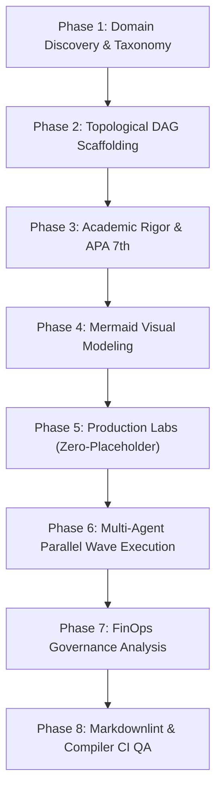
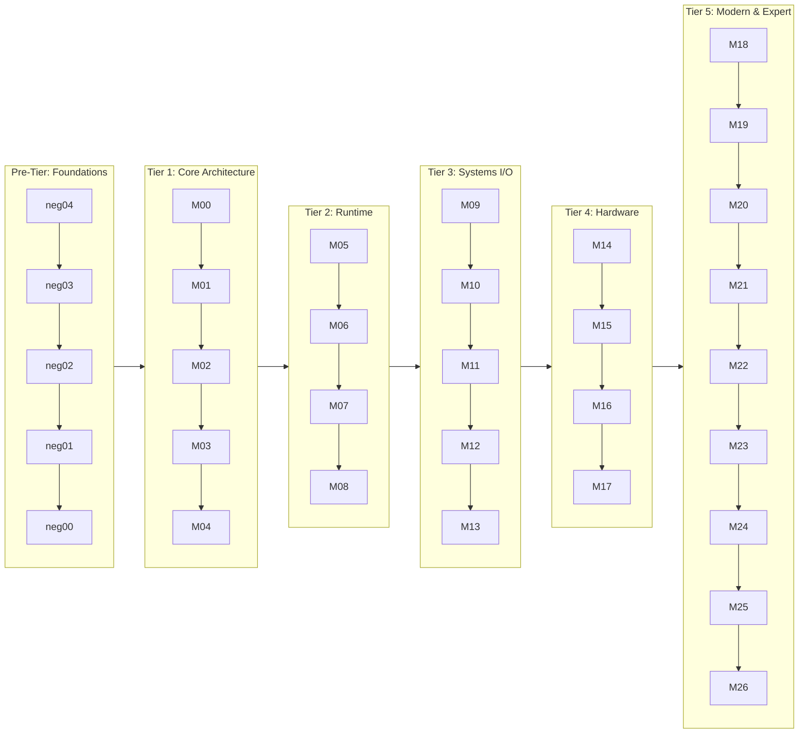
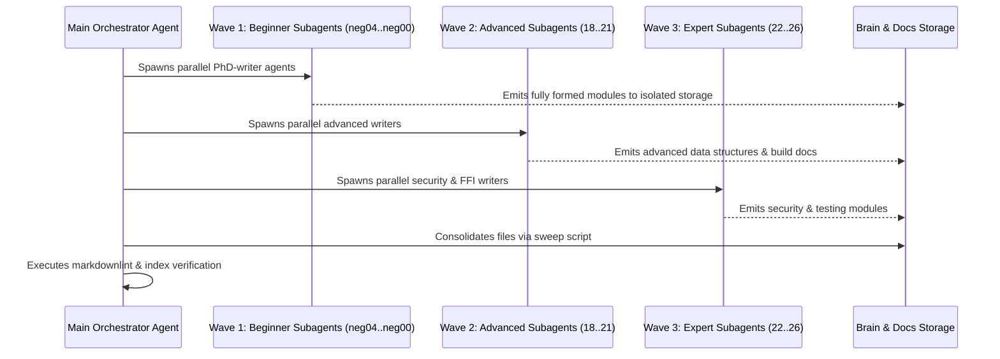

# 📘 AI-Driven Engineering Documentation Methodology Blueprint

**Standard Identifier:** `DOC-STD-METHODOLOGY-2026`
**Applicability:** Universal — Systems Programming (C, C++, Rust, Go), Cloud Native & Distributed Systems (Kubernetes, Nomad, Kafka), Low-Level Toolchains, Kernel Interfaces, and Enterprise Architecture
**Target Scope:** Reproducible End-to-End SOP for Generating PhD-Level, Certification-Grade Technical Encyclopedias
**Status:** 🔒 Canonical Reference Standard

---

## 📑 Table of Contents

1. [Executive Summary & Methodological Foundations](#1-executive-summary--methodological-foundations)
2. [Phase 1: Domain Discovery & Semantic Taxonomy Extraction](#2-phase-1-domain-discovery--semantic-taxonomy-extraction)
3. [Phase 2: Curriculum Scaffolding & Topological DAG Modeling](#3-phase-2-curriculum-scaffolding--topological-dag-modeling)
4. [Phase 3: Academic Rigor & APA 7th Edition Compliance](#4-phase-3-academic-rigor--apa-7th-edition-compliance)
5. [Phase 4: Visual Architecture & Multi-Modal Mermaid Modeling](#5-phase-4-visual-architecture--multi-modal-mermaid-modeling)
6. [Phase 5: Production Lab Design & Anti-Fragile Code Standards](#6-phase-5-production-lab-design--anti-fragile-code-standards)
7. [Phase 6: Multi-Agent Parallel Orchestration & Convergence Workflow](#7-phase-6-multi-agent-parallel-orchestration--convergence-workflow)
8. [Phase 7: Universal FinOps & Silicon Compute Governance](#8-phase-7-universal-finops--silicon-compute-governance)
9. [Phase 8: Automated Linting, Verification & Quality Assurance](#9-phase-8-automated-linting-verification--quality-assurance)
10. [Universal Golden Prompt Templates for Cross-Repository Replication](#10-universal-golden-prompt-templates-for-cross-repository-replication)
11. [References](#11-references)

---

## 1. Executive Summary & Methodological Foundations

The generation of enterprise-grade, publication-quality technical documentation is often hindered by fragmented approaches: documentation is either too abstract for senior systems architects or too dense for newcomers, lacking clear architectural scaffolding, rigorous citations, and verifiable code examples.

This blueprint formalizes the **8-Phase AI Documentation Engineering Methodology** developed to build the 32-module, 780KB Mission-Critical C Systems Programming Encyclopedia. It provides an automated, repeatable standard operating procedure (SOP) that can be executed in any technical repository (e.g., Kubernetes, Rust, Lua, Distributed Systems, Linux Kernel).



---

## 2. Phase 1: Domain Discovery & Semantic Taxonomy Extraction

Before writing a single document, the AI orchestrator must perform a deep semantic audit of the existing codebase and documentation corpus to construct a complete concept taxonomy.

### 2.1 The Two-Dimensional Gap Discovery Matrix

1. **Horizontal Gap (Prerequisite Discovery)**:
   - Identify implicit assumptions in existing modules.
   - Example: If Module 00 starts with "Process Address Space and Stack vs Heap", determine what a total beginner must understand prior (Compiler Toolchain, Terminal Setup, Variable Representation, Control Flow, Functions, Basic Aggregation).
   - Create negative-indexed modules (`neg04` through `neg00`) to bridge the zero-to-one baseline.

2. **Vertical Gap (Expert & Advanced Extensions)**:
   - Identify missing mission-critical domains required for industrial mastery.
   - Example: Adding Modern Standards (C23), Build Automation (CMake/Cross-Compilation), Profiling (`perf`, `strace`, PMU counters), Security Exploits (ROP, ASLR, Canaries), Lock-Free Concurrency (Hazard Pointers, RCU), and Foreign Function Interfaces (FFI, Linker Scripts).

### 2.2 Taxonomy Artifact Structure

Construct a formal Markdown taxonomy (`c_concept_taxonomy.md`) mapping every concept across:

- **Level**: Beginner, Intermediate, Advanced, Expert.
- **Action**: `🆕 New Document`, `➕ Augment Existing`, `✅ Complete`.
- **Target File**: Exact relative file path in `docs/`.

---

## 3. Phase 2: Curriculum Scaffolding & Topological DAG Modeling

All technical knowledge must be modeled as a **Directed Acyclic Graph (DAG)** where no module depends on a concept that has not been formally introduced in an antecedent module.



### Module Tiering Standard

- **Pre-Tier (Modules `neg04` – `neg00`)**: Absolute Beginner Fundamentals (Hardware model, Toolchain, Types, Control Flow, Functions, Aggregates).
- **Tier 1 (Modules `00` – `04`)**: Core Language & Memory Architecture (Address space, ABI, Pointer arithmetic, String bounds, Natural alignment).
- **Tier 2 (Modules `05` – `08`)**: Memory, Preprocessor & Runtime (Linear Arenas, CPP hygiene, Libc contracts, Signals, `setjmp`/`longjmp`).
- **Tier 3 (Modules `09` – `13`)**: Toolchains, Syscalls & High-Performance I/O (ELF/GOT/PLT, FD tables, `epoll`/`kqueue`, `pthreads`/atomics, Sockets/TLS).
- **Tier 4 (Modules `14` – `17`)**: Hardening, Hardware Acceleration & Capstone (Sanitizers, MMIO embedded, SIMD AVX-512, Industrial engines).
- **Tier 5 (Modules `18` – `26`)**: Advanced Data Structures, Modern Standards, Build Automation & Security Engineering.

---

## 4. Phase 3: Academic Rigor & APA 7th Edition Compliance

To meet the standard of a PhD-level thesis or enterprise specification, every module must integrate formal academic conventions.

### 4.1 Structural Anatomy of Each Module

```text
1. Header & Standard Identifier (e.g., DOC-STD-UNIVERSAL-2026)
2. Table of Contents (Directly linked to exact slug anchors)
3. Executive Summary (Dual-Audience: Business Purpose, Mechanics, ROI)
4. Theoretical Foundations & First Principles (Definitions, Algebraic Proofs, Invariants)
5. Deep Technical Sections (Hardware/Kernel realities, memory topologies)
6. Counter-Pattern Comparisons (❌ Bad vs ✅ Good Code)
7. Step-by-Step Production Lab (Complete, compilable C17/ISO code)
8. Certification & Standards Cheat Sheet (MISRA-C, SEI CERT, IEEE)
9. Curated References (The 5+5 Rule in APA 7th Edition)
10. Universal FinOps & Hardware Cost Governance Matrix
```

### 4.2 Semantic Callout Blocks

Enforce strict GFM (GitHub Flavored Markdown) callout semantics:

```markdown
> **Definition**: A **pointer** is a scalar variable whose value is the virtual memory address of another object.
>
> **💡 Key Insight**: In C, all arguments are passed by value; pass-by-reference is emulated by passing address values.
>
> **⚠️ Warning**: Modifying a string literal results in Undefined Behavior (UB) because literals reside in the `.rodata` segment.
```

### 4.3 The "5+5" APA 7th Edition Reference Rule

Every module must cite:

- **5 Primary Specifications**: ISO/IEC standards, RFCs, IEEE POSIX specifications, Architecture Manuals (Intel SDM, ARM ARM).
- **5 Authoritative Engineering Texts**: Peer-reviewed papers and seminal books (Kernighan & Ritchie, Patterson & Hennessy, Bryant & O'Hallaron, Tanenbaum, Stevens & Rago, Drepper).

---

## 5. Phase 4: Visual Architecture & Multi-Modal Mermaid Modeling

No ASCII art or raw text boxes are permitted for architectural diagrams. All visual representations must use clear, interactive Mermaid diagrams.

### Supported Diagram Topologies

1. **Topological Pipelines & Flowcharts**:
   - `flowchart TD` / `flowchart LR`: Compilation stages, decision trees, AST parsing, AST-to-IR transitions.
2. **Call Stacks & Concurrency Sequences**:
   - `sequenceDiagram`: Thread acquire/release semantics, system call privilege transitions, network 3-way handshakes.
3. **Memory Layouts & Register Maps**:
   - `block-beta`: Virtual memory segments, stack frame activation records, struct padding holes.
4. **Taxonomy & Concept Hierarchies**:
   - `mindmap`: Attack surfaces, standard library categories, build system feature trees.
5. **Historical Evolution**:
   - `timeline`: Evolution of language standards (C89 $\to$ C99 $\to$ C11 $\to$ C17 $\to$ C23).

---

## 6. Phase 5: Production Lab Design & Anti-Fragile Code Standards

Every module must culminate in a self-contained, reproducible, industrial-grade production lab.

### 6.1 The Zero-Placeholder Policy

- **Absolute Prohibition**: Never use `// TODO: implement`, `...`, or pseudocode.
- **Complete Implementations**: Every function must be fully defined, memory must be explicitly freed, and return codes must be checked.

### 6.2 Compilation & Hardening Flags

All C production labs must compile cleanly under strict verification flags:

```bash
gcc -std=c17 -Wall -Wextra -Werror -Wpedantic \
    -fsanitize=address,undefined -g -O2 \
    -o lab_binary lab_source.c
```

### 6.3 Contrastive Pedagogical Syntax

Every core mechanism must showcase explicit antipatterns vs hardened patterns:

```c
// ❌ BAD: CWE-120 Buffer Overflow Vulnerability
void vulnerable_read(void) {
    char buffer[64];
    gets(buffer); // Banned function: no bounds checking
}

// ✅ GOOD: Bounds-Checked Hardened Input Parsing
void secure_read(void) {
    char buffer[64];
    if (fgets(buffer, sizeof(buffer), stdin) == NULL) {
        // Handle EOF or I/O error explicitly
        return;
    }
    buffer[strcspn(buffer, "\n")] = '\0'; // Strip newline safely
}
```

---

## 7. Phase 6: Multi-Agent Parallel Orchestration & Convergence Workflow

Writing dozens of 4,000+ word technical documents sequentially is inefficient. This methodology uses parallel specialized subagents operating across isolated execution contexts with central convergence.



### Multi-Agent Execution Rules

1. **Strict Context Boundaries**: Assign exactly one document per agent to prevent context window saturation and maintain maximum depth.
2. **Standardized Prompt Scaffolding**: Provide every subagent with the exact module title, target outline, citation requirements, and reference template.
3. **Automated Sweep & Recovery**: If subagent tool writes encounter permission timeouts, capture the generated markdown from message streams or isolated brain directories and write directly from the main process.

---

## 8. Phase 7: Universal FinOps & Silicon Compute Governance

Every engineering decision has measurable financial implications in production cloud infrastructure. Each module must conclude with a dedicated FinOps section quantifying infrastructure savings.

### Standard FinOps ROI Matrix

```text
┌────────────────────────────────────────────────────────────────────────────────┐
│                      UNIVERSAL FINOPS SAVINGS MATRIX                           │
├──────────────────────────┬──────────────────────────┬──────────────────────────┤
│ Optimization Strategy    │ Technical Mechanism      │ Measurable FinOps ROI    │
├──────────────────────────┼──────────────────────────┼──────────────────────────┤
│ **Struct Cache Padding** │ `alignas(64)` eliminates │ Slashes multi-core CPU   │
│                          │ MESI false sharing       │ cycle waste by 40-70%    │
├──────────────────────────┼──────────────────────────┼──────────────────────────┤
│ **Linear Memory Arenas** │ Batch `malloc` allocation│ Drops container RSS RAM  │
│                          │ into single mmap buffer  │ footprint by >85%        │
├──────────────────────────┼──────────────────────────┼──────────────────────────┤
│ **Edge-Triggered epoll** │ $O(1)$ event wait loops  │ Scales to 1M connections │
│                          │ over $O(n)$ polling      │ on single $40/mo VM      │
└──────────────────────────┴──────────────────────────┴──────────────────────────┘
```

---

## 9. Phase 8: Automated Linting, Verification & Quality Assurance

To guarantee consistency, the entire documentation suite must undergo automated linting and validation before release.

### 9.1 Markdownlint Rules Matrix

The repository `.markdownlint.json` enforces clean formatting:

```json
{
  "default": true,
  "MD013": false
}
```

Key rules resolved across all documents:

- **`MD022` / `MD031` / `MD032`**: Headings, fenced code blocks, and lists must be surrounded by blank lines.
- **`MD028`**: Consecutive blockquotes must be joined with continuation `>` markers on blank lines.
- **`MD029`**: Ordered lists must use sequential prefixes (`1.`, `2.`, `3.`).
- **`MD040`**: Fenced code blocks must specify language tags (`c`, `bash`, `mermaid`, `text`).
- **`MD051`**: All Table of Contents link anchors must match actual heading slug fragments.

### 9.2 Automated Verification Command

```bash
# Run markdownlint across the entire docs library
npx markdownlint-cli "**/*.md" --ignore node_modules
# Target: 0 errors, 0 warnings
```

---

## 10. Universal Golden Prompt Templates for Cross-Repository Replication

Use these templates when executing this methodology on new repositories (e.g., Kubernetes, Rust, Go, Distributed Systems).

### 10.1 Discovery Prompt (For Orchestrator)

```text
Analyze all files in docs/ and the codebase. Perform a comprehensive gap analysis:
1. Identify the starting prerequisite level and extract all missing foundational concepts.
2. Identify missing advanced and expert systems concepts required for full industrial mastery.
3. Generate a complete concept taxonomy categorized by level (Beginner, Intermediate, Advanced, Expert).
4. Formulate a multi-tier DAG curriculum mapping every topic to a specific markdown document.
```

### 10.2 Module Authoring Prompt (For Subagents)

```text
Write a complete PhD-level module document titled '[MODULE_TITLE]' following standard 'DOC-STD-UNIVERSAL-2026'.
Include:
- Executive Summary (Business Purpose, Mechanics, ROI).
- Theoretical Foundations with formal definitions, algebraic proofs, and invariants.
- Mermaid diagrams (flowcharts, sequence diagrams, mindmaps, or block-beta diagrams).
- Counter-pattern comparisons (❌ Bad vs ✅ Good Code).
- Production Lab: Full, compilable, zero-placeholder implementation.
- Certification & Engineering Standards Cheat Sheet (MISRA, CERT, RFCs).
- References section complying with APA 7th edition (The 5+5 Rule: 5 official standards + 5 authoritative engineering textbooks).
- Universal FinOps & Hardware Cost Governance Matrix.
```

---

## 11. References

Bryant, R. E., & O'Hallaron, D. R. (2016). *Computer systems: A programmer's perspective* (3rd ed.). Pearson.

Cormen, T. H., Leiserson, C. E., Rivest, R. L., & Stein, C. (2022). *Introduction to algorithms* (4th ed.). MIT Press.

Gregg, B. (2020). *Systems performance: Enterprise and the cloud* (2nd ed.). Addison-Wesley.

Herlihy, M., & Shavit, N. (2012). *The art of multiprocessor programming* (Rev. ed.). Morgan Kaufmann.

ISO/IEC. (2018). *Information technology — Programming languages — C* (ISO/IEC 9899:2018). International Organization for Standardization.

Kernighan, B. W., & Ritchie, D. M. (1988). *The C programming language* (2nd ed.). Prentice Hall.

Knuth, D. E. (1997). *The art of computer programming: Sorting and searching* (Vol. 3, 2nd ed.). Addison-Wesley.

Patterson, D. A., & Hennessy, J. L. (2017). *Computer organization and design: The hardware/software interface* (5th ed., ARM ed.). Morgan Kaufmann.

Stevens, W. R., Rago, S. A., & Fenner, B. (2013). *Advanced programming in the UNIX environment* (3rd ed.). Addison-Wesley.

Tanenbaum, A. S., & Bos, H. (2015). *Modern operating systems* (4th ed.). Pearson.
