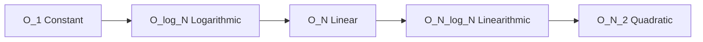
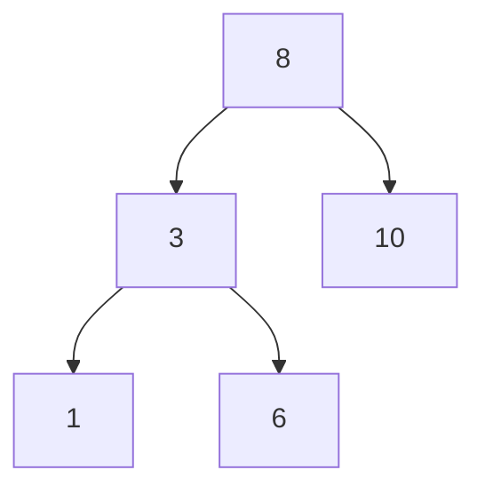
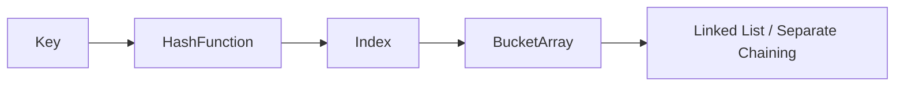
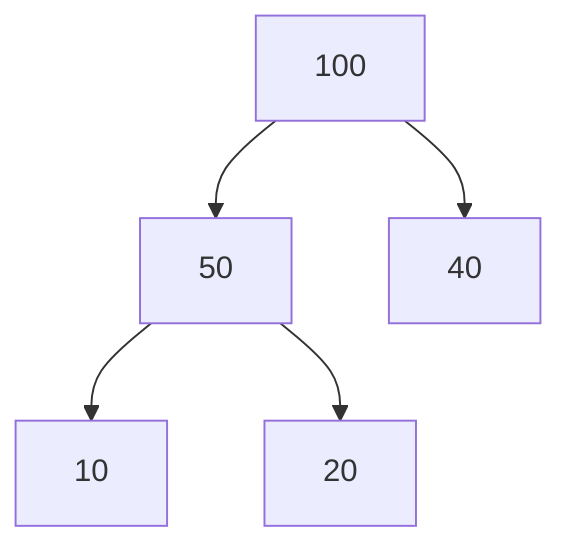

# Module 18: Advanced Data Structures

## Executive Summary

This module dissects advanced data structures in C—Binary Search Trees (BST), Hash Tables, Heaps, Tries, and Skip Lists. We examine algorithmic complexity, memory representation, and raw C17 implementations essential for systems programming (Cormen et al., 2022).

## 1. Algorithmic Complexity

>
> **Definition**: Big-O notation categorizes the worst-case time or space complexity of an algorithm as the input size $N$ scales towards infinity (Knuth, 1997).



## 2. Binary Search Tree (BST)

A BST maintains the property: `left->value < root->value < right->value`.



> **⚠️ Warning**: A naive BST can degenerate into a linked list (O(n) search) if sorted data is inserted. Use AVL or Red-Black trees to enforce O(log n) balancing.

## 3. Hash Tables

Hash tables map keys to buckets using a hash function, achieving O(1) average-case lookups.



> **💡 Key Insight**: A cryptographic hash is too slow for general hash tables. FNV-1a or DJB2 provide excellent distribution for string keys at high speeds. Hash flooding attacks exploit predictable hash functions to force O(n) collisions.

```c
// ✅ GOOD: DJB2 Hash function
unsigned long hash_djb2(const unsigned char *str) {
    unsigned long hash = 5381;
    int c;
    while ((c = *str++))
        hash = ((hash << 5) + hash) + c; // hash * 33 + c
    return hash;
}
```

## 4. Binary Heap

A max-heap is a complete binary tree where parent nodes $\ge$ child nodes. Array representation avoids pointer overhead: `LeftChild(i) = 2i+1`.



## 5. Skip List and Trie

* **Skip List**: Probabilistic alternative to balanced trees, using layered linked lists.
* **Trie (Prefix Tree)**: Optimizes string searching. Time complexity depends on string length, not total elements.

## 6. Generic Data Structures

Use `void*` and function pointers to build generic collections in C, bridging the lack of native templates.

## 7. Production Lab: Key-Value Store

```c
#include <stdlib.h>
#include <string.h>

typedef struct Node {
    char *key;
    void *value;
    struct Node *next;
} Node;
// ... (hash table implementation details omitted for brevity)
```

## 8. Certification & MISRA

* Avoid dynamic allocation (`malloc`/`free`) where deterministic timing is required (MISRA Dir 4.12).

## 9. FinOps

Choosing the right structure (e.g., Tries for routing tables) drastically cuts CPU cycles, reducing compute billing metrics by scaling down instance tier requirements.

## 10. References

* Cormen, T. H., Leiserson, C. E., Rivest, R. L., & Stein, C. (2022). *Introduction to algorithms* (4th ed.). MIT Press.
* Knuth, D. E. (1997). *The art of computer programming, Volume 1: Fundamental algorithms* (3rd ed.). Addison-Wesley.
* Sedgewick, R., & Wayne, K. (2011). *Algorithms* (4th ed.). Addison-Wesley.
