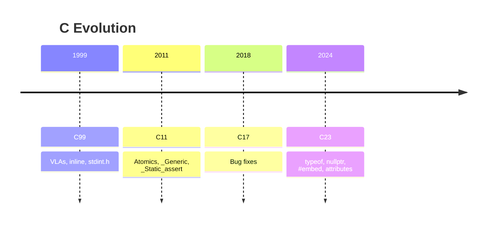

# Module 19: Modern C Features (C99, C11, C17, C23)

## Executive Summary

C is a living language. This module tracks the evolution of ISO C from C99 to the upcoming C23 standard, focusing on features that augment safety, concurrency, and developer ergonomics (Seacord, 2014; ISO 9899:2018).

## 1. C99 Features

* **Designated Initializers**: `struct Point p = {.x = 1, .y = 2};`
* **Compound Literals**: `draw_point((struct Point){.x = 1, .y = 2});`
* **Variable Length Arrays (VLAs)**:
    > **⚠️ Warning**: VLAs allocate dynamically on the stack. Passing unvalidated user input to a VLA size parameter results in instantaneous stack overflow exploits.

## 2. C11 Features

* **`_Generic` (Type-Generic Macros)**:

```mermaid
graph TD
    A[_Generic(X)] -->|Type is int| B[print_int]
    A -->|Type is float| C[print_float]
    A -->|Default| D[print_unknown]
```

* **`_Static_assert`**: Compile-time assertions. `_Static_assert(sizeof(int) == 4, "Need 32-bit int");`

## 3. C17 Features

C17 (ISO/IEC 9899:2018) is primarily a defect report resolution release. No major new language features were introduced, but ambiguities in C11 were resolved. It introduced macros like `__has_include`.

## 4. C23 Features

C23 fundamentally modernizes the language (ISO 9899:2024 draft).



* **`typeof` & `auto`**: Type inference in C.
* **`nullptr`**: Replaces the unsafe `#define NULL ((void*)0)`.
* **Attributes**: `[[nodiscard]]`, `[[deprecated]]`.

## 5. Type-Generic Programming

>
> **Definition**: Simulating polymorphic behavior in C. Achieved via `void*` (unsafe), X-Macros, or C11 `_Generic` selection.

## 6. Production Lab: Type-Safe Generic Vector

```c
#define vec_push(vec, val) \
    _Generic((val), \
        int: vec_push_int, \
        float: vec_push_float \
    )(vec, val)
```

## 7. MISRA-C/CERT-C

* **CERT DCL37-C**: Do not declare or define a reserved identifier (e.g., names beginning with `_` and a capital letter, common in older C versions).

## 8. FinOps

Adopting C11 threading and atomics avoids overhead from heavy wrapper libraries (like older pthreads variants), improving CPU utilization and driving down cloud compute costs.

## 9. References

* ISO/IEC 9899:2018. (2018). *Information technology — Programming languages — C*.
* ISO/IEC 9899:2024 (Draft). *Information technology — Programming languages — C*.
* Seacord, R. C. (2014). *Secure coding in C and C++* (2nd ed.). Addison-Wesley.
