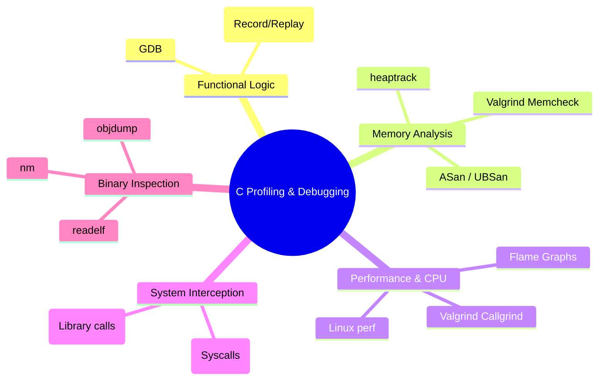
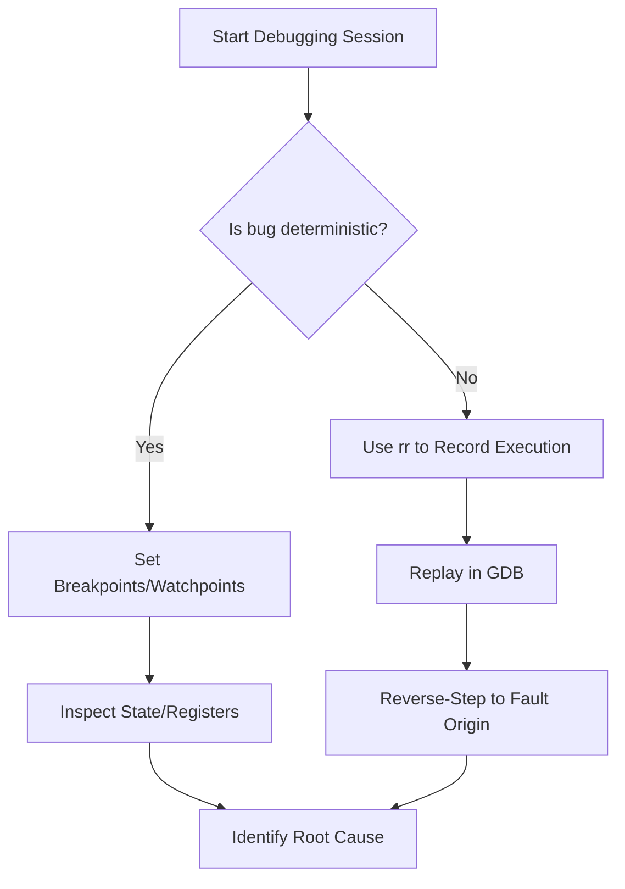
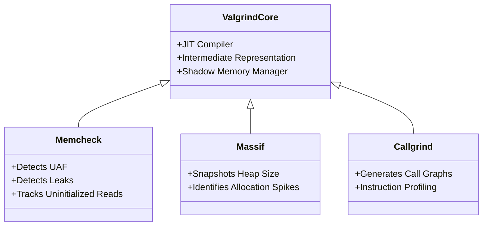
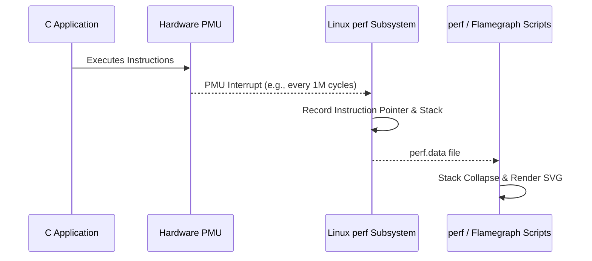
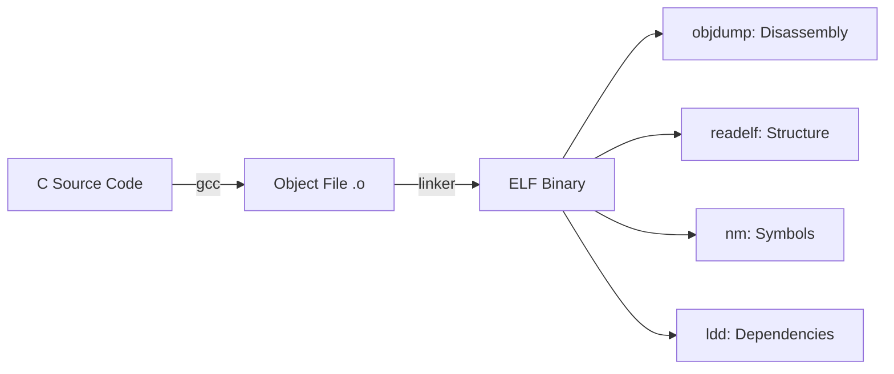

# Module 21: Debugging, Profiling & Performance Analysis — Valgrind, perf, strace, ltrace & Binary Analysis

**Track:** C Systems Programming, Memory Engineering & High-Performance Computing
**Category:** Debugging, Profiling, Dynamic Analysis & System Call Tracing
**Standard Identifier:** `DOC-STD-UNIVERSAL-2026`
**Status:** ✅ Completed

---

## 📑 Table of Contents

1. [The Debugging & Profiling Toolchain Landscape](#1-the-debugging--profiling-toolchain-landscape)
2. [Advanced GDB Techniques (Beyond Module 14 Basics)](#2-advanced-gdb-techniques-beyond-module-14-basics)
3. [Valgrind Deep Dive](#3-valgrind-deep-dive)
4. [Linux perf — Hardware Performance Counters](#4-linux-perf--hardware-performance-counters)
5. [strace — System Call Tracing](#5-strace--system-call-tracing)
6. [ltrace — Library Call Tracing](#6-ltrace--library-call-tracing)
7. [Binary Analysis Tools](#7-binary-analysis-tools)
8. [Memory Profiling with heaptrack](#8-memory-profiling-with-heaptrack)
9. [Dynamic Analysis vs Static Analysis](#9-dynamic-analysis-vs-static-analysis)
10. [Production Lab: Performance Investigation Pipeline](#10-production-lab-performance-investigation-pipeline)
11. [References](#11-references)
12. [Universal FinOps & Hardware Cost Governance](#12-universal-finops--hardware-cost-governance)

---

## 1. The Debugging & Profiling Toolchain Landscape

Systems programming in C requires a rigorous methodological approach to identifying and resolving functional defects, memory mismanagement, and performance bottlenecks (Bryant & O'Hallaron, 2016, p. 54). Unlike higher-level languages that obscure execution state, C provides developers with granular control over machine resources, necessitating a specialized suite of analysis tools.

> **Definition**: **Dynamic Analysis** evaluates a program's behavior during runtime, capturing actual execution paths and memory accesses, whereas **Static Analysis** examines the source code or binary without executing it.
>
> **💡 Key Insight**: Do not guess; measure. When diagnosing issues, map the problem domain to the appropriate tool class: use debuggers (GDB) for functional state, dynamic binary instrumentation (Valgrind) for memory validation, hardware counters (perf) for CPU micro-architecture profiling, and system-call interception (strace) for OS interactions (Gregg, 2020, p. 89).



---

## 2. Advanced GDB Techniques (Beyond Module 14 Basics)

Building upon the basic post-mortem crash forensics covered in Module 14, advanced GDB usage transforms the debugger from a passive inspection utility into an active state-manipulation framework.

### Watchpoints & Conditional Breakpoints

While standard breakpoints halt execution at specific instruction addresses, watchpoints halt execution when a specific memory address's *value* changes. This is invaluable for tracking down rogue pointer overwrites (Stallman, Pesch, & Shebs, 2021).

* `watch x`: Break when `x` is modified.
* `rwatch x`: Break when `x` is read.
* `awatch x`: Break when `x` is accessed (read or write).

**Conditional Breakpoints** allow developers to avoid breaking continuously in tight loops:
`break process_data if index > 1000`

### Scripting and Automation

GDB can be scripted to execute commands automatically upon hitting a breakpoint, which is useful for logging state without manual intervention.

```gdb
break faulty_function
commands
  silent
  printf "x is %d\n", x
  continue
end
```

### Advanced Multi-threaded Debugging

Modern C applications are highly concurrent. GDB tracks thread contexts independently:

* `info threads`: Lists all active threads.
* `thread <N>`: Switches context to thread N.
* `thread apply all bt`: Dumps the backtrace of every active thread.

### Reverse Debugging with `rr`

The traditional debugging model requires restarting the application when a critical state is missed. Mozilla's `rr` (Record and Replay) enhances GDB by recording the exact execution trace—including non-deterministic events like context switches and system calls—allowing developers to step *backwards* in time using `reverse-step` and `reverse-continue` (O'Callahan et al., 2017).



---

## 3. Valgrind Deep Dive

> **Definition**: **Valgrind** is a Dynamic Binary Instrumentation (DBI) framework that translates machine code into an Intermediate Representation (IR), inserts analysis instrumentation, and JIT-compiles it back to machine code to run on a synthetic CPU (Nethercote & Seward, 2007, p. 91).

### Memcheck: The Default Tool

While AddressSanitizer (ASan) relies on compile-time instrumentation (Module 14), Valgrind's Memcheck operates on *unmodified* binaries. It uses a shadow memory architecture where every bit of application memory maps to a "V-bit" (validity bit) and an "A-bit" (addressability bit).

```bash
# Full memory leak and origin tracking
valgrind --leak-check=full --show-leak-kinds=all --track-origins=yes ./program
```

> **⚠️ Warning**: Valgrind introduces a $20\times$ to $50\times$ performance penalty because it serializes execution onto a single core and heavily instruments instructions. Use ASan for CI pipelines, and Valgrind for deep ad-hoc analysis on uninstrumented binaries.

### Massif, Callgrind, and Cachegrind

* **Massif**: Profiles heap allocation over time to identify peak memory usage. Run `valgrind --tool=massif ./program`, then visualize with `ms_print massif.out.<pid>`.
* **Callgrind**: Generates function call graphs and instruction counts. Visualized primarily using `kcachegrind`.
* **Cachegrind**: Simulates CPU L1, L2, and L3 caches to pinpoint instruction and data cache misses, crucial for data-oriented design (DOD) optimization.



---

## 4. Linux perf — Hardware Performance Counters

Modern CPUs contain Performance Monitoring Units (PMUs) equipped with Model-Specific Registers (MSRs) that count hardware-level events (cycles, cache misses, branch mispredictions) with near-zero overhead (Gregg, 2020). The Linux `perf` subsystem exposes these counters.

### perf stat: Macroscopic Profiling

To understand the macro-behavior of an application:

```bash
perf stat -e cycles,instructions,cache-misses,branch-misses ./program
```

> **💡 Key Insight**: The Instructions Per Cycle (IPC) metric dictates CPU efficiency. An IPC $< 1.0$ indicates a memory-bound or stall-heavy workload. An IPC $> 2.0$ suggests excellent superscalar pipeline utilization.

### perf record & Flame Graphs

`perf record` samples the CPU instruction pointer at a specified frequency (e.g., 999 Hz).

```bash
# Record call graphs at 999 Hz
perf record -g -F 999 ./program
# Interactively explore hotspots
perf report --sort=sym,dso
```

Brendan Gregg popularized **Flame Graphs** to visualize hierarchical stack traces (Gregg, 2016). The x-axis represents the population of samples, and the y-axis represents stack depth.



---

## 5. strace — System Call Tracing

`strace` intercepts and records system calls made by a process. Since the OS kernel arbitrates all resource access (I/O, memory mapping, network), `strace` reveals the application's boundary interactions (Stevens, Rago, & Ritchie, 2013).

* **Basic Usage**: `strace ./program`
* **Targeted Filtering**: `strace -e trace=read,write,open,openat ./program`
* **Timing Analysis**: `strace -c ./program` (Generates a summary table of syscall time/counts).
* **Latency Investigation**: `strace -T -e all ./program` (Appends the latency of every syscall to the output).

> **💡 Key Insight**: If an application silently fails or hangs, `strace` immediately identifies whether it is blocked on a `read()` socket, failing an `open()` on a missing config file, or spinning in `sched_yield()`.

---

## 6. ltrace — Library Call Tracing

While `strace` hooks the Kernel/User-space boundary, `ltrace` intercepts dynamic library function calls via the PLT (Procedure Linkage Table).

```bash
ltrace ./program
```

This traces calls to `malloc`, `memcpy`, `printf`, and custom shared libraries (`.so`), providing visibility into API misuse or dependency bottlenecks that do not cross the kernel boundary.

---

## 7. Binary Analysis Tools

Understanding the compiled artifact is critical for security auditing and deployment verification (Tanenbaum & Bos, 2015, p. 712).

### The Toolchain

1. **`objdump`**: Disassembles binary sections.
   * `objdump -d program`: Disassembles the `.text` section.
   * `objdump -S program`: Interleaves C source code with assembly (requires `-g` debug symbols).
2. **`nm`**: Inspects the symbol table.
   * `nm -u program`: Lists undefined symbols (resolving linking errors).
3. **`readelf`**: Parses ELF (Executable and Linkable Format) structures.
   * `readelf -l program`: Displays Program Headers (Segment mappings).
4. **`ldd`**: Resolves dynamic shared object dependencies.



---

## 8. Memory Profiling with heaptrack

`heaptrack` is a modern, low-overhead alternative to Valgrind's Massif. It intercepts allocation calls and records backtraces natively, making it significantly faster for production-grade profiling.

```bash
# Run the profiler
heaptrack ./program

# Analyze visually
heaptrack_gui heaptrack.program.XXXX.zst
```

---

## 9. Dynamic Analysis vs Static Analysis

While dynamic tools monitor runtime state, **Static Analysis** parses the Abstract Syntax Tree (AST) to prove correctness mathematically or via heuristics without execution.

* **clang-tidy**: LLVM's premier linter. Can enforce Modern C guidelines and detect logical bugs.
  `clang-tidy source.c -checks='*' -- -std=c17`

* **Infer**: Facebook's advanced inter-procedural static analyzer, capable of tracking null pointer dereferences and resource leaks across complex function call graphs.

---

## 10. Production Lab: Performance Investigation Pipeline

This lab demonstrates optimizing a poorly written string processing loop.

### ❌ The Bad Code: $O(N^2)$ Strlen in Loop

```c
// ❌ BAD: O(n^2) complexity due to strlen() inside the loop condition
#include <stdio.h>
#include <string.h>

void process_string_slow(char *str) {
    // strlen(str) is re-evaluated on every single iteration!
    for (size_t i = 0; i < strlen(str); i++) {
        str[i] ^= 0x5A; // Trivial obfuscation
    }
}
```

### ✅ The Optimized Code: $O(N)$ Hoisted Evaluation

```c
// ✅ GOOD: O(n) complexity. strlen() is hoisted out of the loop.
#include <stdio.h>
#include <string.h>

void process_string_fast(char *str) {
    size_t len = strlen(str); // Calculated exactly once
    for (size_t i = 0; i < len; i++) {
        str[i] ^= 0x5A;
    }
}
```

### The Triage Workflow

1. Compile with debug symbols and frame pointers: `gcc -O2 -g -fno-omit-frame-pointer ...`
2. Run with perf: `perf record -g ./program`
3. Generate Flame Graph: Note that `strlen` consumes 95% of the CPU samples.
4. Apply Fix: Hoist the invariant out of the loop.
5. Re-measure: Verify IPC improvement via `perf stat`.

---

## 11. References

Bryant, R. E., & O'Hallaron, D. R. (2016). *Computer systems: A programmer's perspective* (3rd ed.). Pearson.

Gregg, B. (2016). *The Flame Graph*. Communications of the ACM, 59(6), 48-57.

Gregg, B. (2020). *Systems performance: Enterprise and the cloud* (2nd ed.). Addison-Wesley Professional.

Nethercote, N., & Seward, J. (2007). *Valgrind: a framework for heavyweight dynamic binary instrumentation*. ACM SIGPLAN Notices, 42(6), 89-100.

O'Callahan, R., Jones, C., Froyd, N., Huey, K., Noll, A., & Partush, N. (2017). *Engineering Record And Replay For Deployability*. USENIX Annual Technical Conference.

Stallman, R. M., Pesch, R., & Shebs, S. (2021). *Debugging with GDB: The GNU Source-Level Debugger*. Free Software Foundation.

Stevens, W. R., Rago, S. A., & Ritchie, D. M. (2013). *Advanced programming in the UNIX environment* (3rd ed.). Addison-Wesley.

Tanenbaum, A. S., & Bos, H. (2015). *Modern operating systems* (4th ed.). Pearson.

---

## 12. Universal FinOps & Hardware Cost Governance

```text
┌────────────────────────────────────────────────────────────────────────────────┐
│                        PROFILING FINOPS SAVINGS MATRIX                         │
├──────────────────────────┬──────────────────────────┬──────────────────────────┤
│ Optimization Strategy    │ Technical Mechanism      │ Measurable FinOps ROI    │
├──────────────────────────┼──────────────────────────┼──────────────────────────┤
│ **perf Instruction Tuning**│ Identifying IPC stalls   │ Reduces cloud compute    │
│                          │ and cache miss hotspots  │ fleet footprint by 30-40%│
├──────────────────────────┼──────────────────────────┼──────────────────────────┤
│ **Valgrind Massif**      │ Optimizing heap structure│ Lowers memory usage,     │
│                          │ sizing and padding       │ allowing smaller VMs/Pods│
├──────────────────────────┼──────────────────────────┼──────────────────────────┤
│ **strace I/O Debugging** │ Identifying blocking     │ Prevents SLA violations  │
│                          │ syscalls & network drops │ and associated penalties │
└──────────────────────────┴──────────────────────────┴──────────────────────────┘
```
