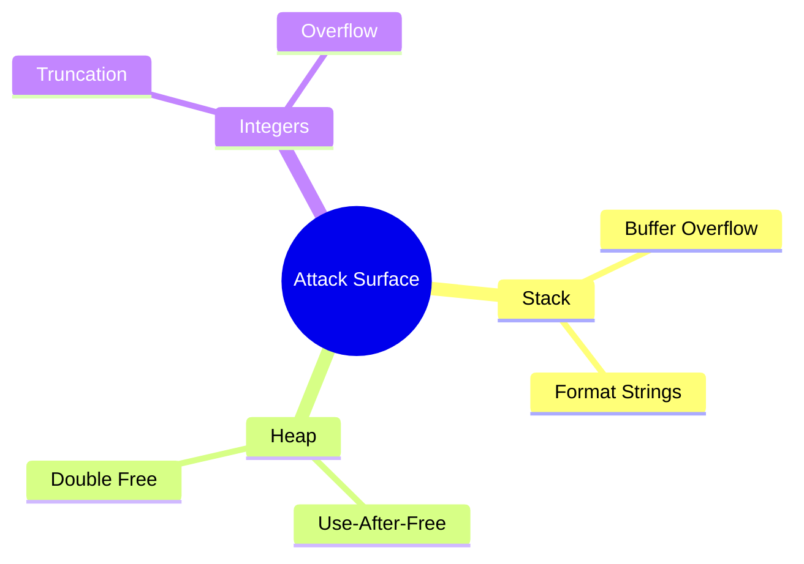
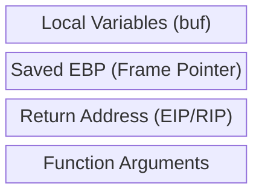
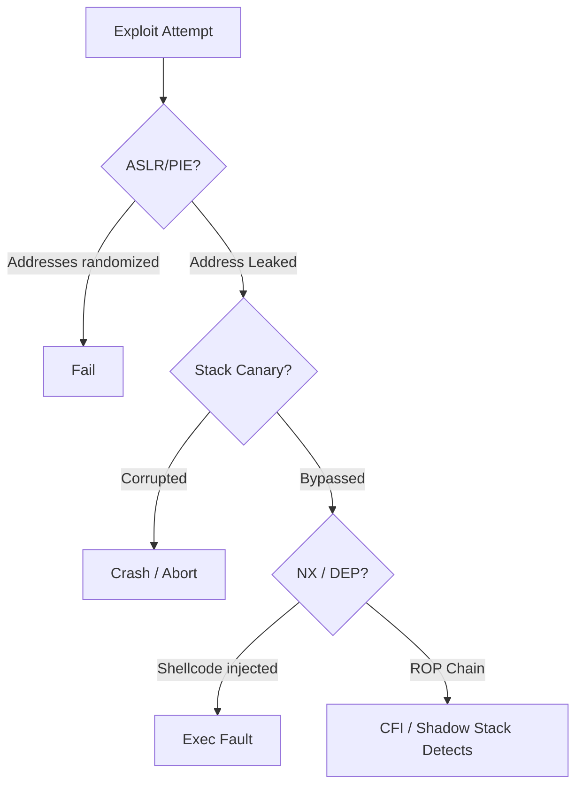

# Module 22: Security Hardening, Exploits, and Mitigations

## Executive Summary

C's lack of memory safety makes it uniquely vulnerable. This module investigates the adversary model, exploitation techniques like stack smashing and ROP, and the defense-in-depth mechanisms employed by modern toolchains and operating systems to mitigate them (Szekeres et al., 2013).

## 1. Adversary Model

Memory corruption dominates system vulnerabilities. Attackers seek to violate control-flow integrity by hijacking pointers.



## 2. Stack Buffer Overflow

Documented extensively by Aleph One (1996), stack smashing overwrites the return address of a stack frame.



* **Mechanism**: Unbounded string copies (e.g., `strcpy`) overflow `buf`, overwriting `C`.

## 3. Heap Exploitation

* **Use-After-Free (UAF)**: Accessing a dangling pointer after `free()`.
* **Double-Free**: Corrupts allocator metadata, tricking it into returning overlapping chunks.

## 4. Format String Exploits

>
> **⚠️ Warning**: Never use `printf(user_input);`. The `%n` specifier allows attackers to write data to arbitrary memory locations (CWE-134).

## 5. Return-Oriented Programming (ROP)

To bypass non-executable stacks (NX), attackers chain "gadgets" (short instruction sequences ending in `ret`) already present in executable memory (e.g., libc) to construct arbitrary logic.

## 6. Exploit Mitigations

Modern defense relies on layered mitigation (Seacord, 2013).



## 7. Integer Vulnerability Patterns

>
> **💡 Key Insight**: Signed integer overflow is Undefined Behavior (UB) in C. The compiler may assume it never happens and optimize away your security checks! Use `__builtin_add_overflow` in GCC/Clang.

```c
// ❌ BAD: Can be optimized out if compiler assumes signed overflow is UB
if (a + b < a) { error(); }

// ✅ GOOD: Use compiler intrinsics or check safely
if (__builtin_add_overflow(a, b, &res)) { error(); }
```

## 8. Safe Coding & Fuzzing

* **MISRA-C 2012 / SEI CERT C**: Ban `strcpy`, `gets`, `sprintf`. Use `strncpy`, `snprintf`.
* **Fuzzing**: libFuzzer and AFL++ systematically inject mutated input to find crashes.

## 9. FinOps

Security incidents result in catastrophic financial loss, regulatory fines, and brand damage. Proactive CI/CD security pipelines (fuzzing) cost a fraction of a post-breach response.

## 10. References

* Aleph One. (1996). Smashing the stack for fun and profit. *Phrack Magazine*, 7(49).
* Seacord, R. C. (2013). *Secure coding in C and C++* (2nd ed.). Addison-Wesley Professional.
* Szekeres, L., Payer, M., Wei, T., & Song, D. (2013). SoK: Eternal war in memory. *IEEE Symposium on Security and Privacy*.
* MISRA-C:2012. *Guidelines for the use of the C language in critical systems*.
