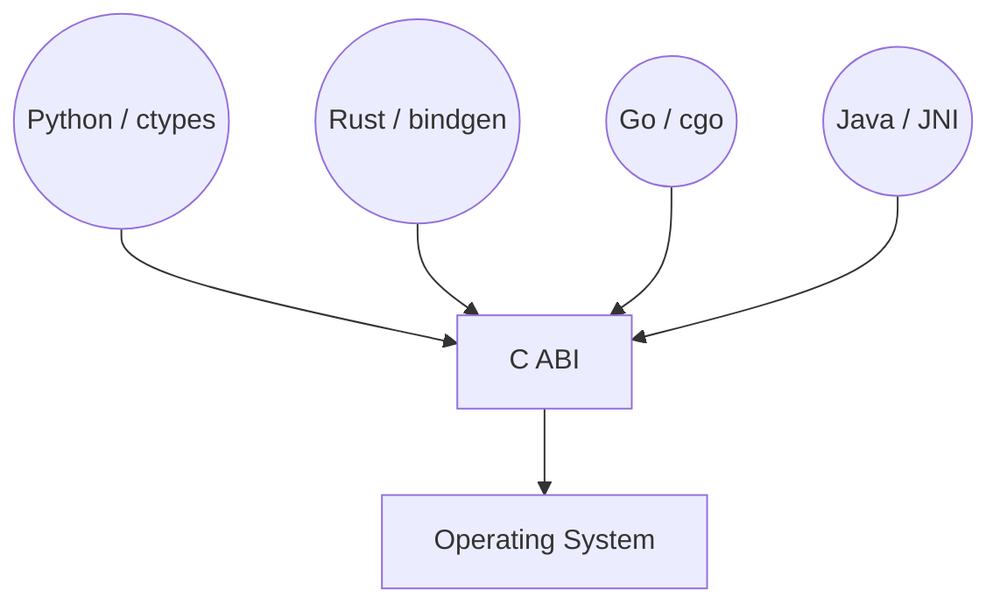
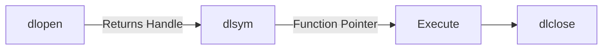
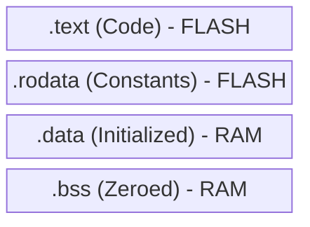

# Module 24: Interoperability, FFI, and Dynamic Loading

## Executive Summary

C serves as the universal *lingua franca* of systems programming. This module explores the Application Binary Interface (ABI), Dynamic Loading (`dlopen`), Linker Scripts, and Foreign Function Interfaces (FFI) to interface C with Python, Rust, Go, and Java (Drepper, 2011).

## 1. The Interoperability Problem



> **Definition**: The ABI defines how data structures and functions are represented at the machine level (calling conventions, register usage, struct packing).

## 2. ABI and Symbol Mangling

Unlike C++, C does not mangle function names. To expose C++ functions to C, use the `extern "C"` pattern to suppress C++ name mangling, allowing dynamic loaders to resolve the raw symbol names.

## 3. Dynamic Loading: dlopen

The POSIX standard defines APIs for runtime library loading (POSIX, 2017).



> **💡 Key Insight**: `RTLD_LAZY` resolves symbols as they are called, speeding up load time but risking crashes later if symbols are missing. `RTLD_NOW` resolves all symbols immediately.

## 4. LD_PRELOAD Interposition

`LD_PRELOAD` intercepts shared library calls before the standard C library (libc) is queried. Use `dlsym(RTLD_NEXT, "malloc")` to write custom memory trackers.

## 5. Linker Scripts

Linker scripts control memory layout (crucial in embedded C).



They define the Entry Point (`ENTRY`) and regions (`MEMORY { FLASH (rx) : ORIGIN = 0x08000000, LENGTH = 256K }`).

## 6. Shared Library Versioning

SONAME (`libfoo.so.1`) enables multiple ABIs to coexist, preventing dependency hell. Version scripts restrict exported symbols.

## 7. FFI: Python, Rust, Go, Java

* **Python**: `ctypes.CDLL()` loads the shared object; `argtypes` maps C types.
* **Rust**: `#[no_mangle]` exposes Rust functions. `bindgen` generates Rust FFI bindings from C headers.
* **Go**: `import "C"` bridges the runtimes; strings require `C.CString` (and manual freeing).
* **Java**: JNI relies on strict naming conventions (`Java_com_example_MyClass_myMethod`).

## 8. Production Lab: dlopen Plugin

```c
#include <dlfcn.h>
#include <stdio.h>

int main() {
    // ✅ GOOD: Proper dynamic loading with error checking
    void *handle = dlopen("./libplugin.so", RTLD_NOW);
    if (!handle) {
        fprintf(stderr, "%s\n", dlerror());
        return 1;
    }
    // Cast to function pointer
    void (*run)(void) = dlsym(handle, "run_plugin");
    if (run) run();
    dlclose(handle);
    return 0;
}
```

## 9. FinOps

Dynamic loading enables modular cloud monoliths. Loading code only when triggered reduces startup times in FaaS (Function-as-a-Service) environments, avoiding cold-start latency billing penalties.

## 10. References

* Drepper, U. (2011). *How to write shared libraries*.
* IEEE Std 1003.1-2017. (2017). *POSIX.1-2017*. Open Group.
