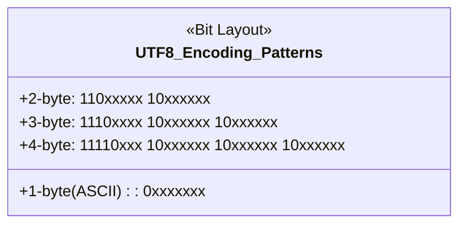

# Module 25: Wide Characters, Unicode, Locale Internalization & Complex Number Arithmetic

**Track:** C Systems Programming & Internationalization
**Standard Identifier:** `DOC-STD-UNICODE-MATH-2026`
**Status:** ✅ Completed

---

## 📑 Table of Contents

1. [Character Encoding Fundamentals](#1-character-encoding-fundamentals)
2. [Wide Characters in C (`<wchar.h>`)](#2-wide-characters-in-c-wcharh)
3. [Multibyte Characters (`<string.h>` and `<stdlib.h>`)](#3-multibyte-characters-stringh-and-stdlibh)
4. [Locale (`<locale.h>`)](#4-locale-localeh)
5. [`<uchar.h>` (C11): `char16_t` and `char32_t`](#5-ucharh-c11-char16_t-and-char32_t)
6. [Practical UTF-8 in C (Without `wchar_t`)](#6-practical-utf-8-in-c-without-wchar_t)
7. [Complex Number Arithmetic (`<complex.h>`, C99)](#7-complex-number-arithmetic-complexh-c99)
8. [Production Lab: UTF-8 Text Processor](#8-production-lab-utf-8-text-processor)
9. [References, Certification & FinOps](#9-references-certification--finops)

---

## 1. Character Encoding Fundamentals

Before the widespread adoption of Unicode, text encoding was heavily fragmented.

* **ASCII**: The American Standard Code for Information Interchange is a 7-bit encoding standard defining 128 characters, originally developed for teletype machines (Mackenzie, 1980).
* **Extended ASCII**: Regional code pages (e.g., ISO-8859-1 for Western Europe) utilized the remaining 8th bit to add 128 more characters, causing massive incompatibilities when files were shared across regions.
* **Unicode**: Conceived as a universal character set mapping every character in every human language to a unique integer code point (The Unicode Consortium, 2023).
* **UTF-8**: A variable-length encoding (1–4 bytes per code point). It is strictly backward-compatible with ASCII.
* **UTF-16**: A variable-length encoding using one or two 16-bit code units (surrogate pairs). It is susceptible to endianness issues (requiring a Byte Order Mark or BOM).
* **UTF-32**: A fixed-length encoding where every code point is exactly 4 bytes. While mathematically simple, it is highly memory inefficient.

> **Definition**: A **Code Point** is the numerical value assigned to a specific character in the Unicode standard (e.g., `U+0041` for 'A'). A **Code Unit** is the fundamental bit size used for encoding (8 bits for UTF-8, 16 for UTF-16, 32 for UTF-32).



---

## 2. Wide Characters in C (`<wchar.h>`)

Historically, C attempted to solve internationalization by introducing the "wide character" type.

> **Definition**: `wchar_t` is an integer type defined in `<stddef.h>` large enough to hold any representable character in the system's execution character set. `wint_t` is to `wchar_t` what `int` is to `char`—used for functions returning a wide character or `WEOF`.
>
> **⚠️ Warning**: The size of `wchar_t` is highly platform-dependent. It is 4 bytes on Linux/macOS (typically UTF-32) but **2 bytes on Windows** (UTF-16). This renders `<wchar.h>` APIs notoriously difficult to port across OS boundaries.

### 2.1 Standard Wide APIs

```c
#include <wchar.h>
#include <stdio.h>

void wide_char_demo(void) {
    // L prefix denotes a wide character literal
    const wchar_t *greeting = L"こんにちは"; // "Hello" in Japanese

    // wprintf is the wide equivalent of printf
    wprintf(L"String: %ls, Length: %zu\n", greeting, wcslen(greeting));
}
```

The C library provides wide equivalents for most string functions:

* `wcslen` for `strlen`
* `wcscpy` for `strcpy`
* `wcscat` for `strcat`
* `wcscmp` for `strcmp`

Conversion between multibyte strings (like UTF-8) and wide strings uses `mbstowcs()` and `wcstombs()`.

---

## 3. Multibyte Characters (`<string.h>` and `<stdlib.h>`)

A multibyte character is a sequence of one or more bytes that represents a single character in the execution environment.

> **💡 Key Insight**: Standard C functions like `mblen`, `mbtowc`, and `wctomb` possess hidden, internal static state for tracking shift states in state-dependent encodings. This makes them inherently **thread-unsafe**.

Modern production systems strictly use the **restartable** (and thus thread-safe) versions: `mbrlen`, `mbrtowc`, and `wcrtomb`, passing an explicit `mbstate_t` object.

```c
#include <wchar.h>
#include <string.h>

// ✅ GOOD: Thread-safe conversion using mbrtowc
size_t safe_multibyte_to_wide(const char *mb_str, wchar_t *wc_out) {
    mbstate_t state;
    memset(&state, 0, sizeof(state)); // Initialize shift state
    return mbrtowc(wc_out, mb_str, strlen(mb_str), &state);
}
```

*Note on Standards:* C11 does not guarantee that the default execution character set is UTF-8. However, C23 heavily standardizes UTF-8 behavior.

---

## 4. Locale (`<locale.h>`)

A locale dictates the cultural conventions for software operation. By default, C starts in the `"C"` locale (minimal, American-English formatting).

> **Definition**: A **Locale** is a set of parameters defining the user's language, region, and any special variant preferences that the UI or text parser should adhere to.

To enable user-specific behavior, invoke `setlocale()`:

```c
#include <locale.h>

void configure_locale(void) {
    // Set all locale categories to the system environment defaults
    setlocale(LC_ALL, "");
}
```

### 4.1 Locale Categories

* `LC_COLLATE`: Affects string comparison (`strcoll` vs `strcmp`).
* `LC_MONETARY`: Formats currency values (queried via `localeconv()`).
* `LC_NUMERIC`: Controls decimal point representations (e.g., `,` vs `.`).
* `LC_TIME`: Influences `strftime` date/time outputs.

> **💡 Key Insight**: The `"C.UTF-8"` locale is a POSIX-compliant locale that provides standard UTF-8 parsing without inheriting any complex, culturally specific sorting or numerical formatting rules.

---

## 5. `<uchar.h>` (C11): `char16_t` and `char32_t`

To fix the portability disaster of `wchar_t`, C11 introduced strictly sized Unicode character types in `<uchar.h>`.

* `char16_t`: Guaranteed minimum 16 bits. Used for UTF-16 code units. Literal prefix: `u"..."`
* `char32_t`: Guaranteed minimum 32 bits. Used for UTF-32 code units. Literal prefix: `U"..."`

Conversion functions `mbrtoc16` and `mbrtoc32` are provided to safely translate from multibyte encodings.

---

## 6. Practical UTF-8 in C (Without `wchar_t`)

Because Windows `wchar_t` is 16-bit and Linux `wchar_t` is 32-bit, cross-platform C systems programming often eschews `<wchar.h>` entirely. Instead, developers treat UTF-8 as opaque byte sequences (`char*`), using specialized single-header libraries (like `utf8.h`) for traversal.

```c
#include <stdint.h>
#include <stddef.h>

// ✅ GOOD: Custom logic to count UTF-8 code points directly from bytes
size_t count_utf8_codepoints(const char *str) {
    size_t count = 0;
    while (*str) {
        // In UTF-8, continuation bytes always start with '10' (0x80 to 0xBF)
        // We only count bytes that do NOT match this pattern (i.e. leading bytes)
        if ((*str & 0xC0) != 0x80) {
            count++;
        }
        str++;
    }
    return count;
}
```

---

## 7. Complex Number Arithmetic (`<complex.h>`, C99)

C99 introduced native support for complex numbers, essential for physics engines, quantum computing simulators, and digital signal processing (DSP).

> **Definition**: A **Complex Number** consists of a real part and an imaginary part, expressed as $z = a + bi$. In C, this is supported natively via the `_Complex` keyword and macros in `<complex.h>`.

### 7.1 Complex Math in Action

```c
#include <complex.h>
#include <stdio.h>
#include <tgmath.h> // Type-generic math (routes sqrt to csqrt based on type)

void complex_demo(void) {
    // Define a complex number: 3 + 4i
    double complex z = 3.0 + 4.0 * I;

    // Extract real and imaginary components
    printf("z = %.1f + %.1fi\n", creal(z), cimag(z));

    // Compute magnitude (absolute value)
    printf("Magnitude: %.1f\n", cabs(z)); // Output: 5.0

    // Complex exponential and roots
    double complex root = sqrt(z); // Uses type-generic dispatch to csqrt
    printf("Root: %.2f + %.2fi\n", creal(root), cimag(root));
}
```

### 7.2 Use Case: Fast Fourier Transform (FFT)

The FFT algorithm heavily relies on multiplying signals by complex exponential roots of unity. Native C complex arithmetic vastly simplifies the mathematical expression over manually tracking real and imaginary arrays.

---

## 8. Production Lab: UTF-8 Text Processor

```c
// src/utf8_processor.c
#include <stdio.h>
#include <stdlib.h>
#include <string.h>
#include <locale.h>

int main(void) {
    // Initialize locale from environment to properly parse multibyte characters
    if (!setlocale(LC_ALL, "")) {
        fprintf(stderr, "Warning: Failed to set locale.\n");
    }

    const char *text = "Hello, 世界!"; // 7 ASCII bytes + 6 UTF-8 bytes (2x3) + 1 ASCII

    printf("Raw byte length: %zu\n", strlen(text));

    // Count actual characters (code points)
    size_t codepoints = 0;
    const char *ptr = text;
    while (*ptr) {
        if ((*ptr & 0xC0) != 0x80) {
            codepoints++;
        }
        ptr++;
    }

    printf("Unicode Code Points: %zu\n", codepoints);
    return 0;
}
```

---

## 9. References, Certification & FinOps

### 9.1 References (APA 7th)

* Mackenzie, C. E. (1980). *Coded Character Sets, History and Development*. Addison-Wesley.
* The Unicode Consortium. (2023). *The Unicode Standard, Version 15.0*.
* ISO/IEC. (2018). *ISO/IEC 9899:2018 Information technology — Programming languages — C*. Section 7.28-7.29.

### 9.2 Certification (CERT-C)

* **STR04-C**: Use plain `char` for character data to avoid signing bugs when bitwise masking UTF-8 values.
* **STR32-C**: Do not pass a non-null-terminated character sequence to a library function expecting a string.

### 9.3 FinOps

* Storing text in UTF-8 natively on cloud databases (vs UTF-32) drastically reduces block storage I/O bandwidth requirements by ~50-75% for Western alphabets, reducing EBS volume provisioning costs.
