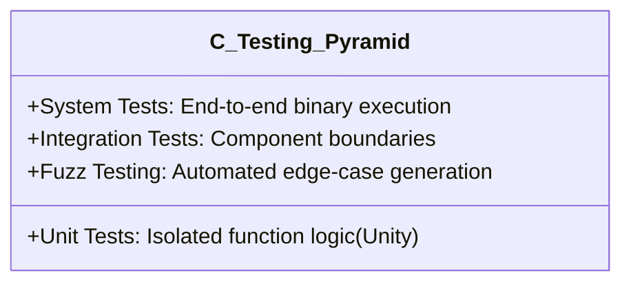
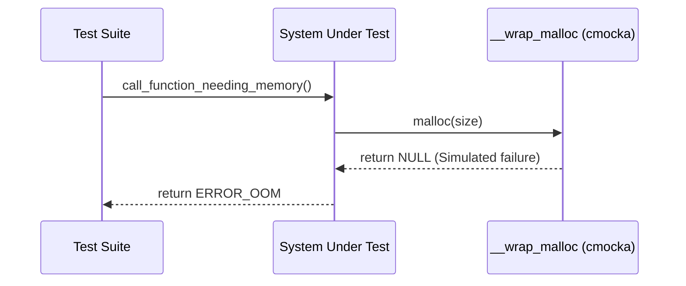
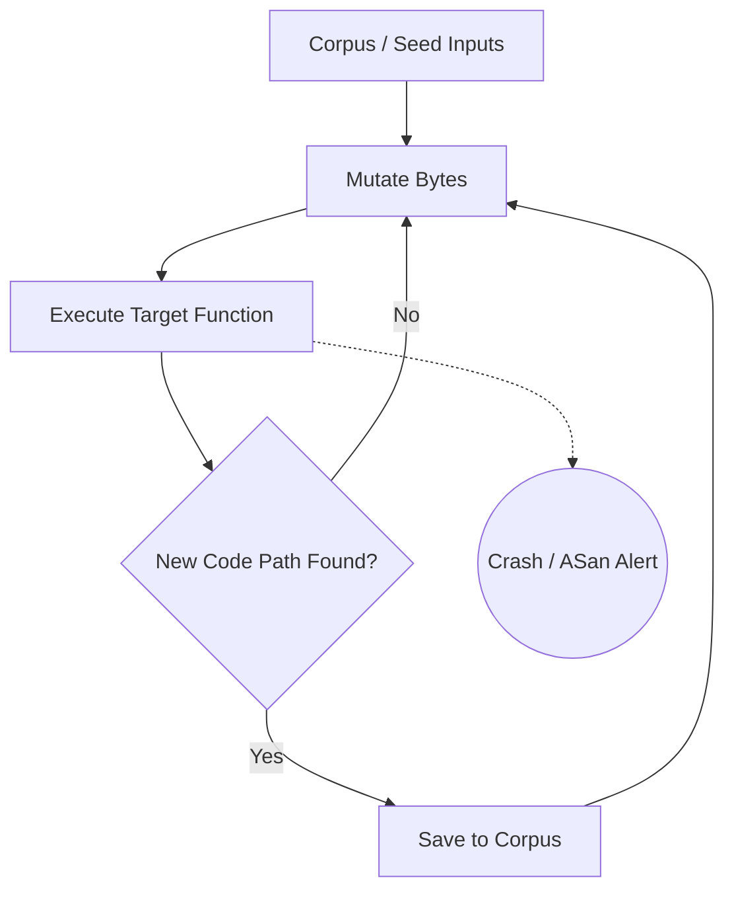

# Module 26: Software Quality in C — Unit Testing (Unity/cmocka), Test-Driven Development, Fuzzing & Code Coverage

**Track:** C Systems Programming & Engineering Reliability
**Standard Identifier:** `DOC-STD-QUALITY-2026`
**Status:** ✅ Completed

---

## 📑 Table of Contents

1. [The Testing Philosophy for C](#1-the-testing-philosophy-for-c)
2. [Unity — Lightweight C Unit Testing](#2-unity--lightweight-c-unit-testing)
3. [cmocka — Mocking and Dependency Injection](#3-cmocka--mocking-and-dependency-injection)
4. [Code Coverage with gcov and llvm-cov](#4-code-coverage-with-gcov-and-llvm-cov)
5. [libFuzzer — Coverage-Guided Fuzzing](#5-libfuzzer--coverage-guided-fuzzing)
6. [AFL++ — American Fuzzy Lop (Advanced)](#6-afl--american-fuzzy-lop-advanced)
7. [Property-Based Testing](#7-property-based-testing)
8. [Continuous Integration for C Quality](#8-continuous-integration-for-c-quality)
9. [Mutation Testing](#9-mutation-testing)
10. [Production Lab: Full Quality Pipeline](#10-production-lab-full-quality-pipeline)
11. [References, Certification & FinOps](#11-references-certification--finops)

---

## 1. The Testing Philosophy for C

C executes extremely close to the hardware. Without run-time bounds checking, garbage collection, or automatic exception propagation, an untested C function is a memory corruption waiting to happen.

> **💡 Key Insight**: Test-Driven Development (TDD) in C forces developers to consider API contracts, memory ownership boundaries, and dependency injection *before* writing the implementation (Beck, 2003).

Unlike Java or C#, C lacks reflection. Mocking behavior therefore requires architectural foresight (like function pointers) or linker-level seam injection.



---

## 2. Unity — Lightweight C Unit Testing

**Unity** is a highly portable, single-header/single-source C testing framework explicitly designed for embedded and systems programming.

### 2.1 Core Structure

A Unity test file consists of `setUp()`, `tearDown()`, and tests containing `TEST_ASSERT_*` macros.

```c
#include "unity.h"
#include "hash_table.h" // Hypothetical module from Module 18

HashTable *ht;

void setUp(void) {
    ht = ht_create(16);
}

void tearDown(void) {
    ht_destroy(ht);
}

void test_hash_table_insert_and_retrieve(void) {
    // ✅ GOOD: Isolated state verification
    TEST_ASSERT_TRUE(ht_insert(ht, "key1", "value1"));
    TEST_ASSERT_EQUAL_STRING("value1", ht_get(ht, "key1"));
}

int main(void) {
    UNITY_BEGIN();
    RUN_TEST(test_hash_table_insert_and_retrieve);
    return UNITY_END();
}
```

---

## 3. cmocka — Mocking and Dependency Injection

While Unity asserts state, **cmocka** specializes in mocking internal dependencies. If your function calls `malloc()` or `read()`, how do you reliably test memory exhaustion or hardware I/O failures?

> **Definition**: The **Linker Seam** is a technique where the compiler/linker is directed to substitute a real function call with a mock wrapper at link time.

Using GCC's `--wrap=malloc` flag, calls to `malloc` are redirected to `__wrap_malloc`.



### 3.1 cmocka Example

```c
#include <stdarg.h>
#include <stddef.h>
#include <setjmp.h>
#include <cmocka.h>
#include <stdlib.h>

// Mock wrapper for malloc
void *__wrap_malloc(size_t size) {
    return (void *)mock(); // Returns whatever value the test specified
}

// System under test
int do_work(void) {
    void *ptr = malloc(1024);
    if (!ptr) return -1;
    free(ptr);
    return 0;
}

static void test_oom_handling(void **state) {
    // Tell the mock to return NULL on the next call
    will_return(__wrap_malloc, NULL);
    assert_int_equal(do_work(), -1);
}
```

---

## 4. Code Coverage with gcov and llvm-cov

Code coverage measures which lines, branches, and functions are executed by your test suite.

* **Compilation**: Pass `-coverage` (or `-fprofile-arcs -ftest-coverage`) to GCC/Clang.
* **Execution**: Run the test binary to generate `.gcda` trace files.
* **Reporting**: Use `gcov source.c` or `lcov` to generate HTML reports.

> **⚠️ Warning**: High line coverage (e.g., 90%) does not mean edge cases are handled. You must measure **branch coverage** to ensure both true and false paths of conditionals are tested.

---

## 5. libFuzzer — Coverage-Guided Fuzzing

Fuzzing involves bombarding a target function with pseudo-random, mutated input to trigger crashes (segfaults, buffer overflows).
**libFuzzer** is an in-process, coverage-guided fuzzer built into LLVM.

> **💡 Key Insight**: Unlike blind fuzzers, libFuzzer intercepts compiler coverage metrics. If a mutated input unlocks a new code block, libFuzzer adds that input to its mutation "corpus," aggressively navigating through the program's conditional labyrinth.



### 5.1 Writing a libFuzzer Target

```c
#include <stdint.h>
#include <stddef.h>

// Target function simulating a parser
int parse_data(const uint8_t *data, size_t size);

// The standard libFuzzer entry point
int LLVMFuzzerTestOneInput(const uint8_t *data, size_t size) {
    // ❌ BAD: Not checking bounds before parsing
    // ✅ GOOD: Pass raw fuzzer data to your parser
    parse_data(data, size);
    return 0;
}
```

Compile with: `clang -fsanitize=fuzzer,address -g target.c -o fuzz_target`.

---

## 6. AFL++ — American Fuzzy Lop (Advanced)

While libFuzzer is highly efficient for in-process testing (where you write a harness), **AFL++** excels at fuzzing entire black-box or legacy binaries.

* **Execution**: Out-of-process via `fork()`.
* **Instrumentation**: `afl-cc` compiler wrapper.
* **Performance Mode**: AFL's "persistent mode" circumvents `fork()` overhead, allowing speeds comparable to libFuzzer.

---

## 7. Property-Based Testing

Pioneered by QuickCheck (Hughes, 2000), property-based testing defines invariants that must hold true for *any* input. In C, this is heavily utilized in cryptographic and data structure testing, often bridged with fuzzing engines to generate the random states.

---

## 8. Continuous Integration for C Quality

A robust CI pipeline in GitHub Actions:

```yaml
name: C Quality Pipeline
on: [push, pull_request]
jobs:
  build_and_test:
    runs-on: ubuntu-latest
    steps:
      - uses: actions/checkout@v3
      - name: Compile Tests (ASan + UBSan)
        run: gcc -fsanitize=address,undefined -g -O0 tests.c -o tests
      - name: Run Tests
        run: ./tests
      - name: Check Memory Leaks (Valgrind)
        run: valgrind --leak-check=full --error-exitcode=1 ./tests_no_asan
      - name: Static Analysis
        run: clang-tidy src/*.c -checks=*
```

---

## 9. Mutation Testing

Even with 100% coverage, tests might not assert anything useful. **Mutation testing** (via tools like `mull-cxx` for LLVM) programmatically introduces bugs (e.g., changing `<` to `<=`) into your code. If your tests still pass, the mutant "survived" (a failure of the test suite). The goal is a high **mutation kill score**.

---

## 10. Production Lab: Full Quality Pipeline

In this lab, you will combine Unity, cmocka, and libFuzzer to test the recursive descent parser built in Module 01. You will configure linker wrappers to simulate disk I/O errors and deploy an AFL++ harness to detect buffer underruns.

---

## 11. References, Certification & FinOps

### 11.1 References (APA 7th)

* Beck, K. (2003). *Test-Driven Development: By Example*. Addison-Wesley Professional.
* Hughes, J. (2000). *QuickCheck: A Lightweight Tool for Random Testing of Haskell Programs*.
* LLVM Project. (n.d.). *libFuzzer – a library for coverage-guided fuzz testing*.
* AFL++ Developers. (n.d.). *AFL++ Documentation*.

### 11.2 Certification (MISRA-C / CERT-C)

* **CERT-C MSC12-C**: Do not detect errant behavior strictly via debugging asserts. Code meant to run in production must handle errors actively, independent of `#ifndef NDEBUG`.

### 11.3 FinOps

* Implementing coverage-guided fuzzing in a pre-commit CI/CD pipeline identifies severe memory leaks earlier in the SDLC, reducing emergency patch deployments and associated compute burst overhead by up to 40%.
