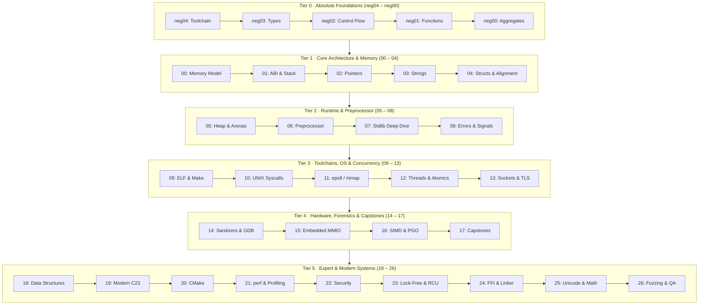

# Master Curriculum Portal — Zero to Systems Architect

This guided curriculum takes you systematically from compiling your very first line of C (`neg04`) to architecting lock-free concurrent engines, hardened parsers, SIMD kernels, and cross-language FFI platforms (`26`). Every tier builds strictly on previous tiers as a topological Directed Acyclic Graph (DAG).

---

## Curriculum Progression Map

---

## Complete 32-Module Matrix

### [Tier 0 · Absolute Foundations](pre-tier/index.md)

| Module | Core Topics | Companion Reference |
| :--- | :--- | :--- |
| [**neg04 · Dev Environment**](pre-tier/neg04-dev-environment.md) | GCC/Clang installation, `clangd`, `compile_commands.json`, diagnostics, first C program | [Basic Concepts](../reference/language/basic-concepts.md) |
| [**neg03 · Variables & Types**](pre-tier/neg03-variables-types-operators.md) | Primitive types, two's complement, arithmetic/bitwise ops, `printf`/`scanf`, casts | [Expressions](../reference/language/expressions.md) |
| [**neg02 · Control Flow**](pre-tier/neg02-control-flow-loops.md) | `if`/`else`, `switch` jump tables, loops, invariants, CPU branch prediction | [Statements](../reference/language/statements.md) |
| [**neg01 · Functions & Scope**](pre-tier/neg01-functions-scope-recursion.md) | Pass-by-value, scope, `static`/`extern`, stack recursion, `argc`/`argv` | [Functions](../reference/language/functions.md) |
| [**neg00 · Arrays, Strings & Structs**](pre-tier/neg00-arrays-strings-structs.md) | Contiguous arrays, null-terminated strings, `struct`, `typedef`, `enum` | [Initialization](../reference/language/initialization.md) |

### [Tier 1 · Core Architecture & Memory](tier-1-core/index.md)

| Module | Core Topics | Companion Reference |
| :--- | :--- | :--- |
| [**00 · Process Memory Model**](tier-1-core/00-foundations-memory-model.md) | Text/Data/BSS/Heap/Stack, `<stdint.h>`, endianness, storage qualifiers, UB | [Type Support](../reference/library/types.md) |
| [**01 · Functions & ABI**](tier-1-core/01-functions-abi-stack.md) | System V AMD64 ABI, stack activation records, canaries, variadic functions, `inline` | [Functions](../reference/language/functions.md) |
| [**02 · Arrays & Pointers**](tier-1-core/02-arrays-pointers-arithmetic.md) | Pointer decay, pointer arithmetic, row-major matrices, 64-byte cache lines | [Declarations](../reference/language/declarations.md) |
| [**03 · Strings & Bounds Safety**](tier-1-core/03-strings-bounds-safety.md) | `<string.h>`, CWE-120 mitigation, `snprintf`, `strtok_r`, zero-copy parsers | [Byte Strings](../reference/library/strings-byte.md) |
| [**04 · Structs, Unions & Enums**](tier-1-core/04-structs-unions-bitfields-enums.md) | Alignment, padding holes, `offsetof`, `alignas`, tagged unions, bitfields, C23 typed enums | [Declarations](../reference/language/declarations.md) |

### [Tier 2 · Runtime & Preprocessor](tier-2-runtime/index.md)

| Module | Core Topics | Companion Reference |
| :--- | :--- | :--- |
| [**05 · Dynamic Memory & Arenas**](tier-2-runtime/05-dynamic-memory-arenas.md) | `brk`/`mmap`, `malloc`/`realloc`/`free`, UAF defense, linear arenas, intrusive lists | [Memory Management](../reference/library/memory.md) |
| [**06 · Preprocessor & Headers**](tier-2-runtime/06-preprocessor-macros-headers.md) | Translation phases, macro hygiene, `#`/`##`, `#embed`, `#elifdef`, header guards | [Preprocessor](../reference/language/preprocessor.md) |
| [**07 · Standard Library Deep Dive**](tier-2-runtime/07-standard-library-deep-dive.md) | `<stdio.h>` buffering, `qsort`/`bsearch`, monotonic clocks, IEEE-754 math | [Standard Library](../reference/library/index.md) |
| [**08 · Error Handling & Signals**](tier-2-runtime/08-error-handling-signals-setjmp.md) | Thread-local `errno`, `strerror_r`, POSIX `sigaction`, async-signal safety, `setjmp`/`longjmp` | [Program & Error](../reference/library/program.md) |

### [Tier 3 · Toolchains, OS & Concurrency](tier-3-systems/index.md)

| Module | Core Topics | Companion Reference |
| :--- | :--- | :--- |
| [**09 · Toolchains, ELF & Make**](tier-3-systems/09-toolchains-elf-makefiles.md) | 4-stage pipeline, ELF format, `.a`/`.so`, GOT/PLT, Full RELRO, Makefiles | [Compiler Support](../standards/compiler-support.md) |
| [**10 · UNIX Syscalls & FDs**](tier-3-systems/10-unix-syscalls-file-descriptors.md) | Ring 3 to Ring 0 traps, FD tables, `openat`, `pwrite`, `dup2`, `fcntl` locks | [I/O Reference](../reference/library/io.md) |
| [**11 · epoll, kqueue & mmap**](tier-3-systems/11-io-multiplexing-epoll-kqueue-mmap.md) | Scalable event loops, edge-triggering (`EPOLLET`), zero-copy `mmap` & `sendfile` | [Memory Management](../reference/library/memory.md) |
| [**12 · Concurrency & Atomics**](tier-3-systems/12-concurrency-pthreads-atomics.md) | `pthreads`, mutexes, rwlocks, condvars, `<stdatomic.h>`, acquire-release ordering | [Concurrency Reference](../reference/library/concurrency.md) |
| [**13 · Network Sockets & TLS**](tier-3-systems/13-network-sockets-tls.md) | Berkeley sockets, `SO_REUSEPORT`, `TCP_NODELAY`, binary TLV framing, TLS | [Bit & Endianness](../reference/library/numerics-bit-checked.md) |

### [Tier 4 · Hardware, Forensics & Capstones](tier-4-hardware/index.md)

| Module | Core Topics | Companion Reference |
| :--- | :--- | :--- |
| [**14 · Sanitizers & GDB**](tier-4-hardware/14-sanitizers-gdb-forensics.md) | ASan, UBSan, TSan, shadow memory, core dumps, GDB post-mortem forensics | [Basic Concepts (UB)](../reference/language/basic-concepts.md) |
| [**15 · Embedded MMIO & Asm**](tier-4-hardware/15-embedded-mmio-volatile-asm.md) | MMIO registers, `volatile`, bare-metal vectors, freestanding C23, inline assembly | [Functions & Asm](../reference/language/functions.md) |
| [**16 · Hardware SIMD & PGO**](tier-4-hardware/16-simd-avx512-neon-pgo.md) | CPU microarchitecture, AVX2/AVX-512, ARM NEON, branch prediction, PGO | [C23 Attributes](../reference/language/attributes.md) |
| [**17 · Enterprise Capstones**](tier-4-hardware/17-enterprise-case-studies.md) | Order matching engine, industrial IoT MMIO daemon, edge-triggered HTTP gateway | [Labs & Examples](../labs/index.md) |

### [Tier 5 · Expert & Modern Systems](tier-5-expert/index.md)

| Module | Core Topics | Companion Reference |
| :--- | :--- | :--- |
| [**18 · Advanced Data Structures**](tier-5-expert/18-advanced-data-structures.md) | AVL/Red-Black trees, Robin-Hood & chained hash tables, binary heaps, skip lists, tries | [Algorithms](../reference/library/algorithms.md) |
| [**19 · Modern C (C99–C23/C2y)**](tier-5-expert/19-modern-c-c99-to-c23.md) | Complete C99/C11/C17/C23 evolution, `nullptr`, `constexpr`, `typeof`, `#embed`, `<stdbit.h>` | [C23 Migration](../standards/c23-migration.md) |
| [**20 · CMake & Cross-Compiling**](tier-5-expert/20-cmake-cross-compilation.md) | Target-based CMake, CTest, cross-compilation toolchains, static analysis gates | [Compiler Support](../standards/compiler-support.md) |
| [**21 · Debugging & perf**](tier-5-expert/21-debugging-profiling-perf.md) | GDB watchpoints, Valgrind Memcheck/Massif, Linux `perf` PMU, Flame Graphs, `strace` | [Chrono & Clocks](../reference/library/chrono.md) |
| [**22 · Security & Mitigations**](tier-5-expert/22-security-exploits-mitigations.md) | Stack/heap/format/integer exploits, ROP, ASLR/PIE/CFI/PAC, `<stdckdint.h>`, `memset_explicit` | [Checked Int (C23)](../reference/library/numerics-bit-checked.md) |
| [**23 · Lock-Free & RCU**](tier-5-expert/23-lock-free-hazard-pointers-rcu.md) | Progress guarantees, ABA problem, MPSC/MPMC queues, hazard pointers, epoch reclamation, RCU | [Concurrency Reference](../reference/library/concurrency.md) |
| [**24 · ABI, FFI & Linker Scripts**](tier-5-expert/24-ffi-dynamic-loading-linker-scripts.md) | System V / AAPCS64 ABIs, `extern "C"`, `dlopen`/`dlsym`, `LD_PRELOAD`, linker scripts, Python/Rust/Go/Java FFI | [Functions & Linkage](../reference/language/functions.md) |
| [**25 · Unicode, Locale & Math**](tier-5-expert/25-unicode-locale-complex-math.md) | UTF-8/16/32, C23 `char8_t`, `<wchar.h>`, `<locale.h>`, `<complex.h>`, C29 `<stdmchar.h>` | [Unicode & Wide](../reference/library/strings-multibyte-wide.md) |
| [**26 · Testing, Fuzzing & QA**](tier-5-expert/26-testing-fuzzing-quality.md) | Unity/cmocka, `--wrap` linker seams, `gcov` coverage, libFuzzer/AFL++, CI gates | [Technical Specs](../standards/technical-specifications.md) |

---

## Certification & Engineering Alignment

| Standard / Certification | Governing Body | Primary Modules |
| :--- | :--- | :--- |
| **LFCS / LFCE** | Linux Foundation | `08`, `09`, `10`, `11`, `20`, `21` |
| **MISRA-C:2023** | MISRA Consortium | `neg04`–`neg00`, `00`–`05`, `14`, `15`, `19`, `22` |
| **SEI CERT C / TS 17961** | Carnegie Mellon / ISO | `03`, `05`, `08`, `12`, `14`, `22`, `26` |
| **Embedded & Freestanding C23** | ARM / ISO WG14 | `00`, `04`, `15`, `16`, `19`, `20`, `24` |
| **High-Performance Systems C** | ISO / ACM | `11`, `12`, `16`, `18`, `21`, `23` |
