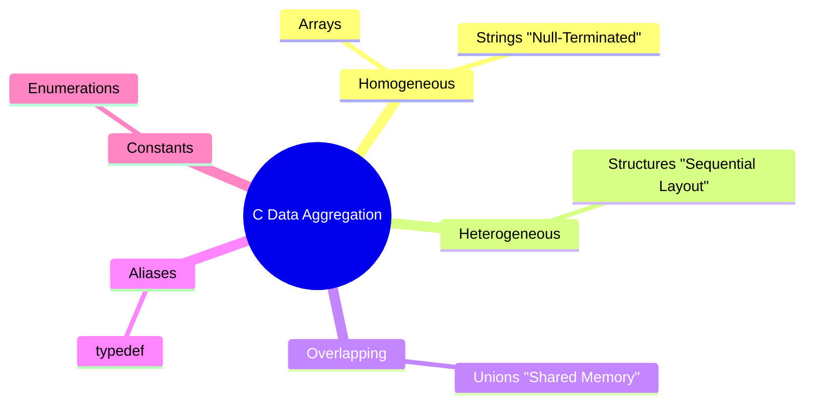
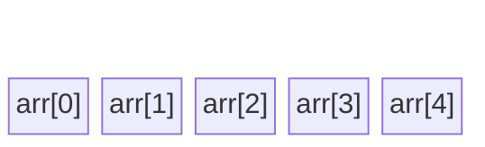
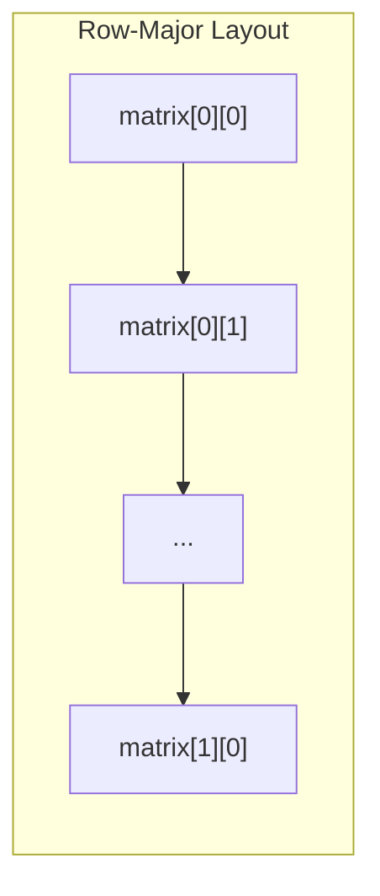
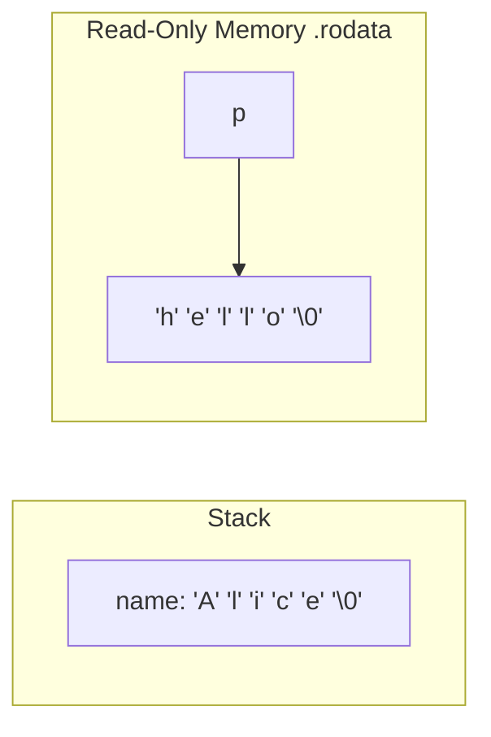
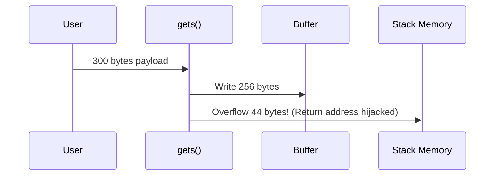
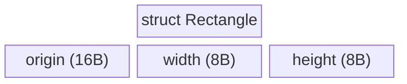
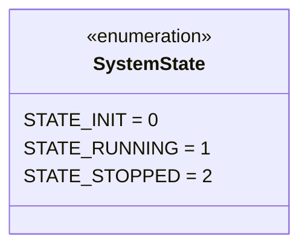

# Module neg00: Arrays, Strings, Structures, Enumerations & typedef — Foundational Data Aggregation

!!! info "C23 Reference Companion"
    Pair this deep-dive curriculum module with the live **ISO C23 (`en.cppreference.com/c`) Reference**:

    - [Initialization & C23 Empty {}](../../reference/language/initialization.md)
    - [Byte Strings Reference](../../reference/library/strings-byte.md)

**Track:** C Systems Programming, Memory Engineering & High-Performance Computing

**Category:** Core Data Aggregation, Contiguous Memory Layouts, String Fundamentals

**Standard Identifier:** `DOC-STD-UNIVERSAL-2026`

**Status:** ✅ Completed

---

## 📑 Table of Contents

1. [High-Level Overview & Executive Summary](#1-high-level-overview-executive-summary)
2. [Why We Need Data Aggregation](#2-why-we-need-data-aggregation)
3. [One-Dimensional Arrays](#3-one-dimensional-arrays)
4. [Multi-Dimensional Arrays (Introduction)](#4-multi-dimensional-arrays-introduction)
5. [Strings — Null-Terminated Byte Arrays](#5-strings-null-terminated-byte-arrays)
6. [Structures — Heterogeneous Records](#6-structures-heterogeneous-records)
7. [typedef — Type Aliases](#7-typedef-type-aliases)
8. [Enumerations](#8-enumerations)
9. [Basic Unions (Introduction)](#9-basic-unions-introduction)
10. [Production Lab: Student Database](#10-production-lab-student-database)
11. [Pure CLI / Command Interface](#11-pure-cli-command-interface)
12. [Advanced Architecture & Edge-Case Failure Modes](#12-advanced-architecture-edge-case-failure-modes)
13. [Detailed Sub-Components & Subsystems](#13-detailed-sub-components-subsystems)
14. [References (The 5+5 Rule)](#14-references-the-55-rule)
15. [Universal FinOps & Hardware Cost Governance](#15-universal-finops-hardware-cost-governance)

---

## 1. High-Level Overview & Executive Summary

In foundational C programming, handling scalar variables is insufficient for complex data. To represent vectors, records, and abstract entities, the C standard provides composite types. This module introduces **Arrays**, **Strings** (which are arrays of characters), **Structures (`struct`)**, **Enumerations (`enum`)**, and type aliasing (`typedef`). Understanding these concepts is imperative for writing hardware-efficient memory layouts and safe software (Kernighan & Ritchie, 1988).

### 👔 Executive Summary (For Managers & Non-Technical Stakeholders)

* **Business Purpose**: Data aggregation provides the ability to handle millions of records (like user accounts or sensor readings) using structured memory blocks instead of scattered individual variables.
* **How It Works**: It groups related data either uniformly (arrays) or dynamically across varying types (structs), allowing bulk processing by CPUs.
* **Key Business Value & ROI**: Predictable memory layouts directly map to cache efficiency, increasing application throughput drastically and saving on memory requirements.

---

## 2. Why We Need Data Aggregation

> **Definition**: Data aggregation refers to the grouping of individual data elements into unified collections, either as homogeneous groups (arrays) or heterogeneous records (structures).

Scalar variables hold one value. Real-world systems operate on matrices, databases, and networks requiring grouped data.

There are three primary aggregation mechanisms in C:

1. **Arrays**: Homogeneous, contiguous memory blocks.
2. **Structures (structs)**: Heterogeneous records with sequential members.
3. **Unions**: Overlapping memory for mutually exclusive types.



---

## 3. One-Dimensional Arrays

> **Definition**: An array is a collection of $N$ contiguous elements of identical type $T$ allocated sequentially in memory.

### 3.1 Formal Mechanics

Arrays are strictly contiguous blocks of memory. Declaration requires the size to be a compile-time constant, standard prior to C99's Variable Length Arrays (VLAs) (ISO C Standard, 2018).

```c
// ❌ Bad Code: Uninitialized arrays contain garbage
int uninit_arr[5];

// ✅ Good Code: Zero-initialization idiom
int arr[100] = {0};

// Partial initialization zeros the remaining elements
int partial[5] = {1, 2}; // 1, 2, 0, 0, 0
```

> **💡 Key Insight**: The idiom `int arr[100] = {0};` correctly zeroes out the entire array.

### 3.2 Index Access & Size

Accessing an element is done via a 0-based index. **C does not perform bounds checking** (Tanenbaum & Bos, 2015, p. 112).

> **⚠️ Warning**: Accessing `arr[N]` in an array of size $N$ is Undefined Behavior (UB), commonly an "off-by-one" bug.

To calculate the number of elements:

```c
int n = sizeof(arr) / sizeof(arr[0]);
```

This fails if `arr` has decayed into a pointer, as `sizeof(pointer)` does not yield the array's size.



### 3.3 Array Pointer Decay

Arrays are not pointers. However, when passed to a function, the array identifier decays into a pointer to its first element.

```c
// Array size information is lost upon passing to this function.
void process_array(int *arr_ptr, size_t size) {
    // sizeof(arr_ptr) == 8 on 64-bit systems!
}
```

---

## 4. Multi-Dimensional Arrays (Introduction)

C supports multi-dimensional arrays, mapped onto 1D continuous memory.

```c
int matrix[3][4] = {
    {1, 2, 3, 4},
    {5, 6, 7, 8},
    {9, 10, 11, 12}
};
```

> **💡 Key Insight**: C enforces **row-major** storage order. Traversing rows sequentially maximizes CPU cache hits, a crucial feature for algorithmic performance (Bryant & O'Hallaron, 2016, p. 642).



When passing multi-dimensional arrays, all dimensions except the first must be specified:

```c
void process_matrix(int matrix[][4], size_t rows);
```

---

## 5. Strings — Null-Terminated Byte Arrays

> **Definition**: A C string is a one-dimensional array of characters terminated by a null character `'\0'` (ASCII value 0).

Why the null terminator? C was designed for memory-constrained systems. A terminator requires only 1 byte, whereas storing a length field would require 2-8 bytes (Kernighan & Ritchie, 1988).

### 5.1 Literal vs Stack Strings

```c
// Mutable stack string
char name[50] = "Alice";

// ❌ Pointer to string literal (.rodata segment)
char *p = "hello";
// p[0] = 'H'; // UNDEFINED BEHAVIOR: Segmentation Fault!
```



### 5.2 String Library Pitfalls

String operations like `strlen`, `strcpy`, and `strcat` operate in $O(N)$ time.

> **⚠️ Warning**: The function `gets()` was removed from C11 due to being the primary source of buffer overflow attacks (CWE-120) (Stevens & Rago, 2013). Always use `fgets()`.

```c
// ✅ Good Code: Safe string reading
char buf[256];
fgets(buf, sizeof(buf), stdin);
```



---

## 6. Structures — Heterogeneous Records

> **Definition**: A structure is a user-defined data type that aggregates variables of different data types under a single name.

### 6.1 Syntax and Usage

```c
struct Point {
    double x;
    double y;
};

struct Rectangle {
    struct Point origin;
    double width;
    double height;
};

// C99 Designated Initializer
struct Point p = { .x = 3.0, .y = 4.0 };
```

Access relies on the dot operator `.` or the arrow operator `->` for pointers.

```c
struct Point *ptr = &p;
ptr->x = 5.0; // Equivalent to (*ptr).x
```

### 6.2 Pass-by-Value vs Pointers

Structs are passed by **value** (a full memory copy) by default. For large structs, this causes significant performance degradation.

> **💡 Key Insight**: Always pass large structures by pointer (preferably `const struct Type *`) to avoid expensive stack copies.



---

## 7. typedef — Type Aliases

> **Definition**: `typedef` establishes an alias for an existing type, abstracting away underlying details and improving code clarity.

### 7.1 Struct and typedef

The canonical pattern for structs removes the need to write the keyword `struct` repeatedly:

```c
typedef struct {
    double x;
    double y;
} Point;

Point p1; // No 'struct' keyword required
```

For self-referential structures like linked list nodes, a struct tag is mandatory:

```c
typedef struct Node {
    int val;
    struct Node *next;
} Node;
```

### 7.2 Function Pointers and Standard Ints

`typedef` clarifies function pointer syntax drastically:

```c
typedef int (*Comparator)(const void*, const void*);
```

The `<stdint.h>` library relies on `typedef` to ensure fixed-width integers (e.g., `typedef int int32_t;`) across varying architectures.

---

## 8. Enumerations

> **Definition**: An enumeration (`enum`) is a user-defined type representing a set of named integer constants.

### 8.1 Syntax and Underlying Types

```c
typedef enum {
    STATE_INIT = 0,
    STATE_RUNNING = 1,
    STATE_STOPPED = 2
} SystemState;
```

By default, the compiler assigns integer values starting from 0. The underlying type is generally `int`, though implementation-defined.

> **💡 Key Insight**: C23 allows explicit typing for enums: `enum Flags : uint8_t { ... };`, ensuring smaller memory footprints.

Unlike `#define` constants, `enum` is typed, strictly scoped, and symbols are visible in modern debuggers like GDB.



---

## 9. Basic Unions (Introduction)

> **Definition**: A union is a custom type where all members share the exact same starting memory region.

Its size is `sizeof(largest member)` plus potential padding. Unions are heavily used for variant/tagged union patterns (covered in Module 04).
Reading a different member than what was last written is known as type-punning, strictly legal in C but undefined in C++ (ISO C Standard, 2018).

---

## 10. Production Lab: Student Database

This lab demonstrates arrays, strings, structs, enums, and typedefs working together to form a student registry.

### File Structure

* `src/student_db.c`

```c
// src/student_db.c
#include <stdio.h>
#include <string.h>
#include <stdbool.h>

#define MAX_STUDENTS 100
#define NAME_LEN 50

typedef enum {
    STATUS_ACTIVE,
    STATUS_GRADUATED,
    STATUS_DROPPED
} StudentStatus;

typedef struct {
    int id;
    char name[NAME_LEN];
    double gpa;
    StudentStatus status;
} Student;

// Global state
Student records[MAX_STUDENTS] = {0};
size_t student_count = 0;

bool add_student(int id, const char *name, double gpa, StudentStatus status) {
    if (student_count >= MAX_STUDENTS) return false;

    Student *s = &records[student_count++];
    s->id = id;
    strncpy(s->name, name, NAME_LEN - 1);
    s->name[NAME_LEN - 1] = '\0'; // Guarantee null-termination
    s->gpa = gpa;
    s->status = status;
    return true;
}

void print_all(void) {
    for (size_t i = 0; i < student_count; i++) {
        printf("ID: %d | Name: %s | GPA: %.2f | Status: %d\n",
               records[i].id, records[i].name, records[i].gpa, records[i].status);
    }
}

int main(void) {
    add_student(101, "Alice Smith", 3.8, STATUS_ACTIVE);
    add_student(102, "Bob Jones", 3.2, STATUS_GRADUATED);

    print_all();
    return 0;
}
```

---

## 11. Pure CLI / Command Interface

### 1. Compile with Full Standard Compliance

```bash
gcc -std=c17 -Wall -Wextra -Werror -Wpedantic \
    -o bin/student_db src/student_db.c
```

### 2. Inspect Assembly Layout of Structs

```bash
objdump -d -S bin/student_db | less
```

---

## 12. Advanced Architecture & Edge-Case Failure Modes

| Failure Scenario | Underlying Root Cause | Production Mitigation |
| :--- | :--- | :--- |
| **`Buffer Overflow`** | Lack of array bounds check | Never use `gets()`, prefer `strncpy()` with explicit `'\0'` attachment. |
| **`Stack Overflow`** | Passing 1MB structs by value | Always pass `const struct Type *` via pointers. |
| **`Pointer Decay Size Loss`** | Using `sizeof()` on array params | Pass `size_t length` explicitly to all functions consuming arrays. |

---

## 13. Detailed Sub-Components & Subsystems

### 1. Zero-Initialization Routine (.bss)

* **Key Concepts**: Global and static arrays `int arr[100]` are zero-initialized by the OS loader in the `.bss` segment before `main()` begins.

### 2. String Constant Pool (.rodata)

* **Key Concepts**: Compilers deduplicate identical string literals like `"hello"` into a single readonly block to save memory space.

---

## 14. References (The 5+5 Rule)

### Official Documentation & Academic Specifications

1. ISO/IEC 9899:2018. (2018). *Information technology — Programming languages — C*. International Organization for Standardization.
2. Stevens, W. R., & Rago, S. A. (2013). *Advanced Programming in the UNIX Environment* (3rd ed.). Addison-Wesley Professional.

### Authoritative Engineering Textbooks & Systems Deep Dives

1. Kernighan, B. W., & Ritchie, D. M. (1988). *The C Programming Language* (2nd ed.). Prentice Hall.
2. Tanenbaum, A. S., & Bos, H. (2015). *Modern Operating Systems* (4th ed.). Pearson.
3. Bryant, R. E., & O'Hallaron, D. R. (2016). *Computer Systems: A Programmer's Perspective* (3rd ed.). Pearson.

---

## 15. Universal FinOps & Hardware Cost Governance

| Optimization Strategy | Technical Mechanism | Measurable FinOps ROI |
| :--- | :--- | :--- |
| **Pass by Pointer** | Eliminates large struct copies | Drastically reduces CPU cycle consumption |
| **Zero-Initialization Arrays** | Avoids runtime looping | Faster startup times reducing compute usage |
| **Using enums properly** | Standardizes variable memory footprint | Prevents massive integer-overuse bloat |
