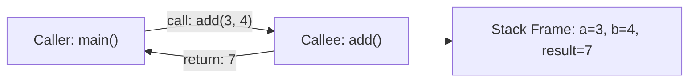
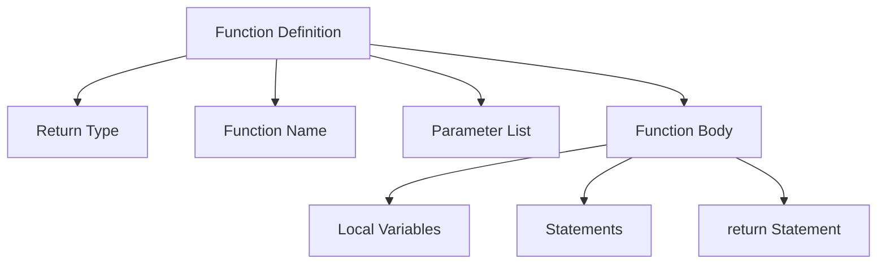
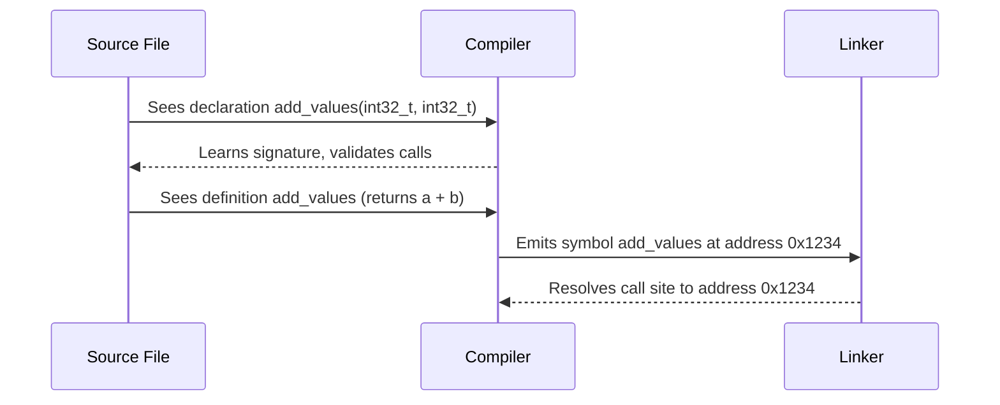
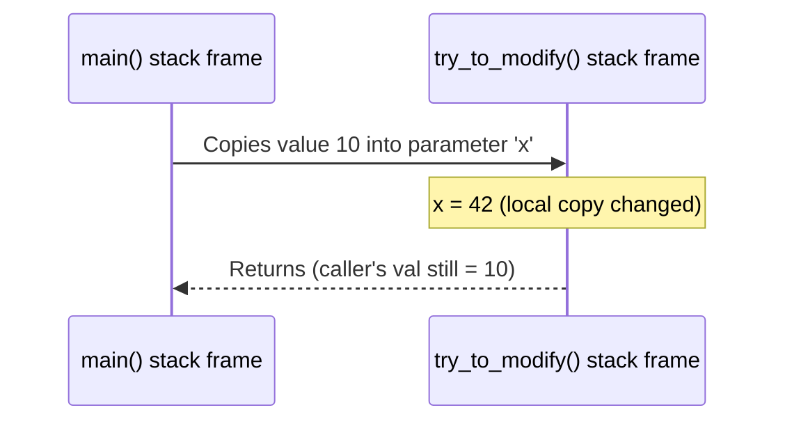
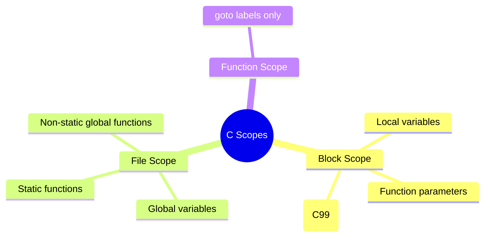
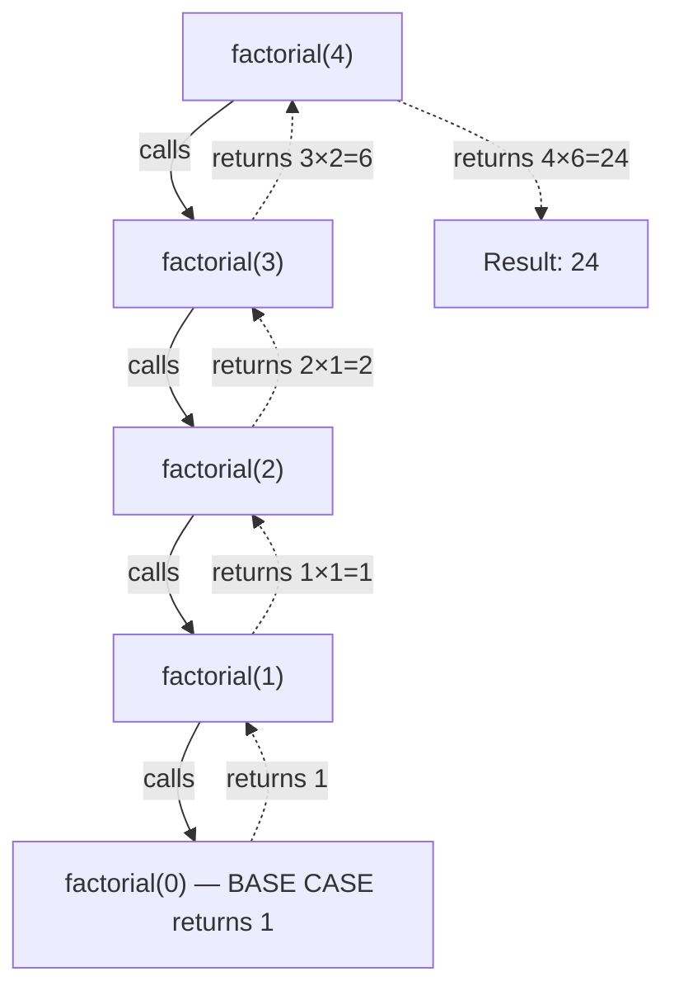
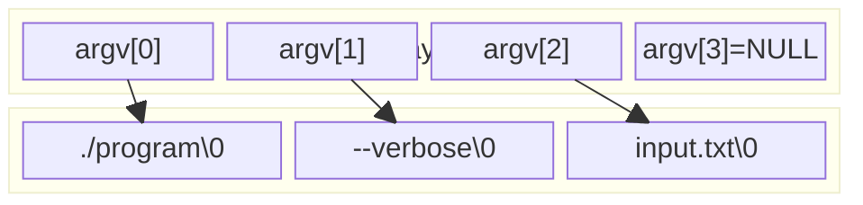

# Module neg01: Functions from First Principles, Scope, Recursion & Command-Line Arguments

!!! info "C23 Reference Companion"
    Pair this deep-dive curriculum module with the live **ISO C23 (`en.cppreference.com/c`) Reference**:

    - [Functions & Linkage Reference](../../reference/language/functions.md)
    - [Declarations & Storage Classes](../../reference/language/declarations.md)

**Track:** C Systems Programming, Memory Engineering & High-Performance Computing

**Category:** Function Fundamentals, Compilation Semantics, and Architectural Principles

**Standard Identifier:** `DOC-STD-NEG01-2026`

**Status:** ✅ Completed

**Prerequisites:** Modules neg04, neg03, neg02

---

## 📑 Table of Contents

1. [Executive Summary](#1-executive-summary)
2. [What a Function IS](#2-what-a-function-is)
3. [Function Anatomy — Every Token](#3-function-anatomy-every-token)
4. [Declarations vs Definitions](#4-declarations-vs-definitions)
5. [Pass-by-Value — Proven](#5-pass-by-value-proven)
6. [Scope and Lifetime](#6-scope-and-lifetime)
7. [static and extern](#7-static-and-extern)
8. [Recursion](#8-recursion)
9. [Inline Functions](#9-inline-functions)
10. [Command-Line Arguments](#10-command-line-arguments)
11. [Function Pointers](#11-function-pointers)
12. [Production Lab: Recursive Expression Evaluator](#12-production-lab-recursive-expression-evaluator)
13. [MISRA-C / CERT-C Cheat Sheet](#13-misra-c-cert-c-cheat-sheet)
14. [References (APA 7th)](#14-references-apa-7th)
15. [FinOps & Cost Governance](#15-finops-cost-governance)

---

## 1. Executive Summary

Functions are the fundamental unit of abstraction and modularity in C. Every C program is a collection of functions; the OS invokes `main()`, which in turn calls other functions to accomplish work. Understanding functions requires simultaneously understanding the C language semantics (declaration, definition, scope) and the hardware reality (stack frames, register passing, return address management) (Kernighan & Ritchie, 1988; Bryant & O'Hallaron, 2016).

> **👔 Business Impact**: Poorly structured functions (too large, too tightly coupled, misuse of global state) directly increase bug density, extend onboarding time for new engineers, and inflate maintenance costs. The principle of single responsibility applied at the function level is empirically linked to lower defect rates (McConnell, 2004).

---

## 2. What a Function IS

> **Definition**: A **function** is a named, typed, parameterized unit of computation that accepts zero or more arguments, executes a sequence of statements, and optionally returns a value to its caller (ISO/IEC, 2018, §6.9.1).

Formally, a C function maps inputs to outputs: $f: D \to R$. Unlike mathematical functions, C functions can also produce **side effects** (modifying memory, performing I/O, changing hardware state).



Functions serve three purposes:

1. **Decomposition**: Break complex problems into manageable units
2. **Reuse**: Call the same logic from multiple places
3. **Abstraction**: Hide implementation details behind an interface

---

## 3. Function Anatomy — Every Token

```c
//  return_type   name        parameters
    int32_t       add_values  (int32_t a, int32_t b)
//  body
    {
        int32_t result = a + b;  // local variable (automatic storage)
        return result;            // return statement
    }
```

| Token | Meaning |
| :------ | :-------- |
| `int32_t` | Return type — the type of value delivered to the caller |
| `add_values` | Function name — identifier (use `snake_case` verb-noun) |
| `(int32_t a, int32_t b)` | Parameter list — formal copies of the caller's arguments |
| `{...}` | Compound statement — creates a new block scope |
| `return result;` | Terminates execution, delivers value to caller |

> **⚠️ Warning**: `void` in the parameter list (`int foo(void)`) means the function takes **zero** arguments. An empty list (`int foo()`) in pre-C23 means "unspecified arguments" — a dangerous legacy behavior. Always use `void` for zero-argument functions (ISO/IEC, 2018, §6.7.6.3).



---

## 4. Declarations vs Definitions

The C compiler processes source files **top-to-bottom** in a single pass. Before calling a function, the compiler must know its **signature** (return type + parameter types).

> **Definition**: A **declaration** (prototype) announces a function's signature without providing the body. A **definition** provides the implementation.

```c
// ✅ GOOD: Declaration before use
int32_t add_values(int32_t a, int32_t b);  // Declaration (prototype)

int main(void) {
    int32_t result = add_values(3, 4);     // Call — OK because of declaration
    return 0;
}

int32_t add_values(int32_t a, int32_t b) { // Definition
    return a + b;
}
```

```c
// ❌ BAD: No declaration — C99+ makes this a compile error
int main(void) {
    int32_t result = add_values(3, 4);  // error: implicit declaration
    return 0;
}
int32_t add_values(int32_t a, int32_t b) { return a + b; }
```



---

## 5. Pass-by-Value — Proven

> **💡 Key Insight**: In C, **all** function arguments are passed by **value** — a physical copy of the argument is made and placed in the callee's stack frame or registers. The callee **cannot** modify the caller's original variable through a parameter.

```c
// ❌ This does NOT modify the caller's variable
void try_to_modify(int x) {
    x = 42;  // modifies the LOCAL COPY only
}

int main(void) {
    int val = 10;
    try_to_modify(val);
    printf("%d\n", val);  // prints: 10  (unchanged!)
    return 0;
}
```

```c
// ✅ Pass the ADDRESS to enable modification
void modify_through_pointer(int *x_ptr) {
    *x_ptr = 42;  // dereference pointer → write to caller's memory
}

int main(void) {
    int val = 10;
    modify_through_pointer(&val);
    printf("%d\n", val);  // prints: 42
    return 0;
}
```



---

## 6. Scope and Lifetime

> **Definition**: **Scope** is the region of source code where a name is visible. **Lifetime** (storage duration) is the period during program execution when the named object's memory is allocated.

| Scope Type | Where Declared | Visible From |
| :----------- | :--------------- | :------------- |
| Block scope | Inside `{...}` | Point of declaration to `}` |
| File scope | Outside any function | Point of declaration to end of file |
| Function scope | Only `goto` labels | Anywhere in the function |

| Storage Duration | Where | Lifetime |
| :---------------- | :------ | :--------- |
| Automatic | Stack | Entry to containing block → exit |
| Static | `.data` / `.bss` | Entire program execution |
| Allocated | Heap | `malloc()` → `free()` |



> **⚠️ Warning**: Global variables introduce **hidden coupling** between functions. Two functions sharing a global variable cannot be tested independently. In multithreaded programs, unprotected global variables are data races waiting to happen (Herlihy & Shavit, 2012).

---

## 7. static and extern

**`static` — two distinct meanings:**

```c
// Meaning 1: static on a LOCAL variable → extends lifetime to program duration
void counter(void) {
    static int count = 0;  // initialized ONCE, persists between calls
    count++;
    printf("Called %d times\n", count);
}

// Meaning 2: static on a function/global → INTERNAL linkage (invisible outside this .c file)
static void internal_helper(void) {
    // Only visible within this translation unit — linker cannot see it
}
```

**`extern` — references a definition in another translation unit:**

```c
// file_a.c
int shared_counter = 0;  // definition

// file_b.c
extern int shared_counter;  // declaration — refers to file_a.c's definition
```

> **💡 Key Insight**: Using `static` on file-scope functions is critical for encapsulation. It prevents name collisions when linking many object files and is required by MISRA-C Rule 8.7 for functions not needed outside their translation unit.

---

## 8. Recursion

> **Definition**: **Recursion** occurs when a function directly or indirectly calls itself. Every recursive algorithm requires a **base case** (termination condition) and a **recursive case** (self-similar reduction).



```c
// ✅ Recursive factorial — O(n) time, O(n) space (n stack frames)
int64_t factorial(int n) {
    if (n <= 0) return 1;           // base case
    return (int64_t)n * factorial(n - 1);  // recursive case
}

// ✅ Iterative factorial — O(n) time, O(1) space (no extra frames)
int64_t factorial_iter(int n) {
    int64_t result = 1;
    for (int i = 2; i <= n; i++) result *= i;
    return result;
}
```

> **⚠️ Warning**: Each recursive call allocates a new stack frame (~tens to hundreds of bytes). With a default stack of ~8MB, you get ~8,000–80,000 frames before **stack overflow** (`SIGSEGV`). For unbounded recursion, use iteration or an explicit heap-based stack. MISRA-C Rule 17.2 prohibits recursion entirely in safety-critical systems.

---

## 9. Inline Functions

The `inline` keyword **suggests** to the compiler that the function body be inserted at the call site, eliminating the function-call overhead (branch, stack frame setup, register save/restore).

```c
// ✅ Type-safe, no double-evaluation side effects
static inline double square(double x) {
    return x * x;
}

// ❌ BAD: Macro version — double-evaluates x
#define SQUARE(x) ((x) * (x))
// square(i++) calls increment once; SQUARE(i++) increments TWICE!
```

`__attribute__((always_inline))` forces inlining even when the compiler would otherwise not inline (e.g., at `-O0`). Use sparingly.

---

## 10. Command-Line Arguments

```c
int main(int argc, char *argv[])
```

| Symbol | Type | Meaning |
| :------- | :----- | :-------- |
| `argc` | `int` | Count of arguments (always ≥ 1) |
| `argv` | `char *[]` | Array of C-string pointers |
| `argv[0]` | `char *` | Program name (or path) |
| `argv[argc]` | `char *` | Always `NULL` (ISO/IEC, 2018, §5.1.2.2.1) |



```c
// ✅ GOOD: Safe argument parsing
int main(int argc, char *argv[]) {
    if (argc < 2) {
        fprintf(stderr, "Usage: %s <number>\n", argv[0]);
        return EXIT_FAILURE;
    }

    char *endptr;
    long value = strtol(argv[1], &endptr, 10);  // NOT atoi()!
    if (*endptr != '\0' || endptr == argv[1]) {
        fprintf(stderr, "Error: '%s' is not a valid integer\n", argv[1]);
        return EXIT_FAILURE;
    }

    printf("You entered: %ld\n", value);
    return EXIT_SUCCESS;
}
```

> **⚠️ Warning**: Never use `atoi()` — it silently returns 0 on error with no way to distinguish "the string was '0'" from "the string was invalid." Always use `strtol()` with `endptr` checking (SEI CERT C, INT06-C).

---

## 11. Function Pointers

> **Definition**: A **function pointer** is a variable that stores the memory address of a function's executable code.

```c
// Syntax: return_type (*pointer_name)(parameter_types)
int (*operation)(int, int);

int add(int a, int b) { return a + b; }
int multiply(int a, int b) { return a * b; }

// Assign and call
operation = add;
printf("%d\n", operation(3, 4));  // prints: 7

operation = multiply;
printf("%d\n", operation(3, 4));  // prints: 12

// ✅ Typedef for readability
typedef int (*BinaryOp)(int, int);
BinaryOp ops[] = {add, multiply};
```

Function pointers enable **callbacks** (qsort, signal handlers), **dispatch tables** (state machines, plugin architectures), and **runtime polymorphism** (OOP in C).

---

## 12. Production Lab: Recursive Expression Evaluator

A recursive descent parser for arithmetic expressions like `"3 + 4 * (2 - 1)"`.

```c
// expr_eval.c — compile: gcc -std=c17 -Wall -Wextra -Werror expr_eval.c -o eval
#include <stdio.h>
#include <stdlib.h>
#include <ctype.h>
#include <stdint.h>

// Grammar:
//   expression = term { ('+' | '-') term }
//   term       = factor { ('*' | '/') factor }
//   factor     = number | '(' expression ')'

static const char *pos;  // current parse position

static void skip_ws(void) {
    while (isspace((unsigned char)*pos)) pos++;
}

static int64_t parse_expression(void);
static int64_t parse_term(void);

static int64_t parse_factor(void) {
    skip_ws();
    if (*pos == '(') {
        pos++;  // consume '('
        int64_t val = parse_expression();
        skip_ws();
        if (*pos == ')') pos++;  // consume ')'
        return val;
    }
    // Parse integer literal
    char *end;
    int64_t val = strtoll(pos, &end, 10);
    pos = end;
    return val;
}

static int64_t parse_term(void) {
    int64_t left = parse_factor();
    for (;;) {
        skip_ws();
        char op = *pos;
        if (op != '*' && op != '/') break;
        pos++;
        int64_t right = parse_factor();
        left = (op == '*') ? left * right : (right != 0 ? left / right : 0);
    }
    return left;
}

static int64_t parse_expression(void) {
    int64_t left = parse_term();
    for (;;) {
        skip_ws();
        char op = *pos;
        if (op != '+' && op != '-') break;
        pos++;
        int64_t right = parse_term();
        left = (op == '+') ? left + right : left - right;
    }
    return left;
}

int main(int argc, char *argv[]) {
    if (argc != 2) {
        fprintf(stderr, "Usage: %s \"<expression>\"\n", argv[0]);
        return EXIT_FAILURE;
    }
    pos = argv[1];
    printf("Result: %lld\n", (long long)parse_expression());
    return EXIT_SUCCESS;
}
```

**Test:**

```bash
gcc -std=c17 -Wall -Wextra -Werror expr_eval.c -o eval
./eval "3 + 4 * (2 - 1)"   # → Result: 7
./eval "100 / 4 + 3 * 7"   # → Result: 46
```

---

## 13. MISRA-C / CERT-C Cheat Sheet

| Rule | Standard | Summary |
| :----- | :--------- | :-------- |
| Rule 8.4 | MISRA-C:2012 | Compatible declaration visible when function defined |
| Rule 8.7 | MISRA-C:2012 | Use `static` for functions not needed outside TU |
| Rule 17.2 | MISRA-C:2012 | Functions shall not call themselves (no recursion) |
| DCL31-C | SEI CERT C | Declare identifiers before using them |
| ERR33-C | SEI CERT C | Detect and handle standard library errors |
| INT06-C | SEI CERT C | Use `strtol()` not `atoi()` for integer conversion |

---

## 14. References (APA 7th)

Bryant, R. E., & O'Hallaron, D. R. (2016). *Computer systems: A programmer's perspective* (3rd ed.). Pearson.

Herlihy, M., & Shavit, N. (2012). *The art of multiprocessor programming* (Rev. ed.). Morgan Kaufmann.

ISO/IEC. (2018). *Information technology — Programming languages — C* (ISO/IEC 9899:2018). International Organization for Standardization.

Kernighan, B. W., & Ritchie, D. M. (1988). *The C programming language* (2nd ed.). Prentice Hall.

McConnell, S. (2004). *Code complete: A practical handbook of software construction* (2nd ed.). Microsoft Press.

Patterson, D. A., & Hennessy, J. L. (2017). *Computer organization and design: The hardware/software interface* (5th ed., ARM ed.). Morgan Kaufmann.

SEI CERT. (2016). *SEI CERT C coding standard*. Software Engineering Institute. <https://wiki.sei.cmu.edu/confluence/display/c>

Stevens, W. R., Rago, S. A., & Fenner, B. (2013). *Advanced programming in the UNIX environment* (3rd ed.). Addison-Wesley.

---

## 15. FinOps & Cost Governance

Well-structured functions directly reduce cloud compute cost:

| Optimization | Mechanism | FinOps Impact |
| :------------- | :---------- | :-------------- |
| Inline hot-path functions | Eliminate call overhead (~5-15 cycles/call) | Reduces CPU utilization → smaller instance class |
| Static functions + LTO | Link-Time Optimization removes dead code | Smaller binary → reduced cold-start time in Lambda/Cloud Run |
| Iteration vs recursion | Eliminates stack frame churn | Reduces memory footprint → cheaper per-container billing |
| `strtol` vs `atoi` | Prevents silent error paths requiring retry | Reduces retry storm costs in production |
