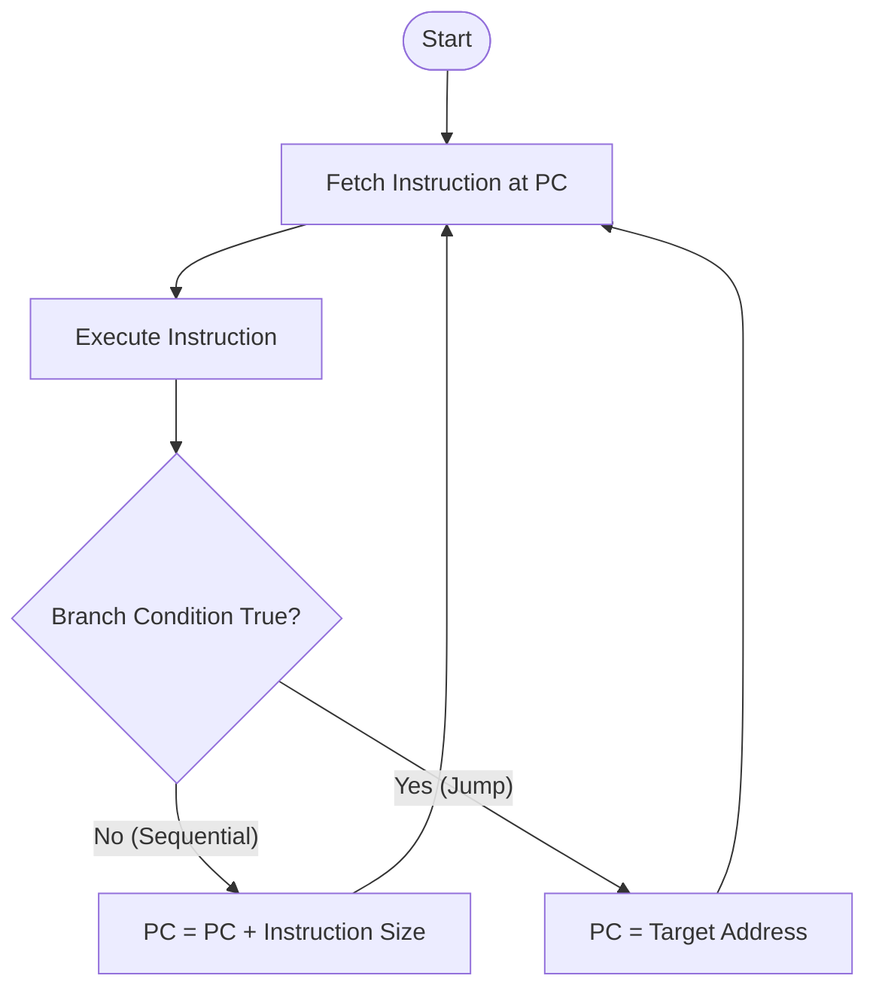
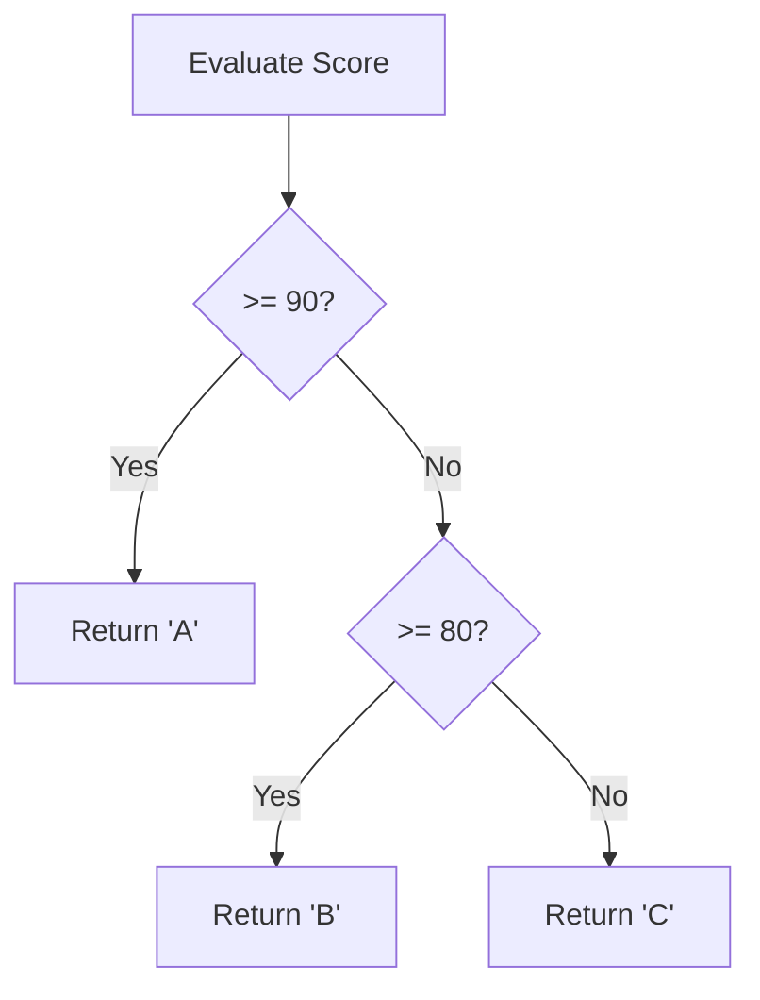
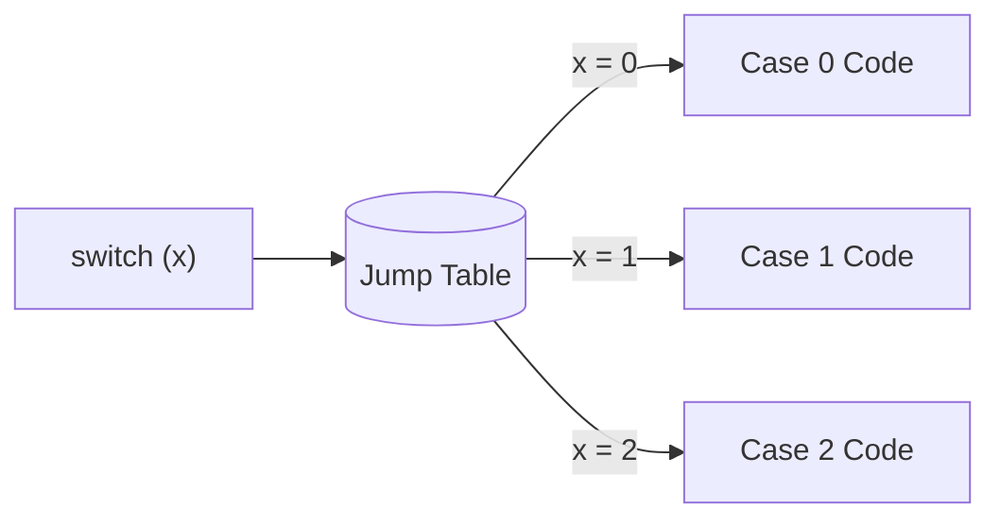
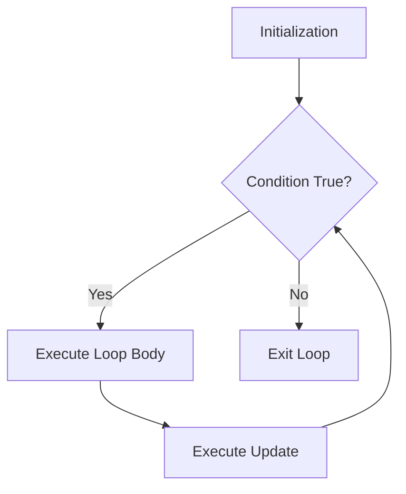
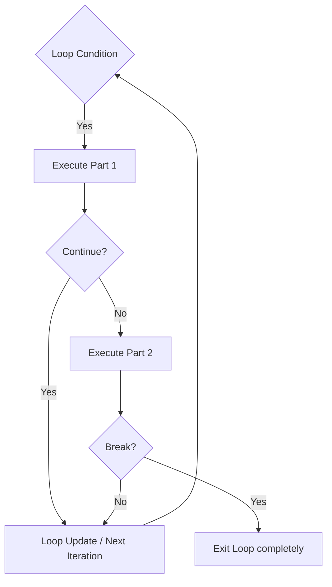
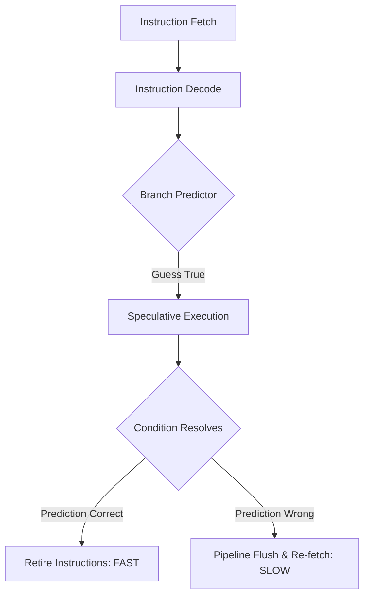

# Module neg02: Control Flow, Conditional Branching, Iteration & Loop Invariants

!!! info "C23 Reference Companion"
    Pair this deep-dive curriculum module with the live **ISO C23 (`en.cppreference.com/c`) Reference**:

    - [Statements & Control Flow](../../reference/language/statements.md)
    - [C23 Attributes ([[fallthrough]])](../../reference/language/attributes.md)

**Track:** C Systems Programming, Memory Engineering & High-Performance Computing

**Category:** C17/C23 Control Flow, Branching, Hardware Branch Prediction

**Standard Identifier:** `DOC-STD-CTRL-2026`

**Status:** ✅ Completed

---

## 📑 Table of Contents

1. [What Control Flow IS](#1-what-control-flow-is)
2. [Conditional Branching: if / else if / else](#2-conditional-branching-if-else-if-else)
3. [The switch Statement](#3-the-switch-statement)
4. [The for Loop](#4-the-for-loop)
5. [The while Loop](#5-the-while-loop)
6. [The do-while Loop](#6-the-do-while-loop)
7. [Loop Control: break and continue](#7-loop-control-break-and-continue)
8. [The goto Statement](#8-the-goto-statement)
9. [Short-Circuit Evaluation](#9-short-circuit-evaluation)
10. [CPU Branch Prediction (Hardware Context)](#10-cpu-branch-prediction-hardware-context)
11. [Production Lab: State Machine](#11-production-lab-state-machine)
12. [References (APA 7th), Certification & FinOps](#12-references-apa-7th-certification-finops)

---

## 1. What Control Flow IS

At its core, a computer is a deterministic state machine executing instructions stored in memory. The **Program Counter (PC)** (often the `%rip` register on x86-64) holds the memory address of the next instruction to execute (Patterson & Hennessy, 2017).

By default, execution is **sequential**: the CPU fetches the instruction at the PC, executes it, and increments the PC by the size of the instruction. This follows the classic Von Neumann architecture, where both instructions and data reside in a shared memory space, and the control unit directs sequential fetching (Von Neumann, 1945).

> **Definition**: **Control Flow** refers to the execution order of instructions in a program. It encompasses sequential execution, conditional branching (altering the PC based on a condition), and iteration (looping back to a previous PC).

When a program needs to make a decision, it uses **branching**. Hardware implements this by evaluating a condition (often setting flags via a `CMP` compare instruction) and then conditionally modifying the PC (e.g., using a `Jcc` jump-if-condition instruction).



---

## 2. Conditional Branching: if / else if / else

In C, the `if` statement evaluates a scalar expression. If the expression evaluates to any non-zero value, the condition is considered true.

### 2.1 Syntax and Boolean Logic

Historically, C89 had no boolean type; integer `0` represented false, and any non-zero integer represented true (Kernighan & Ritchie, 1988). C99 introduced `<stdbool.h>` and the `_Bool` type to provide standard `true` (1) and `false` (0) macros.

### 2.2 The Dangling-Else Problem

A notorious parsing ambiguity arises with nested `if` statements lacking braces. The C standard dictates that an `else` binds to the closest preceding `if` that does not have an `else`.

> **⚠️ Warning**: **The Dangling-Else Pitfall**
> Always use braces `{}` for block statements to explicitly define scope and prevent maintenance errors (Apple’s `goto fail` bug is a classic example of missing braces causing catastrophic security failures).

### 2.3 Deep Example: Grade Classifier & The Arrow Anti-Pattern

Deeply nested `if-else` blocks degrade readability.

❌ **Bad Code: Deep Nesting (Arrow Anti-Pattern)**

```c
if (student != NULL) {
    if (student->score >= 0) {
        if (student->score >= 90) {
            grade = 'A';
        } else {
            // ... more nesting
        }
    }
}
```

✅ **Good Code: Guard Clauses & Early Return**

```c
if (student == NULL || student->score < 0) {
    return '\0'; // Invalid input guard
}
if (student->score >= 90) return 'A';
if (student->score >= 80) return 'B';
// Flat hierarchy is highly readable
```



---

## 3. The switch Statement

The `switch` statement provides a structured way to branch execution based on the value of an **integral constant expression**.

> **Definition**: A **jump table** is an array of pointers to code blocks. For dense `switch` cases, the compiler uses the switch variable as an index into this table, providing $O(1)$ dispatch time regardless of the number of cases (Bryant & O'Hallaron, 2016, p. 257).

### 3.1 Syntax and Fall-Through

The execution "falls through" cases unless explicitly stopped by a `break` statement.

> **💡 Key Insight**: By MISRA-C Rule 16.3, every non-empty `switch` clause must be terminated with a `break` statement. If fall-through is intentional, it must be rigorously documented with a `/* fallthrough */` comment or C23 `[[fallthrough]]` attribute.

✅ **Good Code: Explicit Breaks**

```c
switch (state) {
    case STATE_INIT:
        initialize_system();
        break; // Required to prevent execution bleeding into STATE_RUN
    case STATE_RUN:
        run_system();
        break;
    default:
        handle_error();
        break; // Defensive programming
}
```

### 3.2 Limitations

- The evaluated expression must resolve to an integer type. Strings or ranges are not natively supported because jump tables require arithmetic offset calculations.



---

## 4. The for Loop

The `for` loop provides a compact syntax for iteration, encapsulating initialization, condition checking, and state updating.

### 4.1 Anatomy

```c
for (initialization; condition; update) {
    // Loop body
}
```

Evaluation order:

1. `initialization` runs exactly once. (In C99+, variable scope can be restricted to the loop: `for(int i = 0; ...)`).
2. `condition` is evaluated. If true (non-zero), execution enters the body. If false, the loop terminates.
3. The loop body executes.
4. The `update` statement executes.
5. Go back to step 2.

> **💡 Key Insight**: The infinite loop idiom `for (;;) { }` is standard practice in system programming for event loops and daemon processes.



---

## 5. The while Loop

The `while` loop is a pre-test loop, meaning the condition is evaluated *before* the body executes. If the condition is false initially, the body executes zero times.

### 5.1 Loop Invariants

>
> **Definition**: A **loop invariant** is a formal condition or logical assertion that is strictly true before the loop begins, remains true after each iteration, and is true when the loop terminates (Dijkstra, 1976).

Using loop invariants is essential for mathematically proving the correctness of algorithms.

✅ **Good Code: while Loop for Unknown Iteration Count**

```c
int token;
// We do not know exactly how many tokens exist.
while ((token = get_next_token()) != EOF) {
    process_token(token);
}
```

---

## 6. The do-while Loop

The `do-while` loop is a post-test loop. The body is guaranteed to execute at least once before the condition is checked.

### 6.1 Interactive Validation

```c
int input;
do {
    printf("Enter a positive number: ");
    scanf("%d", &input);
} while (input <= 0); // Condition checked after reading
```

> **💡 Key Insight**: The `do { ... } while(0)` construct is famously used in C preprocessor macros to group multiple statements into a single syntactic block that strictly requires a trailing semicolon, integrating safely into `if` statements.

---

## 7. Loop Control: break and continue

- **`break`**: Immediately terminates the innermost enclosing `loop` or `switch` statement.
- **`continue`**: Halts execution of the current iteration of the loop body and jumps directly to the loop's update/condition phase.



---

## 8. The goto Statement

The `goto` statement performs an unconditional jump to a named label within the same function.

> **⚠️ Warning**: Dijkstra (1968) famously argued against `goto`, as unrestricted branching creates "spaghetti code" that makes static analysis and human comprehension impossible.

### 8.1 The Legitimate Use Case: Resource Cleanup

In C (which lacks `try-catch-finally` or destructors), the industry standard pattern for handling errors during sequential resource acquisition is the forward `goto` cleanup pattern, heavily utilized in the Linux kernel (Stevens et al., 2013).

✅ **Good Code: Forward goto for cleanup**

```c
int process_file(const char *path) {
    FILE *f = fopen(path, "r");
    if (!f) return -1;

    char *buffer = malloc(1024);
    if (!buffer) {
        goto cleanup_file; // Jump to specific cleanup
    }

    // Process buffer...

    free(buffer);
cleanup_file:
    fclose(f);
    return 0;
}
```

---

## 9. Short-Circuit Evaluation

The logical AND (`&&`) and logical OR (`||`) operators introduce implicit sequence points and use **short-circuit evaluation**.

- In `A && B`, if `A` is false, `B` is never evaluated (because the whole expression must be false).
- In `A || B`, if `A` is true, `B` is never evaluated.

✅ **Good Code: Null Guarding**

```c
// If ptr is NULL, ptr->value is NOT evaluated, preventing a segfault.
if (ptr != NULL && ptr->value > 0) {
    // Safe to use ptr
}
```

---

## 10. CPU Branch Prediction (Hardware Context)

Modern superscalar pipelined CPUs (like Intel Core or ARM Cortex) must keep their pipelines full. When they encounter a conditional branch, they cannot wait for the condition to evaluate. Instead, they use a **Branch Predictor** to guess the outcome and speculatively execute instructions.

If the prediction is wrong, the CPU suffers a **pipeline flush**, discarding the speculative work and reloading the correct instructions, costing ~15-20 clock cycles on modern architectures (Patterson & Hennessy, 2017).

> **💡 Key Insight**: Sorting arrays before processing them in an `if` condition can yield massive performance speedups because the branch predictor achieves >99% accuracy on predictable data patterns.



---

## 11. Production Lab: State Machine

This lab demonstrates a production-grade lexical scanner state machine using `enum`, `while`, and `switch`.

### File: `src/lexer_fsm.c`

```c
#include <stdio.h>
#include <stdbool.h>

// Define rigorous exact states for our machine
typedef enum {
    STATE_START,
    STATE_IN_WORD,
    STATE_IN_NUMBER,
    STATE_DONE,
    STATE_ERROR
} LexerState;

// Simple character classification
static bool is_alpha(char c) {
    return (c >= 'a' && c <= 'z') || (c >= 'A' && c <= 'Z');
}

static bool is_digit(char c) {
    return c >= '0' && c <= '9';
}

int main(void) {
    const char *input = "Speed 299792458 m";
    int index = 0;
    LexerState current_state = STATE_START;

    printf("Starting Lexical Analysis...\\n");

    // Loop invariant: current_state is valid, index < length of string
    while (current_state != STATE_DONE && current_state != STATE_ERROR) {
        char c = input[index];

        if (c == '\\0') {
            current_state = STATE_DONE;
            break;
        }

        // Jump table dispatch for O(1) state transitions
        switch (current_state) {
            case STATE_START:
                if (is_alpha(c)) {
                    printf("Found Word Start: %c\\n", c);
                    current_state = STATE_IN_WORD;
                } else if (is_digit(c)) {
                    printf("Found Number Start: %c\\n", c);
                    current_state = STATE_IN_NUMBER;
                } else if (c == ' ') {
                    // Skip whitespace
                } else {
                    current_state = STATE_ERROR;
                }
                break;

            case STATE_IN_WORD:
                if (!is_alpha(c)) {
                    // Word boundary detected, return to start to process 'c' again
                    current_state = STATE_START;
                    continue; // Skip the index increment below
                }
                break;

            case STATE_IN_NUMBER:
                if (!is_digit(c)) {
                    // Number boundary detected
                    current_state = STATE_START;
                    continue; // Skip the index increment
                }
                break;

            case STATE_DONE:
            case STATE_ERROR:
                // MISRA-C Rule 16.4: default clause is mandatory
            default:
                break;
        }

        index++; // Loop update
    }

    if (current_state == STATE_ERROR) {
        printf("Analysis failed due to unrecognized syntax.\\n");
        return 1;
    }

    printf("Analysis successfully completed.\\n");
    return 0;
}
```

---

## 12. References (APA 7th), Certification & FinOps

### References

1. Bryant, R. E., & O'Hallaron, D. R. (2016). *Computer systems: A programmer's perspective* (3rd ed.). Pearson.
2. Dijkstra, E. W. (1968). Go to statement considered harmful. *Communications of the ACM*, 11(3), 147–148.
3. Dijkstra, E. W. (1976). *A discipline of programming*. Prentice-Hall.
4. Kernighan, B. W., & Ritchie, D. M. (1988). *The C programming language* (2nd ed.). Prentice Hall.
5. Patterson, D. A., & Hennessy, J. L. (2017). *Computer organization and design RISC-V edition: The hardware software interface*. Morgan Kaufmann.
6. Stevens, W. R., Rago, S. A., & Fenner, B. (2013). *Advanced programming in the UNIX environment* (3rd ed.). Addison-Wesley.
7. Von Neumann, J. (1945). *First draft of a report on the EDVAC*. Moore School of Electrical Engineering, University of Pennsylvania.

### Certification Cheat Sheet (MISRA-C / CERT-C)

- ⚠️ **MISRA-C Rule 14.3**: Controlling expressions shall not be invariant (prevents dead code).
- 🔒 **MISRA-C Rule 15.1**: The `goto` statement should not be used (unless for strict forward-only error handling in system programming).
- ⚙️ **MISRA-C Rule 16.3**: An unconditional `break` statement shall terminate every non-empty `switch` clause.
- ⚠️ **CERT-C MSC20-C**: Do not use a `switch` statement with complex, non-constant logic that could be better handled by polymorphism or `if` chains.

### Universal FinOps & Hardware Cost Governance

```text
┌────────────────────────────────────────────────────────────────────────────────┐
│                   CONTROL FLOW FINOPS SAVINGS MATRIX                           │
├──────────────────────────┬──────────────────────────┬──────────────────────────┤
│ Optimization Strategy    │ Technical Mechanism      │ Measurable FinOps ROI    │
├──────────────────────────┼──────────────────────────┼──────────────────────────┤
│ **Data Sorting**         │ Eliminates branch pred.  │ Up to 600% throughput    │
│                          │ pipeline flushes         │ increase on intensive CPU│
├──────────────────────────┼──────────────────────────┼──────────────────────────┤
│ **Jump Tables (switch)** │ O(1) branch dispatch vs  │ Flat microsecond latency │
│                          │ O(N) if-else chains      │ at scale                 │
├──────────────────────────┼──────────────────────────┼──────────────────────────┤
│ **Early Return guards**  │ Eliminates deep nesting  │ Reduces maintainability  │
│                          │ instruction cache strain │ cost and developer hours │
└──────────────────────────┴──────────────────────────┴──────────────────────────┘
```
