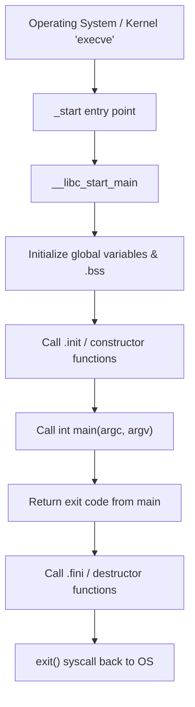
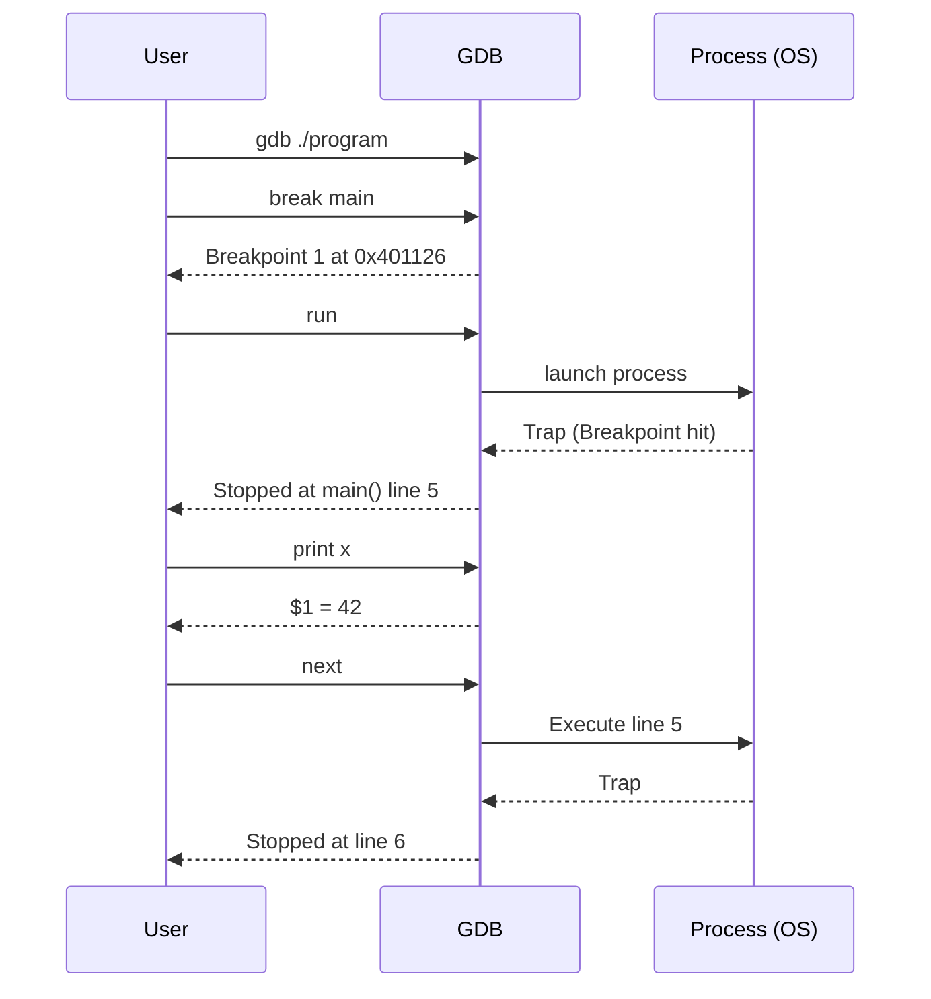
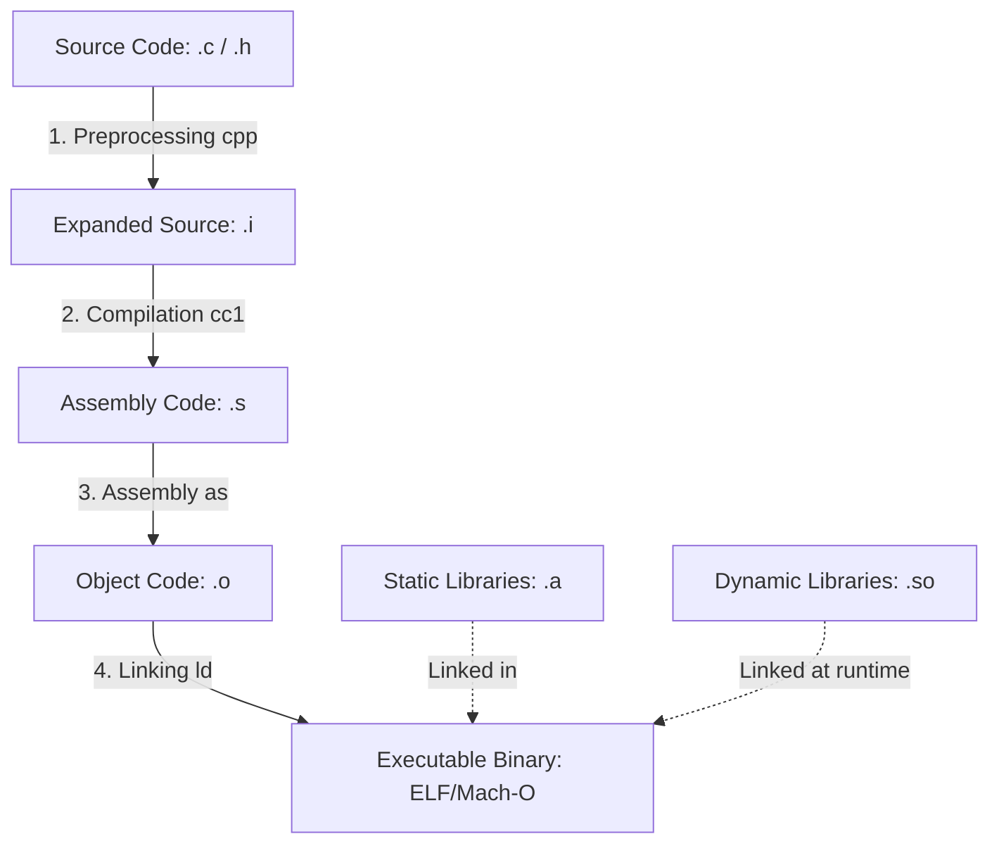

# Module neg04: Development Environment Setup, Toolchain Fundamentals & First C Program

!!! info "C23 Reference Companion"
    Pair this deep-dive curriculum module with the live **ISO C23 (`en.cppreference.com/c`) Reference**:

    - [Basic Concepts & Translation Phases](../../reference/language/basic-concepts.md)
    - [Compiler & Libc Support Matrix](../../standards/compiler-support.md)

**Track:** C Systems Programming, Memory Engineering & High-Performance Computing

**Category:** C Development Environment, Toolchains & Compilation Pipeline

**Standard Identifier:** `DOC-STD-NEG04-2026`

**Status:** ✅ Completed

---

## 📑 Table of Contents

1. [High-Level Overview & Executive Summary: What C Is — Historical Context](#1-high-level-overview-executive-summary-what-c-is-historical-context)
2. [Installing the Toolchain](#2-installing-the-toolchain)
3. [Editor and IDE Setup](#3-editor-and-ide-setup)
4. [Your First C Program — Every Token Explained](#4-your-first-c-program-every-token-explained)
5. [The Compilation Command](#5-the-compilation-command)
6. [Reading Compiler Diagnostics](#6-reading-compiler-diagnostics)
7. [Basic GDB Usage (Introduction)](#7-basic-gdb-usage-introduction)
8. [The 4-Stage Compilation Pipeline (Overview)](#8-the-4-stage-compilation-pipeline-overview)
9. [Step-by-Step Production Lab: Setting Up a C Project](#9-step-by-step-production-lab-setting-up-a-c-project)
10. [Certification & Engineering Essentials (MISRA-C / CERT-C Cheat Sheet)](#10-certification-engineering-essentials-misra-c-cert-c-cheat-sheet)
11. [References (The 5+5 Rule)](#11-references-the-55-rule)
12. [Universal FinOps & Hardware Cost Governance](#12-universal-finops-hardware-cost-governance)

---

## 1. High-Level Overview & Executive Summary: What C Is — Historical Context

The C programming language was developed between 1969 and 1973 by Dennis Ritchie and Ken Thompson at Bell Labs. Originally designed to implement the UNIX operating system, C evolved directly from its typeless predecessors, BCPL and B (Ritchie, 1993, p. 2). By introducing a rudimentary type system and arrays that map directly to memory addresses, C provided the necessary abstractions to manage hardware without sacrificing execution speed.

Over fifty years later, C remains the dominant systems language. The Linux kernel, foundational database systems like PostgreSQL and SQLite, high-performance web servers like Nginx, the CPython reference implementation, and in-memory datastores like Redis are all written primarily in C. This enduring supremacy stems from C's unique combination of low-level memory control and high-level structural constructs (Kernighan & Ritchie, 1988).

The lineage of the C standard reflects its evolutionary maturation:

* **K&R C (1978)**: The original informal specification based on the first edition of *The C Programming Language*.
* **C89 / C90 (ANSI C / ISO C)**: The first formal standardization, introducing function prototypes and standard libraries.
* **C99**: Introduced inline functions, variable-length arrays (VLAs), and exact-width integer types (`<stdint.h>`).
* **C11**: Added native multithreading (`<threads.h>`) and `_Generic` macros for type-generic math.
* **C17**: A bug-fix release clarifying defects in the C11 standard.
* **C23**: The latest iteration, deprecating K&R function definitions and adding true `bool`, `constexpr`, and improved attribute syntax.

> **💡 Key Insight**: C is not merely a language; it is the universal API of operating systems. Every other programming language runtime, whether Java's JVM, Python's interpreter, or Go's runtime, ultimately relies on C ABIs to interact with the OS kernel.

---

## 2. Installing the Toolchain

To compile C effectively, a robust toolchain comprising a compiler, an assembler, a linker, and a debugger is strictly required. The primary industry-standard compilers are **GCC (GNU Compiler Collection)** and **Clang (LLVM)**.

### Platform-Specific Installation

* **macOS**: Utilize the Apple-provided Clang toolchain and Homebrew for GCC.

  ```bash
  xcode-select --install # Installs Apple Clang, Make, and LLDB
  brew install gcc       # Installs the GNU Compiler Collection
  ```

* **Linux (Ubuntu / Debian)**: Install the essential build meta-package.

  ```bash
  sudo apt update
  sudo apt install build-essential gdb valgrind
  ```

* **Linux (Fedora / RHEL)**: Use `dnf` for development tools.

  ```bash
  sudo dnf groupinstall "Development Tools"
  sudo dnf install gcc gdb valgrind
  ```

* **Windows**: Native Windows development (MSVC) diverges significantly from POSIX standards. The recommended approach is **WSL2 (Windows Subsystem for Linux)** running Ubuntu, following the Linux instructions above. Alternatively, **MinGW-w64** provides a native Windows port of GCC.

### Verifying Installation

Ensure your tools are correctly configured in your `$PATH`:

```bash
gcc --version
clang --version
make --version
```

### Compiler Comparison Matrix

| Feature | GCC (GNU Compiler Collection) | Clang (LLVM Infrastructure) |
| :--- | :--- | :--- |
| **Error Messages** | Historically verbose, vastly improved in GCC 10+ | Exceptionally clear, context-aware, color-coded |
| **Sanitizer Support** | ASan, UBSan, TSan support | Superior ASan integration and memory tooling |
| **Architecture Coverage** | Unmatched; supports almost every known CPU arch | Excellent for modern architectures (x86, ARM, RISC-V) |
| **License** | GPLv3 (Copyleft) | Apache 2.0 with LLVM Exceptions (Permissive) |

---

## 3. Editor and IDE Setup

Modern C programming demands a semantic understanding of codebases, facilitated by the Language Server Protocol (LSP).

### Visual Studio Code

VS Code is the ubiquitous choice for modern C development.

1. Install the **C/C++ Extension Pack** (Microsoft).
2. Install the **Code Runner** extension for quick execution.
3. Configure `tasks.json` for automated build orchestration and `launch.json` for bridging GDB/LLDB to the VS Code debugging UI.

### The `clangd` Language Server

For unparalleled code navigation, the `clangd` extension is recommended over Microsoft's default IntelliSense. `clangd` requires a compilation database (`compile_commands.json`), which dictates the exact compilation flags for every file. This can be generated using the `bear` tool:

```bash
bear -- make all
```

### Code Formatting: `clang-format`

A consistent codebase is a secure codebase. The `.clang-format` file enforces rigid stylistic constraints, resolving debates over brace placement and pointer alignment.

```yaml
# Example .clang-format snippet
BasedOnStyle: LLVM
IndentWidth: 4
AllowShortIfStatementsOnASingleLine: false
PointerAlignment: Right
```

### Alternative IDEs

* **CLion**: JetBrains' premier C/C++ IDE; integrates seamlessly with CMake.
* **Eclipse CDT**: Legacy enterprise Java-style IDE for C.
* **Vim / Neovim**: Utilizing `coc-clangd` or native LSP.
* **Emacs**: Utilizing `lsp-mode` paired with `ccls` or `clangd`.

---

## 4. Your First C Program — Every Token Explained

The following is the canonical `hello.c`, annotated with exhaustive precision.

```c
#include <stdio.h>

int main(void) {
    printf("Hello, World!\n");
    return 0;
}
```

### Token-by-Token Deconstruction

1. `#include`: A preprocessor directive. Before the compiler parses C syntax, the preprocessor physically copies the contents of the specified header file into the current file.
2. `<stdio.h>`: The Standard Input/Output header. It contains the declarations (prototypes) for I/O functions like `printf` and defines the opaque `FILE` abstraction. Angle brackets `< >` indicate a system directory search.
3. `int`: The return type of the function. The operating system expects an integer exit code indicating execution status.
4. `main`: The designated entry point for the programmer's code.
5. `(void)`: Indicates that the function accepts absolutely no parameters. (Conversely, `(int argc, char *argv[])` accepts command-line arguments).
6. `{`: The opening brace defining the start of a new lexical block scope.
7. `printf`: A variadic function from `<stdio.h>` that writes formatted data to the standard output stream (`stdout`).
8. `"Hello, World!\n"`: A string literal. `\n` is an escape sequence representing an ASCII Line Feed (LF, `0x0A`), flushing the line buffer to the terminal.
9. `;`: The statement terminator, mandatory in C syntax.
10. `return 0;`: Returns the integer `0` to the operating system. By POSIX convention, `0` signifies absolute success, while any non-zero value indicates an error anomaly.
11. `}`: The closing brace, terminating the block scope and destroying the function's stack frame.

### The C Runtime Startup Sequence

When an OS executes a binary, `main()` is *not* the first code that runs. The entry point is a symbol named `_start`, provided by the C Runtime Library (CRT, specifically `crt0.o` or `crt1.o`).



> **Definition**: **C Runtime (CRT)** - The set of standardized initialization code linked into every C program that prepares the execution environment (stack setup, heap initialization) before passing control to the user-defined `main` function.

---

## 5. The Compilation Command

Compiling a C program requires invoking the compiler frontend with precise operational parameters.

```bash
gcc hello.c -o hello && ./hello
```

### Artifact Generation

The compiler translates human-readable `.c` files into native OS binaries:

* **Linux**: Generates **ELF** (Executable and Linkable Format) binaries.
* **macOS**: Generates **Mach-O** (Mach Object) binaries.
* **Windows**: Generates **PE** (Portable Executable) binaries.

### The Deep-Dive Flag Taxonomy

To write production-grade code, strict compiler flags are non-negotiable.

* `-std=c17`: Strictly enforces the ISO C17 standard, rejecting legacy compiler extensions.
* `-Wall`: Enables the majority of standard warning classes. (Despite the name, it does *not* enable all warnings).
* `-Wextra`: Enables additional, critical warnings (e.g., unused parameters, uninitialized variables).
* `-Werror`: **Crucial for CI/CD**. Elevates all warnings to fatal errors, instantly halting compilation. This prevents degraded code from entering production.
* `-Wpedantic`: Issues all warnings demanded by strict ISO C standard conformance.
* `-g`: Instructs the compiler to emit **DWARF** debug symbols alongside the machine code, mapping assembly instructions back to specific lines of C source code, making GDB usable.
* **Optimization Levels**:
  * `-O0`: Zero optimization (default). Fastest compilation time; crucial for accurate debugging.
  * `-O1`, `-O2`, `-O3`: Increasing levels of aggressive optimization (loop unrolling, dead-code elimination, vectorization).
  * `-Os`: Optimizes strictly for reduced binary size (common in embedded systems).
  * `-Og`: Optimizes the code safely without degrading the debugging experience.
* `-fsanitize=address`: Injects the **AddressSanitizer (ASan)** runtime instrumentation to detect memory corruption (buffer overflows, use-after-free) at execution time. (Covered fully in Module 14).

**The Recommended Development Command:**

```bash
gcc -std=c17 -Wall -Wextra -Werror -g -O0 src/hello.c -o bin/hello
```

---

## 6. Reading Compiler Diagnostics

Compiler diagnostics represent the compiler's static analysis feedback. Misinterpreting these messages leads to wasted debugging cycles.

### Anatomy of an Error


* **Error**: A fatal syntax or semantic violation. The compiler cannot generate an object file.
* **Warning**: A non-fatal anomaly. The code is syntactically valid but logically suspect (e.g., `warning: unused variable 'x' [-Wunused-variable]`).
* **Note**: Secondary context provided to explain a primary error (e.g., pointing to where a variable was originally declared).

**Common Beginner Errors**:

1. **Missing Semicolon**: Often reported on the line *after* the actual missing semicolon.
2. **Undeclared Identifier**: Using a variable or function before it has been declared (or missing a `#include`).
3. **Type Mismatch**: Attempting to assign incompatible types, such as assigning a pointer to an integer without a cast.

> **💡 Key Insight**: Clang revolutionized compiler diagnostics by introducing `caret` diagnostics (pointing exactly to the offending column) and color coding (`-fdiagnostics-color=always`), which GCC subsequently adopted.

---

## 7. Basic GDB Usage (Introduction)

The **GNU Debugger (GDB)** is the standard interactive debugging facility for examining binary state during execution.

### Launching a Session

The target program must be compiled with `-g` to inject DWARF symbols.

```bash
gcc -g program.c -o program
gdb ./program
```

### Essential GDB Commands

* `run` (or `r`): Begin program execution.
* `break main` (or `b main`): Set a breakpoint at the `main` function.
* `next` (or `n`): Execute the next line of code, stepping *over* function calls.
* `step` (or `s`): Execute the next line, stepping *into* function calls.
* `print var` (or `p var`): Evaluate and print the current value of variable `var`.
* `display var`: Continuously print the value of `var` every time the program stops.
* `quit` (or `q`): Exit GDB.

### GDB Interaction Flow



---

## 8. The 4-Stage Compilation Pipeline (Overview)

The single `gcc` command actually invokes four distinct subsystem programs in sequence.



1. **Preprocessing (`.c` → `.i`)**: Handled by `cpp`. Strips comments, expands `#define` macros, and recursively includes `#include` headers.
2. **Compilation (`.i` → `.s`)**: Handled by `cc1`. Performs lexical analysis, parses tokens into an Abstract Syntax Tree (AST), optimizes, and emits architecture-specific assembly code.
3. **Assembly (`.s` → `.o`)**: Handled by `as`. Translates mnemonic assembly instructions into binary machine code, producing a relocatable object file.
4. **Linking (`.o` → executable)**: Handled by `ld`. Resolves external symbols (like `printf`), patches absolute memory addresses, and links object files with the standard C library (`libc.so`) to produce the final executable.

*(Note: A deeper architectural dive into the linker and ELF format is provided in Module 09).*

---

## 9. Step-by-Step Production Lab: Setting Up a C Project

A professional C project requires rigid structural organization to separate source logic, header definitions, and build artifacts.

### 1. Standard Directory Structure

```text
my_project/
├── .clang-format
├── .gitignore
├── Makefile
├── include/
│   └── main.h
├── src/
│   └── main.c
├── tests/
│   └── test_main.c
└── build/          (Generated objects and binaries)
```

### 2. A Canonical C `.gitignore`

```text
# Ignore build artifacts
build/
*.o
*.out
*.exe
*.dSYM/
compile_commands.json
.cache/
```

### 3. A Robust Production Makefile

```makefile
CC = gcc
CFLAGS = -std=c17 -Wall -Wextra -Werror -Wpedantic -g -O0
INCLUDES = -I./include

SRC_DIR = src
BUILD_DIR = build
TARGET = $(BUILD_DIR)/app

SOURCES = $(wildcard $(SRC_DIR)/*.c)
OBJECTS = $(patsubst $(SRC_DIR)/%.c, $(BUILD_DIR)/%.o, $(SOURCES))

all: dir $(TARGET)

dir:
 @mkdir -p $(BUILD_DIR)

$(TARGET): $(OBJECTS)
 $(CC) $(CFLAGS) $^ -o $@

$(BUILD_DIR)/%.o: $(SRC_DIR)/%.c
 $(CC) $(CFLAGS) $(INCLUDES) -c $< -o $@

clean:
 rm -rf $(BUILD_DIR)

.PHONY: all clean dir
```

---

## 10. Certification & Engineering Essentials (MISRA-C / CERT-C Cheat Sheet)

Adhering to high-integrity C standards ensures determinism and mitigates exploitation.

* ⚠️ **MISRA-C:2012 Rule 1.1**: The program shall strictly conform to standard C syntax and semantics. Use compiler flags (`-std=c17 -pedantic`) to enforce this.
* 🔒 **MISRA-C:2012 Rule 2.1**: A project shall not contain unreachable code. Dead code indicates a logical flaw and wastes flash storage in embedded contexts.
* ⚙️ **CERT-C ENV30-C**: Do not modify the string returned by `getenv()`. The returned pointer targets an internal libc buffer; mutating it induces Undefined Behavior.
* ⚠️ **CERT-C MSC24-C**: Do not use deprecated or obsolescent functions. For instance, `gets()` is fundamentally unsafe and cannot prevent buffer overflows; use `fgets()` instead.

---

## 11. References (The 5+5 Rule)

### Official Documentation & ISO Standards

1. ISO/IEC. (2018). *Information technology — Programming languages — C* (ISO/IEC 9899:2018). International Organization for Standardization. <https://www.iso.org/standard/74528.html>
2. Free Software Foundation. (2024). *Using the GNU Compiler Collection (GCC)*. GNU Project. <https://gcc.gnu.org/onlinedocs/gcc/>
3. LLVM Project. (2024). *Clang Compiler User’s Manual*. <https://clang.llvm.org/docs/UsersManual.html>
4. SEI CERT. (2016). *SEI CERT C Coding Standard*. Software Engineering Institute, Carnegie Mellon University. <https://wiki.sei.cmu.edu/confluence/display/c>
5. MISRA. (2012). *MISRA C:2012 Guidelines for the use of the C language in critical systems*. Motor Industry Software Reliability Association.

### Authoritative Textbooks & Historical Journals

1. Kernighan, B. W., & Ritchie, D. M. (1988). *The C programming language* (2nd ed.). Prentice Hall.
2. Ritchie, D. M. (1993). The development of the C language. *ACM SIGPLAN Notices, 28*(3), 201–208. <https://doi.org/10.1145/155360.155580>
3. Bryant, R. E., & O'Hallaron, D. R. (2015). *Computer systems: A programmer's perspective* (3rd ed.). Pearson.
4. Stevens, W. R., & Rago, S. A. (2013). *Advanced programming in the UNIX environment* (3rd ed.). Addison-Wesley.
5. Tanenbaum, A. S., & Bos, H. (2014). *Modern operating systems* (4th ed.). Pearson.

---

## 12. Universal FinOps & Hardware Cost Governance

The financial implications of selecting a programming language ecosystem extend far beyond developer productivity; they directly dictate the infrastructural footprint and recurring capital expenditures (CapEx) or operational cloud expenditures (OpEx) of an enterprise.

In contemporary cloud-native architectures, applications are routinely built using managed, garbage-collected languages (Java, Python, C#, Go) running inside containerized virtual machines (Docker on Kubernetes). These runtimes exact a continuous, inescapable "VM tax" on hardware resources. A Java Virtual Machine, for instance, requires a substantial upfront memory allocation (heap) merely to initialize, and expends significant CPU cycles performing Just-In-Time (JIT) compilation and non-deterministic stop-the-world garbage collection sweeps. In Python, the Global Interpreter Lock (GIL) and bytecode interpretation overhead results in execution speeds orders of magnitude slower than native silicon execution.

C circumvents this virtualization tax entirely. By compiling directly down to the precise Instruction Set Architecture (ISA) of the host processor (x86-64, ARM64), a C binary operates with zero intermediary runtime translation. The memory footprint of a native C microservice is bound strictly to its active stack frames, text segment, and explicitly requested heap allocations. A daemon that requires 2 GB of RAM in Java might consume less than 15 MB in optimized C17.

From a FinOps perspective, this extreme efficiency fundamentally alters the server consolidation ratio. If an enterprise requires 1,000 application instances, deploying a managed runtime might necessitate provisioning 50 massive AWS `m6i.8xlarge` nodes to absorb the memory bloat and background GC spikes. Conversely, deploying the same logic implemented in C allows the workload to be densely bin-packed onto merely 5 smaller `c6g.2xlarge` nodes (leveraging cheaper ARM AWS Graviton processors, as C compiles natively to ARM).

This reduction in compute nodes collapses several secondary cost vectors simultaneously. Lower node counts reduce necessary Kubernetes control plane overhead, decrease VPC networking ingress/egress costs across availability zones, and drastically reduce the licensing fees associated with enterprise observability agents (like Datadog or Splunk) which charge per-host. Furthermore, the cache-friendly nature of exact-width C structs (`<stdint.h>`) minimizes DRAM memory bus traffic, reducing the thermal wattage dissipation of bare-metal servers, which yields compounding savings in datacenter cooling costs.

Ultimately, mastering the C development environment and compilation pipeline is not just a technical endeavor; it is a fiduciary mechanism to enforce strict hardware resource governance. By ensuring every CPU cycle is spent executing pure business logic rather than memory management overhead, C engineering aligns software architecture directly with enterprise profitability.
