# Module 19: Modern C Evolution — C99, C11, C17, C23 (ISO/IEC 9899:2024) & C2y

!!! info "C23 Reference Companion"
    Pair this deep-dive curriculum module with the live **ISO C23 (`en.cppreference.com/c`) Reference**:

    - [C23 Migration & Breaking Changes](../../standards/c23-migration.md)
    - [Compiler & Libc Support Matrix](../../standards/compiler-support.md)
    - [Standardized Attributes (`[[nodiscard]]`, `[[unsequenced]]`, ...)](../../reference/language/attributes.md)
    - [Bit Manipulation & Checked Arithmetic (`<stdbit.h>`, `<stdckdint.h>`)](../../reference/library/numerics-bit-checked.md)

**Track:** C Systems Programming, Language Architecture & Standards Engineering
**Category:** ISO/IEC 9899 Standard Evolution (C99 → C11 → C17 → C23 → C2y/C29)
**Standard Identifier:** `DOC-STD-UNIVERSAL-2026-MOD19`
**Status:** ✅ Completed

---

## 📑 Table of Contents

1. [High-Level Overview & Standards Timeline](#1-high-level-overview-standards-timeline)
2. [C99 — Modernizing Systems C](#2-c99-modernizing-systems-c)
3. [C11 & C17 — Concurrency, Type-Genericity & Defect Stabilization](#3-c11-c17-concurrency-type-genericity-defect-stabilization)
4. [C23 (ISO/IEC 9899:2024) — Complete Language Deep Dive](#4-c23-isoiec-98992024-complete-language-deep-dive)
5. [C23 Removals, Deprecations & Representation Mandates](#5-c23-removals-deprecations-representation-mandates)
6. [C23 Preprocessor & All Seven Standardized `[[attributes]]`](#6-c23-preprocessor-all-seven-standardized-attributes)
7. [C23 Standard Library Additions](#7-c23-standard-library-additions)
8. [Looking Ahead: C2y / C29 Draft (`WG14 N3998` & TS 6010)](#8-looking-ahead-c2y-c29-draft-wg14-n3998-ts-6010)
9. [Contrastive Engineering Patterns: C17 vs. C23](#9-contrastive-engineering-patterns-c17-vs-c23)
10. [Production Lab: C23 Type-Safe Generic Ring Buffer & Telemetry Pipeline](#10-production-lab-c23-type-safe-generic-ring-buffer-telemetry-pipeline)
11. [MISRA-C:2023 & SEI CERT C Migration Governance](#11-misra-c2023-sei-cert-c-migration-governance)
12. [FinOps & Engineering Cost Governance](#12-finops-engineering-cost-governance)
13. [References](#13-references)

---

## 1. High-Level Overview & Standards Timeline

```mermaid
flowchart LR
    C89["C89 / C90 (__STDC__)"] --> C95["C95 AMD1 (199409L)"]
    C95 --> C99["C99 (199901L)"]
    C99 --> C11["C11 (201112L)"]
    C11 --> C17["C17 / C18 (201710L)"]
    C17 --> C23["C23 · ISO/IEC 9899:2024 (202311L)"]
    C23 --> C2Y["C2y / C29 Draft (WG14 N3998)"]

    style C99 fill:#0369a1,color:#ffffff,stroke:#0c4a6e
    style C11 fill:#047857,color:#ffffff,stroke:#064e3b
    style C17 fill:#4338ca,color:#ffffff,stroke:#312e81
    style C23 fill:#0e7490,color:#ffffff,stroke:#164e63,stroke-width:3px
    style C2Y fill:#7e22ce,color:#ffffff,stroke:#581c87,stroke-dasharray: 5 5
```

For more than three decades, ISO/IEC JTC 1/SC 22/WG 14 has evolved the C programming language under a strict mandate: **preserve zero-overhead ABI transparency and hardware immediacy while eliminating decades-old safety hazards and portability ambiguities**. With the publication of **ISO/IEC 9899:2024 (C23)** in October 2024—the largest revision since C99—C formally retired K&R non-prototype functions, mandated two's-complement signed representation, introduced `nullptr`, `constexpr`, `typeof`, `auto`, `#embed`, `<stdbit.h>`, `<stdckdint.h>`, and seven standard `[[attributes]]`, and elevated boolean, alignment, and static-assertion primitives into first-class keywords.



### Standard Revision & Feature-Test Macro Matrix

| Revision | Official ISO Designation | `__STDC_VERSION__` | Compiler Flag | Defining Technical Shift |
| :--- | :--- | :--- | :--- | :--- |
| <span class="c-badge c89">C89</span> / C90 | ANSI X3.159-1989 / ISO/IEC 9899:1990 | *(undefined)* | `-std=c90` | Function prototypes, `const`, `volatile`, standard headers |
| <span class="c-badge c95">C95</span> | ISO/IEC 9899:1990/AMD1:1995 | `199409L` | `-std=iso9899:199409` | `<wchar.h>`, `<wctype.h>`, `<iso646.h>`, digraphs |
| <span class="c-badge c99">C99</span> | ISO/IEC 9899:1999 | `199901L` | `-std=c99` | `<stdint.h>`, `restrict`, `inline`, designated init, FAMs, VLAs |
| <span class="c-badge c11">C11</span> | ISO/IEC 9899:2011 | `201112L` | `-std=c11` | Memory model, `<stdatomic.h>`, `<threads.h>`, `_Generic`, `_Static_assert` |
| <span class="c-badge c17">C17</span> / C18 | ISO/IEC 9899:2018 | `201710L` | `-std=c17` | Pure Defect Report (DR) bug-fix consolidation; no new features |
| <span class="c-badge c23">C23</span> | **ISO/IEC 9899:2024** | **`202311L`** | `-std=c23` | `nullptr`, `constexpr`, `typeof`, `auto`, `#embed`, `<stdbit.h>`, `<stdckdint.h>`, K&R removed |
| <span class="c-badge c2y">C2y</span> / C29 | WG14 Working Draft (`N3998`+) | TBD (`> 202311L`) | `-std=c2y` (GCC 15 / Clang 19+) | `_Countof`, named loops, `if` declarations, `<stdmchar.h>`, `defer`, TS 6010 Provenance |

---

## 2. C99 — Modernizing Systems C

<span class="c-badge c99">C99</span> (`199901L`) transformed C from an idiosyncratic 1980s language into a deterministic, optimizable systems language.

### 2.1 Designated Initializers & Compound Literals <span class="c-badge c99">C99</span>

- **Designated Initializers:** Permit initializing struct fields by name (`.field = val`) and array elements by index (`[idx] = val`) in any order, with all omitted subobjects implicitly zero-initialized. This eliminates brittle positional struct initializers when headers evolve.
- **Compound Literals:** Construct unnamed lvalue objects inline via `(Type){ init-list }`. At file scope, a compound literal has **static storage duration**; inside a function block, it has **automatic storage duration** tied to the enclosing block (never return its address!).

```c
#include <stdint.h>

typedef struct {
    uint16_t port;
    uint32_t timeout_ms;
    bool     tls_enabled;
} EndpointConfig;

void connect_endpoint(const EndpointConfig *cfg);

void bootstrap_client(void) {
    // Compound literal with designated initializers (timeout_ms defaults to 0)
    connect_endpoint(&(const EndpointConfig){
        .tls_enabled = true,
        .port        = 443U,
    });

    // Sparse lookup table with array designators (all unlisted entries = 0)
    static const uint8_t hex_digit[256] = {
        ['0'] = 0U, ['1'] = 1U, ['a'] = 10U, ['f'] = 15U, ['A'] = 10U, ['F'] = 15U,
    };
    (void)hex_digit;
}
```

### 2.2 The `restrict` Aliasing Contract <span class="c-badge c99">C99</span>

`restrict` is a pointer type qualifier promising the compiler that, for the lifetime of the pointer, any object modified through it is accessed **exclusively** through pointers derived from it. Without `restrict`, the compiler must conservatively assume `dst` and `src` overlap and reload from memory on every loop iteration, disabling AVX-512/NEON vectorization. Violating a `restrict` promise (e.g., passing overlapping buffers to `memcpy` instead of `memmove`) is **Undefined Behavior**.

### 2.3 C99 `inline` Linkage Semantics <span class="c-badge c99">C99</span>

Unlike C++, C99 `inline` follows a strict three-form linkage model:

| Declaration Form | Linkage | Out-of-Line Symbol Emitted? | Recommended Usage |
| :--- | :--- | :--- | :--- |
| `static inline int f(int x) { ... }` | Internal | Only if address taken or not inlined | **Header-only helpers** (95% of systems C) |
| `inline int f(int x) { ... }` | External (inline def only) | **No** (linker fails if not inlined unless paired) | Header definition paired with one `extern inline` TU |
| `extern inline int f(int x);` (in `.c`) | External | **Yes** (emits single canonical ABI symbol) | Exported library symbol with optional header inlining |

### 2.4 Fixed-Width Integers, Booleans & Flexible Array Members <span class="c-badge c99">C99</span>

- **`<stdint.h>` & `<inttypes.h>`:** Standardized exact-width (`int8_t`–`int64_t`, `uint8_t`–`uint64_t`), minimum-width (`int_leastN_t`), fastest minimum-width (`int_fastN_t`), pointer-sized (`intptr_t`/`uintptr_t`), maximum-width (`intmax_t`), and portable `printf`/`scanf` macros (`PRIu64`, `PRIxPTR`).
- **`<stdbool.h>`:** Introduced `_Bool` (which normalizes any non-zero value to `1`, unlike `typedef int bool`) alongside `bool`, `true`, and `false` macros—later promoted directly to core keywords in <span class="c-badge c23">C23</span>.
- **Flexible Array Members (FAM):** Replaced the UB-ridden C89 "struct hack" (`char data[1]`) with an incomplete trailing array member `uint8_t data[];`. `sizeof(Packet)` excludes the FAM (while preserving trailing struct alignment padding), and allocation uses `malloc(sizeof(Packet) + payload_len)`.

### 2.5 Variable Length Arrays (VLAs) & Variably Modified Types <span class="c-badge c99">C99</span> <span class="c-badge c-optional">optional</span>

C99 introduced automatic-storage Variable Length Arrays (`int buf[n];`) and Variably Modified (VM) pointer types (`void matmul(size_t n, double (*a)[n])`). Because stack-allocated VLAs provide **zero failure mechanism** on stack exhaustion (triggering silent stack-clash security vulnerabilities, SEI CERT ARR32-C), <span class="c-badge c11">C11</span> made VLAs **optional** via `__STDC_NO_VLA__`.

!!! note "Crucial C23 Nuance (WG14 N2778): VM Types Are Mandatory Again"
    In <span class="c-badge c23">C23</span>, **automatic-storage VLA objects** (`int a[n];`) remain optional (`__STDC_NO_VLA__`), but **Variably Modified (VM) pointer types** (`double (*matrix)[cols] = calloc(rows, sizeof(*matrix));`) were restored to **mandatory** language status because heap-backed multidimensional arrays carry zero stack-overflow risk and dramatically improve bounds clarity and static analysis.

---

## 3. C11 & C17 — Concurrency, Type-Genericity & Defect Stabilization

### 3.1 C11 (`201112L`) Core Additions <span class="c-badge c11">C11</span>

| Feature | Header / Syntax | Engineering Purpose & Optionality |
| :--- | :--- | :--- |
| **`_Generic`** | `_Generic(expr, T1: e1, default: eN)` | Compile-time type selection without C++ overloading; enables type-safe polymorphic macros |
| **`_Static_assert`** | `_Static_assert(expr, "msg")` | Compile-time invariant checking (struct layout, ABI widths, endianness) |
| **`_Alignas` / `_Alignof`** | `<stdalign.h>`, `max_align_t`, `aligned_alloc` | Cache-line alignment (`alignas(64)`) to prevent false sharing and satisfy SIMD alignment |
| **Memory Model & Atomics** | `<stdatomic.h>`, `_Atomic`, `memory_order_*` | Formal multi-threaded happens-before memory model (optional: `__STDC_NO_ATOMICS__` <span class="c-badge c-optional">optional</span>) |
| **Standard Threads** | `<threads.h>`, `thrd_t`, `mtx_t`, `_Thread_local` | Portable threading & TLS primitives (optional: `__STDC_NO_THREADS__` <span class="c-badge c-optional">optional</span>) |
| **Anonymous Structs/Unions** | Unnamed member `union { ... };` | Ergonomic tagged unions and memory-mapped hardware register bitfield overlays |
| **Unicode UTF-16/UTF-32** | `<uchar.h>`, `char16_t`, `char32_t`, `u""`, `U""` | Fixed-width Unicode string literals and restartable `mbrtoc16`/`mbrtoc32` |
| **Bounds-Checking Annex K** | `memcpy_s`, `snprintf_s`, `__STDC_LIB_EXT1__` | Widely rejected by POSIX/glibc due to runtime constraint-handler complexity <span class="c-badge c-optional">optional</span> |

### 3.2 C17 / C18 (`201710L`) — The Defect Report Consolidation <span class="c-badge c17">C17</span>

Published as **ISO/IEC 9899:2018** (with `__STDC_VERSION__ == 201710L`), C17 intentionally added **zero new language syntax or library functions**. Instead, it resolved more than 60 Defect Reports (DRs) filed against C11:

- **DR 485 (`ATOMIC_VAR_INIT`):** Deprecated `ATOMIC_VAR_INIT(val)` because ordinary initialization `atomic_int x = 0;` already sufficed (subsequently removed in C23).
- **DR 400 (`realloc(ptr, 0)`):** Declared zero-size `realloc` behavior obsolescent due to irreconcilable divergences across glibc (frees and returns `NULL`), BSD/macOS (allocates minimal unique pointer), and AIX—paving the way for C23 marking it explicit Undefined Behavior.
- **DR 469 / DR 493:** Clarified `aligned_alloc` valid alignment requirements, `quick_exit` signal-safety, and `<threads.h>` `mtx_unlock` / `tss_delete` edge cases.

---

## 4. C23 (ISO/IEC 9899:2024) — Complete Language Deep Dive

<span class="c-badge c23">C23</span> (`__STDC_VERSION__ == 202311L`) modernizes C's daily ergonomics, type safety, and C++ interoperability while keeping the compiled machine model intact.

### 4.1 `nullptr` and `nullptr_t` <span class="c-badge c23">C23</span>

Historically, `NULL` could expand to either integer `0` (or `0L`) or `(void *)0`, causing two notorious classes of bugs:

1. Passing `NULL` to a variadic function (`execl("/bin/ls", "ls", NULL)`) when `NULL` is 32-bit `0` on LP64 systems triggers UB by writing 32 bits into a 64-bit pointer register/slot.
2. `_Generic(NULL, ...)` behaved non-portably across platforms (`int` vs. `void *`).

C23 introduces the keyword **`nullptr`** of distinct type **`nullptr_t`** (declared via `typedef typeof(nullptr) nullptr_t;` in `<stddef.h>`):

- Implicitly converts to **any** object or function pointer type and to `bool` (evaluating to `false`).
- Does **not** implicitly convert to integer types (`int x = nullptr;` is a constraint violation!).
- Occupies `sizeof(void *)` bytes and passes safely as a null `void *` across variadic `...` boundaries.

### 4.2 `constexpr` Object Declarations <span class="c-badge c23">C23</span>

Before C23, file-scope `const int N = 64;` was **not** an integer constant expression in C, forcing developers into untyped `#define` macros or `enum` hacks (which only supported `int`).

C23 adds **`constexpr`** for **object definitions** (both scalar and aggregate `struct`/array objects):

- A `constexpr` object is implicitly `const`, guaranteed to be evaluated at translation time, and valid in array bounds, `switch` cases, bitfield widths, and `static_assert`.
- Unlike C++11/20, **C23 does not include `constexpr` functions**—only `constexpr` objects (and compound literals).

```c
#include <stdint.h>

constexpr size_t   CACHE_LINE = 64U;
constexpr uint32_t MAGIC_HDR  = 0xC230'BEEFU;

typedef struct {
    uint16_t major;
    uint16_t minor;
} SemVer;

constexpr SemVer PROTOCOL_VER = { .major = 2U, .minor = 3U };
alignas(CACHE_LINE) uint8_t frame_buf[CACHE_LINE * 4U] = {};
static_assert(PROTOCOL_VER.major == 2U);
```

### 4.3 `typeof` and `typeof_unqual` <span class="c-badge c23">C23</span>

Standardizing GCC/Clang's `__typeof__`, C23 adds two compile-time type-query operators:

- **`typeof(expr-or-type)`:** Yields the exact type of `expr` (including `const`, `volatile`, `restrict`, `_Atomic` qualifiers), evaluating `expr` **only** if it has a Variably Modified (VM) type.
- **`typeof_unqual(expr-or-type)`:** Yields the type with all top-level type qualifiers (`const`, `volatile`, `restrict`, `_Atomic`) stripped—essential for declaring mutable temporary variables inside generic macros when passed a `const` argument!

### 4.4 `auto` Type Inference <span class="c-badge c23">C23</span>

C23 repurposes the obsolete C89 `auto` storage-class specifier for **single-declarator type inference** from an initializer expression:

```c
const double sensor_c = 24.75;
auto copy_val = sensor_c;          // Deduced as `double` (lvalue conversion drops top-level const)
const auto pinned_val = sensor_c;  // Deduced as `const double`
auto *ptr = &sensor_c;             // Deduced as `const double *` (pointer preserves pointee const)
```

!!! warning "C23 `auto` Restrictions"
    In C23, `auto` cannot be used for function return types, function parameters, struct members, or multi-declarator lists with differing deduced types, and cannot initialize from a brace-enclosed initializer list without a type cast (`auto s = (Point){ .x = 1 };` is valid; `auto s = { 1 };` is invalid).

### 4.5 Promoted Keywords & Empty Initializer `= {}` <span class="c-badge c23">C23</span>

C23 promotes previously underscored keywords and library macros into **first-class language keywords** (making `<stdbool.h>` and `<stdalign.h>` effectively transitional):

- **Promoted Keywords:** `bool`, `true`, `false`, `static_assert`, `thread_local`, `alignas`, `alignof`
- **New Keywords:** `nullptr`, `constexpr`, `typeof`, `typeof_unqual`, `_BitInt`, `_Decimal32`, `_Decimal64`, `_Decimal128`
- **Single-Argument `static_assert(expr)`:** The diagnostic message string is now optional (`static_assert(sizeof(void *) == 8U);`).
- **Universal Empty Initializer `= {}`:** Valid for scalars, structs, unions, arrays, and **even automatic VLAs**! Crucially, C23 guarantees that `= {}` initializes **all padding bits** of structs and unions to zero, eliminating information-leak vulnerabilities when copying structs across kernel/network boundaries (SEI CERT DCL39-C).

### 4.6 Binary Literals, Digit Separators, `_BitInt(N)` & Decimal Floating-Point <span class="c-badge c23">C23</span>

- **Binary Literals & Digit Separators:** `0b` / `0B` prefixes and single-quote `'` digit separators dramatically improve bitmask and constant legibility: `constexpr uint32_t FLAGS = 0b1011'0001'1100'0101U;`, `constexpr uint64_t ONE_SEC_NS = 1'000'000'000ULL;`.
- **Bit-Precise Integers (`_BitInt(N)`):** Arbitrary-width signed (`_BitInt(N)`, $N \ge 2$) and unsigned (`unsigned _BitInt(N)`, $N \ge 1$) integers up to `BITINT_MAXWIDTH` (minimum 64, typically 128–8,388,608 on Clang/GCC), with literal suffixes `wb` / `uwb` (e.g., `42uwb`, `-7wb`). Ideal for 256-bit cryptographic limbs, 24-bit DSP audio samples, and FPGA/ASIC registers. **Important:** `_BitInt(N)` values **never undergo integer promotions** to `int`!
- **IEEE 754-2019 Decimal Floating-Point <span class="c-badge c-optional">optional</span>:** `_Decimal32` (`df`), `_Decimal64` (`dd`), and `_Decimal128` (`dl`) represent base-10 fractions (`0.1dd + 0.2dd == 0.3dd`) exactly without binary rounding drift, controlled by `__STDC_IEC_60559_DFP__`—critical for financial ledgers and billing engines.

### 4.7 Fixed Underlying Type Enums, Labels, Unnamed Parameters & Compound Literal Storage <span class="c-badge c23">C23</span>

1. **Enums with Fixed Underlying Type:** `enum PacketKind : uint8_t { PKT_DATA = 1, PKT_ACK = 2 };` guarantees exact ABI width (`sizeof(enum PacketKind) == 1`) and signedness across every compiler and platform, and eliminates the C17 restriction that enumerators must fit in `int`!
2. **Storage-Class Specifiers on Compound Literals:** `(static const uint8_t[]){ 0xDE, 0xAD, 0xBE, 0xEF }` or `(constexpr int[]){ 1, 2, 3 }` places block-scope compound literals directly into `.rodata` instead of re-initializing them on the stack on every call (supports `static`, `constexpr`, `register`, `thread_local`).
3. **Labels Before Declarations & Before Closing `}`:** You no longer need an empty `;` after `case X:` or a `cleanup:` label before declaring a local variable or ending a compound block:

    ```c
    switch (code) {
    case 1:
        int count = compute_count(); // Valid in C23 (syntax error in C17!)
        process(count);
        break;
    default:
        goto end;
    }
    end:
    } // Label directly preceding `}` is valid in C23!
    ```

4. **Unnamed Function Parameters:** `void on_timeout(int, void *)` lets callback implementations omit unused parameter names without `(void)unused;` boilerplate or `-Wunused-parameter` warnings.

---

## 5. C23 Removals, Deprecations & Representation Mandates

C23 intentionally introduces targeted breaking cleanups to permanently retire 50-year-old UB traps:

| Change | Status | Pre-C23 Behavior | C23 Normative Behavior & Migration Impact |
| :--- | :--- | :--- | :--- |
| **K&R Function Definitions & Non-Prototype `int f()`** | <span class="c-badge c-removed">removed C23</span> | `int f()` meant "unspecified parameters"; `int f(a, b) int a; int b; {}` was legal | `int f()` now **strictly means `int f(void)`**; K&R parameter-list definitions are syntax errors |
| **Signed Integer Representation** | <span class="c-badge c23">C23</span> Mandate | Permitted sign-magnitude, ones' complement, and two's complement | **Two's complement is mandatory**; signed `-0` and trap representations in `intN_t` are retired |
| **`realloc(ptr, 0)`** | <span class="c-badge c-removed">removed C23</span> | Implementation-defined (deprecated in C17 DR 400) | **Explicit Undefined Behavior**! Never call `realloc(p, 0)`—explicitly branch to `free(p)` |
| **Trigraph Sequences (`??=`, `??/`, ...)** | <span class="c-badge c-removed">removed C23</span> | Replaced in translation phase 1 (even inside strings!) | Removed completely; `"What??!"` is now just a literal string |
| **`ATOMIC_VAR_INIT` Macro** | <span class="c-badge c-removed">removed C23</span> | Deprecated in C17 | Removed from `<stdatomic.h>`; initialize atomics directly (`atomic_int x = 0;`) |
| **`asctime()` / `ctime()`** | <span class="c-badge c-deprecated">deprecated C23</span> | Non-thread-safe static buffer, UB on years > 9999 | Deprecated; migrate to `strftime()` with caller-owned buffers |
| **`<stdnoreturn.h>`, `DECIMAL_DIG`, `bsearch` const loss** | <span class="c-badge c-deprecated">deprecated C23</span> | `strchr`/`bsearch` discarded `const` silently | C23 adds **const-preserving generic wrappers** (`QChar *strchr(QChar *, int)`), deprecates `<stdnoreturn.h>` |

---

## 6. C23 Preprocessor & All Seven Standardized `[[attributes]]`

### 6.1 Preprocessor Breakthroughs <span class="c-badge c23">C23</span>

1. **`#embed` (Binary Resource Inclusion):** Embeds raw binary files (firmware blobs, TLS root certificates, lookup tables, shaders) directly into `unsigned char` arrays at compile time—$10\times\text{–}100\times$ faster and orders of magnitude lower RAM than `xxd -i` generated C headers! Supports `limit(N)`, `prefix(...)`, `suffix(...)`, `if_empty(...)`, and feature detection via `__has_embed`:

    ```c
    static const unsigned char root_ca_der[] = {
    #if __has_embed("certs/root_ca.der")
    #embed "certs/root_ca.der" suffix(, 0)
    #else
    #error "Missing root CA certificate blob"
    #endif
    };
    ```

2. **`#elifdef` & `#elifndef`:** Concise counterparts to `#elif defined(X)` and `#elif !defined(X)`.
3. **`#warning "message"`:** Standardized non-fatal compiler diagnostic directive (previously a non-standard GCC/Clang extension).
4. **`__VA_OPT__(content)`:** Expands `content` **if and only if** `__VA_ARGS__` is non-empty, replacing GNU's non-standard `, ##__VA_ARGS__` trailing-comma hack:

    ```c
    #define LOG_INFO(fmt, ...) fprintf(stderr, "[INFO] " fmt "\n" __VA_OPT__(,) __VA_ARGS__)
    LOG_INFO("Boot complete");               // Expands cleanly with no trailing comma!
    LOG_INFO("Listening on port %u", 8080U); // Inserts comma cleanly
    ```

5. **`__has_include(<hdr>)` & `__has_c_attribute(attr)`:** Standard compile-time feature probes returning year-month version tokens (e.g., `202311L`).

### 6.2 All Seven Standardized C23 `[[attributes]]` <span class="c-badge c23">C23</span>

C23 adopts C++-compatible double-bracket attribute syntax `[[attr]]` (with optional `[[__attr__]]` macro-safe spellings). Unknown vendor attributes (e.g., `[[gnu::hot]]`) are safely ignored if unrecognized.

| Attribute | Placement | Semantics & Compiler Effect | Legacy Equivalent |
| :--- | :--- | :--- | :--- |
| **`[[deprecated]]`** / **`[[deprecated("reason")]]`** | Declarations, types, enumerators, struct fields | Emits diagnostic warning on use with migration rationale | `__attribute__((deprecated))` |
| **`[[fallthrough]]`** | Null statement `[[fallthrough]];` inside `switch` | Explicitly documents intentional fallthrough; silences `-Wimplicit-fallthrough` | `/* fallthrough */` |
| **`[[nodiscard]]`** / **`[[nodiscard("reason")]]`** | Functions, `struct`/`union`/`enum` types | Warns if caller discards return value (prevents ignored error codes / leaked allocations) | `__attribute__((warn_unused_result))` |
| **`[[maybe_unused]]`** | Variables, parameters, functions, types, fields | Suppresses `-Wunused-*` diagnostics cleanly (e.g., `assert`-only variables in release builds) | `__attribute__((unused))` |
| **`[[noreturn]]`** *(also `[[_Noreturn]]`)* | Function declarations | Promises function never returns to caller (enables dead-code elimination after `abort`/`panic`) | `_Noreturn` / `<stdnoreturn.h>` |
| **`[[reproducible]]`** | **Function type** (after parameter list!) | **Effectless + Idempotent:** no observable side effects outside return value/out-params; repeated calls with same state produce identical result | Stronger than GNU `pure` (relaxed) |
| **`[[unsequenced]]`** | **Function type** (after parameter list!) | **Stateless + Independent + Effectless + Idempotent:** depends *only* on arguments (no globals, no mutable static state); enables CSE, loop hoisting, and out-of-order/parallel evaluation! | Stronger than GNU `const` |

!!! tip "Placement Precision for `[[unsequenced]]` and `[[reproducible]]`"
    Unlike `[[nodiscard]]` (which appertains to a function *declaration* and appears before the return type), `[[unsequenced]]` and `[[reproducible]]` appertain to the **function type** so they can also decorate function pointers! Place them **after the parameter list**:

    ```c
    uint32_t mix_crc32(uint32_t crc, uint8_t byte) [[unsequenced]];
    typedef uint32_t (*HashFn)(uint64_t) [[unsequenced]];
    ```

---

## 7. C23 Standard Library Additions

| Header | New C23 Symbols | Engineering Capability & Performance Value |
| :--- | :--- | :--- |
| **`<stdbit.h>`** | `__STDC_ENDIAN_NATIVE__`, `LITTLE`, `BIG`; **14 type-generic bit families:** `stdc_leading_zeros`, `stdc_leading_ones`, `stdc_trailing_zeros`, `stdc_trailing_ones`, `stdc_first_leading_zero`, `stdc_first_leading_one`, `stdc_first_trailing_zero`, `stdc_first_trailing_one`, `stdc_count_zeros`, `stdc_count_ones`, `stdc_has_single_bit`, `stdc_bit_width`, `stdc_bit_floor`, `stdc_bit_ceil` | Portable single-instruction hardware bit ops (`LZCNT`, `TZCNT`, `POPCNT`, `CLZ`, `RBIT`) across `unsigned char` through `unsigned long long` without compiler-specific `__builtin_*` `#ifdef` jungles |
| **`<stdckdint.h>`** | `ckd_add(&res, a, b)`, `ckd_sub(&res, a, b)`, `ckd_mul(&res, a, b)` | Type-generic overflow-checked arithmetic returning `bool` (`true` = wrapped/overflowed, `false` = exact); compiles down to hardware `ADD`/`JO` / `MUL`/`JO` flags; eliminates signed-overflow UB |
| **`<string.h>`** | `memset_explicit(s, c, n)`, `strdup(s)`, `strndup(s, n)`, `memccpy(dst, src, c, n)` | `memset_explicit` guarantees the optimizer **cannot elide** secret-key zeroization (solving dead-store elimination vulnerabilities); POSIX `strdup`/`strndup`/`memccpy` now portable ISO C |
| **`<uchar.h>`** | `char8_t` (`unsigned char`), `mbrtoc8()`, `c8rtomb()` | First-class UTF-8 code-unit type matching C++20 and `u8"..."` literals |
| **`<stddef.h>`** | `nullptr_t`, `unreachable()` | `unreachable()` invokes UB if reached, giving optimizers a portable equivalent to `__builtin_unreachable()` for exhaustive switch/state-machine pruning |
| **`<stdlib.h>`** | `free_sized(ptr, size)`, `free_aligned_sized(ptr, align, size)`, `memalignment(ptr)`, `call_once` / `once_flag` | Sized deallocation enables $O(1)$ slab/size-class lookup in `jemalloc`/`mimalloc`/`tcmalloc` without chasing metadata headers or page maps; `memalignment` queries runtime pointer alignment |
| **`<stdio.h>`** | `printf`/`scanf` **`%b` / `%B`** (binary output/input), **`%wN` / `%wfN`** (`%w32u`, `%w64x`, `%wf16d`), `strtol` base-0 `0b` | Direct binary formatting (`printf("0b%08b", mask)`) and clean exact-width formatting without `<inttypes.h>` `PRIu64` string-concatenation noise! |
| **`<time.h>` / `<math.h>`** | `timespec_getres()`, optional `TIME_MONOTONIC`; IEEE 754-2019 `exp10`, `sinpi`, `cospi`, `rsqrt`, `fmaximum_num`, `fminimum_num`, `roundeven` | Monotonic clock resolution queries and modern IEEE 754-2019 mathematical accuracy |

---

## 8. Looking Ahead: C2y / C29 Draft (`WG14 N3998` & TS 6010)

<span class="c-badge c2y">C2y</span> is the active WG14 working draft targeting **ISO/IEC 9899:2029 (C29)** (tracking working drafts through `N3998` and companion Technical Specifications). Several high-impact systems capabilities are already adopted into the C2y draft or advancing rapidly through WG14:

| C2y / C29 Feature | WG14 Paper / TS | Status in Draft | Problem Solved |
| :--- | :--- | :--- | :--- |
| **`_Countof` & `<stdcountof.h>` (`countof`)** | N3369 | **Adopted in C2y** | Replaces error-prone `sizeof(a) / sizeof(a[0])`, which silently yields garbage when `a` decays to a pointer; `_Countof(ptr)` is a hard compile error! |
| **Named Loops (`break label;`, `continue label;`)** | N3355 | **Adopted in C2y** | Eliminates nested-loop boolean flag gymnastics and `goto` escape hatches cleanly (`outer: for (...) { for (...) { break outer; } }`) |
| **`if` / `switch` Declarations** | N3356 | **Adopted in C2y** | Tightens variable scope: `if (FILE *fp = fopen(path, "rb"); fp != nullptr) { ... }` |
| **`case a ... b:` Range Expressions** | N3370 | **Adopted in C2y** | Standardizes GNU's `case '0' ... '9':` switch ranges |
| **`<stdmchar.h>` Text Transcoding Utilities** | N3349 / Meneide | Active WG14 Track | Zero-allocation, stateless/streaming UTF-8 / UTF-16 / UTF-32 transcoding replacing legacy locale-entangled `<uchar.h>` |
| **`defer` Statement** | N3434 / N3589 / TS 25755 | Technical Spec / C2y Track | Deterministic LIFO lexical-scope cleanup (`FILE *fp = fopen(...); defer fclose(fp);`), eliminating fragile `goto cleanup` error ladders |
| **Memory Object Provenance (PNVI-ae-udi)** | **ISO/IEC CD TS 6010** | Committee Draft TS | Formalizes pointer provenance, integer-to-pointer round-trips (`uintptr_t`), and `memcpy` provenance preservation so compilers stop miscompiling allocators and lock-free tagged pointers |

---

## 9. Contrastive Engineering Patterns: C17 vs. C23

### Pattern 1: Null Pointers, Generic Swap & Variadic Logging

=== "C17"

    ```c
    #include <stddef.h>
    #include <stdio.h>

    // C17: NULL might be `0` or `(void *)0`; unsafe in _Generic & variadics
    #define SWAP_C17(T, a, b) do { T _tmp = (a); (a) = (b); (b) = _tmp; } while (0)

    // C17: Standard C cannot strip trailing comma when zero varargs are passed
    #define LOG_C17(fmt, ...) fprintf(stderr, "[LOG] " fmt "\n", __VA_ARGS__)
    ```

=== "C23"

    ```c
    #include <stddef.h>
    #include <stdio.h>

    // C23: nullptr is guaranteed pointer-typed; typeof_unqual strips qualifiers safely
    #define SWAP_C23(a, b)                               \
        do {                                             \
            typeof_unqual(a) _tmp = (a);                 \
            (a) = (b);                                   \
            (b) = _tmp;                                  \
        } while (false)

    // C23: __VA_OPT__ eliminates trailing commas portably with zero extensions
    #define LOG_C23(fmt, ...)                            \
        fprintf(stderr, "[LOG] " fmt "\n" __VA_OPT__(,) __VA_ARGS__)
    ```

### Pattern 2: Overflow-Safe Allocation & Power-of-2 Sizing

=== "C17"

    ```c
    #include <limits.h>
    #include <stdbool.h>
    #include <stddef.h>
    #include <stdlib.h>

    void *alloc_array_c17(size_t count, size_t elem_size) {
        if (elem_size != 0 && count > SIZE_MAX / elem_size) {
            return NULL; // Manual division guard (20-40 cycle DIV instruction)
        }
        size_t total = count * elem_size;
        return (total == 0) ? NULL : calloc(1, total);
    }
    ```

=== "C23"

    ```c
    #include <stdckdint.h>
    #include <stddef.h>
    #include <stdlib.h>

    [[nodiscard]] void *alloc_array_c23(size_t count, size_t elem_size) {
        size_t total = 0;
        if (ckd_mul(&total, count, elem_size) || total == 0U) {
            return nullptr; // Single-cycle hardware overflow flag check!
        }
        return calloc(1U, total);
    }
    ```

### Pattern 3: Typed Constants, Fixed-Width Enums & Zero-Initialized Padding

=== "C17"

    ```c
    #include <stdint.h>
    #include <string.h>

    #define MAX_FRAMES 256U // Untyped macro leaks into all scopes

    typedef enum { FRAME_TEMP = 1, FRAME_VOLT = 2 } FrameTypeC17; // Size is `int` (4 bytes!)

    typedef struct {
        uint8_t  type; // Forced to use raw uint8_t instead of enum for ABI packing
        uint32_t seq;
    } HeaderC17;

    void init_header_c17(HeaderC17 *h) {
        // `{0}` does NOT guarantee struct padding bytes are zeroed in C17!
        memset(h, 0, sizeof(*h));
    }
    ```

=== "C23"

    ```c
    #include <stdint.h>

    constexpr size_t MAX_FRAMES = 256U; // Scoped, strongly typed, compile-time constant

    typedef enum : uint8_t { FRAME_TEMP = 1U, FRAME_VOLT = 2U } FrameType;
    static_assert(sizeof(FrameType) == 1U);

    typedef struct {
        FrameType type; // Exact 1-byte ABI type + full compiler enum checking
        uint32_t  seq;
    } HeaderC23;

    void init_header_c23(HeaderC23 *h) {
        *h = (HeaderC23){}; // C23 empty initializer zeros all fields AND all padding bits!
    }
    ```

### Pattern 4: Labels Before Declarations, Unused Parameters & `realloc` Safety

=== "C17"

    ```c
    #include <stdlib.h>

    void handle_event_c17(int kind, void *ctx) {
        (void)ctx; // Boilerplate required to silence -Wunused-parameter
        switch (kind) {
        case 1: ;  // Awkward empty statement required before a declaration!
            int weight = 42;
            (void)weight;
            break;
        default:
            goto done;
        }
    done:
        ; // Empty statement required before closing brace!
    }
    ```

=== "C23"

    ```c
    #include <stdlib.h>

    void handle_event_c23(int kind, void *) { // Unnamed unused parameter!
        switch (kind) {
        case 1:
            int weight = 42; // Declaration directly after label!
            (void)weight;
            break;
        default:
            goto done;
        }
    done:
    } // Label directly before closing brace!
    ```

---

## 10. Production Lab: C23 Type-Safe Generic Ring Buffer & Telemetry Pipeline

### Lab Objectives

This standalone ISO C23 systems lab integrates a **Type-Safe Generic Power-of-2 Ring Buffer** (built with `typeof`, `typeof_unqual`, `constexpr`, `static_assert`, and `<stdckdint.h>`) with a **Polymorphic Telemetry Pipeline** using `_Generic`, `enum : uint8_t`, `auto`, `nullptr`, `= {}`, `0b` binary literals with `'` digit separators, `[[nodiscard]]`, `[[maybe_unused]]`, `[[fallthrough]]`, guarded `[[unsequenced]]`, unnamed parameters, labels before declarations, and secure scratch-buffer zeroization (`memset_explicit` / volatile fallback).

### Build & Verification Command

```bash
clang -std=c23 -O2 -Wall -Wextra -Wpedantic -Werror \
      -fsanitize=address,undefined lab19_telemetry.c -o lab19_telemetry
./lab19_telemetry
```

### Complete C23 Implementation (`lab19_telemetry.c`)

```c
// lab19_telemetry.c — ISO C23 Generic Ring Buffer & Polymorphic Telemetry Pipeline
#include <assert.h>
#include <inttypes.h>
#include <stdckdint.h>
#include <stddef.h>
#include <stdint.h>
#include <stdio.h>
#include <stdlib.h>
#include <string.h>

// ---------------------------------------------------------------------------
// 1. C23 Feature Guards, Attributes & Compile-Time Constants
// ---------------------------------------------------------------------------

#if __has_c_attribute(unsequenced)
#define ATTR_UNSEQUENCED [[unsequenced]]
#else
#define ATTR_UNSEQUENCED
#endif

constexpr size_t   RING_CAPACITY    = 16U;          // Must be a power of 2
constexpr uint32_t FRAME_MAGIC      = 0xC230'544DU; // 'C23 TM' with digit separator
constexpr uint16_t FAULT_CRITICAL   = 0b1100'0000'0000'0001U;
constexpr uint16_t FAULT_THERMAL    = 0b0000'0000'0001'0000U;
constexpr uint16_t FAULT_BROWNOUT   = 0b0000'0000'0000'0100U;

static_assert((RING_CAPACITY != 0U) && ((RING_CAPACITY & (RING_CAPACITY - 1U)) == 0U),
              "RING_CAPACITY must be a non-zero power of two");

// Portable C23 memset_explicit wrapper (uses libc memset_explicit where available)
static void secure_zero(void *ptr, size_t len) {
#if defined(__STDC_VERSION__) && (__STDC_VERSION__ >= 202311L) && defined(__GLIBC__) && \
    ((__GLIBC__ > 2) || (__GLIBC__ == 2 && __GLIBC_MINOR__ >= 39))
    memset_explicit(ptr, 0, len);
#else
    volatile unsigned char *p = (volatile unsigned char *)ptr;
    for (size_t i = 0; i < len; ++i) {
        p[i] = 0U;
    }
#endif
}

// ---------------------------------------------------------------------------
// 2. C23 Fixed-Width Enumerations & Tagged Telemetry Frame
// ---------------------------------------------------------------------------

typedef enum : uint8_t {
    SENSOR_THERMAL_C = 1U,
    SENSOR_VOLTAGE   = 2U,
    SENSOR_FAULTS    = 3U,
} SensorKind;

typedef enum : uint8_t {
    RING_OK          = 0U,
    RING_ERR_FULL    = 1U,
    RING_ERR_EMPTY   = 2U,
    RING_ERR_NOMEM   = 3U,
    RING_ERR_INVALID = 4U,
} RingStatus;

static_assert(sizeof(SensorKind) == 1U);
static_assert(sizeof(RingStatus) == 1U);

typedef struct {
    uint32_t   magic;
    uint32_t   sequence_id;
    SensorKind kind;
    union {
        double   celsius;
        uint32_t millivolts;
        uint16_t fault_mask;
    } reading;
    uint32_t   checksum;
} TelemetryFrame;

// Pure, stateless checksum mixer annotated with C23 [[unsequenced]]
static uint32_t mix_checksum(uint32_t seed, uint64_t payload_bits) ATTR_UNSEQUENCED;
static uint32_t mix_checksum(uint32_t seed, uint64_t payload_bits) {
    uint64_t h = ((uint64_t)seed << 32U) ^ payload_bits;
    h ^= h >> 30U;
    h *= 0xbf58476d1ce4e5b9ULL;
    h ^= h >> 27U;
    h *= 0x94d049bb133111ebULL;
    h ^= h >> 31U;
    return (uint32_t)(h ^ (h >> 32U));
}

// ---------------------------------------------------------------------------
// 3. C23 Type-Safe Generic Ring Buffer Generator (typeof + ckd_mul + nullptr)
// ---------------------------------------------------------------------------

#define DEFINE_RING_BUFFER(NAME, ELEM_T)                                           \
    typedef struct {                                                               \
        ELEM_T *slots;                                                             \
        size_t  capacity;                                                          \
        size_t  head;                                                              \
        size_t  tail;                                                              \
        size_t  count;                                                             \
        size_t  dropped;                                                           \
    } NAME;                                                                        \
                                                                                   \
    [[nodiscard]] static RingStatus NAME##_init(NAME *rb, size_t cap) {            \
        *rb = (NAME){};                                                            \
        if (cap == 0U || (cap & (cap - 1U)) != 0U) {                               \
            return RING_ERR_INVALID;                                               \
        }                                                                          \
        size_t bytes = 0U;                                                         \
        if (ckd_mul(&bytes, cap, sizeof(ELEM_T))) {                                \
            return RING_ERR_NOMEM;                                                 \
        }                                                                          \
        rb->slots = calloc(cap, sizeof(ELEM_T));                                   \
        if (rb->slots == nullptr) {                                                \
            return RING_ERR_NOMEM;                                                 \
        }                                                                          \
        rb->capacity = cap;                                                        \
        return RING_OK;                                                            \
    }                                                                              \
                                                                                   \
    static void NAME##_destroy(NAME *rb) {                                         \
        if (rb->slots != nullptr) {                                                \
            secure_zero(rb->slots, rb->capacity * sizeof(ELEM_T));                 \
            free(rb->slots);                                                       \
        }                                                                          \
        *rb = (NAME){};                                                            \
    }                                                                              \
                                                                                   \
    [[nodiscard]] static RingStatus NAME##_push(NAME *rb, const ELEM_T *item) {    \
        if (rb->count == rb->capacity) {                                           \
            rb->dropped++;                                                         \
            return RING_ERR_FULL;                                                  \
        }                                                                          \
        rb->slots[rb->tail] = *item;                                               \
        rb->tail = (rb->tail + 1U) & (rb->capacity - 1U);                          \
        rb->count++;                                                               \
        return RING_OK;                                                            \
    }                                                                              \
                                                                                   \
    [[nodiscard]] static RingStatus NAME##_pop(NAME *rb, ELEM_T *out_item) {       \
        if (rb->count == 0U) {                                                     \
            return RING_ERR_EMPTY;                                                 \
        }                                                                          \
        *out_item = rb->slots[rb->head];                                           \
        rb->slots[rb->head] = (ELEM_T){};                                          \
        rb->head = (rb->head + 1U) & (rb->capacity - 1U);                          \
        rb->count--;                                                               \
        return RING_OK;                                                            \
    }

DEFINE_RING_BUFFER(TelemetryRing, TelemetryFrame)

// Type-preserving C23 safe swap macro using typeof_unqual
#define SAFE_SWAP(a, b)                                  \
    do {                                                 \
        typeof_unqual(a) _tmp_val = (a);                 \
        (a) = (b);                                       \
        (b) = _tmp_val;                                  \
    } while (false)

// ---------------------------------------------------------------------------
// 4. Polymorphic Telemetry Builders Dispatched via C11/C23 _Generic
// ---------------------------------------------------------------------------

[[nodiscard]] static TelemetryFrame build_thermal_frame(uint32_t seq, double celsius) {
    TelemetryFrame frame = {
        .magic       = FRAME_MAGIC,
        .sequence_id = seq,
        .kind        = SENSOR_THERMAL_C,
        .reading     = { .celsius = celsius },
    };
    uint64_t raw_bits = 0U;
    memcpy(&raw_bits, &celsius, sizeof(raw_bits));
    frame.checksum = mix_checksum(seq, raw_bits);
    return frame;
}

[[nodiscard]] static TelemetryFrame build_voltage_frame(uint32_t seq, uint32_t mv) {
    TelemetryFrame frame = {
        .magic       = FRAME_MAGIC,
        .sequence_id = seq,
        .kind        = SENSOR_VOLTAGE,
        .reading     = { .millivolts = mv },
    };
    frame.checksum = mix_checksum(seq, (uint64_t)mv);
    return frame;
}

[[nodiscard]] static TelemetryFrame build_fault_frame(uint32_t seq, uint16_t mask) {
    TelemetryFrame frame = {
        .magic       = FRAME_MAGIC,
        .sequence_id = seq,
        .kind        = SENSOR_FAULTS,
        .reading     = { .fault_mask = mask },
    };
    frame.checksum = mix_checksum(seq, (uint64_t)mask);
    return frame;
}

#define MAKE_TELEMETRY_FRAME(seq, value)         \
    _Generic((value),                            \
        double:   build_thermal_frame,           \
        uint32_t: build_voltage_frame,           \
        uint16_t: build_fault_frame              \
    )((seq), (value))

// ---------------------------------------------------------------------------
// 5. Pipeline Consumer Demonstrating Unnamed Params, Labels & [[fallthrough]]
// ---------------------------------------------------------------------------

typedef struct {
    size_t   processed;
    size_t   critical_alerts;
    uint64_t total_millivolts;
    double   max_temp_c;
} PipelineMetrics;

// Unnamed second parameter demonstrates C23 callback hygiene without (void)ctx hacks
static void consume_frame(const TelemetryFrame *f, PipelineMetrics *m, void *) {
    assert(f->magic == FRAME_MAGIC);

    switch (f->kind) {
    case SENSOR_THERMAL_C:
        // C23: declaration directly after a case label
        double temp = f->reading.celsius;
        uint64_t raw_bits = 0U;
        memcpy(&raw_bits, &temp, sizeof(raw_bits));
        assert(f->checksum == mix_checksum(f->sequence_id, raw_bits));
        if (temp > m->max_temp_c) {
            m->max_temp_c = temp;
        }
        if (temp >= 85.0) {
            m->critical_alerts++;
        }
        break;

    case SENSOR_VOLTAGE:
        uint32_t mv = f->reading.millivolts;
        assert(f->checksum == mix_checksum(f->sequence_id, (uint64_t)mv));
        uint64_t sum = 0U;
        assert(!ckd_add(&sum, m->total_millivolts, (uint64_t)mv));
        m->total_millivolts = sum;
        if (mv >= 3000U) {
            break;
        }
        [[fallthrough]]; // Undervoltage falls through to increment critical alert counter!

    case SENSOR_FAULTS:
        if (f->kind == SENSOR_FAULTS) {
            uint16_t mask = f->reading.fault_mask;
            assert(f->checksum == mix_checksum(f->sequence_id, (uint64_t)mask));
            if ((mask & FAULT_CRITICAL) != 0U) {
                m->critical_alerts++;
            }
        } else {
            m->critical_alerts++;
        }
        break;

    default:
        goto unexpected_kind;
    }

    m->processed++;
    return;

unexpected_kind:
    // C23: label allowed directly before closing brace of compound statement
}

// ---------------------------------------------------------------------------
// 6. Self-Test Driver
// ---------------------------------------------------------------------------

int main(void) {
    TelemetryRing ring = {};
    assert(TelemetryRing_init(&ring, 15U) == RING_ERR_INVALID); // Non-power-of-2 rejected
    assert(TelemetryRing_init(&ring, RING_CAPACITY) == RING_OK);

    // Demonstrate C23 auto type inference + SAFE_SWAP with typeof_unqual
    auto seq_lo = 1U;
    auto seq_hi = 100U;
    SAFE_SWAP(seq_lo, seq_hi);
    assert(seq_lo == 100U && seq_hi == 1U);

    // Enqueue polymorphic telemetry readings using _Generic dispatch
    uint32_t seq = 1U;
    const double temps[]    = { 42.5, 68.25, 91.75, 55.0, 88.5 };
    const uint32_t volts[]  = { 3310U, 3295U, 2850U, 3305U, 3320U, 3280U };
    const uint16_t faults[] = { FAULT_THERMAL, FAULT_BROWNOUT, FAULT_CRITICAL, 0U, FAULT_CRITICAL };

    for (size_t i = 0; i < sizeof(temps) / sizeof(temps[0]); ++i) {
        auto frame = MAKE_TELEMETRY_FRAME(seq++, temps[i]);
        assert(TelemetryRing_push(&ring, &frame) == RING_OK);
    }
    for (size_t i = 0; i < sizeof(volts) / sizeof(volts[0]); ++i) {
        auto frame = MAKE_TELEMETRY_FRAME(seq++, volts[i]);
        assert(TelemetryRing_push(&ring, &frame) == RING_OK);
    }
    for (size_t i = 0; i < sizeof(faults) / sizeof(faults[0]); ++i) {
        auto frame = MAKE_TELEMETRY_FRAME(seq++, faults[i]);
        assert(TelemetryRing_push(&ring, &frame) == RING_OK);
    }

    // Ring is now full (5 + 6 + 5 = 16); verify overflow backpressure
    [[maybe_unused]] const auto extra = MAKE_TELEMETRY_FRAME(seq++, (uint16_t)0x0001U);
    assert(TelemetryRing_push(&ring, &extra) == RING_ERR_FULL);
    assert(ring.dropped == 1U);

    // Drain ring buffer through consumer pipeline
    PipelineMetrics metrics = {};
    TelemetryFrame current = {};
    while (TelemetryRing_pop(&ring, &current) == RING_OK) {
        consume_frame(&current, &metrics, nullptr);
    }

    assert(TelemetryRing_pop(&ring, &current) == RING_ERR_EMPTY);
    assert(metrics.processed == RING_CAPACITY);
    assert(metrics.max_temp_c == 91.75);
    assert(metrics.total_millivolts == (3310U + 3295U + 2850U + 3305U + 3320U + 3280U));
    // Alerts: 2 over-temp (>=85C) + 1 brownout (<3000mV) + 2 FAULT_CRITICAL = 5
    assert(metrics.critical_alerts == 5U);

    printf("PASS [C23 Telemetry]: processed=%zu | dropped=%zu | max_temp=%.2fC | "
           "sum_mv=%" PRIu64 " | critical_alerts=%zu\n",
           metrics.processed, ring.dropped, metrics.max_temp_c,
           metrics.total_millivolts, metrics.critical_alerts);

    TelemetryRing_destroy(&ring);
    return EXIT_SUCCESS;
}
```

---

## 11. MISRA-C:2023 & SEI CERT C Migration Governance

Upgrading an existing C11/C17 safety-critical or enterprise codebase to **C23** directly closes long-standing MISRA-C:2023 and SEI CERT C compliance gaps:

| C23 Feature / Change | Mapped Compliance Rule | Defect Class Eliminated |
| :--- | :--- | :--- |
| **`<stdckdint.h>` (`ckd_add`/`ckd_mul`)** | SEI CERT **INT30-C / INT32-C**, MISRA Rule 10.x | Silent unsigned wraparound & signed-overflow UB in buffer-size arithmetic |
| **`memset_explicit()`** | SEI CERT **MSC06-C** | Dead-store elimination stripping secret-key / password wipes before `free()` or stack exit |
| **`nullptr` / `nullptr_t`** | SEI CERT **EXP34-C**, MISRA Rule 11.9 | Ambiguous integer `0` passed to variadic functions or wrong `_Generic` pointer branch |
| **Empty Initializer `= {}`** | SEI CERT **EXP33-C / DCL39-C**, MISRA Rule 9.1 | Uninitialized variables and unzeroed struct padding leaking stack memory across IPC/network |
| **`[[nodiscard]]`** | SEI CERT **ERR33-C**, MISRA Rule 17.7 | Silently ignoring `malloc`/`realloc`/syscall status codes |
| **K&R Function Removal (`int f()` $\equiv$ `int f(void)`)** | SEI CERT **DCL20-C**, MISRA Rule 8.2 | Missing prototypes causing ABI calling-convention mismatches and stack corruption |
| **`realloc(ptr, 0)` Marked UB** | SEI CERT **MEM04-C**, MISRA Dir 4.12 | Portability crashes across glibc vs. BSD/macOS on zero-byte resize requests |
| **Fixed-Width `enum : uint8_t`** | MISRA Rule 10.1 / ABI Hygiene | Compiler-dependent enum width discrepancies across ARM/x86/MSVC toolchains |

---

## 12. FinOps & Engineering Cost Governance

Modernizing toolchains and codebases to ISO C23 delivers measurable CI/CD, compute, and security-remediation ROI:

| C23 Capability | Engineering / Runtime Impact | FinOps & Infrastructure Lever |
| :--- | :--- | :--- |
| **`#embed` Binary Inclusion** | Eliminates `xxd`/`python` codegen scripts & massive comma-separated `.c` arrays | Cuts CI build times and compiler peak RAM by **40%–85%** for firmware/asset-heavy builds |
| **`free_sized()` & `free_aligned_sized()`** | Passes known object size directly to slab/arena allocators (`jemalloc`/`mimalloc`) | Reduces `free()` CPU cycles by **15%–35%** in allocation-intensive proxies and parsers |
| **`[[unsequenced]]` / `[[reproducible]]`** | Unlocks aggressive CSE, loop-invariant hoisting, and auto-vectorization across TU boundaries | Cuts hot-loop CPU instruction count without resorting to brittle inline assembly |
| **`<stdbit.h>` & `<stdckdint.h>`** | Compiles directly to native hardware bit-scan and overflow-flag instructions | Zero-overhead portability across x86-64 and ARM64 (AWS Graviton / Ampere FinOps migrations) |
| **C23 Safety Features (`nullptr`, `= {}`, `[[nodiscard]]`)** | Shifts memory-disclosure and error-handling bugs from production CVEs to compile-time errors | Reduces P0 incident-response engineering hours and fuzzing triage overhead |

---

## 13. References

### Standards & Official WG14 Documents

1. International Organization for Standardization. (2024). *Information technology — Programming languages — C* (ISO/IEC Standard No. 9899:2024 [C23]). ISO. <https://www.iso.org/standard/82075.html>
2. ISO/IEC JTC 1/SC 22/WG 14. (2024). *N3220: Working draft — Programming languages — C (C23 post-publication working draft)*. Open Standards. <https://www.open-std.org/jtc1/sc22/wg14/www/docs/n3220.pdf>
3. ISO/IEC JTC 1/SC 22/WG 14. (2026). *Working drafts & technical specifications for C2y/C29 (N3355 Named Loops, N3356 `if` Declarations, N3369 `_Countof`, N3349 `<stdmchar.h>`, TS 25755 `defer`, CD TS 6010 Memory Provenance)*. Open Standards. <https://www.open-std.org/jtc1/sc22/wg14/www/projects>
4. MISRA Consortium. (2023). *MISRA C:2023 — Guidelines for the use of the C language in critical systems* (3rd ed., 2nd rev.). MISRA Limited.
5. Software Engineering Institute. (2024). *SEI CERT C Coding Standard: Rules for developing safe, reliable, and secure systems*. Carnegie Mellon University. <https://wiki.sei.cmu.edu/confluence/display/c>

### Authoritative Books, Compilers & Technical References

1. Gustedt, J. (2024). *Modern C* (3rd ed., updated for C23). Manning Publications.
2. Seacord, R. C. (2025). *Effective C: An introduction to professional C programming* (2nd ed., updated for C23). No Starch Press.
3. cppreference Contributors. (2025). *C23 Language and Standard Library Reference*. <https://en.cppreference.com/w/c/23>
4. Free Software Foundation. (2025). *GCC C23 & C2y Status Documentation*. GNU Project. <https://gcc.gnu.org/projects/c-status.html>
5. LLVM Project. (2025). *Clang C Language Support Status (C99–C2y)*. <https://clang.llvm.org/c_status.html>
