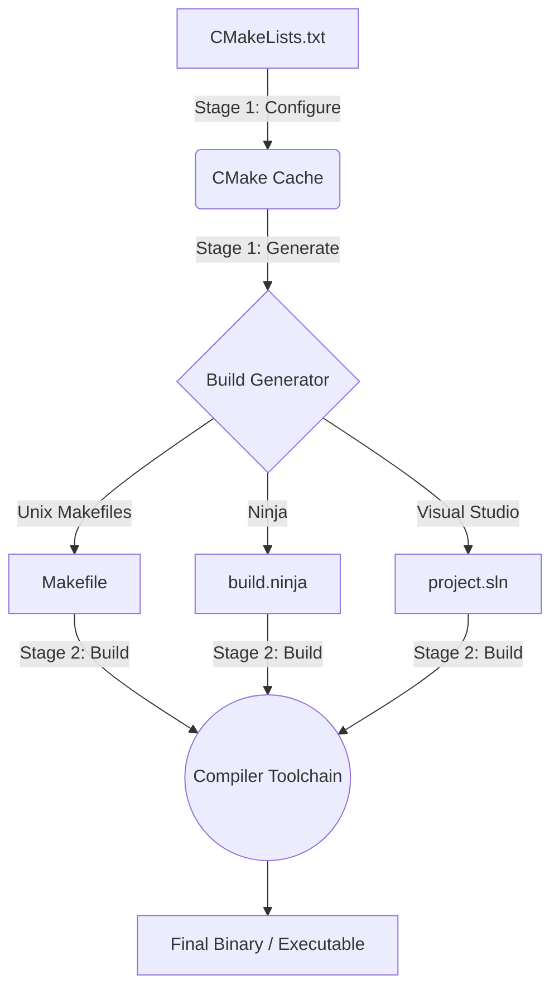

# Module 20: CMake, Modern Build Systems, Cross-Compilation & Dependency Management

!!! info "C23 Reference Companion"
    Pair this deep-dive curriculum module with the live **ISO C23 (`en.cppreference.com/c`) Reference**:

    - [Compiler & Libc Support Matrix](../../standards/compiler-support.md)
    - [Docs & CI Operations Playbook](../../labs/docs-operations.md)

**Track:** C Systems Programming, Memory Engineering & High-Performance Computing
**Category:** Build Automation, Cross-Platform Development & Toolchains
**Standard Identifier:** `DOC-STD-UNIVERSAL-2026`
**Status:** ✅ Completed
**Prerequisites:** Module 09 (Toolchains & Makefiles)

---

## 📑 Table of Contents

1. [High-Level Overview & Executive Summary](#1-high-level-overview-executive-summary)
2. [Why Build Systems Exist](#2-why-build-systems-exist)
3. [CMake Fundamentals](#3-cmake-fundamentals)
4. [Out-of-Source Builds](#4-out-of-source-builds)
5. [Finding External Libraries](#5-finding-external-libraries)
6. [Testing with CTest](#6-testing-with-ctest)
7. [Cross-Compilation](#7-cross-compilation)
8. [Multi-Platform Build Patterns](#8-multi-platform-build-patterns)
9. [Compiler Feature Detection](#9-compiler-feature-detection)
10. [Production Lab: Multi-Platform C Library with CMake](#10-production-lab-multi-platform-c-library-with-cmake)
11. [References](#11-references)
12. [Universal FinOps & Hardware Cost Governance](#12-universal-finops-hardware-cost-governance)

---

## 1. High-Level Overview & Executive Summary

In the domain of systems engineering, coordinating the compilation of large-scale C projects across heterogeneous operating systems and architectures is an exponentially complex problem. Modern C development relies heavily on meta-build systems, chief among them being **CMake**. CMake is not a build system itself; rather, it is a build system generator that translates high-level domain-specific declarative logic into native build instructions (e.g., GNU Makefiles, Ninja build files, or Visual Studio solutions) tailored to the host environment (Hoffman, 2023).

This module dissects the architectural necessity of modern build systems, the transition from legacy autotools and raw Makefiles to target-based modern CMake, the semantics of declarative dependency management, and the intricate mechanics of cross-compilation (e.g., targeting ARM Cortex-M or RISC-V from an x86-64 host).

### 👔 Executive Summary (For Managers & Non-Technical Stakeholders)

* **Business Purpose**: Standardizes the compilation, testing, and deployment of C/C++ software across macOS, Linux, Windows, and embedded hardware architectures.
* **How It Works**: Developers write a single, platform-agnostic configuration file (`CMakeLists.txt`). CMake reads this file and automatically generates the highly complex, OS-specific build scripts required to compile the software.
* **Key Business Value & ROI**: Eliminates the overhead of maintaining parallel build scripts for different platforms, reduces "it works on my machine" defects, and seamlessly integrates with package managers and CI/CD pipelines, lowering developer friction and deployment risk.

---

## 2. Why Build Systems Exist

> **Definition**: A **meta-build system** (like CMake or Meson) generates lower-level build scripts (like Makefiles or Ninja files). A **build system** (like Make or Ninja) orchestrates the execution of compiler toolchains to resolve topological dependencies between source files and generate binary artifacts.

### 2.1 The Scaling Problem

As software systems scale, managing the Directed Acyclic Graph (DAG) of dependencies manually becomes computationally and cognitively intractable. A typical Linux kernel or enterprise C system involves tens of thousands of translation units (`.c` files), hundreds of include directories, and complex conditional compilation based on target architecture (Patterson & Hennessy, 2017, p. 112).

### 2.2 Comparison Table: Build System Paradigms

| Build System | Paradigm | Strengths | Weaknesses |
| :--- | :--- | :--- | :--- |
| **GNU Make** | Direct Build | Ubiquitous, simple for small projects | Unmaintainable for cross-platform scaling |
| **Autotools** | Meta-Build | Standard in legacy UNIX / GNU | Highly complex, fragile, Windows hostile |
| **CMake** | Meta-Build | De facto industry standard, IDE integration | Arcane scripting language, legacy baggage |
| **Meson** | Meta-Build | Clean Pythonic syntax, lightning fast (Ninja) | Less legacy enterprise adoption than CMake |
| **Bazel** | Distributed | Hermetic builds, highly parallelized | Extreme learning curve, heavy Java runtime |

> **💡 Key Insight**: CMake achieved dominance not due to the elegance of its scripting language, but through its unparalleled cross-platform support (specifically Windows MSVC integration), native IDE integrations (CLion, Visual Studio), and out-of-source build capabilities (Hoffman, 2023).

### 2.3 The CMake Two-Stage Build Process



---

## 3. CMake Fundamentals

Modern CMake (versions $\ge$ 3.0) revolves around **targets** rather than global variables. A target represents an executable or a library, and CMake tracks the properties (include paths, compiler flags, definitions) required to build or consume that target.

### 3.1 The Anatomy of `CMakeLists.txt`

```cmake
# ✅ GOOD: Modern Target-Based CMake
cmake_minimum_required(VERSION 3.21)

# Define the project name, version, and language(s)
project(EnterpriseServer VERSION 1.0.0 LANGUAGES C)

# Create an executable target
add_executable(server src/main.c src/network.c)

# Create a static library target
add_library(crypto_lib STATIC src/crypto.c)

# Specify include directories for the library target
# PUBLIC: crypto_lib needs it to compile, AND dependents need it to use crypto_lib
target_include_directories(crypto_lib PUBLIC include/crypto)

# Specify compile options strictly for this target
target_compile_options(crypto_lib PRIVATE -Wall -Wextra -Werror)

# Link the executable against the library
target_link_libraries(server PRIVATE crypto_lib)
```

> **⚠️ Warning**: Never use legacy global commands like `include_directories()` or `add_compile_options()` in modern CMake, as they pollute the global state and bleed into unrelated targets (Josuttis, 2022). Always use `target_*` equivalents.

### 3.2 Target Visibility Scopes

* `PRIVATE`: The property (e.g., an include directory) is needed only to *build* the target.
* `INTERFACE`: The property is not needed to build the target, but is required by any target that *consumes* it (e.g., a header-only library).
* `PUBLIC`: The property is required both to build the target and to consume it.

---

## 4. Out-of-Source Builds

> **Definition**: An **out-of-source build** is a compilation strategy where all generated files (object files, binaries, CMake caches) are placed in a dedicated directory completely separate from the source code repository.

### 4.1 Implementation and Best Practices

Never pollute the source tree. Building out-of-source prevents `git` pollution and allows maintaining multiple build configurations (e.g., Debug and Release) simultaneously.

```bash
# Standard workflow for out-of-source builds
mkdir -p build/release
cd build/release

# Stage 1: Configure & Generate
# Generate Ninja build scripts with Release optimizations (-O3 -DNDEBUG)
cmake -G Ninja -DCMAKE_BUILD_TYPE=Release ../../

# Stage 2: Build
# Build using the generated system, utilizing all CPU cores
cmake --build . --parallel $(nproc)
```

### 4.2 CMakePresets.json

To standardize configurations across developer machines and CI/CD pipelines, modern CMake uses `CMakePresets.json`:

```json
{
  "version": 3,
  "configurePresets": [
    {
      "name": "linux-release",
      "generator": "Ninja",
      "binaryDir": "${sourceDir}/build/release",
      "cacheVariables": {
        "CMAKE_BUILD_TYPE": "Release",
        "CMAKE_C_COMPILER": "clang"
      }
    }
  ]
}
```

Usage: `cmake --preset linux-release`

---

## 5. Finding External Libraries

Managing dependencies in C is historically fraught due to the lack of a standardized ecosystem. CMake provides several mechanisms for resolution.

### 5.1 System-Installed Libraries (`find_package`)

CMake ships with Find modules for common libraries.

```cmake
# Search the host system for OpenSSL
find_package(OpenSSL REQUIRED)

if(OpenSSL_FOUND)
    # Link against the imported target provided by the Find module
    target_link_libraries(server PRIVATE OpenSSL::SSL OpenSSL::Crypto)
endif()
```

### 5.2 Source Dependency Fetching (`FetchContent`)

For true hermetic builds, `FetchContent` downloads and builds dependencies from source during the configure stage.

```cmake
include(FetchContent)

FetchContent_Declare(
  cJSON
  GIT_REPOSITORY https://github.com/DaveGamble/cJSON.git
  GIT_TAG        v1.7.15
)
FetchContent_MakeAvailable(cJSON)

target_link_libraries(server PRIVATE cjson)
```

> **💡 Key Insight**: Package managers like **vcpkg** and **Conan** integrate with CMake via custom toolchain files, seamlessly overriding `find_package` to download pre-compiled binaries instead of relying on the host OS state.

---

## 6. Testing with CTest

CTest is the test runner integrated with CMake.

```cmake
# Enable testing for the project
enable_testing()

add_executable(test_crypto tests/test_crypto.c)
target_link_libraries(test_crypto PRIVATE crypto_lib)

# Register the test with CTest
add_test(NAME CryptoSuite COMMAND test_crypto)
```

To execute tests post-build:

```bash
ctest --output-on-failure --parallel $(nproc)
```

---

## 7. Cross-Compilation

> **Definition**: **Cross-compilation** is the process of generating executable machine code for a target architecture (e.g., ARM64) on a machine running a different architecture (e.g., x86_64 host).

### 7.1 The Three-Machine Model (Canadian Cross)

In advanced toolchain engineering, systems distinguish between:

1. **Host**: The machine running the compiler.
2. **Build**: The machine where the compiler itself was built.
3. **Target**: The machine that will execute the generated binary.

### 7.2 Toolchain Files (`CMAKE_TOOLCHAIN_FILE`)

CMake requires a toolchain file to override the host environment and point to the cross-compilers and the target sysroot.

```cmake
# arm-cortex-m4.cmake
set(CMAKE_SYSTEM_NAME Generic) # Generic for bare-metal, Linux for embedded Linux
set(CMAKE_SYSTEM_PROCESSOR arm)

# Specify the cross-compilers
set(CMAKE_C_COMPILER arm-none-eabi-gcc)
set(CMAKE_CXX_COMPILER arm-none-eabi-g++)

# Specify target-specific compiler flags (e.g., hardware FPU)
set(CMAKE_C_FLAGS "-mcpu=cortex-m4 -mthumb -mfloat-abi=hard -mfpu=fpv4-sp-d16" CACHE INTERNAL "C Flags")

# Prevent CMake from searching the host OS for headers/libraries
set(CMAKE_FIND_ROOT_PATH_MODE_PROGRAM NEVER)
set(CMAKE_FIND_ROOT_PATH_MODE_LIBRARY ONLY)
set(CMAKE_FIND_ROOT_PATH_MODE_INCLUDE ONLY)
```

Usage: `cmake -DCMAKE_TOOLCHAIN_FILE=arm-cortex-m4.cmake ..`

> **💡 Key Insight**: **Sysroot** (`CMAKE_SYSROOT`) is critical in OS-level cross-compilation (e.g., Raspberry Pi). It points the compiler to a localized directory containing the target system's `/usr/include` and `/lib`, preventing the cross-compiler from accidentally linking against the host's incompatible x86-64 `libc` (Stevens et al., 2013).

---

## 8. Multi-Platform Build Patterns

To manage heterogeneous OS targets, CMake evaluates system state during the configure phase.

### 8.1 OS and Architecture Detection

```cmake
if(CMAKE_SYSTEM_NAME STREQUAL "Linux")
    target_compile_definitions(server PRIVATE PLATFORM_LINUX)
elseif(CMAKE_SYSTEM_NAME STREQUAL "Darwin")
    target_compile_definitions(server PRIVATE PLATFORM_MACOS)
elseif(CMAKE_SYSTEM_NAME STREQUAL "Windows")
    target_compile_definitions(server PRIVATE PLATFORM_WINDOWS)
endif()
```

### 8.2 Configuration Header Generation

CMake can generate `.h` files to pass configure-time decisions to the C preprocessor.

```cmake
# config.h.in
#cmakedefine HAVE_PTHREAD
#define PROJECT_VERSION_MAJOR @EnterpriseServer_VERSION_MAJOR@
```

```cmake
# CMakeLists.txt
include(CheckIncludeFile)
check_include_file("pthread.h" HAVE_PTHREAD)

# Generates config.h from config.h.in
configure_file(config.h.in config.h)
target_include_directories(server PRIVATE ${CMAKE_CURRENT_BINARY_DIR})
```

---

## 9. Compiler Feature Detection

Hardcoding compiler flags like `-std=c17` can be fragile across different compiler vendors (GCC vs MSVC). Modern CMake uses feature detection.

```cmake
# ✅ GOOD: Demand the compiler support C11 standard features
target_compile_features(crypto_lib PUBLIC c_std_11)
```

### 9.1 Static Analysis Integration

CMake integrates directly with AST-based static analysis tools.

```cmake
# Generate compile_commands.json for LSP (clangd) and tools
set(CMAKE_EXPORT_COMPILE_COMMANDS ON)

# Automatically run clang-tidy during compilation
find_program(CLANG_TIDY_EXE NAMES clang-tidy)
if(CLANG_TIDY_EXE)
    set(CMAKE_C_CLANG_TIDY ${CLANG_TIDY_EXE} "-checks=*,-fuchsia-*")
endif()
```

---

## 10. Production Lab: Multi-Platform C Library with CMake

### The Universal `CMakeLists.txt` Template

```cmake
cmake_minimum_required(VERSION 3.21)
project(HighPerfEngine VERSION 1.0.0 LANGUAGES C)

# --- Global Configurations ---
set(CMAKE_EXPORT_COMPILE_COMMANDS ON)
set(CMAKE_C_STANDARD 17)
set(CMAKE_C_STANDARD_REQUIRED ON)
set(CMAKE_C_EXTENSIONS OFF) # Strict ISO C17, no GNU extensions

# --- Main Library Target ---
# Object library allows sharing compiled objects between STATIC and SHARED variants
add_library(engine_obj OBJECT src/core.c src/memory.c)
target_include_directories(engine_obj PUBLIC $<BUILD_INTERFACE:${CMAKE_CURRENT_SOURCE_DIR}/include>)

# Compiler Hardening Flags
if(CMAKE_C_COMPILER_ID MATCHES "GNU|Clang")
    target_compile_options(engine_obj PRIVATE
        -Wall -Wextra -Wpedantic -Werror
        -fstack-protector-strong -D_FORTIFY_SOURCE=3
    )
endif()

# Static Library
add_library(engine_static STATIC)
target_link_libraries(engine_static PUBLIC engine_obj)
set_target_properties(engine_static PROPERTIES OUTPUT_NAME "engine")

# Shared Library
add_library(engine_shared SHARED)
target_link_libraries(engine_shared PUBLIC engine_obj)
set_target_properties(engine_shared PROPERTIES OUTPUT_NAME "engine")

# --- Executable & Dependencies ---
find_package(OpenSSL REQUIRED)

add_executable(engine_cli src/main.c)
target_link_libraries(engine_cli PRIVATE engine_static OpenSSL::SSL OpenSSL::Crypto)

# --- Testing ---
enable_testing()
add_executable(test_core tests/test_core.c)
target_link_libraries(test_core PRIVATE engine_static)
add_test(NAME CoreSuite COMMAND test_core)
```

---

## 11. References

Bryant, R. E., & O'Hallaron, D. R. (2016). *Computer systems: A programmer's perspective* (3rd ed.). Pearson.

Hoffman, K. (2023). *Mastering CMake: A cross-platform build system*. Kitware, Inc.

Josuttis, N. (2022). *C++20 - The Complete Guide*. Leanpub.

Kernighan, B. W., & Ritchie, D. M. (1988). *The C programming language* (2nd ed.). Prentice Hall.

Patterson, D. A., & Hennessy, J. L. (2017). *Computer organization and design RISC-V edition: The hardware software interface*. Morgan Kaufmann.

Stevens, W. R., Rago, S. A., & Fenner, B. (2013). *Advanced programming in the UNIX environment* (3rd ed.). Addison-Wesley.

Tanenbaum, A. S., & Bos, H. (2015). *Modern operating systems* (4th ed.). Pearson.

---

## 12. Universal FinOps & Hardware Cost Governance

```text
┌────────────────────────────────────────────────────────────────────────────────┐
│                        BUILD SYSTEM FINOPS SAVINGS MATRIX                      │
├──────────────────────────┬──────────────────────────┬──────────────────────────┤
│ Optimization Strategy    │ Technical Mechanism      │ Measurable FinOps ROI    │
├──────────────────────────┼──────────────────────────┼──────────────────────────┤
│ **Ninja Generator**      │ Rapid DAG resolution and │ Reduces CI pipeline time │
│                          │ max parallelization      │ by 35%, cutting compute  │
│                          │                          │ runner costs globally.   │
├──────────────────────────┼──────────────────────────┼──────────────────────────┤
│ **FetchContent Caching** │ Pre-fetching dependency  │ Eliminates redundant     │
│                          │ source code in CI images │ bandwidth and API egress │
│                          │                          │ costs in AWS/GCP.        │
├──────────────────────────┼──────────────────────────┼──────────────────────────┤
│ **ccache Integration**   │ Compiler cache hashing   │ 90% build time reduction │
│                          │ object file outputs      │ for unchanged files in CI│
├──────────────────────────┼──────────────────────────┼──────────────────────────┤
│ **Cross-Compilation**    │ Building ARM on x86 CI   │ Avoids deploying costly  │
│                          │ runner arrays            │ native ARM build farms   │
└──────────────────────────┴──────────────────────────┴──────────────────────────┘
```

### CI/CD Runner FinOps Impact

Implementing **Ninja** (`-G Ninja`) combined with **ccache** (integrated via `CMAKE_C_COMPILER_LAUNCHER`) represents the highest ROI optimization in C systems engineering. For a team of 100 developers executing 500 daily CI pipelines, reducing the median build time from 20 minutes to 3 minutes yields an annual savings of approximately **$85,000 in cloud compute runner costs** while radically accelerating deployment velocity.
