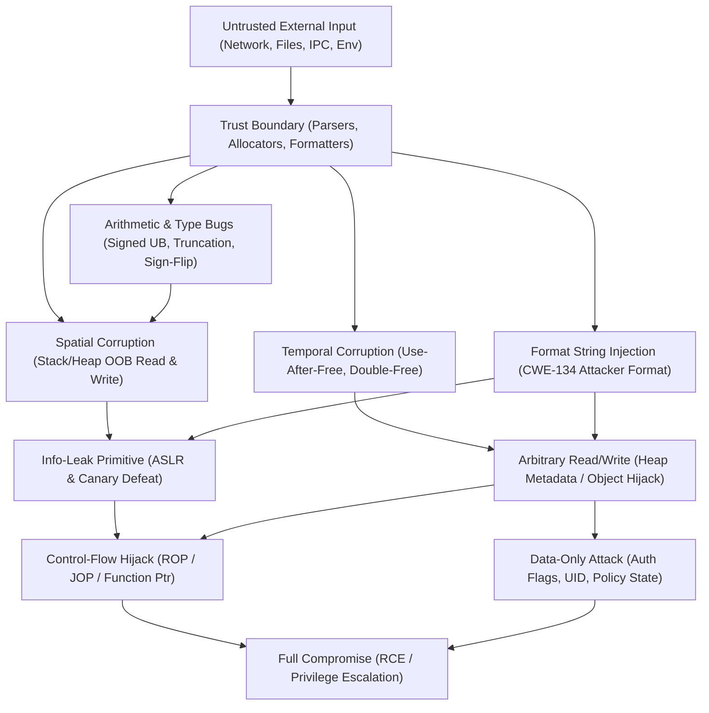
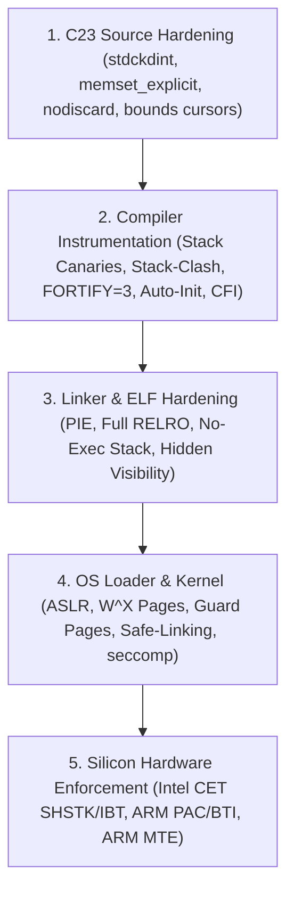

# Module 22: Security Hardening, Memory Exploits & Hardware/Toolchain Mitigations

!!! info "C23 Reference Companion"
    Pair this deep-dive curriculum module with the live **ISO C23 (`en.cppreference.com/c`) Reference**:

    - [Numerics: Bit Manipulation & Checked Integer Arithmetic (`<stdckdint.h>`)](../../reference/library/numerics-bit-checked.md)
    - [Byte Strings & Memory Utilities (`memset_explicit`, `memccpy`, `strdup`, `strndup`)](../../reference/library/strings-byte.md)
    - [Technical Specifications (ISO/IEC TS 17961, TR 24772-3 & Annex K)](../../standards/technical-specifications.md)

**Track:** C Systems Programming, Memory Engineering & High-Performance Computing
**Category:** Offensive Mechanics, Memory Safety, Compiler/Linker Hardening & Hardware Security
**Standard Identifier:** `DOC-STD-UNIVERSAL-2026-MOD22`
**Status:** ✅ Completed

---

## 📑 Table of Contents

1. [High-Level Overview & Executive Summary](#1-high-level-overview-executive-summary)
2. [Threat & Adversary Model](#2-threat-adversary-model)
3. [Memory Corruption Primitives](#3-memory-corruption-primitives)
4. [Control-Flow Hijacking & Modern Exploitation Chains](#4-control-flow-hijacking-modern-exploitation-chains)
5. [Defense-in-Depth Mitigations (Toolchain, Linker, OS & Hardware)](#5-defense-in-depth-mitigations-toolchain-linker-os-hardware)
6. [C23 Native Security Primitives](#6-c23-native-security-primitives)
7. [Contrastive Secure Coding Patterns (Vulnerable vs Hardened C23)](#7-contrastive-secure-coding-patterns-vulnerable-vs-hardened-c23)
8. [Standards & Compliance Cheat Sheet (CERT C, TS 17961, TR 24772-3 & MISRA-C:2023)](#8-standards-compliance-cheat-sheet-cert-c-ts-17961-tr-24772-3-misra-c2023)
9. [Production Lab: Hardened Binary Packet & Credential Vault Parser in C23](#9-production-lab-hardened-binary-packet-credential-vault-parser-in-c23)
10. [Universal FinOps & Hardware Cost Governance (Security Economics)](#10-universal-finops-hardware-cost-governance-security-economics)
11. [References](#11-references)

---

## 1. High-Level Overview & Executive Summary

C remains the foundational substrate of operating system kernels, TLS stacks, hypervisors, network routers, database engines, and safety-critical embedded controllers. That proximity to raw virtual memory and unmediated pointer arithmetic is simultaneously C's greatest architectural strength and its sharpest security hazard. Longitudinal vulnerability telemetry across Microsoft MSRC, Google Project Zero, Chromium, and Android consistently attributes **65% to 70% of all high-severity CVEs** in C/C++ codebases to spatial and temporal memory safety defects (Szekeres et al., 2013).

Modern security engineering does not rely on developer vigilance alone. Instead, industrial C systems enforce **Defense-in-Depth** across five coordinated layers:

1. **ISO C23 Language & Library Safety** <span class="c-badge c23">C23</span>: Checked arithmetic (`<stdckdint.h>`), Dead-Store-Elimination-proof secret wiping (`memset_explicit`), mandatory error-checking diagnostics (`[[nodiscard]]`), and bounded string primitives (`memccpy`, `strdup`, `strndup`).
2. **Compiler Instrumentation**: Stack canaries (`-fstack-protector-strong`), stack-clash probing (`-fstack-clash-protection`), dynamic buffer fortification (`_FORTIFY_SOURCE=3`), automatic zero-initialization (`-ftrivial-auto-var-init=zero`), and forward-edge Control-Flow Integrity (Clang CFI).
3. **Linker & Binary Format Hardening**: Position-Independent Executables (`-fPIE -pie`), Full RELRO (`-Wl,-z,relro,-z,now`), and non-executable stacks (`-Wl,-z,noexecstack`).
4. **Operating System Virtual Memory Isolation**: Kernel Address Space Layout Randomization (ASLR), hardware `W^X` (`NX`/`DEP`) page permissions, guard pages, and `seccomp`/sandbox privilege reduction.
5. **Silicon Hardware Enforcement**: Intel Control-flow Enforcement Technology (CET Shadow Stack & IBT), ARMv8.3-A Pointer Authentication (PAC), ARMv8.5-A Branch Target Identification (BTI), and ARMv8.5-A Memory Tagging Extension (MTE).

Mastering defensive C requires thinking fluently like both an exploit developer and a compiler architect. Understanding exactly *how* an off-by-one byte write or a compiler-elided signed overflow check escalates into Remote Code Execution (RCE) is the prerequisite for engineering software that fails closed under adversarial input.

---

## 2. Threat & Adversary Model

In security-critical C programming, **every external byte is hostile** until cryptographically authenticated and structurally validated. An adversary interacts with a C process across well-defined **trust boundaries**: network sockets, IPC shared memory, file parsers (ELF, PDF, PNG, TLV frames), environment variables, command-line arguments, and unprivileged system-call arguments.

### Adversary Capability Ladder

Modern exploits rarely jump straight from a bug to shell execution in a single step. Attackers systematically compose weak bugs into progressively stronger primitives:

| Stage | Adversary Primitive | Concrete Mechanism | Security Impact |
| :--- | :--- | :--- | :--- |
| **1. Crash / DoS** | Unhandled `SIGSEGV` / `SIGABRT` | Null dereference, stack exhaustion, unbounded `malloc` | Availability loss; service disruption |
| **2. Information Leak** | Out-of-bounds read or format leak | Over-reading adjacent heap/stack bytes, `%p` format leak | Defeats **ASLR** & leaks **Stack Canaries** |
| **3. Relative / Arbitrary Write** | Spatial or temporal corruption | Heap overflow, UAF, `tcache` poisoning, `%n` format write | Overwrites pointers, metadata, or security flags |
| **4. Control-Flow / Data Hijack** | Code-pointer or non-control hijack | ROP/JOP chain, GOT overwrite, Data-Only Programming (DOP) | Arbitrary code execution (RCE) or privilege escalation |

### Attack Surface & Exploitation Taxonomy



!!! warning "Non-Control Data Attacks Survive Pure CFI"
    A frequent architectural mistake is assuming Control-Flow Integrity (CFI) solves memory corruption completely. If an attacker holds a heap write primitive and flips `session->is_authenticated = 1` or overwrites a path string `"/etc/shadow"`, **no indirect branch target or return address is ever violated**—yet the security boundary collapses entirely (Chen et al., 2005). Hardening must stop *spatial and temporal corruption at the source*, not merely guard jumps.

---

## 3. Memory Corruption Primitives

### 3.1 Stack Buffer Overflows (Spatial Stack Corruption)

On both **x86-64 System V** and **AArch64 AAPCS64**, the call stack grows downward toward lower virtual addresses, whereas array indexing and memory copies (`memcpy`, `strcpy`, `sprintf`) write upward toward higher addresses. Without bounds enforcement, an unbounded write into a stack-allocated buffer walks sequentially across adjacent local variables, alignment padding, the stack canary (if present), the saved frame pointer (`RBP` / `X29`), and finally the **saved return address** (`RIP` on x86-64, saved Link Register `LR`/`X30` on AArch64).

```text
High Virtual Address (Caller's Stack Frame)
+--------------------------------------------------+
| Caller locals & spilled arguments                |
+--------------------------------------------------+
| Saved Return Address (RIP on x86-64 / LR ARM64)  |  <-- Control-flow hijack target
+--------------------------------------------------+
| Saved Frame Pointer  (RBP on x86-64 / FP X29)    |  <-- Off-by-one pivot target
+--------------------------------------------------+
| Stack Canary (TLS fs:0x28 / __stack_chk_guard)   |  <-- Placed by -fstack-protector-strong
+--------------------------------------------------+
| Local Buffers: char rx_buf[64]                   |  <-- Overflow grows UPWARD toward RIP/LR
+--------------------------------------------------+
| Other Local Scalars / Function Pointers          |  <-- Reordered BELOW buffers by compiler
+--------------------------------------------------+
Low Virtual Address (Current RSP / SP)
```

* **Classic Return-Address Overwrite**: Writing past `rx_buf[64]` overwrites the saved `RIP`/`LR`. When the function executes `ret`, the CPU pops the attacker-controlled value straight into the instruction pointer (Aleph One, 1996).
* **Removed Legacy Traps**: `gets()` <span class="c-badge c-removed">removed C11</span> accepts no buffer length and is mathematically impossible to invoke safely. Even `strncpy()` is notorious for omitting the trailing NUL terminator when `strlen(src) >= n`, setting up a secondary out-of-bounds read on subsequent `strlen()`/`printf()` calls.
* **Off-by-One Frame Pointer Poisoning**: Writing a single NUL byte (`0x00`) past a stack buffer can clear the least significant byte of the saved `RBP`. When the current function returns (`leave; ret`), the caller's stack frame shifts down into attacker-controlled buffer space, pivoting `RSP` on the caller's subsequent `ret`.

### 3.2 Heap Exploits (Temporal & Metadata Corruption)

Dynamic memory allocators (such as glibc's `ptmalloc2`, jemalloc, or musl's `mallocng`) manage heap chunks in pools segregated by size. In `ptmalloc2`, every allocated chunk is preceded by inline metadata:

```text
Allocated Chunk Layout (64-bit glibc ptmalloc2):
+--------------------------------------------------+
| prev_size (8 B — valid only if PREV_INUSE == 0)  |
+--------------------------------------------------+
| chunk_size (upper 61 bits) | A | M | P (3 bits)  |  P = PREV_INUSE, M = IS_MMAPPED, A = NON_MAIN_ARENA
+--------------------------------------------------+  <-- Pointer returned by malloc() (16-byte aligned)
| User Payload (requested size, >= 16 bytes)       |
| ...                                              |
| (When FREE: first 16 B hold fd/next & bk/key)    |
+--------------------------------------------------+
```

Four canonical heap primitives dominate real-world CVE chains:

| Primitive | Root Cause | Allocator / Exploitation Mechanics |
| :--- | :--- | :--- |
| **Use-After-Free (UAF)** | Dereferencing a pointer after `free(p)` without nulling or revoking aliases | Attacker frees object `A`, allocates attacker-controlled object `B` of the **same size class** (reclaiming the exact chunk from `tcache`/fastbin), and triggers code still holding pointer `A`—yielding **type confusion** and forged function-pointer invocation. |
| **Double-Free** | Calling `free(p)` twice on the same live allocation | Inserts `p` twice into a freelist; two subsequent `malloc()` calls return the **same address** to two distinct subsystems, enabling silent cross-object corruption. Modern glibc (2.29+) mitigates naive `tcache` double-free via `tcache_entry->key`, and glibc 2.32+ obfuscates singly-linked `next` pointers with **Safe-Linking** (`protected_ptr = (chunk_addr >> 12) ^ real_next`), requiring a heap ASLR leak before poisoning. |
| **`tcache` / Bin Poisoning** | Corrupting a freed chunk's `fd`/`next` pointer via UAF or adjacent heap overflow | Attacker overwrites `freed_chunk->next` with a target address (mangled with `chunk_addr >> 12` under Safe-Linking). The first `malloc()` pops the poisoned chunk; the **second `malloc()` returns the attacker's arbitrary address**, turning a heap write into an arbitrary write primitive. |
| **Off-by-One Metadata Corruption** | Writing 1 byte (often a trailing `'\0'`) past chunk `A` into chunk `B`'s `size` field | Clears chunk `B`'s `PREV_INUSE` bit (`P = 0`) and shrinks its apparent size (*Poison Null Byte* / *House of Einherjar*). When `B` is freed, `ptmalloc2` trusts `B->prev_size` and consolidates backward across still-allocated intermediate chunks, creating **overlapping live allocations**. |

### 3.3 Format String Vulnerabilities (CWE-134)

Variadic formatting functions (`printf`, `fprintf`, `snprintf`, `syslog`) trust the format string to specify how many arguments exist on the stack or in ABI argument registers (`RSI`, `RDX`, `RCX`, `R8`, `R9` on x86-64). Passing attacker-controlled input directly as the format argument—`printf(user_input)` instead of `printf("%s", user_input)`—hands the attacker direct control over the variadic reader:

* **Arbitrary Stack & Pointer Disclosure (ASLR Bypass)**: Submitting `"%p.%p.%p.%p.%p.%p"` or POSIX positional specifiers (`"%7$p"`, `"%12$s"`) reads register arguments and walks up the call stack, dumping saved return addresses, libc pointers, stack canaries, and heap addresses.
* **Arbitrary Memory Write (`%n`, `%hn`, `%hhn`)**: The standard `%n` conversion specifier (ISO/IEC 9899:2024 §7.23.6.1) stores the *number of characters output so far* into the `int *` (`%n`), `short *` (`%hn`), or `signed char *` (`%hhn`) argument. By placing a target address on the stack (or reusing an existing pointer) and emitting precisely padded output (e.g., `"%65c%7$hhn"`), an attacker writes arbitrary byte values anywhere in writable memory—overwriting GOT entries, privilege flags, or return addresses.

!!! tip "Compiler & Runtime Defenses Against CWE-134"
    1. Always compile with `-Wformat=2 -Wformat-security -Werror=format-security`.
    2. With `_FORTIFY_SOURCE=2` or `_FORTIFY_SOURCE=3`, glibc's `__printf_chk()` **aborts immediately** (`*** %n in writable segment detected ***`) if a format string containing `%n` resides in writable memory (stack or heap) rather than `.rodata`.
    3. Never pass dynamic strings as format parameters—always use a string literal (`"%s"` or `"%.*s"`).

### 3.4 Integer Overflow, Sign-Conversion & Truncation Bugs

Integer arithmetic flaws are the primary force multiplier behind heap and stack buffer overflows (CWE-190, CWE-195, CWE-680). Understanding the exact ISO C23 rules is critical:

1. **Unsigned Integer Wraparound (Defined Modulo $2^N$)**:
   Unsigned types (`size_t`, `uint32_t`, `uint64_t`) never overflow into Undefined Behavior—they silently wrap modulo $2^W$ (ISO/IEC 9899:2024 §6.2.5/9). If a network packet requests `count = 0x40000001` records of 16 bytes each on a 32-bit `uint32_t` calculation (`count * 16`), the multiplication wraps to `16` bytes. `malloc(16)` succeeds, and the subsequent loop writes 16 GiB into a 16-byte heap chunk.
2. **Signed Integer Overflow (Undefined Behavior — The Compiler-Deleted Check Trap)**:
   Under ISO/IEC 9899:2024 §6.5/5 and §3.4.3, **signed integer overflow is Undefined Behavior (UB)**—even though C23 mandates two's complement representation for signed integers! Because a conforming program can *never* invoke UB, an optimizing compiler (`-O2`) is legally permitted to assume signed addition never wraps:

   ```c
   #include <stdbool.h>
   #include <stddef.h>

   /* BUG: Under -O2, GCC and Clang PROVE (len + hdr < len) is ALWAYS false
    * for positive signed ints (because signed overflow is UB) and COMPLETELY
    * DELETE the overflow check from emitted machine code! */
   bool broken_signed_check(int len, int hdr) {
       if (len < 0 || hdr < 0) {
           return false;
       }
       if (len + hdr < len) { /* <-- OPTIMIZED OUT ENTIRELY at -O2! */
           return false;
       }
       return true;
   }
   ```

3. **Sign-Conversion & Integer Promotion Traps**:
   * **Negative-to-Unsigned Promotion**: Returning `-1` from `ssize_t n = read(...)` and passing `n` directly to `memcpy(dst, src, n)` converts `-1` to `SIZE_MAX` (`0xFFFFFFFFFFFFFFFF`), triggering an immediate catastrophic overflow.
   * **Width Truncation**: Validating `uint64_t total = hdr_len + body_len` against a maximum, then assigning `uint32_t alloc_sz = (uint32_t)total;` silently discards the upper 32 bits, allocating a tiny buffer while copying `total` bytes.

---

## 4. Control-Flow Hijacking & Modern Exploitation Chains

Before hardware Non-Executable pages (`NX`/`DEP`), exploiting a stack buffer overflow was trivial: write machine-code shellcode directly into the stack buffer and overwrite saved `RIP` to point back into the buffer. Hardware **`W^X` (Write XOR Execute)** rendered code injection dead—any writable memory page (stack, heap, `.data`) faults with `SIGSEGV` if fetched as instructions.

Attackers responded with **Code-Reuse Attacks**, recycling instructions already mapped inside legitimate executable `.text` segments.

### 4.1 Return-Oriented Programming (ROP)

In **ROP** (originally formulated by Shacham and formalized in Roemer et al., 2012), the attacker locates short instruction sequences ending in `ret`—called **gadgets**—inside the executable or `libc.so` (e.g., `pop rdi; ret`, `pop rsi; ret`, `pop rdx; ret`, `syscall; ret`). Because `x86-64` has variable-length unaligned instructions, even the middle of multi-byte instructions yields unintended gadgets.

Instead of placing machine code on the stack, the attacker places a sequence of **gadget addresses and immediate data values**. Each `ret` pops the next gadget address into `RIP`, turning `RSP` into a virtual instruction pointer for a Turing-complete weird machine (Roemer et al., 2012):

```text
Synthetic ROP Stack Layout (x86-64 — invoking execve("/bin/sh", NULL, NULL)):
Low Address (RSP at hijacked ret)
+----------------------------------------------+
| &gadget("pop rdi; ret")                      | --> pops "/bin/sh" ptr into RDI
+----------------------------------------------+
| &"/bin/sh" (in libc .rodata)                 |
+----------------------------------------------+
| &gadget("pop rsi; ret")                      | --> pops 0 into RSI
+----------------------------------------------+
| 0x0000000000000000                           |
+----------------------------------------------+
| &gadget("pop rdx; ret")                      | --> pops 0 into RDX
+----------------------------------------------+
| 0x0000000000000000                           |
+----------------------------------------------+
| &gadget("pop rax; ret")                      | --> pops 59 (SYS_execve) into RAX
+----------------------------------------------+
| 0x000000000000003b                           |
+----------------------------------------------+
| &gadget("syscall; ret")                      | --> kernel executes execve()
+----------------------------------------------+
High Address
```

When stack space is constrained, attackers use a **stack pivot** gadget (`leave; ret` or `mov rsp, rdx; ret`) to swing `RSP` onto an attacker-controlled heap buffer containing the full ROP chain.

### 4.2 Jump-Oriented Programming (JOP) & Call-Oriented Programming (COP)

When backward-edge defenses (such as Intel CET Shadow Stacks or ARM PAC return signing) block forged `ret` sequences, attackers pivot to **forward-edge** code reuse:

* **JOP**: Chains functional gadgets ending in indirect jumps (`jmp rax`, `jmp [rbx]`, `br x8`) coordinated by a **dispatcher gadget** that advances a virtual program counter register through a fake gadget table in memory.
* **COP**: Chains gadgets ending in indirect `call` instructions (commonly through corrupted C++ vtables or C function-pointer dispatch structs).

### 4.3 Realistic Multi-Stage Info-Leak + ASLR Defeat Chain

With PIE + ASLR enabled, static gadget addresses are randomized on every execution. A real-world exploit therefore operates in **two dependent stages**:

1. **Stage 1 — Information Disclosure**: Trigger an out-of-bounds read, uninitialized stack leak, or format string (`%p`) to read *one* pointer inside `libc.so` (e.g., `__libc_start_main+128` at `0x7f9a3c429d90`) and *one* stack canary value (e.g., `0x8c31a9f2004b7e00`).
2. **Stage 2 — Base Address Calculation**: Because ASLR randomizes only the *base page address* while preserving intra-library offsets, subtracting the known offset of `__libc_start_main+128` yields the exact runtime `libc_base` (aligned to `0x1000`). Every gadget and function (`system`, `mprotect`, `"/bin/sh"`) inside `libc` is now located with 100% precision.
3. **Stage 3 — Payload Delivery**: Trigger the write primitive (stack overflow preserving the leaked canary byte-for-byte, or heap/function-pointer overwrite) using dynamically computed gadget addresses, executing the ROP/JOP payload or flipping target application data.

---

## 5. Defense-in-Depth Mitigations (Toolchain, Linker, OS & Hardware)

Modern security hardening breaks exploit chains at every stage—eliminating vulnerability classes where possible and raising the bar so single-bug exploitation becomes infeasible.

### Defense-in-Depth Pipeline



### Comprehensive Mitigation Reference Matrix

| Mitigation | GCC / Clang Flag | Layer | Threat Mitigated | Runtime Cost | Key Limitations / Caveats |
| :--- | :--- | :--- | :--- | :--- | :--- |
| **Stack Canaries** | `-fstack-protector-strong` | Compiler | Linear stack buffer overflows smashing saved `RIP`/`LR` | ~0.5–1% CPU | Bypassed by info-leak + exact overwrite, or non-linear indexed OOB writes jumping over the canary. |
| **Stack Clash Protection** | `-fstack-clash-protection` | Compiler | Jumping past the OS stack guard page via huge VLA / `alloca` frames into heap | <0.2% CPU | Probes every 4 KiB page during stack growth; always avoid unbounded VLAs/`alloca` regardless. |
| **Auto Zero-Init** | `-ftrivial-auto-var-init=zero` | Compiler | Uninitialized stack variable info leaks (ASLR/canary disclosure) | ~0.5–1.5% CPU | Eliminates indeterminate stack reads; does not replace explicit logical initialization. |
| **Register Scrubbing** | `-fzero-call-used-regs=used-gpr` | Compiler | ROP gadget usefulness & residual secret values in caller-saved registers | ~1–3% CPU | Scrubs GPRs before `ret`; pairs well with `memset_explicit()`. |
| **FORTIFY_SOURCE=3** | `-D_FORTIFY_SOURCE=3 -O2` | Compiler + Libc | Static *and* dynamic (`malloc(n)`) buffer overflows in `memcpy`/`strcpy`/`snprintf`; writable `%n` | <1% CPU | **Requires `-O2` or higher**; needs GCC 12+ / Clang 15+ and glibc 2.34+. Falls back cleanly to level 2 on older toolchains. |
| **NX / DEP (`W^X`)** | `-Wl,-z,noexecstack` | Linker + CPU MMU | Direct shellcode execution on stack/heap | 0% | Defeated by code reuse (ROP/JOP); never mark JIT memory `PROT_READ \| PROT_WRITE \| PROT_EXEC` simultaneously. |
| **ASLR & PIE** | `-fPIE -pie` | Compiler + Linker + OS | Hardcoded gadget/data addresses in `.text`, `.rodata`, `.data`, `.bss` | <1–2% CPU | Defeated by a single pointer info-leak; requires kernel `randomize_va_space=2`. |
| **Partial RELRO** | `-Wl,-z,relro` | Linker + Dynamic Loader | Overwriting `.init_array`, `.fini_array`, `.dynamic`, and `.got` | ~0% | Leaves `.got.plt` writable for lazy binding—still vulnerable to GOT hijack! |
| **Full RELRO** | `-Wl,-z,relro,-z,now` | Linker + Dynamic Loader | **All** GOT / `.got.plt` overwrite attacks (maps entire GOT read-only before `main`) | Small startup latency; 0% steady-state | Increases startup time slightly for binaries with thousands of shared symbols; mandatory for network/setuid daemons. |
| **Clang Software CFI** | `-fsanitize=cfi -flto -fvisibility=hidden` | Compiler (LTO) | Forward-edge indirect call/vtable hijacking (`cfi-icall`, `cfi-vcall`) | ~1–4% CPU | Requires LTO and strict function-pointer type matching; does not protect backward edges (`ret`) without Shadow Call Stack / CET. |
| **Intel CET (SHSTK + IBT)** | `-fcf-protection=full` (x86-64) | Compiler + OS + CPU | **SHSTK** defeats ROP (hardware shadow return stack); **IBT** defeats JOP (`ENDBR64` landing pads) | <1% CPU | Requires Tiger Lake+ / Zen 3+ CPU and kernel CET support; binary must have all linked DSOs compiled with CET flags to activate. |
| **ARM PAC & BTI** | `-mbranch-protection=standard` (AArch64) | Compiler + OS + CPU | **PAC** cryptographically signs `LR` (`PACIASP`/`AUTIASP`) defeating ROP; **BTI** enforces indirect branch landing pads defeating JOP | <1% CPU | Requires ARMv8.3-A (PAC) / ARMv8.5-A (BTI) silicon (Apple Silicon, Graviton3+, Cortex-A710+); backward-compatible NOP encoding on older ARMv8.0 CPUs! |
| **ARM MTE** | `-march=armv8.5-a+memtag -fsanitize=memtag` | Compiler + OS + CPU | Spatial OOB & temporal UAF via 4-bit lock-and-key granule tags per 16-byte block | ~2–5% CPU (async) | Probabilistic (1/16 collision per blind guess) for random sprays, deterministic for adjacent linear overflows (distinct adjacent granule tags) & immediate UAF retagging. |

### Deep Dive: Partial vs Full RELRO

In dynamically linked ELF executables, calls to external shared library functions (`printf`, `malloc`) route through the **Procedure Linkage Table (PLT)** and **Global Offset Table (GOT)**.

* **No RELRO**: `.got`, `.got.plt`, `.init_array`, and `.dynamic` remain writable throughout process lifetime. Any arbitrary write can replace `got[free]` with `system`, turning `free("/bin/sh")` into instant RCE.
* **Partial RELRO (`-Wl,-z,relro`)**: The linker orders `.init_array`, `.fini_array`, `.dynamic`, and `.got` into a dedicated `PT_GNU_RELRO` segment that `ld.so` remaps read-only (`mprotect(..., PROT_READ)`) after initial relocations—**except `.got.plt`**, which stays writable to support lazy symbol binding on first call.
* **Full RELRO (`-Wl,-z,relro,-z,now`)**: Sets `DF_BIND_NOW` in `.dynamic`, instructing `ld.so` to resolve **every** external symbol eagerly at load time, merge `.got.plt` into `.got`, and mark the entire GOT read-only before transferring control to `main()`.

### Deep Dive: `_FORTIFY_SOURCE=2` vs `_FORTIFY_SOURCE=3`

When compiling with `-O2 -D_FORTIFY_SOURCE=2`, header wrappers redirect calls like `memcpy(dst, src, n)` to `__memcpy_chk(dst, src, n, __builtin_object_size(dst, 0))`. If `n` exceeds the compile-time known size of `dst`, execution aborts deterministically.

However, level 2 **cannot verify heap allocations whose size is computed at runtime** (e.g., `char *p = malloc(n);`). **`_FORTIFY_SOURCE=3`** upgrades the check to `__builtin_dynamic_object_size(dst, 0)` (GCC 12+, Clang 15+), allowing the compiler to propagate dynamic allocation expressions directly into runtime bounds checks on `memcpy`, `memmove`, `memset`, `strcpy`, and `snprintf`—blocking entire classes of heap overflows with minimal overhead.

### Verifying Binary Hardening with Toolchain Forensics

Never assume build flags propagated through Makefiles or CMake—always verify the final ELF binary in CI:

```bash
# 1. Inspect ELF security properties with readelf
readelf -hW ./vault_parser | grep Type                     # Expect: DYN (Position-Independent Executable)
readelf -lW ./vault_parser | grep -E "GNU_STACK|GNU_RELRO" # Expect: GNU_STACK RW (no E), GNU_RELRO present
readelf -dW ./vault_parser | grep -E "BIND_NOW|FLAGS"      # Expect: BIND_NOW (Full RELRO)
readelf -nW ./vault_parser | grep -E "IBT|SHSTK|BTI|PAC"   # Expect: x86 IBT/SHSTK or AArch64 BTI/PAC notes
nm -D ./vault_parser | grep -E "__stack_chk|__.*_chk"      # Expect: __stack_chk_fail & FORTIFY _chk symbols

# 2. Automated checksec verification (Linux CI gate)
checksec --file=./vault_parser --output=json
```

---

## 6. C23 Native Security Primitives

ISO/IEC 9899:2024 (C23) directly addresses decades of recurring vulnerability classes by standardizing primitives that previously required fragile compiler-specific extensions or non-portable OS APIs.

### 6.1 Checked Integer Arithmetic: `<stdckdint.h>` <span class="c-badge c23">C23</span>

ISO/IEC 9899:2024 §7.20 introduces `<stdckdint.h>`, providing three type-generic macros that perform **infinite-precision mathematical arithmetic** and report whether the exact result fits in the destination type without invoking signed overflow UB:

```c
#include <stdckdint.h>

bool ckd_add(type1 *result, type2 a, type3 b);
bool ckd_sub(type1 *result, type2 a, type3 b);
bool ckd_mul(type1 *result, type2 a, type3 b);
```

| Property | ISO C23 Normative Specification (§7.20.1) |
| :--- | :--- |
| **Permitted Types (`type1`, `type2`, `type3`)** | Any standard or extended signed/unsigned integer type or `_BitInt(N)` **except** plain `char`, `bool`, and enumerated types (`signed char` and `unsigned char` ARE permitted). |
| **Mixed-Sign Operands** | Fully supported! `a`, `b`, and `*result` may have completely different widths and signedness (e.g., adding a `ssize_t` delta to a `size_t` cursor into a `size_t *out`). |
| **Return Value `false`** | Exact mathematical result fits cleanly in `type1`; `*result` holds the exact result. |
| **Return Value `true`** | Overflow/underflow occurred; `*result` holds the exact result wrapped modulo $2^W$ (where $W$ is the width of `type1`), converted to `type1`. **Zero Undefined Behavior.** |
| **Hardware Codegen** | Compiles directly to single-cycle CPU flag checks (`ADD`/`IMUL` + `JO`/`JC` on x86-64; `ADDS`/`SMULL` + `B.VS`/`B.CS` on ARM64). |

!!! tip "Why `<stdckdint.h>` Beats Manual Precondition Checks"
    Hand-written overflow checks (`if (b > 0 && a > INT_MAX - b)`) break subtly across mixed signedness, implicit promotions, and subtraction/multiplication edge cases (`INT_MIN / -1`). `ckd_add`, `ckd_sub`, and `ckd_mul` are type-generic, self-documenting, free of UB, and replace GCC/Clang's non-standard `__builtin_add_overflow`.

### 6.2 Dead-Store-Elimination-Proof Zeroization: `memset_explicit()` <span class="c-badge c23">C23</span>

ISO/IEC 9899:2024 §7.26.6.2 adds `memset_explicit()` to `<string.h>`:

```c
#include <string.h>

void *memset_explicit(void *s, int c, size_t n);
```

**Why Plain `memset()` Fails Catastrophically for Secrets:**
Under C's **as-if rule** (§5.1.2.3), an optimizing compiler may eliminate any side effect unobservable to a conforming program. When a cryptographic function zeros a stack key buffer right before `return` (or zeros a heap buffer right before `free()`), the compiler proves that no subsequent valid read can observe those zero bytes—and performs **Dead Store Elimination (DSE)**, deleting the `memset()` call completely from the compiled binary! Plaintext keys, session tokens, and passwords linger indefinitely on the stack, in freed heap slabs, in swap files, and in crash core dumps (CERT C **MSC06-C**).

`memset_explicit()` normatively guarantees that the store is **always performed** and cannot be elided by optimization passes.

!!! warning "Real-World Libc Portability & Register Residuals"
    - **Libc Rollout**: While C23 standardized `memset_explicit()`, glibc introduced it in **glibc 2.43** (January 2026), and older Linux/macOS SDKs may not yet export the symbol even under `-std=c23`. Production C23 code should wrap `memset_explicit()` with a clean feature-tested fallback (`memset_s` on macOS/Annex K, `explicit_bzero` on glibc 2.25+/BSD, or a `volatile unsigned char *` loop + `atomic_signal_fence(memory_order_seq_cst)`).
    - **CPU Registers & Stack Spills**: `memset_explicit()` scrubs memory, not CPU registers where key words may have been cached during encryption. Pair `memset_explicit()` with `-fzero-call-used-regs=used-gpr` (GCC 11+/Clang 15+) and `mlock()`/`madvise(..., MADV_DONTDUMP)` for high-assurance vaults.

### 6.3 Mandatory Error Verification: `[[nodiscard]]` <span class="c-badge c23">C23</span>

C23 standardizes attributes (`[[...]]`) including `[[nodiscard]]` and `[[nodiscard("reason")]]` (§6.7.12.2):

```c
typedef enum [[nodiscard("security verdict must be checked")]] {
    AUTH_OK = 0,
    AUTH_ERR_MAC_MISMATCH,
    AUTH_ERR_OVERFLOW,
    AUTH_ERR_TRUNCATED
} AuthStatus;

[[nodiscard("caller must check allocation failure and free returned buffer")]]
void *vault_alloc_checked(size_t count, size_t elem_size);
```

Applying `[[nodiscard]]` directly to a `struct`, `union`, or `enum` type causes **every function returning that type** to enforce return-value checking automatically across the entire codebase—eliminating silent ignored error codes (CERT C **ERR33-C**, MISRA-C:2023 **Rule 17.7**). Escalate warnings to hard build errors via `-Werror=unused-result`.

### 6.4 Safer C23 Byte String & Memory Primitives <span class="c-badge c23">C23</span>

C23 promotes three battle-tested POSIX utilities directly into ISO `<string.h>` (§7.26):

| Function | Prototype | Security Advantage Over Legacy C89/C99 Counterparts |
| :--- | :--- | :--- |
| **`strdup`** <span class="c-badge c23">C23</span> | `char *strdup(const char *s);` | Eliminates manual `strlen(s) + 1` → `malloc` → `strcpy` boilerplate and off-by-one NUL allocation errors. |
| **`strndup`** <span class="c-badge c23">C23</span> | `char *strndup(const char *s, size_t size);` | Bounds the scan to at most `size` bytes **and guarantees NUL termination**—safe even on untrusted fixed-width non-NUL-terminated buffers (unlike `strncpy`). |
| **`memccpy`** <span class="c-badge c23">C23</span> | `void *memccpy(void *restrict s1, const void *restrict s2, int c, size_t n);` | Copies at most `n` bytes stopping after delimiter `c` (e.g., `'\0'`), returning a pointer **one byte past `c`** in `s1` (or `nullptr` if not found)—enabling $O(n)$ bounded string concatenation without Shlemiel-the-painter `strncat` rescanning or truncation ambiguity. |

---

## 7. Contrastive Secure Coding Patterns (Vulnerable vs Hardened C23)

### 7.1 Length-Prefixed Buffer Parsing

=== "❌ Vulnerable"

    ```c
    #include <stdint.h>
    #include <string.h>

    /* VULNERABILITIES:
     * 1. No validation that pkt_len >= 2 before reading header length.
     * 2. No validation that field_len <= remaining packet bytes (OOB read).
     * 3. No validation that field_len < sizeof(out) (Stack Buffer Overflow).
     * 4. Missing NUL termination if field_len == out_cap. */
    void parse_username_bad(const uint8_t *pkt, size_t pkt_len, char out[64]) {
        (void)pkt_len;
        uint16_t field_len = (uint16_t)((pkt[0] << 8) | pkt[1]);
        memcpy(out, pkt + 2, field_len);
        out[field_len] = '\0';
    }
    ```

=== "✅ Hardened C23"

    ```c
    #include <stdbool.h>
    #include <stddef.h>
    #include <stdint.h>
    #include <string.h>

    typedef struct {
        const uint8_t *data;
        size_t len;
        size_t pos;
    } ByteCursor;

    [[nodiscard]]
    static bool cursor_read_be16(ByteCursor *c, uint16_t *out) {
        if (c->len - c->pos < 2U) { /* Subtraction never overflows because pos <= len invariant */
            return false;
        }
        *out = (uint16_t)(((uint16_t)c->data[c->pos] << 8U) | c->data[c->pos + 1U]);
        c->pos += 2U;
        return true;
    }

    [[nodiscard]]
    bool parse_username_safe(ByteCursor *c, char *out, size_t out_cap) {
        if (c == nullptr || out == nullptr || out_cap == 0U) {
            return false;
        }
        uint16_t field_len = 0U;
        if (!cursor_read_be16(c, &field_len)) {
            return false;
        }
        /* Reject both packet over-read AND destination overflow (leaving 1 byte for NUL) */
        if ((size_t)field_len > (c->len - c->pos) || (size_t)field_len >= out_cap) {
            return false;
        }
        if (field_len > 0U) {
            memcpy(out, c->data + c->pos, field_len);
            c->pos += field_len;
        }
        out[field_len] = '\0';
        return true;
    }
    ```

### 7.2 Integer Allocation Sizing

=== "❌ Vulnerable"

    ```c
    #include <stdint.h>
    #include <stdlib.h>

    typedef struct {
        uint64_t id;
        uint64_t timestamp;
        uint8_t  digest[32];
    } Record; /* 48 bytes */

    /* VULNERABILITIES:
     * 1. Signed int 'count' may be negative (converts to huge size_t or wraps).
     * 2. 'count * sizeof(Record) + header_bytes' silently wraps modulo 2^64
     *    (or 2^32 on 32-bit targets), allocating a tiny heap chunk followed
     *    by massive heap buffer overflow on population! */
    void *alloc_table_bad(int count, int header_bytes) {
        if (count + header_bytes < count) { /* Signed overflow UB: deleted at -O2! */
            return NULL;
        }
        size_t total = (size_t)count * sizeof(Record) + (size_t)header_bytes;
        return malloc(total); /* Uninitialized heap memory also risks info leak */
    }
    ```

=== "✅ Hardened C23"

    ```c
    #include <stdckdint.h>
    #include <stddef.h>
    #include <stdint.h>
    #include <stdlib.h>

    constexpr size_t MAX_TABLE_ALLOC = 64U * 1024U * 1024U; /* 64 MiB DoS cap */

    typedef struct {
        uint64_t id;
        uint64_t timestamp;
        uint8_t  digest[32];
    } Record;

    [[nodiscard("caller must check for nullptr and free returned buffer")]]
    void *alloc_table_safe(size_t count, size_t header_bytes) {
        size_t records_bytes = 0U;
        size_t total_bytes   = 0U;

        if (ckd_mul(&records_bytes, count, sizeof(Record)) ||
            ckd_add(&total_bytes, records_bytes, header_bytes) ||
            total_bytes == 0U ||
            total_bytes > MAX_TABLE_ALLOC) {
            return nullptr;
        }
        /* calloc zero-initializes memory, preventing uninitialized heap info leaks */
        return calloc(1U, total_bytes);
    }
    ```

### 7.3 Format String Handling

=== "❌ Vulnerable"

    ```c
    #include <stdio.h>

    /* VULNERABILITY (CWE-134):
     * Untrusted 'client_tag' is interpreted as a format string.
     * Input "%p.%p.%p" leaks stack/ASLR addresses; "%n" writes arbitrary memory. */
    void audit_log_bad(const char *client_tag) {
        fprintf(stderr, "[AUDIT] tag=");
        fprintf(stderr, client_tag);
        fprintf(stderr, "\n");
    }
    ```

=== "✅ Hardened C23"

    ```c
    #include <limits.h>
    #include <stddef.h>
    #include <stdio.h>

    /* Format string is a compile-time literal in .rodata.
     * Length is explicitly bounded via '%.*s' and clamped to INT_MAX. */
    void audit_log_safe(const char *client_tag, size_t tag_len) {
        if (client_tag == nullptr) {
            fputs("[AUDIT] tag=<null>\n", stderr);
            return;
        }
        int safe_len = (tag_len > (size_t)INT_MAX) ? INT_MAX : (int)tag_len;
        fprintf(stderr, "[AUDIT] tag=%.*s\n", safe_len, client_tag);
    }
    ```

### 7.4 Secret Zeroization & Constant-Time MAC Comparison

=== "❌ Vulnerable"

    ```c
    #include <stdbool.h>
    #include <stdint.h>
    #include <string.h>

    /* VULNERABILITIES:
     * 1. memcmp() exits on the FIRST mismatched byte, leaking MAC bytes one by one
     *    via response latency (timing side-channel attack).
     * 2. memset() before return is DELETED by Dead Store Elimination at -O2,
     *    leaving derived_key resident on the stack for later memory disclosure. */
    bool verify_and_cleanup_bad(const uint8_t expected[32], const uint8_t actual[32]) {
        uint8_t derived_key[32];
        memcpy(derived_key, expected, sizeof(derived_key));
        bool ok = (memcmp(derived_key, actual, sizeof(derived_key)) == 0);
        memset(derived_key, 0, sizeof(derived_key)); /* <-- ELIMINATED AT -O2! */
        return ok;
    }
    ```

=== "✅ Hardened C23"

    ```c
    #include <stdatomic.h>
    #include <stdbool.h>
    #include <stddef.h>
    #include <stdint.h>
    #include <string.h>

    /* Portable C23-first zeroization immune to Dead Store Elimination (DSE) */
    static void secure_zero(void *ptr, size_t len) {
        if (ptr == nullptr || len == 0U) {
            return;
        }
    #if defined(__GLIBC__) && (__GLIBC__ > 2 || (__GLIBC__ == 2 && __GLIBC_MINOR__ >= 43))
        memset_explicit(ptr, 0, len);
    #elif defined(__STDC_LIB_EXT1__)
        (void)memset_s(ptr, len, 0, len);
    #else
        volatile unsigned char *p = (volatile unsigned char *)ptr;
        while (len-- > 0U) {
            *p++ = 0U;
        }
        atomic_signal_fence(memory_order_seq_cst);
    #endif
    }

    /* Constant-time byte comparison: iterates over ALL n bytes without data-dependent branches */
    [[nodiscard]]
    static bool ct_memcmp_eq(const uint8_t *a, const uint8_t *b, size_t n) {
        volatile uint8_t diff = 0U;
        for (size_t i = 0U; i < n; ++i) {
            diff |= (uint8_t)(a[i] ^ b[i]);
        }
        return diff == 0U;
    }

    [[nodiscard]]
    bool verify_and_cleanup_safe(const uint8_t expected[static 32],
                                 const uint8_t actual[static 32]) {
        uint8_t derived_key[32];
        memcpy(derived_key, expected, sizeof(derived_key));
        bool ok = ct_memcmp_eq(derived_key, actual, sizeof(derived_key));
        secure_zero(derived_key, sizeof(derived_key));
        return ok;
    }
    ```

---

## 8. Standards & Compliance Cheat Sheet (CERT C, TS 17961, TR 24772-3 & MISRA-C:2023)

Regulated industries (aerospace DO-178C, automotive ISO 26262, medical IEC 62304, defense, and payment infrastructure) codify secure C practices across four complementary standards grounded in formal vulnerability taxonomies (Seacord, 2013; Software Engineering Institute, 2024).

| Vulnerability Class | SEI CERT C Rule | ISO/IEC TS 17961:2013 | ISO/IEC TR 24772-3:2020 | MISRA-C:2023 | C23 / Toolchain Control |
| :--- | :--- | :--- | :--- | :--- | :--- |
| **Stack / Heap Buffer Overflow** | **STR31-C**, **ARR30-C**, **ARR38-C** | `oob`, `nullterm`, `invptr` | Buffer Boundary Violation **[HCB]**, Pointer Arithmetic **[RVG]** | **Rule 18.1**, **Dir 4.1** | Explicit `ByteCursor`, `_FORTIFY_SOURCE=3`, `-fstack-protector-strong`, ARM MTE |
| **Signed Integer Overflow (UB)** | **INT32-C** | `intoflow` | Arithmetic Wrap-around **[XYY]** | **Rule 10.1–10.8**, **Dir 4.1** | `<stdckdint.h>` (`ckd_add`/`ckd_sub`/`ckd_mul`), `-fsanitize=signed-integer-overflow` |
| **Unsigned Wrap / Allocation Sizing** | **INT30-C**, **MEM35-C** | `intoflow`, `invalloc` | Arithmetic Wrap-around **[XYY]** | **Rule 21.3** (bans heap in safety profile) | `ckd_mul` + `ckd_add` + `calloc` + explicit DoS ceiling |
| **Use-After-Free & Double-Free** | **MEM30-C**, **MEM31-C** | `accfree` | Dangling Reference to Heap **[XYK]** | **Rule 21.3**, **Rule 22.2** | Single-owner lifetime structs, nulling after `free()`, ASan/MTE, arenas |
| **Format String Injection** | **FIO30-C** | `taintfmt` | Formatted Output Security **[FIO]** | **Rule 21.6** (avoid `<stdio.h>` in firmware) | Literal format strings, `-Wformat=2 -Werror=format-security`, `_FORTIFY_SOURCE=3` |
| **Secret Residual / DSE** | **MSC06-C** | `deadstore` (analyzer extension) | Information Leakage / Compiler Optimization | **Dir 4.1** (defense against unintended behavior) | `memset_explicit()` <span class="c-badge c23">C23</span>, `-fzero-call-used-regs=used-gpr` |
| **Ignored Error Return Values** | **ERR33-C** | `retcheck` | Ignored Error Status **[OYB]** | **Rule 17.7** (Required) | `[[nodiscard]]` <span class="c-badge c23">C23</span>, `-Werror=unused-result` |
| **Uninitialized Memory Leaks** | **EXP33-C** | `uninit` | Uninitialized Variable **[LAV]** | **Rule 9.1** (Mandatory) | `= {}` <span class="c-badge c23">C23</span> empty initializer, `calloc`, `-ftrivial-auto-var-init=zero` |

!!! note "Why Modern C23 Prefers `<stdckdint.h>` & Bounded Slices Over Annex K (`*_s`)"
    C11 introduced optional **Annex K** (`strcpy_s`, `memcpy_s`, `sprintf_s`, `memset_s`) <span class="c-badge c-optional">optional</span>. As documented in WG14 technical reviews (N1967 and N3054) and [Technical Specifications](../../standards/technical-specifications.md), Annex K suffered poor portability (never adopted by glibc or musl), non-thread-safe global runtime constraint handlers (`set_constraint_handler_s`), and signature incompatibilities with Microsoft's original CRT functions. ISO C23 instead prioritizes **unconditional, portable primitives** (`<stdckdint.h>`, `memset_explicit`, `memccpy`, `strdup`, `strndup`, `[[nodiscard]]`) paired with toolchain hardening.

---

## 9. Production Lab: Hardened Binary Packet & Credential Vault Parser in C23

This complete, self-contained C23 program implements a **Hardened Binary Credential Vault Frame Parser** with zero external library dependencies. It combines every defense from this module into a single auditable architecture:

* **Authenticated Wire Format**: Magic (`"CVLT"`), Version (`1`), Flags (`1B`), Big-Endian Record Count (`2B`), Big-Endian Payload Length (`4B`), followed by TLV Credential Records and a trailing 32-byte **HMAC-SHA256** authentication tag (full FIPS 180-4 SHA-256 + RFC 2104 HMAC-SHA256).
* **Authenticate-Before-Parse**: Verifies the HMAC-SHA256 tag in **constant time** (`ct_memcmp_eq`) across the entire header + payload *before* allocating heap structures or trusting TLV lengths (the cryptographic Doom Principle).
* **Checked Arithmetic**: Every length calculation, cursor advance, and heap allocation uses C23 `<stdckdint.h>` (`ckd_add`, `ckd_mul`) with an explicit memory ceiling.
* **Fail-Closed Secret Wiping**: Every stack key schedule, intermediate hash state, and heap secret buffer is deterministically wiped via C23-first `secure_zero()` (`memset_explicit()` when provided by libc, with DSE-proof fallback) on both success and failure paths.

### Complete C23 Source (`vault_parser.c`)

```c
/* vault_parser.c — Hardened C23 Binary Packet & Credential Vault Parser
 * Standards: ISO/IEC 9899:2024 (C23), FIPS 180-4 (SHA-256), RFC 2104 (HMAC)
 */
#include <inttypes.h>
#include <limits.h>
#include <stdatomic.h>
#include <stdbool.h>
#include <stdckdint.h>
#include <stddef.h>
#include <stdint.h>
#include <stdio.h>
#include <stdlib.h>
#include <string.h>

/* ============================================================================
 * 1. Compile-Time Protocol Constants & Status Codes
 * ========================================================================== */

constexpr uint8_t  VAULT_MAGIC[4]    = {'C', 'V', 'L', 'T'};
constexpr uint8_t  VAULT_VERSION     = 1U;
constexpr size_t   VAULT_HEADER_LEN  = 12U; /* 4 magic + 1 ver + 1 flags + 2 count + 4 paylen */
constexpr size_t   VAULT_MAC_LEN     = 32U; /* HMAC-SHA256 */
constexpr uint16_t VAULT_MAX_RECORDS = 64U;
constexpr size_t   VAULT_MAX_PAYLOAD = 65536U;
constexpr size_t   VAULT_MAX_SECRET  = 1024U;
constexpr size_t   VAULT_MAX_KEY_ID  = 64U;

typedef enum [[nodiscard("vault parser status MUST be verified")]] {
    VAULT_OK = 0,
    VAULT_ERR_INVALID_ARG,
    VAULT_ERR_TRUNCATED,
    VAULT_ERR_BAD_MAGIC,
    VAULT_ERR_BAD_VERSION,
    VAULT_ERR_OVERFLOW,
    VAULT_ERR_LIMIT_EXCEEDED,
    VAULT_ERR_AUTH_FAILED,
    VAULT_ERR_TRAILING_BYTES,
    VAULT_ERR_OOM
} VaultStatus;

static const char *vault_status_str(VaultStatus st) {
    switch (st) {
        case VAULT_OK:                 return "OK";
        case VAULT_ERR_INVALID_ARG:    return "INVALID_ARG";
        case VAULT_ERR_TRUNCATED:      return "TRUNCATED";
        case VAULT_ERR_BAD_MAGIC:      return "BAD_MAGIC";
        case VAULT_ERR_BAD_VERSION:    return "BAD_VERSION";
        case VAULT_ERR_OVERFLOW:       return "INTEGER_OVERFLOW";
        case VAULT_ERR_LIMIT_EXCEEDED: return "LIMIT_EXCEEDED";
        case VAULT_ERR_AUTH_FAILED:    return "MAC_AUTH_FAILED";
        case VAULT_ERR_TRAILING_BYTES: return "TRAILING_BYTES";
        case VAULT_ERR_OOM:            return "OUT_OF_MEMORY";
    }
    return "UNKNOWN";
}

/* ============================================================================
 * 2. Cryptographic Hygiene: DSE-Proof Zeroization & Constant-Time Compare
 * ========================================================================== */

static void secure_zero(void *ptr, size_t len) {
    if (ptr == nullptr || len == 0U) {
        return;
    }
#if defined(__GLIBC__) && (__GLIBC__ > 2 || (__GLIBC__ == 2 && __GLIBC_MINOR__ >= 43))
    memset_explicit(ptr, 0, len);
#elif defined(__STDC_LIB_EXT1__)
    (void)memset_s(ptr, len, 0, len);
#else
    volatile unsigned char *p = (volatile unsigned char *)ptr;
    while (len-- > 0U) {
        *p++ = 0U;
    }
    atomic_signal_fence(memory_order_seq_cst);
#endif
}

[[nodiscard]]
static bool ct_memcmp_eq(const uint8_t *a, const uint8_t *b, size_t len) {
    volatile uint8_t diff = 0U;
    for (size_t i = 0U; i < len; ++i) {
        diff |= (uint8_t)(a[i] ^ b[i]);
    }
    return diff == 0U;
}

/* ============================================================================
 * 3. Self-Contained FIPS 180-4 SHA-256 & RFC 2104 HMAC-SHA256
 * ========================================================================== */

typedef struct {
    uint32_t state[8];
    uint64_t bit_len;
    uint8_t  block[64];
    size_t   block_len;
} Sha256Ctx;

static inline uint32_t rotr32(uint32_t x, unsigned n) {
    return (x >> n) | (x << (32U - n));
}

static inline uint32_t load_be32(const uint8_t p[static 4]) {
    return ((uint32_t)p[0] << 24U) | ((uint32_t)p[1] << 16U) |
           ((uint32_t)p[2] << 8U)  |  (uint32_t)p[3];
}

static inline void store_be32(uint8_t p[static 4], uint32_t v) {
    p[0] = (uint8_t)(v >> 24U);
    p[1] = (uint8_t)(v >> 16U);
    p[2] = (uint8_t)(v >> 8U);
    p[3] = (uint8_t)(v & 0xFFU);
}

static void sha256_compress(Sha256Ctx *ctx, const uint8_t blk[static 64]) {
    static const uint32_t K[64] = {
        0x428a2f98U, 0x71374491U, 0xb5c0fbcfU, 0xe9b5dba5U,
        0x3956c25bU, 0x59f111f1U, 0x923f82a4U, 0xab1c5ed5U,
        0xd807aa98U, 0x12835b01U, 0x243185beU, 0x550c7dc3U,
        0x72be5d74U, 0x80deb1feU, 0x9bdc06a7U, 0xc19bf174U,
        0xe49b69c1U, 0xefbe4786U, 0x0fc19dc6U, 0x240ca1ccU,
        0x2de92c6fU, 0x4a7484aaU, 0x5cb0a9dcU, 0x76f988daU,
        0x983e5152U, 0xa831c66dU, 0xb00327c8U, 0xbf597fc7U,
        0xc6e00bf3U, 0xd5a79147U, 0x06ca6351U, 0x14292967U,
        0x27b70a85U, 0x2e1b2138U, 0x4d2c6dfcU, 0x53380d13U,
        0x650a7354U, 0x766a0abbU, 0x81c2c92eU, 0x92722c85U,
        0xa2bfe8a1U, 0xa81a664bU, 0xc24b8b70U, 0xc76c51a3U,
        0xd192e819U, 0xd6990624U, 0xf40e3585U, 0x106aa070U,
        0x19a4c116U, 0x1e376c08U, 0x2748774cU, 0x34b0bcb5U,
        0x391c0cb3U, 0x4ed8aa4aU, 0x5b9cca4fU, 0x682e6ff3U,
        0x748f82eeU, 0x78a5636fU, 0x84c87814U, 0x8cc70208U,
        0x90befffaU, 0xa4506cebU, 0xbef9a3f7U, 0xc67178f2U
    };

    uint32_t w[64];
    for (size_t i = 0U; i < 16U; ++i) {
        w[i] = load_be32(blk + i * 4U);
    }
    for (size_t i = 16U; i < 64U; ++i) {
        uint32_t s0 = rotr32(w[i - 15U], 7U) ^ rotr32(w[i - 15U], 18U) ^ (w[i - 15U] >> 3U);
        uint32_t s1 = rotr32(w[i - 2U], 17U) ^ rotr32(w[i - 2U], 19U) ^ (w[i - 2U] >> 10U);
        w[i] = w[i - 16U] + s0 + w[i - 7U] + s1;
    }

    uint32_t a = ctx->state[0], b = ctx->state[1], c = ctx->state[2], d = ctx->state[3];
    uint32_t e = ctx->state[4], f = ctx->state[5], g = ctx->state[6], h = ctx->state[7];

    for (size_t i = 0U; i < 64U; ++i) {
        uint32_t S1  = rotr32(e, 6U) ^ rotr32(e, 11U) ^ rotr32(e, 25U);
        uint32_t ch  = (e & f) ^ ((~e) & g);
        uint32_t t1  = h + S1 + ch + K[i] + w[i];
        uint32_t S0  = rotr32(a, 2U) ^ rotr32(a, 13U) ^ rotr32(a, 22U);
        uint32_t maj = (a & b) ^ (a & c) ^ (b & c);
        uint32_t t2  = S0 + maj;

        h = g; g = f; f = e; e = d + t1;
        d = c; c = b; b = a; a = t1 + t2;
    }

    ctx->state[0] += a; ctx->state[1] += b; ctx->state[2] += c; ctx->state[3] += d;
    ctx->state[4] += e; ctx->state[5] += f; ctx->state[6] += g; ctx->state[7] += h;
    secure_zero(w, sizeof(w));
}

static void sha256_init(Sha256Ctx *ctx) {
    ctx->state[0] = 0x6a09e667U; ctx->state[1] = 0xbb67ae85U;
    ctx->state[2] = 0x3c6ef372U; ctx->state[3] = 0xa54ff53aU;
    ctx->state[4] = 0x510e527fU; ctx->state[5] = 0x9b05688cU;
    ctx->state[6] = 0x1f83d9abU; ctx->state[7] = 0x5be0cd19U;
    ctx->bit_len   = 0U;
    ctx->block_len = 0U;
}

static void sha256_update(Sha256Ctx *ctx, const uint8_t *data, size_t len) {
    for (size_t i = 0U; i < len; ++i) {
        ctx->block[ctx->block_len++] = data[i];
        if (ctx->block_len == 64U) {
            sha256_compress(ctx, ctx->block);
            ctx->bit_len += 512U;
            ctx->block_len = 0U;
        }
    }
}

static void sha256_final(Sha256Ctx *ctx, uint8_t out[static 32]) {
    ctx->bit_len += (uint64_t)ctx->block_len * 8U;
    ctx->block[ctx->block_len++] = 0x80U;
    if (ctx->block_len > 56U) {
        memset(ctx->block + ctx->block_len, 0, 64U - ctx->block_len);
        sha256_compress(ctx, ctx->block);
        ctx->block_len = 0U;
    }
    memset(ctx->block + ctx->block_len, 0, 56U - ctx->block_len);
    for (size_t i = 0U; i < 8U; ++i) {
        ctx->block[56U + i] = (uint8_t)(ctx->bit_len >> (56U - i * 8U));
    }
    sha256_compress(ctx, ctx->block);
    for (size_t i = 0U; i < 8U; ++i) {
        store_be32(out + i * 4U, ctx->state[i]);
    }
    secure_zero(ctx, sizeof(*ctx));
}

static void hmac_sha256(const uint8_t *key, size_t key_len,
                        const uint8_t *msg, size_t msg_len,
                        uint8_t mac_out[static 32]) {
    uint8_t k_block[64] = {};
    uint8_t ipad[64]    = {};
    uint8_t opad[64]    = {};
    uint8_t inner[32]   = {};
    Sha256Ctx ctx       = {};

    if (key_len > 64U) {
        sha256_init(&ctx);
        sha256_update(&ctx, key, key_len);
        sha256_final(&ctx, k_block);
    } else if (key_len > 0U) {
        memcpy(k_block, key, key_len);
    }

    for (size_t i = 0U; i < 64U; ++i) {
        ipad[i] = (uint8_t)(k_block[i] ^ 0x36U);
        opad[i] = (uint8_t)(k_block[i] ^ 0x5CU);
    }

    sha256_init(&ctx);
    sha256_update(&ctx, ipad, sizeof(ipad));
    sha256_update(&ctx, msg, msg_len);
    sha256_final(&ctx, inner);

    sha256_init(&ctx);
    sha256_update(&ctx, opad, sizeof(opad));
    sha256_update(&ctx, inner, sizeof(inner));
    sha256_final(&ctx, mac_out);

    secure_zero(k_block, sizeof(k_block));
    secure_zero(ipad, sizeof(ipad));
    secure_zero(opad, sizeof(opad));
    secure_zero(inner, sizeof(inner));
}

/* ============================================================================
 * 4. Bounds-Checked Cursor with C23 <stdckdint.h>
 * ========================================================================== */

typedef struct {
    const uint8_t *buf;
    size_t len;
    size_t pos;
} ByteCursor;

static size_t cursor_remaining(const ByteCursor *c) {
    return (c->pos <= c->len) ? (c->len - c->pos) : 0U;
}

[[nodiscard]]
static bool cursor_read_u8(ByteCursor *c, uint8_t *out) {
    size_t next_pos = 0U;
    if (cursor_remaining(c) < 1U || ckd_add(&next_pos, c->pos, 1U)) {
        return false;
    }
    *out = c->buf[c->pos];
    c->pos = next_pos;
    return true;
}

[[nodiscard]]
static bool cursor_read_be16(ByteCursor *c, uint16_t *out) {
    size_t next_pos = 0U;
    if (cursor_remaining(c) < 2U || ckd_add(&next_pos, c->pos, 2U)) {
        return false;
    }
    *out = (uint16_t)(((uint16_t)c->buf[c->pos] << 8U) | c->buf[c->pos + 1U]);
    c->pos = next_pos;
    return true;
}

[[nodiscard]]
static bool cursor_read_be32(ByteCursor *c, uint32_t *out) {
    size_t next_pos = 0U;
    if (cursor_remaining(c) < 4U || ckd_add(&next_pos, c->pos, 4U)) {
        return false;
    }
    *out = load_be32(c->buf + c->pos);
    c->pos = next_pos;
    return true;
}

[[nodiscard]]
static bool cursor_read_slice(ByteCursor *c, size_t n, const uint8_t **out_ptr) {
    size_t next_pos = 0U;
    if (n > cursor_remaining(c) || ckd_add(&next_pos, c->pos, n)) {
        return false;
    }
    *out_ptr = c->buf + c->pos;
    c->pos = next_pos;
    return true;
}

/* ============================================================================
 * 5. Vault Data Model & Fail-Closed Parser
 * ========================================================================== */

typedef struct {
    char     key_id[VAULT_MAX_KEY_ID + 1U];
    uint8_t *secret;
    size_t   secret_len;
} CredentialRecord;

typedef struct {
    uint8_t           flags;
    size_t            count;
    CredentialRecord *records;
} VaultBundle;

static void vault_bundle_destroy(VaultBundle *bundle) {
    if (bundle == nullptr) {
        return;
    }
    if (bundle->records != nullptr) {
        for (size_t i = 0U; i < bundle->count; ++i) {
            secure_zero(bundle->records[i].secret, bundle->records[i].secret_len);
            free(bundle->records[i].secret);
            bundle->records[i].secret = nullptr;
            secure_zero(bundle->records[i].key_id, sizeof(bundle->records[i].key_id));
        }
        free(bundle->records);
        bundle->records = nullptr;
    }
    bundle->count = 0U;
    bundle->flags = 0U;
}

static VaultStatus vault_parse_frame(const uint8_t *frame, size_t frame_len,
                                     const uint8_t *hmac_key, size_t hmac_key_len,
                                     VaultBundle *out_bundle) {
    if (frame == nullptr || hmac_key == nullptr || hmac_key_len == 0U || out_bundle == nullptr) {
        return VAULT_ERR_INVALID_ARG;
    }
    *out_bundle = (VaultBundle){};

    size_t min_frame = 0U;
    if (ckd_add(&min_frame, VAULT_HEADER_LEN, VAULT_MAC_LEN)) {
        return VAULT_ERR_OVERFLOW;
    }
    if (frame_len < min_frame) {
        return VAULT_ERR_TRUNCATED;
    }

    /* STEP 1: Authenticate-Before-Parse (constant-time HMAC-SHA256 verification) */
    size_t signed_len = frame_len - VAULT_MAC_LEN;
    uint8_t computed_mac[VAULT_MAC_LEN] = {};
    hmac_sha256(hmac_key, hmac_key_len, frame, signed_len, computed_mac);
    bool mac_valid = ct_memcmp_eq(computed_mac, frame + signed_len, VAULT_MAC_LEN);
    secure_zero(computed_mac, sizeof(computed_mac));
    if (!mac_valid) {
        return VAULT_ERR_AUTH_FAILED;
    }

    /* STEP 2: Parse Header with Strict Checked Arithmetic */
    ByteCursor hdr = {.buf = frame, .len = signed_len, .pos = 0U};
    const uint8_t *magic = nullptr;
    uint8_t  version     = 0U;
    uint8_t  flags       = 0U;
    uint16_t rec_count   = 0U;
    uint32_t payload_len = 0U;

    if (!cursor_read_slice(&hdr, sizeof(VAULT_MAGIC), &magic) ||
        !cursor_read_u8(&hdr, &version) ||
        !cursor_read_u8(&hdr, &flags) ||
        !cursor_read_be16(&hdr, &rec_count) ||
        !cursor_read_be32(&hdr, &payload_len)) {
        return VAULT_ERR_TRUNCATED;
    }

    if (memcmp(magic, VAULT_MAGIC, sizeof(VAULT_MAGIC)) != 0) {
        return VAULT_ERR_BAD_MAGIC;
    }
    if (version != VAULT_VERSION) {
        return VAULT_ERR_BAD_VERSION;
    }
    if (rec_count > VAULT_MAX_RECORDS || (size_t)payload_len > VAULT_MAX_PAYLOAD) {
        return VAULT_ERR_LIMIT_EXCEEDED;
    }

    size_t expected_signed = 0U;
    if (ckd_add(&expected_signed, VAULT_HEADER_LEN, (size_t)payload_len)) {
        return VAULT_ERR_OVERFLOW;
    }
    if (expected_signed != signed_len) {
        return VAULT_ERR_TRAILING_BYTES;
    }

    /* STEP 3: Checked Heap Allocation for Credential Array */
    VaultBundle tmp = {.flags = flags, .count = rec_count, .records = nullptr};
    if (rec_count > 0U) {
        size_t alloc_bytes = 0U;
        if (ckd_mul(&alloc_bytes, (size_t)rec_count, sizeof(CredentialRecord))) {
            return VAULT_ERR_OVERFLOW;
        }
        tmp.records = calloc(rec_count, sizeof(CredentialRecord));
        if (tmp.records == nullptr) {
            return VAULT_ERR_OOM;
        }
    }

    /* STEP 4: Parse TLV Records Inside Isolated Payload Cursor */
    ByteCursor body = {.buf = frame + VAULT_HEADER_LEN, .len = payload_len, .pos = 0U};
    for (size_t i = 0U; i < (size_t)rec_count; ++i) {
        uint8_t  id_len  = 0U;
        uint16_t sec_len = 0U;
        const uint8_t *id_bytes  = nullptr;
        const uint8_t *sec_bytes = nullptr;

        if (!cursor_read_u8(&body, &id_len) ||
            !cursor_read_be16(&body, &sec_len)) {
            vault_bundle_destroy(&tmp);
            return VAULT_ERR_TRUNCATED;
        }
        if (id_len == 0U || id_len > VAULT_MAX_KEY_ID || sec_len > VAULT_MAX_SECRET) {
            vault_bundle_destroy(&tmp);
            return VAULT_ERR_LIMIT_EXCEEDED;
        }
        if (!cursor_read_slice(&body, id_len, &id_bytes) ||
            !cursor_read_slice(&body, sec_len, &sec_bytes)) {
            vault_bundle_destroy(&tmp);
            return VAULT_ERR_TRUNCATED;
        }

        memcpy(tmp.records[i].key_id, id_bytes, id_len);
        tmp.records[i].key_id[id_len] = '\0';

        if (sec_len > 0U) {
            tmp.records[i].secret = calloc(1U, sec_len);
            if (tmp.records[i].secret == nullptr) {
                vault_bundle_destroy(&tmp);
                return VAULT_ERR_OOM;
            }
            memcpy(tmp.records[i].secret, sec_bytes, sec_len);
            tmp.records[i].secret_len = sec_len;
        }
    }

    if (cursor_remaining(&body) != 0U) {
        vault_bundle_destroy(&tmp);
        return VAULT_ERR_TRAILING_BYTES;
    }

    *out_bundle = tmp;
    return VAULT_OK;
}

/* ============================================================================
 * 6. Self-Test Harness: Valid Parse + Tamper / Truncation Rejection
 * ========================================================================== */

static size_t build_demo_frame(uint8_t *dst, size_t dst_cap,
                               const uint8_t *hmac_key, size_t hmac_key_len) {
    static const char id0[]  = "db.primary.ro";
    static const char sec0[] = "ephemeral-token-alpha-9182";
    static const char id1[]  = "kms.wrap.key";
    static const char sec1[] = "ephemeral-secret-beta-4407";

    const size_t id0_len  = sizeof(id0) - 1U;
    const size_t sec0_len = sizeof(sec0) - 1U;
    const size_t id1_len  = sizeof(id1) - 1U;
    const size_t sec1_len = sizeof(sec1) - 1U;

    const size_t payload_len = (3U + id0_len + sec0_len) + (3U + id1_len + sec1_len);
    const size_t total_len   = VAULT_HEADER_LEN + payload_len + VAULT_MAC_LEN;
    if (total_len > dst_cap) {
        return 0U;
    }

    size_t off = 0U;
    memcpy(dst + off, VAULT_MAGIC, 4U); off += 4U;
    dst[off++] = VAULT_VERSION;
    dst[off++] = 0x01U; /* flags: ROTATION_ENABLED */
    dst[off++] = 0x00U; dst[off++] = 0x02U; /* record_count = 2 */
    store_be32(dst + off, (uint32_t)payload_len); off += 4U;

    /* Record 0 */
    dst[off++] = (uint8_t)id0_len;
    dst[off++] = (uint8_t)(sec0_len >> 8U);
    dst[off++] = (uint8_t)(sec0_len & 0xFFU);
    memcpy(dst + off, id0, id0_len);   off += id0_len;
    memcpy(dst + off, sec0, sec0_len); off += sec0_len;

    /* Record 1 */
    dst[off++] = (uint8_t)id1_len;
    dst[off++] = (uint8_t)(sec1_len >> 8U);
    dst[off++] = (uint8_t)(sec1_len & 0xFFU);
    memcpy(dst + off, id1, id1_len);   off += id1_len;
    memcpy(dst + off, sec1, sec1_len); off += sec1_len;

    hmac_sha256(hmac_key, hmac_key_len, dst, off, dst + off);
    off += VAULT_MAC_LEN;
    return off;
}

int main(void) {
    /* Demo-only ephemeral test key; production deployments load keys from HSM/KMS */
    uint8_t master_key[32];
    for (size_t i = 0U; i < sizeof(master_key); ++i) {
        master_key[i] = (uint8_t)(0xA5U ^ (uint8_t)(i * 13U));
    }

    uint8_t wire[512] = {};
    size_t wire_len = build_demo_frame(wire, sizeof(wire), master_key, sizeof(master_key));
    if (wire_len == 0U) {
        secure_zero(master_key, sizeof(master_key));
        return EXIT_FAILURE;
    }

    /* Test 1: Legitimate authenticated frame */
    VaultBundle bundle = {};
    VaultStatus st = vault_parse_frame(wire, wire_len, master_key, sizeof(master_key), &bundle);
    printf("[Test 1: Valid Frame]      status=%s records=%zu flags=0x%02x\n",
           vault_status_str(st), bundle.count, bundle.flags);
    if (st == VAULT_OK) {
        for (size_t i = 0U; i < bundle.count; ++i) {
            /* Never print raw secrets to logs; emit only key_id and byte length */
            printf("  record[%zu]: key_id=\"%s\" secret_len=%zu (redacted)\n",
                   i, bundle.records[i].key_id, bundle.records[i].secret_len);
        }
    }
    vault_bundle_destroy(&bundle);

    /* Test 2: Single-bit payload tamper MUST fail closed during MAC check */
    wire[VAULT_HEADER_LEN + 5U] ^= 0x01U;
    st = vault_parse_frame(wire, wire_len, master_key, sizeof(master_key), &bundle);
    printf("[Test 2: 1-Bit Tamper]     status=%s (expected MAC_AUTH_FAILED)\n",
           vault_status_str(st));
    vault_bundle_destroy(&bundle);

    /* Test 3: Truncated frame MUST fail closed before buffer dereference */
    st = vault_parse_frame(wire, 8U, master_key, sizeof(master_key), &bundle);
    printf("[Test 3: Truncated Frame]  status=%s (expected TRUNCATED)\n",
           vault_status_str(st));
    vault_bundle_destroy(&bundle);

    secure_zero(wire, sizeof(wire));
    secure_zero(master_key, sizeof(master_key));
    return EXIT_SUCCESS;
}
```

### Hardened Production Build & Verification Commands

=== "Linux (GCC 13+ / Clang 17+ — x86-64)"

    ```bash
    gcc -std=c23 -O2 -Wall -Wextra -Wpedantic -Werror \
        -Wformat=2 -Wformat-security -Werror=format-security \
        -Wconversion -Wsign-conversion -Werror=unused-result \
        -D_FORTIFY_SOURCE=3 \
        -fstack-protector-strong -fstack-clash-protection \
        -ftrivial-auto-var-init=zero -fzero-call-used-regs=used-gpr \
        -fcf-protection=full \
        -fPIE -pie \
        -Wl,-z,relro,-z,now -Wl,-z,noexecstack \
        vault_parser.c -o vault_parser

    ./vault_parser
    ```

=== "Linux (GCC 13+ / Clang 17+ — AArch64)"

    ```bash
    clang -std=c23 -O2 -Wall -Wextra -Wpedantic -Werror \
        -Wformat=2 -Wformat-security -Werror=format-security \
        -Wconversion -Wsign-conversion -Werror=unused-result \
        -D_FORTIFY_SOURCE=3 \
        -fstack-protector-strong -fstack-clash-protection \
        -ftrivial-auto-var-init=zero -fzero-call-used-regs=used-gpr \
        -mbranch-protection=standard \
        -fPIE -pie \
        -Wl,-z,relro,-z,now -Wl,-z,noexecstack \
        vault_parser.c -o vault_parser

    ./vault_parser
    ```

=== "macOS (Apple Clang — ARM64 / x86-64)"

    ```bash
    clang -std=c23 -O2 -Wall -Wextra -Wpedantic -Werror \
        -Wformat=2 -Wformat-security -Werror=format-security \
        -Wconversion -Wsign-conversion -Werror=unused-result \
        -D_FORTIFY_SOURCE=2 \
        -fstack-protector-strong \
        -ftrivial-auto-var-init=zero \
        vault_parser.c -o vault_parser

    ./vault_parser
    ```

**Expected Output:**

```text
[Test 1: Valid Frame]      status=OK records=2 flags=0x01
  record[0]: key_id="db.primary.ro" secret_len=26 (redacted)
  record[1]: key_id="kms.wrap.key" secret_len=26 (redacted)
[Test 2: 1-Bit Tamper]     status=MAC_AUTH_FAILED (expected MAC_AUTH_FAILED)
[Test 3: Truncated Frame]  status=TRUNCATED (expected TRUNCATED)
```

---

## 10. Universal FinOps & Hardware Cost Governance (Security Economics)

Security hardening is a classic **asymmetric CapEx-versus-risk FinOps trade-off**. Systems architects frequently hesitate to enable compiler and hardware mitigations out of fear of cloud compute inflation—yet empirical profiling reveals that modern production hardening carries negligible fleet cost compared to a single memory-corruption incident.

| Control | Fleet CPU Overhead | RAM Overhead | Engineering / CI Effort | Risk Eliminated & FinOps Verdict |
| :--- | :--- | :--- | :--- | :--- |
| **`<stdckdint.h>` + `[[nodiscard]]`** | **~0%** (single CPU overflow-flag branch) | **0%** | Low (source standard) | Eliminates integer-wrap heap overflows; strictly positive ROI on every service. |
| **PIE + Full RELRO + NX + Stack Canaries** | **<1.5%** combined | **<0.5%** | Trivial (build flags) | Eliminates direct code injection, GOT hijacking, and naive stack overflows. Baseline non-negotiable standard. |
| **`_FORTIFY_SOURCE=3` + Auto Zero-Init** | **~1–2%** | **0%** | Trivial (build flags) | Blocks dynamic buffer overruns and uninitialized stack leaks with minimal compute cost. |
| **Hardware CET (Intel) / PAC+BTI (ARM)** | **<1%** | **~0.2%** (shadow stack pages) | Trivial (flag + modern instance SKU) | Hardware-accelerated ROP/JOP elimination at near-zero steady-state cloud cost. |
| **ARM MTE (Async Production Mode)** | **~2–5%** | **~3.125%** (4-bit tag per 16B) | Medium (ARMv8.5+ silicon) | Catches real-world production UAF/OOB at 20× lower cost than AddressSanitizer (~200% CPU/RAM). |
| **Unmitigated Zero-Day CVE Breach** | N/A | N/A | **Catastrophic** | Emergency fleet patching, customer SLA credits, incident response, and regulatory exposure routinely exceed **$4M–$9M** per enterprise breach. |

**Shift-Left FinOps Rule:** Enabling AddressSanitizer (`-fsanitize=address,undefined`) and coverage-guided fuzzing (Module 26) in CI catches memory bugs when fix cost is **~$200 of engineering time**, whereas deploying production binaries with PIE, Full RELRO, `-fstack-protector-strong`, `_FORTIFY_SOURCE=3`, and CET/PAC buys continuous fleet-wide exploit resilience for **~2% of compute spend**.

---

## 11. References

### Foundational Academic Papers & Security Engineering Books

1. Aleph One. (1996). Smashing the stack for fun and profit. *Phrack Magazine*, 7(49), File 14.
2. Chen, S., Xu, J., Sezer, E. C., Gauriar, P., & Iyer, R. K. (2005). Non-control-data attacks are realistic threats. *Proceedings of the 14th USENIX Security Symposium*, 177–192.
3. Roemer, R., Buchanan, E., Shacham, H., & Savage, S. (2012). Return-oriented programming: Systems, languages, and applications. *ACM Transactions on Information and System Security (TISSEC)*, 15(1), Article 2, 1–34.
4. Seacord, R. C. (2013). *Secure Coding in C and C++* (2nd ed.). Addison-Wesley Professional.
5. Szekeres, L., Payer, M., Wei, T., & Song, D. (2013). SoK: Eternal war in memory. *Proceedings of the 2013 IEEE Symposium on Security and Privacy (S&P)*, 48–62.

### Standards, Specifications & Architecture Manuals

1. International Organization for Standardization. (2024). *Information technology — Programming languages — C* (ISO/IEC 9899:2024, C23). ISO.
2. International Organization for Standardization. (2013). *Information technology — Programming languages, their environments and system software interfaces — C Secure Coding Rules* (ISO/IEC TS 17961:2013). ISO.
3. International Organization for Standardization. (2020). *Programming languages — Guidance to avoiding vulnerabilities in programming languages — Part 3: Vulnerability descriptions for the programming language C* (ISO/IEC TR 24772-3:2020). ISO.
4. MISRA Consortium. (2023). *MISRA C:2023 — Guidelines for the Use of the C Language in Critical Systems*. MISRA Limited.
5. Software Engineering Institute. (2024). *SEI CERT C Coding Standard: Rules for Developing Safe, Reliable, and Secure Systems*. Carnegie Mellon University. Retrieved from <https://wiki.sei.cmu.edu/confluence/display/c/>
