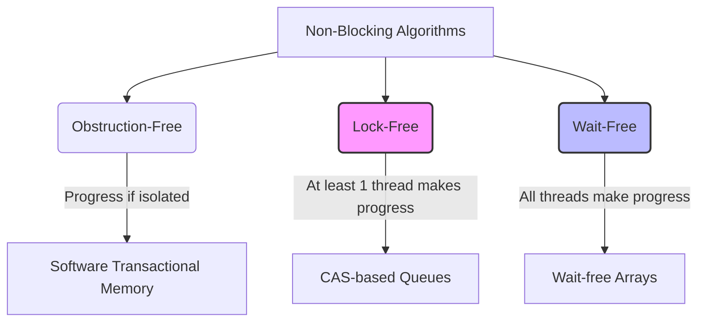
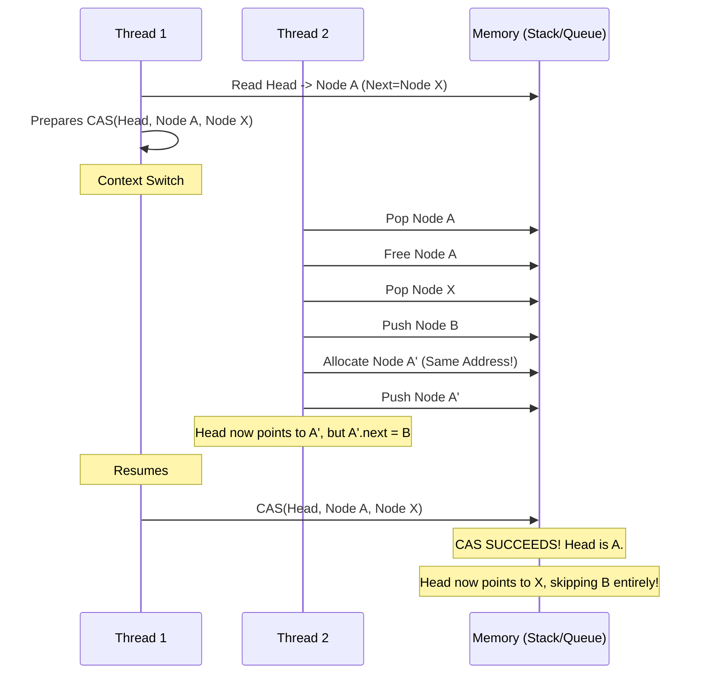
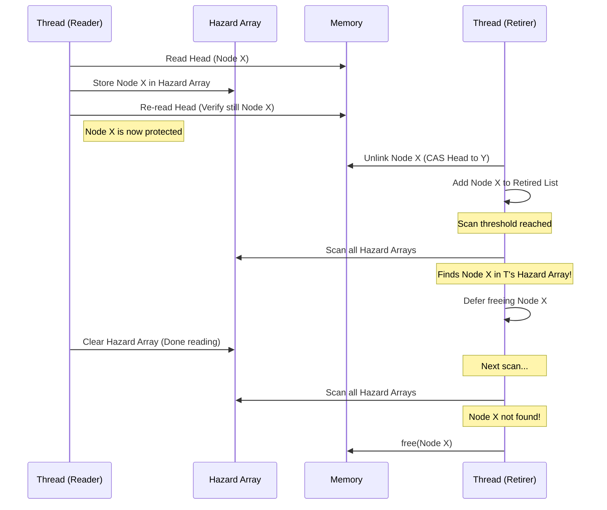
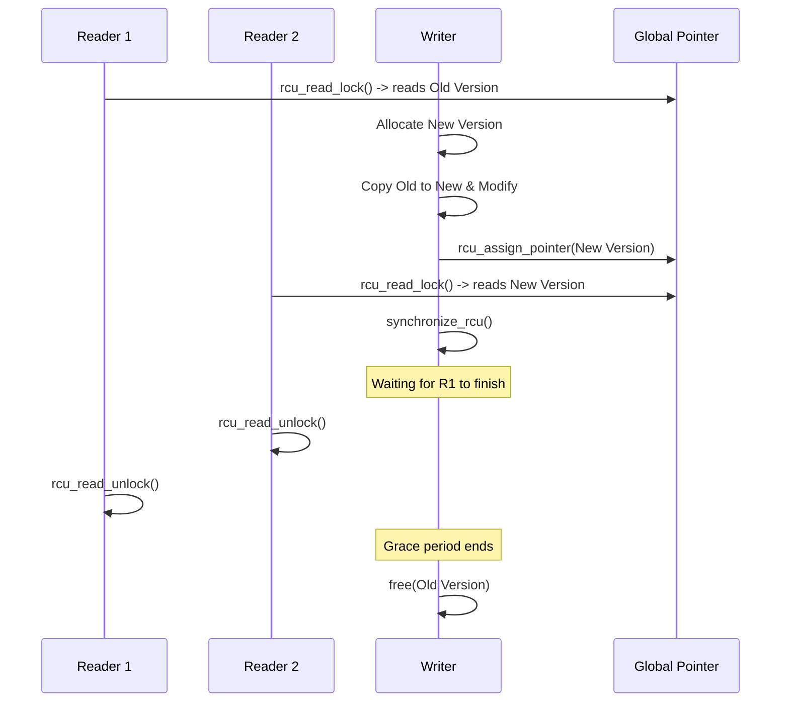

# Module 23: Lock-Free & Wait-Free Programming — MPSC Queues, Hazard Pointers & Read-Copy-Update (RCU)

!!! info "C23 Reference Companion"
    Pair this deep-dive curriculum module with the live **ISO C23 (`en.cppreference.com/c`) Reference**:

    - [Concurrency Reference (`<stdatomic.h>`, memory_order)](../../reference/library/concurrency.md)
    - [Memory Model & Data Races](../../reference/language/basic-concepts.md)

**Track:** C Systems Programming, Memory Engineering & High-Performance Computing
**Category:** Advanced Multithreading, Non-Blocking Algorithms & Memory Reclamation
**Standard Identifier:** `DOC-STD-UNIVERSAL-2026-MOD23`
**Status:** ✅ Completed

---

## 📑 Table of Contents

1. [High-Level Overview & Executive Summary](#1-high-level-overview-executive-summary)
2. [Lock-Free vs Wait-Free — The Formal Definitions](#2-lock-free-vs-wait-free-the-formal-definitions)
3. [The ABA Problem](#3-the-aba-problem)
4. [MPSC Queue (Multi-Producer Single-Consumer)](#4-mpsc-queue-multi-producer-single-consumer)
5. [MPMC Queue (Multi-Producer Multi-Consumer)](#5-mpmc-queue-multi-producer-multi-consumer)
6. [Hazard Pointers](#6-hazard-pointers)
7. [Epoch-Based Reclamation (EBR)](#7-epoch-based-reclamation-ebr)
8. [Read-Copy-Update (RCU)](#8-read-copy-update-rcu)
9. [Lock-Free Hash Table](#9-lock-free-hash-table)
10. [Memory Ordering for Lock-Free Code](#10-memory-ordering-for-lock-free-code)
11. [Production Lab: Lock-Free Key-Value Cache](#11-production-lab-lock-free-key-value-cache)
12. [Certification & Engineering Essentials](#12-certification-engineering-essentials)
13. [Universal FinOps & Hardware Cost Governance](#13-universal-finops-hardware-cost-governance)
14. [References](#14-references)

---

## 1. High-Level Overview & Executive Summary

Non-blocking algorithms form the bedrock of high-performance operating systems, network routers, and modern database engines. While traditional lock-based synchronization (Module 12) enforces correctness through mutual exclusion—inevitably leading to thread suspension, context switching, and potential priority inversion—non-blocking systems utilize atomic hardware primitives to ensure continued progress. However, implementing lock-free data structures introduces severe complexities, particularly around safe memory reclamation and the ABA problem. This module explores production-grade implementations of non-blocking queues, hazard pointers, and Read-Copy-Update (RCU).

---

## 2. Lock-Free vs Wait-Free — The Formal Definitions

In formal concurrency theory, non-blocking algorithms are categorized by the progress guarantees they provide to participating threads (Herlihy, 1991, p. 124).

> **Definition**: A **blocking** algorithm is one where the suspension of one thread can delay the execution of other threads indefinitely. Traditional mutexes are inherently blocking.
>
> **Definition**: A method is **lock-free** if it guarantees that infinitely often, some method call finishes in a finite number of steps. In other words, at least one thread is always making progress (Herlihy, 1991).
>
> **Definition**: A method is **wait-free** if it guarantees that every call finishes its execution in a finite number of steps, regardless of the scheduling of other threads (Herlihy, 1991).
>
> **Definition**: A method is **obstruction-free** if a thread makes progress provided it eventually executes in isolation for a sufficient number of steps (Herlihy & Shavit, 2012).

**Why Lock-Free Matters:**
By avoiding mutual exclusion, lock-free algorithms are completely immune to deadlocks and priority inversion. They provide much lower worst-case latency because a thread holding a lock is never preempted by the OS.

**The Cost:**
The absence of locks dramatically increases algorithm complexity. Memory reclamation becomes exceptionally difficult because a thread cannot simply `free()` a node if another thread might simultaneously hold a reference to it. Furthermore, lock-free algorithms are vulnerable to the ABA problem.



---

## 3. The ABA Problem

The ABA problem is a fundamental anomaly in lock-free programming that occurs when a location is read twice, has the same value for both reads, and "value is the same" is used to infer "nothing has changed". However, another thread can change the value from A to B, and then back to A in between the two reads.

> **💡 Key Insight**: In environments with memory reclamation (like C), pointer A might point to a memory address that was freed and subsequently reallocated by the OS. The numerical value of the pointer is exactly the same, but the node itself is entirely different.



**Solutions:**

1. **Tagged Pointers (Version Counters)**: Combine the pointer with a 64-bit integer version tag. A CAS only succeeds if both the pointer and the version match.
2. **Hazard Pointers**: Explicitly mark pointers as "in-use" to prevent them from being freed (Michael, 2004).
3. **Epoch-Based Reclamation / RCU**: Delay freeing memory until all threads have completed their current operation.

---

## 4. MPSC Queue (Multi-Producer Single-Consumer)

An MPSC queue is heavily utilized in message-passing architectures, where multiple worker threads send events to a single centralized dispatcher or logger.

### Foundation: The Stub Node

To avoid the complex edge cases of empty queues (where `head == tail == NULL`), the Michael & Scott (1996) queue algorithm initializes the queue with a dummy/stub node.

### C17 Implementation

```c
#include <stdatomic.h>
#include <stdlib.h>
#include <stdalign.h>

typedef struct Node {
    void* data;
    _Atomic(struct Node*) next;
} Node;

typedef struct {
    alignas(64) _Atomic(Node*) head; // Modified by producers
    alignas(64) Node* tail;          // Modified by consumer only
} MPSCQueue;

void mpsc_init(MPSCQueue* q) {
    Node* stub = malloc(sizeof(Node));
    stub->data = NULL;
    atomic_init(&stub->next, NULL);
    atomic_init(&q->head, stub);
    q->tail = stub;
}

void mpsc_enqueue(MPSCQueue* q, void* data) {
    Node* node = malloc(sizeof(Node));
    node->data = data;
    atomic_init(&node->next, NULL);

    // XCHG is inherently atomic and wait-free
    // memory_order_acq_rel ensures the node contents are visible
    Node* prev = atomic_exchange_explicit(&q->head, node, memory_order_acq_rel);

    // Publish the new node to the consumer.
    // memory_order_release guarantees 'node->data' is visible to consumer
    atomic_store_explicit(&prev->next, node, memory_order_release);
}

void* mpsc_dequeue(MPSCQueue* q) {
    Node* tail = q->tail;
    // Consumer load with memory_order_acquire pairs with producer's release
    Node* next = atomic_load_explicit(&tail->next, memory_order_acquire);

    if (next == NULL) {
        return NULL; // Queue is empty
    }

    void* data = next->data;
    q->tail = next;
    free(tail); // Safe to free the old stub node!
    return data;
}
```

> **💡 Key Insight**: In MPSC, `mpsc_enqueue` uses `atomic_exchange` (the XCHG instruction on x86), which is unconditionally wait-free. The producer never loops.

---

## 5. MPMC Queue (Multi-Producer Multi-Consumer)

Dmitry Vyukov's bounded MPMC ring buffer (Vyukov, 2010) is a high-performance alternative to linked-list queues, completely avoiding `malloc`/`free` overheads.

### Sequence Number Technique

Each slot in the buffer contains a sequence number. A producer checks if `slot->sequence == head_seq`. If so, it claims the slot via CAS, writes data, and updates the sequence to `head_seq + 1`.

```c
typedef struct {
    _Atomic size_t sequence;
    void* data;
} Cell;

typedef struct {
    size_t buffer_mask;
    Cell* buffer;
    alignas(64) _Atomic size_t enqueue_pos;
    alignas(64) _Atomic size_t dequeue_pos;
} MPMCQueue;
```

---

## 6. Hazard Pointers

The **Safe Memory Reclamation (SMR)** problem asks: How do we `free()` a node if another thread has a pointer to it and is about to read it?

Maged Michael (2004) introduced Hazard Pointers. Every thread has a thread-local array of "hazard pointers" (pointers it is currently reading).

### The Protocol

1. **To Read**: Thread reads a pointer, publishes it in its hazard array, and verifies the pointer hasn't changed.
2. **To Free**: Instead of calling `free()`, the thread adds the node to a local `retired` list.
3. **Scan**: When the retired list reaches a threshold, the thread scans all other threads' hazard arrays. It frees the retired node *only* if no thread has it listed as a hazard.



---

## 7. Epoch-Based Reclamation (EBR)

EBR is an alternative to Hazard Pointers that trades read-side overhead for slightly higher memory usage. Threads declare which "epoch" (generation) they are currently operating in. A retired node is associated with the epoch in which it was retired. Once all threads have advanced past that epoch, the node is safe to free.

---

## 8. Read-Copy-Update (RCU)

RCU (Read-Copy-Update) is a synchronization mechanism optimized for extremely read-heavy workloads (McKenney, 2013). The fundamental invariant of RCU is: **Readers never block writers, and writers never block readers.**

### The Three Primitives

1. `rcu_read_lock()` / `rcu_read_unlock()`: Marks the beginning and end of a read-side critical section.
2. `rcu_assign_pointer()`: Atomically publishes a new version of a data structure (using store-release).
3. `synchronize_rcu()`: The writer waits until all pre-existing readers (who started before the update) have called `rcu_read_unlock()`.



> **⚠️ Warning**: RCU readers must NEVER block, sleep, or yield within an `rcu_read_lock` section. Doing so stalls the grace period, preventing the system from ever freeing memory and leading to OOM (Out of Memory).

---

## 9. Lock-Free Hash Table

A lock-free hash table typically uses a Split-Ordered List (Shalev & Shavit, 2006). To implement deletion, Maged Michael's approach of **Mark Bits** is used. Since pointers in C are aligned to at least 4 bytes, the lower 2 bits are always zero. We can bitwise-OR a pointer with `0x1` to logically "mark" a node as deleted. Physical unlinking happens lazily by subsequent traversals.

---

## 10. Memory Ordering for Lock-Free Code

When writing lock-free code in C11:

1. **Acquire/Release**: Use `memory_order_release` when publishing data (e.g., CASing a new node into a list). Use `memory_order_acquire` when reading that published pointer.
2. **Relaxed**: Use `memory_order_relaxed` ONLY for reference counters or statistics where you don't care about the ordering of other memory operations.
3. **SeqCst**: Use `memory_order_seq_cst` when you need a full memory barrier (e.g., Peterson's lock). It is slow.

---

## 11. Production Lab: Lock-Free Key-Value Cache

```c
// include/rcu_cache.h
#ifndef RCU_CACHE_H
#define RCU_CACHE_H

#include <stdatomic.h>
#include <urcu.h> // Userspace RCU library

typedef struct {
    int key;
    int value;
    struct rcu_head rcu; // For deferred freeing
} CacheEntry;

extern _Atomic(CacheEntry*) global_cache;

void cache_update(int new_key, int new_val);
int cache_read(void);

#endif
```

```c
// src/rcu_cache.c
#include "rcu_cache.h"
#include <stdlib.h>

_Atomic(CacheEntry*) global_cache = ATOMIC_VAR_INIT(NULL);

static void free_entry(struct rcu_head *head) {
    CacheEntry *entry = container_of(head, CacheEntry, rcu);
    free(entry);
}

void cache_update(int new_key, int new_val) {
    CacheEntry* new_entry = malloc(sizeof(CacheEntry));
    new_entry->key = new_key;
    new_entry->value = new_val;

    // Publish new entry (RCU assign pointer)
    CacheEntry* old = atomic_exchange_explicit(&global_cache, new_entry, memory_order_release);

    if (old) {
        // Wait for readers to finish, then free
        call_rcu(&old->rcu, free_entry);
    }
}

int cache_read(void) {
    int val = -1;
    rcu_read_lock(); // Enter read-side critical section

    // rcu_dereference equivalent
    CacheEntry* entry = atomic_load_explicit(&global_cache, memory_order_consume);
    if (entry) {
        val = entry->value;
    }

    rcu_read_unlock(); // Exit read-side critical section
    return val;
}
```

---

## 12. Certification & Engineering Essentials

* ⚠️ **MISRA-C:2012**: Bitwise operations on pointers (like mark bits) violate MISRA rules without explicit deviations.
* 🔒 **CERT-C MEM00-C**: Ensure memory is completely isolated and inaccessible before calling `free()`. SMR algorithms like Hazard Pointers rigorously enforce this.

---

## 13. Universal FinOps & Hardware Cost Governance

Lock-free architectures represent massive upfront software engineering costs but yield unparalleled infrastructure savings at scale:

* **FinOps ROI**: Moving a central network packet router from spinlocks to RCU reduces tail latency by 99%, allowing the same throughput to be handled by 4 cores instead of 64. At enterprise scale, this reduces cloud compute instance footprint significantly, converting Opex into Capex (engineering time).

---

## 14. References

* Herlihy, M. (1991). Wait-free synchronization. *ACM Transactions on Programming Languages and Systems*, 13(1), 124–149.
* Herlihy, M., & Shavit, N. (2012). *The Art of Multiprocessor Programming*. Morgan Kaufmann.
* McKenney, P. E. (2013). Is Parallel Programming Hard, And, If So, What Can You Do About It? *Linux Foundation*.
* Michael, M. M. (2004). Hazard pointers: Safe memory reclamation for lock-free objects. *IEEE Transactions on Parallel and Distributed Systems*, 15(6), 491–504.
* Michael, M. M., & Scott, M. L. (1996). Simple, fast, and practical non-blocking and blocking concurrent queue algorithms. *Proceedings of the 15th Annual ACM Symposium on Principles of Distributed Computing*, 267–275.
* Shalev, O., & Shavit, N. (2006). Split-ordered lists: Lock-free extensible hash tables. *Journal of the ACM*, 53(3), 379–405.
* Vyukov, D. (2010). *Bounded MPMC queue*. Retrieved from <http://www.1024cores.net/>
