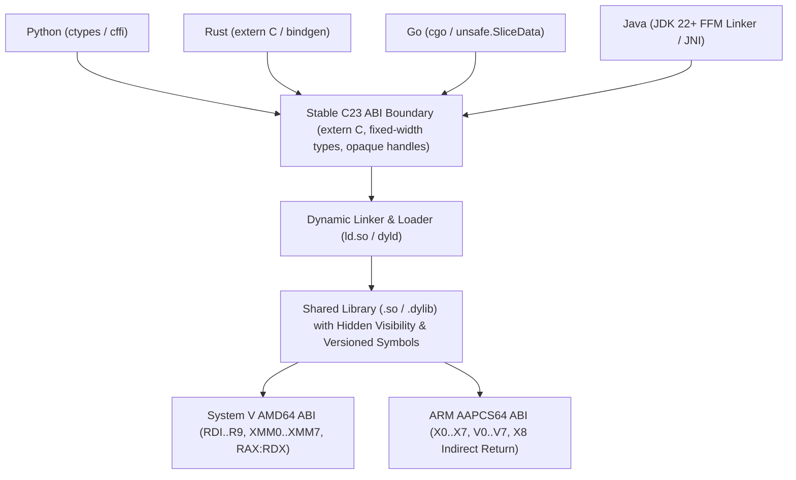
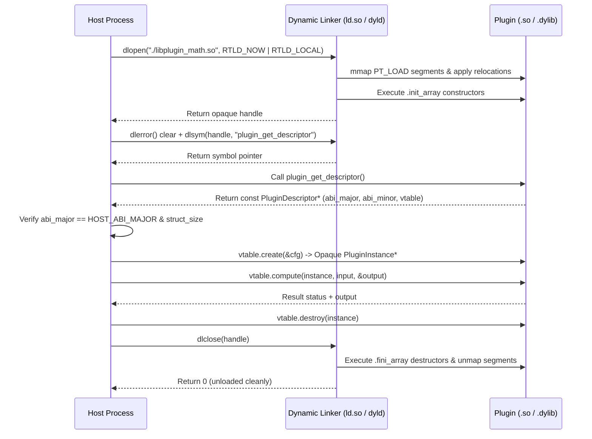

# Module 24: ABI Contracts, Foreign Function Interfaces (FFI), Dynamic Loading & Linker Scripts

!!! info "C23 Reference Companion"
    Pair this deep-dive curriculum module with the live **ISO C23 (`en.cppreference.com/c`) Reference**:

    - [Functions, Calling Conventions & Linkage](../../reference/language/functions.md)
    - [Declarations, Types, Alignment & Storage Classes](../../reference/language/declarations.md)
    - [Module 09: Toolchains, ELF Binaries & Makefiles](../tier-3-systems/09-toolchains-elf-makefiles.md)

**Track:** C Systems Programming, Memory Engineering & High-Performance Computing
**Category:** Application Binary Interfaces, Foreign Function Interfaces, Dynamic Linkers & Bare-Metal Layout
**Standard Identifier:** `DOC-STD-UNIVERSAL-2026-MOD24`
**Status:** ✅ Completed

---

## 📑 Table of Contents

1. [High-Level Overview & Executive Summary](#1-high-level-overview-executive-summary)
2. [C as the Universal Systems ABI](#2-c-as-the-universal-systems-abi)
3. [Linkage, C++ Interoperability & Symbol Visibility](#3-linkage-c-interoperability-symbol-visibility)
4. [POSIX Dynamic Loading (`<dlfcn.h>`)](#4-posix-dynamic-loading-dlfcnh)
5. [Runtime Interposition (`LD_PRELOAD` & `DYLD_INSERT_LIBRARIES`)](#5-runtime-interposition-ld_preload-dyld_insert_libraries)
6. [Shared Library Versioning, `RPATH` vs `RUNPATH` & Symbol Version Scripts](#6-shared-library-versioning-rpath-vs-runpath-symbol-version-scripts)
7. [GNU `ld` Linker Scripts (Bare-Metal & Custom ELF Layouts)](#7-gnu-ld-linker-scripts-bare-metal-custom-elf-layouts)
8. [Practical Multi-Language FFI Recipes](#8-practical-multi-language-ffi-recipes)
9. [Production Lab: C23 ABI-Versioned Plugin Architecture](#9-production-lab-c23-abi-versioned-plugin-architecture)
10. [Standards, Certification & Engineering Essentials](#10-standards-certification-engineering-essentials)
11. [Universal FinOps & Hardware Cost Governance (Modular Deployment Economics)](#11-universal-finops-hardware-cost-governance-modular-deployment-economics)
12. [References](#12-references)

---

## 1. High-Level Overview & Executive Summary

Every modern programming language runtime—Python, Rust, Go, Java, Swift, Zig, Lua, WebAssembly hosts, and C++—ultimately speaks **the C Application Binary Interface (ABI)** whenever it crosses an operating system, hardware driver, or cross-language boundary. While an **API (Application Programming Interface)** defines source-level contracts (header declarations, types, and function signatures), an **ABI** specifies the exact **machine-level binary contract**: which CPU registers hold arguments and return values, how structures are aligned and padded in memory, how symbol names are encoded in object tables, how stack frames are aligned, and who owns dynamically allocated memory across shared library boundaries (Levine, 2000; Bryant & O'Hallaron, 2016).

Controlling the binary boundary unlocks four superpowers of senior systems architecture:

1. **Zero-Overhead Multi-Language Extensions**: Exposing high-throughput C23 kernels cleanly to Python, Rust, Go, and Java without serialization or IPC overhead.
2. **Dynamic Plugin Architectures**: Loading, validating, upgrading, and unloading binary modules at runtime via POSIX `<dlfcn.h>` without recompiling the host executable (Kerrisk, 2010).
3. **Runtime Interposition & Forensics**: Intercepting allocator, I/O, or socket calls transparently via `LD_PRELOAD` / `DYLD_INSERT_LIBRARIES` and `dlsym(RTLD_NEXT, ...)`.
4. **Deterministic Memory Placement**: Dictating exact virtual and physical memory layouts (`VMA` vs `LMA`, vector tables, Flash-to-SRAM `.data` initialization) through GNU `ld` linker scripts (Free Software Foundation, 2024).

---

## 2. C as the Universal Systems ABI

Because ISO C imposes minimal runtime machinery—no hidden exception tables, no garbage-collected object headers, no name mangling, and deterministic struct layout—operating system vendors anchor their Processor Supplement ABIs directly to C types.

### Multi-Language FFI Architecture



### 2.1 System V AMD64 ABI vs ARM AAPCS64 Calling Conventions

When calling a C function across a binary boundary (e.g., from Rust or Java FFM into a `.so`), caller and callee must agree on every register and alignment rule (Matz et al., 2024; Arm Limited, 2024):

| ABI Aspect | System V AMD64 ABI (Linux / macOS / BSD x86-64) | ARM AAPCS64 (Linux / macOS ARM64 / AArch64) |
| :--- | :--- | :--- |
| **Integer / Pointer Args** | `RDI`, `RSI`, `RDX`, `RCX`, `R8`, `R9` (first 6); overflow on stack right-to-left | `X0`–`X7` (first 8); overflow on stack (8-byte slots) |
| **FP / SIMD Args** | `XMM0`–`XMM7` (first 8); variadic calls set `AL` = count of XMM registers used | `V0`–`V7` (first 8) |
| **Integer Return** | `RAX` (up to 64-bit); `RAX:RDX` (65–128-bit composites / `__int128`) | `X0` (up to 64-bit); `X0:X1` (65–128-bit composites) |
| **FP / Vector Return** | `XMM0` (`XMM0:XMM1` for 128-bit / `_Complex double`) | `V0`–`V3` (supports **HFA**: up to 4 homogeneous `float`/`double` fields!) |
| **Large Struct Return (`> 16 B`)** | Caller allocates space and passes hidden `sret` pointer in **`RDI`** (shifting arg 1 to `RSI`); callee returns pointer in `RAX` | Caller allocates space and passes hidden pointer in dedicated **`X8` (`XR`)** register—`X0`–`X7` remain unaffected! |
| **Callee-Saved Registers** | `RBX`, `RBP`, `R12`–`R15`, `RSP` | `X19`–`X28`, `X29` (`FP`), `X30` (`LR`), `D8`–`D15` (lower 64 bits of `V8`–`V15`), `SP` |
| **Stack Alignment** | 16-byte aligned **prior to `call`** (`RSP % 16 == 8` on function entry) | `SP` must be 16-byte aligned at **all** public interfaces and SP-relative accesses |
| **Red Zone** | **128 bytes** below `RSP` safe for leaf functions (disabled in kernels via `-mno-red-zone`) | **None (0 bytes)** |

### 2.2 Struct Passing, Alignment Padding & Silent ABI Breaks

Compilers classify structs passed by value according to eightbyte/granule alignment rules:

* On **System V AMD64**, structs $\le 16$ bytes are split into two 8-byte chunks classified as `INTEGER` (`RAX`/`RDX`), `SSE` (`XMM0`/`XMM1`), or `MEMORY`. Structs $> 16$ bytes—or structs containing unaligned fields (`__attribute__((packed))`)—always pass in `MEMORY`.
* On **ARM AAPCS64**, a **Homogeneous Floating-Point Aggregate (HFA)** such as `typedef struct { double x, y, z, w; } Vec4;` (32 bytes!) is passed and returned entirely in **`V0`–`V3`**, whereas a non-HFA 24-byte struct uses indirect pass-by-reference / `X8`.

**Catalog of Silent ABI-Breaking Changes (Never Do These Without Bumping `SONAME` / Major ABI Version):**

1. **Adding, removing, or reordering fields** in any caller-allocated `struct` (shifts member offsets and `sizeof`, silently corrupting caller stack frames).
2. **Using platform-dependent types** (`long` is 64-bit on LP64 Linux/macOS but 32-bit on LLP64 Windows; `size_t`, `time_t`, and plain `enum` width vary across ABIs and compiler flags like `-fshort-enums`). Always use `<stdint.h>` fixed-width types (`int32_t`, `uint64_t`) across ABI boundaries—and in C23, specify fixed underlying enum types (`enum Status : int32_t { ... };`) <span class="c-badge c23">C23</span>!
3. **Leaving implicit padding bytes uninitialized**: Padding between `uint8_t` and `uint64_t` contains indeterminate stack garbage, causing information leaks across privilege/FFI boundaries (CERT C **DCL39-C**).
4. **Crossing allocator domains**: Calling `malloc()` inside a shared library compiled against one allocator/CRT and calling `free()` inside the host (or Rust/Python runtime) causes instant heap corruption. **Rule of Allocator Symmetry**: the library that allocates an object MUST export the matching destructor function.

### 2.3 ABI-Stable Design Patterns in C23

Two battle-tested C patterns decouple binary compatibility from internal struct evolution:

```c
#include <stddef.h>
#include <stdint.h>

/* PATTERN 1: Opaque Handle (Pimpl in C)
 * Callers hold only a pointer; internal layout can change arbitrarily across minor releases! */
typedef struct CryptoEngine CryptoEngine;

/* PATTERN 2: Self-Sizing Versioned Options Struct
 * Callers set struct_size = sizeof(EngineConfig). Newer libraries detect smaller
 * caller structs and apply safe defaults for newly appended fields. */
typedef struct {
    uint32_t struct_size;
    uint32_t abi_version;
    uint32_t worker_threads;
    uint32_t reserved_flags; /* Explicit padding to 16-byte boundary */
} EngineConfig;

/* C23 keyword static_assert (no <assert.h> required) freezes ABI layout at compile time */
static_assert(sizeof(EngineConfig) == 16U, "EngineConfig ABI size regression");
static_assert(offsetof(EngineConfig, worker_threads) == 8U, "EngineConfig offset regression");
static_assert(alignof(EngineConfig) == 4U, "EngineConfig alignment regression");

[[nodiscard]] CryptoEngine *engine_create(const EngineConfig *cfg);
void                        engine_destroy(CryptoEngine *eng);
```

---

## 3. Linkage, C++ Interoperability & Symbol Visibility

### 3.1 `extern "C"` Header Guards

C++ encodes parameter types, namespaces, and templates into linker symbol names (**name mangling**, e.g., `int mathx_add(int, int)` becomes `_Z9mathx_addii` under the Itanium C++ ABI). C emits unmangled symbols (`mathx_add`). Every public C ABI header intended for C++ or cross-language consumption MUST wrap declarations in an `extern "C"` guard:

```c
#ifndef MATHX_API_H
#define MATHX_API_H

#include <stddef.h>
#include <stdint.h>

#ifdef __cplusplus
extern "C" {
#endif

int32_t mathx_dot_i32(const int32_t *a, const int32_t *b, size_t len, int64_t *out);

#ifdef __cplusplus
}
#endif

#endif /* MATHX_API_H */
```

!!! tip "C23 & C++ Convergence at the Header Boundary"
    ISO C23 <span class="c-badge c23">C23</span> promotes `bool`, `true`, `false`, `nullptr`, `static_assert`, `alignof`, and `[[nodiscard]]` into native C keywords/attributes matching C++17/C++20. Avoid C-only keywords (`restrict`, `_Generic`, compound literals, or VLA syntax) in public `extern "C"` headers if C++ consumers will `#include` them directly.

### 3.2 Symbol Visibility & Avoiding ELF Symbol Pollution

By default on ELF platforms (Linux, BSD), GCC and Clang mark **every non-`static` function and global variable** with `default` visibility—exporting internal helpers straight into the shared library's dynamic symbol table (`.dynsym`). As Ulrich Drepper's canonical monograph *How To Write Shared Libraries* explains, exporting internal symbols causes four serious defects (Drepper, 2011):

1. **Silent Symbol Interposition (ODR/Namespace Collisions)**: If two loaded plugins both export an internal helper named `sha256_init()`, the dynamic linker resolves *both* plugins' calls to whichever library loaded first—causing baffling cross-plugin ABI crashes!
2. **PLT Indirection Overhead**: Exported ELF symbols cannot be called directly by PC-relative call within their own `.so` unless marked hidden/protected, forcing extra PLT/GOT indirection on internal hot paths.
3. **Slower Startup & Bloated Binaries**: Larger `.dynsym` and `.gnu.hash` tables slow dynamic loading across process launches.
4. **Accidental ABI Surface**: Users link against private symbols you never intended to support.

**Production Best Practice:** Compile every shared library with **`-fvisibility=hidden`** and explicitly opt in public entry points using a portable visibility macro:

```c
#if defined(_WIN32) || defined(__CYGWIN__)
  #ifdef MATHX_BUILDING_DLL
    #define MATHX_EXPORT __declspec(dllexport)
  #else
    #define MATHX_EXPORT __declspec(dllimport)
  #endif
#elif defined(__GNUC__) || defined(__clang__)
  #define MATHX_EXPORT __attribute__((visibility("default")))
#else
  #define MATHX_EXPORT
#endif

MATHX_EXPORT int32_t mathx_dot_i32(const int32_t *a, const int32_t *b,
                                   size_t len, int64_t *out);
```

Verify exported symbols in CI so internal helpers never leak:

```bash
# Linux ELF: list ONLY exported defined dynamic symbols
nm -D --defined-only libmathx.so
readelf --dyn-syms --wide libmathx.so | grep -v " UND "

# macOS Mach-O: list exported global symbols
nm -gU libmathx.dylib
```

---

## 4. POSIX Dynamic Loading (`<dlfcn.h>`)

POSIX.1-2024 (IEEE Std 1003.1-2024) defines `<dlfcn.h>` for runtime dynamic loading of shared objects (`.so` on ELF, `.dylib`/`.bundle` on macOS).

### Core `<dlfcn.h>` API Reference

| Function | Prototype | Behavior & Thread-Safety Notes |
| :--- | :--- | :--- |
| **`dlopen`** | `void *dlopen(const char *file, int mode);` | Maps shared object into process address space, runs `.init_array` constructors, returns opaque handle or `NULL` on failure. Passing `file == NULL` returns a handle to the main executable's global symbol table. |
| **`dlsym`** | `void *dlsym(void *restrict handle, const char *restrict name);` | Resolves symbol `name` inside `handle` (or special pseudo-handles `RTLD_DEFAULT`, `RTLD_NEXT`). Returns address as `void *`. |
| **`dlerror`** | `char *dlerror(void);` | Returns human-readable description of the most recent `<dlfcn.h>` error on the calling thread and **clears** the error state (returns `NULL` if no error occurred since last call). |
| **`dlclose`** | `int dlclose(void *handle);` | Decrements handle reference count; when zero (and not pinned by `RTLD_NODELETE`), executes `.fini_array` destructors and unmaps segments. Returns `0` on success. |

### Binding & Scope Mode Flags

Every `dlopen()` call MUST choose one binding flag (`RTLD_NOW` or `RTLD_LAZY`) combined via bitwise OR with a scope flag (`RTLD_LOCAL` or `RTLD_GLOBAL`):

| Flag | Category | Semantics & Engineering Guidance |
| :--- | :--- | :--- |
| **`RTLD_NOW`** | Binding | Resolves **all** undefined symbols before `dlopen()` returns. **Recommended default**—surfaces missing dependencies cleanly as an error rather than crashing mid-request hours later. |
| **`RTLD_LAZY`** | Binding | Defers function symbol resolution until first PLT invocation. Slightly faster load time, but unresolved symbols terminate the entire process abruptly when called. |
| **`RTLD_LOCAL`** | Scope | Loaded symbols are **not** exported to subsequently loaded shared objects. **Recommended default** for plugin isolation. |
| **`RTLD_GLOBAL`** | Scope | Loaded symbols become available globally for resolving symbols in future `dlopen()` modules (e.g., Python C-extension loading shared runtime dependencies). |
| **`RTLD_DEEPBIND`** | Scope *(glibc)* | Searches symbols within the plugin's own dependency tree before the global host scope, insulating plugins against host symbol collisions. |
| **`RTLD_NODELETE`** | Lifetime *(POSIX)* | Prevents unmapping on `dlclose()`—useful if callbacks or `.rodata` string pointers might outlive plugin teardown. |

### Strict ISO C Function-Pointer Casting from `void *`

ISO/IEC 9899:2024 §6.3.2.3 deliberately leaves conversions between **object pointers** (`void *`) and **function pointers** (`int (*)(int)`) undefined because Harvard-architecture machines may have distinct code and data pointer widths. Consequently, writing `MyFn fn = (MyFn)dlsym(handle, "sym");` triggers `-Wpedantic` errors under strict ISO C23!

There are three ways to resolve this cleanly on POSIX targets (where POSIX.1-2024 guarantees function pointers fit in `void *`):

=== "✅ Strict-Aliasing-Safe `memcpy` (Recommended C23)"

    ```c
    #include <dlfcn.h>
    #include <string.h>

    typedef int (*PluginInitFn)(void);

    /* Clear any stale dlerror before calling dlsym, because a valid symbol
     * could theoretically resolve to address 0 (NULL). */
    (void)dlerror();
    void *raw_sym = dlsym(handle, "plugin_init");
    const char *err = dlerror();
    if (err != nullptr || raw_sym == nullptr) {
        /* Handle error cleanly */
    }

    PluginInitFn init_fn = nullptr;
    static_assert(sizeof(init_fn) == sizeof(raw_sym),
                  "POSIX requires function pointers and void* to have identical size");
    /* Zero strict-aliasing violations, zero -Wpedantic warnings, compiles to a single MOV */
    memcpy(&init_fn, &raw_sym, sizeof(init_fn));
    ```

=== "POSIX.1-2008 Sanctioned Idiom (`*(void **)`)"

    ```c
    #include <dlfcn.h>

    typedef int (*PluginInitFn)(void);

    PluginInitFn init_fn = nullptr;
    (void)dlerror();
    /* Explicitly shown in POSIX.1-2008/2024 dlsym() rationale.
     * Note: GCC/Clang accept this under POSIX, though strict-aliasing analyzers
     * (-Wstrict-aliasing) prefer the memcpy or union idioms. */
    *(void **)(&init_fn) = dlsym(handle, "plugin_init");
    const char *err = dlerror();
    ```

=== "ISO C99/C23 Union Type-Punning Idiom"

    ```c
    #include <dlfcn.h>

    typedef int (*PluginInitFn)(void);

    union SymCast {
        void        *obj;
        PluginInitFn fn;
    };

    (void)dlerror();
    union SymCast sym = {.obj = dlsym(handle, "plugin_init")};
    const char *err = dlerror();
    PluginInitFn init_fn = sym.fn;
    ```

### Plugin Runtime Lifecycle



!!! danger "Four Classic `dlclose()` Crash Hazards"
    Never call `dlclose(handle)` while **any** of the following still exist:
    1. A worker thread is still executing code inside the plugin's `.text` segment (instant `SIGSEGV` upon `munmap`).
    2. The host holds pointers to string literals or `const` tables inside the plugin's `.rodata` (e.g., cached `desc->name` pointers).
    3. A heap object allocated by the plugin has not yet been destroyed via the plugin's own destructor.
    4. The plugin registered signal handlers or `atexit()` callbacks without unregistering them prior to unload.

---

## 5. Runtime Interposition (`LD_PRELOAD` & `DYLD_INSERT_LIBRARIES`)

Dynamic linkers search symbols in a deterministic lookup order. On Linux ELF systems, libraries listed in **`LD_PRELOAD`** are inserted at the **head of the global symbol search list**—ahead of `libc.so.6`. Any call to `malloc`, `free`, `open`, or `connect` resolves first to the preloaded library, which can inspect/trace the call and forward to the original implementation via **`dlsym(RTLD_NEXT, ...)`** (Love, 2013; Kerrisk, 2010).

* **Linux ELF**: `LD_PRELOAD=./libmemtrace.so ./target_app` (requires `_GNU_SOURCE` for `RTLD_NEXT`).
* **macOS Mach-O**: Two-level namespaces prevent flat overrides by default; macOS supports `DYLD_INSERT_LIBRARIES=./libmemtrace.dylib` combined with the `__DATA,__interpose` Mach-O section (or `DYLD_FORCE_FLAT_NAMESPACE=1` for unsigned binaries).
* **Security Invariant**: On Linux, the kernel sets `AT_SECURE=1` in the auxiliary vector for `setuid`/`setgid`/file-capability binaries, instructing `ld.so` to **ignore `LD_PRELOAD`** so unprivileged users cannot hijack privileged processes.

### The Fatal Recursion Trap & Production-Safe Allocator Tracer

Naively calling `fprintf()` or `dlsym()` inside an interposed `malloc()` triggers **infinite recursion** because `fprintf()` buffers via `malloc()` and glibc's `dlsym()` may allocate error/state buffers via `calloc()`!

A production-safe interposer requires three defenses:

1. A C23 **`thread_local`** <span class="c-badge c23">C23</span> re-entrancy guard (`in_hook`) so internal calls bypass tracing.
2. A tiny **static bootstrap bump buffer** to satisfy any `calloc()` calls invoked while `dlsym(RTLD_NEXT, ...)` is resolving the real allocator.
3. **Async-signal-safe `write(STDERR_FILENO, ...)`** formatting (never `printf`/`fprintf`).

```c
/* memtrace_preload.c — Production-safe LD_PRELOAD malloc/free tracer (Linux ELF)
 * Build: gcc -std=c23 -O2 -shared -fPIC -D_GNU_SOURCE -Wall -Wextra \
 *            memtrace_preload.c -o libmemtrace.so -ldl
 * Run:   LD_PRELOAD=./libmemtrace.so /bin/ls
 */
#define _GNU_SOURCE
#include <dlfcn.h>
#include <stdatomic.h>
#include <stdbool.h>
#include <stddef.h>
#include <stdint.h>
#include <string.h>
#include <unistd.h>

typedef void *(*MallocFn)(size_t);
typedef void *(*CallocFn)(size_t, size_t);
typedef void  (*FreeFn)(void *);

static MallocFn real_malloc = nullptr;
static CallocFn real_calloc = nullptr;
static FreeFn   real_free   = nullptr;

/* Bootstrap arena for allocations made by dlsym() during first-call resolution */
static alignas(16) unsigned char bootstrap_buf[16384];
static _Atomic size_t            bootstrap_off = 0U;

/* C23 native thread_local recursion guard */
static thread_local bool in_hook = false;

static bool is_bootstrap_ptr(const void *p) {
    uintptr_t addr  = (uintptr_t)p;
    uintptr_t start = (uintptr_t)bootstrap_buf;
    uintptr_t end   = start + sizeof(bootstrap_buf);
    return addr >= start && addr < end;
}

static void write_trace_u64(const char *prefix, uint64_t val) {
    char buf[96];
    size_t n = strlen(prefix);
    if (n > 64U) {
        n = 64U;
    }
    memcpy(buf, prefix, n);

    char digits[24];
    size_t d = 0U;
    do {
        digits[d++] = (char)('0' + (val % 10U));
        val /= 10U;
    } while (val > 0U && d < sizeof(digits));

    while (d > 0U) {
        buf[n++] = digits[--d];
    }
    buf[n++] = '\n';
    (void)write(STDERR_FILENO, buf, n);
}

static void resolve_real_allocators(void) {
    if (real_malloc != nullptr && real_calloc != nullptr && real_free != nullptr) {
        return;
    }
    void *m = dlsym(RTLD_NEXT, "malloc");
    void *c = dlsym(RTLD_NEXT, "calloc");
    void *f = dlsym(RTLD_NEXT, "free");
    memcpy(&real_malloc, &m, sizeof(real_malloc));
    memcpy(&real_calloc, &c, sizeof(real_calloc));
    memcpy(&real_free,   &f, sizeof(real_free));
}

__attribute__((visibility("default")))
void *malloc(size_t size) {
    if (in_hook) {
        return (real_malloc != nullptr) ? real_malloc(size) : nullptr;
    }
    in_hook = true;
    resolve_real_allocators();
    void *ptr = (real_malloc != nullptr) ? real_malloc(size) : nullptr;
    write_trace_u64("[memtrace] malloc bytes=", (uint64_t)size);
    in_hook = false;
    return ptr;
}

__attribute__((visibility("default")))
void *calloc(size_t nmemb, size_t size) {
    if (real_calloc == nullptr && in_hook) {
        /* Satisfy dlsym()'s internal bootstrap calloc from static zeroed arena */
        size_t total = (nmemb * size + 15U) & ~(size_t)15U;
        size_t off   = atomic_fetch_add_explicit(&bootstrap_off, total, memory_order_relaxed);
        if (off + total <= sizeof(bootstrap_buf)) {
            return bootstrap_buf + off;
        }
        return nullptr;
    }
    if (in_hook) {
        return real_calloc(nmemb, size);
    }
    in_hook = true;
    resolve_real_allocators();
    void *ptr = (real_calloc != nullptr) ? real_calloc(nmemb, size) : nullptr;
    in_hook = false;
    return ptr;
}

__attribute__((visibility("default")))
void free(void *ptr) {
    if (ptr == nullptr || is_bootstrap_ptr(ptr)) {
        return;
    }
    if (in_hook) {
        if (real_free != nullptr) {
            real_free(ptr);
        }
        return;
    }
    in_hook = true;
    resolve_real_allocators();
    if (real_free != nullptr) {
        real_free(ptr);
    }
    in_hook = false;
}
```

---

## 6. Shared Library Versioning, `RPATH` vs `RUNPATH` & Symbol Version Scripts

### 6.1 ELF `SONAME` & Semantic Symlink Architecture

Shared libraries in production Linux distributions decouple compile-time linking from runtime ABI identity via a three-file symlink hierarchy:

```text
libfoo.so       -> libfoo.so.2.1.0   (Linker name: used ONLY at compile time by -lfoo)
libfoo.so.2     -> libfoo.so.2.1.0   (SONAME: embedded in consumer ELF DT_NEEDED; bumps on ABI break)
libfoo.so.2.1.0                      (Real file: MAJOR.MINOR.PATCH; minor/patch preserve binary ABI)
```

Embed the `SONAME` at link time:

```bash
gcc -shared -fPIC -fvisibility=hidden \
    -Wl,-soname,libfoo.so.2 \
    -Wl,--version-script=libfoo.map \
    foo.c -o libfoo.so.2.1.0

ln -sf libfoo.so.2.1.0 libfoo.so.2
ln -sf libfoo.so.2     libfoo.so
```

When a breaking ABI change occurs (e.g., removing a symbol or altering a public struct), bump `SONAME` to `libfoo.so.3`. Both `libfoo.so.2` and `libfoo.so.3` coexist peacefully in `/usr/lib`, allowing legacy binaries and newly rebuilt binaries to run side by side without dependency hell.

### 6.2 Dynamic Loader Search Path: `DT_RPATH` vs `DT_RUNPATH`

When locating `DT_NEEDED` libraries, Linux's `ld-linux.so` follows a strict precedence hierarchy:

| Priority | Mechanism | Linker Flag | Critical Difference |
| :--- | :--- | :--- | :--- |
| **1** | **`DT_RPATH`** *(deprecated)* | `-Wl,--disable-new-dtags -Wl,-rpath,...` | Searched **before** `LD_LIBRARY_PATH` (cannot be overridden by operators during debugging/testing!) AND propagates transitively to indirect dependencies. |
| **2** | **`LD_LIBRARY_PATH`** | Runtime environment variable | Operator/CI override path (ignored when `AT_SECURE=1`). |
| **3** | **`DT_RUNPATH`** *(modern default)* | `-Wl,--enable-new-dtags -Wl,-rpath,'$ORIGIN/../lib'` | Searched **after** `LD_LIBRARY_PATH` and applies **only to direct dependencies** of the object defining it. `$ORIGIN` expands dynamically to the binary's directory, enabling relocatable installations! |
| **4** | `/etc/ld.so.cache` | `ldconfig` cache | System-wide indexed cache of `/etc/ld.so.conf.d/*`. |
| **5** | Default OS directories | `/lib`, `/usr/lib` | Fallback system paths. |

!!! note "macOS Mach-O Equivalent (`@rpath` & `@loader_path`)"
    macOS embeds an **install name** directly inside every `.dylib` (`-install_name @rpath/libfoo.1.dylib`), and the host executable specifies search directories via `-Wl,-rpath,@executable_path/../lib` (or `@loader_path` relative to the loading `.dylib`). Inspect with `otool -L` and `otool -l`.

### 6.3 GNU Symbol Version Scripts (`.map` Files)

A **GNU `ld` version script** achieves two industrial goals simultaneously: (1) whitelisting exact exported symbols while hiding everything else (`local: *;`), and (2) attaching version tags (`LIBFOO_1.0`, `LIBFOO_2.0`) so a single `.so` can serve **multiple historical ABI versions of the same function** simultaneously (the exact mechanism allowing `glibc` to run 20-year-old Linux binaries unmodified!).

```text
/* libfoo.map — GNU ld Symbol Version Script */
LIBFOO_1.0 {
    global:
        foo_init;
        foo_compute;
        foo_destroy;
    local:
        *;   /* Hide ALL symbols not explicitly listed above */
};

LIBFOO_2.0 {
    global:
        foo_compute;         /* New ABI version of foo_compute */
        foo_compute_batch;   /* Newly added API in 2.0 */
} LIBFOO_1.0;                /* Inherits ABI compatibility graph from 1.0 */
```

Inside `foo.c`, GCC 10+ / Clang 12+ map distinct C implementations to versioned ELF symbols via `__attribute__((symver(...)))`:

```c
/* Legacy callers linked against LIBFOO_1.0 bind to foo_compute@LIBFOO_1.0 (single '@') */
__attribute__((symver("foo_compute@LIBFOO_1.0")))
int foo_compute_v1(int x) {
    return x * 2;
}

/* New callers bind automatically to default version foo_compute@@LIBFOO_2.0 (double '@@') */
__attribute__((symver("foo_compute@@LIBFOO_2.0")))
int foo_compute_v2(int x, uint32_t flags) {
    return (flags & 1U) ? (x * 4) : (x * 2);
}
```

---

## 7. GNU `ld` Linker Scripts (Bare-Metal & Custom ELF Layouts)

Hosted OS binaries rely on the linker's built-in default script. In **embedded firmware, bootloaders, OS kernels, and DMA-capable drivers**, however, the hardware imposes exact physical address constraints: the ARM Cortex-M reset vector table MUST reside at Flash address `0x08000000`, read-only code lives in Flash, writable state lives in SRAM at `0x20000000`, and the initial stack pointer `_estack` starts at the top of SRAM (Free Software Foundation, 2024).

### VMA vs LMA and the `AT>` Directive

Every output ELF section possesses two addresses:

* **VMA (Virtual Memory Address)**: The address the section occupies **at runtime** when instructions execute or code dereferences variables (`> RAM`).
* **LMA (Load Memory Address)**: The address where the section's initial bytes are **stored in the binary image / Flash ROM** before startup (`AT> FLASH`).

| Section | Content | VMA (Runtime) | LMA (Stored Image) | Startup Action Required? |
| :--- | :--- | :--- | :--- | :--- |
| **`.isr_vector`** | Hardware interrupt & reset vector table | `FLASH` (`0x08000000`) | `FLASH` | None (read directly from Flash) |
| **`.text`** | Executable machine instructions | `FLASH` | `FLASH` | None (Execute-in-Place / XIP) |
| **`.rodata`** | String literals & `const` tables | `FLASH` | `FLASH` | None |
| **`.data`** | Initialized writable globals (`int g = 42;`) | **`RAM`** (`0x20000000`) | **`FLASH`** (`AT> FLASH`) | **Copy** `[_sdata, _edata)` from `_sidata` (Flash LMA) to RAM VMA |
| **`.bss`** | Zero-initialized globals (`int buf[1024];`) | **`RAM`** | None (`NOLOAD`, 0 bytes in Flash!) | **Zero-fill** `[_sbss, _ebss)` in RAM before calling `main()` |

### Complete Bare-Metal Linker Script (`stm32_cortex_m.ld`)

```ld
/* stm32_cortex_m.ld — Bare-Metal ARM Cortex-M Linker Script (512 KiB Flash, 128 KiB SRAM) */
ENTRY(Reset_Handler)

MEMORY
{
    FLASH (rx)  : ORIGIN = 0x08000000, LENGTH = 512K
    RAM   (rwx) : ORIGIN = 0x20000000, LENGTH = 128K
}

/* Top of SRAM (16-byte aligned) for downward-growing main stack */
_estack = ORIGIN(RAM) + LENGTH(RAM);

SECTIONS
{
    /* Interrupt vector table placed deterministically at base of Flash */
    .isr_vector : ALIGN(4)
    {
        KEEP(*(.isr_vector))
    } > FLASH

    /* Executable code & read-only constants in Flash (VMA == LMA) */
    .text : ALIGN(4)
    {
        *(.text)
        *(.text.*)
        *(.rodata)
        *(.rodata.*)
        . = ALIGN(4);
        _etext = .;
    } > FLASH

    /* Capture Flash Load Memory Address (LMA) of .data initial values */
    _sidata = LOADADDR(.data);

    /* Initialized mutable globals: VMA in RAM, LMA in FLASH via AT> */
    .data : ALIGN(4)
    {
        _sdata = .;
        *(.data)
        *(.data.*)
        . = ALIGN(4);
        _edata = .;
    } > RAM AT> FLASH

    /* Zero-initialized globals: occupies RAM only, ZERO bytes in Flash image */
    .bss (NOLOAD) : ALIGN(4)
    {
        _sbss = .;
        *(.bss)
        *(.bss.*)
        *(COMMON)
        . = ALIGN(4);
        _ebss = .;
    } > RAM

    /* Guard assertion: fail link cleanly if static RAM exceeds physical SRAM minus 8 KiB stack */
    _min_stack_size = 8K;
    ASSERT((_ebss + _min_stack_size) <= _estack, "ERROR: SRAM overflow — insufficient stack headroom")
}
```

### Complete C23 Bare-Metal Startup Code (`startup.c`)

!!! danger "The #1 Linker Script Bug in C: Symbols Have Addresses, Not Values!"
    A linker script symbol such as `_sdata = .;` creates an entry in the ELF symbol table whose **address** is `0x20000000`—it does **not** allocate a C variable containing `0x20000000`! Writing `uint32_t start = _sdata;` reads the *first 4 bytes stored at RAM address `0x20000000`* instead of the address itself. Always declare linker symbols as `extern uint32_t _sdata[];` (or take `&_sdata`)!

```c
/* startup.c — C23 Bare-Metal Reset_Handler (.data Flash->SRAM copy & .bss zeroing) */
#include <stdint.h>

extern uint32_t _estack[];
extern const uint32_t _sidata[];
extern uint32_t _sdata[];
extern uint32_t _edata[];
extern uint32_t _sbss[];
extern uint32_t _ebss[];

extern int main(void);

[[noreturn]] void Reset_Handler(void) {
    /* 1. Copy .data initial values from Flash LMA (_sidata) to SRAM VMA (_sdata.._edata) */
    const uint32_t *src = _sidata;
    uint32_t       *dst = _sdata;
    while (dst < _edata) {
        *dst++ = *src++;
    }

    /* 2. Zero-initialize .bss segment in SRAM (_sbss.._ebss) */
    for (uint32_t *bss = _sbss; bss < _ebss; ++bss) {
        *bss = 0U;
    }

    /* 3. Enter C runtime application */
    (void)main();

    /* 4. Trap forever if bare-metal main() ever returns */
    for (;;) {
        __asm__ volatile ("wfi");
    }
}

/* Placed into .isr_vector by linker script: slot 0 = initial SP, slot 1 = Reset PC */
__attribute__((section(".isr_vector"), used))
const uintptr_t isr_vector_table[2] = {
    (uintptr_t)_estack,
    (uintptr_t)Reset_Handler
};
```

---

## 8. Practical Multi-Language FFI Recipes

Assume a shared C23 library `libmathx.so` (or `libmathx.dylib`) exports a single ABI-stable function:

```c
/* mathx.h — Shared C ABI target called by Python, Rust, Go & Java */
#include <stddef.h>
#include <stdint.h>

/* Computes 64-bit dot product of two int32_t vectors. Returns 0 on success, -1 on invalid arg. */
int32_t mathx_dot_i32(const int32_t *a, const int32_t *b, size_t len, int64_t *out);
```

=== "Python (`ctypes` & `cffi`)"

    ```python
    # --- Approach A: Standard-library ctypes (zero external dependencies) ---
    import ctypes
    from ctypes import POINTER, byref, c_int32, c_int64, c_size_t

    lib = ctypes.CDLL("./libmathx.so")  # Use ./libmathx.dylib on macOS

    # ALWAYS declare exact argtypes & restype — omitting them corrupts 64-bit pointers/ints!
    lib.mathx_dot_i32.argtypes = [
        POINTER(c_int32),
        POINTER(c_int32),
        c_size_t,
        POINTER(c_int64),
    ]
    lib.mathx_dot_i32.restype = c_int32

    arr_a = (c_int32 * 4)(10, 20, 30, 40)
    arr_b = (c_int32 * 4)(1, 2, 3, 4)
    result = c_int64(0)

    rc = lib.mathx_dot_i32(arr_a, arr_b, len(arr_a), byref(result))
    assert rc == 0 and result.value == 300

    # --- Approach B: cffi (parses C declarations directly; supports zero-overhead API mode) ---
    from cffi import FFI

    ffi = FFI()
    ffi.cdef("int32_t mathx_dot_i32(const int32_t *a, const int32_t *b, size_t len, int64_t *out);")
    clib = ffi.dlopen("./libmathx.so")

    ca = ffi.new("int32_t[]", [10, 20, 30, 40])
    cb = ffi.new("int32_t[]", [1, 2, 3, 4])
    out_ptr = ffi.new("int64_t *")
    assert clib.mathx_dot_i32(ca, cb, 4, out_ptr) == 0
    assert out_ptr[0] == 300
    ```

=== "Rust (`extern \"C\"` & `bindgen`)"

    ```rust
    // Auto-generate bindings in build.rs via:
    //   bindgen::Builder::default().header("mathx.h").generate()
    // Or declare minimal safe FFI wrapper directly:

    #[link(name = "mathx")]
    unsafe extern "C" {
        fn mathx_dot_i32(
            a: *const i32,
            b: *const i32,
            len: usize,
            out: *mut i64,
        ) -> i32;
    }

    /// Safe Rust wrapper enforcing equal slice lengths and non-null ABI invariants.
    pub fn dot_i32(a: &[i32], b: &[i32]) -> Result<i64, i32> {
        if a.len() != b.len() {
            return Err(-1);
        }
        let mut out: i64 = 0;
        // SAFETY: Both slices have identical length `a.len()`, valid aligned pointers,
        // and `out` is a valid mutable stack reference for the duration of the FFI call.
        let rc = unsafe { mathx_dot_i32(a.as_ptr(), b.as_ptr(), a.len(), &mut out) };
        if rc == 0 { Ok(out) } else { Err(rc) }
    }

    fn main() {
        let res = dot_i32(&[10, 20, 30, 40], &[1, 2, 3, 4]).expect("FFI call failed");
        assert_eq!(res, 300);
    }
    ```

=== "Go (`cgo`)"

    ```go
    package main

    /*
    #cgo CFLAGS: -I.
    #cgo LDFLAGS: -L. -lmathx -Wl,-rpath,${SRCDIR}
    #include "mathx.h"
    */
    import "C"
    import (
        "fmt"
        "runtime"
        "unsafe"
    )

    func DotI32(a, b []int32) (int64, error) {
        if len(a) != len(b) || len(a) == 0 {
            return 0, fmt.Errorf("invalid slices")
        }
        var out C.int64_t
        rc := C.mathx_dot_i32(
            (*C.int32_t)(unsafe.Pointer(unsafe.SliceData(a))),
            (*C.int32_t)(unsafe.Pointer(unsafe.SliceData(b))),
            C.size_t(len(a)),
            &out,
        )
        // Guarantee Go GC does not reclaim backing arrays before C call completes
        runtime.KeepAlive(a)
        runtime.KeepAlive(b)
        if rc != 0 {
            return 0, fmt.Errorf("mathx_dot_i32 failed: %d", int(rc))
        }
        return int64(out), nil
    }

    func main() {
        res, err := DotI32([]int32{10, 20, 30, 40}, []int32{1, 2, 3, 4})
        if err != nil {
            panic(err)
        }
        fmt.Println("dot =", res)
    }
    ```

=== "Java (JDK 22+ FFM `Linker` & JNI)"

    ```java
    // Modern Java Foreign Function & Memory API (JEP 454, standard since JDK 22)
    // Eliminates JNI C-glue boilerplate, JNIEnv overhead, and manual malloc/free leaks!
    // Run with: java --enable-native-access=ALL-UNNAMED MathxFfmDemo.java
    import java.lang.foreign.*;
    import java.lang.invoke.MethodHandle;
    import java.nio.file.Path;

    public final class MathxFfmDemo {
        public static void main(String[] args) throws Throwable {
            Linker linker = Linker.nativeLinker();
            try (Arena arena = Arena.ofConfined()) {
                SymbolLookup lib = SymbolLookup.libraryLookup(Path.of("./libmathx.so"), arena);
                MemorySegment sym = lib.find("mathx_dot_i32").orElseThrow();

                FunctionDescriptor desc = FunctionDescriptor.of(
                    ValueLayout.JAVA_INT,     // int32_t return
                    ValueLayout.ADDRESS,      // const int32_t *a
                    ValueLayout.ADDRESS,      // const int32_t *b
                    ValueLayout.JAVA_LONG,    // size_t len (LP64)
                    ValueLayout.ADDRESS       // int64_t *out
                );
                MethodHandle dotFn = linker.downcallHandle(sym, desc);

                MemorySegment a   = arena.allocateFrom(ValueLayout.JAVA_INT, 10, 20, 30, 40);
                MemorySegment b   = arena.allocateFrom(ValueLayout.JAVA_INT, 1, 2, 3, 4);
                MemorySegment out = arena.allocate(ValueLayout.JAVA_LONG);

                int rc = (int) dotFn.invokeExact(a, b, 4L, out);
                if (rc != 0) throw new IllegalStateException("C error: " + rc);
                System.out.println("dot = " + out.get(ValueLayout.JAVA_LONG, 0));
            } // Arena deterministically frees native memory on scope exit!
        }
    }

    /* Contrast with Legacy JNI:
     * JNI requires generating a C wrapper with Java_pkg_Class_method(JNIEnv *, jclass, jintArray...),
     * pinning JVM heap arrays via GetIntArrayElements / ReleaseIntArrayElements, and coping with
     * higher call overhead and manual native resource cleanup. Prefer FFM for JDK 22+. */
    ```

---

## 9. Production Lab: C23 ABI-Versioned Plugin Architecture

This complete, zero-placeholder lab builds a **cross-platform (Linux `.so` & macOS `.dylib`) C23 ABI-versioned Plugin Architecture** consisting of:

1. **`plugin_api.h`**: Shared C23 + `extern "C"` ABI contract featuring semantic ABI versioning (`PLUGIN_ABI_MAJOR` / `PLUGIN_ABI_MINOR`), self-sizing `PluginDescriptor`, opaque `PluginInstance *` context, `static_assert` layout verification, `[[nodiscard]]`, and portable `PLUGIN_EXPORT` visibility macros.
2. **`plugin_math.c`**: Compiled with `-fvisibility=hidden`, exporting **strictly one symbol** (`plugin_get_descriptor`) while implementing stateful streaming statistics + checked dot-product arithmetic.
3. **`host.c`**: Dynamically loads the plugin with `dlopen(..., RTLD_NOW | RTLD_LOCAL)`, resolves the descriptor via the strict-aliasing-clean `memcpy` idiom, validates `abi_major` and `struct_size`, executes operations through the vtable, frees all plugin state via the plugin's own destructor, and cleanly unloads via `dlclose()`.
4. **`plugin_math.map`** & **`Makefile`**: GNU `ld` version script and cross-platform build automation.

### File 1: `plugin_api.h`

```c
/* plugin_api.h — Stable C23 ABI Contract for Dynamically Loaded Plugins */
#ifndef PLUGIN_API_H
#define PLUGIN_API_H

#include <stdckdint.h>
#include <stddef.h>
#include <stdint.h>

#ifdef __cplusplus
extern "C" {
#endif

#define PLUGIN_ABI_MAJOR 1U
#define PLUGIN_ABI_MINOR 0U
#define PLUGIN_ENTRYPOINT_SYMBOL "plugin_get_descriptor"

#if defined(_WIN32) || defined(__CYGWIN__)
  #ifdef PLUGIN_BUILD_SHARED
    #define PLUGIN_EXPORT __declspec(dllexport)
  #else
    #define PLUGIN_EXPORT __declspec(dllimport)
  #endif
#elif defined(__GNUC__) || defined(__clang__)
  #define PLUGIN_EXPORT __attribute__((visibility("default")))
#else
  #define PLUGIN_EXPORT
#endif

/* Opaque handle hides all plugin internal state from host ABI */
typedef struct PluginInstance PluginInstance;

/* Fixed-width ABI status codes (C23 explicit underlying enum type) */
typedef enum : int32_t {
    PLUGIN_OK              = 0,
    PLUGIN_ERR_INVALID_ARG = -1,
    PLUGIN_ERR_OVERFLOW    = -2,
    PLUGIN_ERR_OOM         = -3,
    PLUGIN_ERR_ABI_MISMATCH = -4
} PluginStatus;

typedef struct {
    uint32_t struct_size; /* Must equal sizeof(PluginConfig) */
    uint32_t reserved;    /* Explicit alignment padding; must be 0 */
    double   scale_factor;
} PluginConfig;

typedef struct {
    int64_t  dot_product;
    double   scaled_mean;
    uint64_t invocations;
} PluginResult;

/* Self-sizing versioned vtable returned by the plugin's sole exported symbol */
typedef struct {
    uint32_t    struct_size;
    uint16_t    abi_major;
    uint16_t    abi_minor;
    const char *name;
    const char *version;

    PluginInstance *(*create)(const PluginConfig *cfg);
    PluginStatus    (*compute)(PluginInstance *inst,
                               const int32_t *a,
                               const int32_t *b,
                               size_t len,
                               PluginResult *out);
    void            (*destroy)(PluginInstance *inst);
} PluginDescriptor;

/* Freeze ABI layout invariants at compile time (C23 static_assert keyword) */
static_assert(sizeof(PluginStatus) == 4U, "PluginStatus must remain 32-bit");
static_assert(sizeof(PluginConfig) == 16U, "PluginConfig ABI size mismatch");
static_assert(offsetof(PluginConfig, scale_factor) == 8U, "PluginConfig alignment mismatch");

typedef const PluginDescriptor *(*PluginGetDescriptorFn)(void);

#ifdef __cplusplus
}
#endif

#endif /* PLUGIN_API_H */
```

### File 2: `plugin_math.c`

```c
/* plugin_math.c — Reference C23 Shared Library Plugin (-fvisibility=hidden) */
#include "plugin_api.h"

#include <stdlib.h>

/* Private internal state: completely invisible across ABI boundary */
struct PluginInstance {
    double   scale_factor;
    uint64_t invocations;
};

static PluginInstance *math_create(const PluginConfig *cfg) {
    if (cfg == nullptr || cfg->struct_size != sizeof(PluginConfig) || cfg->reserved != 0U) {
        return nullptr;
    }
    PluginInstance *inst = calloc(1U, sizeof(PluginInstance));
    if (inst == nullptr) {
        return nullptr;
    }
    inst->scale_factor = cfg->scale_factor;
    inst->invocations  = 0U;
    return inst;
}

static PluginStatus math_compute(PluginInstance *inst,
                                 const int32_t *a,
                                 const int32_t *b,
                                 size_t len,
                                 PluginResult *out) {
    if (inst == nullptr || a == nullptr || b == nullptr || out == nullptr || len == 0U) {
        return PLUGIN_ERR_INVALID_ARG;
    }

    int64_t acc = 0;
    for (size_t i = 0U; i < len; ++i) {
        int64_t prod = 0;
        if (ckd_mul(&prod, (int64_t)a[i], (int64_t)b[i]) ||
            ckd_add(&acc, acc, prod)) {
            return PLUGIN_ERR_OVERFLOW;
        }
    }

    inst->invocations += 1U;
    out->dot_product = acc;
    out->scaled_mean = ((double)acc / (double)len) * inst->scale_factor;
    out->invocations = inst->invocations;
    return PLUGIN_OK;
}

static void math_destroy(PluginInstance *inst) {
    free(inst);
}

static const PluginDescriptor MATH_DESCRIPTOR = {
    .struct_size = (uint32_t)sizeof(PluginDescriptor),
    .abi_major   = PLUGIN_ABI_MAJOR,
    .abi_minor   = PLUGIN_ABI_MINOR,
    .name        = "math.dot_stats",
    .version     = "1.0.0",
    .create      = math_create,
    .compute     = math_compute,
    .destroy     = math_destroy
};

/* SOLE exported symbol in the entire DSO */
PLUGIN_EXPORT const PluginDescriptor *plugin_get_descriptor(void) {
    return &MATH_DESCRIPTOR;
}
```

### File 3: `host.c`

```c
/* host.c — C23 Dynamic Plugin Host using POSIX <dlfcn.h> */
#define _POSIX_C_SOURCE 200809L
#include "plugin_api.h"

#include <dlfcn.h>
#include <inttypes.h>
#include <stdio.h>
#include <stdlib.h>
#include <string.h>

[[nodiscard]]
static int run_plugin(const char *so_path) {
    void *handle = dlopen(so_path, RTLD_NOW | RTLD_LOCAL);
    if (handle == nullptr) {
        fprintf(stderr, "[host] dlopen(%s) failed: %s\n", so_path, dlerror());
        return EXIT_FAILURE;
    }

    /* Resolve entrypoint via strict-aliasing-safe & -Wpedantic-clean memcpy idiom */
    (void)dlerror();
    void *raw_sym = dlsym(handle, PLUGIN_ENTRYPOINT_SYMBOL);
    const char *err = dlerror();
    if (err != nullptr || raw_sym == nullptr) {
        fprintf(stderr, "[host] dlsym(%s) failed: %s\n",
                PLUGIN_ENTRYPOINT_SYMBOL, err != nullptr ? err : "null symbol");
        (void)dlclose(handle);
        return EXIT_FAILURE;
    }

    PluginGetDescriptorFn get_desc = nullptr;
    static_assert(sizeof(get_desc) == sizeof(raw_sym),
                  "POSIX requires function pointers to match void* size");
    memcpy(&get_desc, &raw_sym, sizeof(get_desc));

    const PluginDescriptor *desc = get_desc();
    if (desc == nullptr ||
        desc->struct_size < sizeof(PluginDescriptor) ||
        desc->abi_major != PLUGIN_ABI_MAJOR ||
        desc->create == nullptr ||
        desc->compute == nullptr ||
        desc->destroy == nullptr) {
        fprintf(stderr, "[host] ABI validation failed (expected major=%u)\n", PLUGIN_ABI_MAJOR);
        (void)dlclose(handle);
        return EXIT_FAILURE;
    }

    printf("[host] Loaded plugin: name=\"%s\" version=\"%s\" ABI=%u.%u\n",
           desc->name, desc->version, desc->abi_major, desc->abi_minor);

    PluginConfig cfg = {
        .struct_size  = (uint32_t)sizeof(PluginConfig),
        .reserved     = 0U,
        .scale_factor = 0.5
    };
    PluginInstance *inst = desc->create(&cfg);
    if (inst == nullptr) {
        fprintf(stderr, "[host] plugin create() returned nullptr\n");
        (void)dlclose(handle);
        return EXIT_FAILURE;
    }

    const int32_t vec_a[4] = {10, 20, 30, 40};
    const int32_t vec_b[4] = {1, 2, 3, 4};
    PluginResult res = {};

    PluginStatus st = desc->compute(inst, vec_a, vec_b, 4U, &res);
    if (st != PLUGIN_OK) {
        fprintf(stderr, "[host] compute() failed with status=%d\n", (int)st);
        desc->destroy(inst);
        (void)dlclose(handle);
        return EXIT_FAILURE;
    }

    printf("[host] Compute #%" PRIu64 ": dot=%" PRId64 " scaled_mean=%.2f\n",
           res.invocations, res.dot_product, res.scaled_mean);

    /* Trigger checked-overflow path safely across ABI boundary (3 * INT32_MAX^2 > INT64_MAX) */
    const int32_t big_a[3] = {INT32_MAX, INT32_MAX, INT32_MAX};
    const int32_t big_b[3] = {INT32_MAX, INT32_MAX, INT32_MAX};
    PluginStatus ovf_st = desc->compute(inst, big_a, big_b, 3U, &res);
    printf("[host] Overflow test: status=%d (expected %d = PLUGIN_ERR_OVERFLOW)\n",
           (int)ovf_st, (int)PLUGIN_ERR_OVERFLOW);

    /* Mandatory teardown ordering: destroy all plugin objects BEFORE dlclose()! */
    desc->destroy(inst);
    inst = nullptr;
    desc = nullptr;

    if (dlclose(handle) != 0) {
        fprintf(stderr, "[host] dlclose() failed: %s\n", dlerror());
        return EXIT_FAILURE;
    }
    printf("[host] Plugin unloaded cleanly.\n");
    return EXIT_SUCCESS;
}

int main(int argc, char **argv) {
    const char *plugin_path = (argc > 1) ? argv[1] : "./libplugin_math.so";
    return run_plugin(plugin_path);
}
```

### File 4: `plugin_math.map` (Linux ELF Symbol Version Script)

```text
PLUGIN_MATH_1.0 {
    global:
        plugin_get_descriptor;
    local:
        *;
};
```

### File 5: `Makefile` (Cross-Platform Linux ELF & macOS Mach-O)

```makefile
CC      := clang
CFLAGS  := -std=c23 -O2 -Wall -Wextra -Wpedantic -Werror
UNAME_S := $(shell uname -s)

ifeq ($(UNAME_S),Darwin)
    PLUGIN_LIB     := libplugin_math.dylib
    PLUGIN_LDFLAGS := -dynamiclib -install_name @rpath/$(PLUGIN_LIB)
    HOST_LDFLAGS   := -Wl,-rpath,@executable_path
else
    PLUGIN_LIB     := libplugin_math.so
    PLUGIN_LDFLAGS := -shared -Wl,-soname,$(PLUGIN_LIB).1 \
                      -Wl,--version-script=plugin_math.map \
                      -Wl,-z,relro,-z,now
    HOST_LDFLAGS   := -ldl -Wl,--enable-new-dtags -Wl,-rpath,'$$ORIGIN' \
                      -Wl,-z,relro,-z,now
endif

.PHONY: all run inspect clean

all: host $(PLUGIN_LIB)

$(PLUGIN_LIB): plugin_math.c plugin_api.h
	$(CC) $(CFLAGS) -fPIC -fvisibility=hidden -DPLUGIN_BUILD_SHARED \
		plugin_math.c $(PLUGIN_LDFLAGS) -o $@

host: host.c plugin_api.h
	$(CC) $(CFLAGS) host.c $(HOST_LDFLAGS) -o $@

run: all
	./host ./$(PLUGIN_LIB)

inspect: $(PLUGIN_LIB)
ifeq ($(UNAME_S),Darwin)
	nm -gU $(PLUGIN_LIB)
else
	nm -D --defined-only $(PLUGIN_LIB)
endif

clean:
	rm -f host libplugin_math.so libplugin_math.dylib
```

**Expected Output (`make run`):**

```text
[host] Loaded plugin: name="math.dot_stats" version="1.0.0" ABI=1.0
[host] Compute #1: dot=300 scaled_mean=37.50
[host] Overflow test: status=-2 (expected -2 = PLUGIN_ERR_OVERFLOW)
[host] Plugin unloaded cleanly.
```

---

## 10. Standards, Certification & Engineering Essentials

| Standard / Rule | Requirement | Applied Practice in ABI & Dynamic Loading |
| :--- | :--- | :--- |
| **ISO/IEC 9899:2024 §6.3.2.3** | Object-to-function pointer casts are undefined in pure ISO C | Use `static_assert(sizeof(fn) == sizeof(void *))` + `memcpy(&fn, &sym, sizeof fn)` when binding POSIX `dlsym()` results. |
| **SEI CERT C `DCL39-C`** | Avoid information leakage when passing structures across trust/ABI boundaries | Zero-initialize ABI structs (`= {}` <span class="c-badge c23">C23</span>) and insert explicit `reserved` padding fields checked with `static_assert(sizeof(...))`. |
| **SEI CERT C `MEM34-C`** | Only free memory allocated dynamically within the matching allocator domain | Enforce **Allocator Symmetry**—every opaque `create()` exported by a `.so` pairs with an exported `destroy()`. |
| **SEI CERT C `EXP36-C`** | Do not cast pointers into more strictly aligned pointer types | Verify cross-language buffer alignment (`alignof`) before passing Python/Rust/Go/Java buffers to SIMD-accelerated C kernels. |
| **MISRA-C:2023 Rule 11.1** | Conversions shall not be performed between a pointer to a function and any other type | Document a formal project deviation scoped exclusively to the POSIX `<dlfcn.h>` bootstrap helper, backed by `static_assert` size verification. |
| **POSIX.1-2024 `<dlfcn.h>`** | Clear stale errors before `dlsym()` | Always execute `(void)dlerror();` immediately prior to `dlsym()` and inspect `dlerror() != nullptr` afterward. |

---

## 11. Universal FinOps & Hardware Cost Governance (Modular Deployment Economics)

Choosing between static linking, shared libraries (`.so`/`.dylib`), runtime `dlopen()` plugins, and out-of-process RPC/microservices directly governs RAM footprint, cold-start latency, CI build spend, and cloud bandwidth costs.

| Architecture | Call Latency | Physical RAM Efficiency | Deployment / Patch Agility | FinOps Sweet Spot |
| :--- | :--- | :--- | :--- | :--- |
| **Static Linking** | **~0.5 ns** (inlineable via LTO) | Poor across multi-process hosts (duplicates `.text` per binary) | Full monolith rebuild & redeploy on every patch | Single-binary scratch containers, bare-metal firmware, extreme LTO hot paths |
| **Shared Libraries (`.so` + `-fvisibility=hidden`)** | **~1–2 ns** (direct PC-rel internally; GOT/PLT only at API edge) | **High** (OS page cache deduplicates read-only `.text`/`.rodata` pages across all processes) | Patching security libraries (`libssl`, `zlib`) updates fleet without relinking apps | Multi-process Linux hosts, language FFI bindings (Python/Rust/Go/Java) |
| **ABI-Versioned `dlopen()` Plugins** | **~1–2 ns** (indirect vtable call) | **Elastic** (load heavy modules only for tenants/workloads that invoke them) | Ship **50 KiB** plugin updates instead of **200 MiB** container images | Database extensions, codec packs, telemetry collectors, hot-swappable policy engines |
| **Out-of-Process IPC / Microservice** | **~50–500 µs** (25,000× slower; serialization + syscall) | High overhead (separate runtime/heap per service) | Independent lifecycle & strong OS isolation | Untrusted multi-tenant sandboxing where security isolation outweighs latency |

**Toolchain Performance Tip:** On x86-64 Linux, compiling performance-sensitive shared libraries with `-fvisibility=hidden -fno-plt` eliminates PLT trampolines for external calls (converting `call foo@PLT` into a single indirect `call *foo@GOTPCREL(%rip)`), recovering ~1–3% throughput while keeping Full RELRO (`-Wl,-z,relro,-z,now`) intact (Drepper, 2011).

---

## 12. References

### Foundational Systems Engineering Books & Monographs

1. Bryant, R. E., & O'Hallaron, D. R. (2016). *Computer Systems: A Programmer's Perspective* (3rd ed.). Pearson.
2. Drepper, U. (2011). *How To Write Shared Libraries*. Red Hat, Inc. Retrieved from <https://www.akkadia.org/drepper/dsohowto.pdf>
3. Kerrisk, M. (2010). *The Linux Programming Interface: A Linux and UNIX System Programming Handbook*. No Starch Press.
4. Levine, J. R. (2000). *Linkers and Loaders*. Morgan Kaufmann.
5. Love, R. (2013). *Linux System Programming: Talking Directly to the Kernel and C Library* (2nd ed.). O'Reilly Media.

### ABI, Language & Toolchain Specifications

1. Arm Limited. (2024). *Procedure Call Standard for the Arm 64-bit Architecture (AAPCS64)*. Arm Architecture ABI Documentation. Retrieved from <https://github.com/ARM-software/abi-aa>
2. Free Software Foundation. (2024). *Using LD, the GNU Linker — Linker Scripts & Symbol Versioning*. GNU Binutils Manual. Retrieved from <https://sourceware.org/binutils/docs/ld/>
3. IEEE & The Open Group. (2024). *IEEE Std 1003.1-2024 (POSIX.1-2024) — Base Specifications, Issue 8 (`<dlfcn.h>`)*. IEEE.
4. International Organization for Standardization. (2024). *Information technology — Programming languages — C* (ISO/IEC 9899:2024, C23). ISO.
5. Matz, M., Hubička, J., Jaeger, A., & Mitchell, M. (2024). *System V Application Binary Interface: AMD64 Architecture Processor Supplement*. x86-64 ABI Working Group. Retrieved from <https://gitlab.com/x86-psABIs/x86-64-ABI>
