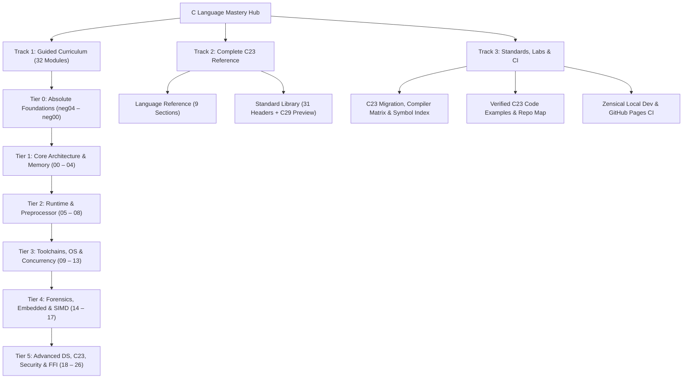

# C Language Mastery & Complete C23 Reference

Welcome to the unified **Zero-to-Systems-Architect C Programming Hub** — combining a structured **32-module guided curriculum** with a complete, up-to-date **ISO C23 (`ISO/IEC 9899:2024`) Language & Standard Library Reference** modeled directly on [`en.cppreference.com/c`](https://en.cppreference.com/c).

<span class="c-badge c89">C89</span>
<span class="c-badge c95">C95</span>
<span class="c-badge c99">C99</span>
<span class="c-badge c11">C11</span>
<span class="c-badge c17">C17</span>
<span class="c-badge c23">C23 (Current)</span>
<span class="c-badge c2y">C2y / C29 Draft</span>

---

## Choose Your Entry Point

<div class="grid cards" markdown>

- :lucide-graduation-cap:{ .lg .middle } **Start From Zero (Guided Curriculum)**

    ---

    32 sequential, zero-placeholder engineering modules taking you from installing your compiler (`neg04`) through pointers, memory arenas, UNIX syscalls, lock-free concurrency, SIMD, and C23 mastery (`26`).

    [:octicons-arrow-right-24: Explore the 32-Module Curriculum](curriculum/index.md)

- :lucide-code-2:{ .lg .middle } **C Language Reference (cppreference Parity)**

    ---

    Exact semantics for every core construct: translation phases, memory model, keywords, preprocessor & `#embed`, expressions, `_Generic`, `typeof`, `constexpr`, initialization `= {}`, functions, statements, and C23 `[[attributes]]`.

    [:octicons-arrow-right-24: Open Language Reference](reference/language/index.md)

- :lucide-library:{ .lg .middle } **C Standard Library (All 31 C23 Headers)**

    ---

    Complete API tables, edge cases, UB warnings, and C23 examples across every standard header — including `<stdbit.h>`, `<stdckdint.h>`, `memset_explicit`, `strdup`, `<threads.h>`, `<stdatomic.h>`, and C29 `<stdmchar.h>`.

    [:octicons-arrow-right-24: Browse Standard Library](reference/library/index.md)

- :lucide-sparkles:{ .lg .middle } **C23 Migration, Compilers & Symbol Index**

    ---

    Upgrading from C11/C17 to ISO C23? Inspect every removed/deprecated feature, GCC/Clang/Apple Clang/MSVC support matrices, ISO Technical Specifications (including TS 6010 Provenance), and the A–Z Symbol Index.

    [:octicons-arrow-right-24: Open C23 & Standards Hub](standards/index.md)

</div>

---

## Architecture of This Documentation Hub



---

## Quick Start: Run Locally or Compile C23 Examples

=== "Serve Docs Locally (Zensical)"

    ```bash
    # Requires uv (recommended) or pip install zensical
    make docs-serve
    # Or directly:
    uvx zensical serve
    ```

    Open `http://127.0.0.1:8000` for instant live reload, full-text search, Mermaid diagrams, and MathJax equations.

=== "Build & Verify Static Site"

    ```bash
    make docs-build
    make check-links
    ```

=== "Compile & Run Verified C23 Examples"

    ```bash
    make test-c23
    ```

    All reference examples under `examples/c23/` compile cleanly with `-std=c23 -Wall -Wextra -Werror -Wpedantic`.

---

## What Makes This Guide Different

| Pillar | What You Get |
| :--- | :--- |
| **Dual-Track Learning + Lookup** | Every curriculum module links straight into the matching ISO C23 reference pages, and every reference page links back to deep-dive hands-on labs. |
| **C23-First (`202311L`) Accuracy** | Covers published ISO/IEC 9899:2024 (C23) with explicit version badges (`C89` through `C23` + `C2y` draft `N3998`), breaking-change callouts, and real-world libc portability notes. |
| **Hardware & Systems Grounding** | Connects abstract C rules directly to stack frames, System V AMD64 / ARM64 ABIs, CPU cache lines, sanitizers (`ASan`/`UBSan`/`TSan`), and exploit mitigations. |
| **Modern Zensical Platform** | Built on **Zensical** (the Rust/Python successor to deprecated MkDocs) with automated GitHub Actions verification and GitHub Pages deployment. |

!!! tip "New to C?"
    Start with [**Module neg04: Development Environment & First Program**](curriculum/pre-tier/neg04-dev-environment.md) and follow the [Master Curriculum Roadmap](curriculum/index.md) in order.

!!! info "Experienced C11/C17 Developer?"
    Jump directly to [**Module 19: Modern C (C99–C23)**](curriculum/tier-5-expert/19-modern-c-c99-to-c23.md), the [**C23 Migration Guide**](standards/c23-migration.md), and the [**Master Symbol Index**](standards/symbol-index.md).
