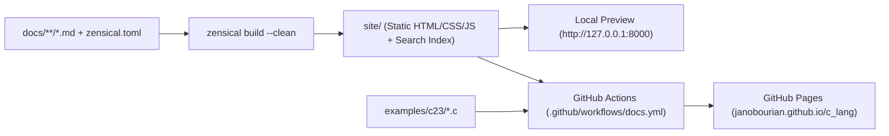

# Documentation, Local Serving & GitHub Pages Operations

This project uses [**Zensical**](https://zensical.org/) — the modern, Rust-powered direct successor to Material for MkDocs — to render pure Markdown into a blazing-fast static documentation portal with instant client-side search, Mermaid diagrams, MathJax equations, content tabs, and dark/light themes.

!!! info "Why Zensical Instead of MkDocs?"
    Legacy **MkDocs** stalled and entered maintenance/deprecation with breaking 2.0 plans, and the creators of *Material for MkDocs* built **Zensical** from the ground up with a high-performance Rust engine, native `zensical.toml` configuration, millisecond rebuilds, built-in Mermaid/tab/admonition/code-annotation support, and zero Node.js sprawl.

---

## Architecture & Repository Layout



| Path | Purpose |
| :--- | :--- |
| `zensical.toml` | Central Zensical site configuration: navigation tree, theme features, palettes, fonts, Markdown extensions, Mermaid & MathJax hooks |
| `pyproject.toml` | Python dependency specification pinning `zensical>=0.1.3` for `uv` / `pip` |
| `Makefile` | Developer ergonomics (`make docs-serve`, `make docs-build`, `make test-c23`, `make check-links`) |
| `docs/stylesheets/extra.css` | Custom CSS for cppreference-style C standard version pills (`.c-badge.c23`, etc.) and typography |
| `docs/javascripts/mathjax.js` | MathJax v3 initialization synchronized with Zensical instant navigation (`document$.subscribe`) |
| `scripts/check_docs.py` | Automated validator verifying zero broken relative links, valid frontmatter, and nav-tree integrity |
| `.github/workflows/docs.yml` | CI/CD workflow: builds docs + compiles/runs C23 examples on PRs and deploys to GitHub Pages on pushes to `main` |

---

## Local Development Workflow

### Option 1: Using the Project `.venv` (Recommended)

The `Makefile` automatically detects `.venv/bin/zensical` when present:

```bash
# Install or update documentation requirements inside .venv
source .venv/bin/activate
pip install -r requirements.txt

# Live-reloading local dev server at http://127.0.0.1:8000
make docs-serve
# Equivalent raw command:
.venv/bin/zensical serve
```

Build the production static output into `./site`:

```bash
make docs-build
# Equivalent raw command:
.venv/bin/zensical build --clean
```

### Option 2: Using `uv` (Zero Setup Fallback)

If `.venv` is not present, `make docs-serve` falls back to [`uv`](https://docs.astral.sh/uv/):

```bash
uvx zensical serve
```

### Validating Markdown Lint, Links & C23 Code Examples

Run all automated gates before opening a pull request or pushing to `main`:

```bash
make lint-md
make check-links
make test-c23
make docs-build
```

---

## Automated GitHub Actions & GitHub Pages Deployment

The workflow at `.github/workflows/docs.yml` automates both **pull request verification** and **production GitHub Pages publishing**:

1. **On every Pull Request to `main`**:
   - Installs `zensical>=0.1.3`.
   - Executes `zensical build --clean` to catch broken config or Markdown errors.
   - Compiles and executes every C23 program in `examples/c23/*.c` with `gcc -std=c23 -Wall -Wextra -Werror -Wpedantic -O2`.
2. **On every Push to `main` (or manual `workflow_dispatch`)**:
   - Runs all build and C23 verification steps.
   - Uploads `./site` via `actions/upload-pages-artifact@v5`.
   - Deploys live to GitHub Pages via `actions/deploy-pages@v5`.

### One-Time GitHub Repository Setup

Before the first deployment succeeds on GitHub, ensure GitHub Pages is switched to **GitHub Actions** mode:

1. Open your repository on GitHub: `https://github.com/janobourian/c_lang/settings/pages`.
2. Under **Build and deployment → Source**, select **GitHub Actions** (not "Deploy from a branch").
3. Commit and push `zensical.toml`, `docs/`, `examples/c23/`, and `.github/workflows/docs.yml` to `main`.
4. Watch the **Actions** tab — once `Deploy to GitHub Pages` completes, the site is live at:
   `https://janobourian.github.io/c_lang/`

!!! tip "Custom Domain (Optional)"
    To serve on a custom domain, add a `docs/CNAME` file containing your domain name, update `site_url` in `zensical.toml`, and configure DNS according to GitHub Pages documentation.

---

## Authoring Standards for Future Contributors

When adding a new curriculum module or C2y/C29 reference page:

1. **Frontmatter**: Include `title`, `description`, and `icon` (`lucide/...`) at the top of every `.md` file.
2. **Version Badges**: Tag standard versions cleanly using our CSS classes:
   - `<span class="c-badge c89">C89</span>` through `<span class="c-badge c23">C23</span>` and `<span class="c-badge c2y">C2y</span>`
   - `<span class="c-badge c-deprecated">deprecated C23</span>` and `<span class="c-badge c-removed">removed C23</span>`
3. **Register Navigation**: Add the new file path to `nav` in `zensical.toml`.
4. **Verify**: Run `make check-links && make docs-build && make test-c23`.
