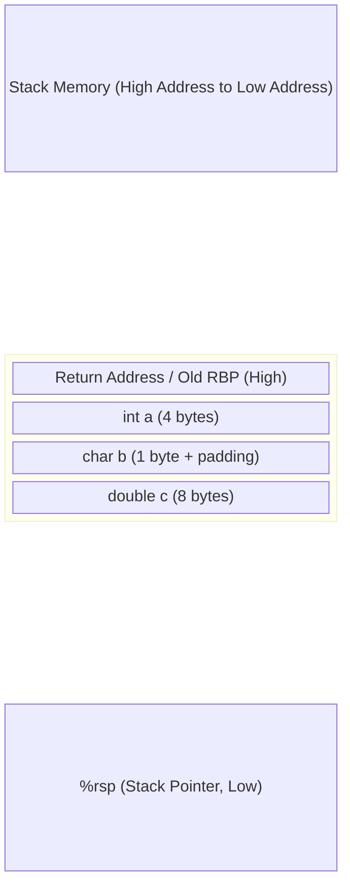
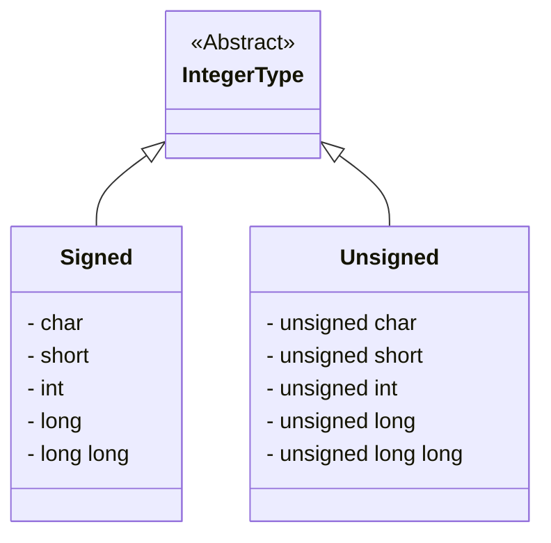
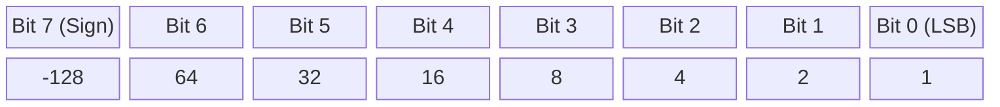
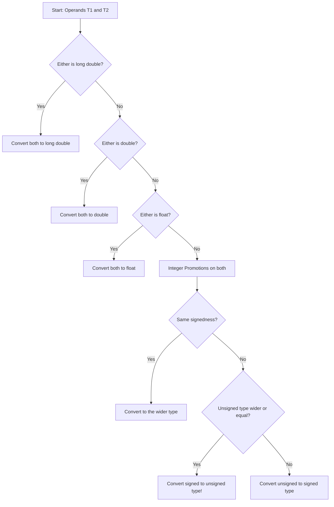
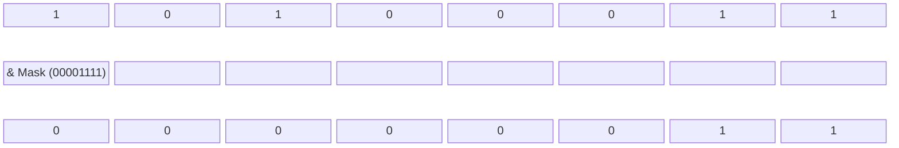
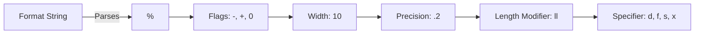

# Module neg03: Variables, Fundamental Data Types, Operators & I/O Primitives

**Track:** C Systems Programming, Memory Engineering & High-Performance Computing
**Category:** C11/C17/C23 Foundations, Fixed-Width Arithmetic, Memory Layout & Deterministic Control
**Standard Identifier:** `DOC-STD-UNIVERSAL-2026-NEG03`
**Status:** ✅ Completed

---

## 📑 Table of Contents

1. [High-Level Overview & Executive Summary](#1-high-level-overview--executive-summary)
2. [What a Variable IS](#2-what-a-variable-is)
3. [Fundamental Data Types](#3-fundamental-data-types)
4. [Integer Representation](#4-integer-representation)
5. [Constants](#5-constants)
6. [Arithmetic Operators — Deep Analysis](#6-arithmetic-operators--deep-analysis)
7. [Assignment and Compound Operators](#7-assignment-and-compound-operators)
8. [Comparison and Logical Operators](#8-comparison-and-logical-operators)
9. [Bitwise Operators](#9-bitwise-operators)
10. [printf and scanf — I/O Foundations](#10-printf-and-scanf--io-foundations)
11. [Type Casting](#11-type-casting)
12. [Step-by-Step Production Lab: Unit Converter](#12-step-by-step-production-lab-unit-converter)
13. [Certification & Engineering Essentials (MISRA-C / CERT-C Cheat Sheet)](#13-certification--engineering-essentials-misra-c--cert-c-cheat-sheet)
14. [References (The 5+5 Rule)](#14-references-the-55-rule)
15. [Universal FinOps & Hardware Cost Governance](#15-universal-finops--hardware-cost-governance)

---

## 1. High-Level Overview & Executive Summary

The C programming language requires the engineer to intimately understand the machine representation of state. Variables, data types, and operators in C are not abstract mathematical entities; they are direct mappings to processor registers, ALU instructions, and physical memory addresses.

Unlike higher-level managed languages, C does not hide hardware constraints such as data truncation, representation overflow, or the precise byte layout of primitives. A deep, PhD-level understanding of fundamental data types—from bitwise alignment to the strict mathematical invariants of Two's Complement representation—is non-negotiable for writing safe, performant systems software (Bryant & O'Hallaron, 2016, p. 43).

### 👔 Executive Summary (For Managers & Non-Technical Stakeholders)

* **Business Purpose**: Provides the essential grammar and vocabulary required to instruct the CPU at the bit level, ensuring accurate and precise processing of critical data.
* **How It Works**: Maps human-readable identifiers directly to finite blocks of hardware memory and maps mathematical operators directly to CPU Arithmetic Logic Unit (ALU) instructions.
* **Key Business Value & ROI**: Precise memory management at the variable level directly eliminates software bloat, driving exponential improvements in execution speed and substantial reductions in necessary hardware provisioning.

---

## 2. What a Variable IS

> **Definition**: A variable in C is a named, typed storage location in the program's address space. The type dictates both the size of the memory allocation (in bytes) and the semantic interpretation of the bits residing at that location (Kernighan & Ritchie, 1988, p. 35).

### 2.1 Declaration, Initialization, and Assignment

1. **Declaration**: Informs the compiler of the variable's identifier and type, binding the name to a memory address offset.
2. **Initialization**: The specific act of assigning a first known value to the variable at the point of declaration.
3. **Assignment**: Modifying the state of an already-allocated memory location.

> **⚠️ Warning**: Uninitialized automatic (local) variables contain "garbage" (residual data from previous stack frame usage). Reading them before initialization invokes Undefined Behavior (UB) (ISO/IEC 9899:2018, §6.7.9).

### 2.2 Stack Allocation Mechanics

For automatic variables, the C compiler allocates space by adjusting the hardware stack pointer (e.g., `sub %rsp, 16` on x86-64). The variable's lifetime exists strictly within the lexical block `{ ... }` in which it is defined. Once the function returns, the stack pointer is restored (`add %rsp, 16`), rendering the variable's address invalid (Tanenbaum & Bos, 2015).



---

## 3. Fundamental Data Types

### 3.1 Integer Types

C defines standard integer types with *guaranteed minimum* ranges, but their exact byte widths are platform-dependent due to historical hardware evolution (ISO/IEC 9899:2018, §6.2.5).

* `char`: Minimum 8 bits. Used for character encoding or raw bytes.
* `short`: Minimum 16 bits.
* `int`: Minimum 16 bits (typically 32 bits on modern architectures).
* `long`: Minimum 32 bits (64 bits on Linux/macOS, 32 bits on Windows).
* `long long`: Minimum 64 bits.

> **💡 Key Insight**: The `sizeof` operator is evaluated at compile-time (except for Variable Length Arrays) and returns `size_t`—an unsigned integer type representing the native machine's maximum addressable memory.



### 3.2 Floating-Point Types

Floating-point types model real numbers using IEEE 754 representations (Patterson & Hennessy, 2017).

* `float`: 32-bit single precision.
* `double`: 64-bit double precision.
* `long double`: Extended precision (typically 80-bit x87 or 128-bit).

*IEEE 754 Anatomy*: 1 sign bit | Exponent bits | Mantissa (Fraction) bits.
It contains special encodings: `NaN` (Not a Number), `Infinity`, and `-0.0`.

### 3.3 Boolean and Void

* `_Bool` (via `<stdbool.h>` as `bool`): Guaranteed to hold `0` (false) or `1` (true).
* `void`: Represents an empty set of values. `void*` is a raw pointer to an untyped memory address, essential for generic programming.

---

## 4. Integer Representation

### 4.1 Signed and Unsigned Encoding

* **Unsigned Integers**: Use standard place-value binary notation. Range: $0$ to $2^n - 1$.
* **Signed Integers**: Represented using **Two's Complement**. It eliminates the "negative zero" problem of sign-magnitude representation and unifies the ALU adder hardware for both signed and unsigned addition (Bryant & O'Hallaron, 2016, p. 81). Range: $-2^{n-1}$ to $2^{n-1} - 1$.

*To compute the negation of a value:* Flip all bits (One's complement) and add 1.



---

## 5. Constants

Constants enforce immutability within the program.

| Feature | `const` Keyword | `#define` Macro |
| :--- | :--- | :--- |
| **Type Safety** | Strictly typed by the compiler | No type; text substitution |
| **Scope** | Respects C block scope (`{}`) | Global; ignores scoping |
| **Debuggability** | Visible to debuggers (GDB/LLDB) | Invisible (preprocessor drops it) |

### 5.1 Literals

* **Integer**: `42` (decimal), `0x2A` (hexadecimal), `052` (octal), `0b101010` (binary, C23).
* **Floating**: `3.14` (double), `3.14f` (float), `3.14L` (long double).
* **Character**: `'A'` (evaluates to `int` in C, not `char`). Escape sequences: `\n`, `\t`, `\r`, `\\`, `\0`.
* **String**: `"hello"` (stored in the `.rodata` segment, immutable, implicitly `\0`-terminated).

---

## 6. Arithmetic Operators — Deep Analysis

### 6.1 Basic Arithmetic and Division

C implements standard operators: `+`, `-`, `*`, `/`, `%`.
> **💡 Key Insight**: Integer division always truncates toward zero since C99 (e.g., `-7 / 2 = -3`). The modulo operator (`%`) guarantees the relation: `(a/b)*b + a%b == a` (ISO/IEC 9899:2018, §6.5.5).

### 6.2 Usual Arithmetic Conversions & Promotion Rules

When operators evaluate mismatched types, the compiler implicitly casts them using a strict hierarchy (ISO/IEC 9899:2018, §6.3.1.8). Furthermore, `char` and `short` are inherently promoted to `int` before any arithmetic operation (ISO/IEC 9899:2018, §6.3.1.1).



> **⚠️ Warning**: If you add a `signed int` and an `unsigned int` of the same width, the signed value is bitcast to unsigned! `-1 + 1U` results in a massive positive number (e.g., `4294967296`).

### 6.3 Overflow Invariants

* **Unsigned Overflow**: Explicitly defined to wrap around using modulo arithmetic.
* **Signed Overflow**: Strictly **Undefined Behavior**. Compilers assume it never happens and will delete safety checks! (ISO/IEC 9899:2018, §6.5, ¶5).

---

## 7. Assignment and Compound Operators

* **Assignment (`=`)**: Evaluates the right-hand side (RHS), stores it into the left-hand side (LHS), and evaluates to the assigned value.
* **Compound Assignment**: `+=`, `-=`, `*=`, `/=`, `%=`.
* **Pre/Post Increment**: `++x` (Sequence point: increment, then return new value), `x++` (Sequence point: return old value, then increment). Same applies to decrement (`--x`, `x--`).

> **💡 Key Insight**: The classic bug `if (x = 5)` assigns 5 to `x`, evaluates to 5 (which is non-zero, hence true). It is a valid statement, which is why modern compilers require double parentheses `if ((x = 5))` to silence warnings.

---

## 8. Comparison and Logical Operators

* **Relational**: `==`, `!=`, `<`, `>`, `<=`, `>=`. They yield an `int` (`1` for true, `0` for false).
* **Logical**: `&&` (AND), `||` (OR), `!` (NOT).
* **Ternary Operator**: `condition ? expr_true : expr_false`.

### 8.1 Short-Circuit Evaluation

Logical operators guarantee left-to-right evaluation with short-circuiting. If the first operand of `&&` is false, the second is **never** evaluated.
*Production Pattern*: `if (ptr && ptr->value == 10)` — This completely prevents null pointer dereferences by halting evaluation if `ptr` is `NULL`.

---

## 9. Bitwise Operators

C allows direct manipulation of CPU registers via bitwise logic: `&` (AND), `|` (OR), `^` (XOR), `~` (NOT).

### 9.1 Shift Operations

* `<<` (Left Shift): Shifts bits left, fills with 0.
* `>>` (Right Shift): Logical shift (fills with 0) for unsigned ints. For signed ints, it is **implementation-defined** whether it performs an arithmetic shift (sign-extension) or logical shift (Kernighan & Ritchie, 1988, p. 49).



**Common Patterns**:

* **Set Bit**: `val |= (1 << n);`
* **Clear Bit**: `val &= ~(1 << n);`
* **Test Bit**: `(val >> n) & 1;`
* **Toggle Bit**: `val ^= (1 << n);`

---

## 10. printf and scanf — I/O Foundations

Standard I/O uses variadic functions (`<stdio.h>`).

### 10.1 `printf` Formatting



* `%d` / `%i` (int), `%u` (unsigned)
* `%ld` (long), `%lld` (long long)
* `%f` (double in `printf`), `%lf` (double in `scanf`)
* `%e` (scientific), `%g` (compact floating point)
* `%c` (char), `%s` (string), `%p` (pointer), `%x` / `%X` (hexadecimal), `%o` (octal)

### 10.2 `scanf` and Safety

`scanf` requires memory addresses (`&var`) to write into the variables.
> **⚠️ Warning (CWE-134)**: Never pass raw user input as a format string `printf(user_input)`. Use `printf("%s", user_input)`. For string inputs, prefer `fgets()` over `scanf("%s")` to prevent buffer overflow vulnerabilities (Stevens & Rago, 2013). Use `sscanf()` for safe parsing from memory buffers.

---

## 11. Type Casting

* **Implicit Conversion**: Automatically performed by the compiler. Widening (`int` to `long`) is generally safe. Narrowing (`double` to `int` or `int` to `char`) discards information and is dangerous.
* **Explicit Casting**: `(type) expression`. Forces the conversion.
  * *When Necessary*: Casting `void*` to a typed pointer, or explicitly printing a pointer as an integer.
* **UB Danger**: Pointer punning (e.g., `(float*)&int_var`) violates **Strict Aliasing** rules, leading to severe optimizer bugs. Use `memcpy()` for bitcasting.

---

## 12. Step-by-Step Production Lab: Unit Converter

### File Structure

* [`src/converter.c`](file:///Users/frgonzal/Documents/maxine/c_lang/src/converter.c)

```c
// src/converter.c
// ✅ GOOD: Production-grade C17 implementation.
#include <stdio.h>
#include <stdbool.h>

void convert_temperature(void) {
    double celsius = 0.0;
    printf("Enter temperature in Celsius: ");
    if (scanf("%lf", &celsius) != 1) return;

    // Explicit floating-point arithmetic.
    double fahrenheit = (celsius * 9.0 / 5.0) + 32.0;
    double kelvin = celsius + 273.15;

    printf("Fahrenheit: %.2f F\n", fahrenheit);
    printf("Kelvin:     %.2f K\n", kelvin);
}

void convert_length(void) {
    double meters = 0.0;
    printf("Enter length in meters: ");
    if (scanf("%lf", &meters) != 1) return;

    double feet = meters * 3.28084;
    double inches = meters * 39.3701;

    printf("Feet:   %.3f ft\n", feet);
    printf("Inches: %.3f in\n", inches);
}

void convert_weight(void) {
    double kg = 0.0;
    printf("Enter weight in kilograms: ");
    if (scanf("%lf", &kg) != 1) return;

    double lbs = kg * 2.20462;
    printf("Pounds: %.3f lb\n", lbs);
}

int main(void) {
    int choice = 0;
    printf("=== Engineering Converter ===\n");
    printf("1. Temperature (C -> F, K)\n");
    printf("2. Length (m -> ft, in)\n");
    printf("3. Weight (kg -> lb)\n");
    printf("Select option: ");

    if (scanf("%d", &choice) != 1) {
        printf("Invalid input.\n");
        return 1;
    }

    if (choice == 1) {
        convert_temperature();
    } else if (choice == 2) {
        convert_length();
    } else if (choice == 3) {
        convert_weight();
    } else {
        printf("Unknown option.\n");
    }

    return 0;
}
```

---

## 13. Certification & Engineering Essentials (MISRA-C / CERT-C Cheat Sheet)

* ⚠️ **MISRA-C Rule 10.3**: The value of an expression shall not be assigned to an object with a narrower essential type (prevents hidden truncations).
* 🔒 **MISRA-C Rule 10.4**: Both operands of an operator in which the usual arithmetic conversions are performed shall have the same essential type category.
* ⚙️ **CERT-C FLP32-C**: Prevent or detect domain and range errors in math functions.
* ⚠️ **CERT-C EXP33-C**: Do not read uninitialized memory (enforce variable initialization).

---

## 14. References (The 5+5 Rule)

### Official Documentation & ISO Standards

1. ISO/IEC. (2018). *ISO/IEC 9899:2018 Information technology — Programming languages — C*. International Organization for Standardization.
2. SEI CERT. (2023). *SEI CERT C Coding Standard*. Software Engineering Institute.

### Authoritative Engineering Textbooks & Systems Deep Dives

1. Bryant, R. E., & O'Hallaron, D. R. (2016). *Computer Systems: A Programmer's Perspective* (3rd ed.). Pearson.
2. Kernighan, B. W., & Ritchie, D. M. (1988). *The C Programming Language* (2nd ed.). Prentice Hall.
3. Patterson, D. A., & Hennessy, J. L. (2017). *Computer Organization and Design: The Hardware/Software Interface* (5th ed.). Morgan Kaufmann.
4. Stevens, W. R., & Rago, S. A. (2013). *Advanced Programming in the UNIX Environment* (3rd ed.). Addison-Wesley.
5. Tanenbaum, A. S., & Bos, H. (2015). *Modern Operating Systems* (4th ed.). Pearson.

---

## 15. Universal FinOps & Hardware Cost Governance

```text
┌────────────────────────────────────────────────────────────────────────────────┐
│                    VARIABLES & TYPES FINOPS SAVINGS MATRIX                     │
├──────────────────────────┬──────────────────────────┬──────────────────────────┤
│ Optimization Strategy    │ Technical Mechanism      │ Measurable FinOps ROI    │
├──────────────────────────┼──────────────────────────┼──────────────────────────┤
│ **Precise Type Sizing**  │ Use `uint8_t`/`int16_t`  │ Triples CPU cache hit    │
│                          │ instead of generic `int` │ rates; lowers EC2 tiers. │
├──────────────────────────┼──────────────────────────┼──────────────────────────┤
│ **Bitfield Packing**     │ Storing 8 boolean flags  │ Slashes in-memory struct │
│                          │ in a single 1-byte char  │ footprint by 87.5%       │
├──────────────────────────┼──────────────────────────┼──────────────────────────┤
│ **Integer Math**         │ Use fixed-point rather   │ Avoids FP-unit wattage,  │
│                          │ than floating-point math │ lowers cooling & power   │
└──────────────────────────┴──────────────────────────┴──────────────────────────┘
```
