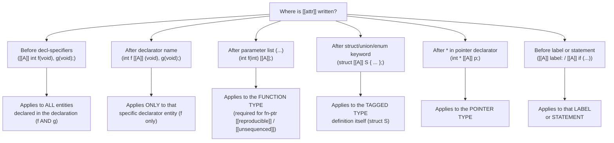

# Standard Attributes <span class="c-badge c23">C23</span>

**Attributes** (`[[...]]`), introduced into ISO C in **C23 (ISO/IEC 9899:2024 §6.7.13, `N2335`)**, provide a unified, portable, grammar-anchored syntax for attaching diagnostics, semantic guarantees, and optimization contracts to declarations, types, statements, and labels — replacing fragmented compiler extensions such as GCC/Clang `__attribute__((...))`, MSVC `__declspec(...)`, and `#pragma` directives while aligning directly with C++11–C++23 syntax for shared headers.

---

## Overview of All 7 Standard C23 Attributes

| Standard Attribute | Underscore-Safe Form | WG14 Paper | Applies To (Appertainment) | Optional Argument | Purpose |
| :--- | :--- | :--- | :--- | :--- | :--- |
| **`[[deprecated]]`** | `[[__deprecated__]]` | `N2334` | Functions, objects, `typedef`, `struct`/`union`/`enum`, members, enumerators | `"reason"` string literal | Emit warning when the entity is referenced |
| **`[[fallthrough]]`** | `[[__fallthrough__]]` | `N2408` | Null statement (`[[fallthrough]];`) inside `switch` | None | Suppress implicit fallthrough warning between `case`/`default` blocks |
| **`[[maybe_unused]]`** | `[[__maybe_unused__]]` | `N2270` / `N2731` | `struct`/`union`/`enum`, `typedef`, variables, params, members, functions, enumerators, **labels** | None | Suppress unused-entity compiler warnings |
| **`[[nodiscard]]`** | `[[__nodiscard__]]` | `N2267` / `N2448` | Functions (non-`void` return), `struct`, `union`, `enum` definitions | `"reason"` string literal | Warn if a return value (or returned value of a tagged type) is discarded |
| **`[[noreturn]]`** | `[[__noreturn__]]` | `N2764` | Functions only | None | Function never returns to caller (replaces `_Noreturn` & `<stdnoreturn.h>`) |
| **`[[reproducible]]`** | `[[__reproducible__]]` | `N2956` | Function types (and function declarations) | None | **Effectless + Idempotent**: identical consecutive calls may be merged |
| **`[[unsequenced]]`** | `[[__unsequenced__]]` | `N2956` | Function types (and function declarations) | None | **Stateless + Independent + Effectless + Idempotent**: freely reorderable, hoistable, & CSE-able |

!!! note "Deprecated Compatibility Spelling: `[[_Noreturn]]` <span class="c-badge c-deprecated">deprecated C23</span>"
    ISO C23 (§6.7.13.6) also defines `[[_Noreturn]]` (and `[[___Noreturn__]]`) as an **obsolescent/deprecated** synonym for `[[noreturn]]`. It exists solely so that legacy code including `<stdnoreturn.h>` (which defines `#define noreturn _Noreturn`) does not break when someone writes `[[noreturn]]` after the include!

---

## C23 Standard Attribute Syntax (§6.7.13.1)

An **attribute specifier sequence** consists of one or more bracketed attribute specifiers:

```c
[[attr]]                                /* single standard attribute */
[[attr1, attr2("msg")]]                 /* comma-separated attribute list */
[[attr1]] [[attr2]]                     /* adjacent attribute specifiers */
[[vendor::attr]]                        /* vendor-prefixed attribute */
[[vendor::attr(arg1, arg2)]]            /* vendor-prefixed attribute with balanced tokens */
[[]]                                    /* empty attribute specifier (valid no-op) */
```

### Core Syntax Rules

1. **Underscore-Protected Spellings (`[[__attr__]]`)**:
   Every standard attribute `name` has an equivalent reserved spelling `__name__` (`[[__nodiscard__]]`, `[[__deprecated__]]`, `[[__maybe_unused__]]`, `[[__fallthrough__]]`, `[[__noreturn__]]`, `[[__reproducible__]]`, `[[__unsequenced__]]`, `[[___Noreturn__]]`).
   - **Why this matters**: Public library headers cannot guarantee that user code hasn't defined `#define deprecated 1` or `#define fallthrough 0` before `#include`. Double-underscore identifiers are reserved to the implementation, so **`[[__nodiscard__]]` is 100% immune to user macro collisions**!
2. **Duplicate Attributes Allowed (`N2557`)**:
   C23 (`N2557`) allows the same standard attribute to appear more than once in the same attribute specifier list (for example, `[[nodiscard, nodiscard]]` or via stacked macros). Repeating a standard attribute has the exact same effect as specifying it once (with no constraint violation).
3. **Unknown Attributes Must Be Ignored (§6.7.13.1 ¶2)**:
   Any unrecognized attribute (whether an unknown vendor attribute like `[[acme::fast]]` or a future C2y standard attribute) **must be ignored** by a conforming C23 compiler (it may issue a diagnostic warning, but shall not reject the program).
4. **No `using` Prefix**:
   Unlike C++17 (`[[using gnu: const, always_inline]]`), C23 does **not** support `using vendor:` attribute prefixes — each prefixed attribute must repeat its vendor token (`[[gnu::const, gnu::always_inline]]`).

---

## Exact Attribute Placement (Appertainment) Rules

In ISO C23, **where** you place `[[...]]` determines **which syntactic entity** it attaches (*appertains*) to! Unlike GCC's older `__attribute__((...))`, which floated loosely around declarations, C23 `[[...]]` attaches strictly by grammar position.



### Master Placement Table

| Construct | Exact Syntactic Position | Appertains To | Valid Example |
| :--- | :--- | :--- | :--- |
| **Whole declaration** | Start of declaration (before specifiers) | All entities declared in that declaration | `[[nodiscard]] int open_a(void), open_b(void);` |
| **Single declarator** | Immediately after the declared identifier | Only that specific variable/function | `int x [[maybe_unused]] = 0, y = 1;` |
| **Function type** | Immediately after parameter list `(...)` | The **function type** (essential for function pointers!) | `int (*fp)(int) [[unsequenced]];` |
| **Function declaration (shortcut for type attrs)** | Start of function declaration *or* after `(...)` | Function type of the declared function (`[[reproducible]]`/`[[unsequenced]]`) | `[[unsequenced]] int hash(int x);` *or* `int hash(int x) [[unsequenced]];` |
| **`struct` / `union` / `enum` type** | Immediately after `struct` / `union` / `enum` keyword | The tagged type definition itself | `struct [[nodiscard]] Result { int err; };` |
| **Struct / union member** | Start of member declaration or after member name | That specific struct/union member | `struct S { [[deprecated]] int legacy; };` |
| **Enumerator** | Immediately after enumerator identifier (before `= val`) | That specific enum constant | `enum Mode { FAST, OLD_FAST [[deprecated]] = 0 };` |
| **Function parameter** | Start of parameter declaration or after parameter name | That specific parameter | `void cb([[maybe_unused]] int flags, void *ctx);` |
| **Pointer type** | Immediately after `*` (and before qualifiers or name) | The pointer type | `int * [[gnu::aligned(16)]] p;` |
| **Array type** | Immediately after `[...]` | The array type | `int arr[16] [[vendor::attr]];` |
| **Label** | Immediately before `label:`, `case E:`, or `default:` | That label | `[[maybe_unused]] cleanup:` |
| **Statement** | Immediately before the statement (or before `;`) | That statement | `[[fallthrough]];` |
| **Compound literal** | Immediately before `{ ... }` or inside type name | Compound literal object / type | `(struct S) [[vendor::attr]] { 0 }` |

!!! danger "Function Pointer Trap with `[[reproducible]]` and `[[unsequenced]]`"
    Because `[[reproducible]]` and `[[unsequenced]]` appertain to a **function type** (§6.7.13.7):

    - `[[unsequenced]] int add(int a, int b);` → **VALID** (special C23 rule forwards it to `add`'s function type).
    - `int add(int a, int b) [[unsequenced]];` → **VALID** (explicitly attached to the function type).
    - `int (*fp)(int, int) [[unsequenced]];` → **VALID** (`fp` is a pointer to an `[[unsequenced]]` function).
    - `[[unsequenced]] int (*fp)(int, int);` → **CONSTRAINT VIOLATION!** Here `[[unsequenced]]` appertains to the variable `fp` (a *pointer object*), NOT the pointed-to function type!

    Writing `[[reproducible]]` and `[[unsequenced]]` consistently **after `(...)`** works uniformly for both function declarations and function pointers!

---

## Feature Testing: `__has_c_attribute(token)` (§6.10.2)

C23 introduces the preprocessor conditional operator **`__has_c_attribute(attribute-token)`**, usable inside `#if` and `#elif` directives to detect compiler support for both standard and vendor-prefixed attributes:

- Evaluates to **`0`** if the attribute is not supported by the implementation.
- Evaluates to a **positive integer constant (`YYYYMML`)** if supported.
- Accepts standard tokens (`__has_c_attribute(nodiscard)`), underscore-protected tokens (`__has_c_attribute(__nodiscard__)`), and vendor-prefixed tokens (`__has_c_attribute(gnu::packed)`).

### Exact `__has_c_attribute` Return Values (ISO C23 vs. Real-World Compilers)

| Attribute Token | Final ISO/IEC 9899:2024 (§6.10.2) Value | Pre-Ratification C2x Draft Value (GCC 10–14 / Clang 15–21) | Why Both Values Matter |
| :--- | :--- | :--- | :--- |
| `deprecated` / `__deprecated__` | **`202311L`** | `201904L` | Adopted in `N2334` (Apr 2019); harmonized to `202311L` in final C23 |
| `fallthrough` / `__fallthrough__` | **`202311L`** | `201910L` (early: `201904L`) | Refined in `N2408` (Oct 2019); harmonized to `202311L` in final C23 |
| `maybe_unused` / `__maybe_unused__` | **`202311L`** | `202106L` (early: `201904L`) | Extended to labels in `N2731` (Jun 2021); harmonized to `202311L` in final C23 |
| `nodiscard` / `__nodiscard__` | **`202311L`** | `202003L` (early: `201904L`) | Added `"reason"` string in `N2448` (Mar 2020); harmonized to `202311L` in final C23 |
| `noreturn` / `_Noreturn` | **`202311L`** | `202202L` | Adopted in `N2764` (Feb 2022); harmonized to `202311L` in final C23 |
| `reproducible` / `__reproducible__` | **`202311L`** | `202311L` (GCC 15+) / `0` (older Clang) | Adopted in `N2956` |
| `unsequenced` / `__unsequenced__` | **`202311L`** | `202311L` (GCC 15+) / `0` (older Clang) | Adopted in `N2956` |

!!! danger "Two Classic `__has_c_attribute` Pitfalls"
    1. **NEVER combine `defined(__has_c_attribute)` and `__has_c_attribute(...)` on the same `#if` line!**
       `#if defined(__has_c_attribute) && __has_c_attribute(nodiscard)` is a **syntax error** on pre-C23 preprocessors that do not know `__has_c_attribute` is function-like. Always use **nested `#if` directives**!
    2. **NEVER hardcode `>= 202311L` for `deprecated`/`nodiscard`/`fallthrough`/`maybe_unused`/`noreturn`!**
       Real-world compilers (including Clang 18–21 and GCC 13–14) return the C2x draft dates (`201904L`, `202003L`, `202106L`, `202202L`) even in `-std=c23` mode! Test `#if __has_c_attribute(nodiscard)` (nonzero) or `#if __has_c_attribute(nodiscard) >= 202003L` (for `"reason"` string support).

```c
/* SAFE portable two-level feature check */
#if defined(__has_c_attribute)
#  if __has_c_attribute(__nodiscard__)
#    define API_NODISCARD [[__nodiscard__]]
#  endif
#endif

#ifndef API_NODISCARD
#  define API_NODISCARD
#endif
```

---

## Deep Dive: All 7 Standard C23 Attributes

### 1. `[[deprecated]]` and `[[deprecated("reason")]]` {#deprecated}

**Standard**: ISO/IEC 9899:2024 §6.7.13.2 (`N2334`)

Marks an entity as still functional for backward compatibility, but discouraged for new code. Compilers are encouraged to emit a warning whenever the entity is referenced outside a deprecated context.

- **Appertains to**: functions, variables, `typedef` names, `struct`/`union`/`enum` definitions, struct/union members, and enumerators.
- **Argument**: Optional **ordinary string literal** (no `u8`, `u`, `U`, or `L` prefix).

```c
#include <stdio.h>

[[deprecated("use parse_config_v2() for bounds-checked parsing")]]
static int parse_config_v1(const char *path) {
    return path != nullptr ? 0 : -1;
}

enum [[deprecated("migrate to enum HashAlg")]] LegacyCipher {
    CIPHER_RC4 [[deprecated("cryptographically broken")]] = 1,
    CIPHER_AES256 = 2,
};

struct Header {
    int version;
    [[deprecated("ignored since protocol v3")]] int legacy_flags;
};

typedef int legacy_fd_t [[deprecated("use struct FileHandle instead")]];
```

---

### 2. `[[fallthrough]]` {#fallthrough}

**Standard**: ISO/IEC 9899:2024 §6.7.13.3 (`N2408`)

Marks an **intentional** control-flow fallthrough from one `switch` branch into the immediately following `case` or `default` label, silencing `-Wimplicit-fallthrough` warnings without relying on fragile comment conventions (`/* fallthrough */`).

- **Appertains to**: **Only** a null statement (`[[fallthrough]];`) inside a `switch` statement.
- **Constraints**:
  1. Takes **no** arguments.
  2. The **next statement executed** after `[[fallthrough]];` must be a `case` or `default` label belonging to the **same** enclosing `switch` statement.
  3. Placing `[[fallthrough]];` at the end of the **final** `case`/`default` block (with no subsequent label) or outside a `switch` is a **constraint violation**!

```c
#include <stdio.h>

static void handle_http_status(int code) {
    switch (code) {
    case 301:
        puts("Permanent redirect: updating cached URL");
        [[fallthrough]]; /* Valid: immediately followed by case 302 */
    case 302:
        puts("Following redirect location");
        break;
    case 200:
        puts("OK");
        break;
    default:
        printf("Unhandled status %d\n", code);
        /* [[fallthrough]]; <-- CONSTRAINT VIOLATION here (no subsequent label!) */
        break;
    }
}
```

---

### 3. `[[maybe_unused]]` {#maybe_unused}

**Standard**: ISO/IEC 9899:2024 §6.7.13.4 (`N2270`, `N2731`)

Suppresses compiler warnings (`-Wunused-variable`, `-Wunused-parameter`, `-Wunused-function`, `-Wunused-label`, `-Wunused-local-typedefs`) for entities that may legitimately remain unreferenced in certain build configurations (such as release builds with `NDEBUG` or platform-specific `#ifdef` branches).

- **Appertains to**: `struct`/`union`/`enum` types, `typedef` names, variables, function parameters, struct/union members, functions, enumerators, and **labels** (`N2731`).
- **Argument**: None.

```c
#include <assert.h>
#include <stdio.h>

[[maybe_unused]] static void debug_dump(const char *tag, int val) {
    printf("[DEBUG %s] %d\n", tag, val);
}

static int verify_and_process([[maybe_unused]] int strict_mode, int input) {
    /* Under -DNDEBUG, assert() compiles out and `ok` / `strict_mode` would warn */
    [[maybe_unused]] int ok = (input >= 0);
    assert(!strict_mode || ok);

    if (input == 0) {
#ifdef FAST_SHORT_CIRCUIT
        goto fast_exit;
#endif
    }
    return input * 2;

[[maybe_unused]] fast_exit:
    return 0;
}
```

!!! tip "`[[maybe_unused]]` vs. C23 Unnamed Parameters"
    For function parameters that are **never** referenced in any build configuration, prefer C23 unnamed parameters (`void cb(int, void *ctx)` — `N2480`). Reserve `[[maybe_unused]]` for parameters that *are* used in some preprocessor configurations (like `assert(...)` or `#ifdef`).

---

### 4. `[[nodiscard]]` and `[[nodiscard("reason")]]` {#nodiscard}

**Standard**: ISO/IEC 9899:2024 §6.7.13.5 (`N2267`, `N2448`)

Encourages the compiler to emit a warning when a caller discards a return value by evaluating a function call as a void expression (without assigning it, inspecting it, or explicitly casting it to `(void)`).

- **Appertains to**:
  1. **Functions** with a non-`void` return type.
  2. **`struct`, `union`, and `enum` type definitions**!
- **Argument**: Optional ordinary string literal (`"reason"`).

#### Key Semantics & Type-Level Inheritance

- **Marked on a tagged type (`struct` / `union` / `enum`)**: **Every** function that returns that type **by value** automatically behaves as `[[nodiscard]]` — even if the function itself is *not* annotated!
- **Returning a pointer**: Returning `struct [[nodiscard]] Status *` does **not** automatically inherit `[[nodiscard]]` (annotate the allocator function itself with `[[nodiscard("caller owns heap memory")]]`!).
- **Intentional discard**: Explicitly cast to `void`: `(void)write_audit_log(msg);`.

```c
#include <stdio.h>
#include <stdlib.h>

/* Type-level [[nodiscard]]: EVERY function returning `enum Status` by value inherits it! */
enum [[nodiscard("check operation status code")]] Status {
    STATUS_OK = 0,
    STATUS_IO_ERR = 1,
    STATUS_NOMEM = 2,
};

/* Inherits [[nodiscard]] automatically from `enum Status` */
static enum Status flush_buffer(void) {
    return STATUS_OK;
}

/* Function-level [[nodiscard]] for pointer-returning allocator */
[[nodiscard("returned pointer must be freed to avoid memory leak")]]
static void *alloc_zeroed(size_t count, size_t elem_size) {
    return calloc(count, elem_size);
}

static void caller_demo(void) {
    /* flush_buffer(); */       /* Compiler WARNING: ignoring return value of type enum Status */
    (void)flush_buffer();       /* Explicitly suppressed via (void) cast */

    void *buf = alloc_zeroed(16, sizeof(int));
    if (buf != nullptr) {
        free(buf);
    }
}
```

---

### 5. `[[noreturn]]` (and Deprecation of `_Noreturn` / `<stdnoreturn.h>`) {#noreturn}

**Standard**: ISO/IEC 9899:2024 §6.7.13.6 (`N2764`)

Declares that a function never returns control to its caller. Enables dead-code elimination, suppresses missing-`return` warnings in callers after fatal error helpers, and allows tighter register allocation at call sites.

- **Appertains to**: Functions only (argument: none).
- **Valid ways to exit a `[[noreturn]]` function**: calling `exit()`, `_Exit()`, `quick_exit()`, `abort()`, `thrd_exit()`, `longjmp()`, invoking another `[[noreturn]]` function, or entering an infinite loop (`for (;;) {}`).
- **Undefined Behavior**: Returning from a `[[noreturn]]` function (via `return;` or falling off the closing `}`) is **Undefined Behavior**!
- **Deprecation**: In C23, `[[noreturn]]` supersedes both the C11 `_Noreturn` function specifier and the `<stdnoreturn.h>` header (and `[[_Noreturn]]` is retained only as a deprecated synonym).

```c
#include <stdio.h>
#include <stdlib.h>

[[noreturn]] static void panic_abort(const char *file, int line, const char *msg) {
    fprintf(stderr, "PANIC at %s:%d: %s\n", file, line, msg);
    abort();
}

static int checked_div(int a, int b) {
    if (b == 0) {
        panic_abort(__FILE__, __LINE__, "division by zero");
        /* No `return` needed here: compiler knows panic_abort never returns */
    }
    return a / b;
}
```

---

### 6. `[[reproducible]]` (`N2956`) {#reproducible}

**Standard**: ISO/IEC 9899:2024 §6.7.13.7.2 (`N2956`)

`[[reproducible]]` is a **function type attribute** asserting that a function is **effectless** and **idempotent** — allowing the optimizer to merge redundant consecutive calls (Common Subexpression Elimination) or eliminate dead calls when no intervening observable state changes occur.

#### The Four Formal N2956 Function Properties

ISO C23 §6.7.13.7 defines four precise mathematical properties to specify `[[reproducible]]` and `[[unsequenced]]`:

| Property | Formal Meaning in ISO C23 (§6.7.13.7) | Required by `[[reproducible]]`? | Required by `[[unsequenced]]`? |
| :--- | :--- | :---: | :---: |
| **Effectless** | Synchronizes with no other threads; accesses no `volatile` objects; performs no I/O; modifies **no** object visible after the call returns *except* objects directly reachable through its pointer arguments (which must also not be modified through globals). | **Yes** | **Yes** |
| **Idempotent** | Calling `f(args)` twice back-to-back with identical arguments and memory state produces the exact same return value and leaves pointed-to output objects in the exact same state as calling it once. | **Yes** | **Yes** |
| **Stateless** | Any `static` or `thread_local` object defined inside or accessed by the function must be `const`-qualified (no reading mutable globals or mutable static state). | No | **Yes** |
| **Independent** | Depends **only** on its argument values (and objects directly reachable through its pointer parameters, assuming no aliasing conflicts); never depends on external global state that could change between separated calls. | No | **Yes** |

#### How `[[reproducible]]` Differs from `[[unsequenced]]` and GCC `__attribute__((pure))`

- **Versus `[[unsequenced]]`**: A `[[reproducible]]` function **IS allowed** to read mutable global/file-scope state (such as a configuration table, a lookup cache, or a global scale factor `g_tax_rate`). Because that global state might be modified by *other* code between two non-adjacent calls, the compiler can merge back-to-back calls (or calls with no intervening writes), **but cannot hoist a `[[reproducible]]` call across arbitrary writes to global memory**!
- **Versus GCC `__attribute__((pure))`**: GCC's `pure` forbids modifying memory through pointer arguments at all. C23's `[[reproducible]]` **permits writing through pointer parameters** (e.g., filling an output struct or buffer passed by pointer), provided those writes are effectless (only through pointer params) and idempotent!

```c
#include <stddef.h>

/* Global mutable configuration read (never written) by a [[reproducible]] function */
static double g_calibration_offset = 0.25;

/* VALID [[reproducible]]:
 * - Reads mutable global `g_calibration_offset` (so NOT [[unsequenced]]!)
 * - Writes through output pointer `out` deterministically (idempotent & effectless)
 * - No I/O, no volatile, no global mutations
 */
void calibrate_sample(double raw, double *out) [[reproducible]] {
    *out = raw + g_calibration_offset;
}
```

!!! warning "Violating `[[reproducible]]` Is Undefined Behavior"
    If a function annotated `[[reproducible]]` increments a static call counter (`static int calls; ++calls;`), writes to a global variable, reads a `volatile` register, performs `printf`, or produces a different result on a second consecutive call (like `rand()` or `clock()`), the behavior is **Undefined Behavior** — the optimizer may silently drop calls or reuse stale cached results!

---

### 7. `[[unsequenced]]` (`N2956`) {#unsequenced}

**Standard**: ISO/IEC 9899:2024 §6.7.13.7.3 (`N2956`)

`[[unsequenced]]` is the **strictest** C23 optimization contract — a strict superset of `[[reproducible]]` requiring all four N2956 properties: **stateless**, **independent**, **effectless**, and **idempotent**.

Every `[[unsequenced]]` function is automatically `[[reproducible]]`.

#### What Optimizer Transformations `[[unsequenced]]` Unlocks

Because an `[[unsequenced]]` function depends *solely* on its arguments and never reads or mutates global/thread-local state, the compiler may freely:

1. **Common Subexpression Elimination (CSE)**: Call `f(x)` once even if written multiple times across intervening writes to unrelated global memory.
2. **Loop-Invariant Code Motion (LICM)**: Hoist `f(invariant_arg)` completely out of a hot loop even when the loop writes to globals or calls unknown external functions!
3. **Instruction Reordering & Speculative Scheduling**: Move calls before or after unrelated statements, or execute multiple independent calls in parallel / SIMD lanes.
4. **Dead Call Elimination**: Completely delete calls whose return values (and output pointers) are never used.

#### Side-by-Side Comparison: `[[reproducible]]` vs. `[[unsequenced]]` vs. GCC `pure` / `const`

| Capability / Optimizer Permission | `[[reproducible]]` (<span class="c-badge c23">C23</span>) | `[[unsequenced]]` (<span class="c-badge c23">C23</span>) | GCC `[[gnu::pure]]` | GCC `[[gnu::const]]` |
| :--- | :---: | :---: | :---: | :---: |
| Read mutable global / static variables | **Allowed** | **Forbidden (UB)** | **Allowed** | **Forbidden (UB)** |
| Read `static const` lookup tables | **Allowed** | **Allowed** | **Allowed** | **Allowed** |
| Dereference pointer arguments (read) | **Allowed** | **Allowed** (must not alias mutable global state) | **Allowed** | **Forbidden** (except invariant data) |
| Write through output pointer arguments (idempotently) | **Allowed** | **Allowed** (with non-aliasing pointer params) | **Forbidden (UB)** | **Forbidden (UB)** |
| Modify globals / `volatile` / perform I/O | **Forbidden (UB)** | **Forbidden (UB)** | **Forbidden (UB)** | **Forbidden (UB)** |
| Applies to function pointer types (`int (*fp)(int) [[...]]`) | **Yes** | **Yes** | Function decl/type | Function decl/type |
| Hoist across unrelated global memory writes | No | **Yes** | No | **Yes** |
| Eliminate consecutive duplicate calls (CSE) | **Yes** | **Yes** | **Yes** | **Yes** |

#### Function Type Compatibility for `[[reproducible]]` and `[[unsequenced]]`

Because both attributes are part of the **function type**, C23 defines safe subtyping conversions (analogous to adding `const` to a pointer, in reverse for guarantees):

- A pointer to an `[[unsequenced]]` function converts implicitly to a pointer to a `[[reproducible]]` function or to an ordinary unqualified function pointer (dropping stronger guarantees is always safe).
- A pointer to an ordinary function **cannot** implicitly convert to an `[[unsequenced]]` function pointer without an explicit cast (and calling a non-unsequenced function through an `[[unsequenced]]` function pointer is **Undefined Behavior**!).

```c
#include <stdint.h>

/* Pure mathematical mixing function: stateless, independent, effectless, idempotent */
uint32_t splitmix32(uint32_t x) [[unsequenced]] {
    x += UINT32_C(0x9e3779b9);
    x = (x ^ (x >> 16)) * UINT32_C(0x85ebca6b);
    x = (x ^ (x >> 13)) * UINT32_C(0xc2b2ae35);
    return x ^ (x >> 16);
}

/* Output-parameter [[unsequenced]] function (valid in C23, unlike GCC `const`!) */
void divmod_u32(uint32_t num, uint32_t den, uint32_t * restrict q, uint32_t * restrict r) [[unsequenced]] {
    *q = num / den;
    *r = num % den;
}

/* Function pointer preserving the [[unsequenced]] contract */
typedef uint32_t (*hash_fn_t)(uint32_t) [[unsequenced]];
```

!!! danger "Subtle UB Traps with `[[unsequenced]]`"
    - **Floating-point rounding mode / `errno`**: A math function that reads the dynamic FENV rounding mode (`fegetround()`) or sets `errno` on domain errors is **NOT** `[[unsequenced]]` (and setting `errno` violates `[[reproducible]]` too!).
    - **Pointer-identity comparisons on local/static addresses**: Returning the address of a non-`const` static object or depending on runtime address layout violates independence/statelessness.
    - **Aliasing**: Passing overlapping pointers to an `[[unsequenced]]` function that writes through a pointer parameter can break idempotency if the second invocation sees modified input bytes! Always mark output pointers `restrict` and verify non-overlap.

---

## Vendor-Prefixed Attributes (`[[gnu::...]]`, `[[clang::...]]`, `[[msvc::...]]`)

C23 standardizes the `[[vendor::attr]]` namespace syntax so compiler extensions fit cleanly into the same grammar without breaking non-supporting compilers.

| Vendor Attribute | Compilers | Purpose | Example |
| :--- | :--- | :--- | :--- |
| **`[[gnu::packed]]`** | GCC, Clang | Remove struct padding (byte-aligned layout; beware unaligned access!) | `struct [[gnu::packed]] WireHdr { uint8_t tag; uint32_t len; };` |
| **`[[gnu::format(printf, fmt, first)]]`** | GCC, Clang | Type-check `printf`/`scanf`-style format strings and variadic args | `[[gnu::format(printf, 1, 2)]] void logf(const char *fmt, ...);` |
| **`[[gnu::always_inline]]`** | GCC, Clang | Force inlining even at low optimization levels (pair with `inline`) | `[[gnu::always_inline]] static inline int fast_min(int a, int b) { ... }` |
| **`[[gnu::aligned(N)]]`** | GCC, Clang | Minimum alignment (prefer standard C11/C23 `alignas(N)` when possible!) | `alignas(64) uint8_t cacheline[64];` |
| **`[[gnu::nonnull(1, 2)]]`** | GCC, Clang | Warn if argument 1 or 2 is `NULL` (prefer C99 `[static 1]` for arrays) | `[[gnu::nonnull(1)]] size_t safe_len(const char *s);` |
| **`[[gnu::malloc]]`** | GCC, Clang | Return pointer does not alias any existing object (allocator optimization) | `[[gnu::malloc]] [[nodiscard]] void *pool_alloc(size_t n);` |
| **`[[gnu::cleanup(fn)]]`** | GCC, Clang | Automatic scope-exit cleanup hook (RAII-like idiom in GNU C) | `[[gnu::cleanup(free_ptr)]] char *buf = malloc(64);` |
| **`[[clang::musttail]]`** | Clang | Guarantee tail-call optimization on a `return` statement (interpreters/VMs) | `[[clang::musttail]] return next_opcode(vm);` |
| **`[[clang::no_sanitize("undefined")]]`** | Clang | Selectively disable a sanitizer on a low-level function | `[[clang::no_sanitize("unsigned-integer-overflow")]] uint32_t hash(uint32_t x);` |

!!! tip "Always Guard Vendor Attributes with `__has_c_attribute`"
    Even though ISO C23 mandates ignoring unknown vendor attributes, compilers typically emit `-Wattributes` diagnostics when encountering another vendor's prefix. Checking `#if __has_c_attribute(gnu::format)` keeps builds clean under `-Werror` across GCC, Clang, and MSVC.

---

## Portability Wrapper Macro Recipe (C11 / C17 / C23 + C++ Dual Builds)

Drop this self-contained header (`c_attrs.h`) into any production library to use standard C23 `[[__...__]]` attributes whenever available (including C++ builds via `__has_cpp_attribute`), gracefully falling back to GCC/Clang `__attribute__` and MSVC annotations on C11/C17 toolchains.

```c
/* c_attrs.h — Portable C11 / C17 / C23 / C++ attribute abstraction layer */
#ifndef C_ATTRS_H
#define C_ATTRS_H

/* Unified feature-test probe:
 * Gate C `[[...]]` on __STDC_VERSION__ >= 202311L so compilers like Clang that
 * expose __has_c_attribute in C11/C17 mode do not emit -Wc23-extensions under -Wpedantic!
 */
#if defined(__cplusplus) && defined(__has_cpp_attribute)
#  define C_HAS_ATTR(x) __has_cpp_attribute(x)
#elif !defined(__cplusplus) && defined(__STDC_VERSION__) && __STDC_VERSION__ >= 202311L && defined(__has_c_attribute)
#  define C_HAS_ATTR(x) __has_c_attribute(x)
#else
#  define C_HAS_ATTR(x) 0
#endif

/* 1. [[nodiscard]] and [[nodiscard("reason")]] */
#if C_HAS_ATTR(__nodiscard__) >= 202003L
#  define C_NODISCARD          [[__nodiscard__]]
#  define C_NODISCARD_MSG(msg) [[__nodiscard__(msg)]]
#elif C_HAS_ATTR(__nodiscard__)
#  define C_NODISCARD          [[__nodiscard__]]
#  define C_NODISCARD_MSG(msg) [[__nodiscard__]]
#elif defined(__GNUC__) || defined(__clang__)
#  define C_NODISCARD          __attribute__((__warn_unused_result__))
#  define C_NODISCARD_MSG(msg) __attribute__((__warn_unused_result__))
#elif defined(_MSC_VER)
#  define C_NODISCARD          _Check_return_
#  define C_NODISCARD_MSG(msg) _Check_return_
#else
#  define C_NODISCARD
#  define C_NODISCARD_MSG(msg)
#endif

/* 2. [[deprecated]] and [[deprecated("reason")]] */
#if C_HAS_ATTR(__deprecated__)
#  define C_DEPRECATED          [[__deprecated__]]
#  define C_DEPRECATED_MSG(msg) [[__deprecated__(msg)]]
#elif defined(__GNUC__) || defined(__clang__)
#  define C_DEPRECATED          __attribute__((__deprecated__))
#  define C_DEPRECATED_MSG(msg) __attribute__((__deprecated__(msg)))
#elif defined(_MSC_VER)
#  define C_DEPRECATED          __declspec(deprecated)
#  define C_DEPRECATED_MSG(msg) __declspec(deprecated(msg))
#else
#  define C_DEPRECATED
#  define C_DEPRECATED_MSG(msg)
#endif

/* 3. [[maybe_unused]] */
#if C_HAS_ATTR(__maybe_unused__)
#  define C_MAYBE_UNUSED [[__maybe_unused__]]
#elif defined(__GNUC__) || defined(__clang__)
#  define C_MAYBE_UNUSED __attribute__((__unused__))
#else
#  define C_MAYBE_UNUSED
#endif

/* 4. [[fallthrough]] */
#if C_HAS_ATTR(__fallthrough__)
#  define C_FALLTHROUGH [[__fallthrough__]]
#elif defined(__GNUC__) && __GNUC__ >= 7
#  define C_FALLTHROUGH __attribute__((__fallthrough__))
#elif defined(__clang__)
#  define C_FALLTHROUGH __attribute__((__fallthrough__))
#else
#  define C_FALLTHROUGH /* fallthrough */
#endif

/* 5. [[noreturn]] */
#if C_HAS_ATTR(__noreturn__)
#  define C_NORETURN [[__noreturn__]]
#elif !defined(__cplusplus) && defined(__STDC_VERSION__) && __STDC_VERSION__ >= 201112L
#  define C_NORETURN _Noreturn
#elif defined(__GNUC__) || defined(__clang__)
#  define C_NORETURN __attribute__((__noreturn__))
#elif defined(_MSC_VER)
#  define C_NORETURN __declspec(noreturn)
#else
#  define C_NORETURN
#endif

/* 6. [[reproducible]] (C23 N2956; placed AFTER function parameter list `(...)`) */
#if !defined(__cplusplus) && C_HAS_ATTR(__reproducible__)
#  define C_REPRODUCIBLE [[__reproducible__]]
#else
#  define C_REPRODUCIBLE
#endif

/* 7. [[unsequenced]] (C23 N2956; placed AFTER function parameter list `(...)`) */
#if !defined(__cplusplus) && C_HAS_ATTR(__unsequenced__)
#  define C_UNSEQUENCED [[__unsequenced__]]
#else
#  define C_UNSEQUENCED
#endif

/* Vendor extension example: printf-style format checking */
#if C_HAS_ATTR(gnu::format)
#  define C_PRINTF_LIKE(fmt_idx, arg_idx) [[gnu::format(printf, fmt_idx, arg_idx)]]
#elif defined(__GNUC__) || defined(__clang__)
#  define C_PRINTF_LIKE(fmt_idx, arg_idx) __attribute__((__format__(__printf__, fmt_idx, arg_idx)))
#else
#  define C_PRINTF_LIKE(fmt_idx, arg_idx)
#endif

#endif /* C_ATTRS_H */
```

---

## Complete Compilable C23 Example

This warning-free C23 program exercises all 7 standard attributes (using `__has_c_attribute` guards for `[[reproducible]]` and `[[unsequenced]]` so it compiles cleanly on both GCC 15+ and current Clang 18–21 toolchains).

```c
/* Compile: gcc -std=c23 -Wall -Wextra -Wpedantic attributes_demo.c -o attributes_demo
 *      or: clang -std=c23 -Wall -Wextra -Wpedantic attributes_demo.c -o attributes_demo
 */
#include <stdint.h>
#include <stdio.h>
#include <stdlib.h>

#if defined(__has_c_attribute)
#  if __has_c_attribute(__reproducible__)
#    define ATTR_REPRODUCIBLE [[__reproducible__]]
#  endif
#  if __has_c_attribute(__unsequenced__)
#    define ATTR_UNSEQUENCED [[__unsequenced__]]
#  endif
#endif
#ifndef ATTR_REPRODUCIBLE
#  define ATTR_REPRODUCIBLE
#endif
#ifndef ATTR_UNSEQUENCED
#  define ATTR_UNSEQUENCED
#endif

/* 1. [[nodiscard]] on an enum type definition */
enum [[nodiscard("inspect error code before continuing")]] ErrCode {
    ERR_OK = 0,
    ERR_RANGE = 1,
};

/* 2. [[deprecated("reason")]] combined with [[maybe_unused]] in one list */
[[deprecated("use hash_u32() instead"), maybe_unused]]
static uint32_t legacy_hash(uint32_t x) {
    return x * UINT32_C(2654435761);
}

/* 3. [[unsequenced]]: stateless, independent, effectless, idempotent */
static uint32_t hash_u32(uint32_t x) ATTR_UNSEQUENCED {
    x ^= x >> 16;
    x *= UINT32_C(0x7feb352d);
    x ^= x >> 15;
    x *= UINT32_C(0x846ca68b);
    return x ^ (x >> 16);
}

/* 4. [[reproducible]]: reads mutable global state, effectless & idempotent */
static uint32_t g_salt = UINT32_C(0x12345678);

static uint32_t salted_hash(uint32_t x) ATTR_REPRODUCIBLE {
    return hash_u32(x ^ g_salt);
}

/* 5. [[noreturn]]: never returns to caller */
[[noreturn]] static void abort_with_msg(const char *msg) {
    fprintf(stderr, "FATAL: %s\n", msg);
    exit(EXIT_FAILURE);
}

/* 6 & 7. [[fallthrough]] and [[maybe_unused]] (including on a label!) */
static enum ErrCode classify_tier([[maybe_unused]] int verbose, int level) {
    switch (level) {
    case 1:
        puts("Tier 1 -> escalating to Tier 2 checks");
        [[fallthrough]];
    case 2:
        puts("Tier 2 verified");
        return ERR_OK;
    default:
        goto invalid_tier;
    }

[[maybe_unused]] invalid_tier:
    return ERR_RANGE;
}

int main(void) {
    /* Suppress intentional unused warning on legacy_hash reference demo */
    [[maybe_unused]] uint32_t (*old_fn)(uint32_t) = nullptr;
    (void)old_fn;

    uint32_t h1 = hash_u32(42U);
    uint32_t h2 = salted_hash(42U);
    printf("hash_u32(42)=0x%08x, salted_hash(42)=0x%08x\n", h1, h2);

    enum ErrCode rc = classify_tier(0, 1);
    if (rc != ERR_OK) {
        abort_with_msg("tier classification failed");
    }

    return EXIT_SUCCESS;
}
```

---

## See Also

- [Functions, Linkage & Conformance](functions.md) — deprecation of `_Noreturn` & `<stdnoreturn.h>`, unnamed parameters (`N2480`)
- [Statements & Control Flow](statements.md) — `[[fallthrough]];` attribute statements and `[[maybe_unused]]` on C23 labels
- [Preprocessor & `#embed`](preprocessor.md) — `__has_c_attribute`, `__has_include`, and conditional inclusion
- [Declarations, Types & `typeof`](declarations.md) — declarator grammar and type qualifiers
- [Compiler & Libc Support Matrix](../../standards/compiler-support.md) — GCC, Clang, and MSVC support for C23 attributes
- [C23 Migration & Breaking Changes](../../standards/c23-migration.md) — upgrading `_Noreturn` and vendor attributes to C23

### Authoritative References

- ISO/IEC 9899:2024 (C23): §6.7.13 (*Attributes*), §6.7.13.1 (*General*), §6.7.13.2 (*`deprecated`*), §6.7.13.3 (*`fallthrough`*), §6.7.13.4 (*`maybe_unused`*), §6.7.13.5 (*`nodiscard`*), §6.7.13.6 (*`noreturn`*), §6.7.13.7 (*`reproducible` and `unsequenced`*), §6.10.2 (*Conditional inclusion / `__has_c_attribute`*).
- WG14 Papers: `N2335` (*Attributes in C*), `N2557` (*Allow duplicate attributes*), `N2764` (*`[[noreturn]]`*), `N2956` (*Unsequenced functions*).
- [cppreference.com — C Attributes](https://en.cppreference.com/w/c/language/attributes)
- [cppreference.com — C `[[deprecated]]`](https://en.cppreference.com/w/c/language/attributes/deprecated)
- [cppreference.com — C `[[fallthrough]]`](https://en.cppreference.com/w/c/language/attributes/fallthrough)
- [cppreference.com — C `[[maybe_unused]]`](https://en.cppreference.com/w/c/language/attributes/maybe_unused)
- [cppreference.com — C `[[nodiscard]]`](https://en.cppreference.com/w/c/language/attributes/nodiscard)
- [cppreference.com — C `[[noreturn]]`](https://en.cppreference.com/w/c/language/attributes/noreturn)
- [cppreference.com — C `[[reproducible]]`](https://en.cppreference.com/w/c/language/attributes/reproducible)
- [cppreference.com — C `[[unsequenced]]`](https://en.cppreference.com/w/c/language/attributes/unsequenced)
