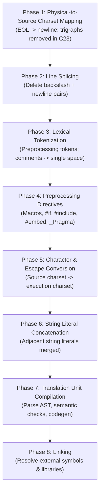
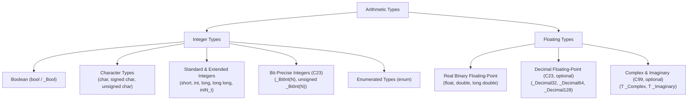

# Basic Concepts & Memory Model

This page documents the foundational rules of the ISO C abstract machine and lexical/semantic model (ISO/IEC 9899:2024 §§3–6.2, §6.5, §5.1–5.2), mirroring [en.cppreference.com/c/language/basic_concepts](https://en.cppreference.com/c/language/basic_concepts).

---

## Comments

C supports two comment forms, both recognized and stripped during **Translation Phase 3**:

| Form | Introduced | Delimiters | Behavior |
| :--- | :--- | :--- | :--- |
| **Block (multi-line) comment** | <span class="c-badge c89">C89</span> | `/* ... */` | Begins at `/*` and terminates at the **first** subsequent `*/`. May span multiple lines. |
| **Line (single-line) comment** | <span class="c-badge c99">C99</span> | `// ...` | Begins at `//` and terminates at the next unescaped newline character. |

### Key Lexical Rules & Pitfalls

1. **Single-Space Replacement**: In Phase 3, every comment is replaced by a **single space character** (`' '`), never by nothing. Therefore `int/*comment*/x;` becomes `int x;`, not `intx;`.
2. **Comments Inside Literals Are Not Comments**: `/*` and `//` inside string literals (`"/* literal */"`) or character constants have no special meaning.
3. **Block Comments Do Not Nest**: Putting `/* ... */` inside another `/* ... */` terminates the outer comment prematurely at the inner `*/`.
4. **Line Splicing Precedes Comment Stripping**: Because Phase 2 (backslash-newline splicing) happens *before* Phase 3, a trailing `\` on a `//` comment silently comments out the next physical line!

=== "Bad (Nesting & Splicing Traps)"

    ```c
    /* Outer comment
       /* Attempting to nest fails: */
       this_line_is_not_commented(); // Syntax error!
    */

    // Path is C:\temp\
    int critical_flag = 1; // SILENTLY COMMENTED OUT by trailing '\'!
    ```

=== "Good (Safe Commenting & `#if 0`)"

    ```c
    #if 0
    /* Safely disables blocks that already contain block comments.
       Note: contents must still form valid preprocessing tokens. */
    int legacy_helper(int x) { return x * 2; }
    #endif

    // Path is C:/temp/ (or place a space/text after trailing backslash)
    int critical_flag = 1;
    ```

!!! note "C89 vs. C99 Classic Edge Case"
    In strict C89, `int x = 10 //* comment */ 2;` is parsed as `10 / 2` (`5`). Starting in <span class="c-badge c99">C99</span>, `//` begins a line comment, turning the remainder of the line into a comment and causing a syntax error (missing semicolon).

---

## ASCII Chart & Escape Sequences

While ISO C does not strictly mandate ASCII (supporting EBCDIC and other host encodings), modern systems universally use ASCII or UTF-8 (a strict superset of ASCII). C **guarantees** that the decimal digits `'0'` through `'9'` have contiguous, ascending code values (`'1' == '0' + 1`, …, `'9' == '0' + 9`), whereas uppercase and lowercase Latin letters are **not** guaranteed contiguous by the standard (in EBCDIC, letters have gaps).

### Structured ASCII Reference (0x00–0x7F)

| Hex Range | Dec Range | Category | Key Characters & Notes |
| :--- | :--- | :--- | :--- |
| `0x00`–`0x1F` | `0`–`31` | C0 Controls | `0x00` `NUL` (`\0`), `0x07` `BEL` (`\a`), `0x08` `BS` (`\b`), `0x09` `HT` (`\t`), `0x0A` `LF` (`\n`), `0x0B` `VT` (`\v`), `0x0C` `FF` (`\f`), `0x0D` `CR` (`\r`), `0x1B` `ESC` |
| `0x20` | `32` | Space | `' '` (`SP`), printable whitespace (`isprint` & `isspace`, not `isgraph`) |
| `0x21`–`0x2F` | `33`–`47` | Punctuation I | `! " # $ % & ' ( ) * + , - . /` |
| `0x30`–`0x39` | `48`–`57` | Digits | `'0'` (`48`) through `'9'` (`57`) — contiguous guaranteed by ISO C |
| `0x3A`–`0x40` | `58`–`64` | Punctuation II | `: ; < = > ? @` |
| `0x41`–`0x5A` | `65`–`90` | Uppercase | `'A'` (`65`) through `'Z'` (`90`) |
| `0x5B`–`0x60` | `91`–`96` | Punctuation III | ``[ \ ] ^ _ ` `` |
| `0x61`–`0x7A` | `97`–`122` | Lowercase | `'a'` (`97`) through `'z'` (`122`) — ASCII lowercase = uppercase <code>&#124; 0x20</code> |
| `0x7B`–`0x7E` | `123`–`126` | Punctuation IV | <code>{ &#124; } ~</code> |
| `0x7F` | `127` | Control | `DEL` (`iscntrl`) |

### Standard Escape Sequences

| Escape | Meaning | ASCII Value | Version |
| :--- | :--- | :--- | :--- |
| `\'` | Single quote | `0x27` | <span class="c-badge c89">C89</span> |
| `\"` | Double quote | `0x22` | <span class="c-badge c89">C89</span> |
| `\?` | Question mark (historically to break trigraphs) | `0x3F` | <span class="c-badge c89">C89</span> |
| `\\` | Backslash | `0x5C` | <span class="c-badge c89">C89</span> |
| `\a` | Audible alert (bell) | `0x07` | <span class="c-badge c89">C89</span> |
| `\b` | Backspace | `0x08` | <span class="c-badge c89">C89</span> |
| `\f` | Form feed | `0x0C` | <span class="c-badge c89">C89</span> |
| `\n` | Newline (line feed) | `0x0A` | <span class="c-badge c89">C89</span> |
| `\r` | Carriage return | `0x0D` | <span class="c-badge c89">C89</span> |
| `\t` | Horizontal tab | `0x09` | <span class="c-badge c89">C89</span> |
| `\v` | Vertical tab | `0x0B` | <span class="c-badge c89">C89</span> |
| `\ooo` | Octal byte (1 to 3 octal digits `0`–`7`; e.g., `\0`, `\033`) | `0x00`–`0xFF` | <span class="c-badge c89">C89</span> |
| `\xhh...` | Hexadecimal value (1 or more hex digits — consumes greedily!) | platform-defined | <span class="c-badge c89">C89</span> |
| `\uhhhh` | Universal character name (4 hex digits, Unicode scalar value) | U+`hhhh` | <span class="c-badge c99">C99</span> |
| `\Uhhhhhhhh` | Universal character name (8 hex digits, Unicode scalar value) | U+`hhhhhhhh` | <span class="c-badge c99">C99</span> |

!!! warning "Greedy Hexadecimal Escapes"
    Unlike octal escapes (which stop after 3 digits), `\x` consumes **all** contiguous hexadecimal digits. Writing `"\x1bfoo"` parses `\x1bf` as a single hex escape rather than ESC + `"foo"`. Split the string literal via Phase 6 concatenation instead: `"\x1b" "foo"`.

---

## Character Sets & Encodings

ISO C distinguishes four character sets (ISO/IEC 9899:2024 §5.2.1):

1. **Basic Source Character Set**: Characters available in source files: 52 Latin letters (`A`–`Z`, `a`–`z`), 10 digits (`0`–`9`), 29 classic graphic characters (`! " # % & ' ( ) * + , - . / : ; < = > ? [ \ ] ^ _ { | } ~`), **plus `@`, `$`, and `` ` `` added in <span class="c-badge c23">C23</span>**, plus space, horizontal tab, vertical tab, form feed, and new-line.
2. **Extended Source Character Set**: Basic source character set plus implementation-defined extended characters (typically UTF-8 Unicode).
3. **Basic Execution Character Set**: All basic source characters plus alert (`\a`), backspace (`\b`), carriage return (`\r`), and the null character (`\0`, whose value is guaranteed to be all-bits-zero).
4. **Extended Execution Character Set** (and **Wide Execution Character Set**): Locale-dependent multibyte and `wchar_t` characters.

### C23 Unicode & UTF-8 Enhancements

- **UTF-8 Character & String Literals**:
  - `u8"hello"` <span class="c-badge c11">C11</span> had type `char[]` in C11/C17, but in <span class="c-badge c23">C23</span> its element type changed to **`unsigned char`** (matching `char8_t` in `<uchar.h>`), ensuring UTF-8 code units are never negative!
  - `u8'A'` <span class="c-badge c23">C23</span> adds UTF-8 character constants of type `unsigned char` (must fit in a single UTF-8 code unit, i.e., `0x00`–`0x7F`).
- **UTF-16 & UTF-32 Mandated**: In <span class="c-badge c23">C23</span>, `char16_t` (`u"..."`) and `char32_t` (`U"..."`) are guaranteed to use UTF-16 and UTF-32 (`__STDC_UTF_16__ == 1` and `__STDC_UTF_32__ == 1`).
- **Unicode Identifiers (UAX #31)** <span class="c-badge c23">C23</span>: C23 replaced the outdated C99/C11 Annex D code-point lists with **Unicode Standard Annex #31**: identifiers may start with `_` or any character with Unicode property `XID_Start`, continue with `XID_Continue`, and must be normalized in **Normalization Form C (NFC)** (non-NFC identifiers are ill-formed).
- **Trigraphs Removed** <span class="c-badge c-removed">removed C23</span>: The 9 legacy trigraph sequences (`??=`, `??/`, etc.) were removed from Phase 1 in C23.

---

## Translation Phases

ISO C defines translation as **8 conceptual phases** (ISO/IEC 9899:2024 §5.1.1.2). Compilers may fuse phases internally, but the observable result must match executing them strictly in order.



| Phase | Exact Specification | Important Implications |
| :---: | :--- | :--- |
| **1** | Map physical source file bytes to the source character set; map host end-of-line sequences (e.g., `\r\n`) to `\n`. *(Prior to C23: replace trigraphs here.)* | String literals and comments cannot see host `\r\n` endings. |
| **2** | Delete every `\` immediately followed by `\n` (line splicing). A non-empty source file not ending in an unescaped `\n` has **undefined behavior**. | You can splice inside a token, macro, or `//` comment (dangerous!). |
| **3** | Decompose into **preprocessing tokens** and whitespace sequences. Replace each comment with a single space (`' '`). Newlines are retained. | Maximal munch rule applies (`a+++b` -> `a ++ + b`, not `a + ++ b`). |
| **4** | Execute preprocessing directives (`#include`, `#embed` <span class="c-badge c23">C23</span>, `#define`, `#if`, etc.), expand macros, evaluate `_Pragma(...)`. `#include` recursively runs Phases 1–4 on the included file. Delete all directives. | Macros cannot emit new preprocessing directives (only `_Pragma` works). |
| **5** | Convert characters and escape sequences inside character constants and string literals to the execution character set. | Escape sequences produced by stringification `#` are interpreted here. |
| **6** | Concatenate adjacent string literal tokens (applying encoding-prefix promotion rules, e.g., `u8"a" "b"` -> `u8"ab"`). | Enables portable `<inttypes.h>` formatting: `"%" PRIu64 "\n"`. |
| **7** | Whitespace is discarded; preprocessing tokens become language tokens. Perform syntactic and semantic analysis and translate into object code. | Types, scopes, `sizeof`, `_Generic`, `constexpr`, and `__func__` exist here. |
| **8** | Resolve external object and function references across translation units and libraries into a final program image. | Duplicate external definitions or missing symbols cause link-time errors (or UB). |

---

## Punctuators & Alternative Tokens

### Standard Punctuators

ISO C23 §6.4.6 defines the complete punctuator set (including `::` added in <span class="c-badge c23">C23</span> for vendor-prefixed attributes like `[[gnu::hot]]`):

```text
[   ]   (   )   {   }   .   ->
++  --  &   *   +   -   ~   !
/   %   <<  >>  <   >   <=  >=  ==  !=  ^   |   &&  ||
?   :   ::  ;   ...
=   *=  /=  %=  +=  -=  <<= >>= &=  ^=  |=
,   #   ##
<:  :>  <%  %>  %:  %:%:
```

### Digraphs <span class="c-badge c95">C95</span>

Digraphs are full preprocessing tokens with identical semantics to their primary punctuators, differing only in spelling (so `#` stringification preserves the digraph text):

| Digraph | Equivalent | Digraph | Equivalent |
| :---: | :---: | :---: | :---: |
| `<:` | `[` | `:>` | `]` |
| `<%` | `{` | `%>` | `}` |
| `%:` | `#` | `%:%:` | `##` |

### Trigraphs <span class="c-badge c-removed">removed C23</span>

Trigraphs were replaced in Phase 1 even inside string literals and comments, frequently causing subtle bugs (`"Are you sure??!"` silently became `"Are you sure|"`). All 9 trigraphs were removed in **C23**:

| Trigraph | Pre-C23 Equivalent | Trigraph | Pre-C23 Equivalent | Trigraph | Pre-C23 Equivalent |
| :---: | :---: | :---: | :---: | :---: | :---: |
| `??=` | `#` | `??(` | `[` | `??<` | `{` |
| `??/` | `\` | `??)` | `]` | `??>` | `}` |
| `??'` | `^` | `??!` | <code>&#124;</code> | `??-` | `~` |

For human-readable word operators (`and`, `or`, `not`, `bitand`, etc.), see [`<iso646.h>` Alternative Operator Spellings](keywords.md#alternative-operator-spellings-iso646h).

---

## Identifiers & Reserved Identifiers

### Lexical Rules

An identifier names an object, function, tag, member, typedef, enumeration constant, label, or macro:

- Must begin with `_`, an ASCII letter (`A`–`Z`, `a`–`z`), or (since <span class="c-badge c23">C23</span>) any Unicode `XID_Start` character.
- Subsequent characters may be `_`, ASCII letters, digits (`0`–`9`), or (since <span class="c-badge c23">C23</span>) Unicode `XID_Continue` characters. Must be in Unicode **NFC** form in C23.
- Case-sensitive (`Count` and `count` are distinct).
- Minimum significant initial characters mandated by the standard:
  - <span class="c-badge c89">C89</span>: 31 internal, 6 external (case-insensitive!).
  - <span class="c-badge c99">C99</span>–<span class="c-badge c23">C23</span>: **63** internal, **31** external (case-sensitive). Real compilers treat all characters as significant.

### Reserved Identifiers (ISO C23 §7.1.3 & §7.33)

Declaring or defining a reserved identifier in user code causes **undefined behavior** (even if the corresponding standard header is not included, when reserved for external linkage).

| Scope / Category | Reserved Pattern | Source / Standard Header |
| :--- | :--- | :--- |
| **Always reserved (any use)** | `__*` (starts with double underscore) | Implementation internals (macros, builtins) |
| **Always reserved (any use)** | `_[A-Z]*` (starts with `_` + uppercase letter) | Implementation internals & `_`-keywords |
| **File scope (ordinary & tag)** | `_*` (starts with any single underscore) | Implementation file-scope symbols |
| **Character classification** | `is[a-z]*`, `to[a-z]*` | `<ctype.h>`, `<wctype.h>` |
| **Strings & memory** | `str[a-z]*`, `mem[a-z]*`, `wcs[a-z]*` | `<string.h>`, `<stdlib.h>`, `<wchar.h>` |
| **Error codes** | `E[0-9A-Z]*` | `<errno.h>` |
| **Signals** | `SIG[A-Z]*`, `SIG_[A-Z]*` | `<signal.h>` |
| **Floating-point env** | `FE_[A-Z]*` | `<fenv.h>` |
| **Locales** | `LC_[A-Z]*` | `<locale.h>` |
| **Fixed-width integers** | `int*_t`, `uint*_t`, `INT*_MAX`, `INT*_MIN`, `INT*_WIDTH`, `UINT*_MAX`, `INT*_C`, `UINT*_C` | `<stdint.h>` |
| **Format macros** | `PRI[a-zX]*`, `SCN[a-zX]*` | `<inttypes.h>` |
| **Atomics** <span class="c-badge c11">C11</span> | `ATOMIC_*`, `atomic_*`, `memory_*` | `<stdatomic.h>` |
| **Threads** <span class="c-badge c11">C11</span> | `cnd_*`, `mtx_*`, `thrd_*`, `tss_*`, `TIME_*` | `<threads.h>`, `<time.h>` |
| **Standard utilities** <span class="c-badge c23">C23</span> | `stdc_*` | `<stdbit.h>` & future standard extensions |
| **Correctly rounded math** <span class="c-badge c23">C23</span> | `cr_*`, `exp10*`, `rsqrt*`, `compoundn*`, `pown*`, `rootn*` | `<math.h>` §7.33.8 |
| **Complex math** <span class="c-badge c99">C99</span> | `cerf*`, `cerfc*`, `cexp2*`, `cexpm1*`, `clog10*`, `clog1p*`, `clog2*`, `clgamma*`, `ctgamma*` | `<complex.h>` §7.33.1 |

!!! tip "The `*_t` Suffix Myth: ISO C vs. POSIX"
    ISO C does **not** globally reserve all identifiers ending in `_t`—it only reserves specific type names and families like `int*_t`, `uint*_t`, `size_t`, `char8_t`, etc. However, **POSIX** (IEEE Std 1003.1) *does* reserve **all** identifiers ending in `_t` when POSIX headers are used. For maximum portability on UNIX/Linux/macOS, avoid naming user types `*_t` (prefer `*_type`, `my_vec`, or project-prefixed names like `app_buf`).

---

## Scope & Name Spaces (Lookup)

### The 4 Scopes in C (ISO C23 §6.2.1)

Every identifier is visible only within its **scope**:

1. **Function Scope**: Applies **exclusively to label names** (`done:`). A label is visible throughout the entire enclosing function body—even *before* its declaration (allowing forward `goto`).
2. **File Scope**: Identifiers declared outside any block or parameter list. Visible from the point of declaration until the end of the translation unit.
3. **Block Scope**: Identifiers declared inside a compound statement `{ ... }`, a function definition's parameter list, or a selection/iteration statement header (`for (int i = 0; ...)` since <span class="c-badge c99">C99</span>). Visible until the closing `}` (or end of the associated statement).
4. **Function Prototype Scope**: Parameter identifiers in a function declaration that is *not* a definition (`void copy(size_t n, int dst[n]);`). Visible only until the closing `)` of the prototype.

!!! warning "Point of Declaration & Self-Initialization"
    An ordinary identifier's scope begins **immediately after its declarator**, *before* its initializer. Therefore `int x = x;` declares a new uninitialized `x` and initializes it with its own indeterminate value (**undefined behavior**), rather than reading an outer `x`!

### The 4 Disjoint Name Spaces in C (ISO C23 §6.2.3)

C separates identifiers into **four completely independent name spaces**, disambiguated purely by syntactic context:

| # | Name Space | Entities Contained | Syntactic Disambiguator |
| :-: | :--- | :--- | :--- |
| **1** | **Label names** | `goto` targets | Followed by `:` or preceded by `goto` |
| **2** | **Tags** | `struct`, `union`, and `enum` tags | Preceded by `struct`, `union`, or `enum` |
| **3** | **Members** | Fields of `struct` and `union` (**each struct/union has its own separate member name space**) | Accessed via `.` or `->` or designated initializer `.field` |
| **4** | **Ordinary identifiers** | Variables, functions, `typedef` names, `enum` constants | All other contexts |

```c
#include <stdio.h>

struct widget {     // 'widget' in tag name space (NS #2)
    int widget;     // 'widget' in struct widget's member name space (NS #3)
};

int main(void) {
    struct widget widget = { .widget = 42 }; // variable 'widget' in ordinary NS (#4)
    if (widget.widget == 42) {
        goto widget;                         // 'widget' in label NS (#1)
    }
widget:
    printf("All 4 name spaces coexisted: %d\n", widget.widget);
    return 0;
}
```

Note: This example is legal ISO C23 — though in production code, never reuse the same name across name spaces.

---

## Lifetime and Storage Duration

An object's **storage duration** determines the **lifetime** during which its storage is guaranteed to exist and hold its last-stored value (ISO C23 §6.2.4). Accessing an object outside its lifetime (e.g., through a dangling pointer) is **undefined behavior**.

| Storage Duration | How Created | Lifetime | Default Initialization |
| :--- | :--- | :--- | :--- |
| **Static** | File-scope variables, block-scope `static`, string literals, file-scope compound literals, C23 `static` compound literals `(static const int[]){1, 2}` | Entire program execution | Zero-initialized (`0`, `0.0`, `nullptr`) before `main()` |
| **Thread** <span class="c-badge c11">C11</span> | `thread_local` <span class="c-badge c23">C23</span> / `_Thread_local` <span class="c-badge c11">C11</span> | Entire execution of each thread | Zero-initialized before thread starts |
| **Automatic** | Block-scope non-`static` variables, function parameters, block-scope compound literals, VLAs | Entry into enclosing block until exit (**VLAs**: from declaration evaluation until block exit) | **Indeterminate representation** (uninitialized!) |
| **Allocated** | `malloc`, `calloc`, `realloc`, `aligned_alloc` (`<stdlib.h>`) | From successful allocation until `free` or `realloc` | Indeterminate (`calloc` zero-initializes bytes) |

### Temporary Lifetime <span class="c-badge c11">C11</span>

A non-lvalue expression of `struct` or `union` type that contains an array member creates an object with **temporary lifetime** (for example, `get_packet().bytes[0]`). Its lifetime starts when the expression is evaluated and ends at the completion of the containing full expression (or full declarator). **Attempting to modify a temporary object is undefined behavior.**

```c
#include <stdio.h>

struct bytes4 {
    unsigned char data[4];
};

static struct bytes4 make_bytes(void) {
    return (struct bytes4){ .data = { 0xDE, 0xAD, 0xBE, 0xEF } };
}

int main(void) {
    // Valid: reading an array element of a temporary struct within the full expression
    printf("First byte: 0x%02X\n", make_bytes().data[0]);

    // INVALID (UB): pointer 'p' dangles as soon as the semicolon is reached!
    // unsigned char *p = make_bytes().data;
    return 0;
}
```

---

## Type System, Compatibility & Strict Aliasing

Every expression and object in C has a **type**, partitioned into **object types** (which describe objects) and **function types** (which describe functions).

### Complete vs. Incomplete Types

- A **complete type** has a known size (`sizeof` is valid).
- An **incomplete type** lacks size information:
  - `void` (cannot ever be completed).
  - Forward-declared `struct Node;` or `union Data;` (completed once defined).
  - Arrays of unknown bound `extern int table[];` (completed by a later declaration with size).

### Type Compatibility & Composite Types (ISO C23 §6.2.7)

Two types are **compatible** if they are identical or satisfy C's structural compatibility rules (for example, `int[]` and `int[8]` are compatible, forming the **composite type** `int[8]`; qualified types require identical qualifiers; function prototypes require compatible return and parameter types).

#### C23 Tag Compatibility Upgrade <span class="c-badge c23">C23</span>

Prior to C23, defining `struct Pair { int a, b; };` twice in the same scope (common in macro-generated generic containers!) was a constraint violation. Under **C23 (N3003)**, `struct`, `union`, and `enum` definitions with the **same tag** (or identical redefinitions in the same/different translation units) are **compatible types** provided they have:

- The same number and order of members (or enumerators),
- Identical member names, compatible member types, identical bit-field widths, and matching alignment requirements (and matching underlying types for `enum`).

```c
#include <stdio.h>

// Macro generating a typed slice struct — legal to invoke multiple times in C23!
#define SLICE(T) struct slice_##T { T *ptr; size_t len; }

static void print_slice(SLICE(int) s) {
    for (size_t i = 0; i < s.len; ++i) {
        printf("%d ", s.ptr[i]);
    }
    putchar('\n');
}

int main(void) {
    int vals[] = { 10, 20, 30 };
    SLICE(int) s = { .ptr = vals, .len = 3 }; // Compatible with parameter's struct slice_int!
    print_slice(s);
    return 0;
}
```

### Effective Type & Strict Aliasing (ISO C23 §6.5p6–7)

To optimize memory loads and stores, C enforces **type-based alias analysis (TBAA)** via **effective type** rules:

1. An object with a **declared type** always has that declared type as its effective type.
2. Dynamically allocated memory (`malloc`) initially has **no declared type**. Writing to it through an lvalue of non-character type `T` sets its effective type to `T`; `memcpy` / `memmove` copies the source's effective type.
3. An object's stored value may **only** be accessed through an lvalue of one of these types:
   - A type **compatible** with the object's effective type,
   - A qualified (`const`/`volatile`/`restrict`) version of a compatible type,
   - The **signed or unsigned** integer counterpart of a compatible type,
   - An aggregate (`struct`) or `union` containing one of the above among its members,
   - A **character type** (`char`, `signed char`, `unsigned char`).

Accessing an object through any other pointer type (such as casting `float *` to `uint32_t *` and dereferencing) is **undefined behavior**!

=== "Bad (Strict Aliasing UB)"

    ```c
    #include <stdint.h>

    uint32_t float_bits_ub(float f) {
        // UNDEFINED BEHAVIOR: reading a 'float' object through a 'uint32_t' lvalue!
        return *(uint32_t *)&f;
    }
    ```

=== "Good (Portable `memcpy` — Zero Overhead)"

    ```c
    #include <stdint.h>
    #include <string.h>

    uint32_t float_bits_safe(float f) {
        uint32_t bits = 0;
        static_assert(sizeof(bits) == sizeof(f));
        // Compiles to a single register move (movd / fmov) at -O1 and above!
        memcpy(&bits, &f, sizeof(bits));
        return bits;
    }
    ```

=== "Good (C Union Type-Punning)"

    ```c
    #include <stdint.h>

    uint32_t float_bits_union(float f) {
        // Valid in ISO C (ISO C23 §6.5.2.3 footnote 99): reading a non-active union member
        // reinterprets its object representation. (Note: NOT valid in standard C++!)
        union { float f; uint32_t u; } conv = { .f = f };
        return conv.u;
    }
    ```

---

## Arithmetic Types

C's arithmetic types are divided into **integer types** and **floating types**:



### Integer Types & C23 Two's Complement Mandate

| Type Family | Standard | Minimum Width | Key Rules |
| :--- | :--- | :---: | :--- |
| `bool` / `_Bool` | <span class="c-badge c99">C99</span> / <span class="c-badge c23">C23</span> | 1 value bit (`sizeof >= 1`) | Holds only `0` (`false`) or `1` (`true`); any non-zero value converts to `1`. |
| `char`, `signed char`, `unsigned char` | <span class="c-badge c89">C89</span> | `CHAR_BIT >= 8` | **Three distinct types!** `char` signedness is implementation-defined. `sizeof` is always `1`. |
| `short` / `unsigned short` | <span class="c-badge c89">C89</span> | 16 bits | `sizeof(char) <= sizeof(short) <= sizeof(int)` |
| `int` / `unsigned int` | <span class="c-badge c89">C89</span> | 16 bits (32 on LP64/LLP64) | Natural machine word size (typically 32-bit). |
| `long` / `unsigned long` | <span class="c-badge c89">C89</span> | 32 bits (64 on LP64, 32 on LLP64) | Beware Windows LLP64 (`long` is 32-bit) vs Linux/macOS LP64 (`long` is 64-bit). |
| `long long` / `unsigned long long` | <span class="c-badge c99">C99</span> | 64 bits | Guaranteed at least 64 bits on all platforms. |
| `_BitInt(N)` / `unsigned _BitInt(N)` | <span class="c-badge c23">C23</span> | `N` (`>= 2` signed, `>= 1` unsigned) | Exact width up to `BITINT_MAXWIDTH` (`>= ULLONG_WIDTH`). Literal suffixes `wb` / `uwb`. **Does not undergo integer promotions!** |

!!! info "C23 Mandates Two's Complement (N2412)"
    Starting with <span class="c-badge c23">C23</span>, all signed integer types **must** use two's complement representation. Sign-magnitude and ones' complement representations are abolished: negative zero no longer exists for integers, and `INT_MIN == -INT_MAX - 1` is guaranteed.
    **Important:** Signed integer overflow remains **undefined behavior** in C23! Unsigned integer arithmetic remains defined modulo $2^N$.

### Floating-Point Types

- **Real Binary Floating-Point**: `float`, `double`, `long double`. When `__STDC_IEC_60559_BFP__` <span class="c-badge c23">C23</span> is defined, they conform to IEEE 754 binary floating-point (typically `binary32` / `binary64`).
- **Decimal Floating-Point** <span class="c-badge c23">C23</span> <span class="c-badge c-optional">optional</span>: `_Decimal32`, `_Decimal64`, `_Decimal128` (guarded by `__STDC_IEC_60559_DFP__`). Uses IEEE 754 decimal encoding with suffixes `df`, `dd`, `dl`—eliminating binary rounding errors in finance (`0.1dd + 0.2dd == 0.3dd`).
- **Complex & Imaginary Types** <span class="c-badge c99">C99</span> <span class="c-badge c-optional">optional</span>: `float _Complex`, `double _Complex`, `long double _Complex` (absent if `__STDC_NO_COMPLEX__` is defined). Stored identically to an array of 2 real values `[real, imag]`. `_Imaginary` is optional (Annex G).

```c
#include <limits.h>
#include <stdio.h>

int main(void) {
    // C23 bit-precise 24-bit unsigned integer (e.g., RGB pixel or protocol header)
    unsigned _BitInt(24) rgb = 0xFF8800uwb;
    printf("sizeof(unsigned _BitInt(24)) = %zu, value = 0x%06X\n",
           sizeof(rgb), (unsigned)rgb);

#ifdef __STDC_IEC_60559_DFP__
    _Decimal64 price = 0.1dd + 0.2dd;
    printf("Decimal exact check (0.1 + 0.2 == 0.3): %s\n",
           (price == 0.3dd) ? "true" : "false");
#endif
    return 0;
}
```

---

## Objects, Object Representation, Padding & Alignment

### Object Representation & Padding Bits

An **object** is a contiguous region of data storage in the execution environment whose contents can represent values:

- Copying any object of type `T` into `unsigned char buf[sizeof(T)]` yields its **object representation**.
- Bits contributing to the value form the **value representation**; remaining bits are **padding bits**.
  - `unsigned char` is guaranteed to have **zero padding bits** and **no non-value representations**.
  - Structures frequently contain **padding bytes** between members and at the tail so every member satisfies its alignment requirement.
  - Because padding bytes hold **unspecified values** (even after struct assignment!), comparing structs with `memcmp(&a, &b, sizeof a)` is a classic bug unless the entire struct representation was explicitly zeroed first (e.g., via `memset`).
- **Non-Value Representations** (formerly called *trap representations* prior to <span class="c-badge c23">C23</span>): Bit patterns that do not represent a valid value of type `T` (e.g., a `bool` byte overwritten with `0x42` via `unsigned char *`, or signaling NaNs on some platforms). Reading a non-value representation through a non-character lvalue is **undefined behavior**.

### Alignment (`alignof`, `alignas`, `max_align_t`)

Every complete object type has an **alignment requirement** (a non-negative power of two representing the byte boundary its address must divide evenly):

- Query alignment: `alignof(type-name)` <span class="c-badge c23">C23</span> (or `_Alignof(type-name)` <span class="c-badge c11">C11</span>).
- Specify stricter alignment: `alignas(64) unsigned char cache_line[64];` <span class="c-badge c23">C23</span> (or `_Alignas(64)` <span class="c-badge c11">C11</span>). Cannot weaken natural alignment.
- **Fundamental alignment**: Any alignment `<= alignof(max_align_t)` (`<stddef.h>`). Supported for all storage durations and guaranteed by `malloc`.
- **Extended alignment**: Any alignment `> alignof(max_align_t)` (e.g., 64-byte cache-line or 4096-byte page alignment); use `aligned_alloc()` for heap allocations.
- **Invariant**: `sizeof(T)` is always an integer multiple of `alignof(T)`.

```c
#include <stddef.h>
#include <stdint.h>
#include <stdio.h>

struct padded {
    char a;      // offset 0 (1 byte) + 7 bytes padding on 64-bit
    double b;    // offset 8 (8 bytes)
    char c;      // offset 16 (1 byte) + 7 bytes tail padding
};

struct packed_order {
    double b;    // offset 0 (8 bytes)
    char a;      // offset 8 (1 byte)
    char c;      // offset 9 (1 byte) + 6 bytes tail padding
};

int main(void) {
    alignas(64) unsigned char line[64] = {};
    printf("padded:       size=%zu align=%zu\n", sizeof(struct padded), alignof(struct padded));
    printf("packed_order: size=%zu align=%zu\n", sizeof(struct packed_order), alignof(struct packed_order));
    printf("max_align_t:  align=%zu, line addr %% 64 == %zu\n",
           alignof(max_align_t), (size_t)((uintptr_t)line % 64));
    return 0;
}
```

---

## The `main()` Function

ISO C distinguishes **hosted environments** (`__STDC_HOSTED__ == 1`, standard OS programs) from **freestanding environments** (`__STDC_HOSTED__ == 0`, kernels and bare-metal microcontrollers).

### Hosted Environment Signatures

A portable hosted program must define `main` using one of two standard signatures (or an implementation-defined equivalent such as `int main(int argc, char *argv[], char *envp[])`):

```c
int main(void) { /* ... */ }
int main(int argc, char *argv[]) { /* ... */ } // equivalent to char **argv
```

### Guaranteed Entry Invariants (ISO C23 §5.1.2.2.1)

- `argc` is non-negative (`argc >= 0`).
- `argv[argc]` is guaranteed to be a null pointer (`NULL` / `nullptr`).
- `argv[0]` through `argv[argc - 1]` point to **modifiable** null-terminated multibyte strings.
- If `argc > 0`, `argv[0]` represents the program name (or `""` if unavailable from the host OS).
- **Implicit `return 0;`**: Reaching the closing `}` of `main` without a `return` statement is equivalent to executing `return 0;` since <span class="c-badge c99">C99</span> (in C89, the exit status was undefined).
- **Recursive calls**: Unlike C++, ISO C permits a program to call `main()` recursively or take its address—though doing so is almost never good engineering practice.
- **Portable exit codes**: Return `0`, `EXIT_SUCCESS`, or `EXIT_FAILURE` (`<stdlib.h>`).

### Freestanding Environments

In a freestanding implementation (`__STDC_HOSTED__ == 0`), the entry point's name, signature, and termination behavior are entirely implementation-defined (for example, `void Reset_Handler(void)` or `void kmain(void)`), and only a minimal subset of standard headers (`<float.h>`, `<limits.h>`, `<stdarg.h>`, `<stddef.h>`, `<stdint.h>`, `<stdbit.h>`, `<stdckdint.h>`, etc.) is mandated.

---

## The As-If Rule and Observable Behavior

Under the **as-if rule** (ISO C23 §5.1.2.3), an optimizing compiler may freely reorder, eliminate, fuse, or vectorize any computations—provided the resulting program produces the exact same **observable behavior** as the unoptimized C abstract machine.

### What Counts as Observable Behavior?

1. **Volatile accesses**: Reads and writes to `volatile`-qualified objects occur strictly in the order and count specified by the abstract machine.
2. **File output**: Data written to files at program termination reflects the abstract machine's output.
3. **Interactive I/O**: Prompting output to interactive devices is delivered before the program waits for input.

### Dead-Store Elimination & Security (`memset_explicit`)

Because clearing a stack buffer right before returning has no observable effect on files, interactive I/O, or `volatile` memory, optimizing compilers routinely **delete** plain `memset` calls scrubbing cryptographic keys!

=== "Bad (Optimized Away by Compiler!)"

    ```c
    #include <stdint.h>
    #include <string.h>

    uint8_t derive_tag_bad(const uint8_t *seed, size_t n) {
        uint8_t key[32] = {};
        for (size_t i = 0; i < n && i < sizeof(key); ++i) {
            key[i] = seed[i] ^ 0xA5u;
        }
        uint8_t tag = key[0] ^ key[31];
        memset(key, 0, sizeof(key)); // Compiler may legally delete this dead store!
        return tag;
    }
    ```

=== "Good (C23 `memset_explicit`)"

    ```c
    #include <stdint.h>
    #include <string.h>

    uint8_t derive_tag_c23(const uint8_t *seed, size_t n) {
        uint8_t key[32] = {};
        for (size_t i = 0; i < n && i < sizeof(key); ++i) {
            key[i] = seed[i] ^ 0xA5u;
        }
        uint8_t tag = key[0] ^ key[31];
        // Guaranteed NOT to be eliminated by dead-store optimization (C23 §7.26.6.2)
        memset_explicit(key, 0, sizeof(key));
        return tag;
    }
    ```

---

## Undefined, Unspecified, Implementation-Defined & Locale-Specific Behavior

ISO C23 §3.4 classifies non-portable or erroneous behaviors into four distinct categories:

| Category | Definition | Compiler Obligation | Example |
| :--- | :--- | :--- | :--- |
| **Implementation-Defined** | Unspecified behavior where each implementation **documents** how it chooses. | Must document choice consistently. | Size of `int`, signedness of `char`, right-shift of negative signed integers. |
| **Locale-Specific** | Depends on local conventions of nationality, culture, and language. | Documented per locale (`<locale.h>`). | Decimal point character (`'.'` vs `','`), `isalpha()` outside ASCII. |
| **Unspecified** | Two or more valid behaviors; implementation need **not** document or stay consistent. | Any valid choice each time. | Evaluation order of function arguments `f(a(), b())`, value of struct padding bytes. |
| **Undefined Behavior (UB)** | Erroneous construct or data for which the standard imposes **no requirements**. | **Anything**: crash, silent corruption, nasal demons, or retroactive optimization! | Signed integer overflow, out-of-bounds access, data race, dereferencing `NULL`. |

### Canonical Undefined Behavior Catalog

| UB Category | Trigger Example | Safe Alternative |
| :--- | :--- | :--- |
| **Signed integer overflow** | `INT_MAX + 1` | C23 `<stdckdint.h>` (`ckd_add`, `ckd_mul`) or pre-check bounds |
| **Shift out of range** | `x << 32` (32-bit `int`), `x << -1`, shifting negative left | Validate `0 <= shift && shift < width`; shift unsigned types |
| **Division / modulo by zero** | `a / 0`, `INT_MIN / -1`, `INT_MIN % -1` | Check divisor `!= 0` and `(a == INT_MIN && b == -1)` |
| **Null / dangling pointer deref** | `*p` when `p == nullptr` or after `free(p)` | Null-check; set freed pointers to `nullptr` |
| **Out-of-bounds access** | `arr[n]` (forming `&arr[n]` is OK, dereferencing is UB) | Strict bounds checks; compile with `-fsanitize=address,undefined` |
| **Uninitialized automatic read** | `int x; printf("%d", x);` | Always initialize (`int x = 0;` or `= {}` in C23) |
| **Strict aliasing violation** | `*(uint32_t *)&float_val` | `memcpy()` or union type-punning |
| **Unsequenced modification** | `i = i++ + 1;` or `a[i] = i++;` | Separate side effects with sequence points (`;`) |
| **Modifying string literal / `const`** | `char *s = "hi"; s[0] = 'H';` | Use `const char *s = "hi";` or writable array `char s[] = "hi";` |
| **Data race** | Two threads writing same non-atomic object unsynchronized | Use `mtx_lock`/`mtx_unlock` or `_Atomic` operations |

!!! danger "Time-Travel Undefined Behavior"
    Compilers assume a conforming program **never** executes UB. If a dereference `*p` occurs *before* `if (p == nullptr)`, the optimizer deduces `p` cannot be null (otherwise `*p` would already have been UB) and **deletes the subsequent null check completely**! Always validate preconditions *before* performing the operation, and test with `-fsanitize=undefined,address`.

---

## Memory Model & Data Races <span class="c-badge c11">C11</span>

Introduced in <span class="c-badge c11">C11</span> and refined in <span class="c-badge c23">C23</span> (ISO C23 §5.1.2.4, §7.17, §7.28), the C memory model defines multithreaded visibility and synchronization guarantees. (Thread and atomic support are optional: absent if `__STDC_NO_THREADS__` or `__STDC_NO_ATOMICS__` is defined.)

### Memory Locations & Bit-Field Adjacency Rules

A **memory location** is either:

1. An object of scalar type (`int`, `double`, pointer, etc.), **or**
2. A **maximal sequence of adjacent bit-fields all having nonzero width**.

Two threads may safely modify **distinct memory locations** concurrently without synchronization. However, because adjacent nonzero-width bit-fields share a **single memory location**, concurrent writes to them cause a **data race** unless separated by an unnamed zero-width bit-field (`: 0`)!

```c
#include <stdint.h>

struct shared_flags {
    uint32_t flag_a : 4; // Memory location #1
    uint32_t flag_b : 4; // SAME memory location #1 -> concurrent write with flag_a = DATA RACE!
    uint32_t        : 0; // Zero-width bit-field forces a new storage unit boundary
    uint32_t flag_c : 4; // Memory location #2 -> safe to access concurrently with flag_a/flag_b!
};
```

### Ordering Relations & Data Race Definition

- **Sequenced-before**: Intra-thread evaluation order (e.g., statement 1 is sequenced before statement 2).
- **Synchronizes-with**: Inter-thread ordering established by synchronization primitives—such as an atomic `memory_order_release` store observed by an atomic `memory_order_acquire` load, `mtx_unlock` -> `mtx_lock`, or `thrd_create` / `thrd_join`.
- **Happens-before**: The transitive combination of *sequenced-before* and *synchronizes-with*.
- **Conflicting Evaluations**: Two evaluations *conflict* if they access the same memory location and at least one is a write (modification).
- **Data Race (= Undefined Behavior)**: Two conflicting evaluations executed in different threads where **neither is atomic** and **neither happens-before the other**.

```c
#include <stdatomic.h>
#include <stdbool.h>
#include <stdio.h>

// Classic Release-Acquire publication pattern (data-race-free)
static int payload = 0;
static _Atomic bool ready = false;

static void producer(int value) {
    payload = value;                                          // 1. Sequenced-before store
    atomic_store_explicit(&ready, true, memory_order_release); // 2. Synchronizes-with acquire load
}

static bool consumer(int *out) {
    if (atomic_load_explicit(&ready, memory_order_acquire)) { // 3. Happens-after producer's store
        *out = payload;                                       // 4. Guaranteed to observe 'value'
        return true;
    }
    return false;
}

int main(void) {
    producer(2024);
    int result = 0;
    if (consumer(&result)) {
        printf("Published safely: %d\n", result);
    }
    return 0;
}
```

---

## See Also

- [Keywords (C89–C23)](keywords.md) — Complete catalog of all 59 C23 keywords and context-sensitive tokens
- [Preprocessor & `#embed`](preprocessor.md) — Deep dive into Translation Phase 4
- [Declarations, Types & `typeof`](declarations.md) — Complete type declarator rules, `struct`/`union`/`enum`, and qualifiers
- [Concurrency: Threads & Atomics](../library/concurrency.md) — `<threads.h>` and `<stdatomic.h>` library reference
- [C23 Migration & Breaking Changes](../../standards/c23-migration.md) — Full list of C23 behavioral changes and removals
- External: [cppreference — Basic Concepts](https://en.cppreference.com/c/language/basic_concepts)
