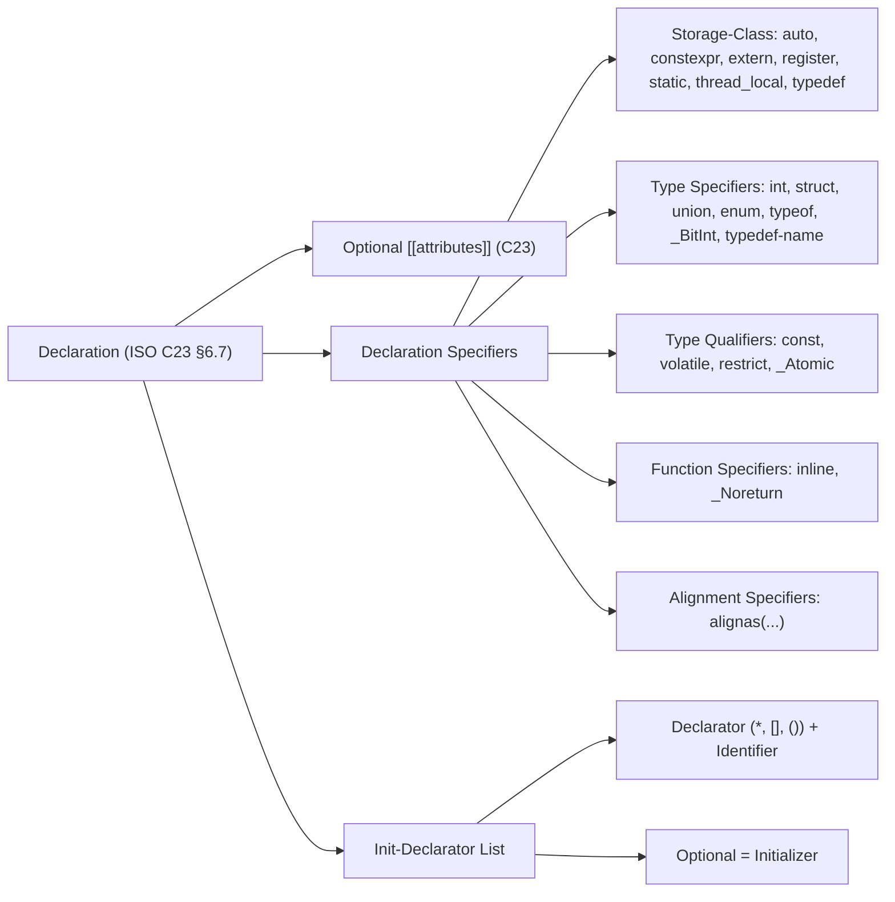

# Declarations, Types & `typeof`

A **declaration** in C (ISO/IEC 9899:2024 §6.7) introduces one or more identifiers into a scope, specifies their **type**, **storage duration**, **linkage**, and **alignment**, and may optionally allocate storage (making the declaration a **definition**) and provide an **initializer**.



---

## 1. Declaration Grammar & Reading Complex Declarators

Every object or function declaration follows the **"declaration reflects use"** principle (ISO C §6.7): writing a declarator mirrors the syntax used to access the base type in an expression.

- `int *p;` $\implies$ evaluating `*p` yields an `int` (so `p` is a pointer to `int`).
- `int a[4];` $\implies$ evaluating `a[i]` yields an `int` (so `a` is an array of 4 `int`s).
- `int (*fp)(double);` $\implies$ evaluating `(*fp)(x)` yields an `int` (so `fp` is a pointer to a function taking `double` and returning `int`).

### The Inside-Out / Clockwise Spiral Rule

Because postfix operators (`[]`, `()`) bind **tighter** than prefix pointer indirection (`*`), always decode any declarator from the **identifier outward**, obeying C operator precedence:

1. Locate the **identifier** being declared.
2. Look **right** first: consume any `[]` ("array of ...") or `()` ("function taking ... returning ...") until hitting a closing `)` or `;`.
3. Look **left**: consume any `*` ("pointer to ...") and its qualifiers (`const`, `volatile`, `restrict`) until hitting an opening `(` or the declaration specifiers.
4. Step outside the enclosing `(...)` and repeat steps 2–3.
5. Finish by reading the **declaration specifiers** on the far left (base type + qualifiers).

### Complex Declarator Reference Table

| C Declaration | Step-by-Step English Reading | Clean `typedef` Equivalent |
| :--- | :--- | :--- |
| `int *a[10];` | `a` is an **array of 10** **pointers** to `int`. | `typedef int *int_ptr; int_ptr a[10];` |
| `int (*p)[10];` | `p` is a **pointer** to an **array of 10** `int`s. | `typedef int row10[10]; row10 *p;` |
| `int (*ops[4])(int, int);` | `ops` is an **array of 4 pointers** to **functions** taking `(int, int)` returning `int`. | `typedef int (*binop_fn)(int, int); binop_fn ops[4];` |
| `int (*make_row(size_t n))[4];` | `make_row` is a **function** taking `(size_t)` returning a **pointer** to an **array of 4** `int`s. | `typedef int row4[4]; row4 *make_row(size_t n);` |
| `void (*signal(int sig, void (*func)(int)))(int);` | `signal` is a **function** taking `(int, ptr-to-fn(int)->void)` returning a **pointer to a function** taking `(int)` returning `void`. | `typedef void (*sighandler_t)(int); sighandler_t signal(int sig, sighandler_t func);` |
| `int * const * volatile p;` | `p` is a **`volatile` pointer** to a **`const` pointer** to mutable `int`. | — |

!!! tip "Production Engineering Rule"
    Never write raw nested function-pointer or pointer-to-array return types in public API headers. Always introduce clear `typedef` aliases (or C23 `typeof` inside local macros) so signatures remain auditable at a glance.

---

## 2. Storage-Class Specifiers

Storage-class specifiers (ISO C23 §6.7.2) govern **storage duration**, **linkage**, **compile-time constancy**, and (for `typedef`) whether the identifier names a type alias rather than an object.

| Specifier | Standard | Allowed Scopes | Storage Duration | Default Linkage | Key Semantics |
| :--- | :--- | :--- | :--- | :--- | :--- |
| **`auto`** | <span class="c-badge c89">C89</span> <span class="c-badge c23">C23</span> | Block (C89–C17); File or Block for type inference <span class="c-badge c23">C23</span> | Automatic (or static if combined with `static`/`constexpr` at file scope) | None (unless combined at file scope) | Legacy automatic storage specifier; **repurposed in C23 (N3007) for single-object type inference**! |
| **`constexpr`** | <span class="c-badge c23">C23</span> | File or Block | Static (file scope) or Automatic (block scope) | **Internal** (file scope) / None (block scope) | Compile-time constant **object** definition; implies `const`; usable in constant expressions. |
| **`extern`** | <span class="c-badge c89">C89</span> | File or Block | Static | External (unless prior visible `static` declaration) | Declares an object or function defined elsewhere (or gives external linkage to a definition). |
| **`register`** | <span class="c-badge c89">C89</span> | Block & Function Parameters | Automatic | None | Hints fast storage; **forbids taking address `&`**, `alignas`, and decaying arrays to pointers. |
| **`static`** | <span class="c-badge c89">C89</span> | File, Block, or Array Param `[static N]` <span class="c-badge c99">C99</span> | Static | **Internal** (file scope) / None (block scope) | Persistent lifetime across calls (block scope) or translation-unit-private symbol (file scope). |
| **`thread_local`** (`_Thread_local`) | <span class="c-badge c11">C11</span> <span class="c-badge c23">C23</span> | File or Block (must pair with `static` or `extern` at block scope!) | Thread | External (file scope unless `static`) | One independent instance per execution thread; lifetime equals thread lifetime. |
| **`typedef`** | <span class="c-badge c89">C89</span> | File or Block | *(Not an object)* | None | Syntactically a storage-class specifier; declares a **type alias**, not a distinct type. |

### Exact C23 Multi-Specifier Combination Rules (ISO C23 §6.7.2p2)

Prior to C23, at most **one** storage-class specifier could appear in a declaration (except `_Thread_local` with `static` or `extern`). ISO C23 §6.7.2p2 strictly defines the permitted combinations:

- **`thread_local`** may appear with **`static`** or **`extern`**.
- **`auto`** may appear with **all others except `typedef`** (e.g., `static auto x = 1;`, `thread_local static auto x = 1;`, `constexpr auto x = 1;`).
- **`constexpr`** may appear **only** with **`auto`**, **`register`**, or **`static`**.

!!! danger "Forbidden C23 Combinations (C vs C++ Trap)"
    - `extern constexpr int X = 10;` is a **constraint violation** in C23 (`constexpr` cannot combine with `extern`, unlike C++!).
    - `thread_local constexpr int Y = 10;` is a **constraint violation** in C23.
    - `typedef auto T = 1;` is a **constraint violation**.

---

### 2.1 `auto` — Legacy Automatic vs C23 Type Inference (N3007) <span class="c-badge c23">C23</span>

In C89–C17, `auto` was an almost-unused storage-class specifier denoting block-scope automatic storage (`auto int x = 5;`). In **C23 (N3007)**, `auto` retains backward compatibility when paired with an explicit type specifier, and performs **type inference** when **no** type specifier is present:

=== "C23 (Type Inference)"

    ```c
    #include <stddef.h>

    void demo_auto(void) {
        auto i = 42;                 // int
        auto u = 1'000'000u;         // unsigned int
        auto d = 3.14159;            // double
        auto p = &i;                 // int *
        auto const ci = i;           // const int (storage-class first avoids -Wold-style-declaration)
        static auto s = 100LL;       // static long long
        constexpr auto k = 64u;      // constexpr unsigned int (implies const)

        int arr[4] = { 1, 2, 3, 4 };
        auto decayed = arr;          // int * (lvalue conversion decays arrays!)
        (void)u; (void)d; (void)p; (void)ci; (void)s; (void)k; (void)decayed;
    }
    ```

=== "C17 (Explicit Types Required)"

    ```c
    #include <stddef.h>

    void demo_c17(void) {
        int i = 42;
        unsigned int u = 1000000u;
        double d = 3.14159;
        int *p = &i;
        const int ci = i;
        static long long s = 100LL;
        int arr[4] = { 1, 2, 3, 4 };
        int *decayed = arr;
        (void)u; (void)d; (void)p; (void)ci; (void)s; (void)decayed;
    }
    ```

#### Strict Constraints on C23 `auto` (ISO C23 §6.7.10)

1. **Single plain identifier declarator only**: `auto x = expr;` is valid; `auto *p = &x;`, `auto a[] = {1, 2};`, `auto x = 1, y = 2;`, and `auto f(void)` are **all constraint violations** in C23 (unlike C++!).
2. **Initializer is mandatory** and must be a single assignment expression (optionally brace-enclosed `{ expr }`, never empty `{}`).
3. **Lvalue conversion & decay apply**: Top-level `const`/`volatile`/`restrict`/`_Atomic` are stripped from the initializer expression, arrays decay to pointers, and functions decay to function pointers (add qualifiers explicitly via `auto const x = ...;`).
4. **No new tag definition in the initializer**: `auto s = (struct Tag { int x; }){ 1 };` is a **constraint violation** (use a previously declared struct type instead).
5. **Variably modified pointer types ARE permitted**: `int vla[n]; auto pv = &vla;` deduces `int (*)[n]`.

!!! tip "Place `auto` Before Qualifiers (`auto const x`)"
    Because `auto` is grammatically a **storage-class specifier** in C23, writing `const auto x = 1;` triggers `-Wold-style-declaration` under GCC `-Wextra`. Always place storage-class specifiers before type qualifiers: `auto const x = 1;`, `static auto const x = 1;`, or `constexpr auto x = 1;`. Also note that C23 has no `zu` integer literal suffix — write `auto idx = (size_t)0;` when inferring `size_t`.

---

### 2.2 `constexpr` Objects (C23 N3018) <span class="c-badge c23">C23</span> { #constexpr-objects }

C23 introduces `constexpr` (§6.7.2) strictly for **object definitions** (there are **no `constexpr` functions** in C23). A `constexpr` object is guaranteed to have a compile-time known constant value and can be used in **constant expressions** (including integer constant expressions for array bounds, `case` labels, bit-field widths, `enum` values, and `static_assert`).

#### Key Rules & Restrictions of C23 `constexpr`

- **Implies `const`**: Every `constexpr` object is implicitly `const`-qualified (and for structures/unions, all members are treated as `const`).
- **Internal linkage at file scope**: File-scope `constexpr int N = 16;` has **internal linkage** by default (ISO C23 §6.2.2p3), making it header-safe across translation units without multiple-definition linker errors.
- **Disallowed types**: Cannot have `volatile`, `restrict`, `_Atomic`, or variably modified (VLA) types (nor contain any member of those types).
- **Mandatory exact-representability initializer**: Must be initialized with constant expressions that fit **without narrowing, overflow, wraparound, or floating-point rounding loss**! See [Initialization: `constexpr` Rules](initialization.md#constexpr-initialization-rules).
- **Pointers may ONLY be null**: A pointer-type `constexpr` object (or pointer member inside a `constexpr` struct) may **only** be initialized with a **null pointer constant** (`nullptr`, `0`, `(void *)0`), **not** with the address of a static object!

#### Comparison: `#define` vs `enum` vs `const` vs C23 `constexpr`

| Property | `#define N 16` | `enum { N = 16 };` | `const int N = 16;` | `constexpr int N = 16;` <span class="c-badge c23">C23</span> |
| :--- | :--- | :--- | :--- | :--- |
| **Type-safe & Scoped** | No (preprocessor text) | Integer only (`int` / C23 wide) | Yes (any type) | Yes (any non-atomic, non-VM object type) |
| **Valid in `#if`** | **Yes** | No | No | No |
| **Integer Constant Expression (array size, `case`, `static_assert`)** | **Yes** | **Yes** | **No!** (Makes VLA!) | **Yes** |
| **Works for `double`, `struct`, arrays** | Unsafe (no type) | No | Yes (not ICE) | **Yes** |
| **Addressable (`&N`)** | No | No | Yes | Yes (unless also `register`) |
| **Header-safe (internal linkage at file scope)** | Yes | Yes | **No** (external linkage in C!) | **Yes** (internal linkage by default!) |

---

### 2.3 `typedef`, `register`, `static`, `extern`, and `thread_local`

- **`typedef`**: Creates a synonym for an existing type, **not** a distinct type. Watch the pointer-qualifier trap:

  ```c
  typedef int *int_ptr;
  const int_ptr p = nullptr; // Equivalent to 'int * const p' (const pointer), NOT 'const int *p'!
  ```

  If a `typedef` names a **variably modified (VLA)** type (`typedef int Row[n];`), the array bound `n` is evaluated **at the point of the `typedef` declaration**, not when `Row` is later used!
- **`register`**: Disallows applying unary `&` to the object (even implicitly via array-to-pointer decay — accessing an element of `register int a[4];` via `a[0]` is **Undefined Behavior** in C99+ because `a` decays to `&a[0]`!). Also cannot combine with `alignas`.
- **`thread_local`** <span class="c-badge c23">C23</span> (formerly `_Thread_local` <span class="c-badge c11">C11</span>): Gives an object **thread storage duration**. At block scope, it **must** be accompanied by `static` or `extern`.

---

## 3. Linkage & External / Tentative Definitions

**Linkage** (ISO C §6.2.2) determines whether identical identifiers declared in different scopes or different translation units (`.c` files) refer to the **same** object or function.

| Linkage Kind | Scope & Meaning | Examples |
| :--- | :--- | :--- |
| **External linkage** | Refers to the same entity across the entire program (all translation units). | File-scope functions and non-`static`/non-`constexpr` objects (`int g = 1;`, `const int c = 2;`, `extern int e;`). |
| **Internal linkage** | Refers to the same entity within a **single translation unit** only. | File-scope `static` objects/functions (`static int s;`), and file-scope **`constexpr`** objects <span class="c-badge c23">C23</span> (`constexpr int k = 5;`). |
| **No linkage** | Every declaration denotes a unique, distinct entity. | Block-scope objects without `extern` (`int x;`, `static int local;`), function parameters, `typedef` names, struct/union/enum tags, enumerators. |

!!! warning "C vs C++ Linkage Trap for File-Scope `const`"
    In **C++**, file-scope `const int X = 5;` has **internal** linkage. In **ISO C**, file-scope `const int X = 5;` has **EXTERNAL** linkage! Placing `const int X = 5;` in a C header causes multiple-definition linker errors unless marked `static const` or (in C23) `constexpr`.

### Tentative Definitions & One-Definition Equivalent (§6.9.2)

A file-scope object declaration **without** an initializer and either **without** a storage-class specifier or with `static` is a **tentative definition**:

```c
int counter;         // Tentative definition (external linkage)
int counter;         // Valid: compatible redeclaration in same TU
int counter = 10;    // Actual definition (supersedes earlier tentative definitions)

static int secret;   // Tentative definition (internal linkage)
// If no initializer appears by end of TU, behaves exactly as 'static int secret = 0;'!

extern int imported; // Pure declaration (NOT a tentative definition!)
```

- **External definition rule (§6.9p5)**: An external identifier used in an **evaluated** expression must have **exactly one** external definition in the entire program (if never used, or used only inside unevaluated operands like `sizeof`, zero or one definition is permitted).
- Note: GCC 10+ and Clang 11+ default to `-fno-common`, so putting `int counter;` in a header included by two `.c` files produces a clean linker error rather than silently merging common symbols.

---

## 4. Type Qualifiers

Type qualifiers (ISO C23 §6.7.4) constrain how an object may be accessed or aliased. Redundant identical qualifiers (e.g., `const const int x;`) are collapsed and permitted since C99.

### 4.1 `const`

Declares an access path as **read-only** (not a modifiable lvalue).

- **Modifying an originally `const`-defined object** via casting away `const` (`const int x = 1; *(int *)&x = 2;`) is **Undefined Behavior** (the object may reside in `.rodata` or be constant-folded by the optimizer).
- **Modifying an originally mutable object** via casting away `const` from a `const` pointer (`int x = 1; const int *p = &x; *(int *)p = 2;`) is **well-defined**.

### 4.2 `volatile`

Tells the compiler that every read or write through a `volatile`-qualified lvalue is an **observable side effect** that must not be elided, cached in a register, merged, or reordered with respect to other `volatile` accesses.

**The 3 legitimate ISO C uses of `volatile`:**

1. Memory-mapped hardware I/O (MMIO) registers.
2. Objects of type `volatile sig_atomic_t` shared with asynchronous signal handlers.
3. Automatic local variables modified between `setjmp` and `longjmp` whose updated values must survive `longjmp`.

!!! danger "`volatile` Is NOT Thread Synchronization"
    `volatile` does **not** guarantee atomicity, does **not** emit CPU memory barriers/fences, and does **not** prevent data races between threads. For inter-thread communication, use C11/C23 `<stdatomic.h>` (`_Atomic` and memory orders).

### 4.3 `restrict` <span class="c-badge c99">C99</span>

Applies **only to object pointers** (and array parameters). `restrict` is an **aliasing contract** between the programmer and the optimizer (§6.7.4.1):

> Within the execution of the block associated with a `restrict`-qualified pointer `P`, if an object is **modified** through any lvalue based on `P`, then **all** accesses (reads or writes) to that object during that block must occur through lvalues **based on `P`** (no other pointer aliases the modified memory).

```c
// Compiler can vectorize (SIMD) without overlap checks because dst and src cannot alias:
void vec_add(size_t n, double * restrict dst,
             const double * restrict a, const double * restrict b) {
    for (size_t i = 0; i < n; ++i) {
        dst[i] = a[i] + b[i];
    }
}
```

Violating a `restrict` contract (for example, calling `vec_add(n, buf, buf, buf)` or `memcpy(buf + 1, buf, 10)`) is **Undefined Behavior**. Use `memmove` (whose parameters are non-`restrict`) whenever buffers may overlap.

### 4.4 `_Atomic` <span class="c-badge c11">C11</span> <span class="c-badge c-optional">optional</span>

Present when `__STDC_NO_ATOMICS__` is not defined. `_Atomic` exists in **two** syntactic forms with an important distinction for pointers:

- **Type specifier `_Atomic(type-name)`**: `_Atomic(int *) p;` declares an **atomic pointer** to mutable `int`.
- **Type qualifier `_Atomic`**: `_Atomic int *p;` declares a **non-atomic pointer** to an `_Atomic int`! (To qualify the pointer itself, write `int * _Atomic p;`.)

`_Atomic` cannot be applied to array types or function types.

### 4.5 C23 Identical CVR-Qualification of Arrays and Elements (N2607) <span class="c-badge c23">C23</span>

Prior to C23, applying `const` to an array `typedef` (`typedef int Arr[4]; const Arr a;`) qualified the **element type** (`const int`), while leaving the **array type itself** technically unqualified — causing bizarre mismatches in `_Generic`, `typeof`, and pointer-to-array conversions (`const int (*)[4]` vs `const Arr *`).

In **C23 (N2607)** (§6.7.4p10), **an array type and its element type are always considered to be identically `const`/`volatile`/`restrict`-qualified**:

```c
typedef int Vec4[4];
const Vec4 v = { 1, 2, 3, 4 };
// In C23: typeof(v) is 'const int[4]', and '&v' has type 'const int (*)[4]',
// matching 'const Vec4 *' seamlessly with zero qualifier mismatch!
```

---

## 5. Alignment Specifiers (`alignas` & `alignof`) <span class="c-badge c11">C11</span> <span class="c-badge c23">C23</span>

Every complete object type has a power-of-two **alignment requirement** (ISO C §6.2.8).

- **`alignof(type-name)`** <span class="c-badge c23">C23</span> (formerly `_Alignof` <span class="c-badge c11">C11</span>): Yields the alignment requirement in bytes (`size_t`) as an integer constant expression.
- **`alignas(constant-expression)`** / **`alignas(type-name)`** <span class="c-badge c23">C23</span> (formerly `_Alignas` <span class="c-badge c11">C11</span>): Strengthens the alignment of an object or struct member.
  - `alignas(0)` is valid and has **no effect**.
  - Must be a valid power of 2 and **cannot weaken** the type's natural alignment (e.g., `alignas(1) int x;` is a constraint violation if `alignof(int) == 4`).
  - **Cannot** be applied to `typedef`, bit-fields, functions, function parameters, or `register` objects.
  - **Fundamental alignments** are $\le$ `alignof(max_align_t)` (guaranteed supported everywhere). **Extended alignments** (such as `alignas(64)` for CPU cache lines) are implementation-supported (over-aligned types; dynamically allocate them with `aligned_alloc` from `<stdlib.h>`).

```c
#include <stddef.h>

// Prevent false sharing across CPU cache lines (64 bytes on x86-64 / ARM64)
// Note: In ISO C (unlike C++), alignas goes on the member or object, NOT after 'struct'!
struct CacheAlignedCounter {
    alignas(64) _Atomic size_t count;
};
static_assert(alignof(struct CacheAlignedCounter) >= 64);
```

!!! warning "C vs C++ `alignas` Placement on Structs"
    Unlike C++ (which allows `struct alignas(64) S { ... };`), ISO C does **not** permit `alignas` between `struct` and the tag name. In C11–C23, apply `alignas(...)` to the first (or relevant) **member** inside the struct definition, or directly on an object declaration (`alignas(64) struct S obj;`).

---

## 6. Composite & Aggregate Type Specifiers

### 6.1 Structures (`struct`)

A `struct` (ISO C §6.7.2.1) allocates its members sequentially in memory in declaration order, inserting **alignment padding bytes** between members and **trailing padding** at the end so arrays of structs remain properly aligned.

- **No initial padding**: The address of a `struct` object, suitably converted, **always equals** the address of its first member (§6.7.2.1p17).
- **Inspecting offsets**: Use `offsetof(type, member)` from `<stddef.h>`.
- **Flexible Array Members (FAM)** <span class="c-badge c99">C99</span>: The **last** member of a `struct` with at least one other named member may be an incomplete array `T data[];`:
  - `sizeof(struct Packet)` excludes the FAM (includes any padding immediately preceding it).
  - Allocate dynamically via `malloc(sizeof(struct Packet) + n * sizeof(uint8_t))`.
  - Struct assignment (`*dst = *src;`) copies only the fixed header and **ignores** the FAM elements.
- **Anonymous Structures** <span class="c-badge c11">C11</span>: An unnamed `struct` member without a tag or declarator promotes its fields directly into the enclosing `struct`/`union` scope.
- **C23 Same-TU & Cross-TU Tag Compatibility (N3037)** <span class="c-badge c23">C23</span>: Two `struct`, `union`, or `enum` definitions with the **same tag** and identical member names, types, order, and alignment are now **compatible types even within the same translation unit**! Previously (C89–C17), redefining a tagged struct in the same TU was a compile error, breaking type-generic macros that expanded struct definitions.

```c
// Valid in C23 (N3037) — identical tagged redefinition in the same translation unit!
#define PAIR(T) struct Pair_##T { T first; T second; }

PAIR(int) make_pair(int a, int b) {
    return (PAIR(int)){ .first = a, .second = b };
}
```

---

### 6.2 Unions (`union`)

A `union` overlays all its members starting at offset `0`. Its size is at least as large as its largest member, rounded up to a multiple of the union's maximum member alignment.

#### Type Punning: ISO C vs C++

| Aspect | ISO C (C99 DR 283 / C11 / C17 / C23) | ISO C++ |
| :--- | :--- | :--- |
| **Reading an inactive union member** | **Well-defined** (§6.5.2.3 footnote 99): reinterprets the object representation bytes as the read member's type (provided the byte pattern is not a trap representation and the target is not larger than the stored representation). | **Undefined Behavior** (except common initial sequence of standard-layout structs). |
| **Cross-language safe alternative** | `memcpy(&dst, &src, sizeof dst)` (compiled to a single register move by GCC/Clang/MSVC!). | `std::bit_cast` (C++20) or `memcpy`. |

- **Common Initial Sequence (§6.5.2.3p6)**: If a union contains multiple `struct` members that share a **common initial sequence** of compatible member types (e.g., a leading `enum Kind tag;` field), you may inspect the common initial members through **any** of those struct members as long as the union definition is visible.
- **Anonymous Unions** <span class="c-badge c11">C11</span>: Combine cleanly with a discriminant tag inside a `struct` to build ergonomic tagged unions without redundant `val.u.as_int` boilerplate.

---

### 6.3 Bit-Fields

A bit-field specifies an exact bit width within a `struct` or `union` (§6.7.2.1): `type-specifier declarator_opt : constant-expression;`.

- **Valid base types**: `int`, `signed int`, `unsigned int`, `bool` (`_Bool`), and in **C23** any `signed`/`unsigned _BitInt(N)`! (Other integer types like `uint8_t` are common implementation-defined extensions, not strictly standard portable.)
- **Classic Signedness Trap**: A plain `int flag : 3;` bit-field has **implementation-defined signedness** (unlike regular `int`, which is always signed!). **Always** write `unsigned int`, `signed int`, or `bool`.
- **Implementation-defined layout**: Bit ordering (LSB-first vs MSB-first), storage unit allocation, and whether a bit-field may straddle storage-unit boundaries are all **implementation-defined**. Never `fwrite` or transmit raw bit-field structs across architectures or network protocols — use explicit bit shifts and masks instead.
- **Zero-width unnamed bit-field (`unsigned int : 0;`)**: Forces the **next** bit-field to start at the beginning of a fresh storage unit (alignment boundary). Cannot have a name.
- **Restrictions**: Cannot apply `&`, `sizeof`, `alignof`, `alignas`, or `typeof` to a bit-field!

!!! danger "Bit-Field Data Race Concurrency Rule (C11 / C23 §3.14)"
    Adjacent non-zero-width bit-fields belong to the **same memory location**! If Thread A writes to `s.bit_a` while Thread B concurrently writes to `s.bit_b` without synchronization, it is a **data race (Undefined Behavior)** because hardware executes read-modify-write on the shared storage word. Inserting an unnamed zero-width bit-field (`unsigned int : 0;`) between them forces separate memory locations!

---

### 6.4 Enumerations (`enum`) — C23 N3029 & N3030

In C89–C17, every enumerator constant was strictly restricted to fit inside **`int`**, the underlying integer type of an `enum` was entirely implementation-defined, and enumerations could not be forward-declared with a guaranteed ABI size.

**C23 completely modernizes `enum` via two landmark proposals:**

#### 1. Improved Normal Enumerations (C23 N3029) <span class="c-badge c23">C23</span>

For normal enumerations without a fixed underlying type:

- Enumerator values are **no longer limited to `int`** — they may use any standard or extended integer type up to `long long` / `unsigned long long` (e.g., `BIG = 1ULL << 40`).
- Inside the `{ ... }` enumerator list, each enumerator receives the type required to represent its value; once the closing `}` is reached, if all values fit in `int`, all enumerators have type `int`; otherwise they take the completed enumerated type (which is compatible with an implementation-chosen integer type wide enough to represent all enumerators).

#### 2. Enumerations with Fixed Underlying Type (C23 N3030) <span class="c-badge c23">C23</span>

Syntax: `enum tag_opt : type-specifier-qualifier-list { enumerator-list };` (or opaque forward declaration `enum tag : underlying-type;`).

- **Permitted underlying types**: Any complete standard or extended integer type **including `bool`**, **EXCEPT** `_BitInt(N)` and another `enum` type!
- **Guaranteed ABI & Size**: `sizeof(enum Color)` and `alignof(enum Color)` match the specified underlying type identically across all platforms and compilers.
- **Range checking**: Every enumerator value **must** be representable in the fixed underlying type (otherwise a constraint violation occurs).
- **Forward declarations**: `enum Status : int32_t;` is a complete, opaque declaration usable in struct members and function prototypes before the enumerators are defined!

=== "C23 (Fixed Underlying Type & Wide Normal Enum)"

    ```c
    #include <stdint.h>

    // Opaque forward declaration with guaranteed 1-byte ABI (N3030)
    enum PacketType : uint8_t;

    enum PacketType : uint8_t {
        PKT_PING = 1,
        PKT_DATA = 2,
        PKT_ACK  = 255
    };
    static_assert(sizeof(enum PacketType) == 1);

    // bool is also a valid fixed underlying type in C23!
    enum SwitchState : bool {
        SW_OFF = false,
        SW_ON  = true
    };

    // Normal enum exceeding 32-bit int range (N3029)
    enum WideFlags {
        FLAG_LOW  = 1,
        FLAG_HIGH = 1ULL << 48
    };
    static_assert(sizeof(enum WideFlags) >= 8);
    ```

=== "C17 (Manual Sized Typedef Workaround)"

    ```c
    #include <stdint.h>

    // C17 cannot fix enum size or exceed INT_MAX:
    enum PacketType_ {
        PKT_PING = 1,
        PKT_DATA = 2,
        PKT_ACK  = 255
    };
    typedef uint8_t PacketType; // Must store in uint8_t manually for ABI layout!
    ```

---

## 7. `typeof` and `typeof_unqual` (C23 N2927 / N2930) <span class="c-badge c23">C23</span>

C23 standardizes **type inference operators** as type specifiers (§6.7.3.6):

- **`typeof(expression)`** / **`typeof(type-name)`**: Produces the exact type of the operand, **preserving all top-level qualifiers** (`const`, `volatile`, `restrict`, `_Atomic`).
- **`typeof_unqual(expression)`** / **`typeof_unqual(type-name)`**: Produces the type of the operand with **top-level `const`, `volatile`, `restrict`, and `_Atomic` stripped** (pointed-to qualifiers are preserved!).

### Exact Qualifier Semantics Table

| Operand `x` / Type `T` | `typeof(...)` | `typeof_unqual(...)` |
| :--- | :--- | :--- |
| `const int x;` | `const int` | `int` |
| `const int * const p;` | `const int * const` | `const int *` *(top-level `const` stripped; target `const` kept!)* |
| `volatile _Atomic int a;` | `volatile _Atomic int` | `int` |
| `int * restrict r;` | `int * restrict` | `int *` |
| `const int arr[4];` | `const int[4]` *(C23 N2607!)* | `int[4]` |
| Bit-field `s.bits` | **Constraint Violation** | **Constraint Violation** |

### Evaluation & VLA Interaction

Just like `sizeof`, the operand of `typeof` / `typeof_unqual` is **unevaluated** — **EXCEPT** when the operand has a **variably modified (VLA) type**, in which case its size expression **IS evaluated at runtime**!

```c
int n = 5;
typeof(int[n++]) arr; // Evaluates n++ -> arr has type int[5], n is now 6!
```

### Safe Type-Generic `MAX` & `SWAP` Macros Using `typeof_unqual`

Using `typeof_unqual` instead of `typeof` is essential for local temporaries inside macros so that passing a `const` or `_Atomic` variable does not create an unassignable temporary!

```c
// Evaluates each argument strictly once; works safely even with const/_Atomic inputs!
#define MAX(a, b) ({                       \
    typeof_unqual(a) _a = (a);             \
    typeof_unqual(b) _b = (b);             \
    _a > _b ? _a : _b;                     \
})

// Pure ISO C23 (no GNU statement expressions needed!) type-safe SWAP macro:
#define SWAP(a, b) do {                    \
    static_assert(                         \
        _Generic(&(a),                     \
            typeof_unqual(b) *: true,      \
            default: false),               \
        "SWAP operands must have identical unqualified types"); \
    typeof_unqual(a) _tmp = (a);           \
    (a) = (b);                             \
    (b) = _tmp;                            \
} while (0)
```

*(Note: `MAX` above uses the widely supported GNU/Clang statement-expression extension `({...})`; `SWAP` is 100% pure ISO C23!)*

---

## 8. Declarators: Pointers & Arrays

### 8.1 Pointer Declarators

Qualifiers placed **after** `*` qualify the **pointer itself**; qualifiers placed **before** `*` qualify the **pointed-to object**:

```c
int x = 10, y = 20;
const int *p1 = &x;        // Pointer to const int (can reseat p1, cannot modify *p1)
int * const p2 = &x;       // Const pointer to mutable int (cannot reseat p2, can modify *p2)
const int * const p3 = &x; // Const pointer to const int (neither reseatable nor mutable)
int * restrict p4 = &y;    // Restrict-qualified pointer to mutable int
```

### 8.2 Array Declarators & Function Parameter Array Syntax

| Array Form | Example | Rules & Standard Notes |
| :--- | :--- | :--- |
| **Fixed-size array** | `int a[16];` | Size must be an integer constant expression $> 0$ (zero-length arrays `int a[0];` are a non-standard GNU extension, NOT ISO C). |
| **Incomplete array** | `extern int a[];` / `int a[] = {1,2};` | Completed by initializer or later declaration; also used as C99 flexible array member inside structs. |
| **Variable-Length Array (VLA)** | `int vla[n];` | Mandatory in <span class="c-badge c99">C99</span>, optional (`__STDC_NO_VLA__`) since <span class="c-badge c11">C11</span>. Block-scope automatic storage only; cannot be `static`/`extern`. Can be zero-initialized with `= {}` in <span class="c-badge c23">C23</span>! |
| **Variably Modified (VM) type** | `void f(size_t n, int (*m)[n]);` | **C23 N2778 split**: Even when `__STDC_NO_VLA__` is defined (no stack VLA objects), **VM pointer/typedef types ARE MANDATORY in C23**! Essential for type-safe multi-dimensional matrix APIs. |
| **Prototype VLA wildcard** | `void f(size_t n, int a[*]);` | <span class="c-badge c99">C99</span> Allowed only in function prototype scope (not definition) to indicate an unspecified VLA bound. |
| **`static` minimum-count parameter** | `void f(int a[static 10]);` | <span class="c-badge c99">C99</span> Caller guarantees `a` is **non-null** and points to **at least 10 valid elements**! Allows compiler null-check elimination, prefetching, and `-Wnonnull` diagnostics. |
| **Qualified array parameter** | `void f(int a[const restrict 10]);` | <span class="c-badge c99">C99</span> Decays to `int * const restrict a` — qualifiers inside `[...]` qualify the **pointer parameter itself**. |

---

## 9. Static Assertions (`static_assert`) <span class="c-badge c11">C11</span> <span class="c-badge c23">C23</span>

Static assertions verify compile-time invariants (ISO C23 §6.7.12) and are permitted anywhere a declaration can appear — at file scope, block scope, and even **inside `struct` and `union` definitions**!

=== "C23 (Keyword + Optional Message)"

    ```c
    // No <assert.h> required; message string is optional (N2829 & N2934)!
    static_assert(sizeof(void *) >= 4);
    static_assert(alignof(max_align_t) >= alignof(double), "alignment invariant");

    struct Header {
        uint32_t magic;
        uint32_t length;
        static_assert(sizeof(uint32_t) == 4);
    };
    ```

=== "C11 / C17 (Two Arguments Mandatory)"

    ```c
    #include <assert.h> // Provides 'static_assert' macro expanding to '_Static_assert'

    _Static_assert(sizeof(void *) >= 4, "32-bit or wider pointers required");
    static_assert(sizeof(int) >= 2, "int must be at least 16 bits");
    ```

---

## 10. Complete Compilable C23 Example

This complete C23 program combines `constexpr`, `auto`, `enum : uint8_t`, `alignas`, anonymous unions, flexible array members, `typeof_unqual` type-safe `SWAP`, `restrict` array parameters, and single-argument `static_assert`. Compile with `gcc-15 -std=c23 -pedantic-errors -Wall -Wextra`.

```c
#include <stddef.h>
#include <stdint.h>
#include <stdio.h>
#include <stdlib.h>

enum MsgKind : uint8_t {
    MSG_INT = 1,
    MSG_DBL = 2
};
static_assert(sizeof(enum MsgKind) == 1);

struct TaggedValue {
    alignas(16) enum MsgKind kind;
    union {
        int64_t as_i64;
        double  as_f64;
    };
};
static_assert(alignof(struct TaggedValue) >= 16);

struct ByteBuffer {
    size_t len;
    uint8_t data[]; // C99 Flexible Array Member
};

#define SWAP(a, b) do {                                  \
    static_assert(                                       \
        _Generic(&(a),                                   \
            typeof_unqual(b) *: true,                    \
            default: false),                             \
        "SWAP requires identical unqualified types");    \
    typeof_unqual(a) _tmp = (a);                         \
    (a) = (b);                                           \
    (b) = _tmp;                                          \
} while (0)

// C99 [static] + [const restrict] array parameter + C23 mandatory VM pointer
static void scale_rows(size_t rows, size_t cols,
                       double (* restrict mat)[cols],
                       const double factor[static const 1]) {
    for (size_t r = 0; r < rows; ++r) {
        for (size_t c = 0; c < cols; ++c) {
            mat[r][c] *= factor[0];
        }
    }
}

static struct ByteBuffer *alloc_buffer(size_t n) {
    struct ByteBuffer *buf = malloc(sizeof *buf + n * sizeof buf->data[0]);
    if (buf == nullptr) {
        return nullptr;
    }
    buf->len = n;
    for (size_t i = 0; i < n; ++i) {
        buf->data[i] = (uint8_t)(i & 0xFFu);
    }
    return buf;
}

int main(void) {
    constexpr size_t k_rows = 2;
    constexpr size_t k_cols = 3;

    double grid[k_rows][k_cols] = {
        { 1.0, 2.0, 3.0 },
        { 4.0, 5.0, 6.0 }
    };
    const double scale = 2.5;
    scale_rows(k_rows, k_cols, grid, &scale);

    auto first = grid[0][0];
    auto last  = grid[1][2];
    SWAP(first, last);
    printf("Swapped corners: first=%.1f, last=%.1f\n", first, last);

    struct TaggedValue tv = { .kind = MSG_DBL, .as_f64 = first };
    printf("TaggedValue kind=%u value=%.1f (align=%zu)\n",
           (unsigned)tv.kind, tv.as_f64, alignof(struct TaggedValue));

    struct ByteBuffer *buf = alloc_buffer(4);
    if (buf == nullptr) {
        fprintf(stderr, "Allocation failed\n");
        return EXIT_FAILURE;
    }
    printf("FAM buffer len=%zu, last byte=%u\n", buf->len, (unsigned)buf->data[3]);
    free(buf);
    return EXIT_SUCCESS;
}
```

---

## 11. Related Pages & Authoritative References

### Internal Cross-References

- [Expressions, Operators & `_Generic`](expressions.md) — Constant expressions, value categories, and `_Generic` dispatch.
- [Initialization & Empty `{}`](initialization.md) — Universal `= {}`, designated initializers, and `constexpr` representability rules.
- [Functions & Linkage](functions.md) — Function prototypes, `inline`, `_Noreturn`, and C23 removal of K&R unprototyped functions.
- [Attributes (C23)](attributes.md) — `[[nodiscard]]`, `[[maybe_unused]]`, `[[deprecated]]`, `[[unsequenced]]`, `[[reproducible]]`.
- [Type Support & Limits (`<stddef.h>`, `<stdint.h>`, `<limits.h>`)](../library/types.md) — Fixed-width integers and `max_align_t`.
- [Curriculum: Structs, Unions, Bitfields & Enums](../../curriculum/tier-1-core/04-structs-unions-bitfields-enums.md) — ABI padding walkthroughs and systems patterns.

### External Standards & Specifications

- **ISO/IEC 9899:2024 (C23)** — §6.2.2 *Linkages*, §6.2.8 *Alignment*, §6.7 *Declarations*, §6.9.2 *External object definitions*.
- **cppreference.com** — [C Language: Declarations](https://en.cppreference.com/w/c/language/declarations), [Storage-class specifiers](https://en.cppreference.com/w/c/language/storage_duration), [Type qualifiers](https://en.cppreference.com/w/c/language/const), [Enumerations](https://en.cppreference.com/w/c/language/enum), [`typeof` operators](https://en.cppreference.com/w/c/language/typeof).
