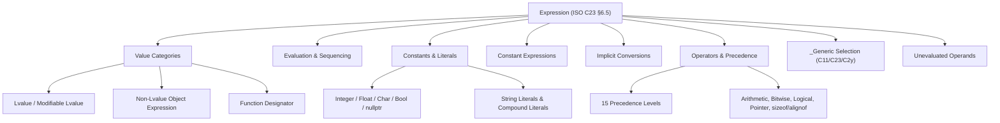
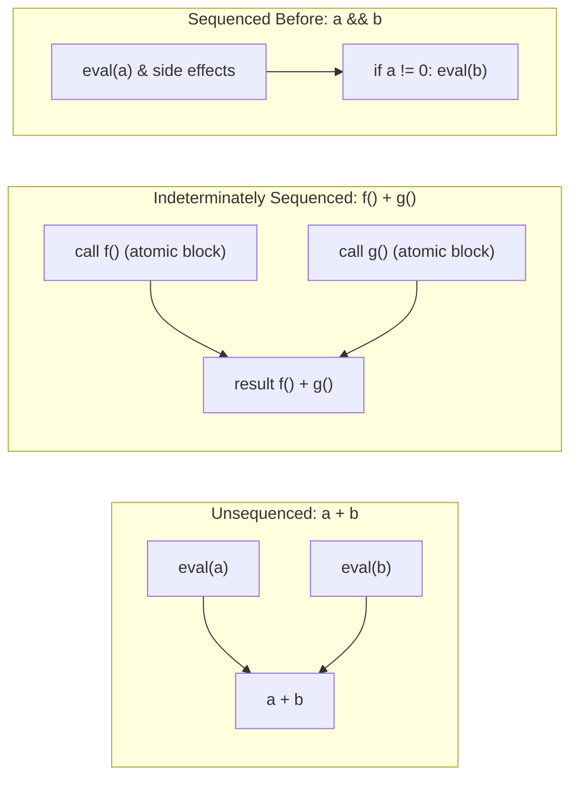

# Expressions, Operators & `_Generic`

An **expression** in C (ISO/IEC 9899:2024 §6.5) is a sequence of **operators** and **operands** that specifies the computation of a **value**, designates an **object** or **function**, or generates **side effects** (such as modifying an object, accessing a `volatile` object, modifying a file, or calling a function that performs any of those operations).



---

## 1. Value Categories & Lvalue Conversion

Every expression in C has a **type** (determined statically at compile time, except for variably modified array bounds) and belongs to one of three primary **value categories** (ISO C §6.3.2.1), plus `void` expressions which yield no value.

| Value Category | Formal Meaning (ISO C §6.3.2.1) | Examples | Can Take `&`? | Can Assign To? |
| :--- | :--- | :--- | :--- | :--- |
| **Lvalue** | An expression with an object type (other than `void`) that potentially designates an object in memory. | `x`, `*p`, `a[i]`, `s.m`, `p->m`, `"hello"`, `(int){42}` | Yes (unless `register` or bit-field) | Only if *modifiable* |
| **Modifiable lvalue** | An lvalue that does **not** have array type, incomplete type, `const`-qualified type, or struct/union type with any (recursively) `const`-qualified member. | `int x; x`, `a[0]`, `s.field`, `(int){42}` | Yes (unless `register` or bit-field) | **Yes** |
| **Non-lvalue object expression** *(informally "rvalue")* | An expression of object type that computes a value without designating a modifiable storage location. | `42`, `a + b`, `(int)x`, `fn()`, `s_fn().field`, `true`, `nullptr` | **No** | **No** |
| **Function designator** | An expression that has function type. | `printf`, `*printf`, `my_func` | Yes (yields function pointer) | **No** |
| **`void` expression** | An expression evaluated solely for its side effects, yielding no value. | `(void)x`, `void_fn()` | **No** | **No** |

!!! note "C vs C++ Lvalue Terminology"
    ISO C does **not** define the term "rvalue" normatively (a footnote in §6.3.2.1 explains that what other languages call an *rvalue* is referred to in C as the *value of an expression*). Unlike C++, C has no prvalue/xvalue/glvalue hierarchy, and prefix `++x`, assignment `a = b`, comma `a, b`, and ternary `c ? a : b` **always produce non-lvalue expressions** in C.

### Lvalue Conversion

Whenever an **lvalue** (that does not have array type) is used in an expression context expecting a value, the compiler automatically performs **lvalue conversion** (ISO C §6.3.2.1p2):

1. The stored value is read from the designated object, and the resulting expression is **no longer an lvalue**.
2. Top-level type qualifiers (`const`, `volatile`, `restrict`) are **stripped**.
3. Top-level `_Atomic` qualification <span class="c-badge c11">C11</span> is **stripped** (the read is performed as a sequentially consistent atomic load).

**Exceptions — contexts where lvalue conversion does NOT occur:**

- Operand of `sizeof` or `typeof` / `typeof_unqual` <span class="c-badge c23">C23</span>
- Operand of unary address-of `&`
- Operand of prefix/postfix `++` or `--`
- Left operand of member access `.`
- Left operand of any assignment operator (`=`, `+=`, etc.)

!!! danger "Undefined Behavior During Lvalue Conversion"
    - If an lvalue fails to designate an actual object when evaluated (e.g., dereferencing a null, dangling, or misaligned pointer), behavior is **undefined**.
    - Performing lvalue conversion on an **uninitialized automatic object** that could have been declared with `register` (i.e., its address is never taken) is **Undefined Behavior** (§6.3.2.1p2).
    - Reading a **non-value (trap) representation** of any type is **Undefined Behavior**.

### Temporary Lifetime <span class="c-badge c99">C99</span> <span class="c-badge c11">C11</span>

If a non-lvalue expression of `struct` or `union` type contains an **array member** (for example, `struct Buf { int data[4]; }; struct Buf make_buf(void);`), accessing `make_buf().data[0]` decays `data` to a pointer into an object with **temporary lifetime** (§6.2.4p8). That lifetime ends at the end of the enclosing full expression (or evaluation of the full declarator). Attempting to modify an object with temporary lifetime is **Undefined Behavior**.

---

## 2. Order of Evaluation & Sequencing

In C, **operator precedence** and **associativity** govern how tokens are parsed into an abstract syntax tree — they do **not** dictate the runtime order in which operands are evaluated.

### Evaluation Components

Evaluating an expression consists of two distinct activities (ISO C §5.1.2.3):

- **Value computation**: calculating the value produced by an expression (including determining the identity of an object for an lvalue).
- **Side effect**: modifying an object, accessing a `volatile` object, performing I/O, or calling a function that does any of these.

### Sequencing Relations <span class="c-badge c11">C11</span>

Since C11 (refining the C89/C99 *sequence point* model to support multithreading), the relative ordering of any two evaluations $A$ and $B$ within a single thread is one of three relations:

| Relation | Definition | Allowed Interleaving |
| :--- | :--- | :--- |
| **$A$ is sequenced before $B$** | $A$ completes entirely (both value computation and side effects) before $B$ begins. Strict partial order (asymmetric, transitive). | None — $A$ strictly precedes $B$. |
| **$A$ and $B$ are unsequenced** | $A$ and $B$ may execute in either order **or overlap/interleave** arbitrarily. | Arbitrary interleaving. Conflicting access to the same scalar = **UB**. |
| **$A$ and $B$ are indeterminately sequenced** | Either $A$ is sequenced before $B$, or $B$ is sequenced before $A$, but the compiler does not specify which. | **No interleaving** (e.g., two function calls in `f() + g()`). |



### Guaranteed Sequencing Rules (Sequence Points)

| Construct | Exact Sequencing Guarantee (ISO C23 §6.5 & Annex C) |
| :--- | :--- |
| **Logical AND `A && B`** | Value computation and side effects of `A` are sequenced before `B` (short-circuits: `B` is not evaluated if `A == 0`). |
| **Logical OR `A \|\| B`** | Value computation and side effects of `A` are sequenced before `B` (short-circuits: `B` is not evaluated if `A != 0`). |
| **Conditional `A ? B : C`** | `A` is sequenced before whichever of `B` or `C` is evaluated (the other branch is never evaluated). |
| **Comma operator `A , B`** | `A` (including all side effects) is sequenced before `B`. *(Does NOT apply to commas separating function arguments or initializer elements!)* |
| **Function call `fn(a1, a2, ...)`** | Evaluations of `fn` and all arguments `a1, a2, ...` are **unsequenced** relative to each other, **but** all of them are sequenced before entering the body of `fn`. Calls to different functions within the same expression are **indeterminately sequenced** (never interleaved). |
| **Full expression** | The end of every full expression — an initializer, an expression statement, the controlling expression of `if`/`switch`/`while`/`do`, each of the 3 expressions in `for(e1; e2; e3)`, a `return` expression, or a full declarator of a variably modified type — is sequenced before the next full expression. |
| **Postfix `x++` / `x--`** | Value computation of `x++` (reading the old value) is sequenced before the side effect of updating `x`. |
| **Assignment `lhs = rhs`** | Value computations of `lhs` and `rhs` are **unsequenced** with respect to each other, **but both** are sequenced before the side effect of storing into `lhs`. |

### Classic Unsequenced Undefined Behavior Traps

The fundamental rule (ISO C §6.5p2): **If a side effect on a scalar object is unsequenced relative to either a different side effect on the same scalar object or a value computation using the value of the same scalar object, the behavior is Undefined Behavior.**

=== "Bad (Undefined Behavior)"

    ```c
    int i = 1;
    int a[4] = { 0 };

    i = ++i + 1;        // UB: two unsequenced modifications to i
    i = i++;            // UB: postfix update and assignment update are unsequenced
    a[i] = i++;         // UB: reading i for a[i] is unsequenced with modifying i in i++
    int r = f(i++, i++);// UB: function arguments are unsequenced relative to each other
    ```

=== "Good (Well-Defined)"

    ```c
    int i = 1;
    int a[4] = { 0 };

    i = i + 1;          // OK: RHS value computation of i is sequenced before store to i
    a[i] = i;           // OK: no conflicting modification
    i++;

    int first = i++;    // OK: full expression boundary sequences the two increments
    int second = i++;
    int r = f(first, second);
    ```

!!! tip "Indeterminately Sequenced Function Calls Are Safe (If Independent)"
    In `int total = next_val() + next_val();`, the two calls to `next_val()` cannot interleave even if `next_val()` mutates a shared `static` counter — they are **indeterminately sequenced**, not unsequenced. The behavior is **unspecified** (which call runs first), not undefined.

---

## 3. Constants & Literals

Constants (ISO C §6.4.4) and string/compound literals (§6.4.5, §6.5.2.5) represent fixed compile-time values or unnamed literal objects.

### 3.1 Integer Constants

Integer constants have no sign (`-42` is the unary `-` operator applied to the integer constant `42`).

| Base | Prefix | Valid Digits | Example | Standard |
| :--- | :--- | :--- | :--- | :--- |
| **Decimal** | *(none, non-zero first digit)* | `0`–`9` | `42`, `1'000'000` | <span class="c-badge c89">C89</span> |
| **Octal** | `0` | `0`–`7` | `0`, `0755`, `0'644` | <span class="c-badge c89">C89</span> |
| **Hexadecimal** | `0x` or `0X` | `0`–`9`, `a`–`f`, `A`–`F` | `0xDEAD'BEEF` | <span class="c-badge c89">C89</span> |
| **Binary** | `0b` or `0B` | `0`, `1` | `0b1010'0101` | <span class="c-badge c23">C23</span> |

- **Digit separators** <span class="c-badge c23">C23</span> (N2626): Single quotation marks `'` may appear between any two digits (e.g., `1'000'000`, `0xFF'00'AA`, `0b1100'0011`) and are ignored by the compiler. They cannot appear at the start or end of the constant, adjacent to the base prefix, or doubled (`1''0`).
- **Bit-precise suffixes** <span class="c-badge c23">C23</span> (N2709): `wb`/`WB` produces `signed _BitInt(N)` where `N` is the smallest width $\ge 2$ able to represent the value (e.g., `0wb` has type `signed _BitInt(2)`). `uwb`/`UWB` produces `unsigned _BitInt(N)` where `N` is the smallest width $\ge 1$ (e.g., `1uwb` has type `unsigned _BitInt(1)`).

#### Integer Constant Type Deduction Table (ISO C23 §6.4.4.1)

The compiler selects the **first type** in the applicable list that can represent the constant's value:

| Suffix | Decimal Constant Type List | Octal, Hex, or Binary Constant Type List | Standard |
| :--- | :--- | :--- | :--- |
| *(none)* | `int`, `long int`, `long long int` | `int`, `unsigned int`, `long int`, `unsigned long int`, `long long int`, `unsigned long long int` | <span class="c-badge c89">C89</span> <span class="c-badge c99">C99</span> |
| `u` / `U` | `unsigned int`, `unsigned long int`, `unsigned long long int` | `unsigned int`, `unsigned long int`, `unsigned long long int` | <span class="c-badge c89">C89</span> |
| `l` / `L` | `long int`, `long long int` | `long int`, `unsigned long int`, `long long int`, `unsigned long long int` | <span class="c-badge c89">C89</span> |
| `ul` / `UL` | `unsigned long int`, `unsigned long long int` | `unsigned long int`, `unsigned long long int` | <span class="c-badge c89">C89</span> |
| `ll` / `LL` | `long long int` | `long long int`, `unsigned long long int` | <span class="c-badge c99">C99</span> |
| `ull` / `ULL` | `unsigned long long int` | `unsigned long long int` | <span class="c-badge c99">C99</span> |
| `wb` / `WB` | `signed _BitInt(N)` (smallest $N \ge 2$) | `signed _BitInt(N)` (smallest $N \ge 2$) | <span class="c-badge c23">C23</span> |
| `uwb` / `UWB` | `unsigned _BitInt(N)` (smallest $N \ge 1$) | `unsigned _BitInt(N)` (smallest $N \ge 1$) | <span class="c-badge c23">C23</span> |

*(If a non-`_BitInt` constant exceeds the largest standard type in its list, extended integer types of matching signedness may be selected; otherwise the program is ill-formed.)*

!!! warning "The `-2147483648` (`INT_MIN`) Trap"
    Because integer constants never include a minus sign, on LP64 systems (32-bit `int`, 64-bit `long`), `2147483648` does not fit in `int` and is deduced as **`long`** (decimal constants without `u` never become `unsigned int`). Thus `-2147483648` has type `long`, **not** `int`! On ILP32 systems (32-bit `int` and `long`), it becomes `long long`. This is why `<limits.h>` defines `INT_MIN` as `(-2147483647 - 1)`.

---

### 3.2 Floating-Point Constants

| Form | Syntax & Meaning | Examples | Standard |
| :--- | :--- | :--- | :--- |
| **Decimal floating** | Fractional digits and/or base-10 exponent (`e`/`E`). Digit separators `'` allowed in C23. | `3.14159`, `.5`, `1e-9`, `1'000.25e+3` | <span class="c-badge c89">C89</span> <span class="c-badge c23">C23</span> |
| **Hexadecimal floating** | `0x` / `0X` significand + **mandatory** base-2 decimal exponent (`p`/`P`). Exact binary representation! | `0x1.fp3` ($1.9375 \times 2^3 = 15.5$), `0x1.0p-10` | <span class="c-badge c99">C99</span> |

| Suffix | Deduced Type | Notes | Standard |
| :--- | :--- | :--- | :--- |
| *(none)* | `double` | Default floating constant type | <span class="c-badge c89">C89</span> |
| `f` / `F` | `float` | Single-precision binary floating point | <span class="c-badge c89">C89</span> |
| `l` / `L` | `long double` | Extended-precision binary floating point | <span class="c-badge c89">C89</span> |
| `df` / `DF` | `_Decimal32` | IEEE 754 decimal32; **decimal constants only** (forbidden on hex floats) | <span class="c-badge c23">C23</span> <span class="c-badge c-optional">optional</span> |
| `dd` / `DD` | `_Decimal64` | IEEE 754 decimal64; **decimal constants only** | <span class="c-badge c23">C23</span> <span class="c-badge c-optional">optional</span> |
| `dl` / `DL` | `_Decimal128` | IEEE 754 decimal128; **decimal constants only** | <span class="c-badge c23">C23</span> <span class="c-badge c-optional">optional</span> |

*(Decimal floating types require `__STDC_IEC_60559_DFP__` to be defined by the implementation.)*

---

### 3.3 Character Constants

| Prefix | Example | Type in C | Encoding / Notes | Standard |
| :--- | :--- | :--- | :--- | :--- |
| *(none)* | `'a'`, `'\n'`, `'ab'` | **`int`** | Ordinary execution character set. Multi-character `'ab'` is implementation-defined (`int`). | <span class="c-badge c89">C89</span> |
| `u8` | `u8'a'` | **`unsigned char`** | Single UTF-8 code unit (`0x00`–`0x7F`); guaranteed unsigned! | <span class="c-badge c23">C23</span> |
| `L` | `L'Ω'` | `wchar_t` | Wide execution character set (`<stddef.h>`). | <span class="c-badge c89">C89</span> |
| `u` | `u'é'` | `char16_t` | Single UTF-16 code unit (`<uchar.h>`). | <span class="c-badge c11">C11</span> |
| `U` | `U'🚀'` | `char32_t` | Single UTF-32 code point (`<uchar.h>`). | <span class="c-badge c11">C11</span> |

!!! note "C vs C++ Character Constant Type"
    In C, `'a'` has type **`int`** (`sizeof('a') == sizeof(int)`), whereas in C++ `'a'` has type `char` (`sizeof('a') == 1`). By contrast, C23's UTF-8 character constant `u8'a'` has type **`unsigned char`** (`sizeof(u8'a') == 1`).

**Escape sequences:** `\'`, `\"`, `\?`, `\\`, `\a`, `\b`, `\f`, `\n`, `\r`, `\t`, `\v`, octal `\o`..`\ooo` (1–3 octal digits), hexadecimal `\xh...` (unlimited hex digits — be careful when followed by hex letters like `"\x1b" "c"`), and Universal Character Names `\uXXXX` / `\UXXXXXXXX` <span class="c-badge c99">C99</span>.

---

### 3.4 Predefined Constants: `true`, `false`, and `nullptr` <span class="c-badge c23">C23</span>

C23 elevates Boolean values and a type-safe null pointer literal into first-class **predefined constant keywords** (§6.4.4.5):

- **`true` and `false`** <span class="c-badge c23">C23</span> (N2935): Keywords of type `bool` with values `1` and `0` (no longer require `<stdbool.h>`). Also recognized directly inside `#if` preprocessor expressions as `1` and `0`.
- **`nullptr`** <span class="c-badge c23">C23</span> (N3042): Keyword representing a null pointer constant of distinct type `nullptr_t` (declared in `<stddef.h>` as `typedef typeof(nullptr) nullptr_t;`).

| Operation on `nullptr` (`nullptr_t`) | Valid in C23? | Semantics |
| :--- | :--- | :--- |
| `int *p = nullptr;` / `void (*fp)(void) = nullptr;` | **Yes** | Implicitly converts to a null pointer of any object or function pointer type. |
| `bool b = nullptr;` / `if (nullptr)` | **Yes** | Implicitly converts to `false`. |
| `p == nullptr` / `nullptr == nullptr` | **Yes** | Equality comparison with any pointer type or `nullptr_t`. |
| `int n = nullptr;` or `int n = (int)nullptr;` | **No (Constraint Violation)** | `nullptr_t` **cannot** convert to integer types — not even with an explicit cast! (To inspect bits, cast via `(uintptr_t)(void *)nullptr`.) |
| `execl("/bin/ls", "ls", nullptr);` | **Yes (Safe!)** | Guaranteed same size & representation as `void *`, eliminating 64-bit variadic sentinel bugs where `NULL` might expand to `0` (`int`). |

---

### 3.5 String Literals

A string literal creates a null-terminated array with **static storage duration** (§6.4.5).

| Prefix | Example | Array Type (C11–C17) | Array Type (C23) | Standard |
| :--- | :--- | :--- | :--- | :--- |
| *(none)* | `"abc"` | `char[4]` | `char[4]` | <span class="c-badge c89">C89</span> |
| `u8` | `u8"abc"` | `char[4]` | **`unsigned char[4]`** (N2653) | <span class="c-badge c11">C11</span> <span class="c-badge c23">C23</span> |
| `L` | `L"abc"` | `wchar_t[4]` | `wchar_t[4]` | <span class="c-badge c89">C89</span> |
| `u` | `u"abc"` | `char16_t[4]` | `char16_t[4]` | <span class="c-badge c11">C11</span> |
| `U` | `U"abc"` | `char32_t[4]` | `char32_t[4]` | <span class="c-badge c11">C11</span> |

!!! danger "Modifying a String Literal Is Undefined Behavior"
    For backwards compatibility with pre-ANSI C, `"abc"` has type `char[4]` rather than `const char[4]`. However, compilers place string literals in read-only memory (`.rodata`) and may merge identical literals or overlapping tails (`"bar"` sharing bytes with `"foobar"`). Attempting to modify any element (`char *s = "abc"; s[0] = 'x';`) is **Undefined Behavior** and typically crashes with `SIGSEGV`. Always bind string literals to `const char *`.

- **Adjacent concatenation** (Translation Phase 6): Adjacent string literals separated only by whitespace concatenate into a single literal (`"Hello, " "world!\n"` $\to$ `"Hello, world!\n"`). Combining an unprefixed literal with a prefixed literal adopts the prefix (`"a" u8"b"` $\to$ `u8"ab"`). Combining two different encoding prefixes (`u"a" U"b"`) is a **constraint violation** in C23.

---

### 3.6 Compound Literals <span class="c-badge c99">C99</span> <span class="c-badge c23">C23</span>

A **compound literal** (§6.5.2.5) constructs an unnamed object of the specified type initialized from a brace-enclosed initializer list. Unlike casts, a compound literal is an **lvalue**, so its address can be taken (`&(struct Point){ .x = 1, .y = 2 }`).

- **C99–C17 syntax**: `(type-name){ initializer-list }`
  - At file scope: **static** storage duration (initializers must be constant expressions).
  - At block scope: **automatic** storage duration associated with the enclosing block (re-initialized each time control passes through the compound literal; beware taking its address inside a loop and saving pointers across iterations — the same object is reused each iteration!).
- **C23 storage-class specifiers** <span class="c-badge c23">C23</span> (N3038): `(storage-class-specifiers type-name){ initializer-list }`
  - Allowed specifiers: `constexpr`, `register`, `static`, `thread_local` (combinable per standard storage-class rules, e.g. `static constexpr` or `static thread_local`).
  - Allows creating static or compile-time constant unnamed objects directly inside functions without stack allocation or dangling pointers!

=== "C23 (Storage-Class Compound Literals)"

    ```c
    struct Config { int port; bool tls; };

    // Safe to return pointer: explicit 'static' gives static storage duration!
    const struct Config *default_config(void) {
        return &(static constexpr struct Config){ .port = 443, .tls = true };
    }

    // Zero runtime stack copy for read-only lookup table inside a function:
    int get_prime(size_t idx) {
        const int *primes = (static const int[]){ 2, 3, 5, 7, 11, 13 };
        return idx < 6 ? primes[idx] : -1;
    }
    ```

=== "C17 (Automatic Block-Scope Workaround)"

    ```c
    struct Config { int port; _Bool tls; };

    // Returning &(struct Config){ 443, 1 } would be a DANGLING POINTER in C17!
    // Must declare a named static object first:
    const struct Config *default_config(void) {
        static const struct Config cfg = { .port = 443, .tls = 1 };
        return &cfg;
    }
    ```

---

## 4. Constant Expressions

A **constant expression** (ISO C §6.6) can be evaluated during translation rather than runtime. Constant expressions cannot contain assignment operators, increment/decrement (`++`, `--`), function calls, or the comma operator (except inside unevaluated subexpressions such as `sizeof`).

| Category | Permitted Operands | Where Required |
| :--- | :--- | :--- |
| **Integer Constant Expression (ICE)** | Integer constants, character constants, enumeration constants, `true`/`false` <span class="c-badge c23">C23</span>, `constexpr` integer/enum objects <span class="c-badge c23">C23</span>, `sizeof` (non-VM types), `alignof`, and casts to integer types (floating constants allowed only as immediate operands of casts to integer types). | `#if` directives, non-VLA array sizes, bit-field widths, `case` labels, enum values, `static_assert`, `alignas`, designated array indices `[N]`. |
| **Arithmetic Constant Expression** | Arithmetic types including floating constants, `constexpr` arithmetic objects <span class="c-badge c23">C23</span>, `sizeof`/`alignof`, casts to arithmetic types. | Initializers for arithmetic objects with static/thread-local storage duration or `constexpr`. |
| **Address Constant** | Null pointer constant (`0`, `(void *)0`, `nullptr`), pointer to an lvalue of static storage duration, or pointer to a function designator (created via unary `&`, array/function decay, or `.`/`->`/`[]` without dereferencing). | Initializers for static/thread-local pointers (can also be offset by an ICE: `&arr[0] + 4`). |
| **Static/Thread-Local Initializer** | Arithmetic constant expression, null pointer constant, address constant, or address constant `±` ICE. | File-scope and `static`/`thread_local` block-scope object initializers. |

!!! warning "`const` Is NOT a Constant Expression in C — Use C23 `constexpr`"
    Unlike C++, a `const`-qualified variable in C (`const int N = 16;`) is **never** an integer constant expression: `int buf[N];` declares a **Variable-Length Array (VLA)** at block scope and is a **compile error** at file scope! In C23 (N3018), `constexpr int N = 16;` **is** a true integer constant expression valid in array bounds, `case` labels, bit-fields, and `static_assert`. See [Declarations: `constexpr`](declarations.md#constexpr-objects) for full rules.

---

## 5. Implicit Conversions

Implicit conversions (ISO C §6.3) occur automatically during expression evaluation, assignment, initialization, function calls, and `return` statements.

### 5.1 Integer Conversion Rank

Every integer type has an **integer conversion rank** (§6.3.1.1):

1. `bool` (`_Bool`) has the lowest standard rank.
2. `char`, `signed char`, `unsigned char` share equal rank (strictly greater than `bool`).
3. `short` < `int` < `long` < `long long`.
4. Signed and unsigned versions of the same standard type have **equal rank**.
5. **`_BitInt(N)`** <span class="c-badge c23">C23</span>: rank is less than any integer type of greater width; if a `_BitInt(N)` and a standard integer type have the **same width**, the standard integer type has **greater rank** than `_BitInt(N)`.

### 5.2 Integer Promotions

Whenever a small integer type is used in an arithmetic, bitwise, or comparison expression, **integer promotions** convert any object or expression whose integer conversion rank is less than `int` (or a bit-field of type `bool`, `int`, `signed int`, or `unsigned int`) to:

- **`int`**, if `int` can represent all values of the original type;
- **`unsigned int`**, otherwise (e.g., an `unsigned short` on an architecture where `sizeof(short) == sizeof(int)`).

!!! info "C23 Exception: `_BitInt(N)` Never Promotes"
    Unlike `char` and `short`, bit-precise integer types `_BitInt(N)` <span class="c-badge c23">C23</span> do **not** undergo integer promotions. Adding two `_BitInt(8)` values produces `_BitInt(8)`, not `int`.

### 5.3 Usual Arithmetic Conversions

Binary arithmetic, relational, equality, bitwise, and ternary operators harmonize their two operands to a **common real type** (§6.3.1.8):

1. **Decimal vs Binary Floating Point** <span class="c-badge c23">C23</span>: Mixing a decimal floating type (`_Decimal32`/`64`/`128`) with a binary floating type (`float`/`double`/`long double`) is a **constraint violation** (requires explicit cast). If both are decimal floats, convert to the wider (`_Decimal128` > `_Decimal64` > `_Decimal32`).
2. **Binary Floating Point**: If either operand is `long double` $\to$ `long double`; else if `double` $\to$ `double`; else if `float` $\to$ `float`.
3. **Integers**: Perform **integer promotions** on both operands, then:
   - Same type $\to$ done.
   - Same signedness $\to$ convert lower-rank operand to higher-rank type.
   - Unsigned operand has rank $\ge$ signed operand $\to$ convert signed operand to the unsigned operand's type.
   - Signed operand's type can represent **all** values of the unsigned operand's type $\to$ convert unsigned operand to the signed operand's type.
   - Otherwise $\to$ convert **both** operands to the **unsigned** counterpart of the signed operand's type.

!!! danger "The Classic Signed/Unsigned Comparison Trap"
    ```c
    int a = -1;
    unsigned int b = 1u;
    bool cmp = (a < b); // Evaluates to FALSE (0)!
    ```
    Because `unsigned int` and `int` have equal rank, `a` (`-1`) is converted to `unsigned int` (`UINT_MAX`, e.g., `4294967295u`), making `4294967295u < 1u` evaluate to `false`! Enable `-Wsign-compare` and never mix signed and unsigned types silently.

### 5.4 Floating-Point, Boolean, Array, Function & Pointer Conversions

- **Floating $\to$ Integer**: Truncates the fractional part **toward zero** (`(int)-3.9 == -3`). If the truncated integral value cannot be represented in the integer type (or is `NaN`/`±Inf`), behavior is **Undefined Behavior**!
- **Scalar $\to$ `bool`**: Zero (or null pointer) converts to `false` (`0`); any non-zero value (including `NaN`!) converts to `true` (`1`).
- **Array-to-Pointer Decay** (§6.3.2.1p3): An expression of type "array of `T`" converts to a non-lvalue pointer of type "`T *`" pointing to element `0`, **except** when it is the operand of `sizeof`, `typeof`/`typeof_unqual` <span class="c-badge c23">C23</span>, unary `&`, or a string literal initializing an array.
- **Function-to-Pointer Decay** (§6.3.2.1p4): A function designator converts to a pointer to that function, **except** when it is the operand of `sizeof` (constraint violation), `typeof`/`typeof_unqual`, or unary `&`.
- **Pointer Conversions** (§6.3.2.3):
  - `void *` implicitly converts to and from any **object** pointer type (unlike C++, which requires a cast from `void *`). Function pointers are **not** implicitly convertible to/from `void *`.
  - Adding qualifiers to the pointed-to type is implicit (`int *` $\to$ `const int *`). Removing qualifiers requires an explicit cast.
  - **Double-pointer trap**: `char **` does **not** implicitly convert to `const char **` (allowing it would let a caller store a `const char *` into a `char *` without a cast).
  - Any null pointer constant (`0`, `(void *)0`, `nullptr`) converts implicitly to a null pointer of any pointer type.

### 5.5 Default Argument Promotions

Applied to arguments matching the `...` ellipsis of a variadic function (such as `printf`) and to unprototyped functions prior to C23 (C23 removed K&R unprototyped function declarations!):

1. **Integer promotions** are performed on each integer argument (`char`, `short`, `bool` $\to$ `int`).
2. **`float`** is promoted to **`double`**.
3. **`_BitInt(N)`** and **`_Decimal32`** <span class="c-badge c23">C23</span> are **not** promoted.

---

## 6. Complete Operator Precedence & Associativity Table (C23)

Operators are listed from **highest precedence (1)** to **lowest precedence (15)**, matching the ISO/IEC 9899:2024 grammar and `cppreference.com`.

| Prec. | Category | Operators | Description | Associativity |
| :---: | :--- | :--- | :--- | :--- |
| **1** | Postfix | `++` `--` | Suffix/postfix increment and decrement | Left-to-right |
| | | `()` | Function call | |
| | | `[]` | Array subscripting | |
| | | `.` | Structure and union member access | |
| | | `->` | Structure and union member access through pointer | |
| | | `(type){list}` | Compound literal <span class="c-badge c99">C99</span> (+ storage-class <span class="c-badge c23">C23</span>) | |
| **2** | Unary & Cast | `++` `--` | Prefix increment and decrement | Right-to-left |
| | | `+` `-` | Unary plus and minus | |
| | | `!` `~` | Logical NOT and bitwise NOT | |
| | | `(type)` | Type cast *(see grammar note below)* | |
| | | `*` | Indirection (dereference) | |
| | | `&` | Address-of | |
| | | `sizeof` | Size-of object or type | |
| | | `alignof` / `_Alignof` | Alignment requirement of type <span class="c-badge c11">C11</span> <span class="c-badge c23">C23</span> | |
| **3** | Multiplicative | `*` `/` `%` | Multiplication, division, remainder | Left-to-right |
| **4** | Additive | `+` `-` | Addition and subtraction | Left-to-right |
| **5** | Bitwise Shift | `<<` `>>` | Bitwise left shift and right shift | Left-to-right |
| **6** | Relational | `<` `<=` | Less than, less than or equal to | Left-to-right |
| | | `>` `>=` | Greater than, greater than or equal to | |
| **7** | Equality | `==` `!=` | Equal to, not equal to | Left-to-right |
| **8** | Bitwise AND | `&` | Bitwise AND | Left-to-right |
| **9** | Bitwise XOR | `^` | Bitwise XOR (exclusive OR) | Left-to-right |
| **10** | Bitwise OR | `\|` | Bitwise OR (inclusive OR) | Left-to-right |
| **11** | Logical AND | `&&` | Logical AND (short-circuiting) | Left-to-right |
| **12** | Logical OR | `\|\|` | Logical OR (short-circuiting) | Left-to-right |
| **13** | Conditional | `?:` | Ternary conditional *(see grammar note below)* | Right-to-left |
| **14** | Assignment | `=` | Simple assignment | Right-to-left |
| | | `+=` `-=` | Compound assignment by sum / difference | |
| | | `*=` `/=` `%=` | Compound assignment by product / quotient / remainder | |
| | | `<<=` `>>=` | Compound assignment by bitwise left / right shift | |
| | | `&=` `^=` `\|=` | Compound assignment by bitwise AND / XOR / OR | |
| **15** | Comma | `,` | Comma operator | Left-to-right |

!!! info "Subtle Grammar Nuances Not Captured by a Flat Table"
    1. **Cast vs Unary**: In the formal C grammar, *cast-expression* sits strictly below *unary-expression*. Thus `(int)sizeof x` parses as `(int)(sizeof x)`, and `sizeof (int)x` is a syntax error (because `sizeof(int)` parses first as `sizeof(type-name)`).
    2. **Ternary Middle Operand**: The middle operand of `a ? b : c` is parsed as an unrestricted *expression* (as if parenthesized), so `a ? x = 1, y = 2 : z` is legal, whereas `a ? b : c = 1` is a syntax error (unlike C++, because C's grammar parses the 3rd operand as a *conditional-expression*, not an *assignment-expression*).
    3. **Bitwise vs Comparison Trap**: Equality (`==`, `!=`) has **higher** precedence than bitwise `&`, `^`, `|`. Always parenthesize masks: `(flags & MASK) == MASK`, never `flags & MASK == MASK` (which parses as `flags & (MASK == MASK)`!).

---

## 7. Operator Reference by Category

### 7.1 Assignment Operators

- **Simple assignment `lhs = rhs`**: `lhs` must be a modifiable lvalue. `rhs` is implicitly converted to the unqualified non-atomic type of `lhs`. The expression evaluates to the stored value (as a **non-lvalue**!).
- **Compound assignment `lhs op= rhs`**: Equivalent to `lhs = lhs op (rhs)` **except that `lhs` is evaluated only once** (§6.5.16.2). Thus `arr[next_idx()] += 5;` invokes `next_idx()` once (safe), whereas `arr[next_idx()] = arr[next_idx()] + 5;` invokes it twice (bug / unsequenced hazard).

### 7.2 Increment & Decrement Operators

- **Prefix `++x` / `--x`**: Adds/subtracts `1` to modifiable lvalue `x` and yields the **new** value (non-lvalue).
- **Postfix `x++` / `x--`**: Yields the **old** value (non-lvalue); the value read is sequenced before the side effect updating `x`.
- On a pointer `T *p`, `++p` advances `p` by `sizeof(T)` bytes (valid up to one-past-the-end of an array).

### 7.3 Arithmetic & Bitwise Operators

| Operator | Semantics & C23 Rules | Undefined / Implementation-Defined Traps |
| :--- | :--- | :--- |
| `+`, `-`, `*` | Signed/unsigned integer or floating arithmetic (plus pointer `±` integer, pointer `-` pointer within same array). | **Signed integer overflow is STILL Undefined Behavior in C23** despite mandatory two's complement representation (N2412)! Unsigned arithmetic wraps modulo $2^N$. For safe checked arithmetic, use C23 `<stdckdint.h>` (`ckd_add`, `ckd_sub`, `ckd_mul`). |
| `/`, `%` | Integer division **truncates toward zero** since C99: `(a / b) * b + (a % b) == a`. `%` requires integer operands. | Division or modulo by `0` is **UB**. Signed `INT_MIN / -1` and `INT_MIN % -1` <span class="c-badge c11">C11</span> are **UB** (overflows `INT_MAX`). |
| `<<` | Bitwise left shift of promoted LHS by RHS bits. | **UB** if RHS $< 0$ or RHS $\ge$ width of promoted LHS. **UB** if LHS is signed and negative, or if `LHS * 2^RHS` is not representable in the signed result type (shifting into/past the sign bit). |
| `>>` | Bitwise right shift of promoted LHS by RHS bits. | **UB** if RHS $< 0$ or RHS $\ge$ width of promoted LHS. If LHS is signed and **negative**, the result is **implementation-defined** (usually arithmetic sign-extending shift, but not guaranteed by ISO C). |
| `~`, `&`, `^`, `\|` | Bitwise complement, AND, XOR, OR on promoted integer operands. | Under C23 mandatory two's complement, bitwise ops on signed integers cannot create trap representations, **but** prefer unsigned types for bit manipulation and masks (see [`<stdbit.h>`](../library/numerics-bit-checked.md)). |

### 7.4 Logical & Comparison Operators

- **Logical (`!`, `&&`, `||`)**: Operands are any scalar types (`0`/null $\to$ false, non-zero $\to$ true). Result is **always type `int`** with value `0` or `1` (even in C23 — not `bool`, preserving C89 ABI/macro compatibility). `&&` and `||` short-circuit from left to right.
- **Comparison (`==`, `!=`, `<`, `<=`, `>`, `>=`)**: Result is **always type `int`** (`0` or `1`).
  - **Floating-point `NaN`**: Every relational/equality comparison involving `NaN` evaluates to `0`, except `NaN != NaN` which evaluates to `1`.
  - **Pointer relational comparison (`<`, `<=`, `>`, `>=`)**: Defined **only** when both pointers point into the **same array object** (or one-past-the-end), or members of the same `struct`/`union`. Comparing pointers to unrelated allocations with `<` is **Undefined Behavior** (equality `==`/`!=` is always well-defined for any valid pointers).

### 7.5 Member Access & Indirection Operators

| Operator | Definition & Subtle Rules |
| :--- | :--- |
| `a[i]` | Defined identically as `*((a) + (i))` — therefore commutative (`i[a]` is syntactically valid, though discouraged). |
| `*p` | Dereferences a non-null, properly aligned pointer to a live object (or function). Yielded lvalue has the pointed-to type. |
| `&x` | Yields pointer to object/function `x`. **C99 special rule (§6.5.3.2p3)**: `&*p` and `&a[n]` cancel the indirection operator and do **not** dereference the pointer — thus `&arr[N]` (one-past-the-end) and `&*(int *)nullptr` (yields a null pointer) are well-defined in C99+. |
| `s.m` | Accesses member `m` of `struct`/`union` `s`. Is an lvalue iff `s` is an lvalue. |
| `p->m` | Defined identically as `(*p).m`; always yields an lvalue (for non-array members). |

### 7.6 Call, Comma & Conditional (`?:`) Operators

- **Function call `fn(args...)`**: Calls function designated by `fn` (or function pointer). Arguments are converted as if by assignment to each parameter type (or default argument promotions for `...`).
- **Comma `a, b`**: Evaluates `a` (discarding its value), sequences all side effects of `a` before `b`, and returns the value and type of `b` (always a **non-lvalue**).
- **Conditional `cond ? e1 : e2`**: Evaluates `cond`; if non-zero evaluates only `e1`, else only `e2`. Result type rules (§6.5.15):
  - Both arithmetic $\to$ usual arithmetic conversions.
  - Both compatible `struct`/`union` $\to$ that type.
  - Both `void` $\to$ `void`.
  - Both pointers to compatible types $\to$ pointer to composite type with **union of pointed-to qualifiers** (`int *` and `const int *` $\to$ `const int *`).
  - One pointer and one `void *` $\to$ `void *` with merged qualifiers.
  - One pointer and one null pointer constant (`0`, `nullptr`) $\to$ that pointer type.

### 7.7 `sizeof`, `alignof`, and Cast Operators

- **`sizeof unary-expression`** / **`sizeof (type-name)`**: Yields object representation size in bytes (`size_t`). `sizeof(char) == sizeof(signed char) == sizeof(unsigned char) == 1` by definition.
  - **Constraint violations**: Cannot apply `sizeof` to a function type, an incomplete type (such as `void` or `int[]`), or a bit-field.
  - **VLA evaluation rule**: The operand of `sizeof` is **NOT evaluated** *unless* its type is a **variably modified (VLA) type**, in which case runtime evaluation occurs (`int n = 5; sizeof(int[n++]);` increments `n` to `6` and yields `5 * sizeof(int)`!).
- **`alignof (type-name)`** <span class="c-badge c23">C23</span> (formerly `_Alignof (type-name)` <span class="c-badge c11">C11</span>): Yields the alignment requirement in bytes (`size_t`) as an integer constant expression. **Takes ONLY a parenthesized type-name** — `alignof(expr)` is a non-standard GNU extension, not ISO C!
- **Cast `(type-name) expr`**: Explicitly converts `expr` to scalar type `type-name` (or `void` to discard a value). Always yields a **non-lvalue** with top-level qualifiers stripped.

---

## 8. Generic Selection (`_Generic`) <span class="c-badge c11">C11</span> <span class="c-badge c23">C23</span> <span class="c-badge c2y">C2y</span>

`_Generic` (§6.5.1.1) provides **compile-time type dispatch** — enabling type-safe polymorphic macros without C++ function overloading.

### Syntax

```c
_Generic ( controlling-expression ,
    type-name-1 : assignment-expression-1 ,
    type-name-2 : assignment-expression-2 ,
    default     : default-assignment-expression   // optional
)
```

### Selection & Conversion Rules

1. The controlling expression is **not evaluated** (side effects do not occur).
2. In C11–C23, the controlling expression undergoes **lvalue conversion** (stripping top-level `const`, `volatile`, `restrict`, `_Atomic`), **array-to-pointer decay**, and **function-to-pointer decay**.
   - Example: `const int x = 5;` matches `int`, **not** `const int`!
   - Example: `const int arr[4] = {};` decays to **`const int *`** (pointed-to `const` is preserved!).
3. Every type in the association list must be a **complete object type** (not `void`, not a function type, not a variably modified/VLA type), and no two associations may specify **compatible types** (e.g., listing both `int` and `int32_t` on 32-bit-`int` targets is a constraint violation!).
4. At most one `default:` association is allowed. If no type matches and no `default:` is present, it is a compile-time error.
5. **Crucial Macro Rule**: Even non-selected branches must be **syntactically valid and type-checked**! A common idiom is to select a **function pointer** inside `_Generic` and invoke it outside: `_Generic((x), int: fn_int, double: fn_dbl)(x)`.

### Preserving Qualifiers in C23 & C2y Type-Name Operands

=== "C23 (Qualifier-Aware Dispatch via Pointer)"

    ```c
    // Passing &(x) prevents top-level qualifier stripping and array decay!
    #define TYPE_QUAL_TAG(x) _Generic(&(x), \
        int *             : "mutable int",  \
        const int *       : "const int",    \
        int (*)[4]        : "int[4]",       \
        const int (*)[4]  : "const int[4]", \
        default           : "other"         \
    )
    ```

=== "C2y Draft (N3260 Type-Name Operand)"

    ```c
    // Proposed for C2y (WG14 N3260 — experimental in GCC 15 / Clang 17+ with -std=c2y):
    // Passing a type-name directly avoids lvalue conversion, preserving qualifiers and arrays!
    #define IS_CONST_INT(T) _Generic(T, const int: true, default: false)
    // IS_CONST_INT(const int) -> true
    // IS_CONST_INT(int)       -> false
    ```

---

## 9. Unevaluated Expressions

Certain expression operands in C are inspected **only for their static type** and are never executed at runtime — their side effects do not happen, and uninitialized reads or division by zero inside them do not execute.

| Construct | Operand Evaluated? | Variably Modified (VLA) Exception | Standard |
| :--- | :--- | :--- | :--- |
| `sizeof(expr)` | **No** | **YES — evaluated** if `expr` has a VLA type (`sizeof(int[n++])` evaluates `n++`!) | <span class="c-badge c89">C89</span> <span class="c-badge c99">C99</span> |
| `alignof(type)` | **No** (type only) | **Never evaluated** — always yields an integer constant expression (for an array or VLA type `T[n]`, yields `alignof(T)` without evaluating `n`). | <span class="c-badge c11">C11</span> <span class="c-badge c23">C23</span> |
| `typeof(expr)` / `typeof_unqual(expr)` | **No** | **YES — evaluated** if `expr` has a variably modified (VLA) type! | <span class="c-badge c23">C23</span> |
| `_Generic(ctrl, ...)` controlling expr | **No** | Never evaluated (VLA types cannot match associations anyway). | <span class="c-badge c11">C11</span> |
| `_Generic(...)` unselected branches | **No** (type-checked only) | Never evaluated at runtime. | <span class="c-badge c11">C11</span> |

---

## 10. Complete Compilable C23 Example

This self-contained C23 program exercises binary literals, digit separators, `_BitInt` literals, `u8'a'` / `u8""` types, `nullptr`, `static constexpr` compound literals, `_Generic` function dispatch, and safe sequencing. Compile with `gcc-15 -std=c23 -pedantic-errors -Wall -Wextra`.

```c
#include <stddef.h>
#include <stdint.h>
#include <stdio.h>
#include <stdckdint.h>

// C23 constexpr objects are true integer constant expressions
constexpr size_t k_table_len = 4;
constexpr unsigned int k_mask = 0b1111'0000u;

// Type-specific print helpers for _Generic dispatch
static void print_i32(int32_t v)      { printf("int32_t: %d\n", v); }
static void print_u32(uint32_t v)     { printf("uint32_t: %u (0x%X)\n", v, v); }
static void print_f64(double v)       { printf("double: %.4f\n", v); }
static void print_cstr(const char *s) { printf("const char *: \"%s\"\n", s); }
static void print_u8s(const unsigned char *s) {
    printf("UTF-8 unsigned char *: \"%s\"\n", (const char *)s);
}
static void print_null(nullptr_t p) {
    (void)p;
    printf("nullptr_t: <null>\n");
}

#define PRINT_VAL(x) _Generic((x),             \
    int32_t              : print_i32,          \
    uint32_t             : print_u32,          \
    double               : print_f64,          \
    char *               : print_cstr,         \
    const char *         : print_cstr,         \
    unsigned char *      : print_u8s,          \
    const unsigned char *: print_u8s,          \
    nullptr_t            : print_null          \
)(x)

static const uint32_t *lookup_ports(void) {
    // C23 static constexpr compound literal: safe to return address!
    return (static constexpr uint32_t[k_table_len]){ 80u, 443u, 8'080u, 8'443u };
}

int main(void) {
    // Compile-time verification of C23 literal types
    static_assert(_Generic(u8'A', unsigned char: true, default: false));
    static_assert(_Generic(u8"hi", unsigned char *: true, default: false));
    static_assert(_Generic(0wb, signed _BitInt(2): true, default: false));
    static_assert(_Generic(1uwb, unsigned _BitInt(1): true, default: false));
    static_assert(sizeof('A') == sizeof(int));

    int32_t counter = 1'000'000;
    double hex_val = 0x1.fp3; // 1.9375 * 2^3 = 15.5

    PRINT_VAL(counter);
    PRINT_VAL(k_mask);
    PRINT_VAL(hex_val);
    PRINT_VAL("classic C string");
    PRINT_VAL(u8"C23 UTF-8 string");
    PRINT_VAL(nullptr);

    const uint32_t *ports = lookup_ports();
    printf("HTTPS port: %u\n", ports[1]);

    // Safe checked signed addition (C23 <stdckdint.h>) avoiding signed overflow UB
    int32_t sum = 0;
    bool overflowed = ckd_add(&sum, INT32_MAX, 1);
    printf("INT32_MAX + 1 overflowed? %s\n", overflowed ? "true" : "false");

    // Unevaluated sizeof (non-VLA): side effect does NOT happen
    int side = 10;
    size_t sz = sizeof(++side);
    printf("sizeof(int)=%zu, side=%d (unchanged)\n", sz, side);

    return 0;
}
```

---

## 11. Related Pages & Authoritative References

### Internal Cross-References

- [Basic Concepts & Memory Model](basic-concepts.md) — Objects, lifetimes, alignment, and the C memory model.
- [Declarations, Types & `typeof`](declarations.md) — `constexpr`, `auto`, `typeof`/`typeof_unqual`, qualifiers, and declarators.
- [Initialization & Empty `{}`](initialization.md) — Aggregate, designated, VLA, and `constexpr` initialization rules.
- [Statements & Control Flow](statements.md) — Full expressions in `if`, `switch`, `for`, `while`, and jump statements.
- [Bit Manipulation & Checked Integer Arithmetic (`<stdbit.h>`, `<stdckdint.h>`)](../library/numerics-bit-checked.md) — Overflow-safe C23 arithmetic.
- [C23 Migration & Breaking Changes](../../standards/c23-migration.md) — Summary of C17 $\to$ C23 breaking changes (`u8""`, `true`/`false`, `nullptr`).

### External Standards & Specifications

- **ISO/IEC 9899:2024 (C23)** — §6.3 *Conversions*, §6.4.4 *Constants*, §6.4.5 *String literals*, §6.5 *Expressions*, §6.6 *Constant expressions*.
- **cppreference.com** — [C Language: Expressions](https://en.cppreference.com/w/c/language/expressions), [Operator Precedence](https://en.cppreference.com/w/c/language/operator_precedence), [Generic Selection](https://en.cppreference.com/w/c/language/generic), [Implicit Conversions](https://en.cppreference.com/w/c/language/conversion).
