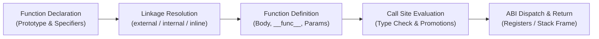

# Functions, Linkage & Conformance

In ISO C, a **function** is a self-contained unit of executable code that associates an identifier (and linkage) with a parameter list, a return type, and a compound statement body (ISO/IEC 9899:2024 §6.7.7.4, §6.9.2). Functions are the primary mechanism for modular abstraction, ABI boundaries, and optimization contracts across translation units.

C23 (**ISO/IEC 9899:2024**) introduces several landmark changes to function declarations and definitions — most notably the **removal of K&R non-prototype declarations and definitions** (`N2841` / `N2432`), **unnamed parameters in function definitions** (`N2480`), **variadic functions without a named parameter** (`N2975`), **deprecation of `_Noreturn`** in favor of `[[noreturn]]`, and **expanded freestanding library conformance**.



---

## Function Declarations & Prototypes

A function declaration introduces a function's name, return type, linkage, optional specifiers (`inline`, `static`, `extern`), optional attributes (`[[nodiscard]]`, `[[noreturn]]`, etc.), and its parameter list into the enclosing scope.

### Prototype Syntax

```c
/* General function declaration syntax (C23 §6.7.7.4) */
attr-spec-seq(opt) decl-specifiers declarator ;
```

A function declarator has the form `direct-declarator ( parameter-type-list(opt) ) attr-spec-seq(opt)`:

```c
int add(int a, int b);                                  /* named prototype parameters */
int multiply(int, int);                                 /* unnamed prototype parameters (C89+) */
void reset(void);                                       /* explicitly zero parameters (C89+) */
void reset_c23();                                       /* IDENTICAL to void reset_c23(void) in C23! */
int (*get_handler(int sig))(int);                       /* function returning pointer to function */
int (*alloc_row(size_t cols))[4];                       /* function returning pointer to int[4] */
```

!!! warning "Return Type Constraints"
    A function **cannot** return an array type or a function type directly (constraint violation, §6.7.7.4 ¶1). To return an array or callable behavior, return a **pointer to an array**, a **struct wrapping an array**, or a **function pointer**. The return type may be `void`, an arithmetic type, a pointer, a `struct`, or a `union`.

### Parameter Type Adjustments (Decay)

When declaring or defining a function, the compiler automatically adjusts certain parameter types (§6.7.7.4 ¶6–7):

| Written Parameter Type | Adjusted Actual Parameter Type | Notes |
| :--- | :--- | :--- |
| `T param[N]` | `T *param` | Array-to-pointer decay; `N` is ignored unless `static` is present |
| `T param[]` | `T *param` | Decays to `T *` |
| `T param[M][N]` | `T (*param)[N]` | Only the outermost dimension decays; inner bounds stay intact |
| `T param[qual N]` | `T * qual param` | Qualifiers inside `[...]` qualify the decayed pointer (<span class="c-badge c99">C99</span>) |
| `R param(Args...)` | `R (*param)(Args...)` | Function-to-function-pointer decay |
| `const int x` | `int` (for function type) | Top-level qualifiers on parameters do **not** affect function type compatibility |

Because top-level qualifiers on parameters do not affect the function's type, these two declarations declare the **exact same function** and are fully compatible:

```c
int clamp(int value, int low, int high);                /* header declaration */
int clamp(const int value, const int low, const int high) { /* definition */
    return value < low ? low : (value > high ? high : value);
}
```

### C23 Breaking Change: Removal of K&R Non-Prototypes <span class="c-badge c23">C23</span> <span class="c-badge c-removed">removed C23</span>

From C89 through C17, an empty parameter list `int f();` did **not** mean "takes zero arguments" — it declared an obsolete K&R *non-prototype* function taking an **unspecified number and types of parameters**, disabling compile-time argument count/type checking and forcing default argument promotions at every call site.

In **C23 (`N2841` & `N2432`)**, non-prototype function declarations and K&R identifier-list definitions are **completely removed from the language**:

- `int f();` is now **strictly identical** to `int f(void);` (a prototype taking zero parameters).
- `int (*fp)();` is now **strictly identical** to `int (*fp)(void);` (a pointer to a zero-parameter function).
- Calling `f(42)` after declaring `int f();` is now a **compile-time constraint violation** (hard error).
- K&R old-style definitions (`int add(a, b) int a; int b; { return a + b; }`) are **syntax errors**.

=== "C17 (and earlier)"

    ```c
    /* C17: Empty () means UNSPECIFIED parameters (NOT zero parameters!) */
    int legacy_fn();

    /* C17: Valid old-style K&R definition (obsolescent since C89) */
    int legacy_fn(a, b)
        int a;
        double b;
    {
        return a + (int)b;
    }

    void caller(void) {
        /* C17: Compiles without error! Wrong argument counts/types become UB. */
        legacy_fn(1, 2.5);
        legacy_fn(1, 2, 3, "oops"); /* UB at runtime, not even a constraint violation! */
    }
    ```

=== "C23 (ISO/IEC 9899:2024)"

    ```c
    /* C23: Empty () is STRICTLY identical to (void) — zero parameters! */
    int modern_fn();
    int modern_fn(void) { /* Compatible redeclaration & definition */
        return 42;
    }

    /* C23: K&R definition below is a HARD SYNTAX ERROR:
     *   int bad(a, b) int a; int b; { return a + b; }
     */

    void caller(void) {
        int x = modern_fn();   /* OK */
        /* modern_fn(1); */    /* Compile-time ERROR: too many arguments */
    }
    ```

!!! danger "C23 Function Pointer Migration Trap"
    Legacy codebases sometimes used `void (*generic_cb)();` as an untyped "any-signature function pointer" (similar to `void *` for objects). In **C23**, `void (*generic_cb)();` means `void (*generic_cb)(void);` — assigning `int (*)(int)` to it without an explicit cast is a **constraint violation**. Always declare exact callback signatures, or cast explicitly to a canonical function-pointer type like `void (*)(void)` and cast back to the exact original type before calling (§6.3.2.3 ¶8).

### Array Parameter Qualifiers & `static` Minimum Size <span class="c-badge c99">C99</span>

C99 introduced two powerful contracts inside the outermost `[...]` of an array parameter in a function declarator (§6.7.7.4 ¶7):

1. **Type qualifiers (`const`, `restrict`, `volatile`)**: Applied directly to the decayed pointer parameter itself.
2. **`static` minimum element count**: Promises the compiler that every caller passes a **non-null** pointer pointing to at least `N` contiguous, accessible elements of the array's element type.

```c
#include <stddef.h>

/* buf is `int * restrict const buf` AND guaranteed non-null with >= 16 ints */
int sum_block16(const int buf[static restrict const 16]);

/* Dynamic minimum bound using an earlier parameter (VLA parameter syntax) */
void mat_scale(size_t rows, size_t cols, double m[static restrict rows][cols], double factor);

/* Prototype with omitted VLA dimension names using [*] (C99+) */
void mat_scale(size_t, size_t, double [*][*], double);
```

| Syntax | Equivalent Pointer Type | Runtime Contract |
| :--- | :--- | :--- |
| `void f(int a[16])` | `int *a` | **None** — `a` may be `NULL` or point to fewer than 16 elements |
| `void f(int a[static 16])` | `int *a` | `a != NULL` and points to at least `16` valid `int` objects (else **UB**) |
| `void f(int a[restrict 16])` | `int * restrict a` | Pointer `a` is `restrict`-qualified (no aliasing); may still be `NULL` |
| `void f(int a[static restrict 16])` | `int * restrict a` | Non-null, `>= 16` valid elements, AND no aliasing with other parameters |
| `void f(int a[const])` | `int * const a` | The pointer variable `a` cannot be reassigned inside `f` |

!!! tip "Compiler Optimization & Diagnostics"
    Both GCC and Clang emit compile-time warnings (`-Wnonnull`, `-Warray-bounds`) when a caller passes `NULL` or an undersized fixed array to a `[static N]` parameter, and the optimizer can safely eliminate null checks and emit wider SIMD vector loads.

---

## Function Definitions

A function definition provides the executable body (a compound statement) for a function (§6.9.2). Every function with external linkage that is actually used (except pure `inline` definitions) must have **exactly one** external definition across the entire program.

### Parameter Scope, Pass-by-Value & Return Semantics

- **Scope**: Parameter identifiers declared in a function prototype have *function prototype scope* (ending at the closing `)`). In a function definition, parameter names have *block scope* covering the entire function body (in the same scope as the outermost block — redeclaring a parameter name directly inside the top-level `{ ... }` is a redefinition error!).
- **Pass-by-Value**: Every argument in C is passed strictly **by value** (a copy of the argument value initializes the parameter object). To mutate caller state, pass a pointer to the caller's object.
- **Falling Off a Non-`void` Function**: Reaching the closing `}` of a non-`void` function (other than `main()`) without executing `return expr;` is **Undefined Behavior if and only if the caller uses the return value** (§6.9.2 ¶12). In practice, always enable `-Wreturn-type` (or `-Werror=return-type`) to reject missing returns outright.

### Unnamed Parameters in Function Definitions <span class="c-badge c23">C23</span>

Before C23, parameter names could be omitted in *declarations* (prototypes), but every parameter in a *function definition* had to be named — forcing ugly `(void)param;` casts or compiler-specific attributes in callbacks and interface implementations.

**C23 (`N2480`)** allows omitting unused parameter names directly in function definitions, matching C++:

=== "C17 (Boilerplate Required)"

    ```c
    /* C17: Must name unused parameters, then silence -Wunused-parameter */
    void timer_callback(int event_id, void *user_ctx) {
        (void)event_id; /* Silences unused parameter warning */
        int *ticks = (int *)user_ctx;
        (*ticks)++;
    }
    ```

=== "C23 (Unnamed Parameters — N2480)"

    ```c
    /* C23: Simply omit the unused parameter's name! */
    void timer_callback(int, void *user_ctx) {
        int *ticks = (int *)user_ctx;
        (*ticks)++;
    }
    ```

!!! tip "Unnamed Parameters vs `[[maybe_unused]]`"
    - **Omit the parameter name** (`void cb(int, void *ctx)`) when the parameter is *unconditionally* unused across all build configurations.
    - Use **`[[maybe_unused]]`** (`void cb([[maybe_unused]] int flags, void *ctx)`) when the parameter is *conditionally* used (for example, inside `assert(flags != 0)` or `#ifdef DEBUG_LOGGING`). See [Attributes (C23)](attributes.md#maybe_unused).

### Predefined Identifier `__func__` <span class="c-badge c99">C99</span>

At the opening `{` of every function definition, the compiler implicitly declares the block-scope identifier `__func__` (§6.4.2.2):

```c
static const char __func__[] = "function-name";
```

Key properties of `__func__`:

- It is a **`static const char` array variable**, **not** a preprocessor macro. Therefore, `"Entering " __func__` is a **syntax error** — pass it as a `%s` argument to `printf` / `fprintf` instead.
- Its storage has static duration, so returning or logging `__func__` is safe (though you must never modify its characters).
- Prefer standard `__func__` over non-standard compiler extensions like `__FUNCTION__` or GCC's `__PRETTY_FUNCTION__`.

```c
#include <stdio.h>

static void log_enter(void) {
    printf("[%s] entered (sizeof = %zu bytes including NUL)\n",
           __func__, sizeof __func__);
}
```

---

## Function Specifiers

ISO C provides two function specifiers (§6.7.4): `inline` (<span class="c-badge c99">C99</span>) and `_Noreturn` (<span class="c-badge c11">C11</span> <span class="c-badge c-deprecated">deprecated C23</span>). Function specifiers may appear only in function declarations (never on variables or function-pointer objects).

### The `inline` Specifier & Linkage Rules <span class="c-badge c99">C99</span>

`inline` is a **hint** suggesting that calls to the function be as fast as possible (typically via inline substitution), but in ISO C it also defines a **precise linkage contract** across translation units that differs fundamentally from C++!

!!! danger "C `inline` Is NOT C++ `inline`!"
    In C++, an `inline` function in a header automatically gets weak/COMDAT external linkage so the linker merges duplicate copies. **ISO C does NOT do this.** A bare `inline int f(int x) { ... }` in a C header emits **no external symbol at all** — if the compiler decides not to inline a call (e.g., at `-O0` or when taking `&f`), the linker fails with `undefined reference to 'f'` unless **exactly one `.c` file** provides an external definition!

#### Master C99–C23 `inline` Linkage Matrix

| Declaration / Definition Pattern | Linkage | Emits External Symbol in This TU? | Required Companion in One `.c` File? | Idiomatic Use Case |
| :--- | :--- | :--- | :--- | :--- |
| **`static inline`** `int f(int x) { ... }` in `.h` | Internal | **No** (private copy per TU) | **No** | **Recommended default** for small header helpers (each TU gets its own private copy; `&f` differs across TUs) |
| **`inline`** `int f(int x) { ... }` in `.h` (no `extern` in TU) | External (*inline definition*) | **No** | **Yes** — must provide `extern inline int f(int);` (or non-`inline` def) in exactly ONE `.c` file | Header-inlinable public library API with a single canonical external symbol & unique `&f` address |
| **`extern inline`** `int f(int x) { ... }` in `.c` (or `extern int f(int);` after `.h` include) | External (*external definition*) | **Yes** | N/A (this **is** the one external definition) | Emits the single out-of-line callable symbol paired with a header's `inline` definition |
| Non-`inline` `int f(int x) { ... }` in `.c` | External | **Yes** | N/A | Standard compiled function (or out-of-line fallback paired with header `inline`) |

#### The Two Canonical Multi-File Header Patterns

=== "Pattern A: `static inline` (Simplest — Preferred for Internal/Small Helpers)"

    ```c
    /* math_helpers.h */
    #ifndef MATH_HELPERS_H
    #define MATH_HELPERS_H

    static inline int square_i(int x) {
        return x * x;
    }

    #endif
    ```

    No `.c` file is needed. Works cleanly at `-O0` and `-O3`. Only caveat: taking `&square_i` in two different `.c` files yields two different addresses, and each TU can contain its own non-inlined copy if optimization is off.

=== "Pattern B: `inline` in `.h` + `extern inline` in One `.c` (Canonical Public ABI)"

    ```c
    /* fast_hash.h — included by all callers AND by fast_hash.c */
    #ifndef FAST_HASH_H
    #define FAST_HASH_H

    #include <stdint.h>

    /* Inline definition: visible to callers for inlining, emits NO symbol on its own */
    inline uint32_t mix32(uint32_t x) {
        x ^= x >> 16;
        x *= UINT32_C(0x7feb352d);
        x ^= x >> 15;
        return x;
    }

    #endif
    ```

    ```c
    /* fast_hash.c — compiled ONCE and linked into the binary/library */
    #include "fast_hash.h"

    /* Redeclaration with `extern` forces emission of the single external definition! */
    extern inline uint32_t mix32(uint32_t x);
    ```

    Every TU that includes `fast_hash.h` can inline `mix32`, while `fast_hash.o` provides the **single canonical external symbol** for `-O0` builds, function pointers (`&mix32`), and FFI callers.

#### Constraints on External-Linkage `inline` Definitions (§6.7.4 ¶3)

An `inline` function with **external linkage** (i.e., declared `inline` without `static`, and without `extern` making it an external definition):

1. **Shall NOT** define a modifiable object with `static` or `thread_local` storage duration (a `static const` variable is permitted).
2. **Shall NOT** contain a reference to any identifier with **internal linkage** (such as a file-scope `static` variable or `static` helper function).

*Why?* Because the compiler is free to choose between calling the header's inline body or the external definition in another TU — referencing internal-linkage entities or mutable statics would produce mismatched addresses or inaccessible symbols across TUs. (`static inline` functions have internal linkage and are exempt from both restrictions.)

!!! note "Historical GNU89 `inline` Semantics"
    Older GCC versions in `-std=gnu89` mode inverted `inline` and `extern inline` relative to C99! Since GCC 5 (`-std=gnu11` / `-std=gnu17` / `-std=gnu23`), standard C99 semantics are the default (`__GNUC_STDC_INLINE__` is defined as `1`).

### The `_Noreturn` Specifier <span class="c-badge c11">C11</span> <span class="c-badge c-deprecated">deprecated C23</span>

Introduced in C11 (§6.7.4), `_Noreturn` declares that a function never returns control to its caller (instead terminating via `exit()`, `abort()`, `quick_exit()`, `_Exit()`, `thrd_exit()`, `longjmp()`, or an infinite loop). C11 also added the convenience header `<stdnoreturn.h>`, which defines `#define noreturn _Noreturn`.

- Returning from a `_Noreturn` function (via `return` or falling off the end) is **Undefined Behavior** (§6.7.4 ¶8).
- In **C23**, both the `_Noreturn` function specifier and the `<stdnoreturn.h>` header are **obsolescent/deprecated** in favor of the standard attribute **`[[noreturn]]`**. See [Attributes (C23)](attributes.md#noreturn).

=== "C11 / C17 (Deprecated in C23)"

    ```c
    #include <stdio.h>
    #include <stdlib.h>
    #include <stdnoreturn.h> /* obsolescent in C23 */

    _Noreturn void fatal_c11(const char *msg) {
        fprintf(stderr, "FATAL: %s\n", msg);
        abort();
    }
    ```

=== "C23 (Recommended)"

    ```c
    #include <stdio.h>
    #include <stdlib.h>

    [[noreturn]] void fatal_c23(const char *msg) {
        fprintf(stderr, "FATAL: %s\n", msg);
        abort();
    }
    ```

---

## Variadic Functions (`...`)

A variadic function accepts a variable number of arguments via an ellipsis `...` at the end of its parameter list, accessed at runtime using the macros in `<stdarg.h>` (`va_list`, `va_start`, `va_arg`, `va_copy`, `va_end`). See [Variadic Functions & Error Handling](../library/variadic-and-error.md) for the full `<stdarg.h>` library reference.

### Default Argument Promotions

Because variadic arguments have no prototype parameter types, every argument passed through `...` undergoes the **default argument promotions** (§6.5.2.2 ¶6–7):

| Passed Argument Type | Promoted Type Received by Callee | Safe `va_arg` Type |
| :--- | :--- | :--- |
| `bool`, `char`, `signed char`, `unsigned char`, `short`, `unsigned short`, small bit-fields | `int` (or `unsigned int` if `int` cannot represent all values) | `int` (or `unsigned int`) |
| `float` | `double` | `double` |
| `int`, `unsigned int`, `long`, `long long`, `double`, `long double`, pointers, `struct`/`union` | Unchanged | Exact type |
| `nullptr_t` (<span class="c-badge c23">C23</span>) | Converted to `void *` | `void *` (or character pointer) |

!!! danger "Promoted-Type Mismatch Is Undefined Behavior"
    Calling `va_arg(ap, float)`, `va_arg(ap, short)`, `va_arg(ap, char)`, or `va_arg(ap, bool)` is **always Undefined Behavior** because those types can never arrive unpromoted through `...`! Always extract `double` for `float`, and `int` for `bool`/`char`/`short`, then cast if needed.

### C89–C17 vs C23 (`N2975`): Zero Named Parameters <span class="c-badge c23">C23</span>

From C89 through C17, a variadic function was **required** to declare at least one named parameter before `, ...`, and `va_start(ap, last_named)` required passing that final named parameter's name (which also could not be `register`, an array, a function, or a type affected by default argument promotions).

**C23 (`N2975`)** lifts both restrictions:

1. A function may be declared with **only** `...` and zero named parameters: `int sum_until_zero(...)`.
2. `va_start(ap)` now takes **only one argument** (`ap`). For backward compatibility with C89–C17 code, a second argument (`va_start(ap, count)`) is still accepted syntactically, but in C23 **any arguments after `ap` are completely ignored and not evaluated**!

=== "C17 (Requires >= 1 Named Parameter)"

    ```c
    #include <stdarg.h>
    #include <stddef.h>

    int sum_n_c17(size_t count, ...) {
        va_list ap;
        va_start(ap, count); /* Second argument mandatory in C17 */
        int total = 0;
        for (size_t i = 0; i < count; ++i) {
            total += va_arg(ap, int);
        }
        va_end(ap);
        return total;
    }
    ```

=== "C23 (Zero Named Parameters — N2975)"

    ```c
    #include <stdarg.h>

    /* Valid in C23: zero named parameters! Sentinel 0 marks end of list. */
    int sum_until_zero(...) {
        va_list ap;
        va_start(ap); /* Single-argument va_start in C23! */
        int total = 0;
        for (;;) {
            int v = va_arg(ap, int);
            if (v == 0) {
                break;
            }
            total += v;
        }
        va_end(ap);
        return total;
    }
    ```

!!! info "Sentinel Pitfall with `NULL` vs `nullptr`"
    In sentinel-terminated variadic calls expecting `const char *` pointers (such as `execl` or a custom `join_strings(...)`), passing `0` or a `NULL` that expands to integer `0` can cause **Undefined Behavior** on 64-bit platforms where `sizeof(int) < sizeof(void *)`. In C23, pass `nullptr` (guaranteed to pass as a null `void *`) or explicitly cast `(const char *)NULL`.

---

## The `main()` Function

In a **hosted environment** (§5.1.2.2.1), program execution begins at the function named `main`, which has external linkage and no prototype predeclared by the implementation.

### Standard Signatures

A hosted implementation **must** accept both of the following forms (and typedef-equivalent spellings):

```c
int main(void) { /* ... */ }                  /* In C23, `int main()` is strictly identical */
int main(int argc, char *argv[]) { /* ... */ } /* Equivalent to `int main(int argc, char **argv)` */
```

Implementations may also accept implementation-defined third parameters (for example, POSIX `int main(int argc, char *argv[], char *envp[])`), though programs relying on them are conforming rather than *strictly conforming*.

### Guarantees on `argc` and `argv` (§5.1.2.2.1 ¶2)

- `argc` is always **non-negative** (`argc >= 0`).
- `argv[argc]` is guaranteed to be a **null pointer** (`NULL` / `nullptr`).
- If `argc > 0`, `argv[0]` through `argv[argc - 1]` point to NUL-terminated multibyte strings representing command-line parameters (`argv[0]` represents the program name, or `""` if the host environment does not supply one).
- Both the `argv` pointer array and the character strings pointed to by `argv[0]`..`argv[argc - 1]` are **modifiable** by the program, and their modifications persist until program termination.

### Special Rules for `main()`

| Rule | ISO C Behavior | Comparison with C++ |
| :--- | :--- | :--- |
| Implicit `return 0;` | Reaching the closing `}` of `main()` executes an implicit `return 0;` (<span class="c-badge c99">C99</span>) | Identical |
| Portable exit codes | `0` and `EXIT_SUCCESS` report success; `EXIT_FAILURE` (`<stdlib.h>`) reports failure | Identical |
| Recursive call / taking `&main` | **Allowed** in ISO C! `main()` is an ordinary function once entered | **Forbidden** (ill-formed in C++) |
| `inline` specifier | **Forbidden** (`main` shall not be declared `inline`, §6.7.4 ¶4) | Forbidden |
| `_Noreturn` / `[[noreturn]]` | **Not permitted** as a standard hosted entry signature (hosted `main` returns `int`) | Forbidden |
| Freestanding entry point | Name, parameter list, and return type are **implementation-defined** (e.g., `void _start(void)` or `void Reset_Handler(void)`) | Implementation-defined |

---

## Conformance & Execution Environments

ISO C Clause 4 (*Conformance*) and Clause 5.1.2 (*Execution environments*) formalize the contract between compilers, standard libraries, and C programs.

### Hosted vs. Freestanding Implementations

The predefined macro `__STDC_HOSTED__` (<span class="c-badge c99">C99</span>) expands to `1` in a **hosted** implementation (full OS/runtime + entire standard library + `main()`) and `0` in a **freestanding** implementation (OS kernels, bootloaders, firmware, bare-metal microcontrollers).

#### C23 Expanded Freestanding Requirements <span class="c-badge c23">C23</span>

Prior to C23, freestanding implementations only had to supply a tiny set of type/limit headers with almost no standard functions. **C23 (ISO/IEC 9899:2024 §4 ¶6–7)** significantly expands mandatory freestanding library support:

| Category | Standard Headers / Facilities Required in Freestanding Mode | Standard Notes |
| :--- | :--- | :--- |
| **Mandatory full headers (C89–C17)** | `<float.h>`, `<iso646.h>` (<span class="c-badge c95">C95</span>), `<limits.h>`, `<stdalign.h>` (<span class="c-badge c11">C11</span>), `<stdarg.h>`, `<stdbool.h>` (<span class="c-badge c99">C99</span>), `<stddef.h>`, `<stdint.h>` (<span class="c-badge c99">C99</span>), `<stdnoreturn.h>` (<span class="c-badge c11">C11</span>) | `<stdalign.h>`, `<stdbool.h>`, `<stdnoreturn.h>` are obsolescent in C23 |
| **New mandatory full headers (C23)** | `<stdbit.h>` (bit/endian utilities), `<stdckdint.h>` (checked overflow arithmetic) | Fully freestanding in <span class="c-badge c23">C23</span> |
| **Partially freestanding `<string.h>` (C23)** | All `<string.h>` functions (`memcpy`, `memmove`, `memset`, `memset_explicit`, `memcmp`, `memchr`, `memccpy`, `strcpy`, `strncpy`, `strcat`, `strncat`, `strcmp`, `strncmp`, `strchr`, `strrchr`, `strspn`, `strcspn`, `strpbrk`, `strstr`, `strlen`, plus `size_t`, `NULL`) **except** the 6 excluded functions: `strcoll`, `strdup`, `strerror`, `strndup`, `strtok`, `strxfrm` | Excludes locale/heap/global-state functions |
| **Partially freestanding `<stdlib.h>` (C23)** | `memalignment` (`size_t memalignment(const void *p);`) | Runtime pointer alignment query |

### Program & Implementation Conformance Classes (§4)

| Classification | Definition |
| :--- | :--- |
| **Strictly conforming program** | Uses **only** features specified in the ISO C standard; produces **no** output dependent on unspecified, undefined, or implementation-defined behavior; and does **not** exceed any minimum translation limit (§5.2.4.1). |
| **Conforming program** | Any program acceptable to a conforming implementation (may use POSIX APIs, compiler extensions like `__asm__`, or rely on implementation-defined properties such as `sizeof(int) == 4`). |
| **Conforming hosted implementation** | Accepts any strictly conforming program and supplies the entire ISO C standard library. |
| **Conforming freestanding implementation** | Accepts any strictly conforming program whose library usage is confined to the mandatory freestanding headers and facilities listed above. |

!!! note "Diagnostics Requirement (§5.1.1.3)"
    A conforming implementation must produce **at least one diagnostic message** (warning or error) if a translation unit violates any syntax rule or constraint, or contains a `#error` directive. To enforce strict ISO diagnostics on GCC/Clang, compile with `-std=c23 -pedantic-errors -Wall -Wextra`.

---

## Inline Assembly (`asm` / GNU Extended `__asm__`)

Inline assembly is **not** a core ISO C keyword; it is listed in **Annex J.5.10** as a *common extension*. Because strict `-std=c23` disables the unprefixed GNU `asm` keyword (so user code can legally name a variable `asm`), portable GNU/Clang C code always spells it **`__asm__`**!

### Basic vs. GNU Extended Inline Assembly

- **Basic assembly**: `__asm__("nop");` — takes only an instruction string literal; has no C operand interface and cannot safely communicate register/memory changes to the optimizer.
- **Extended assembly**:

```c
__asm__ volatile (
    "assembler template"
    : output operands       /* optional: "=r"(var), "+m"(mem) */
    : input operands        /* optional: "r"(in), "i"(42) */
    : clobbered registers   /* optional: "cc", "memory" */
);
```

### Key Operand Constraints & Safety Rules

| Constraint / Qualifier | Meaning |
| :--- | :--- |
| `volatile` (after `__asm__`) | Prevents the compiler from deleting, hoisting, or merging the assembly block (mandatory for side-effecting instructions or timing barriers) |
| `"=r"(x)` | Write-only output stored in a general-purpose register |
| `"+r"(x)` | Read-write operand in a general-purpose register |
| `"=&r"(x)` | Early-clobber output (written before all input operands are consumed — prevents register overlap bugs) |
| `"m"(x)` | Memory operand at the address of `x` |
| `"memory"` clobber | Compiler memory barrier: forces all cached memory values to be flushed before and reloaded after the `asm` block |

```c
#include <stdint.h>

/* Portable compiler-only optimization barrier (prevents reordering / dead-store elimination) */
static inline void compiler_barrier(void) {
#if defined(__GNUC__) || defined(__clang__)
    __asm__ volatile("" ::: "memory");
#endif
}

/* Architecture-specific hardware cycle/timer read with clean portability boundary */
static inline uint64_t read_hw_counter(void) {
#if defined(__x86_64__) && (defined(__GNUC__) || defined(__clang__))
    uint32_t lo = 0, hi = 0;
    __asm__ volatile("rdtsc" : "=a"(lo), "=d"(hi));
    return ((uint64_t)hi << 32) | lo;
#elif defined(__aarch64__) && (defined(__GNUC__) || defined(__clang__))
    uint64_t cnt = 0;
    __asm__ volatile("mrs %0, cntvct_el0" : "=r"(cnt));
    return cnt;
#else
    return 0; /* Portable fallback for unsupported targets */
#endif
}
```

!!! tip "Prefer Standard C11/C23 Facilities Over Inline Assembly"
    Before reaching for `__asm__`, verify whether standard C already compiles to the exact hardware instruction you want:
    - Atomic operations & memory fences → `<stdatomic.h>` (<span class="c-badge c11">C11</span>)
    - Leading/trailing zeros, popcount, bit-ceil, endianness → `<stdbit.h>` (<span class="c-badge c23">C23</span>)
    - Overflow-detecting add/sub/mul (`addc`/`jo`) → `<stdckdint.h>` (<span class="c-badge c23">C23</span>)
    - Deep dive on MMIO, `volatile`, and inline assembly: [15 · Embedded MMIO, volatile & Inline Asm](../../curriculum/tier-4-hardware/15-embedded-mmio-volatile-asm.md).

---

## Analyzability (Annex L) <span class="c-badge c11">C11</span> <span class="c-badge c-optional">optional</span>

**Annex L (*Analyzability*)**, introduced in C11 and retained in C23, is an optional specification aimed at security-critical and safety-critical systems. An implementation that conforms to Annex L predefines the macro **`__STDC_ANALYZABLE__`** to **`1`**.

Annex L partitions all Undefined Behavior in ISO C into two strict severity tiers:

| UB Tier | Formal Guarantee under Annex L (`__STDC_ANALYZABLE__ == 1`) | Representative Examples |
| :--- | :--- | :--- |
| **Bounded Undefined Behavior** | **Cannot** perform an out-of-bounds store (memory corruption). The implementation must either trap, produce an indeterminate value, or continue deterministically without corrupting unrelated objects. | Signed integer overflow; integer division/modulo by zero; shifting by a negative count or `>= width`; reading an uninitialized automatic variable (if non-trap); floating-to-integer conversion overflow. |
| **Critical Undefined Behavior** | **May** perform arbitrary out-of-bounds stores or corrupt program control flow (explicitly listed in Annex L.2.2). | Out-of-bounds array/pointer store; dereferencing `NULL` or a dangling/freed pointer; `free()` on an invalid pointer; violating `restrict` aliasing; calling a function through an incompatible function-pointer type; overflowing `va_arg` or passing mismatched `printf`/`scanf` arguments. |

!!! info "Real-World Compiler Status"
    Very few mainstream compilers formally define `__STDC_ANALYZABLE__ == 1` (GCC, Clang, and MSVC do not define it by default). In production systems engineering, the practical equivalents of Annex L guarantees are achieved by combining **UndefinedBehaviorSanitizer** (`-fsanitize=undefined`), **AddressSanitizer** (`-fsanitize=address`), **C23 checked arithmetic** (`<stdckdint.h>`), hardened flags (`-fwrapv`, `-ftrivial-auto-var-init=zero`), and static analysis.

---

## Complete Compilable C23 Examples

### Example 1: Modern C23 Function Features

This complete, warning-free C23 program exercises strict zero-parameter prototypes (`N2841`), unnamed parameters (`N2480`), `static restrict` array parameter contracts, `__func__`, C23 zero-named-parameter variadic functions (`N2975`), and `[[noreturn]]`.

```c
/* Compile: gcc -std=c23 -Wall -Wextra -Wpedantic functions_demo.c -o functions_demo
 *      or: clang -std=c23 -Wall -Wextra -Wpedantic functions_demo.c -o functions_demo
 */
#include <stdarg.h>
#include <stddef.h>
#include <stdio.h>
#include <stdlib.h>

/* C23: Empty () is strictly identical to (void) */
static void print_banner();

/* C99: static restrict promises non-null, >= 4 elements, no aliasing */
static int dot_product4(const int a[static restrict 4],
                        const int b[static restrict 4]) {
    int sum = 0;
    for (size_t i = 0; i < 4; ++i) {
        sum += a[i] * b[i];
    }
    return sum;
}

/* C23 (N2480): Unnamed parameter in function definition */
static void on_telemetry(int, const char *label, double reading) {
    printf("[%s] sensor=%s value=%.2f\n", __func__, label, reading);
}

/* C23 (N2975): Variadic function with zero named parameters + 1-arg va_start */
static long sum_until_sentinel(...) {
    va_list ap;
    va_start(ap);
    long total = 0;
    for (;;) {
        int val = va_arg(ap, int);
        if (val == 0) {
            break;
        }
        total += val;
    }
    va_end(ap);
    return total;
}

/* C23: [[noreturn]] replaces deprecated _Noreturn */
[[noreturn]] static void die(const char *reason) {
    fprintf(stderr, "[%s] fatal error: %s\n", __func__, reason);
    exit(EXIT_FAILURE);
}

static void print_banner(void) {
    printf("=== %s (C standard: %ldL, hosted: %d) ===\n",
           __func__, __STDC_VERSION__, __STDC_HOSTED__);
}

int main(void) {
    print_banner();

    const int u[4] = { 1, 2, 3, 4 };
    const int v[4] = { 10, 20, 30, 40 };
    printf("dot_product4 = %d\n", dot_product4(u, v));

    on_telemetry(99, "core_temp_c", 47.25);

    long total = sum_until_sentinel(5, 15, 25, 55, 0);
    printf("sum_until_sentinel = %ld\n", total);

    if (total != 100) {
        die("unexpected variadic sum");
    }
    return EXIT_SUCCESS;
}
```

### Example 2: Multi-TU `inline` & `extern inline` Architecture

A clean two-file build illustrating how a header's `inline` definition pairs with exactly one `extern inline` redeclaration so both inlining and taking `&fn` work cleanly at any optimization level (`-O0` through `-O3`).

=== "`ring_math.h`"

    ```c
    #ifndef RING_MATH_H
    #define RING_MATH_H

    #include <stddef.h>

    /* External-linkage inline definition: callers may inline, no symbol emitted here */
    inline size_t ring_next(size_t idx, size_t capacity) {
        return (idx + 1U == capacity) ? 0U : (idx + 1U);
    }

    /* Internal-linkage static inline helper: private copy per TU, no .c needed */
    static inline size_t ring_distance(size_t head, size_t tail, size_t cap) {
        return (head >= tail) ? (head - tail) : (cap - tail + head);
    }

    #endif
    ```

=== "`ring_math.c`"

    ```c
    #include "ring_math.h"

    /* Emits the single external definition symbol `ring_next` for the entire program */
    extern inline size_t ring_next(size_t idx, size_t capacity);
    ```

=== "`main.c`"

    ```c
    /* Compile: clang -std=c23 -O0 -Wall -Wextra ring_math.c main.c -o ring_demo */
    #include "ring_math.h"
    #include <stdio.h>

    int main(void) {
        /* Taking &ring_next requires the external symbol emitted by ring_math.c */
        size_t (*step_fn)(size_t, size_t) = &ring_next;

        size_t idx = 3;
        idx = step_fn(idx, 4);
        printf("next=%zu, dist=%zu\n", idx, ring_distance(1, 3, 4));
        return 0;
    }
    ```

---

## See Also

- [Statements & Control Flow](statements.md) — `return`, block scopes, and statement grammar
- [Attributes (C23)](attributes.md) — `[[noreturn]]`, `[[nodiscard]]`, `[[reproducible]]`, and `[[unsequenced]]`
- [Declarations, Types & `typeof`](declarations.md) — storage classes, linkage, and declarators
- [Variadic Functions & Error Handling](../library/variadic-and-error.md) — complete `<stdarg.h>` reference
- [01 · Functions, ABI & Stack Frames](../../curriculum/tier-1-core/01-functions-abi-stack.md) — calling conventions and stack layout
- [15 · Embedded MMIO, volatile & Inline Asm](../../curriculum/tier-4-hardware/15-embedded-mmio-volatile-asm.md) — bare-metal and extended inline assembly deep dive
- [C23 Migration & Breaking Changes](../../standards/c23-migration.md) — full K&R removal & C17→C23 upgrade checklist

### Authoritative References

- ISO/IEC 9899:2024 (C23): §4 (*Conformance*), §5.1.2 (*Execution environments*), §6.7.4 (*Function specifiers*), §6.7.7.4 (*Function declarators*), §6.9.2 (*Function definitions*), Annex J.5.10 (*`asm`*), Annex L (*Analyzability*).
- [cppreference.com — C Functions](https://en.cppreference.com/w/c/language/functions)
- [cppreference.com — C `main` Function](https://en.cppreference.com/w/c/language/main_function)
- [cppreference.com — C `inline` Function Specifier](https://en.cppreference.com/w/c/language/inline)
- [cppreference.com — C Variadic Arguments](https://en.cppreference.com/w/c/language/variadic)
- [cppreference.com — C Conformance](https://en.cppreference.com/w/c/language/conformance)
