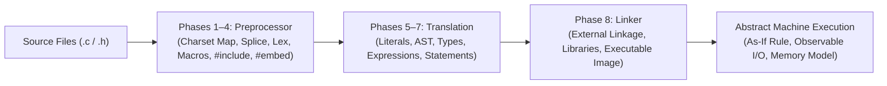

# C Language Reference

Welcome to the complete **ISO C Language Reference**, covering every syntactic construct, semantic rule, translation phase, keyword, preprocessor directive, expression, declaration, statement, and attribute from **C89/C90 (ANSI X3.159-1989)** through **C23 (ISO/IEC 9899:2024)**, along with select **C2y** working-draft notes.

This reference mirrors the structure and rigor of [en.cppreference.com/c/language](https://en.cppreference.com/c/language), organized for rapid lookup by systems programmers, compiler engineers, embedded developers, and learners transitioning from C11/C17 to modern C23.

---

## C Compilation & Semantic Model

Every C program is transformed from source text into executable behavior through an eight-phase translation pipeline defined by ISO/IEC 9899 §5.1.1.2, and then executed according to the rules of the **C Abstract Machine**.

- **Phases 1–4** operate purely on source characters and preprocessing tokens—before types, scopes, or statements exist. See [Basic Concepts: Translation Phases](basic-concepts.md#translation-phases) and [Preprocessor](preprocessor.md).
- **Phases 5–7** resolve declarations, scopes, name spaces, types, constant expressions, attributes, and control flow into a single translation unit. See [Declarations](declarations.md), [Expressions](expressions.md), and [Statements](statements.md).
- **Phase 8** links multiple translation units and standard/platform libraries by matching external linkage symbols. See [Functions & Linkage](functions.md).
- **Abstract Machine Execution** permits aggressive compiler optimization under the *as-if* rule, bounded strictly by observable behavior and the C11/C23 concurrency memory model. See [Basic Concepts: As-If Rule & Memory Model](basic-concepts.md#the-as-if-rule-and-observable-behavior).

---

## Core Language Subsections

Use the categorized portal tables below to jump directly to any topic in the C language specification.

### 1. Foundations, Lexical Structure & Preprocessor

| Reference Page | Topics Covered | Key C23 Highlights |
| :--- | :--- | :--- |
| [**Basic Concepts & Memory Model**](basic-concepts.md) | Comments, ASCII chart, character sets, 8 translation phases, punctuators & digraphs, identifiers & reserved names, scope & 4 name spaces, storage duration & lifetime, type system & strict aliasing, arithmetic types, alignment, `main()`, as-if rule, undefined behavior, memory model & data races | Two's complement mandated, `_BitInt(N)`, `_Decimal32/64/128`, UAX #31 Unicode identifiers, trigraphs removed, tag compatibility across redefinitions, `memset_explicit` |
| [**Keywords (C89–C23)**](keywords.md) | Master table of all 59 C23 keywords (45 primary + 14 `_`-prefixed), C23 keyword promotions, context-sensitive preprocessor/attribute tokens, non-standard extension keywords (`asm`, `fortran`, `__attribute__`), `<iso646.h>` alternative operator macros | `bool`, `true`, `false`, `alignas`, `alignof`, `static_assert`, `thread_local`, `constexpr`, `nullptr`, `typeof`, `typeof_unqual`, `_BitInt`, `_Decimal*`; `_Noreturn` deprecated |
| [**Preprocessor & `#embed`**](preprocessor.md) | Phase 4 preprocessing tokens, `#if`/`#ifdef`/`#elif`/`#elifdef`/`#elifndef`, `#define`/`#undef`, `#` stringification, `##` pasting, variadic macros & `__VA_OPT__`, `#include` & `__has_include`, `#embed` & `__has_embed`, `#error`/`#warning`/`#line`, `#pragma` & `_Pragma`, standard `STDC` pragmas, predefined macros | `#embed`, `__has_embed`, `__VA_OPT__`, `#elifdef`, `#elifndef`, `#warning`, `__has_include`, `__has_c_attribute`, `__STDC_VERSION__ == 202311L`, `FENV_ROUND` |

### 2. Expressions, Types & Initialization

| Reference Page | Topics Covered | Key C23 Highlights |
| :--- | :--- | :--- |
| [**Expressions, Operators & `_Generic`**](expressions.md) | Value categories (lvalues, non-lvalues, function designators), evaluation order & sequencing, integer/floating/character/string/boolean/compound literals, operator precedence & associativity, usual arithmetic conversions, implicit conversions, casts, `sizeof`, `alignof`, `_Generic` type-generic selection, constant expressions | `nullptr`, `true`/`false` of type `bool`, binary literals (`0b`/`0B`), digit separators (`1'000'000`), `wb`/`uwb` `_BitInt` suffixes, `u8'x'` char literals, storage-class compound literals |
| [**Declarations, Types & `typeof`**](declarations.md) | Declarator grammar (spiral/clockwise rule), pointers, arrays & VLAs, `struct`, `union`, bit-fields, `enum` (fixed underlying types), `typedef`, storage-class specifiers (`auto`, `constexpr`, `extern`, `register`, `static`, `thread_local`), type qualifiers (`const`, `volatile`, `restrict`, `_Atomic`), `alignas`, `static_assert` | `typeof` / `typeof_unqual`, `auto` type inference, `constexpr` objects, `enum E : uint16_t` fixed underlying types, `static_assert(cond)` without message, mandatory VM types |
| [**Initialization & Empty `{}`**](initialization.md) | Scalar, array, string, struct, and union initialization; implicit zero-initialization; designated initializers (`.member`, `[index]`); compound literals; aggregate initialization rules; static vs automatic initialization constraints | Universal empty initializer `= {}` (works for scalars, aggregates, and VLAs!), `constexpr` compound initializers |

### 3. Functions, Control Flow & Attributes

| Reference Page | Topics Covered | Key C23 Highlights |
| :--- | :--- | :--- |
| [**Functions & Linkage**](functions.md) | Function declarations & definitions, parameter passing, array-to-pointer parameter decay, `static` & `restrict` array parameters, variadic functions (`...`), `inline` linkage semantics, internal vs external vs no linkage, function pointers, recursion, `__func__` | K&R old-style definitions removed, `int f()` now means `int f(void)`, unnamed parameters in function definitions (`void f(int, int)`), variadic `va_start(ap)` without named parameter |
| [**Statements & Control Flow**](statements.md) | Expression statements, compound blocks, selection (`if`/`else`, `switch`/`case`/`default`), iteration (`while`, `do-while`, `for`), jumps (`break`, `continue`, `goto`, `return`), labels, null statements | Labels allowed directly before declarations and at the end of compound blocks (`{ done: }`) |
| [**Attributes (C23)**](attributes.md) | Standard `[[...]]` attribute syntax, appertainment rules (declarations, types, statements, labels, expressions), `__has_c_attribute`, vendor-prefixed attributes (`[[gnu::...]]`), all 8 standard C23 attributes | `[[deprecated]]`, `[[fallthrough]]`, `[[maybe_unused]]`, `[[nodiscard]]`, `[[noreturn]]`, `[[_Noreturn]]`, `[[reproducible]]`, `[[unsequenced]]` |

---

## Companion Reference & Standards Navigation

The C Language Reference integrates directly with the Standard Library Reference and ISO Standards documentation:

| Area | Page | Description |
| :--- | :--- | :--- |
| **Standard Library** | [**C Standard Library Portal**](../library/index.md) | Complete header-by-header reference for all 31 C23 headers (`<stdio.h>`, `<stdlib.h>`, `<stdbit.h>`, `<stdckdint.h>`, `<stdatomic.h>`, `<threads.h>`, etc.) |
| **Language History** | [**C Standards Overview (C89–C2y)**](../../standards/index.md) | Chronological evolution from K&R C and ANSI C89/ISO C90 through C95, C99, C11, C17, C23 (ISO/IEC 9899:2024), and C2y |
| **Migration Guide** | [**C23 Migration & Breaking Changes**](../../standards/c23-migration.md) | Step-by-step porting checklist from C11/C17 to C23, removed features, keyword collisions, and strict prototype enforcement |
| **Toolchains** | [**Compiler & Libc Support Matrix**](../../standards/compiler-support.md) | Feature-by-feature support table across GCC, Clang, MSVC, glibc, musl, Apple libc, and FreeBSD libc |
| **Extensions** | [**Technical Specifications (TS / TR)**](../../standards/technical-specifications.md) | ISO/IEC TS extensions (Dynamic Memory TR 24731-2, Floating-Point TS 18661, Provenance TS 6010, etc.) |
| **Index** | [**Master Symbol Index**](../../standards/symbol-index.md) | Alphabetical cross-reference of every standard keyword, macro, type, and library function |

---

## Headline Evolution: C89 to C23 & C2y Preview

| Revision | Official Standard | `__STDC_VERSION__` | Defining Language Milestones |
| :--- | :--- | :--- | :--- |
| C89 | ANSI X3.159-1989 / ISO/IEC 9899:1990 | *(not defined)* | Function prototypes, `void`/`void *`, `const`, `volatile`, `signed`, `enum`, standard 15 headers |
| C95 | ISO/IEC 9899/AMD1:1995 | `199409L` | Digraphs (`<:`, `%>`, `%:`), `<iso646.h>`, `<wchar.h>`, `<wctype.h>` |
| C99 | ISO/IEC 9899:1999 | `199901L` | `//` comments, mixed declarations & code, `long long`, `_Bool`, `_Complex`, `inline`, `restrict`, VLAs, flexible array members, designated initializers, compound literals, variadic macros, `_Pragma`, `<stdint.h>` |
| C11 | ISO/IEC 9899:2011 | `201112L` | Memory model, `_Atomic`, `<threads.h>`, `_Generic`, `_Static_assert`, `_Alignas`/`_Alignof`, `_Noreturn`, anonymous structs/unions, `u8`/`u`/`U` string literals, `gets()` removed |
| C17 | ISO/IEC 9899:2018 | `201710L` | Defect-report consolidation over C11; no new language syntax; `ATOMIC_VAR_INIT` deprecated |
| C23 | ISO/IEC 9899:2024 | `202311L` | `nullptr`, `constexpr`, `typeof`/`typeof_unqual`, `auto` inference, `= {}`, `[[attributes]]`, `#embed`, `__VA_OPT__`, `_BitInt(N)`, `_Decimal32/64/128`, fixed-type `enum`, two's complement required, `bool`/`true`/`false`/`alignas`/`alignof`/`static_assert`/`thread_local` keywords, K&R definitions & trigraphs removed |
| C2y | ISO/IEC 9899:202y *(draft)* | *TBD* | Active WG14 proposals: `_Countof` / `<stdcountof.h>`, `defer` scoped cleanup, named loops (`break label;`), `if` declarations (`if (int x = f(); x > 0)`), octal literals `0o`, `#embed` enhancements |

!!! info "About C2y Draft Notes"
    Features tagged C2y reflect active WG14 working-draft papers (e.g., N3301 and subsequent drafts) targeting the post-C23 revision. Their exact syntax and availability may still evolve before publication and should not be assumed portable across production compilers without feature-test guards.

---

## Standard Revision Badges Legend

Throughout this reference, inline badges identify when each language feature was introduced, deprecated, removed, or made optional:

| Badge | Meaning |
| :--- | :--- |
| C89 | Present since ANSI C89 / ISO C90 (baseline language) |
| C95 | Added in ISO C95 (Amendment 1 to C90) |
| C99 | Added in ISO/IEC 9899:1999 |
| C11 | Added in ISO/IEC 9899:2011 |
| C17 | Clarified or changed in ISO/IEC 9899:2018 (C17/C18) |
| C23 | Added or updated in ISO/IEC 9899:2024 |
| C2y | Working-draft proposal for the post-C23 revision |
| deprecated C23 | Obsolescent or deprecated in C23; avoid in new code |
| removed C23 | Removed from the C23 standard; ill-formed in C23 mode |
| optional | Optional implementation feature (guarded by feature-test macros) |

---

## Authoritative External References

- **cppreference C Language Reference**: [https://en.cppreference.com/c/language](https://en.cppreference.com/c/language)
- **ISO/IEC 9899:2024 (C23 Final Working Draft N3220)**: [https://www.open-std.org/jtc1/sc22/wg14/www/docs/n3220.pdf](https://www.open-std.org/jtc1/sc22/wg14/www/docs/n3220.pdf)
- **WG14 Document Log (C2y Papers)**: [https://www.open-std.org/jtc1/sc22/wg14/www/wg14_document_log.htm](https://www.open-std.org/jtc1/sc22/wg14/www/wg14_document_log.htm)
