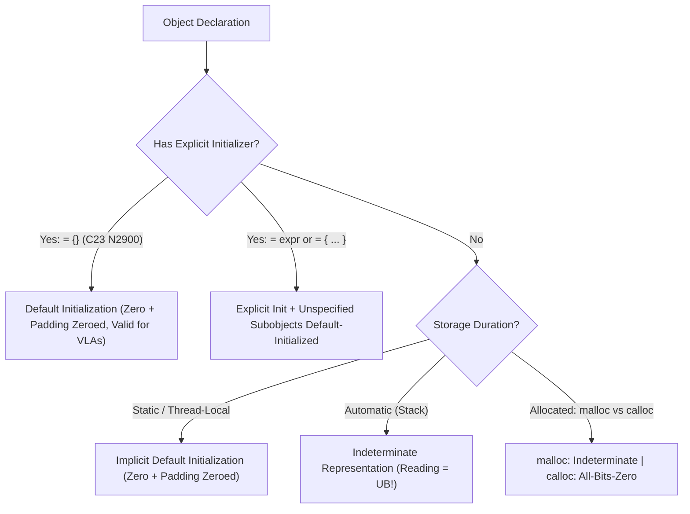

# Initialization & Empty `{}`

**Initialization** (ISO/IEC 9899:2024 §6.7.11) establishes the initial value stored in an object when it is created. C separates objects with **static or thread storage duration** (which are implicitly zero-initialized if no initializer is provided) from objects with **automatic storage duration** (which hold indeterminate representations unless explicitly initialized).



---

## 1. Initialization Overview: Explicit vs Implicit

### Initialization Behavior by Storage Duration

| Storage Duration / Allocation | No Initializer | `= { 0 }` | `= {}` <span class="c-badge c23">C23</span> | Constant-Expression Required? |
| :--- | :--- | :--- | :--- | :--- |
| **Static** (file scope or `static` local) | **Default-initialized** (all scalars zero/null; all padding bits zero) | Valid | **Valid** (default-initialized + zeroed padding) | **Yes** (constant expr / address constant) |
| **Thread-local** (`thread_local`) | **Default-initialized** (per thread) | Valid | **Valid** (default-initialized + zeroed padding) | **Yes** |
| **Automatic** (non-`static` local) | **Indeterminate representation** (reading may be **UB**!) | First subobject `0`, rest default-initialized *(padding between initialized fields unspecified)* | **Valid** (all subobjects zero/null + **all padding bits zeroed!**) | No (runtime expressions allowed, except `constexpr`) |
| **Automatic VLA** (`int a[n]`) | Indeterminate representation | **Constraint Violation** | **Valid!** (`int a[n] = {};` zero-initializes at runtime) | N/A |
| **Allocated (`malloc` / `aligned_alloc`)** | Indeterminate bytes | N/A | N/A (use `calloc` for all-bits-zero, or assign `(T){}`) | N/A |

!!! danger "Reading an Uninitialized Automatic Variable Is Undefined Behavior"
    An automatic object declared without an initializer (`int x;`) has an **indeterminate representation** (either an unspecified value or a non-value/trap representation). Under ISO C §6.3.2.1p2, if the object could have been declared with `register` (i.e., its address is never taken), **merely reading `x` via lvalue conversion is Undefined Behavior** — even on two's-complement machines without integer trap representations! Always initialize automatic variables upon declaration.

### General Constraints (ISO C23 §6.7.11)

- No initializer may attempt to provide a value for an object not contained within the entity being initialized (excess elements are a **constraint violation**).
- The entity being initialized must be a **complete object type**, or an **array of unknown size** whose size is determined by the initializer (except for C23 empty `{}` on an array of unknown size, which is a constraint violation because zero-sized arrays do not exist in ISO C).
- All initializers for objects with **static** or **thread** storage duration (and `constexpr` objects) must be **constant expressions** (or string literals for character arrays).
- Trailing commas inside brace-enclosed initializer lists (`{ 1, 2, 3, }`) are permitted since <span class="c-badge c99">C99</span>.

---

## 2. C23 Universal Empty Initializer `= {}` (N2900) <span class="c-badge c23">C23</span>

Prior to C23, `{}` was a syntax error in ISO C (permitted only as a non-standard GCC/Clang extension). Programmers relied on `= { 0 }`, which suffered from subtle flaws:

- Compilers with `-Wmissing-braces` warned when `{ 0 }` initialized nested structs or multi-dimensional arrays (demanding `{{{ 0 }}}`).
- If a struct's first member was itself a struct, union, or non-scalar (or later refactored into one), `{ 0 }` could trigger warnings or type mismatches.
- `{ 0 }` could **not** initialize Variable-Length Arrays.
- Standard wording left **padding bytes** between explicitly initialized fields unspecified on automatic structs.

**C23 (WG14 N2900)** standardizes the **empty initializer `= {}`** across **every complete object type** (scalars, structs, unions, fixed arrays, and **VLAs**), formally defining **default initialization** (ISO C23 §6.7.11p11):

### Default Initialization Rules (ISO C23 §6.7.11p11)

When an object is **default-initialized** (either via `= {}` or implicitly via static/thread storage duration):

| Object Type | Exact Default-Initialized Value | Padding / Inactive Bytes |
| :--- | :--- | :--- |
| **Pointer type** or **`nullptr_t`** | Null pointer value | N/A |
| **Binary arithmetic / `bool` / `enum` / `_BitInt`** | Positive or unsigned zero (`0`, `0.0`, `false`) | N/A (any padding bits zeroed) |
| **Decimal floating type** (`_Decimal32`/`64`/`128`) | Positive zero with quantum exponent `0` | N/A |
| **Aggregate (`struct` or array)** | Every member/element recursively default-initialized | **All padding bytes/bits explicitly initialized to zero bits!** |
| **Union (`union`)** | **First named member** recursively default-initialized | **All padding bytes/bits (including trailing/inactive bytes of larger members!) explicitly initialized to zero bits!** |

### Initializing Variable-Length Arrays with `= {}` <span class="c-badge c23">C23</span>

In C99–C17, **no** initializer of any kind was allowed on a Variable-Length Array. In C23, an **empty initializer `= {}`** is valid on VLAs (while non-empty initializers like `int vla[n] = { 1 };` remain a constraint violation):

```c
void process_samples(size_t n) {
    if (n == 0 || n > 1024) return;
    double scratch[n] = {}; // Valid in C23! Zero-initializes all n elements at runtime.
    (void)scratch;
}
```

### Security & Binary Comparison Impact: Padding Bytes

In systems programming (cryptography, kernel `copy_to_user`, network framing, hash-table keys), uninitialized struct padding bytes cause **stack memory information leaks** and break `memcmp` equality checks.

=== "C23 (`= {}` Zeroes Padding Guaranteed)"

    ```c
    #include <stdint.h>
    #include <string.h>

    struct NetKey {
        uint8_t  proto;   // offset 0
        // 3 bytes of alignment padding at offsets 1..3
        uint32_t ipv4;    // offset 4
    };

    // Guarantees BOTH members AND the 3 padding bytes are zeroed!
    struct NetKey k1 = {};
    struct NetKey k2 = {};
    // memcmp(&k1, &k2, sizeof k1) == 0 is 100% deterministic!
    ```

=== "C17 (Must Use `memset` for Padding Guarantee)"

    ```c
    #include <stdint.h>
    #include <string.h>

    struct NetKey {
        uint8_t  proto;
        uint32_t ipv4;
    };

    // In C17, '= { 0 }' did not universally guarantee padding bytes were zeroed
    // across all interpretations and compilers; memset was required for memcmp/wire safety:
    struct NetKey k1;
    memset(&k1, 0, sizeof k1);
    ```

!!! warning "Subsequent Member Stores Can Re-Dirty Padding Bytes!"
    Under ISO C §6.2.6.1p6, *"when a value is stored in an object of structure or union type, including in a member object, the bytes of the object representation that correspond to any padding bytes take **unspecified values**."* Therefore, while `struct NetKey k = {};` starts with zeroed padding, modifying `k.proto = 6;` afterward allows an optimizer to overwrite padding bytes! For deterministic hashing/serialization, serialize individual fields explicitly or zero via `memset` before `memcpy`-copying fields.

---

## 3. Scalar Initialization

A scalar object (integer, floating-point, enum, `bool`, pointer, or `nullptr_t`) may be initialized in three ways (§6.7.11p12):

1. **Single expression**: `int a = 42;`
2. **Optionally brace-enclosed single expression**: `int b = { 42 };` (single pair of braces only; `int c = {{ 42 }};` is a constraint violation!)
3. **Empty initializer** <span class="c-badge c23">C23</span>: `int d = {};` (initializes to `0`; pointers initialize to null pointer).

The initializer expression is implicitly converted **as if by simple assignment** (e.g., `void *` converts implicitly to any object pointer type, `nullptr` converts to any pointer or `bool`, floating values truncate toward zero for integers).

```c
int         n = 10;
double      x = { 2.71828 }; // Single brace pair allowed on scalars
const char *s = nullptr;     // C23 null pointer constant
void       *p = {};          // C23 empty initializer -> null pointer
bool        f = {};          // C23 empty initializer -> false
```

---

## 4. Array Initialization

Arrays of known size or unknown size (`T a[]`) are initialized from a brace-enclosed initializer list (or, for character arrays, a string literal).

### 4.1 Size Deduction, Partial Zero-Fill & Multi-Dimensional Arrays

```c
int a[] = { 1, 2, 3 };       // Size deduced as 3 -> int[3]
int b[5] = { 1, 2 };         // Partial init -> { 1, 2, 0, 0, 0 }
int c[5] = {};               // C23 -> { 0, 0, 0, 0, 0 }
// int bad[] = {};           // ERROR: cannot deduce size 0 (zero-size arrays forbidden in ISO C!)
// int over[2] = { 1, 2, 3 };// ERROR: excess elements in array initializer

// Multi-dimensional arrays: nested braces (preferred) vs brace elision (valid)
int m1[2][3] = { { 1, 2, 3 }, { 4, 5, 6 } };
int m2[2][3] = { 1, 2, 3, 4 }; // Brace elision -> { { 1, 2, 3 }, { 4, 0, 0 } }
```

### 4.2 String Literal Initialization & The Exact-Fit Trap

Character arrays may be initialized directly from a string literal (optionally enclosed in braces: `char s[] = { "hi" };`):

| Array Element Type | Compatible String Literals | Standard |
| :--- | :--- | :--- |
| `char`, `signed char`, `unsigned char` | Ordinary `"abc"` and UTF-8 `u8"abc"` | <span class="c-badge c89">C89</span> <span class="c-badge c11">C11</span> <span class="c-badge c23">C23</span> |
| `wchar_t` | Wide `L"abc"` | <span class="c-badge c89">C89</span> |
| `char16_t` | UTF-16 `u"abc"` | <span class="c-badge c11">C11</span> |
| `char32_t` | UTF-32 `U"abc"` | <span class="c-badge c11">C11</span> |

*(In C23, even though `u8"abc"` has type `unsigned char[4]`, ISO C23 §6.7.11p15 explicitly permits initializing `char[]`, `signed char[]`, or `unsigned char[]` from either `"abc"` or `u8"abc"` for full backward compatibility.)*

!!! danger "The Exact-Fit Non-Null-Terminated String Trap (C vs C++)"
    ```c
    char ok[]  = "abc"; // char[4]: { 'a', 'b', 'c', '\0' } -> Safe C string!
    char pad[6] = "abc";// char[6]: { 'a', 'b', 'c', '\0', '\0', '\0' } -> Zero-padded!
    char raw[3] = "abc";// VALID IN C (ERROR in C++!): { 'a', 'b', 'c' } — NO '\0' TERMINATOR!
    ```
    In C, `char raw[3] = "abc";` is **legal** and silently drops the trailing `'\0'`! Passing `raw` to `strlen`, `strcpy`, or `printf("%s", raw)` reads past the end of the array (**Undefined Behavior**). Use `char ok[] = "abc";` unless you intentionally want a fixed-width non-terminated signature tag (like a 4-byte magic header `char magic[4] = "PNG\x0d";` — and document it with `[[gnu::nonstring]]` or a comment!).

### 4.3 Designated Array Initializers <span class="c-badge c99">C99</span>

Element designators `[constant-expression] = initializer` jump directly to a specific zero-based index (must be a non-negative integer constant expression):

```c
// Sequential elements continue from (last designated index + 1):
int arr[6] = { [2] = 10, 20, [0] = 5 };
// Result: { 5, 0, 10, 20, 0, 0 }

// Deducing unknown array size from highest designator:
int sparse[] = { [4] = 99 }; // Size deduced as 5 -> { 0, 0, 0, 0, 99 }

// Idiomatic enum-indexed lookup table (order-independent and self-documenting):
enum Status { ST_OK = 0, ST_EOF = 1, ST_ERR = 2 };
static const char * const status_names[] = {
    [ST_ERR] = "ERROR",
    [ST_OK]  = "OK",
    [ST_EOF] = "EOF",
};
```

!!! note "GNU Range Designators Are Non-Standard"
    Syntax such as `int a[10] = { [0 ... 4] = -1 };` is a **GCC/Clang compiler extension**, not ISO C (rejected under `-pedantic-errors`).

---

## 5. Struct & Union Initialization

### 5.1 Positional & Designated Struct Initialization <span class="c-badge c99">C99</span>

- **Positional initialization**: Values match non-unnamed members in declaration order; omitted trailing members are default-initialized to zero.
- **Designated initialization** <span class="c-badge c99">C99</span>: `.member = value` targets named members directly, **in any order** (unlike C++20, which strictly requires declaration order!).
- **Nested designators** <span class="c-badge c99">C99</span>: Arbitrarily chain `.member` and `[index]` to reach deep subobjects (`.origin.x = 10`, `.rows[1].cols[2] = 7`).
- **Anonymous struct/union members** <span class="c-badge c11">C11</span>: Promoted members can be designated directly by name on the enclosing struct.
- **Copy initialization from same struct/union type**: At block scope, an automatic struct/union may be initialized from a single expression of compatible struct/union type (`struct Point p2 = p1;` or `struct Point p3 = make_point();`).

```c
struct Vec2 { int x; int y; };
struct Rect {
    struct Vec2 origin;
    struct Vec2 size;
    int tags[3];
};

// Out-of-order + nested + array designators (100% standard C99–C23):
struct Rect r = {
    .size.y     = 480,
    .size.x     = 640,
    .origin     = { .x = 10, .y = 20 },
    .tags[2]    = 99,  // tags[0] and tags[1] default-initialized to 0
};
```

### 5.2 Union Initialization

| Form | Behavior | Standard |
| :--- | :--- | :--- |
| `union U u = { val };` | Initializes the **first named member** of `union U`. | <span class="c-badge c89">C89</span> |
| `union U u = { .as_double = 3.14 };` | Initializes the **specifically designated member** `as_double`! | <span class="c-badge c99">C99</span> |
| `union U u = {};` | Default-initializes the **first named member** AND **zeroes all padding / trailing bytes** of the entire union! | <span class="c-badge c23">C23</span> |

### 5.3 Overriding Designators, Evaluation Order & Side Effects

Unlike C++ (which forbids initializing the same subobject twice), ISO C (§6.7.11p19–p24) allows a later initializer to **override** an earlier initialization of the same element or member — useful for applying defaults before selectively overriding fields:

```c
// Valid in ISO C: override defaults with a later designator
struct Rect base = { .origin = { 1, 2 }, .origin.x = 100 };
// Result: base.origin.x == 100, base.origin.y == 2
```

!!! danger "Two Critical Evaluation-Order Traps in Initializer Lists"
    1. **Indeterminately sequenced evaluation** (§6.7.11p24): The initializer expressions inside `{ e1, e2, e3 }` are **indeterminately sequenced** with respect to one another (not left-to-right!). Thus `int a[2] = { next_id(), next_id() };` has **unspecified** order — unlike C++11's guaranteed left-to-right braced-init order!
    2. **Dropped side effects on overridden initializers** (§6.7.11p20): When an initializer is overridden by a later designator (e.g., `int a[2] = { [0] = side_effect(), [0] = 42 };`), **it is unspecified whether the side effects of the overridden expression occur at all!** Never place side-effecting expressions in overridden or order-dependent initializer lists.

### 5.4 Flexible Array Members (FAM) Restriction

A C99 flexible array member (`struct Packet { size_t n; uint8_t data[]; };`) **cannot** be initialized inside a standard ISO C struct initializer:

```c
struct Packet p1 = { .n = 0 };              // OK: FAM is ignored (behaves as empty)
// struct Packet p2 = { .n = 2, .data = { 1, 2 } }; // CONSTRAINT VIOLATION in ISO C (GCC extension only!)
```

---

## 6. `constexpr` Initialization Rules <span class="c-badge c23">C23</span> { #constexpr-initialization-rules }

Objects declared with C23 `constexpr` (WG14 N3018, ISO C23 §6.7.2 & §6.7.11) obey **stricter initialization constraints** than ordinary `const` or `static` objects to prevent silent precision loss, wraparound, or link-time address dependencies:

| Target Type | C23 `constexpr` Initialization Requirement | Valid Example | Constraint Violation Example |
| :--- | :--- | :--- | :--- |
| **Any `constexpr` object** | Initializer is **mandatory** (cannot omit `= ...`; `= {}` is valid). Must consist exclusively of constant expressions. | `constexpr int x = {};` | `constexpr int x;` |
| **Integer target** (signed or unsigned) | Initializer value must be **strictly representable** in the target type's value range — **even unsigned wraparound is forbidden!** | `constexpr uint8_t ok = 255;` | `constexpr uint8_t bad1 = -1;`<br>`constexpr uint8_t bad2 = 256;` |
| **Floating-point target** | Value must be **exactly representable** in the target floating-point type (no silent rounding when converting from a wider float or large integer!). | `constexpr float a = 0.5;`<br>`constexpr float b = 0.1f;` | `constexpr float c = 0.1;` *(double `0.1` loses precision in `float`!)* |
| **Pointer target** | Must be initialized with a **null pointer constant** (`nullptr`, `0`, `(void *)0`) — **addresses of static objects are forbidden!** | `constexpr int *p = nullptr;` | `static int g; constexpr int *p = &g;` |
| **Struct / Union / Array** | Every initialized subobject must recursively satisfy the above rules; omitted subobjects are default-initialized. | `constexpr struct Vec2 v = { 1, 2 };` | `constexpr struct { int *p; } s = { &g };` |
| **Compound literal** | `(constexpr T){ ... }` follows the exact same representability rules and produces a constant-expression object. | `(constexpr int){ 42 }` | `(constexpr uint8_t){ -1 }` |

---

## 7. Practical C17 vs C23 Comparison

=== "C23 (Clean, Uniform, Warning-Free)"

    ```c
    #include <stddef.h>
    #include <stdint.h>

    struct Header {
        uint8_t  version;
        uint32_t length;
    };

    union Payload {
        uint8_t  tag;
        uint64_t raw;
    };

    void init_modern(size_t n) {
        // 1. Universal empty initializer works on scalars, structs, unions, arrays, AND VLAs:
        int count = {};
        struct Header hdr = {};       // Zeroes version, length, AND 3 padding bytes!
        union Payload pay = {};       // Zeroes tag AND all 7 trailing bytes of raw!
        int fixed[8] = {};
        int dynamic_vla[n] = {};      // C23 VLA zero-init!

        // 2. Compile-time checked constexpr aggregate:
        constexpr struct Header k_default = { .version = 2, .length = 1'024u };
        static_assert(k_default.version == 2);

        (void)count; (void)hdr; (void)pay; (void)fixed; (void)dynamic_vla;
    }
    ```

=== "C17 (Verbose & Fragmented)"

    ```c
    #include <stddef.h>
    #include <stdint.h>
    #include <string.h>

    struct Header {
        uint8_t  version;
        uint32_t length;
    };

    union Payload {
        uint8_t  tag;
        uint64_t raw;
    };

    void init_legacy(size_t n) {
        int count = 0;
        struct Header hdr;
        memset(&hdr, 0, sizeof hdr);  // Required to guarantee zeroed padding bytes
        union Payload pay;
        memset(&pay, 0, sizeof pay);  // Required to zero inactive trailing bytes
        int fixed[8] = { 0 };

        int dynamic_vla[n];           // Cannot attach '= { 0 }' to VLA in C17!
        memset(dynamic_vla, 0, sizeof dynamic_vla);

        // No constexpr in C17; cannot use static const struct member in static_assert:
        static const struct Header k_default = { .version = 2, .length = 1024u };

        (void)count; (void)fixed; (void)k_default;
    }
    ```

---

## 8. Complete Compilable C23 Example

This complete C23 program verifies `= {}` padding/union zero-initialization via `memcmp`, VLA empty initialization, nested designated struct/array/union initializers, string literal vs exact-fit character array initialization, and `constexpr` aggregate initialization. Compile with `gcc-15 -std=c23 -pedantic-errors -Wall -Wextra`.

```c
#include <stddef.h>
#include <stdint.h>
#include <stdio.h>
#include <stdlib.h>
#include <string.h>

struct PaddedRecord {
    uint8_t  kind;
    // 3 bytes padding on standard LP64/ILP32 ABIs
    uint32_t id;
};

union SmallFirst {
    uint8_t  small;
    uint64_t wide;
};

struct MatrixCell {
    int coords[2];
    union SmallFirst payload;
};

constexpr struct PaddedRecord k_template = {
    .kind = 1u,
    .id   = 42u,
};
static_assert(k_template.kind == 1u && k_template.id == 42u);

static int sum_zeroed_vla(size_t n) {
    int vla[n] = {}; // C23 empty initializer on VLA!
    int total = 0;
    for (size_t i = 0; i < n; ++i) {
        total += vla[i];
    }
    return total;
}

int main(void) {
    // 1. Verify C23 '= {}' zeroes all padding bytes and union trailing bytes
    struct PaddedRecord a = {};
    struct PaddedRecord b = {};
    unsigned char zeros_rec[sizeof(struct PaddedRecord)] = {};
    printf("PaddedRecord all-zero bytes? %s\n",
           (memcmp(&a, zeros_rec, sizeof a) == 0 && memcmp(&a, &b, sizeof a) == 0)
               ? "yes" : "no");

    union SmallFirst u = {};
    unsigned char zeros_u[sizeof(union SmallFirst)] = {};
    printf("Union SmallFirst all-zero bytes (including trailing)? %s\n",
           memcmp(&u, zeros_u, sizeof u) == 0 ? "yes" : "no");

    // 2. VLA empty initialization
    printf("Zeroed VLA sum (n=16): %d\n", sum_zeroed_vla(16));

    // 3. Nested designated initializers (out-of-order, array + union)
    struct MatrixCell grid[2] = {
        [1] = {
            .payload.wide = 0xCAFE'BABEULL,
            .coords = { [1] = 9, [0] = 3 },
        },
        [0] = {},
    };
    printf("grid[0]=(%d,%d) grid[1]=(%d,%d, 0x%llX)\n",
           grid[0].coords[0], grid[0].coords[1],
           grid[1].coords[0], grid[1].coords[1],
           (unsigned long long)grid[1].payload.wide);

    // 4. String literal vs explicit non-terminated 4-byte magic tag
    // (Note: GCC 15 -Wextra warns on 'char magic[4] = "ELF!";' via -Wunterminated-string-initialization;
    //  using a character brace list avoids any ambiguity and compiles warning-free!)
    char terminated[] = "C23";          // char[4] with '\0'
    unsigned char utf8_msg[] = u8"OK";  // C23 u8"" -> unsigned char[3]
    char magic[4] = { 'E', 'L', 'F', '!' }; // Non-null-terminated 4-byte tag
    static_assert(sizeof terminated == 4);
    static_assert(sizeof utf8_msg == 3);
    static_assert(sizeof magic == 4);

    printf("String: \"%s\", UTF-8: \"%s\", Magic (precision-bounded): \"%.4s\"\n",
           terminated, (const char *)utf8_msg, magic);

    // 5. constexpr pointer (null only) and exact-representability float
    constexpr const char *k_null_ptr = nullptr;
    constexpr float k_half = 0.5; // Exact in binary32 float!
    printf("constexpr null=%p, k_half=%.1f, template.id=%u\n",
           (const void *)k_null_ptr, (double)k_half, k_template.id);

    return EXIT_SUCCESS;
}
```

---

## 9. Related Pages & Authoritative References

### Internal Cross-References

- [Expressions, Operators & `_Generic`](expressions.md) — Constant expressions, string literals, and C23 compound literals.
- [Declarations, Types & `typeof`](declarations.md) — `constexpr` objects, `auto` type inference, structs, unions, and arrays.
- [Basic Concepts & Memory Model](basic-concepts.md) — Storage durations, object representations, and padding/trap representations.
- [Dynamic Memory Management (`<stdlib.h>`)](../library/memory.md) — `malloc` vs `calloc` vs `aligned_alloc` initialization guarantees.
- [C23 Migration & Breaking Changes](../../standards/c23-migration.md) — Adopting `= {}`, `constexpr`, and `u8""`.

### External Standards & Specifications

- **ISO/IEC 9899:2024 (C23)** — §6.2.4 *Storage durations of objects*, §6.2.6.1 *Representations of types*, §6.7.11 *Initialization*.
- **WG14 Proposals** — [N2900](https://www.open-std.org/jtc1/sc22/wg14/www/docs/n2900.htm) (*Consistent, Warningless, and Intuitive Initialization with `{}`*), [N3018](https://www.open-std.org/jtc1/sc22/wg14/www/docs/n3018.htm) (*The `constexpr` specifier for object definitions*).
- **cppreference.com** — [C Language: Initialization](https://en.cppreference.com/w/c/language/initialization), [Scalar initialization](https://en.cppreference.com/w/c/language/scalar_initialization), [Array initialization](https://en.cppreference.com/w/c/language/array_initialization), [Struct and union initialization](https://en.cppreference.com/w/c/language/struct_initialization).
