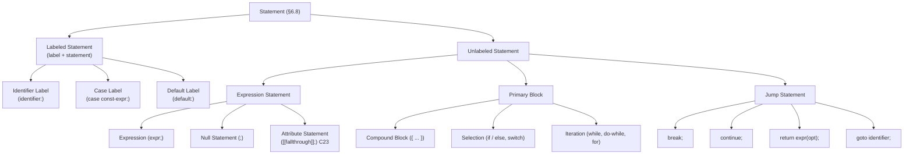

# Statements & Control Flow

A **statement** specifies an action to be executed sequentially at runtime (ISO/IEC 9899:2024 §6.8). Statements control sequencing, branching, iteration, block lifetime, and non-local or structured jumps inside a function body.

C23 (**ISO/IEC 9899:2024**) refines the ISO C statement grammar significantly: **`N2508`** separates `label` from `labeled-statement` so labels may appear directly before **declarations** and before the **closing `}`** of a compound statement, and **C23 attributes** (`[[fallthrough]];`, `[[maybe_unused]] label:`, and statement-level `[[...]]`) integrate cleanly into the statement hierarchy.

---

## Statement Taxonomy & Grammar

In ISO C23 (§6.8), statements are organized into labeled statements and unlabeled statements (expression/null/attribute statements, primary blocks, and jump statements):



### Quick Reference Table

| Category | Forms | Standard | Creates Block Scope? | Key C23 Updates |
| :--- | :--- | :--- | :--- | :--- |
| **Labels** | `id:`, `case E:`, `default:` | <span class="c-badge c89">C89</span> | No | Permitted before declarations & `}` (`N2508`); accepts `[[maybe_unused]]` |
| **Compound** | `{ block-item-list }` | <span class="c-badge c89">C89</span> | **Yes** | Bare `label` is now a valid `block-item` |
| **Expression / Null / Attr** | `expr;`, `;`, `[[attr]];` | <span class="c-badge c89">C89</span> / <span class="c-badge c23">C23</span> | No | Attribute statements (`[[fallthrough]];`) standardized |
| **Selection** | `if`, `if-else`, `switch` | <span class="c-badge c89">C89</span> | **Yes** (<span class="c-badge c99">C99</span>) | Leading `attr-spec-seq`; `_BitInt(N)` allowed in `switch` |
| **Iteration** | `while`, `do-while`, `for` | <span class="c-badge c89">C89</span> | **Yes** (<span class="c-badge c99">C99</span>) | `auto` / `constexpr` permitted in `for`-init; forward-progress rule retained |
| **Jump** | `break`, `continue`, `return`, `goto` | <span class="c-badge c89">C89</span> | No | Leading `attr-spec-seq` permitted |

---

## Labels (`identifier:`, `case:`, `default:`)

ISO C defines three kinds of labels (§6.8.1):

1. **Ordinary (goto) labels (`identifier:`)**:
   - Have **function scope** — the **only** identifiers in the entire C language with function scope (§6.2.1 ¶3).
   - Visible everywhere inside the enclosing function definition (both before and after the label, enabling forward and backward `goto`).
   - Occupy their own dedicated **label namespace** (§6.2.3), so a variable `int done = 0;` and a label `done:` never collide.
   - Must be unique within the same function.
2. **`case constant-expression:` labels**:
   - Valid only inside a `switch` statement (bound to the innermost enclosing `switch`).
   - `constant-expression` must be an **integer constant expression**; its value is converted to the promoted type of the `switch` controlling expression.
   - Duplicate converted `case` values in the same `switch` are a constraint violation.
3. **`default:` label**:
   - Valid only inside a `switch` statement; at most **one** `default:` label is allowed per `switch`.

### C23 Free Placement of Labels (`N2508`) <span class="c-badge c23">C23</span>

From C89 through C17, the grammar required every label to be followed immediately by a **statement** — declarations were *not* statements, and a closing brace `}` was *not* a statement. This produced two notorious syntax annoyances: writing a declaration right after a `case:` label or placing a `cleanup:` label right before `}` failed to compile unless you inserted a dummy `;` null statement!

**C23 (`N2508`)** decouples `label` from `statement` and makes `label` an independent `block-item`, making **both** patterns directly legal:

=== "C17 (Syntax Errors)"

    ```c
    #include <stdio.h>

    void process_c17(int mode) {
        switch (mode) {
        case 1:
            /* ERROR in C17: a label can only be part of a statement,
             * and a declaration is not a statement!
             * Workaround required a dummy `;` or `{ ... }`.
             */
            ;
            int value = 42;
            printf("%d\n", value);
            break;
        default:
            goto done;
        }

    done:
        /* ERROR in C17 if `;` is omitted before closing `}`! */
        ;
    }
    ```

=== "C23 (Valid — N2508)"

    ```c
    #include <stdio.h>

    void process_c23(int mode) {
        switch (mode) {
        case 1:
            int value = 42; /* Directly valid in C23! */
            printf("%d\n", value);
            break;
        default:
            goto done;
        }

    done:
        /* Directly valid before closing `}` in C23 — no dummy `;` needed! */
    }
    ```

!!! warning "Declaration After `case:` Still Shares the `switch` Scope!"
    Although C23 allows `case 1: int value = 42;`, `value` still lives in the enclosing `switch` block's scope. If another `case 2:` follows inside the same `switch`, jumping to `case 2:` **skips `value`'s initializer** (making any use of `value` in `case 2:` Undefined Behavior!). Whenever a `case` needs local variables, wrapping the case body in `{ ... }` remains the cleanest practice.

### Attributes on Labels <span class="c-badge c23">C23</span>

In C23, an attribute specifier sequence may precede any label (`identifier:`, `case`, or `default`). The primary standard use is `[[maybe_unused]]` on labels that are only targeted under conditional compilation (such as `#ifdef` debug paths or macro expansions):

```c
#include <stdio.h>

void audit_step(int ok) {
    if (!ok) {
#ifdef ENABLE_FAST_ABORT
        goto cleanup;
#endif
    }
    puts("normal path");

[[maybe_unused]] cleanup:
}
```

---

## Compound Statements (Blocks `{ ... }`)

A **compound statement** (or *block*, §6.8.2) groups zero or more declarations, statements, and (since C23) bare labels inside `{ ... }`:

```c
{
    /* block-item-list: declarations, statements, and labels freely interleaved */
    int total = 0;
    for (int i = 0; i < 4; ++i) {
        total += i;
    }
    int doubled = total * 2; /* Mixing declarations & statements: valid since C99 */
    (void)doubled;
}
```

### Key Rules of Compound Statements

- **Mixed Declarations and Code**:
  - <span class="c-badge c89">C89</span> required all declarations to appear at the very top of a block before any executable statement.
  - <span class="c-badge c99">C99</span> lifted this restriction so declarations and statements can be freely interleaved (declare variables as close as possible to first use!).
- **Block Scope & Shadowing**: Identifiers declared inside `{ ... }` have block scope lasting from their declaration point until the matching `}`. An inner block may declare an identifier with the same name as an outer block, temporarily shadowing the outer identifier.
- **Automatic Lifetime & Destruction**:
  - Objects with automatic storage duration (non-VLA) enter their lifetime upon block entry (though their initializers execute only when control reaches the declaration).
  - Variable-length arrays (VLAs, <span class="c-badge c99">C99</span>) begin their lifetime when execution reaches their declaration and end their lifetime whenever control leaves the block (via reaching `}`, `break`, `continue`, `return`, or `goto`).
- **Implicit Block Scopes (<span class="c-badge c99">C99</span>)**: Every selection statement (`if`, `switch`) and iteration statement (`while`, `do`, `for`) — as well as each of its controlled substatements — is **implicitly enclosed in its own block scope** (§6.8.4 ¶3, §6.8.5 ¶5), even without braces `{ }`. For example, a compound literal `(struct S){ .x = 1 }` created inside `if (cond)` has its lifetime restricted to that `if` statement!

---

## Expression, Null & Attribute Statements

### Expression Statements (`expr;`)

An expression followed by `;` evaluates the expression as a **void expression** for its side effects (assignments, function calls, `volatile` accesses, atomic operations) and discards the resulting value (§6.8.3):

```c
x = a + b;            /* assignment side effect */
++counter;            /* increment side effect */
puts("hello");        /* function call side effect */
(void)nodiscard_fn(); /* explicit cast to void intentionally discards [[nodiscard]] return */
```

The semicolon ends a **full expression**, establishing a sequencing boundary: all value computations and side effects of the expression are sequenced before the next statement begins.

### Null Statements (`;`)

An expression statement with the expression omitted is a **null statement** — it performs no operation:

```c
/* Searching for the first NUL byte with an explicit empty body */
while (*p != '\0') {
    ++p;
}

/* If a loop genuinely has all work in the header, use an explicit block or `continue;`
 * rather than a bare `;` which looks like an accidental typo! */
while (consume_next_token()) {
    /* intentionally empty */
}
```

!!! warning "Accidental Semicolon Pitfall"
    A stray `;` immediately after `if (cond);` or `for (int i = 0; i < n; ++i);` turns the semicolon into the controlled body, causing the following block to execute unconditionally! Always compile with `-Wall -Wextra` (GCC/Clang emit `-Wempty-body` and `-Wmisleading-indentation`).

### Attribute Statements (`[[attr]];`) <span class="c-badge c23">C23</span>

In C23 (§6.8.3), an attribute specifier sequence immediately preceding a null statement (`;`) forms an **attribute statement**. Its canonical standard use is **`[[fallthrough]];`** inside a `switch` statement:

```c
switch (state) {
case STATE_INIT:
    prepare_resources();
    [[fallthrough]]; /* C23 attribute statement: explicitly authorizes fallthrough */
case STATE_RUNNING:
    execute_step();
    break;
default:
    break;
}
```

---

## Selection Statements

Selection statements choose among alternative execution paths based on a controlling expression (§6.8.4).

### `if` and `if-else`

```c
attr-spec-seq(opt) if ( expression ) secondary-block
attr-spec-seq(opt) if ( expression ) secondary-block else secondary-block
```

- **Controlling expression**: Must have **scalar type** (any integer, floating-point, or pointer type — `struct` and `union` are forbidden). The first branch executes if the expression compares unequal to `0` (or non-null for pointers); otherwise the `else` branch (if present) executes.
- **Dangling-`else` Rule (§6.8.4.1 ¶3)**: An `else` clause is **always** associated with the **lexically nearest enclosing unmatched `if`** within the same block — regardless of indentation!

=== "Bad (Dangling-`else` Bug)"

    ```c
    /* Misleading indentation! `else` actually binds to `if (b)`! */
    if (a)
        if (b)
            do_ab();
    else
        do_not_a(); /* WRONG: executes when (a && !b), NOT when (!a)! */
    ```

=== "Good (Always Brace Nested `if`)"

    ```c
    if (a) {
        if (b) {
            do_ab();
        }
    } else {
        do_not_a(); /* Unambiguously executes when (!a) */
    }
    ```

#### C23 Attribute Placement on `if` <span class="c-badge c23">C23</span>

C23 permits an `attr-spec-seq` before `if` (applying to the `if` statement itself) or before a substatement.

!!! note "`[[likely]]` and `[[unlikely]]` Are C++20 — NOT Standard C23"
    C++20 introduced standard `[[likely]]` and `[[unlikely]]` branch-hint attributes, but **ISO C23 did NOT adopt them** (only the 7 standard attributes in [Attributes (C23)](attributes.md) exist in C23). In C23, branch hints remain vendor extensions such as `__builtin_expect(!!(cond), 1)` on GCC/Clang.

### `switch`

```c
attr-spec-seq(opt) switch ( expression ) secondary-block
```

- **Controlling expression**: Must have **integer type** (standard integers, `bool`, `enum`, or C23 `_BitInt(N)`). Integer promotions are performed on the controlling expression, and every `case` constant expression is converted to that promoted type. Floating-point, pointer, and string types are forbidden.
- **Dispatch**: Control jumps directly to the matching `case` label, or to `default:` if none matches, or past the entire `switch` if neither matches.
- **Fallthrough**: Once control enters a `case`, execution continues sequentially across subsequent `case` / `default` labels until a `break`, `return`, `goto`, or the end of the `switch`. Always terminate cases with `break;` / `return;` or document intentional fallthrough with C23 **`[[fallthrough]];`**.

#### Skipping Variable Initialization Trap

A `switch` jump can legally bypass a variable declaration that has an initializer — placing the variable **in scope** with **uninitialized (indeterminate) storage**!

=== "Bad (Skipped Initializer → Undefined Behavior)"

    ```c
    #include <stdio.h>

    void broken_switch(int x) {
        switch (x) {
        case 1:
            int threshold = 100; /* Initializer ONLY runs when x == 1! */
            printf("case 1: %d\n", threshold);
            break;
        case 2:
            /* `threshold` IS in scope here, but was NEVER initialized -> UB! */
            printf("case 2: %d\n", threshold);
            break;
        default:
            break;
        }
    }
    ```

=== "Good (Block-Scoped Cases)"

    ```c
    #include <stdio.h>

    void safe_switch(int x) {
        switch (x) {
        case 1: {
            int threshold = 100;
            printf("case 1: %d\n", threshold);
            break;
        }
        case 2: {
            int threshold = 200;
            printf("case 2: %d\n", threshold);
            break;
        }
        default:
            break;
        }
    }
    ```

#### Interleaved `case` Labels & Duff's Device

Because `case` labels are ordinary jump targets inside the `switch`'s compound statement, C legally allows `case` labels inside nested loops or `if` blocks (as long as no jump enters a VLA's scope). The classic historical demonstration is **Duff's Device** (manual loop unrolling invented by Tom Duff for memory-mapped I/O registers):

```c
#include <stddef.h>

void duff_copy(char * restrict dst, const char * restrict src, size_t count) {
    if (count == 0) {
        return;
    }
    size_t n = (count + 7U) / 8U;
    switch (count % 8U) {
    case 0: do { *dst++ = *src++; [[fallthrough]];
    case 7:      *dst++ = *src++; [[fallthrough]];
    case 6:      *dst++ = *src++; [[fallthrough]];
    case 5:      *dst++ = *src++; [[fallthrough]];
    case 4:      *dst++ = *src++; [[fallthrough]];
    case 3:      *dst++ = *src++; [[fallthrough]];
    case 2:      *dst++ = *src++; [[fallthrough]];
    case 1:      *dst++ = *src++;
            } while (--n > 0U);
    }
}
```

!!! tip "Modern Engineering Practice"
    Duff's Device is valid ISO C (including C23), but modern compilers (`-O2`/`-O3`) auto-vectorize `memcpy` and simple loops far better than hand-unrolled `switch`-loop interleaving. Prefer `memcpy` or clean loops in production code.

---

## Iteration Statements

ISO C provides three iteration statements (§6.8.5): `while`, `do-while`, and `for`. All controlling expressions must have **scalar type**.

### `while`

```c
attr-spec-seq(opt) while ( expression ) secondary-block
```

Evaluates `expression` **before** each iteration. If it compares equal to `0`, the loop terminates immediately (zero or more executions of the body).

### `do-while` & the `do { ... } while (0)` Macro Idiom

```c
attr-spec-seq(opt) do secondary-block while ( expression ) ;
```

Executes `secondary-block` **first**, then evaluates `expression` (guaranteed **at least one** execution).

Because `do { ... } while (0)` is a single statement that requires a trailing `;`, it is the universal ISO C idiom for **multi-statement function-like macros** that behave safely inside unbraced `if`/`else` chains:

=== "Bad (Broken Multi-Statement Macro)"

    ```c
    /* WRONG: Breaks inside unbraced `if (cond) LOG_AND_INC(x); else ...`! */
    #define LOG_AND_INC(x) { printf("x=%d\n", (x)); ++(x); }
    /* Expands to: if (cond) { ... }; else ...  <-- SYNTAX ERROR before `else`! */
    ```

=== "Good (`do { ... } while (0)` Macro Idiom)"

    ```c
    /* SAFE: Swallows the caller's trailing `;` cleanly in all syntactic contexts */
    #define LOG_AND_INC(x)             \
        do {                           \
            printf("x=%d\n", (x));     \
            ++(x);                     \
        } while (0)
    ```

### `for`

```c
attr-spec-seq(opt) for ( clause-1(opt) ; expression-2(opt) ; expression-3(opt) ) secondary-block
```

| Clause | Role | If Omitted |
| :--- | :--- | :--- |
| `clause-1` | Executed **once** before the loop starts. Either an expression (<span class="c-badge c89">C89</span>) or a declaration (<span class="c-badge c99">C99</span>) | No initialization |
| `expression-2` | Controlling condition evaluated **before** each iteration | Replaced by nonzero constant `1` (infinite loop until `break`/`return`/`goto`) |
| `expression-3` | Evaluated as a void expression **after** each iteration (and whenever `continue;` executes) | No post-iteration step |

#### `for`-Init Declaration Rules & Scoping (<span class="c-badge c99">C99</span> / <span class="c-badge c23">C23</span>)

- **Permitted storage classes (§6.8.5.3 ¶1)**: `clause-1` may only declare objects with automatic storage class (`auto`, `register`, or in C23 automatic `constexpr` / type-inferred `auto`!). Declaring `static`, `extern`, `thread_local`, or `typedef` in `clause-1` is a **constraint violation**.
- **Two nested scopes**: Identifiers declared in `clause-1` live in an outer implicit scope enclosing the loop, while the loop body `{ ... }` has its own inner scope. Therefore, redeclaring `int i` directly inside `{ ... }` shadows the loop variable `i` rather than causing a redefinition error (though shadowing a loop counter is poor style and flagged by `-Wshadow`).

```c
/* C99–C23: loop variable scoped strictly to the for statement */
for (size_t i = 0, n = 10; i < n; ++i) {
    /* i and n are both visible here; neither leaks past `}` */
}

/* C23: type inference with `auto` is valid in for-init */
for (auto i = 0U; i < 10U; ++i) {
    /* i has deduced type `unsigned int` */
}
```

### Infinite Loops & Forward Progress Guarantee <span class="c-badge c11">C11</span> <span class="c-badge c23">C23</span>

ISO C11 §6.8.5 ¶6 (retained unchanged in C17 and C23) specifies one of the most subtle optimization rules in systems programming:

> An iteration statement may be assumed by the implementation to terminate if its controlling expression is **not a constant expression**, and none of the following operations are performed in its body, controlling expression, or (in the case of a `for` statement) its `expression-3`:
>
> 1. Input/output operations,
> 2. Accesses to a `volatile` object, or
> 3. Synchronization or atomic operations.

| Loop Form | Controlling Expression Constant? | Side-Effect-Free Infinite Execution Allowed? | Compiler Behavior |
| :--- | :--- | :--- | :--- |
| `for (;;) {}` | **Yes** (omitted cond = `1`) | **Well-defined** (never UB!) | Must spin forever (cannot delete loop) |
| `while (1) {}` / `while (true) {}` | **Yes** (`1` / `true`) | **Well-defined** (never UB!) | Must spin forever (cannot delete loop) |
| `do {} while (1);` | **Yes** | **Well-defined** (never UB!) | Must spin forever |
| `while (flag) {}` (plain non-`volatile` non-atomic `flag`) | **No** | **Undefined Behavior** if `flag` never becomes `0`! | Optimizer may hoist read of `flag` out of loop or **delete the entire loop**! |
| `while (atomic_load(&flag)) {}` | **No**, *but contains atomic op* | **Well-defined** | Must re-read atomic flag on every iteration |
| `while (hw_reg != 0) {}` (`volatile` `hw_reg`) | **No**, *but accesses `volatile`* | **Well-defined** | Must re-read `volatile` register on every iteration |

!!! danger "Never Spin-Wait on a Plain Global Variable"
    Spinning with `while (!ready) {}` on a plain `bool ready` modified by another thread or signal handler violates **both** the C11/C23 data-race memory model and the forward-progress termination rule. Use `_Atomic bool` (`<stdatomic.h>`) for inter-thread flags, `volatile sig_atomic_t` for signal handlers, or `volatile` for memory-mapped hardware registers!

---

## Jump Statements

Jump statements (§6.8.6) transfer control unconditionally.

### `break`

```c
attr-spec-seq(opt) break ;
```

Terminates execution of the **innermost enclosing** `switch` or iteration statement (`while`, `do`, `for`) and transfers control to the statement immediately following it.

- `break` **never** breaks out of an `if` statement (it targets the enclosing loop or `switch`, if any; using `break` outside any loop/`switch` is a constraint violation).
- To exit nested loops cleanly, either extract a helper function and `return`, or use `goto` to a label immediately after the outer loop.

### `continue`

```c
attr-spec-seq(opt) continue ;
```

Jumps to the **loop-continuation point** (just before the closing `}` of the loop body) of the **innermost enclosing** iteration statement:

- Inside `while (cond)` → immediately re-evaluates `cond`.
- Inside `do { ... } while (cond);` → immediately evaluates `cond`.
- Inside `for (init; cond; iter)` → executes `iter` **first**, then re-evaluates `cond`.
- `continue` **does not apply to `switch`** (a `continue` inside a `switch` nested within a loop continues the enclosing *loop*!).

### `return`

```c
attr-spec-seq(opt) return ;
attr-spec-seq(opt) return expression ;
```

Terminates the current function and returns control to its caller:

- In a **`void` function**:
  - `return;` is valid.
  - `return expr;` is a **constraint violation** — **even when `expr` itself has type `void`** (e.g., `return void_fn();` is valid in C++, but **illegal** in ISO C §6.8.6.4 ¶1!).
- In a **non-`void` function**:
  - `return;` without an expression is a **constraint violation** since <span class="c-badge c99">C99</span>.
  - `return expr;` implicitly converts `expr` to the function's return type as if by assignment.
  - Returning a pointer to a local automatic variable produces a **dangling pointer** (dereferencing it in the caller is Undefined Behavior).

### `goto`

```c
attr-spec-seq(opt) goto identifier ;
```

Transfers control unconditionally to the labeled statement `identifier:` within the **same function**.

#### The Single-Exit Cleanup Idiom (Idiomatic Systems C)

Because C has no destructors (RAII), forward-only **`goto` cleanup chains** are the gold-standard idiom (used throughout the Linux kernel, OpenSSL, and POSIX libraries) to guarantee deterministic, leak-free teardown of multiple resources acquired sequentially:

```c
#include <stdio.h>
#include <stdlib.h>

int copy_file_prefix(const char *src_path, const char *dst_path, size_t nbytes) {
    int status = -1;
    FILE *in = nullptr;
    FILE *out = nullptr;
    unsigned char *buf = nullptr;

    in = fopen(src_path, "rb");
    if (in == nullptr) {
        goto cleanup;
    }

    out = fopen(dst_path, "wb");
    if (out == nullptr) {
        goto cleanup;
    }

    buf = malloc(nbytes);
    if (buf == nullptr) {
        goto cleanup;
    }

    size_t got = fread(buf, 1, nbytes, in);
    if (ferror(in) || fwrite(buf, 1, got, out) != got) {
        goto cleanup;
    }

    status = 0;

cleanup:
    free(buf);
    if (out != nullptr) {
        fclose(out);
    }
    if (in != nullptr) {
        fclose(in);
    }
    return status;
}
```

#### Prohibition on Jumping into a VLA Scope <span class="c-badge c99">C99</span>

ISO C (§6.8.6.1 ¶1) enforces a strict compile-time constraint on **variably modified (VLA) types**:

- A `goto` (or `switch` dispatch) **shall NOT jump from outside the scope of an identifier with a variably modified type to inside its scope** — doing so would bypass runtime stack allocation of the VLA!
- Jumping **out** of a VLA's scope IS permitted and cleanly deallocates the VLA's storage.

=== "Bad (Constraint Violation — Jumping into VLA Scope)"

    ```c
    #include <stddef.h>

    void illegal_vla_jump(size_t n) {
        goto inside; /* COMPILE ERROR: jumps into scope of VLA `buf`! */
        int buf[n];
    inside:
        buf[0] = 1;
        (void)buf;
    }
    ```

=== "Good (Jumping Out of VLA Scope Is Legal)"

    ```c
    #include <stddef.h>

    int legal_vla_exit(size_t n, int abort_early) {
        int buf[n];
        buf[0] = 42;
        if (abort_early) {
            goto done; /* VALID: exits VLA scope cleanly */
        }
        return buf[0];
    done:
        return -1;
    }
    ```

!!! warning "Skipping Ordinary Initializers via `goto`"
    Unlike VLAs, jumping past an ordinary automatic variable's initializer (`goto skip; int x = 5; skip: use(x);`) is **not** a syntax error in C — `x`'s storage is allocated on block entry, its initializer `= 5` is skipped, and reading `x` causes **Undefined Behavior**. Always initialize all variables used in `cleanup:` blocks *before* the first `goto cleanup;`!

---

## Complete Compilable C23 Example

This complete C23 program demonstrates `N2508` labels before declarations and closing braces, `[[fallthrough]];`, `[[maybe_unused]]` on a label, `do { ... } while (0)` statement-like macros, scoped `switch` cases, and forward `goto` cleanup.

```c
/* Compile: gcc -std=c23 -Wall -Wextra -Wpedantic statements_demo.c -o statements_demo
 *      or: clang -std=c23 -Wall -Wextra -Wpedantic statements_demo.c -o statements_demo
 */
#include <stddef.h>
#include <stdio.h>
#include <stdlib.h>

#define CHECK_OR_GOTO(cond, label) \
    do {                           \
        if (!(cond)) {             \
            goto label;            \
        }                          \
    } while (0)

enum PacketKind {
    PKT_PING = 1,
    PKT_DATA = 2,
    PKT_FLUSH = 3,
};

static int dispatch_packet(enum PacketKind kind, size_t payload_len) {
    int rc = -1;
    unsigned char *scratch = nullptr;

    switch (kind) {
    case PKT_PING:
        /* C23 (N2508): declaration directly after case label! */
        const char *msg = "PONG";
        puts(msg);
        rc = 0;
        break;

    case PKT_DATA:
        scratch = malloc(payload_len > 0U ? payload_len : 1U);
        CHECK_OR_GOTO(scratch != nullptr, cleanup);
        scratch[0] = 0xAAU;
        printf("DATA buffered (%zu bytes), triggering flush...\n", payload_len);
        [[fallthrough]]; /* C23 attribute statement */

    case PKT_FLUSH: {
        int flushed = 1;
        printf("FLUSH complete (count=%d)\n", flushed);
        rc = 0;
        break;
    }

    default:
        goto unknown_kind;
    }

cleanup:
    free(scratch);
    return rc;

[[maybe_unused]] unknown_kind:
    fprintf(stderr, "Unknown packet kind: %d\n", (int)kind);
    return -1;
}

static void label_at_end_demo(int skip) {
    if (skip) {
        goto end_of_block;
    }
    puts("executed body");
end_of_block:
    /* C23 (N2508): label directly before closing `}` with no dummy `;`! */
}

int main(void) {
    dispatch_packet(PKT_PING, 0);
    dispatch_packet(PKT_DATA, 64);
    label_at_end_demo(1);
    return EXIT_SUCCESS;
}
```

---

## See Also

- [Functions, Linkage & Conformance](functions.md) — `return` rules, parameter scopes, and `main()`
- [Attributes (C23)](attributes.md) — `[[fallthrough]]`, `[[maybe_unused]]`, and statement appertainment
- [Expressions, Operators & `_Generic`](expressions.md) — full expressions, sequence points, and constant expressions
- [Declarations, Types & `typeof`](declarations.md) — block scope, automatic duration, and VLAs
- [neg02 · Control Flow & Loops](../../curriculum/pre-tier/neg02-control-flow-loops.md) — guided tutorial on C branching and iteration
- [19 · Modern C (C99, C11, C17, C23 & C2y)](../../curriculum/tier-5-expert/19-modern-c-c99-to-c23.md) — deep dive into C23 modernization

### Authoritative References

- ISO/IEC 9899:2024 (C23): §6.8 (*Statements and blocks*), §6.8.1 (*Labeled statements*), §6.8.2 (*Compound statement*), §6.8.3 (*Expression and null statements*), §6.8.4 (*Selection statements*), §6.8.5 (*Iteration statements*), §6.8.6 (*Jump statements*).
- WG14 `N2508`: *Free positioning of labels inside compound statements*.
- [cppreference.com — C Statements](https://en.cppreference.com/w/c/language/statements)
- [cppreference.com — C `switch` Statement](https://en.cppreference.com/w/c/language/switch)
- [cppreference.com — C `for` Loop](https://en.cppreference.com/w/c/language/for)
- [cppreference.com — C `goto` Statement](https://en.cppreference.com/w/c/language/goto)
