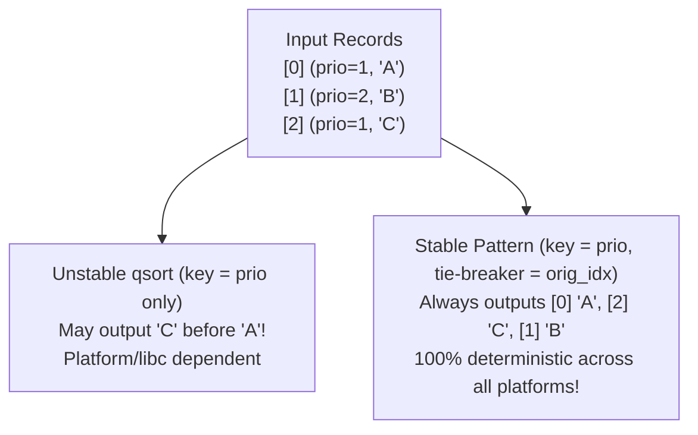

# Algorithms (`qsort` & `bsearch`)

The C standard library provides two type-erased generic algorithms in `` `<stdlib.h>` ``—**sorting (`qsort`, `qsort_s`)** and **binary search (`bsearch`, `bsearch_s`)**. Because C achieves polymorphism via `void *`, element stride (`size_t size`), and comparator function pointers, writing mathematically sound, overflow-free comparators and respecting C23's new const-preserving generic signatures are essential skills for systems programmers.

This reference mirrors [en.cppreference.com/c/algorithm](https://en.cppreference.com/c/algorithm) through **ISO/IEC 9899:2024 (C23)** (§7.24.5 and Annex K.3.6.3).

---

## Summary of `` `<stdlib.h>` `` Algorithms

| Function | Prototype (`<stdlib.h>`) | Standard | Complexity | Key Property |
| :--- | :--- | :--- | :--- | :--- |
| `qsort` | `void qsort(void *ptr, size_t count, size_t size, int (*comp)(const void *, const void *));` | <span class="c-badge c89">C89</span> | Unspecified (typically $O(n \log n)$) | **Not guaranteed stable**; stateless comparator |
| `qsort_s` | `errno_t qsort_s(void *ptr, rsize_t count, rsize_t size, int (*comp)(const void *, const void *, void *), void *context);` | <span class="c-badge c11">C11</span> <span class="c-badge c-optional">optional</span> | Unspecified (typically $O(n \log n)$) | Reentrant `void *context` passed to comparator; Annex K bounds checks |
| `bsearch` | `QVoid *bsearch(const void *key, QVoid *ptr, size_t count, size_t size, int (*comp)(const void *, const void *));` | <span class="c-badge c89">C89</span> <span class="c-badge c23">C23</span> | $O(\log n)$ comparisons | **C23 `QVoid` const-preserving!** `key` always 1st arg to `comp` |
| `bsearch_s` | `QVoid *bsearch_s(const void *key, QVoid *ptr, rsize_t count, rsize_t size, int (*comp)(const void *, const void *, void *), void *context);` | <span class="c-badge c11">C11</span> <span class="c-badge c23">C23</span> <span class="c-badge c-optional">optional</span> | $O(\log n)$ comparisons | **C23 `QVoid` const-preserving!** Reentrant `context` + Annex K checks |

---

## Sorting: `qsort` & `qsort_s`

### `qsort` <span class="c-badge c89">C89</span>

```c
#include <stdlib.h>

void qsort(void *ptr, size_t count, size_t size,
           int (*comp)(const void *a, const void *b));
```

- **`ptr`**: Pointer to the first element of the array to sort.
- **`count`**: Number of elements in the array.
- **`size`**: Size of each element in bytes (`sizeof arr[0]`).
- **`comp`**: Comparison callback returning an integer:
  - **`< 0`** if `*a` precedes `*b`
  - **`0`** if `*a` and `*b` are equivalent
  - **`> 0`** if `*a` follows `*b`

!!! danger "Zero-Element `nullptr` Guard (C89–C23)"
    Even when `count == 0`, passing `ptr == nullptr` to `qsort` is historically **Undefined Behavior** under C89–C23 (where glibc and Clang/GCC static analyzers annotate `ptr` as `nonnull`). Always guard dynamically allocated empty arrays:

    ```c
    if (count > 1 && arr != nullptr) {
        qsort(arr, count, sizeof arr[0], compare_fn);
    }
    ```

    Checking `count > 1` both avoids UB on empty arrays and skips unnecessary function-call overhead on 0- and 1-element slices.

### `qsort_s` (Annex K) & Cross-Platform `qsort_r` Divergence <span class="c-badge c11">C11</span> <span class="c-badge c-optional">optional</span>

When sorting order depends on runtime state (such as a user-selected sort column, ascending/descending flag, or external lookup table), avoid global variables (which break thread safety and reentrancy) and pass a `void *context` pointer.

```c
#define __STDC_WANT_LIB_EXT1__ 1
#include <stdlib.h>

errno_t qsort_s(void *ptr, rsize_t count, rsize_t size,
                int (*comp)(const void *a, const void *b, void *context),
                void *context);
```

- **Runtime constraints (`qsort_s`)**: Fails with non-zero `errno_t` and invokes the constraint handler if `count > RSIZE_MAX`, `size > RSIZE_MAX`, or (`count > 0` and either `ptr == nullptr` or `comp == nullptr`).

!!! warning "CRITICAL PORTABILITY TRAP: `qsort_s` vs `qsort_r` Parameter Order!"
    Context-passing sorts have **four incompatible signatures** across ISO C11, MSVC, BSD/macOS, and POSIX/glibc—mixing up argument order causes silent stack corruption or crashes:

    | Standard / Platform | Function Prototype | Comparator Parameter Order |
    | :--- | :--- | :--- |
    | **ISO C11/C23 Annex K** | `errno_t qsort_s(ptr, count, size, comp, context)` | `(const void *a, const void *b, void *ctx)` |
    | **POSIX.1-2024 / glibc** | `void qsort_r(ptr, count, size, comp, context)` | `(const void *a, const void *b, void *ctx)` |
    | **macOS / FreeBSD (legacy)** | `void qsort_r(ptr, count, size, context, comp)` | `(void *ctx, const void *a, const void *b)` |
    | **Windows MSVC** | `void qsort_s(ptr, count, size, comp, context)` | `(void *ctx, const void *a, const void *b)` |

    Notice that **MSVC `qsort_s`** puts `context` **first** in the comparator (opposite of ISO C11 Annex K!) and returns `void` instead of `errno_t`. Wrap platform differences behind a thin internal helper or use a compile-time macro check (`_MSC_VER`, `__APPLE__`, `__GLIBC__`).

---

## Binary Search: `bsearch`, `bsearch_s` & C23 `QVoid`

```c
#include <stdlib.h>

QVoid *bsearch(const void *key, QVoid *ptr, size_t count, size_t size,
               int (*comp)(const void *key, const void *elem)); /* C23 QVoid */

/* Annex K (optional, requires __STDC_WANT_LIB_EXT1__ == 1): */
QVoid *bsearch_s(const void *key, QVoid *ptr, rsize_t count, rsize_t size,
                 int (*comp)(const void *key, const void *elem, void *context),
                 void *context);                                /* C23 QVoid */
```

### Formal Guarantees of `bsearch`

1. **Partition precondition**: The array `[ptr, ptr + count)` must be partitioned with respect to `key`—every element comparing `< 0` against `key` must appear before all elements comparing `== 0`, which must appear before all elements comparing `> 0`. A fully sorted array using the same ordering satisfies this condition automatically.
2. **Guaranteed argument order (`key` is ALWAYS first!)**: ISO/IEC 9899:2024 §7.24.5.1 explicitly mandates that `comp` is always invoked with **`key` as the first argument** and a pointer to an array element as the **second argument**. This enables **asymmetric binary search**: you can pass a lightweight scalar ID (`const uint32_t *`) as `key` when searching an array of large `struct Record` objects without fabricating a dummy `struct Record`!
3. **Duplicate elements**: If multiple elements compare equal to `key`, **which matching element is returned is unspecified** (often whichever midpoint the binary split lands on first). To locate the *first* or *last* matching element, scan backward/forward from the returned pointer or use a custom lower-bound binary search.
4. **Not found**: Returns `nullptr` (`NULL`) if no element compares equal to `key`.

### C23 `QVoid` Const-Preserving Type-Generic Behavior <span class="c-badge c23">C23</span>

From C89 through C17, `bsearch` took `const void *ptr` yet returned unqualified `void *`, silently stripping `const` from read-only arrays.

In **ISO/IEC 9899:2024 (§7.24.5.1)**, `bsearch` and `bsearch_s` are qualifier-preserving generic functions using the exposition type **`QVoid`**:

- If `ptr` points to a **`const`-qualified** object (`const T *` or `const void *`), `bsearch` returns **`const void *`**.
- If `ptr` points to a **mutable** object (`T *` or `void *`), `bsearch` returns **`void *`**.
- Suppressing macro expansion via `(bsearch)(key, ptr, count, size, comp)` calls the external function returning `void *` for C17 ABI compatibility.

=== "C23 (Const-Preserving)"

    ```c
    #include <stdlib.h>

    static int cmp_int(const void *a, const void *b) {
        int x = *(const int *)a;
        int y = *(const int *)b;
        return (x > y) - (x < y);
    }

    void search_c23(void) {
        const int ro_table[] = {10, 20, 30, 40};
        int rw_table[]       = {10, 20, 30, 40};
        int key = 30;

        /* Passing const int * returns const void * in C23! */
        const int *p_ro = bsearch(&key, ro_table, 4, sizeof ro_table[0], cmp_int);
        /* int *bad = bsearch(&key, ro_table, 4, sizeof ro_table[0], cmp_int); // Error in C23! */

        /* Passing mutable int * returns void *, convertible to int * */
        int *p_rw = bsearch(&key, rw_table, 4, sizeof rw_table[0], cmp_int);
        if (p_rw != nullptr) {
            *p_rw = 35; /* Safe: rw_table is mutable */
        }
        (void)p_ro;
    }
    ```

=== "C17 (Silent Const-Drop)"

    ```c
    #include <stdlib.h>

    static int cmp_int_c17(const void *a, const void *b) {
        int x = *(const int *)a;
        int y = *(const int *)b;
        return (x > y) - (x < y);
    }

    void search_c17_hazard(void) {
        const int ro_table[] = {10, 20, 30, 40};
        int key = 30;

        /* C17 returns void *, silently stripping const without any cast! */
        int *p = bsearch(&key, ro_table, 4, sizeof ro_table[0], cmp_int_c17);
        if (p != NULL) {
            *p = 99; /* UNDEFINED BEHAVIOR: modifying const object! */
        }
    }
    ```

---

## Writing Bug-Free Comparators

Almost every `qsort`/`bsearch` crash, mis-sort, or security bug in production C code stems from a defective comparator.

### 1. Integer Comparison: Never Subtract

Returning `*a - *b` is one of the most famous traps in C programming. It causes **Signed Integer Overflow (Undefined Behavior)** on `INT_MIN - 1` (e.g., comparing `-2000000000` and `+2000000000` wraps to a positive number, sorting negative values *after* positive values!), and fails completely for `unsigned`, `int64_t`, or `size_t` due to wraparound and truncation into `int`.

=== "❌ Overflow Bug"

    ```c
    #include <limits.h>

    int cmp_int_broken(const void *a, const void *b) {
        /*
         * UNDEFINED BEHAVIOR on INT_MIN - 1 or (-2'000'000'000 - 2'000'000'000)!
         * Also breaks if adapted to int64_t (truncating 64-bit diff to 32-bit int)
         * or unsigned int (wraparound to huge positive value).
         */
        return *(const int *)a - *(const int *)b;
    }
    ```

=== "✅ Branchless Safe"

    ```c
    int cmp_int_safe(const void *a, const void *b) {
        int x = *(const int *)a;
        int y = *(const int *)b;
        /*
         * Zero overflow, works identically for int8_t..int64_t, uint64_t, size_t!
         * Returns -1 (x < y), 0 (x == y), or +1 (x > y).
         * Compiles to branchless cmp/setg/setl/sub on x86-64 and cmp/cset on ARM64.
         */
        return (x > y) - (x < y);
    }
    ```

### 2. Mathematical Strict Weak / Total Ordering Axioms

ISO C requires your comparator to define a **consistent total ordering** over the elements being sorted:

| Axiom | Formal Rule | Failure Mode If Violated |
| :--- | :--- | :--- |
| **Reflexivity** | `comp(x, x) == 0` | Partition loops run past array bounds (heap corruption / crash!) |
| **Antisymmetry** | `sgn(comp(x, y)) == -sgn(comp(y, x))` | Non-terminating swaps or unsorted output |
| **Transitivity** | `comp(x, y) < 0 && comp(y, z) < 0` $\implies$ `comp(x, z) < 0` | Broken partition invariants; `bsearch` misses present keys |
| **Equivalence transitivity** | `comp(x, y) == 0 && comp(y, z) == 0` $\implies$ `comp(x, z) == 0` | Violated by floating-point `NaN`! |
| **Determinism** | Calling `comp(x, y)` twice on unmodified elements yields the same sign | Undefined behavior; do not read mutable/random state |

### 3. Floating-Point Comparators & `NaN` Handling

With IEEE 754 `double` / `float`, **`NaN` breaks `(x > y) - (x < y)`**: both `NaN > y` and `NaN < y` evaluate to `false` (`0`), making `NaN` compare "equal" (`0`) to every number! That destroys transitivity (`1.0 == NaN == 5.0` yet `1.0 < 5.0`) and can send quicksort/introsort out of bounds.

```c
#include <math.h>

/* Deterministic total ordering for double: -Inf < finite < +Inf < NaN */
int cmp_double_nan_safe(const void *a, const void *b) {
    double x = *(const double *)a;
    double y = *(const double *)b;

    bool x_nan = isnan(x);
    bool y_nan = isnan(y);
    if (x_nan || y_nan) {
        return (x_nan > y_nan) - (x_nan < y_nan); /* NaNs sort cleanly to the end */
    }
    return (x > y) - (x < y);
}
```

!!! tip "Distinguishing `-0.0` vs `+0.0` in C23"
    The comparator above treats `-0.0` and `+0.0` as equivalent (`0`). If your domain requires IEEE 754 total ordering (distinguishing `-0.0 < +0.0` and quiet/signaling NaN payloads), C23 adds `totalorder(const double *x, const double *y)` in `` `<math.h>` `` (requires `__STDC_IEC_60559_BFP__`).

### 4. Sorting Arrays of C Strings (`const char *[]`): Double-Indirection Trap

An array declared `const char *words[] = {"pear", "apple", "fig"};` has element type **`const char *`**. Therefore, `qsort` passes pointers **to those pointers**—i.e., **`const char * const *`**—into your comparator!

=== "❌ Double-Indirection Bug"

    ```c
    #include <stdlib.h>
    #include <string.h>

    void sort_strings_broken(const char *words[], size_t n) {
        /*
         * TWO BUGS:
         * 1. Undefined behavior: casting strcmp(const char *, const char *) to
         *    int (*)(const void *, const void *) is an incompatible function pointer!
         * 2. Wrong indirection: strcmp compares raw pointer bytes inside words[],
         *    NOT the strings they point to!
         */
        qsort(words, n, sizeof words[0], (int (*)(const void *, const void *))strcmp);
    }
    ```

=== "✅ Correct `strcmp` Wrapper"

    ```c
    #include <stdlib.h>
    #include <string.h>

    static int cmp_cstr_ptr(const void *a, const void *b) {
        /* Dereference once to extract the const char * element stored in words[] */
        const char *sa = *(const char * const *)a;
        const char *sb = *(const char * const *)b;
        return strcmp(sa, sb);
    }

    void sort_strings_safe(const char *words[], size_t n) {
        if (n > 1) {
            qsort(words, n, sizeof words[0], cmp_cstr_ptr);
        }
    }
    ```

*(Note: If your array is a 2D character matrix `char names[N][32]`, each element IS `char[32]` directly—in that case, `a` and `b` point directly to the first `char` of each row, so you cast `(const char *)a` without double indirection!)*

---

## Complexity, Libc Algorithms & Achieving Stability

### Time & Space Complexity Across Real-World Libcs

Despite its historical name ("quicksort"), **ISO C does not require `qsort` to use quicksort** and imposes no worst-case complexity bound! Modern standard libraries select robust $O(n \log n)$ algorithms:

| Standard Library | Underlying `qsort` Algorithm | Worst-Case Time | Extra Space | Stable? |
| :--- | :--- | :---: | :---: | :---: |
| **glibc (2.39+)** | Merge sort (with heap fallback to introsort/heapsort) | $O(n \log n)$ | $O(n)$ (or $O(1)$ fallback) | **Not guaranteed** (fallback is unstable!) |
| **musl libc** | Smoothsort (adaptive Dijkstra heapsort variant) | $O(n \log n)$ | $O(1)$ | **No** |
| **macOS / FreeBSD** | Bentley–McIlroy 3-way quicksort / introsort | $O(n \log n)$ / $O(n^2)$ legacy | $O(\log n)$ | **No** |
| **Windows MSVC** | Median-of-three quicksort + insertion sort | $O(n^2)$ adversarial | $O(\log n)$ | **No** |

- **`bsearch`**: Always $O(\log n)$ comparisons ($\le \lceil \log_2(n + 1) \rceil$) and $O(1)$ space.
- **Inlining overhead**: Because `qsort` invokes `comp` through an opaque function pointer inside libc, the compiler cannot inline `comp` unless link-time optimization (LTO) spans libc. For ultra-hot numeric loops (millions of `uint64_t`s), a specialized typed sort or radix sort can run 2–4× faster than `qsort`.

### Why `qsort` Is NOT Stable — And How to Make It Deterministic

ISO/IEC 9899:2024 §7.24.5.2 explicitly states: *"If two elements compare as equal, their relative order in the resulting sorted array is unspecified."*



**How to guarantee stability portably with `qsort`:**

1. **Embedded index field**: Store `size_t orig_idx;` in each struct (initialized to `0, 1, ..., n - 1` before sorting). When all primary and secondary keys compare equal (`0`), break ties with `(ra->orig_idx > rb->orig_idx) - (ra->orig_idx < rb->orig_idx)`.
2. **Indirect pointer/index sort**: If structs are large or immutable, sort an array of `const Record *ptrs[N]` (using `orig_idx` or original pointer address difference `(pa > pb) - (pa < pb)` for contiguous arrays—since comparing pointers into the *same* array is well-defined in C!).

---

## Complete Compilable C23 Lab: Stable Multi-Key Struct Sorting & Const-Preserving Asymmetric `bsearch`

This complete, warning-free C23 program demonstrates:

- Stable multi-key struct sorting with `qsort` (priority ascending, NaN-safe latency ascending, and `orig_idx` stability tie-breaker)
- Re-sorting by unique `id` for binary search
- **C23 `QVoid` const-preserving `bsearch`** on a `const MetricRecord *` view using an **asymmetric `uint32_t` key** (leveraging ISO C's first-argument `key` guarantee!)
- Double-indirection `const char *` string array sorting
- A custom `lower_bound` helper to deterministically find the *first* match among duplicate keys.

```c
/*
 * Compile (GCC 14+ / Clang 18+):
 *   gcc -std=c23 -Wall -Wextra -Wpedantic -O2 -fsanitize=address,undefined \
 *       algorithms_lab.c -o algorithms_lab -lm && ./algorithms_lab
 */
#include <inttypes.h>
#include <math.h>
#include <stdint.h>
#include <stdio.h>
#include <stdlib.h>
#include <string.h>

typedef struct {
    uint32_t id;
    int priority;       /* Lower number = higher priority */
    double latency_ms;  /* May contain NAN for timed-out probes */
    const char *service;
    size_t orig_idx;    /* Tie-breaker guaranteeing deterministic stability */
} MetricRecord;

/* Multi-key stable comparator: priority -> latency (NaN last) -> orig_idx */
static int cmp_by_priority_stable(const void *a, const void *b) {
    const MetricRecord *ra = (const MetricRecord *)a;
    const MetricRecord *rb = (const MetricRecord *)b;

    if (ra->priority != rb->priority) {
        return (ra->priority > rb->priority) - (ra->priority < rb->priority);
    }

    bool a_nan = isnan(ra->latency_ms);
    bool b_nan = isnan(rb->latency_ms);
    if (a_nan || b_nan) {
        int nan_ord = (a_nan > b_nan) - (a_nan < b_nan);
        if (nan_ord != 0) {
            return nan_ord;
        }
    } else if (ra->latency_ms != rb->latency_ms) {
        return (ra->latency_ms > rb->latency_ms) - (ra->latency_ms < rb->latency_ms);
    }

    /* Final stability tie-breaker preserves original input order */
    return (ra->orig_idx > rb->orig_idx) - (ra->orig_idx < rb->orig_idx);
}

/* Comparator for sorting MetricRecord[] by unique id */
static int cmp_by_id(const void *a, const void *b) {
    uint32_t ia = ((const MetricRecord *)a)->id;
    uint32_t ib = ((const MetricRecord *)b)->id;
    return (ia > ib) - (ia < ib);
}

/*
 * Asymmetric comparator for bsearch:
 *   ISO C guarantees key (const uint32_t *) is ALWAYS arg 1,
 *   and array element (const MetricRecord *) is ALWAYS arg 2!
 */
static int cmp_key_id_to_record(const void *key, const void *elem) {
    uint32_t target_id = *(const uint32_t *)key;
    uint32_t elem_id = ((const MetricRecord *)elem)->id;
    return (target_id > elem_id) - (target_id < elem_id);
}

/* Correct double-indirection wrapper for const char *[] */
static int cmp_cstr_ptr(const void *a, const void *b) {
    const char *sa = *(const char * const *)a;
    const char *sb = *(const char * const *)b;
    return strcmp(sa, sb);
}

/* Deterministic lower-bound binary search for first element with priority >= target */
static size_t lower_bound_priority(const MetricRecord *arr, size_t count, int target_prio) {
    size_t lo = 0;
    size_t hi = count;
    while (lo < hi) {
        size_t mid = lo + (hi - lo) / 2; /* Overflow-safe midpoint */
        if (arr[mid].priority < target_prio) {
            lo = mid + 1;
        } else {
            hi = mid;
        }
    }
    return lo;
}

static void print_records(const char *title, const MetricRecord *arr, size_t n) {
    printf("=== %s ===\n", title);
    for (size_t i = 0; i < n; ++i) {
        printf("  [id=%" PRIu32 "] prio=%d latency=%6.2fms orig=%zu service=%s\n",
               arr[i].id, arr[i].priority, arr[i].latency_ms,
               arr[i].orig_idx, arr[i].service);
    }
}

int main(void) {
    MetricRecord records[] = {
        { .id = 402, .priority = 2, .latency_ms = 12.5, .service = "billing",  .orig_idx = 0 },
        { .id = 105, .priority = 1, .latency_ms = NAN,  .service = "auth",     .orig_idx = 1 },
        { .id = 309, .priority = 1, .latency_ms =  4.2, .service = "gateway",  .orig_idx = 2 },
        { .id = 201, .priority = 1, .latency_ms =  4.2, .service = "edge-cdn", .orig_idx = 3 },
        { .id = 510, .priority = 2, .latency_ms =  8.0, .service = "search",   .orig_idx = 4 },
    };
    const size_t n = sizeof records / sizeof records[0];

    /* 1. Stable multi-key sort: gateway (orig=2) stays before edge-cdn (orig=3) */
    qsort(records, n, sizeof records[0], cmp_by_priority_stable);
    print_records("Sorted by Priority, Latency (NaN last), Stable orig_idx", records, n);

    /* 2. Lower-bound lookup for first record with duplicate priority == 1 */
    size_t first_p1 = lower_bound_priority(records, n, 1);
    if (first_p1 < n && records[first_p1].priority == 1) {
        printf("\nFirst priority-1 record (lower_bound): %s (id=%" PRIu32 ")\n\n",
               records[first_p1].service, records[first_p1].id);
    }

    /* 3. Re-sort by id, then run C23 QVoid const-preserving asymmetric bsearch */
    qsort(records, n, sizeof records[0], cmp_by_id);
    const MetricRecord *ro_view = records;

    uint32_t lookup_id = 309;
    /* C23 QVoid: passing const MetricRecord * returns const void *! */
    const MetricRecord *found = bsearch(
        &lookup_id, ro_view, n, sizeof ro_view[0], cmp_key_id_to_record
    );
    if (found != nullptr) {
        printf("Asymmetric const-preserving bsearch found id=%" PRIu32 ": %s (%.2fms)\n",
               found->id, found->service, found->latency_ms);
    } else {
        printf("Record id=%" PRIu32 " not found\n", lookup_id);
    }

    /* 4. Double-indirection string array sort */
    const char *tags[] = { "zeta", "alpha", "mu", "beta" };
    const size_t tag_count = sizeof tags / sizeof tags[0];
    qsort(tags, tag_count, sizeof tags[0], cmp_cstr_ptr);

    printf("\nSorted tags:");
    for (size_t i = 0; i < tag_count; ++i) {
        printf(" %s", tags[i]);
    }
    putchar('\n');

    return EXIT_SUCCESS;
}
```

---

## Related Documentation & Authoritative References

### Internal Cross-References

- [Byte Strings & Character Utilities (`<string.h>`, `<stdlib.h>`)](strings-byte.md)
- [Dynamic Memory Management (`<stdlib.h>`)](memory.md)
- [Type Support & Limits (`<stdint.h>`, `<limits.h>`)](types.md)
- [Curriculum Module 18: Advanced Data Structures](../../curriculum/tier-5-expert/18-advanced-data-structures.md)
- [C23 Migration & Breaking Changes](../../standards/c23-migration.md)

### External Standards & Specifications

- **cppreference — C Algorithms Library**: [https://en.cppreference.com/c/algorithm](https://en.cppreference.com/c/algorithm)
- **ISO/IEC 9899:2024 (C23)**: Clause 7.24.5 (`bsearch`, `qsort` and `QVoid` const-preservation), Annex K.3.6.3 (`bsearch_s`, `qsort_s`)
- **POSIX.1-2024 (`qsort_r`)**: [https://pubs.opengroup.org/onlinepubs/9799919799/functions/qsort.html](https://pubs.opengroup.org/onlinepubs/9799919799/functions/qsort.html)
