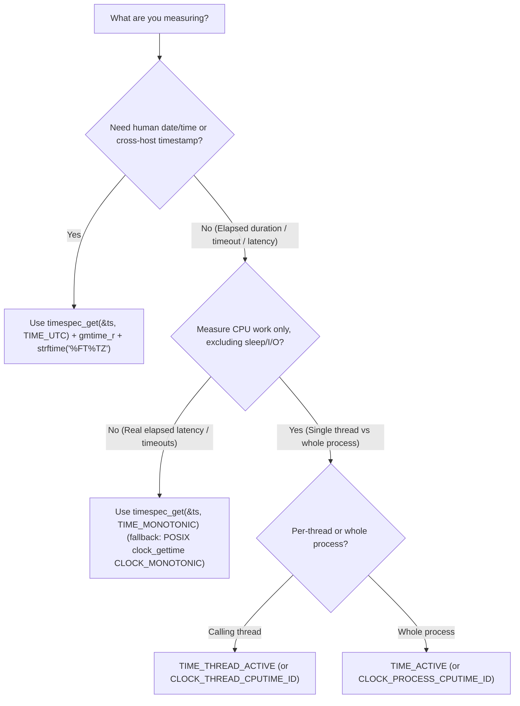

# Date & Time Utilities (`<time.h>`)

The C Standard Library date and time facility in `<time.h>` (ISO/IEC 9899:2024 §7.29), complemented by wide-character formatting (`wcsftime`) in `<wchar.h>`, bridges low-level hardware/OS clocks and calendar time conversions. **C23** delivers the most practical modernization of `<time.h>` in decades: standardizing POSIX's thread-safe **`gmtime_r`**, **`localtime_r`**, and **`timegm`**, introducing **`timespec_getres`** and optional steady/CPU time bases (**`TIME_MONOTONIC`**, **`TIME_ACTIVE`**, **`TIME_THREAD_ACTIVE`**), widening `struct timespec::tv_nsec`, adding locale month specifiers **`%Ob`/`%OB`**, and formally deprecating the unsafe **`asctime`** and **`ctime`** functions.

!!! info "Header & C23 Feature-Test Macro"

    | Header | Standard | C23 Version Macro | Scope |
    | :--- | :--- | :--- | :--- |
    | `<time.h>` | <span class="c-badge c89">C89</span>–<span class="c-badge c23">C23</span> | `__STDC_VERSION_TIME_H__` (`202311L`) | Clocks, `struct timespec`, `struct tm`, calendar conversions, `strftime` |
    | `<wchar.h>` | <span class="c-badge c95">C95</span>–<span class="c-badge c23">C23</span> | `__STDC_VERSION_WCHAR_H__` (`202311L`) | `wcsftime` wide-character date/time formatting |

---

## 1. Types & Time Base Constants (`<time.h>`)

### 1.1 Fundamental Time Types

| Type / Macro | Standard | Definition & Semantics |
| :--- | :--- | :--- |
| `time_t` | <span class="c-badge c89">C89</span> | Real arithmetic type capable of representing calendar times. ISO C does not prescribe its epoch or encoding, though POSIX and Windows define it as signed integer seconds since `1970-01-01T00:00:00Z` (excluding leap seconds). |
| `clock_t` | <span class="c-badge c89">C89</span> | Real arithmetic type capable of representing processor time returned by `clock()`. |
| `CLOCKS_PER_SEC` | <span class="c-badge c89">C89</span> | Number of `clock_t` ticks per second. POSIX mandates `1000000` (1 µs units, regardless of true timer granularity); Windows MSVC defines `1000` (1 ms). |
| `struct timespec` | <span class="c-badge c11">C11</span> / <span class="c-badge c23">C23</span> | Interval or timestamp split into whole seconds (`time_t tv_sec`) and nanoseconds (`tv_nsec` in `[0, 999'999'999]`). **C23 change**: `tv_nsec` is no longer forced to `long`; it is an implementation-defined signed integer type capable of holding `[0, 999'999'999]` (accommodating 64-bit `long long` on x32/LLP64 ABIs). |
| `struct tm` | <span class="c-badge c89">C89</span> | Broken-down Gregorian calendar date and wall-clock time (see field table below). |

### 1.2 Time Base Constants (`timespec_get` & `timespec_getres`)

| Constant | Standard | Semantics & POSIX Equivalent |
| :--- | :--- | :--- |
| `TIME_UTC` | <span class="c-badge c11">C11</span> | **Mandatory** integer constant `> 0`. Calendar wall-clock time in UTC since an implementation-defined epoch (Unix epoch on POSIX/Windows). Equivalent to POSIX `CLOCK_REALTIME`. **Subject to NTP slewing and backward jumps!** |
| `TIME_MONOTONIC` | <span class="c-badge c23">C23</span> <span class="c-badge c-optional">optional</span> | Steady, non-decreasing physical time since an unspecified starting point (e.g., system boot). Immune to wall-clock/NTP/DST adjustments. Equivalent to POSIX `CLOCK_MONOTONIC`. Always guard with `#ifdef TIME_MONOTONIC`. |
| `TIME_ACTIVE` | <span class="c-badge c23">C23</span> <span class="c-badge c-optional">optional</span> | Active CPU processing time consumed by the calling process across all threads (replaces overflow-prone `clock()`). Equivalent to POSIX `CLOCK_PROCESS_CPUTIME_ID`. |
| `TIME_THREAD_ACTIVE` | <span class="c-badge c23">C23</span> <span class="c-badge c-optional">optional</span> | Active CPU processing time consumed solely by the calling thread. Equivalent to POSIX `CLOCK_THREAD_CPUTIME_ID`. |

### 1.3 `struct tm` Layout & Field Semantics

```c
struct tm {
    int tm_sec;   /* Seconds after the minute — [0, 60] (60 allows positive leap second; [0, 61] in C89) */
    int tm_min;   /* Minutes after the hour   — [0, 59] */
    int tm_hour;  /* Hours since midnight     — [0, 23] */
    int tm_mday;  /* Day of the month         — [1, 31] (1-based!) */
    int tm_mon;   /* Months since January     — [0, 11] (0-based! Jan = 0, Dec = 11) */
    int tm_year;  /* Years since 1900         — e.g., 2026 is stored as 126! */
    int tm_wday;  /* Days since Sunday        — [0, 6]  (Sunday = 0, Saturday = 6) */
    int tm_yday;  /* Days since January 1     — [0, 365] */
    int tm_isdst; /* Daylight Saving Time     — >0: DST active, 0: DST inactive, <0: unknown */
    /* Implementations (glibc, BSD, macOS) may add extra fields such as tm_gmtoff and tm_zone! */
};
```

!!! warning "Always Zero-Initialize `struct tm` Before Calling `mktime` or `timegm`"
    POSIX/BSD C libraries often extend `struct tm` with extra fields (`long tm_gmtoff; const char *tm_zone;`). Leaving a stack-allocated `struct tm` partially uninitialized can feed garbage into platform-extended members. In C23, always initialize cleanly with empty braces (`struct tm t = {};`) and explicitly set `t.tm_isdst = -1;` before calling `mktime(&t)` if DST status is unknown.

---

## 2. Time Manipulation Functions

| Function | Standard | Prototype | Return Value & Behavior |
| :--- | :--- | :--- | :--- |
| `time` | <span class="c-badge c89">C89</span> | `time_t time(time_t *arg);` | Returns current calendar time (and writes it to `*arg` if `arg != nullptr`). Returns `(time_t)(-1)` on error. Resolution is typically 1 second. |
| `difftime` | <span class="c-badge c89">C89</span> | `double difftime(time_t time_end, time_t time_beg);` | Computes `time_end - time_beg` in seconds as a `double`. Strictly required for maximum ISO C portability because ISO C does not guarantee `time_t` is integer seconds. |
| `clock` | <span class="c-badge c89">C89</span> | `clock_t clock(void);` | Returns approximate processor time used by the process since an implementation-defined start (`(double)c / CLOCKS_PER_SEC` seconds), or `(clock_t)(-1)` if unavailable. |
| `timespec_get` | <span class="c-badge c11">C11</span> | `int timespec_get(struct timespec *ts, int base);` | Stores current time according to `base` (`TIME_UTC`, `TIME_MONOTONIC`, etc.) in `*ts`. Returns `base` on success, `0` on failure or unsupported base. |
| `timespec_getres` | <span class="c-badge c23">C23</span> | `int timespec_getres(struct timespec *ts, int base);` | Queries the clock resolution (minimum tick interval) of `base`. If `ts != nullptr`, stores resolution in `*ts`. If `ts == nullptr`, simply tests whether `base` is supported! Returns `base` if supported, `0` otherwise. |

!!! danger "Two Classic `clock()` Pitfalls"
    1. **CPU Time vs. Wall Time Divergence**: On Linux/macOS/POSIX, `clock()` measures **summed CPU time across all threads** (so 4 busy threads advance `clock()` at 4× wall-clock speed, while `sleep()` advances it by 0!). On **Windows (MSVC)**, `clock()` measures **wall-clock elapsed time** instead!
    2. **71.6-Minute 32-Bit Wraparound**: On 32-bit POSIX systems (`sizeof(clock_t) == 4`, `CLOCKS_PER_SEC == 1000000`), `clock()` overflows `INT32_MAX` after just **2,147 seconds (~35.8 minutes)** (or ~71.6 minutes unsigned). **Prefer `timespec_get` with `TIME_MONOTONIC` / `TIME_ACTIVE` instead.**

---

## 3. Format Conversions, Calendar Math & Thread Safety

### 3.1 Calendar & Broken-Down Time Conversions

| Function | Standard | Thread-Safe? | Prototype | Semantics & Hazards |
| :--- | :--- | :---: | :--- | :--- |
| `mktime` | <span class="c-badge c89">C89</span> | Depends on `TZ` | `time_t mktime(struct tm *arg);` | Converts **local** `struct tm` to `time_t`. **Normalizes** out-of-range fields (e.g., adding 45 to `tm_mday` automatically advances months/years) and recalculates `tm_wday`, `tm_yday`, `tm_isdst`. Returns `(time_t)(-1)` on error. |
| `timegm` | <span class="c-badge c23">C23</span> | **Yes** | `time_t timegm(struct tm *arg);` | Standardized UTC counterpart to `mktime`! Converts **UTC** `struct tm` to `time_t`, normalizes all calendar fields, ignores `tm_isdst` on input, and sets `tm_isdst = 0` on output. Completely eliminates the non-thread-safe `setenv("TZ", "UTC", 1)` hack! |
| `gmtime` | <span class="c-badge c89">C89</span> | **NO** | `struct tm *gmtime(const time_t *timer);` | Converts `*timer` to UTC `struct tm` inside a **shared static internal object** (data race across threads; overwritten by subsequent calls to `gmtime`/`localtime`/`ctime`/`asctime`). |
| `gmtime_r` | <span class="c-badge c23">C23</span> | **Yes** | `struct tm *gmtime_r(const time_t *timer, struct tm *buf);` | Reentrant, thread-safe UTC conversion writing into caller-supplied `*buf`. Returns `buf` on success, `nullptr` on failure. |
| `gmtime_s` | <span class="c-badge c11">C11</span> <span class="c-badge c-optional">Annex K</span> | **Yes** | `struct tm *gmtime_s(const time_t *restrict timer, struct tm *restrict buf);` | Annex K bounds-checked variant (`__STDC_LIB_EXT1__`). **WARNING**: Microsoft MSVC defines `errno_t gmtime_s(struct tm *buf, const time_t *timer)` with **reversed parameter order and different return type**! |
| `localtime` | <span class="c-badge c89">C89</span> | **NO** | `struct tm *localtime(const time_t *timer);` | Converts `*timer` to local timezone `struct tm` inside a **shared static internal object** (data race!). |
| `localtime_r` | <span class="c-badge c23">C23</span> | **Yes** | `struct tm *localtime_r(const time_t *timer, struct tm *buf);` | Reentrant, thread-safe local-time conversion writing into caller-supplied `*buf`. Returns `buf` on success, `nullptr` on failure. |
| `localtime_s` | <span class="c-badge c11">C11</span> <span class="c-badge c-optional">Annex K</span> | **Yes** | `struct tm *localtime_s(const time_t *restrict timer, struct tm *restrict buf);` | Annex K variant (same MSVC reversed-argument incompatibility as `gmtime_s`!). |
| `asctime` | <span class="c-badge c89">C89</span> <span class="c-badge c-deprecated">deprecated C23</span> | **NO** | `char *asctime(const struct tm *time_ptr);` | Formats `*time_ptr` as `"Www Mmm dd hh:mm:ss yyyy\n"` in a static 26-byte buffer. **Deprecated in C23** — see warning below. |
| `ctime` | <span class="c-badge c89">C89</span> <span class="c-badge c-deprecated">deprecated C23</span> | **NO** | `char *ctime(const time_t *timer);` | Equivalent to `asctime(localtime(timer))`. **Deprecated in C23**. |
| `asctime_s` / `ctime_s` | <span class="c-badge c11">C11</span> <span class="c-badge c-optional">Annex K</span> | **Yes** | `errno_t asctime_s(char *buf, rsize_t bufsz, const struct tm *tp);` | Annex K variants (rarely implemented outside MSVC/safeclib; prefer `strftime`). |

!!! danger "Why `asctime()` and `ctime()` Are Formally Deprecated in C23 (N2611)"
    1. **Buffer Overflow Undefined Behavior**: The C standard specifies `asctime` in terms of `sprintf` into an internal **26-byte static buffer** (`"Sun Sep 16 01:03:52 1973\n\0"`). If `tm_year` corresponds to a year outside `[1000, 9999]` (for example, a negative year or a 5-digit year $\ge 10000$ — trivially reachable with 64-bit `time_t`!), formatting overflows the internal 26-byte buffer, triggering **undefined behavior**!
    2. **Thread-Safety Data Race**: Both functions mutate a single process-wide static character buffer.
    3. **Non-Standard, Locale-Broken Format**: Outputs an English-only, trailing-newline legacy format instead of ISO 8601 (`YYYY-MM-DDTHH:MM:SSZ`).

    **Always replace `ctime`/`asctime` with `gmtime_r` (or `localtime_r`) + `strftime`.**

### 3.2 Formatted Output: `strftime` (`<time.h>`) & `wcsftime` (`<wchar.h>`)

```c
/* <time.h> (C89) */
size_t strftime(char *restrict str, size_t count,
                const char *restrict format, const struct tm *restrict tp);

/* <wchar.h> (C95) */
size_t wcsftime(wchar_t *restrict str, size_t count,
                const wchar_t *restrict format, const struct tm *restrict tp);
```

Both functions write up to `count - 1` characters plus a terminating null character into `str`, returning the number of characters written (excluding the null terminator), or **`0`** if the formatted result does not fit within `count` bytes.

!!! warning "`strftime` Return Value `0` Ambiguity"
    If `strftime` returns `0`, either (a) the output buffer was too small (in which case the contents of `str` are **indeterminate** and must NOT be read!), or (b) the format string legitimately expanded to 0 characters (e.g., `"%p"` in a 24-hour locale where AM/PM is empty). Always include a non-empty literal or check a non-empty format when diagnosing buffer overflow.

#### Complete Conversion Specifier Table

| Category | Specifier | Standard | Meaning (C / POSIX Locale Example) | Locale Alt (`E` / `O`) |
| :--- | :--- | :--- | :--- | :--- |
| **Year** | `%Y` | <span class="c-badge c89">C89</span> | Full 4-digit year (`2026`) | `%EY` (C99: era-based full year) |
| | `%y` | <span class="c-badge c89">C89</span> | Last 2 digits of year `[00, 99]` (`26`) | `%Ey`, `%Oy` (C99) |
| | `%C` | <span class="c-badge c99">C99</span> | First 2 digits of year / century (`20`) | `%EC` (C99: era name) |
| | `%G` | <span class="c-badge c99">C99</span> | ISO 8601 week-based full year (`2026`) | — |
| | `%g` | <span class="c-badge c99">C99</span> | Last 2 digits of ISO 8601 week-based year (`26`) | — |
| **Month** | `%m` | <span class="c-badge c89">C89</span> | Month as decimal `[01, 12]` (`11`) | `%Om` (C99) |
| | `%b`, `%h` | <span class="c-badge c89">C89</span> / <span class="c-badge c99">C99</span> | Abbreviated locale month name (`Nov`) | **`%Ob`** <span class="c-badge c23">C23</span> (standalone/nominative abbreviated month name for inflected languages!) |
| | `%B` | <span class="c-badge c89">C89</span> | Full locale month name (`November`) | **`%OB`** <span class="c-badge c23">C23</span> (standalone/nominative full month name!) |
| **Week & Day** | `%d` | <span class="c-badge c89">C89</span> | Day of month, zero-padded `[01, 31]` (`05`) | `%Od` (C99) |
| | `%e` | <span class="c-badge c99">C99</span> | Day of month, space-padded `[ 1, 31]` (`" 5"`) | `%Oe` (C99) |
| | `%j` | <span class="c-badge c89">C89</span> | Day of year `[001, 366]` (`325`) | — |
| | `%a` / `%A` | <span class="c-badge c89">C89</span> | Abbreviated (`Sat`) / Full (`Saturday`) weekday name | — |
| | `%w` | <span class="c-badge c89">C89</span> | Weekday `[0, 6]` where Sunday = `0` | `%Ow` (C99) |
| | `%u` | <span class="c-badge c99">C99</span> | ISO 8601 weekday `[1, 7]` where Monday = `1` | `%Ou` (C99) |
| | `%U` / `%W` | <span class="c-badge c89">C89</span> | Week number `[00, 53]` (Sunday-first `%U` / Monday-first `%W`) | `%OU`, `%OW` (C99) |
| | `%V` | <span class="c-badge c99">C99</span> | ISO 8601 week number `[01, 53]` | `%OV` (C99) |
| **Time** | `%H` | <span class="c-badge c89">C89</span> | 24-hour clock hour `[00, 23]` (`20`) | `%OH` (C99) |
| | `%I` | <span class="c-badge c89">C89</span> | 12-hour clock hour `[01, 12]` (`08`) | `%OI` (C99) |
| | `%M` | <span class="c-badge c89">C89</span> | Minute `[00, 59]` (`08`) | `%OM` (C99) |
| | `%S` | <span class="c-badge c89">C89</span> | Second `[00, 60]` (`49`) | `%OS` (C99) |
| | `%p` | <span class="c-badge c89">C89</span> | Locale AM/PM designation (`PM`) | — |
| **Composite & ISO 8601** | `%F` | <span class="c-badge c99">C99</span> | Equivalent to **`%Y-%m-%d`** (ISO 8601 date: `2026-11-22`) | — |
| | `%T` | <span class="c-badge c99">C99</span> | Equivalent to **`%H:%M:%S`** (ISO 8601 time: `02:08:49`) | — |
| | `%R` | <span class="c-badge c99">C99</span> | Equivalent to `%H:%M` (`02:08`) | — |
| | `%D` | <span class="c-badge c99">C99</span> | Equivalent to `%m/%d/%y` (`11/22/26`) | — |
| | `%r` | <span class="c-badge c99">C99</span> | Locale 12-hour clock time (`02:08:49 AM`) | — |
| | `%c` | <span class="c-badge c89">C89</span> | Locale standard date and time string | `%Ec` (C99) |
| | `%x` / `%X` | <span class="c-badge c89">C89</span> | Locale date (`%x`) / time (`%X`) representation | `%Ex`, `%EX` (C99) |
| **Timezone & Literals** | `%z` | <span class="c-badge c99">C99</span> | ISO 8601 UTC offset (`+0000`, `-0600`) or empty if undeterminable | — |
| | `%Z` | <span class="c-badge c89">C89</span> | Timezone name or abbreviation (`UTC`, `CST`) or empty | — |
| | `%%`, `%n`, `%t` | <span class="c-badge c89">C89</span> / <span class="c-badge c99">C99</span> | Literal `%`, newline `\n` (C99), horizontal tab `\t` (C99) | — |

---

## 4. Year 2038 Problem (Y2038) & Clock Benchmarking Best Practices

### 4.1 The Year 2038 Overflow (`time_t` 32-bit vs. 64-bit)

On legacy 32-bit systems where `time_t` is a signed 32-bit integer (`int32_t`), the maximum representable timestamp is:

$$2^{31} - 1 = 2{,}147{,}483{,}647\text{ seconds} = \text{2038-01-19 03:14:07 UTC}$$

One second later, signed 32-bit `time_t` wraps to $-2{,}147{,}483{,}648$ (**`1901-12-13 20:45:52 UTC`**), breaking TLS certificate validation, cron/schedulers, file timestamps, lease expirations, and database indexes. Even today, 30-year mortgages and long-lived certificates already cross 2038!

| Platform / Libc | Default `sizeof(time_t)` | Y2038 Mitigation |
| :--- | :---: | :--- |
| 64-bit Linux (LP64), macOS (LP64), 64-bit Windows (LLP64) | **8 bytes** (64-bit) | Safe for $\pm 292$ billion years. |
| 32-bit Linux with **musl 1.2+** | **8 bytes** (64-bit) | Y2038-safe by default on all architectures. |
| 32-bit Linux with **glibc 2.34+** | 4 bytes (ABI compat) | Compile with **`-D_FILE_OFFSET_BITS=64 -D_TIME_BITS=64`** to opt into 64-bit `time_t` and Y2038-safe syscalls. |
| 32-bit Windows (MSVC) | **8 bytes** (since VS 2005) | Default `time_t` is `__time64_t` unless `_USE_32BIT_TIME_T` is explicitly defined. |

Protect security-critical builds at compile time with C23's `static_assert`:

```c
#include <time.h>

static_assert(sizeof(time_t) >= 8, "Build requires 64-bit time_t for Year 2038 safety");
```

### 4.2 Monotonic vs. Wall-Clock vs. CPU-Time Benchmarking

Choosing the wrong clock is one of the most frequent bugs in latency measurement and timeout logic:



| Clock Source | Monotonic? | Includes Sleep / I/O Wait? | Multi-Thread Safe? | Recommended Use Case |
| :--- | :---: | :---: | :---: | :--- |
| `TIME_UTC` (`timespec_get`) | **No** (NTP/manual jumps!) | Yes | Yes | Log timestamps, file metadata, calendar dates — **NEVER for timeouts or latency benchmarks!** |
| `TIME_MONOTONIC` (`timespec_get`) | **Yes** | Yes | Yes | Benchmarks, latency histograms, retry backoffs, network timeouts. |
| `TIME_ACTIVE` (`timespec_get`) | **Yes** | No | Yes | Total CPU time across all threads of a process. |
| `TIME_THREAD_ACTIVE` (`timespec_get`) | **Yes** | No | Yes | CPU profiling of a single worker thread. |
| `clock()` | Varies | OS-dependent (No on POSIX, Yes on MSVC!) | Yes (32-bit wrap!) | Legacy compatibility only. |

!!! tip "Computing `struct timespec` Elapsed Nanoseconds Without Overflow or Borrow Bugs"
    Never subtract `end.tv_nsec - start.tv_nsec` without combining the seconds delta (since `end.tv_nsec` is frequently smaller than `start.tv_nsec` across a second boundary!). Converting the difference safely to `int64_t` nanoseconds handles up to $\pm 292$ years cleanly:

    ```c
    static inline int64_t timespec_diff_ns(struct timespec start, struct timespec end) {
        return (int64_t)(end.tv_sec - start.tv_sec) * 1'000'000'000LL
             + (int64_t)(end.tv_nsec - start.tv_nsec);
    }
    ```

---

## 5. Complete Compilable C23 Example: Monotonic Benchmarking & ISO-8601 UTC Formatting

This complete C23 program verifies Year 2038 readiness at compile time, queries clock resolution (`timespec_getres` when supported), benchmarks a workload using `TIME_MONOTONIC` (with clean POSIX/ISO fallback), formats a nanosecond-precision ISO-8601 UTC timestamp with thread-safe `gmtime_r` + `strftime`, and verifies `timegm` round-tripping:

```c
/* Compile: cc -std=c23 -Wall -Wextra -Wpedantic chrono_demo.c -o chrono_demo */
#if defined(__APPLE__) && !defined(_DARWIN_C_SOURCE)
    #define _DARWIN_C_SOURCE
#elif !defined(_WIN32) && !defined(_DEFAULT_SOURCE)
    #define _DEFAULT_SOURCE
#endif

#include <inttypes.h>
#include <stdbool.h>
#include <stdint.h>
#include <stdio.h>
#include <stdlib.h>
#include <time.h>

#if defined(_WIN32)
    #define portable_gmtime_r(t, out) (gmtime_s((out), (t)) == 0 ? (out) : nullptr)
    #define portable_timegm(tm_ptr)   _mkgmtime(tm_ptr)
#else
    #define portable_gmtime_r(t, out) gmtime_r((t), (out))
    #define portable_timegm(tm_ptr)   timegm(tm_ptr)
#endif

static_assert(sizeof(time_t) >= 8, "64-bit time_t is required for Year 2038 safety");

static int64_t timespec_diff_ns(struct timespec start, struct timespec end) {
    return (int64_t)(end.tv_sec - start.tv_sec) * 1'000'000'000LL
         + (int64_t)(end.tv_nsec - start.tv_nsec);
}

/* Acquire a monotonic timestamp using C23 TIME_MONOTONIC, POSIX CLOCK_MONOTONIC, or TIME_UTC fallback */
static bool get_steady_now(struct timespec *out, const char **clock_name) {
#ifdef TIME_MONOTONIC
    if (timespec_get(out, TIME_MONOTONIC) == TIME_MONOTONIC) {
        if (clock_name != nullptr) *clock_name = "C23 TIME_MONOTONIC";
        return true;
    }
#endif
#if defined(CLOCK_MONOTONIC)
    if (clock_gettime(CLOCK_MONOTONIC, out) == 0) {
        if (clock_name != nullptr) *clock_name = "POSIX CLOCK_MONOTONIC";
        return true;
    }
#endif
    if (timespec_get(out, TIME_UTC) == TIME_UTC) {
        if (clock_name != nullptr) *clock_name = "C11 TIME_UTC (fallback)";
        return true;
    }
    return false;
}

/* Format a UTC struct timespec as ISO-8601: YYYY-MM-DDTHH:MM:SS.nnnnnnnnnZ */
static bool format_iso8601_utc(struct timespec ts, char *buf, size_t buf_sz) {
    struct tm utc_tm = {};
    if (portable_gmtime_r(&ts.tv_sec, &utc_tm) == nullptr) {
        return false;
    }

    char date_part[32] = {};
    if (strftime(date_part, sizeof(date_part), "%FT%T", &utc_tm) == 0) {
        return false;
    }

    int written = snprintf(buf, buf_sz, "%s.%09lldZ", date_part, (long long)ts.tv_nsec);
    return written > 0 && (size_t)written < buf_sz;
}

int main(void) {
    /* 1. Query C23 clock resolution when timespec_getres is provided */
#if defined(__STDC_VERSION_TIME_H__) && __STDC_VERSION_TIME_H__ >= 202311L
    struct timespec res = {};
    if (timespec_getres(&res, TIME_UTC) == TIME_UTC) {
        printf("TIME_UTC resolution: %lld s + %lld ns\n",
               (long long)res.tv_sec, (long long)res.tv_nsec);
    }
#endif

    /* 2. Capture and format current UTC wall-clock timestamp */
    struct timespec wall_now = {};
    if (timespec_get(&wall_now, TIME_UTC) != TIME_UTC) {
        fprintf(stderr, "Failed to read TIME_UTC\n");
        return EXIT_FAILURE;
    }

    char iso_buf[64] = {};
    if (!format_iso8601_utc(wall_now, iso_buf, sizeof(iso_buf))) {
        fprintf(stderr, "Failed to format UTC timestamp\n");
        return EXIT_FAILURE;
    }
    printf("Current UTC timestamp : %s\n", iso_buf);

    /* 3. Measure workload latency with a steady monotonic clock */
    const char *clock_label = nullptr;
    struct timespec t0 = {};
    struct timespec t1 = {};
    if (!get_steady_now(&t0, &clock_label)) {
        fprintf(stderr, "Failed to read start clock\n");
        return EXIT_FAILURE;
    }

    volatile uint64_t checksum = 0;
    for (uint64_t i = 1; i <= 1'000'000ULL; ++i) {
        checksum += (i * 2654435761ULL) ^ (i >> 3);
    }

    if (!get_steady_now(&t1, nullptr)) {
        fprintf(stderr, "Failed to read end clock\n");
        return EXIT_FAILURE;
    }

    int64_t elapsed_ns = timespec_diff_ns(t0, t1);
    printf("Monotonic clock used  : %s\n", clock_label);
    printf("Workload checksum     : 0x%016" PRIX64 "\n", (uint64_t)checksum);
    printf("Elapsed latency       : %" PRId64 " ns (%.3f ms)\n",
           elapsed_ns, (double)elapsed_ns / 1e6);

    /* 4. Demonstrate C23 timegm() calendar normalization (post-Y2038 date: 2040-02-29) */
    struct tm leap_day = {
        .tm_year = 2040 - 1900,
        .tm_mon  = 2 - 1, /* February (0-based) */
        .tm_mday = 29,
        .tm_hour = 12,
        .tm_min  = 30,
        .tm_sec  = 0,
    };
    time_t epoch_2040 = portable_timegm(&leap_day);
    if (epoch_2040 == (time_t)(-1)) {
        fprintf(stderr, "timegm failed\n");
        return EXIT_FAILURE;
    }

    char future_buf[64] = {};
    struct timespec future_ts = { .tv_sec = epoch_2040, .tv_nsec = 0 };
    if (format_iso8601_utc(future_ts, future_buf, sizeof(future_buf))) {
        printf("Post-Y2038 timegm()   : %s (epoch = %lld, wday = %d)\n",
               future_buf, (long long)epoch_2040, leap_day.tm_wday);
    }

    return EXIT_SUCCESS;
}
```

---

## See Also

- [Localization Support (`<locale.h>`)](locale.md) — how `LC_TIME` controls `strftime` / `wcsftime` and C23 `%Ob`/`%OB` month names
- [Concurrency: Threads & Atomics](concurrency.md) — `thrd_sleep`, `cnd_timedwait`, `mtx_timedlock` using `struct timespec` with `TIME_UTC`
- [Program Utilities, Signals & `setjmp`](program.md) — process termination and environment variables (`TZ`)
- [C23 Migration & Breaking Changes](../../standards/c23-migration.md) — deprecation of `asctime`/`ctime` and migration to `strftime` / `gmtime_r`
- **External References**: [cppreference — Date and time utilities (`<time.h>`)](https://en.cppreference.com/w/c/chrono), [cppreference — `strftime`](https://en.cppreference.com/w/c/chrono/strftime), ISO/IEC 9899:2024 §7.29
