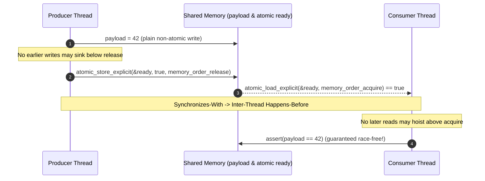

# Concurrency: Threads & Atomics (`<threads.h>` & `<stdatomic.h>`)

ISO C11 introduced a formal **multi-threaded memory model** (defining *data races*, *happens-before*, and *synchronizes-with* relationships) together with two optional standard library headers, refined through C17 and <span class="c-badge c23">C23</span>:

* **`<threads.h>`** <span class="c-badge c11">C11</span> <span class="c-badge c-optional">optional</span> — OS threads, mutexes, one-time initialization, condition variables, and thread-specific storage (TSS).
* **`<stdatomic.h>`** <span class="c-badge c11">C11</span> <span class="c-badge c-optional">optional</span> — lock-free and atomic object operations, `atomic_flag`, memory ordering semantics, and fences. Defines `__STDC_VERSION_STDATOMIC_H__` (`202311L`) in <span class="c-badge c23">C23</span>.

```c
#if !defined(__STDC_NO_ATOMICS__)
#  include <stdatomic.h>
#endif

#if !defined(__STDC_NO_THREADS__)
#  include <threads.h>
#endif
```

---

## Feature-Test Macros & Real-World Platform Support

Both concurrency headers are **conditionally supported** in ISO C11–C23. An implementation that omits a facility defines the corresponding negative feature-test macro to `1`:

| Feature-Test Macro | Meaning When Defined (`1`) | Real-World Toolchain Status |
| :--- | :--- | :--- |
| `__STDC_NO_THREADS__` | `<threads.h>` is not provided. | **Linux** (glibc 2.28+, musl 1.1.5+): supported. **FreeBSD 10+**: supported. **Windows** (MSVC 17.8+ / UCRT): supported. **macOS (Apple SDK)**: **NOT provided** — Apple does not ship `<threads.h>`! |
| `__STDC_NO_ATOMICS__` | `<stdatomic.h>` and `_Atomic` are not provided. | **Supported everywhere** on modern hosted toolchains: GCC 4.9+, Clang 3.6+ (including Apple Clang on macOS), and MSVC 17.5+ (C11/C17/C23 atomics). |
| `__STDC_VERSION_STDATOMIC_H__` <span class="c-badge c23">C23</span> | Expands to `202311L` when C23 `<stdatomic.h>` additions (`atomic_char8_t`, removal of `ATOMIC_VAR_INIT`) are active. | GCC 14+, Clang 18+ (paired with C23 headers). |

!!! warning "macOS / Apple SDK & Cross-Platform Portability Note"
    Because Apple's macOS/iOS SDK does **not** ship `<threads.h>` (even under `-std=c23`), portable C projects targeting macOS + Linux + BSD typically use **`<stdatomic.h>`** directly for atomics while wrapping **`<pthread.h>`** (POSIX) and Win32 threads (or checking `__STDC_NO_THREADS__` / `__has_include(<threads.h>)`) for thread creation and mutexes. Note that the **C23 `thread_local` keyword** is a core compiler feature and *does* work on macOS without `<threads.h>`.

---

## Part I: Thread Support Library (`<threads.h>`)

### Return Status Codes

Most `<threads.h>` functions return one of five integer enumerators:

| Constant | Standard | Meaning |
| :--- | :--- | :--- |
| `thrd_success` | <span class="c-badge c11">C11</span> | Operation completed successfully. |
| `thrd_nomem` | <span class="c-badge c11">C11</span> | Failed to allocate required memory. |
| `thrd_timedout` | <span class="c-badge c11">C11</span> | Timed wait (`mtx_timedlock`, `cnd_timedwait`) expired without acquiring the resource. |
| `thrd_busy` | <span class="c-badge c11">C11</span> | Non-blocking lock (`mtx_trylock`) found the mutex already locked. |
| `thrd_error` | <span class="c-badge c11">C11</span> | Unspecified failure. |

### Thread Lifecycle & Control

| Symbol | Declaration / Prototype | Standard | Semantics & Critical Rules |
| :--- | :--- | :--- | :--- |
| `thrd_t` | *(complete object type)* | <span class="c-badge c11">C11</span> | Opaque thread identifier. **Never compare with `==`** — always use `thrd_equal`. |
| `thrd_start_t` | `typedef int (*thrd_start_t)(void *);` | <span class="c-badge c11">C11</span> | Thread entry-point function pointer type. |
| `thrd_create` | `int thrd_create(thrd_t *thr, thrd_start_t func, void *arg);` | <span class="c-badge c11">C11</span> | Spawns a new thread executing `func(arg)`. Stores thread ID into `*thr`. Synchronizes-with the start of `func`. Returns `thrd_success`, `thrd_nomem`, or `thrd_error`. |
| `thrd_equal` | `int thrd_equal(thrd_t lhs, thrd_t rhs);` | <span class="c-badge c11">C11</span> | Returns nonzero if `lhs` and `rhs` identify the same thread, `0` otherwise. |
| `thrd_current` | `thrd_t thrd_current(void);` | <span class="c-badge c11">C11</span> | Returns the `thrd_t` identifier of the calling thread. |
| `thrd_sleep` | `int thrd_sleep(const struct timespec *duration, struct timespec *remaining);` | <span class="c-badge c11">C11</span> | Blocks the calling thread for at least the **relative** interval `*duration`. Returns `0` if full duration elapsed, `-1` if interrupted by a signal (writing unslept time into `*remaining` if non-null), or another negative value on error. |
| `thrd_yield` | `void thrd_yield(void);` | <span class="c-badge c11">C11</span> | Scheduler hint allowing other runnable threads to execute. |
| `thrd_exit` | `[[noreturn]] void thrd_exit(int res);` | <span class="c-badge c11">C11</span> / <span class="c-badge c23">C23</span> | Terminates the calling thread with exit code `res` (running TSS destructors). If this is the last thread in the program, exits the process as if `exit(0)`. *(Declared `_Noreturn` in C11/C17, `[[noreturn]]` in C23.)* |
| `thrd_detach` | `int thrd_detach(thrd_t thr);` | <span class="c-badge c11">C11</span> | Marks `thr` so its OS resources are reclaimed automatically on termination. A detached thread **cannot** be joined. |
| `thrd_join` | `int thrd_join(thrd_t thr, int *res);` | <span class="c-badge c11">C11</span> | Blocks until `thr` terminates, reclaims its resources, and stores its return code into `*res` (if non-null). Synchronizes-with `thr`'s completion. |

!!! warning "Every Created Thread Must Be Either Joined OR Detached — Never Both"
    Forgetting to call `thrd_join` or `thrd_detach` leaks thread stacks and kernel descriptors. Calling `thrd_join` twice, detaching twice, or joining a detached thread is **undefined behavior**.

### Mutual Exclusion (`mtx_t`) & One-Time Initialization (`call_once`)

#### Mutex Type Constants

`mtx_init` accepts **only four** valid combinations of mutex flags:

| `type` Argument | Timed Lock (`mtx_timedlock`) | Recursive Re-Lock by Owner |
| :--- | :--- | :--- |
| `mtx_plain` | No (UB!) | No (deadlock / UB!) |
| `mtx_timed` | **Yes** | No |
| `mtx_plain \| mtx_recursive` | No | **Yes** (must `mtx_unlock` same number of times) |
| `mtx_timed \| mtx_recursive` | **Yes** | **Yes** |

!!! danger "Never Pass `mtx_recursive` Alone"
    Passing bare `mtx_recursive` without OR-ing `mtx_plain` or `mtx_timed` is invalid in ISO C (§7.28.4.2p2) and causes `mtx_init` to fail or exhibit undefined behavior.

#### Mutex & Once-Init Functions

| Function / Macro | Prototype | Standard | Semantics |
| :--- | :--- | :--- | :--- |
| `mtx_init` | `int mtx_init(mtx_t *mutex, int type);` | <span class="c-badge c11">C11</span> | Initializes `*mutex` with one of the 4 valid `type` combinations above. |
| `mtx_lock` | `int mtx_lock(mtx_t *mutex);` | <span class="c-badge c11">C11</span> | Blocks until `*mutex` is acquired. |
| `mtx_timedlock` | `int mtx_timedlock(mtx_t *restrict mutex, const struct timespec *restrict ts);` | <span class="c-badge c11">C11</span> | Blocks until `*mutex` is acquired or the **absolute UTC time** `*ts` (based on `TIME_UTC`) is reached (`thrd_timedout`). Mutex **must** have `mtx_timed`. |
| `mtx_trylock` | `int mtx_trylock(mtx_t *mutex);` | <span class="c-badge c11">C11</span> | Attempts non-blocking lock. Returns `thrd_success` if acquired, `thrd_busy` if already locked, or `thrd_error`. |
| `mtx_unlock` | `int mtx_unlock(mtx_t *mutex);` | <span class="c-badge c11">C11</span> | Releases `*mutex` (must be owned by the calling thread!). Synchronizes-with the next lock acquisition. |
| `mtx_destroy` | `void mtx_destroy(mtx_t *mutex);` | <span class="c-badge c11">C11</span> | Destroys `*mutex`. Calling while any thread holds or waits on `*mutex` is **UB**. |
| `ONCE_FLAG_INIT` | `once_flag flag = ONCE_FLAG_INIT;` | <span class="c-badge c11">C11</span> | Constant initializer macro for `once_flag` objects (must have static or thread storage duration). |
| `call_once` | `void call_once(once_flag *flag, void (*func)(void));` | <span class="c-badge c11">C11</span> | Guarantees `func()` is invoked **exactly once** across all competing threads. All concurrent callers block until `func()` finishes, and completion of `func()` synchronizes-with every returning `call_once` call. |

!!! warning "Relative Duration vs. Absolute `TIME_UTC` Deadline Trap"
    - `thrd_sleep(&dur, &rem)` takes a **relative duration** (e.g., `{ .tv_sec = 0, .tv_nsec = 50000000 }` for 50 ms).
    - `mtx_timedlock(&m, &deadline)` and `cnd_timedwait(&c, &m, &deadline)` take an **absolute `TIME_UTC` wall-clock timestamp** obtained via `timespec_get(&deadline, TIME_UTC)` plus your offset (remembering to normalize `tv_nsec >= 1000000000L`)! Passing a relative struct like `{ .tv_sec = 1 }` means *January 1, 1970 + 1 second*—an immediate `thrd_timedout`!

### Condition Variables (`cnd_t`)

| Function | Prototype | Standard | Semantics |
| :--- | :--- | :--- | :--- |
| `cnd_init` | `int cnd_init(cnd_t *cond);` | <span class="c-badge c11">C11</span> | Initializes condition variable `*cond`. |
| `cnd_signal` | `int cnd_signal(cnd_t *cond);` | <span class="c-badge c11">C11</span> | Unblocks **at least one** thread currently waiting on `*cond` (no-op if none waiting). |
| `cnd_broadcast` | `int cnd_broadcast(cnd_t *cond);` | <span class="c-badge c11">C11</span> | Unblocks **all** threads currently waiting on `*cond`. |
| `cnd_wait` | `int cnd_wait(cnd_t *cond, mtx_t *mutex);` | <span class="c-badge c11">C11</span> | Atomically unlocks `*mutex` and sleeps on `*cond`; re-locks `*mutex` before returning. Caller **must hold `*mutex`**. |
| `cnd_timedwait` | `int cnd_timedwait(cnd_t *restrict cond, mtx_t *restrict mutex, const struct timespec *restrict ts);` | <span class="c-badge c11">C11</span> | Same as `cnd_wait`, but returns `thrd_timedout` if **absolute `TIME_UTC`** deadline `*ts` elapses (still re-acquiring `*mutex` before returning!). |
| `cnd_destroy` | `void cnd_destroy(cnd_t *cond);` | <span class="c-badge c11">C11</span> | Destroys `*cond` (UB if any thread is still waiting). |

#### The Mandatory `while` Loop for Spurious Wakeups

OS schedulers and multi-core races can wake a thread from `cnd_wait` even when no thread signaled, or when another consumer already stole the work before the woken thread re-acquired `mutex`.

=== "Good (`while` Re-Checks Shared Predicate)"

    ```c
    mtx_lock(&queue.mtx);
    while (queue.count == 0 && !queue.shutdown) {
        cnd_wait(&queue.not_empty, &queue.mtx);
    }
    /* Invariant guaranteed: queue.count > 0 || queue.shutdown */
    ```

=== "Bad (`if` Fails on Spurious Wakeups & Thundering Herd)"

    ```c
    mtx_lock(&queue.mtx);
    if (queue.count == 0) {
        /* BUG: spurious wakeup or stolen item causes underflow / UB! */
        cnd_wait(&queue.not_empty, &queue.mtx);
    }
    ```

### Thread-Local Storage (`thread_local` & TSS)

#### Static Thread-Local Variables (`thread_local`)

* **C11 / C17**: introduced the storage-class specifier `_Thread_local`, with `<threads.h>` defining the convenience macro `#define thread_local _Thread_local`.
* **<span class="c-badge c23">C23</span>**: promoted **`thread_local`** to a **core language keyword** (no `<threads.h>` required; `<threads.h>` no longer defines `thread_local` as a macro) and deprecated `_Thread_local` (kept as an alternate spelling).
* Each thread gets its own independent instance initialized at thread start and destroyed at thread exit. Block-scope `thread_local` variables must also be declared `static` or `extern`.

#### Dynamic Thread-Specific Storage (`tss_t`)

Use TSS when per-thread state needs dynamic allocation keys or an automatic cleanup destructor upon thread termination:

| Symbol | Declaration / Prototype | Standard | Semantics |
| :--- | :--- | :--- | :--- |
| `tss_t` | *(complete object type)* | <span class="c-badge c11">C11</span> | Key identifying a thread-specific pointer slot. |
| `tss_dtor_t` | `typedef void (*tss_dtor_t)(void *);` | <span class="c-badge c11">C11</span> | Destructor callback invoked on thread exit if slot value `!= NULL`. |
| `TSS_DTOR_ITERATIONS` | *(macro `>= 1`)* | <span class="c-badge c11">C11</span> | Maximum number of destructor passes if a destructor calls `tss_set` to install another non-null value. |
| `tss_create` | `int tss_create(tss_t *key, tss_dtor_t dtor);` | <span class="c-badge c11">C11</span> | Allocates a new key with optional destructor (`dtor` may be `NULL`). Initial value for all threads is `NULL`. |
| `tss_get` | `void *tss_get(tss_t key);` | <span class="c-badge c11">C11</span> | Returns the calling thread's pointer stored under `key` (or `NULL`). |
| `tss_set` | `int tss_set(tss_t key, void *val);` | <span class="c-badge c11">C11</span> | Sets the calling thread's slot for `key` to `val` (does **not** call `dtor` on old value). |
| `tss_delete` | `void tss_delete(tss_t key);` | <span class="c-badge c11">C11</span> | Releases `key`. **Does NOT invoke destructors** on values still stored in running threads! |

---

## Part II: Atomic Operations Library (`<stdatomic.h>`)

Accessing a non-atomic object concurrently from two threads where at least one access is a write (without synchronization) is a **data race**—which is **undefined behavior** in C11–C23. Atomic objects eliminate data races and establish cross-thread memory ordering guarantees without requiring OS mutex syscalls.

### `_Atomic(T)` Type Specifier vs. `_Atomic` Type Qualifier

C provides two syntactic forms for atomic types (C11 §6.7.2.4 & §6.7.3):

1. **Type specifier `_Atomic(type-name)`**: wraps any complete object type that is not an array, function, or already atomic—including structs (`_Atomic(struct Point)`).
2. **Type qualifier `_Atomic`**: qualifies a declaration like `const` or `volatile`.

!!! warning "Pointer Binding Difference: `_Atomic(int *)` vs `_Atomic int *`"
    - `_Atomic(int *) p;` $\rightarrow$ **atomic pointer** to non-atomic `int` (equivalent to `int * _Atomic p;`).
    - `_Atomic int *p;` $\rightarrow$ **non-atomic pointer** to an `_Atomic int`!

!!! danger "Never Access Struct Members Directly on an Atomic Struct"
    Evaluating `atomic_struct.field` or `atomic_struct_ptr->field` on an `_Atomic(struct S)` invokes **undefined behavior** (ISO C §6.5.2.3p5). Always load the entire struct into a local non-atomic copy via `atomic_load`, inspect or modify fields locally, and write back via `atomic_store` or `atomic_compare_exchange_*`.

### Complete Standard Atomic Typedef Aliases

`<stdatomic.h>` defines convenient typedefs for all standard integer and character types (every alias is `_Atomic T`):

| Alias | Underlying Type | Standard | Alias | Underlying Type | Standard |
| :--- | :--- | :--- | :--- | :--- | :--- |
| `atomic_bool` | `_Atomic bool` (`_Bool`) | <span class="c-badge c11">C11</span> | `atomic_char8_t` | `_Atomic char8_t` | <span class="c-badge c23">C23</span> |
| `atomic_char` | `_Atomic char` | <span class="c-badge c11">C11</span> | `atomic_char16_t` | `_Atomic char16_t` | <span class="c-badge c11">C11</span> |
| `atomic_schar` | `_Atomic signed char` | <span class="c-badge c11">C11</span> | `atomic_char32_t` | `_Atomic char32_t` | <span class="c-badge c11">C11</span> |
| `atomic_uchar` | `_Atomic unsigned char` | <span class="c-badge c11">C11</span> | `atomic_wchar_t` | `_Atomic wchar_t` | <span class="c-badge c11">C11</span> |
| `atomic_short` | `_Atomic short` | <span class="c-badge c11">C11</span> | `atomic_int_least{8,16,32,64}_t` | `_Atomic int_leastN_t` | <span class="c-badge c11">C11</span> |
| `atomic_ushort` | `_Atomic unsigned short` | <span class="c-badge c11">C11</span> | `atomic_uint_least{8,16,32,64}_t` | `_Atomic uint_leastN_t` | <span class="c-badge c11">C11</span> |
| `atomic_int` | `_Atomic int` | <span class="c-badge c11">C11</span> | `atomic_int_fast{8,16,32,64}_t` | `_Atomic int_fastN_t` | <span class="c-badge c11">C11</span> |
| `atomic_uint` | `_Atomic unsigned int` | <span class="c-badge c11">C11</span> | `atomic_uint_fast{8,16,32,64}_t` | `_Atomic uint_fastN_t` | <span class="c-badge c11">C11</span> |
| `atomic_long` | `_Atomic long` | <span class="c-badge c11">C11</span> | `atomic_intptr_t` | `_Atomic intptr_t` | <span class="c-badge c11">C11</span> |
| `atomic_ulong` | `_Atomic unsigned long` | <span class="c-badge c11">C11</span> | `atomic_uintptr_t` | `_Atomic uintptr_t` | <span class="c-badge c11">C11</span> |
| `atomic_llong` | `_Atomic long long` | <span class="c-badge c11">C11</span> | `atomic_size_t` | `_Atomic size_t` | <span class="c-badge c11">C11</span> |
| `atomic_ullong` | `_Atomic unsigned long long` | <span class="c-badge c11">C11</span> | `atomic_ptrdiff_t` | `_Atomic ptrdiff_t` | <span class="c-badge c11">C11</span> |
| `atomic_intmax_t` | `_Atomic intmax_t` | <span class="c-badge c11">C11</span> | `atomic_uintmax_t` | `_Atomic uintmax_t` | <span class="c-badge c11">C11</span> |

### Lock-Free Property Macros & Runtime Query

An atomic type that cannot be updated by single CPU instructions (e.g., a 64-byte `_Atomic(struct Big)`) is emulated by the compiler/runtime with an internal lock table—making it **not** lock-free (and therefore unsafe inside async signal handlers or hard real-time ISRs). Query lock-freedom at compile time or runtime:

| Macro Value | Meaning |
| :--- | :--- |
| `0` | **Never** lock-free (always uses internal locks). |
| `1` | **Sometimes** lock-free (depends on runtime CPU capabilities or object alignment—check with `atomic_is_lock_free(&obj)`). |
| `2` | **Always** lock-free (safe in lock-free algorithms and signal handlers). |

**Compile-time macros** (usable in `#if` and `static_assert`):

* `ATOMIC_BOOL_LOCK_FREE` <span class="c-badge c11">C11</span>
* `ATOMIC_CHAR_LOCK_FREE` <span class="c-badge c11">C11</span>
* `ATOMIC_CHAR8_T_LOCK_FREE` <span class="c-badge c23">C23</span>
* `ATOMIC_CHAR16_T_LOCK_FREE` <span class="c-badge c11">C11</span>
* `ATOMIC_CHAR32_T_LOCK_FREE` <span class="c-badge c11">C11</span>
* `ATOMIC_WCHAR_T_LOCK_FREE` <span class="c-badge c11">C11</span>
* `ATOMIC_SHORT_LOCK_FREE` <span class="c-badge c11">C11</span>
* `ATOMIC_INT_LOCK_FREE` <span class="c-badge c11">C11</span>
* `ATOMIC_LONG_LOCK_FREE` <span class="c-badge c11">C11</span>
* `ATOMIC_LLONG_LOCK_FREE` <span class="c-badge c11">C11</span>
* `ATOMIC_POINTER_LOCK_FREE` <span class="c-badge c11">C11</span>

**Runtime query**:

```c
bool atomic_is_lock_free(const volatile A *obj); /* Generic function: returns true if *obj is lock-free */
```

### Initialization of Atomic Objects (C11 $\rightarrow$ C17 $\rightarrow$ C23)

=== "C23 / C17 (Recommended)"

    ```c
    /* Direct initialization works for static, thread_local, and automatic atomics */
    atomic_int counter = 0;
    atomic_size_t head = {}; /* C23 empty zero-initializer */

    /* Heap-allocated atomics: initialize non-atomically BEFORE publishing pointer */
    atomic_int *p = malloc(sizeof *p);
    if (p != NULL) {
        atomic_init(p, 42); /* NOT atomic itself — must happen before sharing! */
    }
    ```

=== "C11 (Legacy — `ATOMIC_VAR_INIT` Removed in C23)"

    ```c
    /*
     * ATOMIC_VAR_INIT was introduced in C11, deprecated in C17 (DR 485),
     * and REMOVED in C23 because direct initialization always worked and
     * the macro broke on compound literals / struct initializers!
     */
    atomic_int counter = ATOMIC_VAR_INIT(0); /* DO NOT USE in C17/C23! */
    ```

| Facility | Standard Status | Semantics |
| :--- | :--- | :--- |
| Direct initialization (`atomic_int x = 1;`) | <span class="c-badge c17">C17</span> / <span class="c-badge c23">C23</span> | Standard, preferred initialization for all atomic variables (except `atomic_flag`, which uses `ATOMIC_FLAG_INIT`). |
| `void atomic_init(volatile A *obj, C value)` | <span class="c-badge c11">C11</span> | Initializes an already-allocated atomic object `*obj` (e.g., from `malloc`) to `value`. **Non-atomic** — racing with another thread accessing `*obj` is UB. |
| ~~`ATOMIC_VAR_INIT(value)`~~ | <span class="c-badge c11">C11</span> <span class="c-badge c-deprecated">deprecated C17</span> <span class="c-badge c-removed">removed C23</span> | Removed in ISO C23 (WG14 N2886). Replace with plain `= value`. |

### Generic Atomic Operations

In the signatures below, `A` denotes an atomic type (`_Atomic(C)`), `C` is its corresponding non-atomic type, and `M` is `C` for integer types or `ptrdiff_t` for pointer types. Every non-`_explicit` function uses **`memory_order_seq_cst`**.

| Operation | Default (`seq_cst`) | Explicit Memory Order | Returns & Behavior |
| :--- | :--- | :--- | :--- |
| **Store** | `atomic_store(volatile A *obj, C desired)` | `atomic_store_explicit(obj, desired, order)` | Atomically replaces `*obj` with `desired`. Allowed `order`: `relaxed`, `release`, `seq_cst`. |
| **Load** | `atomic_load(const volatile A *obj)` | `atomic_load_explicit(obj, order)` | Atomically reads and returns `*obj`. Allowed `order`: `relaxed`, `consume`, `acquire`, `seq_cst`. |
| **Exchange (Swap)** | `atomic_exchange(volatile A *obj, C desired)` | `atomic_exchange_explicit(obj, desired, order)` | Atomically replaces `*obj` with `desired` and returns the **previous** value. Any `memory_order`. |
| **CAS (Strong)** | `atomic_compare_exchange_strong(volatile A *obj, C *expected, C desired)` | `atomic_compare_exchange_strong_explicit(obj, expected, desired, succ, fail)` | Compares `*obj` bitwise with `*expected`. If equal: writes `desired` to `*obj` (`succ` order) and returns `true`. If unequal: **overwrites `*expected` with current `*obj`** (`fail` order) and returns `false`. Never fails spuriously. |
| **CAS (Weak)** | `atomic_compare_exchange_weak(volatile A *obj, C *expected, C desired)` | `atomic_compare_exchange_weak_explicit(obj, expected, desired, succ, fail)` | Same as `strong`, **except may fail spuriously** (return `false` even when `*obj == *expected`) on LL/SC CPUs (ARM, AArch64, RISC-V, PowerPC). Faster inside retry loops! |
| **Fetch-Add** | `atomic_fetch_add(volatile A *obj, M arg)` | `atomic_fetch_add_explicit(obj, arg, order)` | Atomically computes `*obj += arg` and returns the **previous** value. Integers & pointers (scales pointer by `sizeof(*ptr)`!). Unsigned/signed wrap silently (two's complement, **no signed overflow UB**!). |
| **Fetch-Sub** | `atomic_fetch_sub(volatile A *obj, M arg)` | `atomic_fetch_sub_explicit(obj, arg, order)` | Atomically computes `*obj -= arg` and returns the **previous** value. Integers & pointers. |
| **Fetch-OR** | `atomic_fetch_or(volatile A *obj, M arg)` | `atomic_fetch_or_explicit(obj, arg, order)` | Atomically computes `*obj \|= arg` and returns the **previous** value. Integers only (not `atomic_bool` or pointers). |
| **Fetch-XOR** | `atomic_fetch_xor(volatile A *obj, M arg)` | `atomic_fetch_xor_explicit(obj, arg, order)` | Atomically computes `*obj ^= arg` and returns the **previous** value. Integers only. |
| **Fetch-AND** | `atomic_fetch_and(volatile A *obj, M arg)` | `atomic_fetch_and_explicit(obj, arg, order)` | Atomically computes `*obj &= arg` and returns the **previous** value. Integers only. |

#### Deep Dive: Strong vs. Weak CAS & Spurious Failure

* **x86-64** implements CAS with a single `LOCK CMPXCHG` instruction, so `weak` and `strong` compile identically.
* **ARM / AArch64 (without LSE), RISC-V, PowerPC** implement CAS with **Load-Linked / Store-Conditional** (`LDXR`/`STXR` or `LR`/`SC`) pairs. A context switch, interrupt, or cache-line snooping between `LDXR` and `STXR` causes `STXR` to fail even when the value never changed!
  * `atomic_compare_exchange_strong` emits an inner loop to mask spurious LL/SC failures.
  * `atomic_compare_exchange_weak` lets *your* outer CAS loop retry naturally—eliminating nested loops!
* **Rule of thumb**: Use **`weak`** inside `do { ... } while (!atomic_compare_exchange_weak_explicit(...))` loops; use **`strong`** for single-shot non-looping state transitions.
* **`fail` memory order**: Must never be `memory_order_release` or `memory_order_acq_rel` (a failed CAS performs only a load). In C11, `fail` also could not be stronger than `succ` (e.g., use `memory_order_acquire` or `memory_order_relaxed` for `fail` when `succ` is `memory_order_acq_rel`).
* **Compound Operators vs. `atomic_fetch_*`**: Writing `a += 5` or `++a` on an atomic object is atomic with `memory_order_seq_cst`, but returns the **new** value (whereas `atomic_fetch_add(&a, 5)` returns the **old** value). Also note: `_Atomic double` supports `load`/`store`/`exchange`/CAS and `a += 1.0` (compiled as a CAS loop), whereas `atomic_fetch_add` only supports integer and pointer types in C23.

### `atomic_flag` — The Guaranteed Lock-Free Primitive

`atomic_flag` is the **only** atomic type in ISO C guaranteed to be **always lock-free** on every conforming platform (even tiny microcontrollers without multi-byte CAS):

| Symbol | Declaration / Prototype | Standard | Semantics |
| :--- | :--- | :--- | :--- |
| `atomic_flag` | *(structure type)* | <span class="c-badge c11">C11</span> | Lock-free atomic boolean flag (`clear` = `false`, `set` = `true`). |
| `ATOMIC_FLAG_INIT` | `atomic_flag f = ATOMIC_FLAG_INIT;` | <span class="c-badge c11">C11</span> | Initializes an `atomic_flag` to the **clear** state. *(Retained in <span class="c-badge c23">C23</span>!)* |
| `atomic_flag_test_and_set` | `bool atomic_flag_test_and_set(volatile atomic_flag *obj);` | <span class="c-badge c11">C11</span> | Atomically sets `*obj` to `true` (`seq_cst`) and returns its **previous** boolean state. |
| `atomic_flag_test_and_set_explicit` | `bool atomic_flag_test_and_set_explicit(volatile atomic_flag *obj, memory_order order);` | <span class="c-badge c11">C11</span> | Same with explicit `memory_order` (typically `memory_order_acquire` for acquiring a spinlock). |
| `atomic_flag_clear` | `void atomic_flag_clear(volatile atomic_flag *obj);` | <span class="c-badge c11">C11</span> | Atomically resets `*obj` to `false` (`seq_cst`). |
| `atomic_flag_clear_explicit` | `void atomic_flag_clear_explicit(volatile atomic_flag *obj, memory_order order);` | <span class="c-badge c11">C11</span> | Same with explicit `memory_order` (`relaxed`, `release`, or `seq_cst` — typically `memory_order_release` when unlocking a spinlock). |

### All 6 Memory Orders (`enum memory_order`)

Memory orders constrain both **compiler instruction reordering** and **CPU store-buffer / cache-coherency visibility** across cores:

| Enumerator | Valid Operations | Synchronization Guarantee | Typical Use Case & Hardware Cost (ARM64 vs x86-64) |
| :--- | :--- | :--- | :--- |
| `memory_order_relaxed` | Load, Store, RMW | **Atomicity + modification order per single variable ONLY.** No cross-variable ordering or happens-before edge. | Telemetry counters, statistics, reference-count increments (`refcount++`). Zero extra barriers (`ldr`/`str` on ARM64 & x86-64). |
| `memory_order_consume` | Load, RMW, Fence | **Data-dependency-ordered acquire**: only operations *carries-a-dependency-to* the loaded value are ordered. `kill_dependency(y)` explicitly breaks dependency chains. | Originally intended for RCU pointer dereference without barriers on PowerPC/ARM. **In practice, GCC, Clang, and MSVC promote `consume` to `acquire`** because compiler optimizations break syntactic dependency chains. Prefer `memory_order_acquire`. |
| `memory_order_acquire` | Load, RMW, Fence | **No later reads or writes in this thread can be reordered *before* this load.** Pairs with a `release` store on the same atomic to establish *synchronizes-with*. | Lock acquisition, consumer reading a published pointer or ring-buffer `head` index. ARM64: `ldar`; x86-64: plain `mov` (TSO provides acquire for free!). |
| `memory_order_release` | Store, RMW, Fence | **No earlier reads or writes in this thread can be reordered *after* this store.** Publishes all prior writes to any thread performing a matching `acquire` load. | Lock release, producer publishing initialized data/pointer or advancing ring-buffer `tail`. ARM64: `stlr`; x86-64: plain `mov` (TSO provides release for free!). |
| `memory_order_acq_rel` | RMW, Fence | Combined **acquire** (for the read half) + **release** (for the write half). | Reference-count decrement (`fetch_sub` releasing object before `free`), CAS loops publishing and observing state simultaneously. ARM64: `ldaxr`/`stlxr` or `casal`. |
| `memory_order_seq_cst` | All (Default) | Acquire/Release semantics **PLUS a single global total order** observed identically by all threads across all `seq_cst` operations. | Default safest order; Dekker/Peterson mutual exclusion where two independent atomics must not reorder store-before-load. ARM64: `stlr`/`ldar`; x86-64: `xchg` or `mfence` on stores (expensive!). |

#### Release–Acquire *Synchronizes-With* Diagram

When Thread A writes non-atomic payload data and then performs a `memory_order_release` store to `ready`, and Thread B observes that stored value with a `memory_order_acquire` load, the C11/C23 memory model guarantees a **synchronizes-with $\rightarrow$ happens-before** edge: every write performed by Thread A before the release store is guaranteed visible to Thread B after the acquire load—with **zero data race** on `payload`.



### Memory Fences

```c
void atomic_thread_fence(memory_order order); /* C11: inter-thread fence */
void atomic_signal_fence(memory_order order); /* C11: same-thread signal-handler fence */
```

* **`atomic_thread_fence(order)`**: synchronizes across threads *without* being tied to a single atomic operation. For example, a reference-counted object can decrement with `memory_order_release` (`relaxed` on load) and invoke `atomic_thread_fence(memory_order_acquire)` **only** when the count reaches `0` right before calling `free()`, avoiding acquire barriers on every non-final decrement!
* **`atomic_signal_fence(order)`**: emits **zero** CPU barrier instructions—it constrains only compiler code motion between a thread and a signal handler executing on the **exact same thread** (see also `sig_atomic_t` in [Program Utilities & Signals](program.md)).

---

## Complete Compilable C23 Example

This self-contained C23 program builds cleanly on **Linux (`<threads.h>`)**, **macOS (`<pthread.h>` fallback)**, and **BSD** using 100% standard C23 `<stdatomic.h>` and the C23 `thread_local` keyword. It demonstrates:

1. A lock-free **`atomic_flag` spinlock** (`memory_order_acquire` / `memory_order_release`) protecting a shared accumulator.
2. A **lock-free Single-Producer / Single-Consumer (SPSC) ring buffer** using **release–acquire** synchronization (`memory_order_release` / `memory_order_acquire` / `memory_order_relaxed`) with zero mutexes.
3. A **`atomic_compare_exchange_weak_explicit` CAS loop** computing a race-free atomic maximum.
4. C23 core keyword **`thread_local`** (without needing `<threads.h>`).

```c
#include <inttypes.h>
#include <stdatomic.h>
#include <stdbool.h>
#include <stdint.h>
#include <stdio.h>
#include <stdlib.h>

/* Portable thread shim: uses ISO C <threads.h> where shipped, POSIX <pthread.h> on macOS */
#if !defined(__STDC_NO_THREADS__) && defined(__has_include)
#  if __has_include(<threads.h>)
#    define USE_C11_THREADS 1
#    include <threads.h>
#  endif
#endif

#if !defined(USE_C11_THREADS)
#  include <pthread.h>
#  include <sched.h>
typedef pthread_t thrd_t;
typedef int (*thrd_start_t)(void *);
enum { thrd_success = 0, thrd_error = 2 };
typedef struct {
    thrd_start_t fn;
    void        *arg;
} PthreadTrampoline;
static void *pthread_entry(void *raw) {
    PthreadTrampoline t = *(PthreadTrampoline *)raw;
    free(raw);
    return (void *)(intptr_t)t.fn(t.arg);
}
static int thrd_create(thrd_t *thr, thrd_start_t fn, void *arg) {
    PthreadTrampoline *t = malloc(sizeof *t);
    if (!t) {
        return thrd_error;
    }
    t->fn  = fn;
    t->arg = arg;
    if (pthread_create(thr, NULL, pthread_entry, t) != 0) {
        free(t);
        return thrd_error;
    }
    return thrd_success;
}
static int thrd_join(thrd_t thr, int *res) {
    void *ret = NULL;
    if (pthread_join(thr, &ret) != 0) {
        return thrd_error;
    }
    if (res) {
        *res = (int)(intptr_t)ret;
    }
    return thrd_success;
}
static void thrd_yield(void) { sched_yield(); }
#endif

/* C23 core keyword: works with zero headers even on macOS */
static thread_local uint64_t tls_processed = 0;

/* --- 1. Guaranteed lock-free spinlock built on atomic_flag --- */
typedef struct {
    atomic_flag locked;
} SpinLock;

static void spin_lock(SpinLock *s) {
    while (atomic_flag_test_and_set_explicit(&s->locked, memory_order_acquire)) {
        thrd_yield();
    }
}

static void spin_unlock(SpinLock *s) {
    atomic_flag_clear_explicit(&s->locked, memory_order_release);
}

/* --- 2. Lock-free SPSC Ring Buffer (release-acquire synchronizes-with) --- */
enum { RING_CAP = 256U, RING_MASK = RING_CAP - 1U };

typedef struct {
    uint64_t      slots[RING_CAP];
    atomic_size_t head; /* written by producer, read by consumer */
    atomic_size_t tail; /* written by consumer, read by producer */
} SpscRing;

static bool ring_push(SpscRing *r, uint64_t val) {
    size_t h = atomic_load_explicit(&r->head, memory_order_relaxed);
    size_t next = (h + 1U) & RING_MASK;
    if (next == atomic_load_explicit(&r->tail, memory_order_acquire)) {
        return false; /* Full */
    }
    r->slots[h] = val;
    /* Release publishes r->slots[h] before consumer observes new head */
    atomic_store_explicit(&r->head, next, memory_order_release);
    return true;
}

static bool ring_pop(SpscRing *r, uint64_t *out) {
    size_t t = atomic_load_explicit(&r->tail, memory_order_relaxed);
    /* Acquire pairs with producer's release store to r->head */
    if (t == atomic_load_explicit(&r->head, memory_order_acquire)) {
        return false; /* Empty */
    }
    *out = r->slots[t];
    /* Release ensures read of r->slots[t] finishes before producer reuses slot */
    atomic_store_explicit(&r->tail, (t + 1U) & RING_MASK, memory_order_release);
    return true;
}

/* --- 3. CAS-weak loop for atomic maximum --- */
static void atomic_update_max(_Atomic(uint64_t) *target, uint64_t candidate) {
    uint64_t cur = atomic_load_explicit(target, memory_order_relaxed);
    while (candidate > cur) {
        if (atomic_compare_exchange_weak_explicit(
                target, &cur, candidate,
                memory_order_relaxed, memory_order_relaxed)) {
            break;
        }
        /* On failure, cur is automatically updated to the latest *target */
    }
}

typedef struct {
    SpscRing         ring;
    SpinLock         audit_lock;
    uint64_t         audit_checksum;
    _Atomic(uint64_t) peak_value;
    uint64_t         total_items;
} PipelineCtx;

static int producer_main(void *arg) {
    PipelineCtx *ctx = arg;
    for (uint64_t i = 1; i <= ctx->total_items; ++i) {
        while (!ring_push(&ctx->ring, i)) {
            thrd_yield();
        }
        ++tls_processed;
    }
    printf("[Producer] pushed %" PRIu64 " items (thread_local count)\n", tls_processed);
    return 0;
}

static int consumer_main(void *arg) {
    PipelineCtx *ctx = arg;
    uint64_t sum = 0;
    while (tls_processed < ctx->total_items) {
        uint64_t v = 0;
        if (ring_pop(&ctx->ring, &v)) {
            sum += v;
            atomic_update_max(&ctx->peak_value, v);
            ++tls_processed;
        } else {
            thrd_yield();
        }
    }
    spin_lock(&ctx->audit_lock);
    ctx->audit_checksum += sum;
    spin_unlock(&ctx->audit_lock);
    printf("[Consumer] popped %" PRIu64 " items (thread_local count)\n", tls_processed);
    return 0;
}

int main(void) {
    PipelineCtx ctx = {
        .ring           = { .head = 0, .tail = 0 },
        .audit_lock     = { .locked = ATOMIC_FLAG_INIT },
        .audit_checksum = 0,
        .peak_value     = 0,
        .total_items    = 100000ULL,
    };

    printf("atomic_size_t lock-free? %s (ATOMIC_INT_LOCK_FREE=%d)\n",
           atomic_is_lock_free(&ctx.ring.head) ? "yes" : "no",
           ATOMIC_INT_LOCK_FREE);

    thrd_t prod, cons;
    if (thrd_create(&prod, producer_main, &ctx) != thrd_success ||
        thrd_create(&cons, consumer_main, &ctx) != thrd_success) {
        fprintf(stderr, "Failed to create worker threads\n");
        return EXIT_FAILURE;
    }

    int prod_rc = 0, cons_rc = 0;
    if (thrd_join(prod, &prod_rc) != thrd_success ||
        thrd_join(cons, &cons_rc) != thrd_success) {
        fprintf(stderr, "Failed to join worker threads\n");
        return EXIT_FAILURE;
    }

    const uint64_t expected_sum = ctx.total_items * (ctx.total_items + 1ULL) / 2ULL;
    const uint64_t peak = atomic_load_explicit(&ctx.peak_value, memory_order_relaxed);
    printf("Checksum=%" PRIu64 " (expected %" PRIu64 "), Peak=%" PRIu64 "\n",
           ctx.audit_checksum, expected_sum, peak);

    return (ctx.audit_checksum == expected_sum && peak == ctx.total_items &&
            prod_rc == 0 && cons_rc == 0)
               ? EXIT_SUCCESS
               : EXIT_FAILURE;
}
```

Compile and run (add `-pthread` on POSIX systems):

```bash
cc -std=c23 -Wall -Wextra -Wpedantic -pthread concurrency_demo.c -o concurrency_demo && ./concurrency_demo
```

---

## See Also & References

* **Related Language & Library Reference**:
  * [Basic Concepts & Memory Model](../language/basic-concepts.md) — data races, sequenced-before, and happens-before definitions.
  * [Keywords (C89–C23)](../language/keywords.md) — `thread_local`, `_Thread_local`, `_Atomic`.
  * [Date & Time Utilities (`<time.h>`)](chrono.md) — `struct timespec` and `timespec_get(..., TIME_UTC)` for timed waits.
  * [Program Utilities & Signals](program.md) — `sig_atomic_t` and `atomic_signal_fence`.
* **Deep Dives in Curriculum**:
  * [12 · Concurrency, pthreads & Atomics](../../curriculum/tier-3-systems/12-concurrency-pthreads-atomics.md)
  * [23 · Lock-Free, Hazard Pointers & RCU](../../curriculum/tier-5-expert/23-lock-free-hazard-pointers-rcu.md)
* **Authoritative Specifications**:
  * [cppreference.com — Thread support library (`<threads.h>`)](https://en.cppreference.com/w/c/thread)
  * [cppreference.com — Atomic operations library (`<stdatomic.h>`)](https://en.cppreference.com/w/c/atomic)
  * ISO/IEC 9899:2024 (C23), §7.17 *Atomics `<stdatomic.h>`* and §7.28 *Threads `<threads.h>`*.
