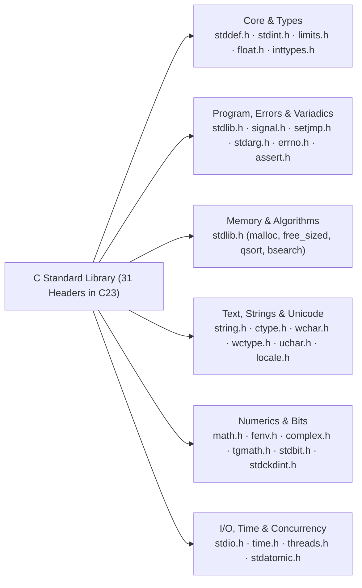

# C Standard Library Reference

The **C Standard Library** (ISO/IEC 9899 Clause 7) provides the portable runtime foundation for every conforming C program: type definitions, numeric limits, memory allocation, string and Unicode manipulation, mathematical routines, bit manipulation, overflow-checked integer arithmetic, buffered I/O, date/time handling, localization, and multi-threaded concurrency.

This reference mirrors the structure of [cppreference.com/c](https://en.cppreference.com/w/c) and covers the complete standard evolution from **C89/C90** through **C23 (ISO/IEC 9899:2024)**, including early **C2y/C29** working-draft previews.



---

## Standard Library Domains

| Reference Section | Primary Headers | Core Facilities |
| :--- | :--- | :--- |
| [Type Support & Limits](types.md) | `<stddef.h>`, `<stdint.h>`, `<inttypes.h>`, `<limits.h>`, `<float.h>`, `<stdbool.h>`, `<stdalign.h>`, `<iso646.h>` | `size_t`, `ptrdiff_t`, `nullptr_t`, `offsetof`, fixed-width integers, `*_WIDTH` macros, `PRI*`/`SCN*`, IEEE 754 & decimal float limits |
| [Program Utilities, Signals & setjmp](program.md) | `<stdlib.h>`, `<stddef.h>`, `<signal.h>`, `<setjmp.h>`, `<stdnoreturn.h>` | `exit`, `quick_exit`, `_Exit`, `abort`, `atexit`, `unreachable()`, `getenv`, `system`, `memalignment`, `signal`, `raise`, `setjmp`/`longjmp` |
| [Variadic Functions & Error Handling](variadic-and-error.md) | `<stdarg.h>`, `<errno.h>`, `<assert.h>`, `<stdlib.h>` | `va_list`, single-arg C23 `va_start`, `va_arg`, `va_copy`, `errno`, `assert`, `static_assert`, Annex K bounds-checking constraint handlers |
| [Dynamic Memory Management](memory.md) | `<stdlib.h>` | `malloc`, `calloc`, `realloc`, `free`, `aligned_alloc`, C23 `free_sized`, `free_aligned_sized`, `memalignment` |
| [Byte Strings & Character Utilities](strings-byte.md) | `<ctype.h>`, `<string.h>`, `<stdlib.h>`, `<inttypes.h>` | Character classification, string/memory copy/search/compare, C23 `strdup`/`strndup`/`memccpy`/`memset_explicit`, numeric parsing |
| [Multibyte, Unicode & Wide Strings](strings-multibyte-wide.md) | `<wchar.h>`, `<wctype.h>`, `<uchar.h>`, `<stdlib.h>`, `<stdmchar.h>` | `wchar_t`, `char8_t`/`char16_t`/`char32_t`, `mbrtoc8`/`c8rtomb`, wide I/O and classification, C2y/C29 `<stdmchar.h>` transcoding preview |
| [Algorithms (qsort & bsearch)](algorithms.md) | `<stdlib.h>` | Type-generic C23 `bsearch` const-preservation, `qsort`, Annex K `qsort_s`/`bsearch_s` |
| [Numerics: Math, fenv, Random & Complex](numerics-math.md) | `<math.h>`, `<fenv.h>`, `<complex.h>`, `<tgmath.h>`, `<stdlib.h>` | Elementary/special functions, rounding/exception flags, `_Complex`, type-generic math, `rand`/`srand`, `div`/`abs` |
| [Numerics: Bit Manipulation & Checked Int](numerics-bit-checked.md) | `<stdbit.h>`, `<stdckdint.h>` | Endianness macros, leading/trailing zeros & ones, popcount, bit width, `ckd_add`/`ckd_sub`/`ckd_mul` |
| [Date & Time Utilities](chrono.md) | `<time.h>` | `time`, `clock`, `timespec_get`, `timespec_getres`, C23 `gmtime_r`/`localtime_r`/`timegm`, `strftime` |
| [Input/Output Support](io.md) | `<stdio.h>`, `<wchar.h>` | `FILE` streams, buffering, formatted `printf`/`scanf` (C23 `%b`/`%B`, `%wN`/`%wfN`), binary I/O, positioning |
| [Localization Support](locale.md) | `<locale.h>` | `setlocale`, `localeconv`, `struct lconv`, `LC_*` categories |
| [Concurrency: Threads & Atomics](concurrency.md) | `<threads.h>`, `<stdatomic.h>` | `thrd_*`, `mtx_*`, `cnd_*`, `tss_*`, `call_once`, `_Atomic`, `memory_order`, fences, lock-free queries |

---

## Complete Master Table of All 31 C23 Standard Headers (+ C2y/C29)

ISO/IEC 9899:2024 (C23) defines exactly **31 standard headers** (up from 29 in C17, adding `<stdbit.h>` and `<stdckdint.h>`). Draft **C2y/C29** introduces `<stdmchar.h>` for modern restartable text transcoding.

| Header | Revision / Status | Freestanding (C23) | Primary Purpose | Reference Page |
| :--- | :--- | :--- | :--- | :--- |
| `<assert.h>` | <span class="c-badge c89">C89</span> | Hosted | Runtime `assert` diagnostic macro (and C11 `static_assert` macro before C23 keyword) | [Variadic & Error](variadic-and-error.md) |
| `<complex.h>` | <span class="c-badge c99">C99</span> <span class="c-badge c-optional">optional</span> | Hosted | Complex number arithmetic (`__STDC_NO_COMPLEX__` if unsupported since C11) | [Numerics: Math](numerics-math.md) |
| `<ctype.h>` | <span class="c-badge c89">C89</span> | Hosted | Byte character classification (`isalpha`, `isdigit`, …) and case conversion | [Byte Strings](strings-byte.md) |
| `<errno.h>` | <span class="c-badge c89">C89</span> | Hosted | Thread-local error condition macro `errno` (`EDOM`, `EILSEQ`, `ERANGE`) | [Variadic & Error](variadic-and-error.md) |
| `<fenv.h>` | <span class="c-badge c99">C99</span> | Hosted | Floating-point environment, rounding modes, and exception status flags | [Numerics: Math](numerics-math.md) |
| `<float.h>` | <span class="c-badge c89">C89</span> | **Full** | Floating-point limits, IEEE 754 properties, C23 `INFINITY`/`NAN`/`*_NORM_MAX`/`*_SNAN`/`DEC*` | [Type Support & Limits](types.md) |
| `<inttypes.h>` | <span class="c-badge c99">C99</span> | Hosted | Format specifiers (`PRI*`/`SCN*`, C23 `PRIb*`/`PRIB*`) and `intmax_t` math/parsing | [Type Support & Limits](types.md) |
| `<iso646.h>` | <span class="c-badge c95">C95</span> | **Full** | Alternative operator spellings (`and`, `or`, `not`, `bitand`, `bitor`, `xor`, …) | [Type Support & Limits](types.md) |
| `<limits.h>` | <span class="c-badge c89">C89</span> | **Full** | Integer range limits (`CHAR_BIT`, `INT_MAX`, …) and C23 `*_WIDTH`, `BITINT_MAXWIDTH` | [Type Support & Limits](types.md) |
| `<locale.h>` | <span class="c-badge c89">C89</span> | Hosted | Locale selection (`setlocale`) and numeric/monetary formatting rules (`localeconv`) | [Localization](locale.md) |
| `<math.h>` | <span class="c-badge c89">C89</span> | Hosted | Common mathematical functions, classification macros, C23 IEC 60559 additions | [Numerics: Math](numerics-math.md) |
| `<setjmp.h>` | <span class="c-badge c89">C89</span> | Hosted | Non-local jumps (`jmp_buf`, `setjmp`, `longjmp`) | [Program & Signals](program.md) |
| `<signal.h>` | <span class="c-badge c89">C89</span> | Hosted | Signal handling (`signal`, `raise`, `sig_atomic_t`, `SIG*`) | [Program & Signals](program.md) |
| `<stdalign.h>` | <span class="c-badge c11">C11</span> <span class="c-badge c-deprecated">deprecated C23</span> | **Full** | Obsolescent in C23 (`alignas`/`alignof` are keywords; `*_is_defined` macros removed) | [Type Support & Limits](types.md) |
| `<stdarg.h>` | <span class="c-badge c89">C89</span> | **Full** | Variable-argument functions (`va_list`, C23 1-arg `va_start`, `va_arg`, `va_copy`, `va_end`) | [Variadic & Error](variadic-and-error.md) |
| `<stdatomic.h>` | <span class="c-badge c11">C11</span> <span class="c-badge c-optional">optional</span> | Optional | Atomic operations and memory orderings (`__STDC_NO_ATOMICS__` if unsupported) | [Concurrency](concurrency.md) |
| `<stdbit.h>` | <span class="c-badge c23">C23</span> | **Full** | Endianness inspection and type-generic bit-manipulation utilities (`stdc_*`) | [Bit & Checked Int](numerics-bit-checked.md) |
| `<stdbool.h>` | <span class="c-badge c99">C99</span> <span class="c-badge c-deprecated">deprecated C23</span> | **Full** | Obsolescent in C23 (`bool`, `true`, `false` are core keywords) | [Type Support & Limits](types.md) |
| `<stdckdint.h>` | <span class="c-badge c23">C23</span> | **Full** | Overflow-checked integer arithmetic macros (`ckd_add`, `ckd_sub`, `ckd_mul`) | [Bit & Checked Int](numerics-bit-checked.md) |
| `<stddef.h>` | <span class="c-badge c89">C89</span> | **Full** | Core type/macro definitions (`size_t`, `ptrdiff_t`, `nullptr_t`, `max_align_t`, `offsetof`, `unreachable`) | [Type Support & Limits](types.md) |
| `<stdint.h>` | <span class="c-badge c99">C99</span> | **Full** | Fixed-width integer types, constant macros, limits, and C23 `*_WIDTH` macros | [Type Support & Limits](types.md) |
| `<stdio.h>` | <span class="c-badge c89">C89</span> | Hosted | Buffered stream I/O, formatted printing/scanning, file operations | [Input/Output](io.md) |
| `<stdlib.h>` | <span class="c-badge c89">C89</span> | **Partial** (C23) | Dynamic memory, program termination, conversions, sorting/searching, `memalignment`, PRNG | [Memory](memory.md) · [Program](program.md) · [Algorithms](algorithms.md) |
| `<stdmchar.h>` | <span class="c-badge c2y">C2y</span> | TBD | **C2y/C29 draft**: Modern restartable multibyte & UTF-8/16/32 text transcoding (`mc*`/`c8*`/`c16*`/`c32*`) | [Multibyte & Wide](strings-multibyte-wide.md) |
| `<stdnoreturn.h>` | <span class="c-badge c11">C11</span> <span class="c-badge c-deprecated">deprecated C23</span> | **Full** | Obsolescent/deprecated in C23 (superseded by `[[noreturn]]` attribute) | [Program & Signals](program.md) |
| `<string.h>` | <span class="c-badge c89">C89</span> | **Partial** (C23) | Byte strings and raw memory operations (`memcpy`, `memmove`, `memset_explicit`, `strlen`, …) | [Byte Strings](strings-byte.md) |
| `<tgmath.h>` | <span class="c-badge c99">C99</span> | Hosted | Type-generic math macros dispatching over real, complex, and decimal floating-point types | [Numerics: Math](numerics-math.md) |
| `<threads.h>` | <span class="c-badge c11">C11</span> <span class="c-badge c-optional">optional</span> | Hosted | Threads, mutexes, condition variables, thread-specific storage (`__STDC_NO_THREADS__`) | [Concurrency](concurrency.md) |
| `<time.h>` | <span class="c-badge c89">C89</span> | Hosted | Clocks, calendar/broken-down time, C23 `gmtime_r`/`localtime_r`/`timegm`/`timespec_getres` | [Date & Time](chrono.md) |
| `<uchar.h>` | <span class="c-badge c11">C11</span> | Hosted | UTF-8 (`char8_t` C23), UTF-16 (`char16_t`), UTF-32 (`char32_t`) restartable conversions | [Multibyte & Wide](strings-multibyte-wide.md) |
| `<wchar.h>` | <span class="c-badge c95">C95</span> | Hosted | Extended multibyte and wide-character strings, conversions, and wide stream I/O | [Multibyte & Wide](strings-multibyte-wide.md) |
| `<wctype.h>` | <span class="c-badge c95">C95</span> | Hosted | Wide-character classification (`iswalpha`, …) and extensible character mapping | [Multibyte & Wide](strings-multibyte-wide.md) |

!!! note "Header Count Evolution Across ISO C Revisions"
    - **C89 / C90**: 15 headers
    - **C95 (AMD1)**: 18 headers (`+<iso646.h>`, `<wchar.h>`, `<wctype.h>`)
    - **C99**: 24 headers (`+<complex.h>`, `<fenv.h>`, `<inttypes.h>`, `<stdbool.h>`, `<stdint.h>`, `<tgmath.h>`)
    - **C11 / C17**: 29 headers (`+<stdalign.h>`, `<stdatomic.h>`, `<stdnoreturn.h>`, `<threads.h>`, `<uchar.h>`)
    - **C23 (ISO/IEC 9899:2024)**: **31 headers** (`+<stdbit.h>`, `<stdckdint.h>`)
    - **C2y / C29 (Draft)**: adds `<stdmchar.h>` (WG14 transcoding proposals — subject to revision prior to ISO publication)

---

## C23 Library Version-Test Macros <span class="c-badge c23">C23</span>

Prior to C23, checking `__STDC_VERSION__ >= 202311L` only revealed the **compiler's** language mode — not whether the system's **C library headers** (such as glibc, musl, Apple libc, or UCRT) actually implemented the C23 library additions.

C23 solves this decoupling problem by introducing per-header version-test macros of the form **`__STDC_VERSION_<HEADER>_H__`**, expanding to `202311L` in ISO/IEC 9899:2024. Every header whose specification gained new or revised features in C23 defines one (21 of the 31 C23 headers).

| Header | C23 Version-Test Macro | C23 Value | Key C23 Additions Signaled |
| :--- | :--- | :--- | :--- |
| `<assert.h>` | `__STDC_VERSION_ASSERT_H__` | `202311L` | Variadic `assert(...)` (handles commas in expressions); `static_assert` moved to core keyword |
| `<complex.h>` | `__STDC_VERSION_COMPLEX_H__` | `202311L` | Updated `CMPLX` / imaginary interaction and IEC 60559 alignment |
| `<fenv.h>` | `__STDC_VERSION_FENV_H__` | `202311L` | `femode_t`, `fegetmode`, `fesetmode`, `fe_dec_getround`, `fe_dec_setround`, `FE_TONEARESTFROMZERO` |
| `<float.h>` | `__STDC_VERSION_FLOAT_H__` | `202311L` | `INFINITY`, `NAN`, `*_NORM_MAX`, `*_SNAN`, `*_IS_IEC_60559`, `CR_DECIMAL_DIG`, `DEC32_*`/`DEC64_*`/`DEC128_*` |
| `<inttypes.h>` | `__STDC_VERSION_INTTYPES_H__` | `202311L` | Binary format macros `PRIb*`, `PRIB*`, `SCNb*`; `0b`/`0B` in `strtoimax`/`strtoumax` |
| `<limits.h>` | `__STDC_VERSION_LIMITS_H__` | `202311L` | `BOOL_WIDTH`, `CHAR_WIDTH`..`ULLONG_WIDTH`, `BITINT_MAXWIDTH` |
| `<math.h>` | `__STDC_VERSION_MATH_H__` | `202311L` | `sinpi`/`cospi`/`tanpi`, `exp2m1`, `log2p1`, `fmaximum`/`fminimum`, `roundeven`, `fromfp`, `nextup`/`nextdown`, decimal float functions |
| `<setjmp.h>` | `__STDC_VERSION_SETJMP_H__` | `202311L` | `longjmp` uses `[[noreturn]]` attribute; updated standard wording |
| `<stdarg.h>` | `__STDC_VERSION_STDARG_H__` | `202311L` | Single-argument `va_start(ap)` and parameterless variadic function support |
| `<stdatomic.h>` | `__STDC_VERSION_STDATOMIC_H__` | `202311L` | `ATOMIC_VAR_INIT` removed; `ATOMIC_CHAR8_T_LOCK_FREE`; `memory_order` refinements |
| `<stdbit.h>` | `__STDC_VERSION_STDBIT_H__` | `202311L` | Entire new C23 header (`__STDC_ENDIAN_*`, 14 type-generic `stdc_*` bit families) |
| `<stdckdint.h>` | `__STDC_VERSION_STDCKDINT_H__` | `202311L` | Entire new C23 header (`ckd_add`, `ckd_sub`, `ckd_mul`) |
| `<stddef.h>` | `__STDC_VERSION_STDDEF_H__` | `202311L` | `nullptr_t`, `unreachable()` |
| `<stdint.h>` | `__STDC_VERSION_STDINT_H__` | `202311L` | `*_WIDTH` macros (`INTN_WIDTH`, `SIZE_WIDTH`, `PTRDIFF_WIDTH`, …); relaxed `intmax_t` width |
| `<stdio.h>` | `__STDC_VERSION_STDIO_H__` | `202311L` | `%b`/`%B` binary conversion, `%wN`/`%wfN` fixed-width length modifiers, `%H`/`%D`/`%DD` decimal float |
| `<stdlib.h>` | `__STDC_VERSION_STDLIB_H__` | `202311L` | `free_sized`, `free_aligned_sized`, `memalignment`, `strfromd*`, `bsearch` const-generic, `0b`/`0B` in `strtol*`, `realloc(p,0)` UB |
| `<string.h>` | `__STDC_VERSION_STRING_H__` | `202311L` | `strdup`, `strndup`, `memccpy`, `memset_explicit`, const-preserving `memchr`/`strchr`/`strstr`/`strpbrk`/`strrchr` |
| `<tgmath.h>` | `__STDC_VERSION_TGMATH_H__` | `202311L` | Dispatch for new C23 `<math.h>` functions and `_Decimal32`/`_Decimal64`/`_Decimal128` |
| `<time.h>` | `__STDC_VERSION_TIME_H__` | `202311L` | `gmtime_r`, `localtime_r`, `timegm`, `timespec_getres`, `TIME_MONOTONIC`/`TIME_ACTIVE`/`TIME_THREAD_ACTIVE`; `asctime`/`ctime` deprecated |
| `<uchar.h>` | `__STDC_VERSION_UCHAR_H__` | `202311L` | `char8_t`, `mbrtoc8`, `c8rtomb` |
| `<wchar.h>` | `__STDC_VERSION_WCHAR_H__` | `202311L` | Const-preserving `wcschr`/`wcspbrk`/`wcsrchr`/`wcsstr`/`wmemchr`, `%b`/`%wN` wide format specifiers |
| `<stdmchar.h>` | `__STDC_VERSION_STDMCHAR_H__` <span class="c-badge c2y">C2y</span> | TBD | Proposed C2y/C29 text transcoding header |

!!! info "Headers Without a `__STDC_VERSION_*_H__` Macro in C23"
    Ten C23 headers received no breaking or additive library interfaces requiring version detection and therefore do **not** define a `__STDC_VERSION_*_H__` macro in ISO/IEC 9899:2024:
    `<ctype.h>`, `<errno.h>`, `<iso646.h>`, `<locale.h>`, `<signal.h>`, `<stdalign.h>`, `<stdbool.h>`, `<stdnoreturn.h>`, `<threads.h>`, and `<wctype.h>`.

### Feature-Detection Idiom Combining `__has_include` and Version Macros

Combine C23's [`__has_include`](../language/preprocessor.md) with `__STDC_VERSION_*_H__` for portable, graceful feature detection across compilers and libcs:

```c
#include <stdio.h>
#include <stdlib.h>

#if defined(__has_include)
#  if __has_include(<stdbit.h>)
#    include <stdbit.h>
#  endif
#endif

static unsigned int count_ones_u32(unsigned int x) {
#if defined(__STDC_VERSION_STDBIT_H__) && __STDC_VERSION_STDBIT_H__ >= 202311L
    return stdc_count_ones(x);
#else
    unsigned int count = 0;
    while (x != 0U) {
        x &= (x - 1U);
        ++count;
    }
    return count;
#endif
}

int main(void) {
    printf("popcount(0xF055) = %u\n", count_ones_u32(0xF055U));
    return EXIT_SUCCESS;
}
```

---

## Hosted vs. Freestanding Environments (C23 Expansion)

ISO C distinguishes two execution environments (Clause 4 & §5.1.2), detectable via the predefined macro **`__STDC_HOSTED__`**:

- **Hosted (`__STDC_HOSTED__ == 1`)**: Runs under an operating system with a standard entry point (`int main(void)` or `int main(int argc, char *argv[])`) and **all 31 standard headers** (except optional facilities signaled by `__STDC_NO_COMPLEX__`, `__STDC_NO_ATOMICS__`, `__STDC_NO_THREADS__`, or Annex K).
- **Freestanding (`__STDC_HOSTED__ == 0`)**: Runs on bare-metal microcontrollers, bootloaders, hypervisors, or OS kernels without an operating system. Program startup and termination are implementation-defined, and only a strict subset of headers is required.

### C23 Expanded Freestanding Library Requirements (ISO/IEC 9899:2024 §4p7)

C23 dramatically improved bare-metal portability by adding `<stdbit.h>`, `<stdckdint.h>`, and **partial freestanding support** for `<string.h>` and `<stdlib.h>`:

| Category | Headers / Facilities | C17 Freestanding | C23 Freestanding |
| :--- | :--- | :--- | :--- |
| **Core types & limits** | `<float.h>`, `<iso646.h>`, `<limits.h>`, `<stdarg.h>`, `<stddef.h>`, `<stdint.h>` | Required | **Required** |
| **Obsolescent keyword headers** | `<stdalign.h>`, `<stdbool.h>`, `<stdnoreturn.h>` | Required | **Required** (obsolescent) |
| **Bit & checked arithmetic** | `<stdbit.h>`, `<stdckdint.h>` | N/A | **Required** <span class="c-badge c23">C23</span> |
| **Partial `<string.h>`** | Memory & byte-string routines (`memcpy`, `memmove`, `memset`, `memset_explicit`, `memcmp`, `memchr`, `memccpy`, `strcpy`, `strncpy`, `strcat`, `strncat`, `strcmp`, `strncmp`, `strchr`, `strrchr`, `strcspn`, `strspn`, `strpbrk`, `strstr`, `strlen`, `strtok`) | Not required | **Required** <span class="c-badge c23">C23</span> (excludes `strcoll`, `strdup`, `strerror`, `strndup`, `strxfrm`) |
| **Partial `<stdlib.h>`** | `memalignment` (mandatory); numeric conversions (`strtol*`, `strtoul*`, `strtod*`, `strfrom*`) and integer arithmetic (`abs`, `labs`, `llabs`) under IEC 60559 / freestanding profiles | Not required | **Partial** <span class="c-badge c23">C23</span> (`memalignment` required; heap/process/env omitted) |
| **Atomics** | `<stdatomic.h>` | Optional | Optional (widely provided by GCC/Clang freestanding) |

!!! warning "Real-World Freestanding Toolchains (`-ffreestanding`)"
    Compiler headers (`<stddef.h>`, `<stdint.h>`, `<limits.h>`, `<float.h>`, `<stdarg.h>`, `<stdbit.h>`, `<stdckdint.h>`) are typically shipped directly by GCC/Clang, whereas `<string.h>` and `memalignment` come from the target libc (e.g., newlib, picolibc, musl, or your kernel runtime). Even in `-ffreestanding`, GCC and Clang require the link environment to provide `memcpy`, `memmove`, `memset`, and `memcmp`, because the optimizer may synthesize calls to them for struct copies and zero-initialization.

---

## Optional Library Feature-Test Macros

| Macro | Standard | Meaning When Defined (to `1`) |
| :--- | :--- | :--- |
| `__STDC_HOSTED__` | <span class="c-badge c99">C99</span> | `1` for hosted implementation, `0` for freestanding |
| `__STDC_IEC_559__` | <span class="c-badge c99">C99</span> <span class="c-badge c-deprecated">deprecated C23</span> | Floating-point arithmetic conforms to IEC 60559 (IEEE 754); superseded by `__STDC_IEC_60559_BFP__` |
| `__STDC_IEC_60559_BFP__` | <span class="c-badge c23">C23</span> | Binary floating-point conforms to ISO/IEC 60559 (`202311L`) |
| `__STDC_IEC_60559_DFP__` | <span class="c-badge c23">C23</span> | Decimal floating-point (`_Decimal32`/`64`/`128`) conforms to ISO/IEC 60559 (`202311L`) |
| `__STDC_IEC_60559_COMPLEX__` | <span class="c-badge c23">C23</span> | Complex arithmetic conforms to Annex G (`202311L`; supersedes `__STDC_IEC_559_COMPLEX__`) |
| `__STDC_NO_ATOMICS__` | <span class="c-badge c11">C11</span> | `_Atomic` types and `<stdatomic.h>` are **not** supported |
| `__STDC_NO_COMPLEX__` | <span class="c-badge c11">C11</span> | `_Complex` types and `<complex.h>` are **not** supported |
| `__STDC_NO_THREADS__` | <span class="c-badge c11">C11</span> | `<threads.h>` is **not** supported |
| `__STDC_NO_VLA__` | <span class="c-badge c11">C11</span> | Variable-length arrays (automatic storage VLAs) are **not** supported (variably modified types remain mandatory in C23) |
| `__STDC_LIB_EXT1__` | <span class="c-badge c11">C11</span> | Annex K bounds-checking interfaces are supported (`202311L` in C23; opt-in via `#define __STDC_WANT_LIB_EXT1__ 1`) |
| `__STDC_UTF_16__` / `__STDC_UTF_32__` | <span class="c-badge c11">C11</span> | `char16_t`/`char32_t` values are UTF-16/UTF-32 encoded (mandatory `1` in C23!) |

---

## Standard Header Usage Rules & Reserved Identifiers

Understanding the formal contract in ISO/IEC 9899:2024 §7.1 prevents subtle undefined behavior across translation units:

1. **Idempotence & Order Independence**: Standard headers may be included in any order and any number of times with no adverse effect — with the single exception of `<assert.h>`, whose behavior changes whenever `NDEBUG` is defined or undefined before re-inclusion.
2. **Include Only at File Scope**: Including a standard header inside a function body, struct definition, or after defining a macro with the same name as a keyword (e.g., `#define const`) is **Undefined Behavior** (§7.1.2p4).
3. **Function-Like Macro Masking**: Any standard library function may additionally be shadowed by a function-like macro in its header. To invoke the actual external function (e.g., to take its address or avoid macro expansion), wrap its name in parentheses: `(puts)("hello")` or `#undef` the macro.
4. **Reserved Identifiers (§7.1.3 & §7.33 Future Library Directions)**:
   - Identifiers starting with `__` (double underscore) or `_` followed by an uppercase letter are **always reserved** for any use.
   - Identifiers starting with `_` followed by a lowercase letter or digit are reserved at file scope (ordinary and tag namespaces).
   - Prefixes reserved for future standard library expansion include: `is[a-z]*`, `to[a-z]*`, `E[0-9A-Z]*`, `FE_[A-Z]*`, `PRI[a-zX]*`, `SCN[a-zX]*`, `LC_[A-Z]*`, `SIG[A-Z]*`, `SIG_[A-Z]*`, `ATOMIC_[A-Z]*`, `atomic_*`, `memory_*`, `cnd_*`, `mtx_*`, `thrd_*`, `tss_*`, `str[a-z]*`, `mem[a-z]*`, `wcs[a-z]*`, `stdc_*`, `ckd_*`, `INT*_MAX`/`MIN`/`WIDTH`/`C`, `UINT*_MAX`/`WIDTH`/`C`, `*_t` (POSIX).

---

## See Also

- [C Language Reference Portal](../language/index.md) — Core grammar, memory model, preprocessor, and C23 keywords/attributes.
- [C23 Migration & Breaking Changes](../../standards/c23-migration.md) — Checklist for migrating C11/C17 codebases to ISO/IEC 9899:2024.
- [Compiler & Libc Support Matrix](../../standards/compiler-support.md) — GCC, Clang, MSVC, glibc, musl, and Apple libc coverage for C23 headers.
- [Curriculum · 07 Standard Library Deep Dive](../../curriculum/tier-2-runtime/07-standard-library-deep-dive.md) — Practical systems patterns using the C standard library.
- External reference: [cppreference.com — C Standard Library headers](https://en.cppreference.com/w/c/header)
