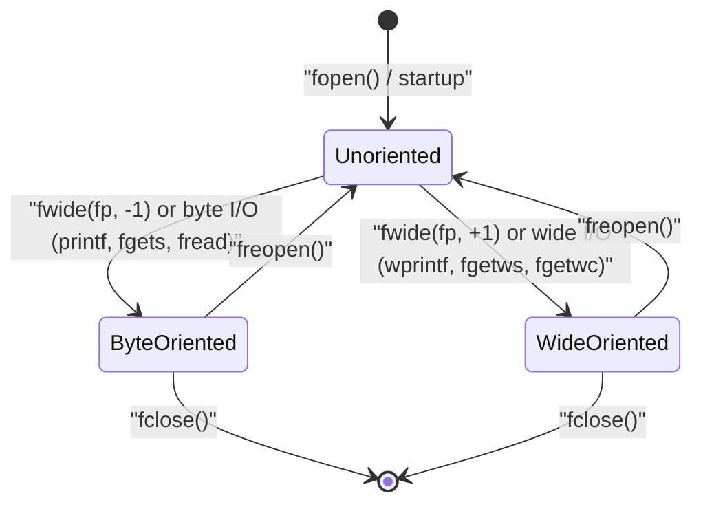

# Input/Output Support (`<stdio.h>` & `<wchar.h>`)

The C Standard I/O library models every external device—regular files, terminals, pipes, and sockets—as an abstract **stream** (`FILE`) providing buffered, portable access to sequences of bytes or wide characters. It spans two headers:

* **`<stdio.h>`** <span class="c-badge c89">C89</span> — byte-oriented stream I/O, binary I/O, file operations, positioning, error queries, and byte formatted I/O. Defines `__STDC_VERSION_STDIO_H__` (`202311L`) in <span class="c-badge c23">C23</span>.
* **`<wchar.h>`** <span class="c-badge c95">C95</span> — wide-oriented stream I/O (`fwide`, `fgetwc`, `fputws`, `wprintf`, `wscanf`, and friends). Defines `__STDC_VERSION_WCHAR_H__` (`202311L`) in <span class="c-badge c23">C23</span>.
* **`<stdarg.h>`** <span class="c-badge c89">C89</span> — provides `va_list` required by the `v*printf` and `v*scanf` families.
* **Annex K Bounds-Checking Interfaces (`*_s`)** <span class="c-badge c11">C11</span> <span class="c-badge c-optional">optional</span> — exposed only when the implementation defines `__STDC_LIB_EXT1__` and the user defines `#define __STDC_WANT_LIB_EXT1__ 1` *before* including `<stdio.h>` or `<wchar.h>`.

```c
#include <stdio.h>   /* Byte streams, FILE, printf/scanf, fread/fwrite */
#include <wchar.h>   /* Wide streams, fwide, wprintf/wscanf, fgetwc    */
#include <stdarg.h>  /* va_list for vprintf/vsnprintf/vfscanf          */
```

---

## Core Types, Standard Streams & Constants

### Core Types

| Type | Header | Standard | Description |
| :--- | :--- | :--- | :--- |
| `FILE` | `<stdio.h>` | <span class="c-badge c89">C89</span> | Complete object type encapsulating all state required to control a stream: file position indicator, buffer pointer/size/mode, error indicator, end-of-file indicator, orientation, and multibyte conversion state (`mbstate_t`). |
| `fpos_t` | `<stdio.h>` | <span class="c-badge c89">C89</span> | Complete non-array object type capable of recording every position and multibyte parse state within a file (used with `fgetpos` and `fsetpos`). Unlike `long` from `ftell`, `fpos_t` handles files larger than 2 GiB on 32-bit `long` platforms (e.g., Windows LLP64) and stateful encodings. |
| `size_t` | `<stdio.h>` | <span class="c-badge c89">C89</span> | Unsigned integer type returned by `sizeof`, `fread`, and `fwrite`. |
| `rsize_t` | `<stdio.h>` | <span class="c-badge c11">C11</span> <span class="c-badge c-optional">optional</span> | Restricted `size_t` (must be `<= RSIZE_MAX`) used by Annex K `*_s` bounds-checked functions. |

!!! danger "Never Copy a `FILE` Object by Value"
    ISO C (§7.23.1p6) explicitly states that the **address** of a `FILE` object may be significant to the C library (for example, internal mutexes or global stream linked lists may point back to it). Copying a `FILE` by value (`FILE copy = *fp;`) and passing `&copy` to any I/O function invokes **undefined behavior**. Always pass and store `FILE *` pointers.

### Standard Pre-Opened Streams

At program startup (before `main` executes), three text streams are opened automatically and exposed as macros expanding to expressions of type `FILE *` (not guaranteed to be modifiable lvalues):

| Stream | Purpose | Default Buffering at Startup (ISO C §7.23.3p7) |
| :--- | :--- | :--- |
| `stdin` | Standard input | Fully buffered **if and only if** the stream can be determined *not* to refer to an interactive device (e.g., redirected from a file or pipe); otherwise line-buffered or unbuffered. |
| `stdout` | Standard output | Same rule as `stdin`: line-buffered on an interactive terminal (flushes on `\n` or before reading from an unbuffered/line-buffered input stream), **fully buffered** when redirected to a pipe or file. |
| `stderr` | Standard error | **Never** fully buffered initially (unbuffered by default on POSIX and Windows CRT) so error diagnostics appear immediately even before a crash. |

### Macro Constants

| Macro | Header | Standard | Meaning & Guaranteed Bounds |
| :--- | :--- | :--- | :--- |
| `EOF` | `<stdio.h>` | <span class="c-badge c89">C89</span> | Negative integer constant expression of type `int` (typically `-1`) returned by byte I/O functions on end-of-file or error. |
| `WEOF` | `<wchar.h>` | <span class="c-badge c95">C95</span> | Constant expression of type `wint_t` that does not correspond to any member of the extended character set. |
| `FOPEN_MAX` | `<stdio.h>` | <span class="c-badge c89">C89</span> | Minimum number of files guaranteed to be open simultaneously, including `stdin`, `stdout`, and `stderr` (at least `8`). |
| `FILENAME_MAX` | `<stdio.h>` | <span class="c-badge c89">C89</span> | Size of a `char` array guaranteed to hold the longest supported filename, or a recommended array size if no fixed OS limit exists. |
| `BUFSIZ` | `<stdio.h>` | <span class="c-badge c89">C89</span> | Buffer size used by `setbuf` (integer constant expression `>= 256`). |
| `_IOFBF` | `<stdio.h>` | <span class="c-badge c89">C89</span> | Full buffering mode argument for `setvbuf`. |
| `_IOLBF` | `<stdio.h>` | <span class="c-badge c89">C89</span> | Line buffering mode argument for `setvbuf`. |
| `_IONBF` | `<stdio.h>` | <span class="c-badge c89">C89</span> | Unbuffered mode argument for `setvbuf`. |
| `SEEK_SET` | `<stdio.h>` | <span class="c-badge c89">C89</span> | `fseek` origin: beginning of file. |
| `SEEK_CUR` | `<stdio.h>` | <span class="c-badge c89">C89</span> | `fseek` origin: current file position indicator. |
| `SEEK_END` | `<stdio.h>` | <span class="c-badge c89">C89</span> | `fseek` origin: end of file. |
| `TMP_MAX` | `<stdio.h>` | <span class="c-badge c89">C89</span> | Minimum number of unique filenames `tmpnam` can generate (`>= 25`). |
| `TMP_MAX_S` | `<stdio.h>` | <span class="c-badge c11">C11</span> <span class="c-badge c-optional">optional</span> | Minimum number of unique filenames `tmpnam_s` can generate (`>= 25`). |
| `L_tmpnam` | `<stdio.h>` | <span class="c-badge c89">C89</span> | Minimum `char` array size to hold a string generated by `tmpnam`. |
| `L_tmpnam_s` | `<stdio.h>` | <span class="c-badge c11">C11</span> <span class="c-badge c-optional">optional</span> | Minimum `char` array size to hold a string generated by `tmpnam_s`. |
| `_PRINTF_NAN_LEN_MAX` | `<stdio.h>` | <span class="c-badge c23">C23</span> | Integer constant expression giving the maximum length of the character sequence produced by `%f`/`%e`/`%g`/`%a` (and uppercase variants) for a NaN payload (when IEC 60559 floating-point is supported). |
| `__STDC_VERSION_STDIO_H__` | `<stdio.h>` | <span class="c-badge c23">C23</span> | Expands to `202311L` to test C23 `<stdio.h>` library conformance. |
| `NULL` | `<stdio.h>` | <span class="c-badge c89">C89</span> | Implementation-defined null pointer constant (see `nullptr` in [Keywords](../language/keywords.md)). |

---

## Stream Orientation

Every opened stream starts with **no orientation**. The very first I/O operation performed on the stream—or an explicit call to `fwide`—permanently locks its orientation to either **byte-oriented** or **wide-oriented** until the stream is closed (`fclose`) or reopened (`freopen`).

```c
#include <wchar.h>
int fwide(FILE *stream, int mode); /* C95 */
```

* **`mode > 0`**: attempts to make `stream` **wide-oriented** (no effect if already oriented).
* **`mode < 0`**: attempts to make `stream` **byte-oriented** (no effect if already oriented).
* **`mode == 0`**: queries current orientation without modifying it.
* **Return value**: `> 0` if wide-oriented, `< 0` if byte-oriented, `0` if unoriented.



!!! warning "Never Mix Byte and Wide Functions on the Same Stream"
    Calling a wide function (e.g., `wprintf`) on a byte-oriented stream—or a byte function (e.g., `printf`, `puts`) on a wide-oriented stream—is **undefined behavior** (ISO C §7.23.2p4–5). Once `stdout` receives a single `printf` call, `wprintf` cannot safely be used on `stdout` unless `freopen` resets the stream.

---

## File Access & Buffering

### File Access Functions

| Function | Prototype | Standard | Behavior & Return Value |
| :--- | :--- | :--- | :--- |
| `fopen` | `FILE *fopen(const char *restrict filename, const char *restrict mode);` | <span class="c-badge c89">C89</span> | Opens `filename` with `mode`. Returns `FILE *` on success, `NULL` on failure (usually sets `errno` on POSIX/Windows). |
| `fopen_s` | `errno_t fopen_s(FILE *restrict *restrict streamptr, const char *restrict filename, const char *restrict mode);` | <span class="c-badge c11">C11</span> <span class="c-badge c-optional">optional</span> | Annex K safe open: validates non-null pointers, creates new files with restrictive permissions where supported, and supports exclusive `'u'` default-permission prefix (`"u..."`). Returns `0` on success. |
| `freopen` | `FILE *freopen(const char *restrict filename, const char *restrict mode, FILE *restrict stream);` | <span class="c-badge c89">C89</span> | Closes the file currently associated with `stream`, clears errors/EOF and orientation, and reassociates `stream` with `filename`. In <span class="c-badge c99">C99</span>+, passing `filename == NULL` attempts to change `mode` of the already-open stream (implementation-defined). |
| `freopen_s` | `errno_t freopen_s(FILE *restrict *restrict newstreamptr, const char *restrict filename, const char *restrict mode, FILE *restrict stream);` | <span class="c-badge c11">C11</span> <span class="c-badge c-optional">optional</span> | Annex K bounds-checked `freopen`. |
| `fclose` | `int fclose(FILE *stream);` | <span class="c-badge c89">C89</span> | Flushes any unwritten buffered output, discards unread buffered input, releases buffers, and closes the underlying file. Returns `0` on success, `EOF` on failure. **Using `stream` after `fclose` (even if `fclose` failed!) is UB.** |
| `fflush` | `int fflush(FILE *stream);` | <span class="c-badge c89">C89</span> | For an output or update stream whose most recent operation was not input, delivers buffered output to the host environment. If `stream == NULL`, flushes **all** open output/update streams. Returns `0` on success, `EOF` on error. |
| `setbuf` | `void setbuf(FILE *restrict stream, char *restrict buf);` | <span class="c-badge c89">C89</span> | Equivalent to `setvbuf(stream, buf, buf ? _IOFBF : _IONBF, BUFSIZ)` without returning status. Prefer `setvbuf`. |
| `setvbuf` | `int setvbuf(FILE *restrict stream, char *restrict buf, int mode, size_t size);` | <span class="c-badge c89">C89</span> | Configures buffering (`_IOFBF`, `_IOLBF`, or `_IONBF`). Must be called **after opening `stream` and before any other operation** (except `fwide`). If `buf == NULL`, the library allocates a buffer of `size` bytes. Returns `0` on success, nonzero on failure. |

### Complete `fopen` Mode String Table

All modes open a **text** stream by default; appending `b` opens a **binary** stream (no newline translation such as `\r\n` $\leftrightarrow$ `\n`, and no special end-of-file character handling on Windows). In <span class="c-badge c11">C11</span>, appending **`x`** to any write (`"w"`) mode requests **exclusive creation**—opening atomically fails if the file already exists (analogous to POSIX `O_CREAT | O_EXCL`).

| Mode (Text) | Mode (Binary) | Standard | Access | File Exists | File Does Not Exist |
| :--- | :--- | :--- | :--- | :--- | :--- |
| `"r"` | `"rb"` | <span class="c-badge c89">C89</span> | Read only | Opens from start | Fails (`NULL`) |
| `"w"` | `"wb"` | <span class="c-badge c89">C89</span> | Write only | **Truncates to zero length** | Creates new file |
| `"a"` | `"ab"` | <span class="c-badge c89">C89</span> | Append only | Opens; all writes forced to end | Creates new file |
| `"r+"` | `"r+b"` / `"rb+"` | <span class="c-badge c89">C89</span> | Read & Write | Opens from start (preserves data) | Fails (`NULL`) |
| `"w+"` | `"w+b"` / `"wb+"` | <span class="c-badge c89">C89</span> | Read & Write | **Truncates to zero length** | Creates new file |
| `"a+"` | `"a+b"` / `"ab+"` | <span class="c-badge c89">C89</span> | Read & Append | Opens; reads anywhere, writes forced to end | Creates new file |
| `"wx"` | `"wbx"` | <span class="c-badge c11">C11</span> | Exclusive write | **Fails (`NULL`)** — never overwrites | Creates new file |
| `"w+x"` | `"w+bx"` / `"wb+x"` | <span class="c-badge c11">C11</span> | Exclusive read & write | **Fails (`NULL`)** — never overwrites | Creates new file |

!!! danger "`fflush(stdin)` is Undefined Behavior in ISO C!"
    According to ISO C23 §7.23.5.2p2, calling `fflush` on an **input stream** (or an update stream whose most recent operation was input) is **undefined behavior**. Although glibc and MSVC define non-standard extensions for `fflush(stdin)` on seekable or console streams, portable C must never call `fflush(stdin)`. To discard the rest of a line from `stdin`, drain characters in a loop:

    ```c
    int ch;
    while ((ch = getchar()) != '\n' && ch != EOF) {
        /* discard remaining characters on line */
    }
    ```

!!! warning "User-Supplied Buffer Lifetime (`setvbuf`)"
    If you pass a non-null `buf` to `setvbuf(fp, buf, _IOFBF, sizeof buf)`, the buffer **must outlive the stream** (i.e., `fclose(fp)` must execute before `buf` goes out of scope). Returning from a function while a global or returned `FILE *` still references a stack-allocated buffer causes stack use-after-return UB.

---

## Direct Binary I/O

Direct I/O transfers raw object representations (bytes) with no character translation or formatting overhead. Always open binary files with `"b"` (`"rb"`, `"wb"`, `"r+b"`).

```c
size_t fread(void *restrict ptr, size_t size, size_t nmemb, FILE *restrict stream);
size_t fwrite(const void *restrict ptr, size_t size, size_t nmemb, FILE *restrict stream);
```

* **`size`**: size in bytes of **one** element (e.g., `sizeof records[0]`).
* **`nmemb`**: number of elements to read or write.
* **Return value**: number of **complete elements** successfully transferred (NOT total bytes, unless `size == 1`!). If either `size == 0` or `nmemb == 0`, both functions return `0` and do nothing.
* **Partial element on short read**: if `fread` encounters EOF or an error partway through an element (when `size > 1`), the value of that partial element in `ptr` is indeterminate and the file position indicator is indeterminate.

### Distinguishing Short Reads: `feof` vs `ferror`

Because `fread` returns a count smaller than `nmemb` on **both** normal end-of-file and I/O errors, you must inspect `ferror(fp)` and `feof(fp)` whenever `n < nmemb`:

```c
uint8_t buf[4096];
size_t n = fread(buf, 1, sizeof buf, fp);
if (n < sizeof buf) {
    if (ferror(fp)) {
        perror("fread failed");
        /* handle I/O error */
    } else if (feof(fp)) {
        /* reached normal end-of-file after reading n valid bytes */
    }
}
```

!!! tip "Element Size `1` vs `sizeof(T)`"
    When reading arbitrary byte streams (network payloads, files whose total size may not be a multiple of a chunk size), pass `size = 1, nmemb = sizeof buf` so `fread` returns the exact byte count read. When reading fixed-size binary records (`struct Header`), pass `size = sizeof(struct Header), nmemb = count` and verify `n == count`.

---

## Unformatted Character & Line I/O

### Byte & Wide Unformatted I/O Reference

| Operation | Byte Function (`<stdio.h>`) | Wide Function (`<wchar.h>`) <span class="c-badge c95">C95</span> | Notes & Error / EOF Return |
| :--- | :--- | :--- | :--- |
| Read single char | `int fgetc(FILE *stream)` | `wint_t fgetwc(FILE *stream)` | Reads next `unsigned char` converted to `int` (or `wchar_t` to `wint_t`). Returns `EOF` / `WEOF` on EOF or error. |
| Read char (macro ok) | `int getc(FILE *stream)` | `wint_t getwc(FILE *stream)` | Equivalent to `fgetc`/`fgetwc`, except **may be a macro that evaluates `stream` more than once**. Never pass `getc(fp++)`. |
| Read char from `stdin` | `int getchar(void)` | `wint_t getwchar(void)` | Equivalent to `getc(stdin)` / `getwc(stdin)`. |
| Read line (bounded) | `char *fgets(char *restrict s, int n, FILE *restrict stream)` | `wchar_t *fgetws(wchar_t *restrict s, int n, FILE *restrict stream)` | Reads at most `n - 1` characters, stopping after `\n` (which **is retained** in `s`) or EOF, and always null-terminates `s`. Returns `s` on success, `NULL` on error or EOF with 0 chars read. |
| Read line (UNSAFE) | ~~`char *gets(char *s)`~~ <span class="c-badge c-removed">removed C11</span> | *(never existed)* | Deprecated in C99 TC3, **removed in C11** — impossible to use safely! |
| Read line (Annex K) | `char *gets_s(char *s, rsize_t n)` <span class="c-badge c11">C11</span> <span class="c-badge c-optional">optional</span> | *(none)* | Reads from `stdin` up to `n - 1` chars, discards `\n`. Fails via runtime-constraint handler if line exceeds `n - 1`. |
| Write single char | `int fputc(int c, FILE *stream)` | `wint_t fputwc(wchar_t c, FILE *stream)` | Converts `c` to `unsigned char` and writes it. Returns written char on success, `EOF` / `WEOF` on error. |
| Write char (macro ok) | `int putc(int c, FILE *stream)` | `wint_t putwc(wchar_t c, FILE *stream)` | Equivalent to `fputc`/`fputwc`, but **may evaluate `stream` more than once**. |
| Write char to `stdout` | `int putchar(int c)` | `wint_t putwchar(wchar_t c)` | Equivalent to `putc(c, stdout)` / `putwc(c, stdout)`. |
| Write string (no `\n`) | `int fputs(const char *restrict s, FILE *restrict stream)` | `int fputws(const wchar_t *restrict s, FILE *restrict stream)` | Writes null-terminated `s` **without** appending `\n`. Returns non-negative on success, `EOF` on error. |
| Write string + `\n` | `int puts(const char *s)` | *(none)* | Writes `s` to `stdout` **followed by `\n`**. Returns non-negative on success, `EOF` on error. |
| Push back one char | `int ungetc(int c, FILE *stream)` | `wint_t ungetwc(wint_t c, FILE *stream)` | Pushes `(unsigned char)c` back into `stream`'s input buffer and clears the EOF indicator. Returns pushed char, or `EOF`/`WEOF` on failure (`ungetc(EOF, fp)` does nothing and fails). |

### Classic Unformatted I/O Pitfalls

=== "Good (`int` for `EOF`)"

    ```c
    /* Correct: int holds all 256 unsigned char values PLUS EOF (-1) */
    int ch;
    while ((ch = fgetc(fp)) != EOF) {
        process_byte((unsigned char)ch);
    }
    ```

=== "Bad (`char` truncates `EOF`)"

    ```c
    /* BUG:
     * - If plain char is unsigned (ARM/AArch64), (char)EOF becomes 255 != -1 -> INFINITE LOOP!
     * - If plain char is signed (x86-64), valid byte 0xFF (Latin-1 'ÿ') becomes -1 == EOF -> PREMATURE STOP!
     */
    char ch;
    while ((ch = fgetc(fp)) != EOF) { /* BROKEN ON EVERY PLATFORM */
        process_byte((unsigned char)ch);
    }
    ```

!!! danger "Why `gets()` Was Permanently Removed in C11"
    `char *gets(char *s)` accepts **no buffer length parameter**. Any input line longer than the caller's buffer unconditionally overflows memory (historically exploited in the 1988 Morris Worm and countless stack buffer overflows). It was deprecated in C99 TC3 (2007) and **removed entirely in ISO C11**. Always use `fgets(buf, (int)sizeof buf, stdin)` (stripping the trailing `\n` with `buf[strcspn(buf, "\n")] = '\0';`) or POSIX `getline()`.

!!! note "`ungetc` Pushback Guarantee"
    ISO C guarantees only **one character** of pushback before an intervening read or positioning call (`fseek`, `fsetpos`, `rewind` discard pushed-back bytes). Pushing two characters back without reading between them may fail depending on the C library.

---

## Formatted I/O (`printf` & `scanf` Families)

### Complete Function Matrix

| Target | Byte Output (`<stdio.h>`) | Byte Input (`<stdio.h>`) | Wide Output (`<wchar.h>`) <span class="c-badge c95">C95</span> | Wide Input (`<wchar.h>`) <span class="c-badge c95">C95</span> |
| :--- | :--- | :--- | :--- | :--- |
| `stdout` / `stdin` | `printf` / `vprintf` | `scanf` / `vscanf` <span class="c-badge c99">C99</span> | `wprintf` / `vwprintf` | `wscanf` / `vwscanf` <span class="c-badge c99">C99</span> |
| Arbitrary `FILE *` | `fprintf` / `vfprintf` | `fscanf` / `vfscanf` <span class="c-badge c99">C99</span> | `fwprintf` / `vfwprintf` | `fwscanf` / `vfwscanf` <span class="c-badge c99">C99</span> |
| Unbounded buffer | `sprintf` / `vsprintf` *(avoid!)* | `sscanf` / `vsscanf` <span class="c-badge c99">C99</span> | *(none — always bounded)* | `swscanf` / `vswscanf` <span class="c-badge c99">C99</span> |
| Bounded buffer | `snprintf` / `vsnprintf` <span class="c-badge c99">C99</span> | *(use field widths)* | `swprintf` / `vswprintf` | *(use field widths)* |
| Annex K safe <span class="c-badge c11">C11</span> <span class="c-badge c-optional">optional</span> | `printf_s`, `fprintf_s`, `sprintf_s`, `snprintf_s` + `v*_s` | `scanf_s`, `fscanf_s`, `sscanf_s` + `v*_s` | `wprintf_s`, `fwprintf_s`, `swprintf_s`, `snwprintf_s` + `v*_s` | `wscanf_s`, `fwscanf_s`, `swscanf_s` + `v*_s` |

```c
/* Key prototypes (<stdio.h>) */
int printf(const char *restrict format, ...);
int fprintf(FILE *restrict stream, const char *restrict format, ...);
int sprintf(char *restrict s, const char *restrict format, ...);
int snprintf(char *restrict s, size_t n, const char *restrict format, ...);       /* C99 */

int vprintf(const char *restrict format, va_list arg);
int vfprintf(FILE *restrict stream, const char *restrict format, va_list arg);
int vsprintf(char *restrict s, const char *restrict format, va_list arg);
int vsnprintf(char *restrict s, size_t n, const char *restrict format, va_list arg); /* C99 */

int scanf(const char *restrict format, ...);
int fscanf(FILE *restrict stream, const char *restrict format, ...);
int sscanf(const char *restrict s, const char *restrict format, ...);

int vscanf(const char *restrict format, va_list arg);                             /* C99 */
int vfscanf(FILE *restrict stream, const char *restrict format, va_list arg);     /* C99 */
int vsscanf(const char *restrict s, const char *restrict format, va_list arg);    /* C99 */
```

* **`printf` return value**: number of characters written (excluding the null terminator for `sprintf`), or for `snprintf`, the number of characters that **would have been written** if `n` had been sufficiently large (excluding `'\0'`). Returns a **negative value** if an encoding or output error occurred.
* **`scanf` return value**: number of input items successfully matched and assigned (may be `0`), or `EOF` if an input failure occurs before the first receiving conversion (or if a read error occurs).

### `printf` Conversion Specification Grammar

```text
%[flags][width][.precision][length]specifier
```

#### Flags

| Flag | Meaning | Applicable Specifiers |
| :--- | :--- | :--- |
| `-` | Left-justify within the field width (overrides `0`). | All |
| `+` | Always emit a sign (`+` or `-`) for signed conversions (overrides space). | `d`, `i`, `f`, `F`, `e`, `E`, `g`, `G`, `a`, `A` |
| ` ` *(space)* | Prefix a leading space for non-negative signed values if no sign is emitted. | `d`, `i`, `f`, `F`, `e`, `E`, `g`, `G`, `a`, `A` |
| `#` | **Alternate form**: `o` guarantees leading `0`; `x`/`X` prepends `0x`/`0X` if nonzero; **`b`/`B` <span class="c-badge c23">C23</span> prepends `0b`/`0B` if nonzero**; `f`/`F`/`e`/`E`/`a`/`A` always emit a decimal point; `g`/`G` always emit a decimal point and retain trailing zeros. | `o`, `x`, `X`, `b`, `B`, `f`, `F`, `e`, `E`, `g`, `G`, `a`, `A` |
| `0` | Pad numeric output on the left with leading zeros instead of spaces (ignored if `-` is present, or if precision is specified on integer conversions `d`/`i`/`o`/`u`/`x`/`X`/`b`/`B`). | Numeric specifiers |

#### Minimum Field Width & Precision

* **Width** (`12` or `*`): minimum number of characters to output. Output is never truncated if wider. Passing `*` reads an `int` argument before the value; a negative `*` width enables the `-` flag with positive width `|w|`.
* **Precision** (`.6` or `.*`):
  * Integers (`d`, `i`, `o`, `u`, `x`, `X`, `b`, `B`): minimum number of digits (pads with leading zeros; `%.0d` with value `0` emits zero characters).
  * `f`, `F`, `e`, `E`, `a`, `A`: exact number of digits after the decimal point (default `6` for `f`/`e`; enough for exact representation for `a`).
  * `g`, `G`: maximum number of significant digits (default `6`).
  * `s`: **maximum number of bytes** to write—critical for printing non-null-terminated slices: `printf("%.*s", (int)len, slice)`.
  * Passing `.*` reads an `int` argument; a negative precision is treated as omitted.

### Complete Length Modifier Table

Mismatched length modifiers cause **undefined behavior** because variadic arguments undergo *default argument promotions* (`char`/`short` promote to `int`; `float` promotes to `double`), and `scanf` writes directly through typed pointers.

| Length Modifier | Standard | `d` / `i` (`printf`) | `u` / `o` / `x` / `X` / `b` / `B` (`printf`) | `f` / `e` / `g` / `a` (`printf`) | `c` / `s` (`printf`) | `n` (`printf`) | `scanf` Pointer Target (`d`/`i`, `u`/`x`/`b`, floats) |
| :--- | :--- | :--- | :--- | :--- | :--- | :--- | :--- |
| *(none)* | <span class="c-badge c89">C89</span> | `int` | `unsigned int` | `double` | `int` / `char *` | `int *` | `int *`, `unsigned int *`, `float *` |
| `hh` | <span class="c-badge c99">C99</span> | `signed char` *(promoted to `int`)* | `unsigned char` *(promoted)* | — | — | `signed char *` | `signed char *`, `unsigned char *` |
| `h` | <span class="c-badge c89">C89</span> | `short` *(promoted to `int`)* | `unsigned short` *(promoted)* | — | — | `short *` | `short *`, `unsigned short *` |
| `l` | <span class="c-badge c89">C89</span> | `long` | `unsigned long` | `double` <span class="c-badge c99">C99</span> | `wint_t` / `wchar_t *` <span class="c-badge c95">C95</span> | `long *` | `long *`, `unsigned long *`, **`double *`** |
| `ll` | <span class="c-badge c99">C99</span> | `long long` | `unsigned long long` | — | — | `long long *` | `long long *`, `unsigned long long *` |
| `j` | <span class="c-badge c99">C99</span> | `intmax_t` | `uintmax_t` | — | — | `intmax_t *` | `intmax_t *`, `uintmax_t *` |
| `z` | <span class="c-badge c99">C99</span> | signed `size_t` | `size_t` | — | — | signed `size_t *` | `size_t *` |
| `t` | <span class="c-badge c99">C99</span> | `ptrdiff_t` | unsigned `ptrdiff_t` | — | — | `ptrdiff_t *` | `ptrdiff_t *` |
| `L` | <span class="c-badge c89">C89</span> | — | — | `long double` | — | — | `long double *` |
| `wN` *(e.g. `w8`, `w16`, `w32`, `w64`)* | <span class="c-badge c23">C23</span> | `intN_t` / `int_leastN_t` | `uintN_t` / `uint_leastN_t` | — | — | `intN_t *` / `int_leastN_t *` | `intN_t *`, `uintN_t *` (or `int_leastN_t *`) |
| `wfN` *(e.g. `wf32`, `wf64`)* | <span class="c-badge c23">C23</span> | `int_fastN_t` | `uint_fastN_t` | — | — | `int_fastN_t *` | `int_fastN_t *`, `uint_fastN_t *` |
| `H` | <span class="c-badge c23">C23</span> <span class="c-badge c-optional">optional</span> | — | — | `_Decimal32` | — | — | `_Decimal32 *` |
| `D` | <span class="c-badge c23">C23</span> <span class="c-badge c-optional">optional</span> | — | — | `_Decimal64` | — | — | `_Decimal64 *` |
| `DD` | <span class="c-badge c23">C23</span> <span class="c-badge c-optional">optional</span> | — | — | `_Decimal128` | — | — | `_Decimal128 *` |

!!! info "C23 `wN` / `wfN` Replace `<inttypes.h>` `PRId32` Macro Soup"
    Before C23, printing a `uint64_t` portably required `#include <inttypes.h>` and ugly string concatenation like `printf("id=%" PRIu64 "\n", id);`. In **C23** (WG14 N2680), write `printf("id=%w64u\n", id);` or `printf("fast=%wf32d\n", f);` directly! Note that `N` must be a supported width from `<stdint.h>` with no leading zeros (`8`, `16`, `32`, `64`, etc.), and `wN`/`wfN` apply to minimum/exact-width and fast-width `<stdint.h>` types (not arbitrary `_BitInt(N)` widths unless they match a supported `int_leastN_t`). Decimal floating-point modifiers (`H`, `D`, `DD`) require `__STDC_IEC_60559_DFP__`.

### Complete Conversion Specifier Table

| Specifier | Standard | `printf` Behavior | `scanf` Behavior |
| :--- | :--- | :--- | :--- |
| `%d` | <span class="c-badge c89">C89</span> | Signed decimal integer (`[-]`dddd). | Matches an optionally signed base-10 integer (like `strtol(..., 10)`). |
| `%i` | <span class="c-badge c89">C89</span> | Identical to `%d` in `printf`. | Matches an optionally signed integer with **base auto-detection**: `0x`/`0X` $\rightarrow$ hex, leading `0` $\rightarrow$ octal, otherwise decimal (like `strtol(..., 0)`). **Watch out**: `"08"` fails octal parsing! |
| `%u` | <span class="c-badge c89">C89</span> | Unsigned decimal integer. | Matches an optionally signed decimal integer into an unsigned target. |
| `%o` | <span class="c-badge c89">C89</span> | Unsigned octal integer (`#` ensures leading `0`). | Matches an optionally signed octal integer (`0`–`7`). |
| `%x`, `%X` | <span class="c-badge c89">C89</span> | Unsigned hexadecimal (`a`–`f` or `A`–`F`; `#` prepends `0x` or `0X`). | Matches an optionally signed hexadecimal integer (optional `0x`/`0X` prefix; `%x` and `%X` behave identically in `scanf`). |
| `%b`, `%B` | <span class="c-badge c23">C23</span> | Unsigned **binary** (base-2) integer (`0` and `1`). `#` prepends `0b` (`%#b`) or `0B` (`%#B`). Note: `%B` is **optional** in C23 `printf` (implementations are recommended, not strictly required, to support `%B`). | `%b` matches an optionally signed binary integer with optional `0b`/`0B` prefix. (`%B` is not a `scanf` specifier in C23.) |
| `%f`, `%F` | <span class="c-badge c89">C89</span> / `%F` <span class="c-badge c99">C99</span> | Fixed-point decimal floating-point (`[-]ddd.ddd`). Inf/NaN formatted as `inf`/`nan` (`%f`) or `INF`/`NAN` (`%F`). | Matches floating-point (decimal, hex `0x...p...`, `inf`, `nan`). Note: `%f` reads `float *`, `%lf` reads `double *`, `%Lf` reads `long double *`! |
| `%e`, `%E` | <span class="c-badge c89">C89</span> | Scientific notation (`[-]d.ddde±dd` or `E±dd`). | Identical to `%f` in `scanf`. |
| `%g`, `%G` | <span class="c-badge c89">C89</span> | Shortest of `%f`/`%e` (or `%F`/`%E`); strips trailing fractional zeros unless `#` is set. | Identical to `%f` in `scanf`. |
| `%a`, `%A` | <span class="c-badge c99">C99</span> | **Hexadecimal floating-point** (`[-]0xh.hhhhp±d` or `0XH.HHHHP±d`) — lossless, exact round-trip representation of binary IEEE 754 floats! | Identical to `%f` in `scanf` (parses hex floats as well as decimal). |
| `%c` | <span class="c-badge c89">C89</span> | Single character (`unsigned char` for `%c`, multibyte-converted `wchar_t` for `%lc`). | Reads exact width characters (default `1`) **without skipping leading whitespace** and **without null-terminating**! |
| `%s` | <span class="c-badge c89">C89</span> | Null-terminated byte string (or wide string for `%ls`). Precision caps bytes read from source. | Skips leading whitespace, then reads non-whitespace bytes and appends `'\0'`. **Always specify a field width** (e.g., `%63s` for `char buf[64]`)! |
| `%p` | <span class="c-badge c89">C89</span> | Implementation-defined pointer representation (typically `0x...`). Cast non-`void *` pointers to `(const void *)`! | Parses an implementation-defined pointer string previously emitted by `%p` into `void **`. |
| `%n` | <span class="c-badge c89">C89</span> | **Writes** the count of characters output so far into `*int_ptr` (produces no output). **Security hazard!** | **Writes** the count of characters consumed so far into `*int_ptr` (does not increment `scanf`'s return count). |
| `%[set]`, `%[^set]` | <span class="c-badge c89">C89</span> | *(not valid in `printf`)* | `scanf` **scanset**: matches a non-empty sequence of characters in `set` (or *not* in `set` when prefixed with `^`), **without** skipping leading whitespace, and null-terminates. **Always specify a width limit** (e.g., `%31[^\n]`). |
| `%%` | <span class="c-badge c89">C89</span> | Writes a literal `%`. | Matches a literal `%` (no argument consumed). |
| `%*...` | <span class="c-badge c89">C89</span> | *(width/precision argument)* | In `scanf`, `*` immediately after `%` means **assignment suppression**: match and discard input without storing into a pointer argument. |

### Critical Formatted I/O Patterns & Security Hazards

#### 1. Safe `snprintf` Truncation Check & Dynamic Sizing

`snprintf` **always** null-terminates `s` whenever `n > 0`, and returns the length the full output *would* have had (excluding `'\0'`). Checking both `< 0` (encoding error) and `(size_t)needed >= sizeof buf` prevents silent truncation bugs:

```c
char path[256];
int needed = snprintf(path, sizeof path, "%s/%s.bin", dir, name);
if (needed < 0) {
    /* Encoding error */
} else if ((size_t)needed >= sizeof path) {
    /* Truncated: allocate (size_t)needed + 1 bytes if dynamic sizing is desired */
    char *dyn = malloc((size_t)needed + 1);
    if (dyn) {
        snprintf(dyn, (size_t)needed + 1, "%s/%s.bin", dir, name);
        /* use dyn ... */
        free(dyn);
    }
}
```

#### 2. `%n` Format-String Vulnerability

!!! danger "Never Pass Untrusted Input as the Format String"
    If an attacker controls `fmt` in `printf(fmt)`, they can supply `"%x%x%x%n"` to leak stack memory and **write arbitrary values to arbitrary memory addresses** via `%n` (CWE-134). Annex K `*_s` functions outright forbid `%n` as a runtime constraint violation. Always write `printf("%s", untrusted)` or `fputs(untrusted, stdout)`—never `printf(untrusted)`.

#### 3. Why Unbounded `scanf("%s")` Is as Dangerous as `gets()`

=== "Bad (Unbounded `scanf`)"

    ```c
    char user[32];
    /* BUFFER OVERFLOW: any input token >= 32 bytes smashes the stack! */
    scanf("%s", user);
    ```

=== "Good (Line-Based `fgets` + `strtol` / Bounded `sscanf`)"

    ```c
    char line[128];
    if (fgets(line, (int)sizeof line, stdin) != NULL) {
        char user[32];
        int port = 0;
        /* Width 31 reserves 1 byte for '\0' in char user[32] */
        if (sscanf(line, "%31s %d", user, &port) == 2) {
            printf("user=%s port=%d\n", user, port);
        }
    }
    ```

!!! tip "Prefer `fgets` + `strtol`/`strtod`/`sscanf` Over Direct `scanf`"
    Direct `scanf("%d", &x)` leaves trailing newlines and malformed tokens sitting in `stdin`, causing infinite loops or skipped subsequent reads, and integer overflow during `scanf("%d", ...)` is **undefined behavior**! Reading full lines with `fgets` and parsing with `strtol`/`strtod` (checking `errno == ERANGE` and `endptr`) gives deterministic recovery and zero overflow UB.

---

## File Positioning, Error Handling & File Operations

### File Positioning Functions

| Function | Prototype | Standard | Semantics & Portability Constraints |
| :--- | :--- | :--- | :--- |
| `ftell` | `long ftell(FILE *stream);` | <span class="c-badge c89">C89</span> | Returns current file offset (`long`, bytes from start on binary streams; opaque value on text streams) or `-1L` on error (setting `errno`). Overflows at 2 GiB on 32-bit `long` platforms (use `fgetpos` or POSIX `ftello`). |
| `fseek` | `int fseek(FILE *stream, long offset, int origin);` | <span class="c-badge c89">C89</span> | Sets file position relative to `SEEK_SET`, `SEEK_CUR`, or `SEEK_END`; clears EOF indicator and discards `ungetc` bytes. Returns `0` on success, nonzero on failure. |
| `fgetpos` | `int fgetpos(FILE *restrict stream, fpos_t *restrict pos);` | <span class="c-badge c89">C89</span> | Captures current file position and multibyte parse state into `*pos`. Returns `0` on success, nonzero on error. Safe for >2 GiB files. |
| `fsetpos` | `int fsetpos(FILE *stream, const fpos_t *pos);` | <span class="c-badge c89">C89</span> | Restores position and parse state from a prior `fgetpos` call; clears EOF and discards `ungetc`. Returns `0` on success. |
| `rewind` | `void rewind(FILE *stream);` | <span class="c-badge c89">C89</span> | Equivalent to `(void)fseek(stream, 0L, SEEK_SET)` **and also clears the error indicator** (`clearerr`). Cannot report failure directly. |

!!! warning "The ISO C Update-Stream (`+`) Read/Write Switching Rule"
    When a file is opened in an update mode (`"r+"`, `"w+"`, `"a+"`, and binary/exclusive variants), ISO C (§7.23.5.3p7) forbids directly alternating reads and writes without synchronizing the stream:

    * **Output $\rightarrow$ Input**: you **must** call `fflush`, `fseek`, `fsetpos`, or `rewind` before reading.
    * **Input $\rightarrow$ Output**: you **must** call `fseek`, `fsetpos`, or `rewind` before writing—*unless* the input operation encountered end-of-file.

    Violating this rule causes **undefined behavior** (typically corrupting the internal stdio buffer or writing at the wrong offset).

!!! note "Text vs. Binary `fseek` Rules"
    - On **text streams**, portable `fseek` calls allow only `offset == 0L` (with any `origin`) or an `offset` returned by an earlier `ftell(stream)` with `origin == SEEK_SET`.
    - On **binary streams**, ISO C does not guarantee meaningful support for `SEEK_END` because trailing zero padding may exist on exotic record-oriented systems (though POSIX and Windows support `SEEK_END` on regular files).

### Error Handling Functions

| Function | Prototype | Standard | Semantics |
| :--- | :--- | :--- | :--- |
| `clearerr` | `void clearerr(FILE *stream);` | <span class="c-badge c89">C89</span> | Clears both the end-of-file and error indicators for `stream`. |
| `feof` | `int feof(FILE *stream);` | <span class="c-badge c89">C89</span> | Returns nonzero if the end-of-file indicator is set (meaning a *prior* read already hit EOF). |
| `ferror` | `int ferror(FILE *stream);` | <span class="c-badge c89">C89</span> | Returns nonzero if the error indicator is set on `stream`. |
| `perror` | `void perror(const char *s);` | <span class="c-badge c89">C89</span> | Writes `s` (if non-null and non-empty), `": "`, the human-readable `strerror(errno)` message, and `'\n'` to `stderr`. |

!!! danger "The `while (!feof(fp))` Anti-Pattern"
    `feof(fp)` only becomes true **after** a read operation attempts to read past the end of the file and fails—it does **not** predict whether the next read will hit EOF! Writing `while (!feof(fp)) { fread(...); use(buf); }` processes the final buffer twice (or processes uninitialized data) and spins forever if a read error occurs instead of EOF. Always loop on the **return value of the read function itself** (`while (fgets(...) != NULL)` or `while ((n = fread(...)) > 0)`), then inspect `ferror(fp)` and `feof(fp)` after the loop exits.

### File Operations

| Function | Prototype | Standard | Semantics & Safety Notes |
| :--- | :--- | :--- | :--- |
| `remove` | `int remove(const char *filename);` | <span class="c-badge c89">C89</span> | Deletes the named file (or empty directory on POSIX). Returns `0` on success, nonzero on failure. Deleting an open file is implementation-defined (unlinks on POSIX, fails on Windows). |
| `rename` | `int rename(const char *old, const char *new);` | <span class="c-badge c89">C89</span> | Renames or moves `old` to `new`. Returns `0` on success. Whether overwriting an existing `new` succeeds is implementation-defined (atomic replace on POSIX, fails on Windows). |
| `tmpfile` | `FILE *tmpfile(void);` | <span class="c-badge c89">C89</span> | Creates and opens a unique binary update (`"wb+"`) temporary file that is **automatically deleted** when closed or when the program exits normally. Safe against filename races. |
| `tmpfile_s` | `errno_t tmpfile_s(FILE *restrict *restrict streamptr);` | <span class="c-badge c11">C11</span> <span class="c-badge c-optional">optional</span> | Annex K safe `tmpfile` with restrictive permissions. |
| `tmpnam` | `char *tmpnam(char *s);` | <span class="c-badge c89">C89</span> | Generates a unique filename string (in `s` of size `>= L_tmpnam`, or in an internal static buffer if `s == NULL`—**not thread-safe!**). |
| `tmpnam_s` | `errno_t tmpnam_s(char *s, rsize_t maxsize);` | <span class="c-badge c11">C11</span> <span class="c-badge c-optional">optional</span> | Annex K thread-safe bounded filename generator (still vulnerable to filesystem races!). |

!!! danger "TOCTOU Security Race in `tmpnam()` / `tmpnam_s()`"
    Between calling `tmpnam(name)` and opening `fopen(name, "wb")`, an attacker can create a symlink or file at `name` (Time-of-Check to Time-of-Use race, CWE-377). **Never use `tmpnam()`** to create temporary files. Use `tmpfile()` (which opens and unlinks atomically), C11 `fopen(path, "w+bx")` with cryptographic random names, or POSIX `mkstemp()`.

---

## Complete Compilable C23 Example

This self-contained program demonstrates:

1. Safe `snprintf` path formatting with full truncation checking.
2. C11 exclusive binary creation (`"w+bx"`) followed by `fwrite`, update-stream synchronization via `fsetpos` / `fgetpos`, and short-read verification with `ferror` / `feof`.
3. C23 `%#b` (binary formatting) and `%w32d` / `%w64u` (fixed-width length modifiers) when supported by the C23 standard library (`__STDC_VERSION_STDIO_H__ >= 202311L`), alongside portable `<inttypes.h>` formatting for older C runtimes.

```c
#include <errno.h>
#include <inttypes.h>
#include <stdint.h>
#include <stdio.h>
#include <stdlib.h>
#include <string.h>

typedef struct {
    uint64_t id;
    int32_t  delta;
    uint16_t flags;
} TelemetryRecord;

static void print_record(const TelemetryRecord *rec) {
    /*
     * C23 <stdio.h> (glibc 2.38+, musl 1.2.5+, newer LLVM/BSD libc) supports
     * %w64u, %w32d, and %#b natively. Guard on __STDC_VERSION_STDIO_H__ so
     * this compiles cleanly even when pairing a C23 compiler with an older OS libc.
     */
#if defined(__STDC_VERSION_STDIO_H__) && (__STDC_VERSION_STDIO_H__ >= 202311L)
    printf("Record id=%w64u delta=%+w32d flags=%#018w16b\n",
           rec->id, rec->delta, rec->flags);
#else
    char bits[17];
    for (int i = 0; i < 16; ++i) {
        bits[i] = (rec->flags & (1U << (15 - i))) ? '1' : '0';
    }
    bits[16] = '\0';
    printf("Record id=%" PRIu64 " delta=%+" PRId32 " flags=0b%s\n",
           rec->id, rec->delta, bits);
#endif
}

int main(void) {
    /* 1. Safe snprintf path construction with explicit truncation check */
    const char *prefix = "telemetry_demo";
    char filename[FILENAME_MAX];
    int n = snprintf(filename, sizeof filename, "%s_v1.bin", prefix);
    if (n < 0 || (size_t)n >= sizeof filename) {
        fprintf(stderr, "Failed to construct filename safely\n");
        return EXIT_FAILURE;
    }

    /* Clean any stale artifact from an aborted run, then create exclusively ("w+bx") */
    (void)remove(filename);
    FILE *fp = fopen(filename, "w+bx");
    if (fp == NULL) {
        perror("fopen(w+bx)");
        return EXIT_FAILURE;
    }

    /* 2. Direct binary write of structured records */
    const TelemetryRecord outbound[3] = {
        { .id = 1001ULL, .delta = -42,  .flags = 0x00A5U },
        { .id = 1002ULL, .delta = +128, .flags = 0x003CU },
        { .id = 1003ULL, .delta = 0,    .flags = 0x00FFU },
    };

    fpos_t start_pos;
    if (fgetpos(fp, &start_pos) != 0) {
        perror("fgetpos");
        fclose(fp);
        (void)remove(filename);
        return EXIT_FAILURE;
    }

    const size_t expected = sizeof outbound / sizeof outbound[0];
    if (fwrite(outbound, sizeof outbound[0], expected, fp) != expected) {
        perror("fwrite");
        fclose(fp);
        (void)remove(filename);
        return EXIT_FAILURE;
    }

    /*
     * 3. Update-stream rule: synchronize before switching from output to input
     * using fsetpos() (also works cleanly for >2 GiB files).
     */
    if (fsetpos(fp, &start_pos) != 0) {
        perror("fsetpos");
        fclose(fp);
        (void)remove(filename);
        return EXIT_FAILURE;
    }

    /* 4. Direct binary read with proper short-read feof vs ferror distinction */
    TelemetryRecord inbound[4] = {0};
    size_t got = fread(inbound, sizeof inbound[0], 4, fp);
    if (ferror(fp)) {
        perror("fread");
        fclose(fp);
        (void)remove(filename);
        return EXIT_FAILURE;
    }
    if (got != expected || !feof(fp)) {
        fprintf(stderr, "Unexpected record count: got %zu, expected %zu\n", got, expected);
        fclose(fp);
        (void)remove(filename);
        return EXIT_FAILURE;
    }

    printf("Read %zu binary records from %s:\n", got, filename);
    for (size_t i = 0; i < got; ++i) {
        print_record(&inbound[i]);
    }

    if (fclose(fp) == EOF) {
        perror("fclose");
        (void)remove(filename);
        return EXIT_FAILURE;
    }
    if (remove(filename) != 0) {
        perror("remove");
        return EXIT_FAILURE;
    }
    return EXIT_SUCCESS;
}
```

Compile and run with warnings enabled:

```bash
cc -std=c23 -Wall -Wextra -Wpedantic -Wformat=2 io_demo.c -o io_demo && ./io_demo
```

---

## See Also & References

* **Related Library Reference**:
  * [Byte Strings & Character Utilities](strings-byte.md) — `strtol`, `strtod`, `strerror`, `snprintf` companions.
  * [Multibyte, Unicode & Wide Strings](strings-multibyte-wide.md) — `mbstate_t`, `wchar_t`, UTF-8 conversion.
  * [Localization Support (`<locale.h>`)](locale.md) — how `LC_NUMERIC` alters `printf`/`scanf` decimal separators.
  * [Variadic Functions & Error Handling](variadic-and-error.md) — `va_list`, `errno`, `<errno.h>`.
* **Deep Dives in Curriculum**:
  * [07 · Standard Library Deep Dive](../../curriculum/tier-2-runtime/07-standard-library-deep-dive.md)
  * [10 · UNIX Syscalls & File Descriptors](../../curriculum/tier-3-systems/10-unix-syscalls-file-descriptors.md) — low-level `open`/`read`/`write` underneath `FILE *`.
  * [22 · Security Hardening & Exploit Mitigations](../../curriculum/tier-5-expert/22-security-exploits-mitigations.md) — format-string exploitation (`%n`) and buffer-overflow mitigations.
* **Authoritative Specifications**:
  * [cppreference.com — File input/output (`<stdio.h>`)](https://en.cppreference.com/w/c/io)
  * ISO/IEC 9899:2024 (C23), §7.23 *Input/output `<stdio.h>`* and §7.31.2–§7.31.3 *Formatted & character wide I/O `<wchar.h>`*.
