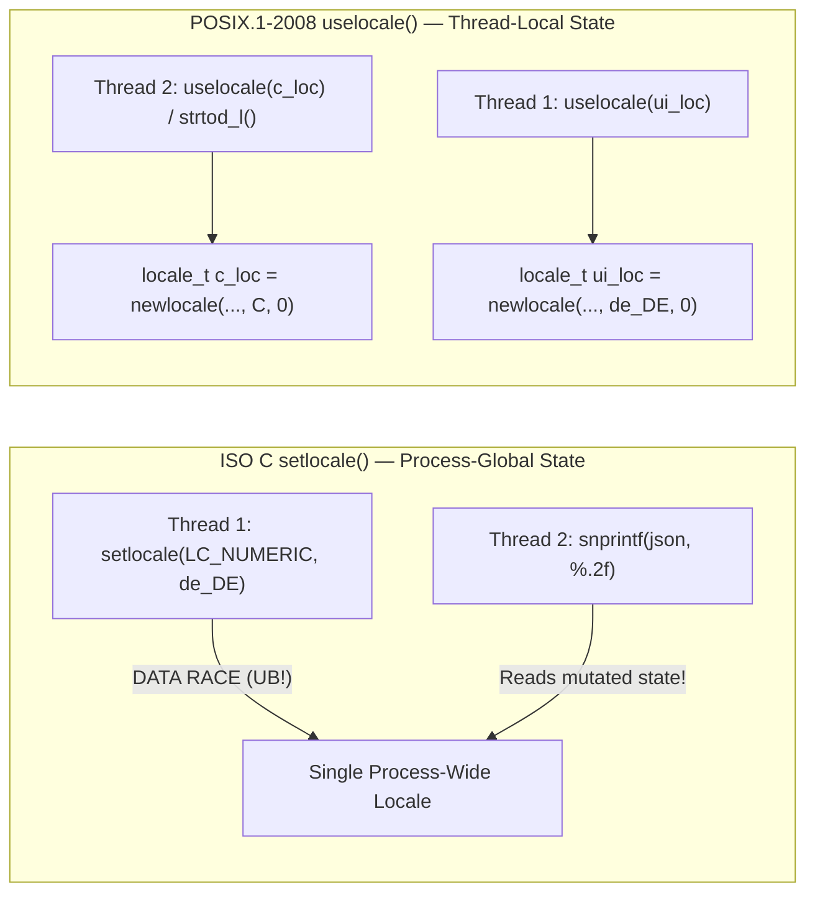

# Localization Support (`<locale.h>`)

The `<locale.h>` <span class="c-badge c89">C89</span> header controls how culture- and language-sensitive C Standard Library functions classify characters, collate strings, format numbers and currency, and render dates and times.

```c
#include <locale.h>
```

At program startup—before `main()` is entered—the C runtime initializes the entire process to the minimal, portable **`"C"` locale** (equivalent to calling `setlocale(LC_ALL, "C")`). No environment variables (`LANG`, `LC_ALL`, `LC_NUMERIC`) take effect unless your program explicitly invokes `setlocale`.

---

## Core Functions

| Function | Prototype | Standard | Summary |
| :--- | :--- | :--- | :--- |
| `setlocale` | `char *setlocale(int category, const char *locale);` | <span class="c-badge c89">C89</span> | Installs or queries the process-wide C locale for `category`. |
| `localeconv` | `struct lconv *localeconv(void);` | <span class="c-badge c89">C89</span> | Returns a pointer to a `struct lconv` describing numeric and monetary formatting rules for the active locale. |

---

## `setlocale` — Querying & Switching the Global Locale

```c
char *setlocale(int category, const char *locale);
```

### Accepted `locale` Argument Values

| `locale` Value | Behavior |
| :--- | :--- |
| `"C"` | Selects the **minimal standard C locale**: 7-bit ASCII classification (`isalpha`, etc.), `.` decimal point, no thousands grouping, English weekday/month abbreviations (`Sun`, `Jan`), byte-wise `strcoll` collation. Guaranteed to succeed on every conforming implementation. |
| `""` *(empty string)* | Selects the **implementation-defined native environment locale**. On POSIX systems, this inspects environment variables in precedence order: `LC_ALL` $\rightarrow$ category-specific `LC_*` $\rightarrow$ `LANG` $\rightarrow$ fallback `"C"`. On Windows, it queries the user/system regional settings. |
| `"name"` *(e.g. `"en_US.UTF-8"`, `"de_DE.UTF-8"`, `"C.UTF-8"`)* | Selects a specific OS-installed locale. Valid naming conventions are implementation-defined (POSIX uses `language[_TERRITORY][.codeset][@modifier]`; Windows CRT supports BCP-47 tags like `"en-US"` and `.UTF8`). |
| `NULL` | **Query mode**: does not modify the locale; returns the name string of the current locale for `category`. |

### Return Value & Pointer Invalidation Rules

* **Success**: returns a pointer to an internal static string identifying the active locale for `category`. This string can be saved and passed back to a later `setlocale(category, saved)` call to restore the previous state.
* **Failure** (e.g., an uninstalled locale name): returns `NULL` and **leaves the program's current locale completely unchanged**.

!!! danger "Never Mutate or Retain the Raw Pointer Returned by `setlocale()`"
    ISO C23 §7.11.1.1p8 establishes two strict lifetime rules:

    1. **Read-only storage**: Modifying the string pointed to by `setlocale`'s return value is **undefined behavior** (despite the historical non-`const` `char *` return type).
    2. **Immediate invalidation**: Any subsequent call to `setlocale()`—even in query mode with `NULL`—**may overwrite or invalidate** the previously returned pointer! Always duplicate the string (`snprintf` into a buffer or `strdup`) if you intend to restore it later.

=== "Good (Copy Saved Locale Name)"

    ```c
    const char *cur = setlocale(LC_NUMERIC, NULL);
    char saved[128];
    if (cur != NULL && snprintf(saved, sizeof saved, "%s", cur) < (int)sizeof saved) {
        if (setlocale(LC_NUMERIC, "C") != NULL) {
            /* serialize portable floating-point data ... */
            setlocale(LC_NUMERIC, saved);
        }
    }
    ```

=== "Bad (Dangling / Overwritten Pointer)"

    ```c
    /* BUG: second setlocale() overwrites the static buffer pointed to by saved! */
    char *saved = setlocale(LC_NUMERIC, NULL);
    setlocale(LC_NUMERIC, "C");
    /* ... */
    setlocale(LC_NUMERIC, saved); /* Restores "C" instead of original locale, or UB! */
    ```

---

## Standard Locale Categories (`LC_*`)

All 6 category macros expand to distinct integer constant expressions defined in `<locale.h>`:

| Category Macro | Standard | Scope & Affected Standard Library Functions |
| :--- | :--- | :--- |
| `LC_ALL` | <span class="c-badge c89">C89</span> | **Entire locale** — simultaneously selects or queries all five categories below (plus any platform extensions such as POSIX `LC_MESSAGES`). |
| `LC_COLLATE` | <span class="c-badge c89">C89</span> | **String collation (sorting)**: affects `strcoll`, `strxfrm`, `wcscoll`, `wcsxfrm`. Does *not* affect `strcmp` or `memcmp` (which always compare raw unsigned byte values). |
| `LC_CTYPE` | <span class="c-badge c89">C89</span> | **Character classification, case mapping & multibyte encoding**: affects `<ctype.h>` (`isalpha`, `isdigit`, `isspace`, `tolower`, `toupper`, etc.), `<wctype.h>` (`iswalpha`, `towlower`, etc.), and multibyte/wide conversions (`mbtowc`, `mbrtowc`, `wcstombs`, `mbrtoc8`/`c8rtomb`, `mbrtoc16`/`mbrtoc32`, etc.). |
| `LC_MONETARY` | <span class="c-badge c89">C89</span> | **Monetary formatting**: governs the monetary fields of `localeconv()` (and POSIX `strfmon`). |
| `LC_NUMERIC` | <span class="c-badge c89">C89</span> | **Decimal radix & numeric grouping**: governs `decimal_point`, `thousands_sep`, and `grouping` in `localeconv()`, AND directly alters the decimal point recognized/emitted by `printf`/`scanf` (`%f`/`%e`/`%g`/`%a`), `strtod`/`strtof`/`strtold`, `atof`, `wcstod`, and `strfromd` <span class="c-badge c23">C23</span>! |
| `LC_TIME` | <span class="c-badge c89">C89</span> | **Date & time formatting**: affects `strftime` and `wcsftime` (weekday/month names, AM/PM indicators, `%x`/`%X`/`%c` formats, era specifiers `%E`/`%O`). Does *not* affect `asctime` or `ctime`. |

!!! note "POSIX `LC_MESSAGES` Extension"
    POSIX adds a 7th category, `LC_MESSAGES`, controlling localized system messages (`strerror`, `perror`, `gettext`). Pure ISO C only defines the 6 categories above.

---

## `localeconv()` & Complete `struct lconv` Reference

```c
struct lconv *localeconv(void);
```

`localeconv()` returns a pointer to an internal `struct lconv` populated for the current locale. Like `setlocale()`, the caller **must never modify** the pointed-to struct or any of its strings, and the object may be overwritten by any later call to `localeconv()` or `setlocale()` modifying `LC_ALL`, `LC_MONETARY`, or `LC_NUMERIC`.

### Complete 24-Field Reference Table (`struct lconv`)

A `char *` field equal to `""` or a `char` field equal to `CHAR_MAX` signifies **"value not available in the current locale"**.

| # | Field Name | Type | Standard | `"C"` Default | Semantics |
| :--- | :--- | :--- | :--- | :--- | :--- |
| 1 | `decimal_point` | `char *` | <span class="c-badge c89">C89</span> | `"."` | Non-monetary decimal radix character (e.g., `"."` in `en_US`, `","` in `de_DE`). Never empty. |
| 2 | `thousands_sep` | `char *` | <span class="c-badge c89">C89</span> | `""` | Separator between digit groups left of the non-monetary decimal point (e.g., `","`, `"."`, or UTF-8 narrow no-break space `"\xE2\x80\xAF"`). |
| 3 | `grouping` | `char *` | <span class="c-badge c89">C89</span> | `""` | Byte-encoded digit group sizes for non-monetary numbers (see decoding table below). |
| 4 | `mon_decimal_point` | `char *` | <span class="c-badge c89">C89</span> | `""` | Decimal radix character for monetary quantities. |
| 5 | `mon_thousands_sep` | `char *` | <span class="c-badge c89">C89</span> | `""` | Digit-group separator for monetary quantities. |
| 6 | `mon_grouping` | `char *` | <span class="c-badge c89">C89</span> | `""` | Byte-encoded digit group sizes for monetary quantities. |
| 7 | `positive_sign` | `char *` | <span class="c-badge c89">C89</span> | `""` | Sign string used for non-negative monetary values. |
| 8 | `negative_sign` | `char *` | <span class="c-badge c89">C89</span> | `""` | Sign string used for negative monetary values (typically `"-"`). |
| 9 | `currency_symbol` | `char *` | <span class="c-badge c89">C89</span> | `""` | Local currency symbol (e.g., `"$"`, `"€"`, `"£"`, `"¥"`). |
| 10 | `frac_digits` | `char` | <span class="c-badge c89">C89</span> | `CHAR_MAX` | Number of fractional digits displayed for local monetary values (e.g., `2` for USD/EUR, `0` for JPY). |
| 11 | `p_cs_precedes` | `char` | <span class="c-badge c89">C89</span> | `CHAR_MAX` | `1` if `currency_symbol` precedes a non-negative monetary value; `0` if it follows. |
| 12 | `n_cs_precedes` | `char` | <span class="c-badge c89">C89</span> | `CHAR_MAX` | `1` if `currency_symbol` precedes a negative monetary value; `0` if it follows. |
| 13 | `p_sep_by_space` | `char` | <span class="c-badge c89">C89</span> | `CHAR_MAX` | Space separation between `currency_symbol` and non-negative value (`0`, `1`, or `2`). |
| 14 | `n_sep_by_space` | `char` | <span class="c-badge c89">C89</span> | `CHAR_MAX` | Space separation between `currency_symbol` and negative value (`0`, `1`, or `2`). |
| 15 | `p_sign_posn` | `char` | <span class="c-badge c89">C89</span> | `CHAR_MAX` | Position of `positive_sign` for non-negative local monetary values (`0`–`4`). |
| 16 | `n_sign_posn` | `char` | <span class="c-badge c89">C89</span> | `CHAR_MAX` | Position of `negative_sign` for negative local monetary values (`0`–`4`). |
| 17 | `int_curr_symbol` | `char *` | <span class="c-badge c89">C89</span> | `""` | ISO 4217 3-letter currency code followed by a 4th separator character (e.g., `"USD "`, `"EUR "`, `"JPY "`). |
| 18 | `int_frac_digits` | `char` | <span class="c-badge c89">C89</span> | `CHAR_MAX` | Number of fractional digits for international monetary format. |
| 19 | `int_p_cs_precedes` | `char` | <span class="c-badge c99">C99</span> | `CHAR_MAX` | Same as `p_cs_precedes` for international monetary formatting. |
| 20 | `int_n_cs_precedes` | `char` | <span class="c-badge c99">C99</span> | `CHAR_MAX` | Same as `n_cs_precedes` for international monetary formatting. |
| 21 | `int_p_sep_by_space` | `char` | <span class="c-badge c99">C99</span> | `CHAR_MAX` | Same as `p_sep_by_space` for international monetary formatting. |
| 22 | `int_n_sep_by_space` | `char` | <span class="c-badge c99">C99</span> | `CHAR_MAX` | Same as `n_sep_by_space` for international monetary formatting. |
| 23 | `int_p_sign_posn` | `char` | <span class="c-badge c99">C99</span> | `CHAR_MAX` | Same as `p_sign_posn` for international monetary formatting. |
| 24 | `int_n_sign_posn` | `char` | <span class="c-badge c99">C99</span> | `CHAR_MAX` | Same as `n_sign_posn` for international monetary formatting. |

### Interpreting Encoded `struct lconv` Fields

#### `grouping` & `mon_grouping` Byte Encoding

Despite having type `char *`, `grouping` and `mon_grouping` are **not printable text**—each byte is a small integer giving the size of successive digit groups moving right-to-left from the decimal point:

| Byte Value (`(unsigned char)g[i]` or `g[i]`) | Meaning |
| :--- | :--- |
| `CHAR_MAX` | No further grouping is performed for all remaining digits to the left. |
| `0` (`'\0'`) | Repeat the **previous** group size indefinitely for all remaining digits (if `g[0] == '\0'`, no grouping at all). |
| `1` .. `CHAR_MAX - 1` | Current group has this exact number of digits; advance to `g[i + 1]` for the next group to the left. |

* Example `"\3"` (`{3, 0}`): standard Western grouping — `1,234,567,890`.
* Example `"\3\2"` (`{3, 2, 0}`): South Asian (Indian) grouping — `1,23,45,67,890`.
* Example `"\3\x7F"` (`{3, CHAR_MAX}`): group only the rightmost 3 digits, leave all higher digits ungrouped — `1234567,890`.

#### `*_sep_by_space` Values

| Value | Meaning |
| :--- | :--- |
| `0` | No space separates the currency symbol and the numeric value (e.g., `$1.23`). |
| `1` | A space separates the currency symbol and the numeric value (e.g., `1,23 €`). |
| `2` | If the sign string and currency symbol are adjacent, a space separates *them*; otherwise a space separates the sign string from the numeric value. |
| `CHAR_MAX` | Unspecified in current locale. |

#### `*_sign_posn` Values

| Value | Meaning | Example (`$`, `-`, `1.23`) |
| :--- | :--- | :--- |
| `0` | Parentheses surround the quantity and currency symbol | `($1.23)` |
| `1` | Sign precedes both quantity and currency symbol | `-$1.23` |
| `2` | Sign follows both quantity and currency symbol | `$1.23-` |
| `3` | Sign immediately precedes the currency symbol | `-$1.23` (or `1.23 -$`) |
| `4` | Sign immediately follows the currency symbol | `$-1.23` |
| `CHAR_MAX` | Unspecified in current locale | — |

---

## Production Pitfalls & Thread-Safe Alternatives

### Pitfall 1: `LC_NUMERIC` Silently Corrupting JSON, CSV, SQL & Wire Formats

Calling `setlocale(LC_ALL, "")` enables the user's `LC_NUMERIC` setting across the **entire process**. On European systems (`de_DE.UTF-8`, `fr_FR.UTF-8`, `es_ES.UTF-8`, `pt_BR.UTF-8`), `decimal_point` switches from `"."` to `","`. Instantly:

* `snprintf(buf, sizeof buf, "{\"lat\":%.4f}", 52.5200)` emits **invalid JSON**: `{"lat":52,5200}`!
* `strtod("3.14159", &end)` **stops at `'.'`** and returns `3.0`, silently discarding `.14159`!
* CSV columns shift because `,` is now both the decimal separator and the column delimiter!
* SQL numeric literals, HTTP `q=` weights, CSS values, and SVG coordinates all break in subtle, customer-locale-only outages.

=== "Bad (Process-Wide `LC_ALL` Breaks Serialization)"

    ```c
    /* Runs fine on US CI servers, corrupts JSON on German/French customer hosts! */
    setlocale(LC_ALL, "");
    printf("{\"price\": %.2f}\n", 19.95);
    /* Under de_DE.UTF-8 prints: {"price": 19,95}  <-- INVALID JSON! */
    ```

=== "Good (Pin `LC_NUMERIC` to `"C"` or Use Per-Locale APIs)"

    ```c
    /* Initialize once at startup BEFORE spawning any threads: */
    setlocale(LC_ALL, "");
    setlocale(LC_NUMERIC, "C"); /* Keep IEEE/JSON/CSV '.' radix everywhere */
    printf("{\"price\": %.2f}\n", 19.95);
    /* Always prints: {"price": 19.95} */
    ```

### Pitfall 2: `LC_CTYPE` & `LC_COLLATE` Surprises

* **Turkish dotted/dotless I (`tr_TR.UTF-8`)**: `toupper('i')` or `tolower('I')` under single-byte or locale-aware case folding breaks ASCII protocol identifiers (`"HTTP/1.1"`, `"INVITE"`, `"SELECT"`). Always implement explicit ASCII helpers (`c >= 'A' && c <= 'Z'`) for wire protocols and config keywords instead of `<ctype.h>` when a non-`"C"` locale is active.
* **Signed `char` UB in `<ctype.h>`**: Passing a negative `char` (e.g., UTF-8 lead/continuation byte `0xC3` sign-extended to `-61`) directly to `isalpha(c)` is **undefined behavior** regardless of locale; always cast to `(unsigned char)c`.

### Pitfall 3: `setlocale()` Is Process-Global and NOT Thread-Safe

ISO C11/C23 (§7.11.1.1p8) states that calling `setlocale()` introduces a **data race** if *any other thread* concurrently calls `setlocale()` **or any locale-dependent function** (`printf`, `scanf`, `strtod`, `isalpha`, `mbtowc`, `strftime`, `strcoll`, `localeconv`).



#### Thread-Safe Alternatives by Platform

| Platform | Thread-Safe Locale API | Header | Notes |
| :--- | :--- | :--- | :--- |
| **POSIX.1-2008** (Linux glibc/musl, macOS, FreeBSD) | `newlocale()`, `uselocale()`, `duplocale()`, `freelocale()`, plus explicit `*_l` functions (`strtod_l`, `strcoll_l`, `strftime_l`, `isalpha_l`, BSD/macOS `snprintf_l`) | `<locale.h>` (and `<xlocale.h>` on macOS for `*_l` stdio) | `uselocale(loc)` switches **only the calling thread's** locale; pass `LC_GLOBAL_LOCALE` to revert. Passing explicit `locale_t` to `strtod_l` avoids even thread-local state mutation. |
| **Windows (MSVC / UCRT)** | `_configthreadlocale(_ENABLE_PER_THREAD_LOCALE)`, `_create_locale()`, `_free_locale()`, `_strtod_l()`, `_snprintf_l()` | `<locale.h>`, `<stdlib.h>`, `<stdio.h>` | Enables per-thread `setlocale()` isolation or explicit `_locale_t` parameters on `*_l` variants. |
| **Portable Pure ISO C** | Call `setlocale()` **once** at startup in `main()` before creating threads, and never call it again; pin `LC_NUMERIC` to `"C"` or implement locale-independent parsers/formatters. | `<locale.h>` | 100% portable, zero data races. |

---

## Complete Compilable C23 Example

This C23 program safely inspects every major field of `struct lconv`, demonstrates how to decode `grouping` byte sequences cleanly without UB, compares `"C"` against the native environment locale `""` (and `"de_DE.UTF-8"` if installed on the host), and shows how `LC_NUMERIC` changes `snprintf` output while preserving and restoring the previous locale string safely.

```c
#include <limits.h>
#include <locale.h>
#include <stdio.h>
#include <stdlib.h>
#include <string.h>

static void print_grouping(const char *label, const char *grp) {
    printf("  %-22s: ", label);
    if (grp == NULL || grp[0] == '\0') {
        puts("(none)");
        return;
    }
    putchar('[');
    for (size_t i = 0; grp[i] != '\0'; ++i) {
        if (i > 0) {
            fputs(", ", stdout);
        }
        unsigned char g = (unsigned char)grp[i];
        if (g == (unsigned char)CHAR_MAX) {
            fputs("CHAR_MAX (stop)", stdout);
            break;
        }
        printf("%u", (unsigned int)g);
    }
    puts("]");
}

static void print_char_field(const char *label, char val) {
    if (val == CHAR_MAX) {
        printf("  %-22s: CHAR_MAX (unspecified)\n", label);
    } else {
        printf("  %-22s: %d\n", label, (int)(unsigned char)val);
    }
}

static void inspect_locale(const char *requested) {
    /* Save current LC_ALL safely into an owned buffer before mutating */
    const char *prev_ptr = setlocale(LC_ALL, NULL);
    char saved[256] = "C";
    if (prev_ptr != NULL) {
        int n = snprintf(saved, sizeof saved, "%s", prev_ptr);
        if (n < 0 || (size_t)n >= sizeof saved) {
            fprintf(stderr, "Warning: saved locale name truncated\n");
            snprintf(saved, sizeof saved, "C");
        }
    }

    const char *active = setlocale(LC_ALL, requested);
    if (active == NULL) {
        printf("=== Locale \"%s\" is not installed on this host ===\n\n", requested);
        return;
    }

    printf("=== Active Locale (requested \"%s\") -> \"%s\" ===\n", requested, active);

    const struct lconv *lc = localeconv();
    printf("  %-22s: \"%s\"\n", "decimal_point", lc->decimal_point);
    printf("  %-22s: \"%s\"\n", "thousands_sep", lc->thousands_sep);
    print_grouping("grouping", lc->grouping);

    printf("  %-22s: \"%s\"\n", "currency_symbol", lc->currency_symbol);
    printf("  %-22s: \"%s\"\n", "int_curr_symbol", lc->int_curr_symbol);
    printf("  %-22s: \"%s\"\n", "mon_decimal_point", lc->mon_decimal_point);
    printf("  %-22s: \"%s\"\n", "mon_thousands_sep", lc->mon_thousands_sep);
    print_grouping("mon_grouping", lc->mon_grouping);
    printf("  %-22s: \"%s\" / \"%s\"\n", "pos / neg sign",
           lc->positive_sign, lc->negative_sign);
    print_char_field("frac_digits", lc->frac_digits);
    print_char_field("int_frac_digits", lc->int_frac_digits);
    print_char_field("p_cs_precedes", lc->p_cs_precedes);
    print_char_field("n_cs_precedes", lc->n_cs_precedes);
    print_char_field("p_sep_by_space", lc->p_sep_by_space);
    print_char_field("n_sign_posn", lc->n_sign_posn);
    print_char_field("int_p_cs_precedes", lc->int_p_cs_precedes);
    print_char_field("int_n_sign_posn", lc->int_n_sign_posn);

    /* Observe live LC_NUMERIC formatting impact */
    char formatted[64];
    int written = snprintf(formatted, sizeof formatted, "%.4f", 1234.5678);
    if (written >= 0 && (size_t)written < sizeof formatted) {
        printf("  %-22s: %s\n\n", "snprintf(\"%.4f\")", formatted);
    }

    /* Restore previous locale */
    if (setlocale(LC_ALL, saved) == NULL) {
        fprintf(stderr, "Failed to restore locale \"%s\"\n", saved);
    }
}

int main(void) {
    inspect_locale("C");
    inspect_locale("");
    inspect_locale("en_US.UTF-8");
    inspect_locale("de_DE.UTF-8");
    return EXIT_SUCCESS;
}
```

Compile and run:

```bash
cc -std=c23 -Wall -Wextra -Wpedantic locale_demo.c -o locale_demo && ./locale_demo
```

---

## See Also & References

* **Related Library Reference**:
  * [Input/Output Support (`<stdio.h>` & `<wchar.h>`)](io.md) — `printf`/`scanf` affected by `LC_NUMERIC` and `LC_CTYPE`.
  * [Byte Strings & Character Utilities](strings-byte.md) — `<ctype.h>`, `strcoll`, `strxfrm`, `strtod`.
  * [Multibyte, Unicode & Wide Strings](strings-multibyte-wide.md) — UTF-8 / `char8_t` / `wchar_t` conversions governed by `LC_CTYPE`.
  * [Date & Time Utilities (`<time.h>`)](chrono.md) — `strftime` and `wcsftime` governed by `LC_TIME`.
* **Deep Dives in Curriculum**:
  * [25 · Unicode, Locales & Complex Math](../../curriculum/tier-5-expert/25-unicode-locale-complex-math.md)
* **Authoritative Specifications**:
  * [cppreference.com — Localization support (`<locale.h>`)](https://en.cppreference.com/w/c/locale)
  * ISO/IEC 9899:2024 (C23), §7.11 *Localization `<locale.h>`*.
  * IEEE Std 1003.1 (POSIX.1-2008+), `newlocale(3)` & `uselocale(3)`.
