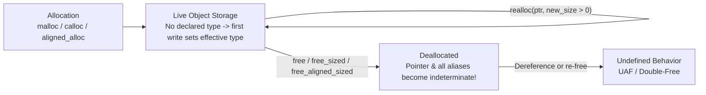

# Dynamic Memory Management (`<stdlib.h>`)

**Header:** `<stdlib.h>` · **Version-test macro:** `__STDC_VERSION_STDLIB_H__` (`202311L`) <span class="c-badge c23">C23</span> · **Freestanding:** Hosted (`memalignment` required in freestanding C23)

This reference mirrors [cppreference.com/c/memory](https://en.cppreference.com/w/c/memory) and documents the complete dynamic allocation lifecycle in ISO C89–C23, including the **C23 breaking change to `realloc(ptr, 0)`**, the new C23 sized deallocators (**`free_sized`** and **`free_aligned_sized`**), **`memalignment`**, strict-aliasing effective type rules, and pointer provenance.



---

## Complete API Reference

| Declaration | Standard | Allocation / Deallocation Contract |
| :--- | :--- | :--- |
| `void *malloc(size_t size);` | <span class="c-badge c89">C89</span> | Allocates `size` bytes of **uninitialized** storage. Returns pointer to allocated block, or `nullptr` on failure. If `size == 0`, behavior is implementation-defined (returns either `nullptr` or a unique non-dereferenceable pointer that may still be passed to `free`). |
| `void *calloc(size_t num, size_t size);` | <span class="c-badge c89">C89</span> | Allocates storage for an array of `num` objects of `size` bytes each and initializes **all bits to zero**. Protects against integer overflow in `num * size` (returns `nullptr` if product exceeds `SIZE_MAX`). |
| `void *realloc(void *ptr, size_t new_size);` | <span class="c-badge c89">C89</span> · <span class="c-badge c23">C23</span> | Resizes block previously allocated by `malloc`, `calloc`, `realloc`, or `aligned_alloc` to `new_size` bytes, preserving the minimum of old and new sizes. If `ptr == nullptr`, behaves like `malloc(new_size)`. **C23 Breaking Change:** Calling `realloc(ptr, 0)` with non-null `ptr` is now **Undefined Behavior**! |
| `void free(void *ptr);` | <span class="c-badge c89">C89</span> | Deallocates storage previously returned by `malloc`, `calloc`, `realloc`, or `aligned_alloc`. If `ptr == nullptr`, performs **no action** (safe no-op). Double-freeing or passing an interior/stack/static pointer is **Undefined Behavior**. |
| `void *aligned_alloc(size_t alignment, size_t size);` | <span class="c-badge c11">C11</span> · <span class="c-badge c17">C17</span> | Allocates `size` bytes of uninitialized storage aligned to `alignment` (which must be a valid power-of-two alignment supported by the implementation). C17 (DR 460) lifted C11's UB when `size` is not a multiple of `alignment` (now returns `nullptr` if invalid/unsupported). |
| `void free_sized(void *ptr, size_t size);` | <span class="c-badge c23">C23</span> | Deallocates `ptr` previously returned by `malloc`, `calloc`, or `realloc` with exact requested size `size` (or no-op if `ptr == nullptr`). Passing a pointer from `aligned_alloc` or a mismatched `size` is **Undefined Behavior**. |
| `void free_aligned_sized(void *ptr, size_t alignment, size_t size);` | <span class="c-badge c23">C23</span> | Deallocates `ptr` previously returned by `aligned_alloc(alignment, size)` with exact matching `alignment` and `size` (or no-op if `ptr == nullptr`). Passing a pointer from `malloc`/`calloc`/`realloc` or mismatched parameters is **Undefined Behavior**. |
| `size_t memalignment(const void *p);` | <span class="c-badge c23">C23</span> | Required in freestanding C23. Returns `0` if `p == nullptr`; otherwise returns the maximum power-of-two byte alignment satisfied by address `p`. |

---

## Function Deep Dives & Edge Cases

### `malloc` and `calloc`

- **Uninitialized bytes in `malloc`**: Reading any byte of `malloc`'d memory before writing to it yields an indeterminate value (and is UB for types with trap representations or uninitialized reads under sanitizers/MSan).
- **Why `calloc(num, size)` beats `malloc(num * size)`**:
  1. **Overflow safety**: `malloc(count * sizeof(T))` can silently wrap around modulo $2^{64}$ on attacker-controlled `count`, allocating a tiny buffer and causing a heap buffer overflow. `calloc(count, sizeof(T))` performs overflow-checked multiplication and returns `nullptr` on overflow.
  2. **OS virtual-memory optimization**: For large allocations (typically $\ge 128\text{ KiB}$), modern allocators satisfy `calloc` via anonymous `mmap` / `VirtualAlloc`, returning demand-zero virtual pages without physically touching RAM or running `memset` — making `calloc` dramatically **faster** and more memory-efficient than `malloc` + `memset`!
- **All-bits-zero representation**: Zero-filled bytes represent `0` for all integer types (mandatory two's complement in C23) and `+0.0` for IEEE 754 binary floating-point types. On flat-address platforms, all-bits-zero also represents a null pointer (though ISO C technically permits exotic architectures with non-zero null-pointer bit patterns).

### `realloc` and the C23 Breaking Change (`realloc(ptr, 0)`)

!!! danger "C23 Breaking Change: `realloc(ptr, 0)` Is Now Undefined Behavior (ISO/IEC 9899:2024 §7.24.3.7)"
    Between C89 and C17, `realloc(ptr, 0)` (when `ptr != nullptr`) was a notorious cross-platform portability trap:

    - **glibc / Windows UCRT**: freed `ptr` and returned `nullptr`.
    - **macOS / FreeBSD / AIX**: freed `ptr` and returned a *new* minimal unique pointer (or failed without freeing), causing memory leaks or double-frees across platforms!

    **C23 formally declared `realloc(ptr, 0)` with non-null `ptr` to be Undefined Behavior.** Always branch explicitly on `new_size == 0` before calling `realloc`.

#### The Safe Temporary-Pointer `realloc` Pattern

Never overwrite your only pointer to a heap block with the return value of `realloc`. If `realloc` fails and returns `nullptr`, the original block remains allocated and untouched — overwriting `ptr` leaks it permanently!

=== "Good (Safe C23 Resize Helper)"

    ```c
    #include <stddef.h>
    #include <stdlib.h>

    void *safe_realloc(void *ptr, size_t new_size) {
        if (new_size == 0) {
            free(ptr);        // Explicitly handle zero size — avoids C23 UB!
            return nullptr;
        }
        void *tmp = realloc(ptr, new_size);
        if (tmp == nullptr) {
            /* Original 'ptr' is STILL VALID here — caller can recover or free(ptr) */
            return nullptr;
        }
        return tmp;
    }
    ```

=== "Bad (Leaks on OOM + UB in C23 on `new_size == 0`)"

    ```c
    #include <stdlib.h>

    void broken_resize(int **buf, size_t new_count) {
        /* BUG 1: If realloc fails, *buf becomes NULL and original memory leaks!
           BUG 2: If new_count == 0 and *buf != NULL, realloc(*buf, 0) is UB in C23!
           BUG 3: new_count * sizeof(int) can overflow size_t! */
        *buf = realloc(*buf, new_count * sizeof(int));
    }
    ```

!!! warning "All Old Pointers Become Invalid After Successful `realloc`"
    Even when `realloc` succeeds **in place** and returns the exact same numeric address (`new_ptr == old_ptr`), ISO C treats the old object's lifetime as ended and begins a new object. Any pointer previously pointing into or at the old block (`old_ptr`, cached element pointers, iterators) has **indeterminate value** and must be recomputed from `new_ptr` (e.g., via saved integer offsets rather than raw interior pointers).

### `aligned_alloc` (C11 $\to$ C17 DR 460)

Use `aligned_alloc` whenever an object requires stricter alignment than `alignof(max_align_t)` — for example, 64-byte cache-line isolation to prevent false sharing between threads, AVX-512 64-byte SIMD vectors, or 4096-byte page-aligned DMA/O_DIRECT buffers.

- **C11 rule**: `size` had to be an integral multiple of `alignment`; otherwise behavior was undefined.
- **C17 (DR 460) / C23 rule**: If `alignment` is not a valid alignment supported by the implementation, `aligned_alloc` fails gracefully and returns `nullptr`.
- **Real-world portability note**:
  - Older macOS / BSD libcs and pre-C17 runtimes still reject `size % alignment != 0` or `alignment < sizeof(void *)`. Rounding `size` up to a multiple of `alignment` (`(size + align - 1) & ~(align - 1)`) guarantees maximum portability across all platforms!
  - **Windows MSVC UCRT** does **not** provide ISO `aligned_alloc` because Windows `free()` cannot free over-aligned blocks; on Windows use `_aligned_malloc(size, alignment)` paired with `_aligned_free(ptr)`.

### C23 Sized Deallocation: `free_sized` & `free_aligned_sized` <span class="c-badge c23">C23</span>

```c
void free_sized(void *ptr, size_t size);
void free_aligned_sized(void *ptr, size_t alignment, size_t size);
```

Why did ISO C23 introduce sized deallocators when `free(ptr)` already knows how much memory to release?

#### Systems Engineering Rationale: How Modern Slab / Size-Class Allocators Work

Modern high-throughput allocators (**jemalloc**, **mimalloc**, **tcmalloc**, **scudo**, **snmalloc**) do **not** store a header word right before every small allocation (storing inline headers destroys cache density, breaks power-of-two alignment, and invites heap-metadata overwrite exploits). Instead, they segregate small allocations into fixed **size-class slabs** (e.g., 16 B, 32 B, 48 B, 64 B, …) tracked in external radix trees or page-descriptor tables.

- **With `free(ptr)`**: The allocator must mask `ptr` to its page/segment base, traverse a multi-level page map or radix tree (often triggering **L2/L3 cache misses**), read the slab descriptor to discover the block's size class, and only then push `ptr` onto that thread's local freelist.
- **With `free_sized(ptr, size)` / `free_aligned_sized(ptr, alignment, size)`**: Because callers (containers, arenas, string buffers, hash tables, `struct` destructors) almost always already hold `size` in a register or struct field, the allocator computes the size-class index in **1–2 arithmetic instructions** and pushes `ptr` directly onto the per-thread size-class cache — **eliminating metadata lookup cache misses**!
- **Security hardening bonus**: Hardened allocators can verify the caller-supplied `size` against slab metadata in debug/hardened builds, immediately trapping type-confusion or corrupted-size bugs.

#### Strict Allocator–Deallocator Pairing Matrix

| Allocator Call | `free(p)` | `free_sized(p, sz)` <span class="c-badge c23">C23</span> | `free_aligned_sized(p, al, sz)` <span class="c-badge c23">C23</span> |
| :--- | :---: | :---: | :---: |
| `malloc(sz)` | Valid | **Valid** (exact `sz`) | **UB** |
| `calloc(n, elem_sz)` | Valid | **Valid** (exact `n * elem_sz`) | **UB** |
| `realloc(old, new_sz)` | Valid | **Valid** (exact `new_sz`) | **UB** |
| `aligned_alloc(al, sz)` | Valid | **UB** | **Valid** (exact `al` and `sz`) |
| `nullptr` | No-op | No-op (any `sz`) | No-op (any `al`, `sz`) |

!!! danger "Never Mismatch `free_sized` and `free_aligned_sized`"
    - Calling `free_sized(p, sz)` on a pointer returned by `aligned_alloc` is **Undefined Behavior** (even if `alignment <= alignof(max_align_t)`!).
    - Calling `free_aligned_sized(p, al, sz)` on a pointer returned by `malloc`, `calloc`, or `realloc` is **Undefined Behavior**.
    - Passing an approximate or rounded-up `size` that does not equal the exact requested size passed to `malloc`/`calloc`/`realloc`/`aligned_alloc` is **Undefined Behavior**.

---

## Memory Model: Effective Type, Alignment & Pointer Provenance

### 1. Object Lifetime & Effective Type (§6.5p6 — Strict Aliasing)

Storage returned by `malloc`, `calloc`, `realloc`, or `aligned_alloc` begins its lifetime with **no declared type**.

- The **first write** using an lvalue of non-character type `T` establishes `T` as the **effective type** of that region.
- Copying bytes from an object with an effective type `T` using `memcpy` or `memmove` transfers effective type `T` to the destination allocated storage.
- Once established, reading the storage through an lvalue of an incompatible type (other than `char`, `signed char`, or `unsigned char`) violates C's **strict aliasing rule** and triggers **Undefined Behavior**.
- Overwriting allocated storage with a new non-character type `U` changes its effective type to `U` (allowing custom memory pools/arenas to recycle `malloc`'d slabs safely across types).

### 2. Alignment Guarantees (DR 445 / ISO C23 §7.24.3)

Every pointer returned by `malloc`, `calloc`, or `realloc` is suitably aligned so that it may be assigned to a pointer to any object with a **fundamental alignment** (`<= alignof(max_align_t)`) and **size less than or equal to the requested size** (the DR 445 clarification adopted in C17/C23: e.g., on a platform where `alignof(max_align_t) == 16`, `malloc(4)` only needs to satisfy alignments up to 4 bytes, though `malloc(16)` must satisfy 16-byte alignment). For **extended (over-aligned)** types (`alignas(64)`), you **must** use `aligned_alloc`.

### 3. Pointer Provenance (ISO/IEC TS 6010 — PNVI-ae-udi)

In modern optimizing compilers (GCC, Clang/LLVM), a pointer is not merely a raw integer address — it carries **provenance** linking it to the specific allocation that created it (formalized in **ISO/IEC TS 6010**, *Memory Object Model for C*, PNVI-ae-udi).

- After `free(p)`, even if a subsequent `q = malloc(n)` happens to return the **exact same numeric address** (`(uintptr_t)p == (uintptr_t)q`), dereferencing `p` is still **Undefined Behavior**: `p` has dead provenance while `q` has fresh provenance.
- Similarly, subtracting or comparing pointers from two distinct `malloc` allocations with `<`, `<=`, `>`, `>=` is **Undefined Behavior** (equality `==`/`!=` is defined, except comparing a one-past-the-end pointer of allocation A with the start of adjacent allocation B can yield surprising optimizer results under provenance analysis!).
- See [Basic Concepts & Memory Model](../language/basic-concepts.md) and [Technical Specifications (TS / TR)](../../standards/technical-specifications.md) for the complete provenance rules.

### 4. Scrubbing Secrets Before Deallocation

Before freeing buffers that held cryptographic keys, passwords, or session tokens, use C23 **`memset_explicit(buf, 0, size)`** (`<string.h>`) instead of `memset(buf, 0, size)`. Optimizers routinely delete plain `memset` calls immediately before `free()` as "dead stores", leaving plaintext secrets resident in heap memory! See [Byte Strings & Character Utilities](strings-byte.md).

---

## Complete Compilable C23 Example: Safe Dynamic Buffer & Aligned Slab

This warning-free C23 program implements a production-style dynamic byte buffer (`ByteBuf`) using C23 `<stdckdint.h>` overflow protection, the safe temporary-pointer `realloc` idiom (explicitly guarding against C23 `realloc(ptr, 0)` UB), C23 `free_sized` (with automatic fallback on pre-C23 libcs), and a 64-byte cache-line-aligned block verified by `memalignment` and released via `free_aligned_sized`.

```c
#include <stdckdint.h>
#include <stddef.h>
#include <stdint.h>
#include <stdio.h>
#include <stdlib.h>
#include <string.h>

/* Portable wrapper utilizing C23 free_sized / free_aligned_sized when libc supports them */
static inline void portable_free_sized(void *ptr, size_t size) {
#if defined(__STDC_VERSION_STDLIB_H__) && __STDC_VERSION_STDLIB_H__ >= 202311L
    free_sized(ptr, size);
#else
    (void)size;
    free(ptr);
#endif
}

static inline void portable_free_aligned_sized(void *ptr, size_t alignment, size_t size) {
#if defined(__STDC_VERSION_STDLIB_H__) && __STDC_VERSION_STDLIB_H__ >= 202311L
    free_aligned_sized(ptr, alignment, size);
#else
    (void)alignment;
    (void)size;
    free(ptr);
#endif
}

typedef struct {
    unsigned char *data;
    size_t len;
    size_t cap;
} ByteBuf;

static void bytebuf_destroy(ByteBuf *b) {
    if (b == nullptr) {
        return;
    }
    portable_free_sized(b->data, b->cap);
    *b = (ByteBuf){}; // C23 empty initializer resets all fields cleanly
}

static bool bytebuf_reserve(ByteBuf *b, size_t min_cap) {
    if (min_cap <= b->cap) {
        return true;
    }

    size_t new_cap = b->cap == 0 ? 32U : b->cap;
    while (new_cap < min_cap) {
        size_t doubled = 0;
        if (ckd_mul(&doubled, new_cap, (size_t)2U)) {
            new_cap = min_cap; // Overflow guarded — clamp to exact request
            break;
        }
        new_cap = doubled;
    }

    /* Safe temporary-pointer realloc; new_cap is guaranteed > 0 (never C23 UB!) */
    unsigned char *tmp = realloc(b->data, new_cap);
    if (tmp == nullptr) {
        return false; // b->data remains valid and unleaked!
    }

    b->data = tmp;
    b->cap = new_cap;
    return true;
}

static bool bytebuf_append(ByteBuf *b, const void *src, size_t n) {
    if (n == 0) {
        return true;
    }

    size_t needed = 0;
    if (ckd_add(&needed, b->len, n)) {
        return false; // Prevent size_t wraparound
    }
    if (!bytebuf_reserve(b, needed)) {
        return false;
    }

    memcpy(b->data + b->len, src, n);
    b->len = needed;
    return true;
}

int main(void) {
    /* 1. Safe growable ByteBuf with checked arithmetic & sized deallocation */
    ByteBuf buf = {};
    const char *chunks[] = { "ISO ", "C23 ", "Dynamic ", "Memory ", "Management!" };

    for (size_t i = 0; i < sizeof(chunks) / sizeof(chunks[0]); ++i) {
        if (!bytebuf_append(&buf, chunks[i], strlen(chunks[i]))) {
            fputs("Out of memory while growing ByteBuf\n", stderr);
            bytebuf_destroy(&buf);
            return EXIT_FAILURE;
        }
    }
    if (!bytebuf_append(&buf, "", 1U)) { // NUL-terminate for printing
        bytebuf_destroy(&buf);
        return EXIT_FAILURE;
    }

    printf("ByteBuf (%zu/%zu bytes): %s\n", buf.len - 1U, buf.cap, (const char *)buf.data);
    bytebuf_destroy(&buf);

    /* 2. Over-aligned 64-byte cache-line allocation + memalignment + free_aligned_sized */
    constexpr size_t CACHE_LINE = 64U;
    constexpr size_t SLAB_BYTES = 256U; // Multiple of CACHE_LINE for full portability

    double *simd_slab = aligned_alloc(CACHE_LINE, SLAB_BYTES);
    if (simd_slab == nullptr) {
        fputs("aligned_alloc failed\n", stderr);
        return EXIT_FAILURE;
    }

    size_t count = SLAB_BYTES / sizeof(double);
    for (size_t i = 0; i < count; ++i) {
        simd_slab[i] = (double)i * 1.5; // First write establishes effective type: double
    }

#if defined(__STDC_VERSION_STDLIB_H__) && __STDC_VERSION_STDLIB_H__ >= 202311L
    printf("SIMD slab alignment = %zu bytes (last elem = %.1f)\n",
           memalignment(simd_slab), simd_slab[count - 1U]);
#else
    printf("SIMD slab allocated (%zu doubles, last elem = %.1f)\n",
           count, simd_slab[count - 1U]);
#endif

    portable_free_aligned_sized(simd_slab, CACHE_LINE, SLAB_BYTES);
    return EXIT_SUCCESS;
}
```

Compile with sanitizers enabled to verify zero leaks, zero UB, and strict C23 conformance:

```bash
gcc -std=c23 -Wall -Wextra -Wpedantic -fsanitize=address,undefined memory_demo.c -o memory_demo && ./memory_demo
```

---

## See Also

- [Program Utilities, Signals & setjmp](program.md) — `memalignment`, `exit`, and termination cleanup.
- [Byte Strings & Character Utilities](strings-byte.md) — `memcpy`, `memmove`, C23 `memset_explicit`, `strdup`, and `strndup`.
- [Bit Manipulation & Checked Integer Arithmetic](numerics-bit-checked.md) — Overflow-safe allocation sizing with `<stdckdint.h>`.
- [Basic Concepts & Memory Model](../language/basic-concepts.md) — Object lifetime, effective type, strict aliasing, and alignment.
- [C23 Migration & Breaking Changes](../../standards/c23-migration.md) — Auditing legacy `realloc(p, 0)` call sites.
- [Curriculum · 05 Dynamic Memory, Heaps & Arenas](../../curriculum/tier-2-runtime/05-dynamic-memory-arenas.md) — Building arena, pool, and slab allocators from scratch.
- External reference: [cppreference.com — Dynamic memory management](https://en.cppreference.com/w/c/memory)
