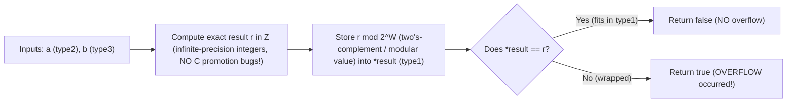

# Numerics: Bit Manipulation (`<stdbit.h>`) & Checked Integer Arithmetic (`<stdckdint.h>`) <span class="c-badge c23">C23</span>

ISO/IEC 9899:2024 (C23) introduces two dedicated low-level numerics headers that eliminate decades of compiler-specific intrinsics (`__builtin_clz`, `_BitScanReverse`, `__builtin_mul_overflow`) and undefined-behavior traps in systems programming:

- **`<stdbit.h>`** (§7.18): Compile-time endianness detection and 14 portable bit-manipulation operations across all standard and bit-precise unsigned integer types.
- **`<stdckdint.h>`** (§7.20): Overflow-checked addition, subtraction, and multiplication with exact infinite-precision semantics across mixed signed and unsigned integer types.

!!! info "C23 Header Overview & Version Macros"

    | Header | Standard | Version Macro | ISO C23 Clause | Purpose |
    | :--- | :--- | :--- | :--- | :--- |
    | `<stdbit.h>` | <span class="c-badge c23">C23</span> | `__STDC_VERSION_STDBIT_H__` (`202311L`) | §7.18 | Endianness macros & 14 type-generic / typed bit operations |
    | `<stdckdint.h>` | <span class="c-badge c23">C23</span> | `__STDC_VERSION_STDCKDINT_H__` (`202311L`) | §7.20 | `ckd_add`, `ckd_sub`, `ckd_mul` overflow-checked arithmetic |

---

## 1. Bit and Byte Utilities (`<stdbit.h>`) <span class="c-badge c23">C23</span>

### 1.1 Compile-Time Endianness Detection (§7.18.2)

Historically, C programmers relied on non-standard platform macros (`__BYTE_ORDER__`), runtime union/pointer type-punning, or build-system probes to detect byte order. `<stdbit.h>` standardizes three integer constant expression macros usable directly inside `#if` preprocessor directives with **zero undefined behavior** and **zero runtime cost**:

| Macro | Standard | Description |
| :--- | :--- | :--- |
| `__STDC_ENDIAN_LITTLE__` | <span class="c-badge c23">C23</span> | Distinct integer constant expression representing little-endian byte order (LSB at lowest address). |
| `__STDC_ENDIAN_BIG__` | <span class="c-badge c23">C23</span> | Distinct integer constant expression representing big-endian byte order (MSB at lowest address). |
| `__STDC_ENDIAN_NATIVE__` | <span class="c-badge c23">C23</span> | Host target's native byte order. Equals `__STDC_ENDIAN_LITTLE__` on little-endian hosts (x86-64, AArch64-LE, RISC-V), `__STDC_ENDIAN_BIG__` on big-endian hosts (s390x, SPARC), or another distinct value on mixed/PDP-11-endian targets. |

```c
#include <stdbit.h>
#include <stdint.h>

#if __STDC_ENDIAN_NATIVE__ == __STDC_ENDIAN_LITTLE__
    /* Compile-time little-endian fast path */
    constexpr bool HOST_IS_LITTLE_ENDIAN = true;
#elif __STDC_ENDIAN_NATIVE__ == __STDC_ENDIAN_BIG__
    /* Compile-time big-endian fast path */
    constexpr bool HOST_IS_LITTLE_ENDIAN = false;
#else
    #error "Unsupported mixed-endian architecture"
#endif
```

### 1.2 Type-Generic Macros vs. Typed Functions

Every one of the 14 bit operations in `<stdbit.h>` is provided in **six forms**:

1. **One type-generic macro** (`stdc_<op>(value)`) accepting any **standard unsigned integer type**, extended unsigned integer type, or **unsigned bit-precise integer type (`unsigned _BitInt(N)`)**.
2. **Five concrete external functions** (whose addresses can be taken as function pointers) suffixed by exact unsigned type:

| Suffix | Parameter Type | Typical Width (LP64 / LLP64) |
| :--- | :--- | :--- |
| `_uc` | `unsigned char` | 8 bits (`UCHAR_WIDTH`) |
| `_us` | `unsigned short` | 16 bits (`USHRT_WIDTH`) |
| `_ui` | `unsigned int` | 32 bits (`UINT_WIDTH`) |
| `_ul` | `unsigned long` | 64 bits (LP64) / 32 bits (LLP64) |
| `_ull` | `unsigned long long` | 64 bits (`ULLONG_WIDTH`) |

!!! danger "Forbidden Argument Types & Zero Integer Promotion"
    - **Allowed**: `unsigned char`, `unsigned short`, `unsigned int`, `unsigned long`, `unsigned long long`, extended unsigned integer types, and `unsigned _BitInt(N)`.
    - **Forbidden**: `bool`, plain `char` (even on platforms where `char` is unsigned!), all **signed** integer types (`int`, `int32_t`, `_BitInt(N)`), and `enum` types. Passing a signed `int` (such as literal `1` instead of `1u`) to a `<stdbit.h>` type-generic macro is a **constraint violation / undefined behavior**!
    - **Exact Type Width (No Promotion)**: Unlike ordinary C expressions, `<stdbit.h>` macros operate on the **exact unpromoted bit width** of the argument. On an 8-bit `uint8_t x = 1;`, `stdc_leading_zeros(x)` returns **`7`**, NOT `31`!

### 1.3 Complete Reference of All 14 `<stdbit.h>` Operations

Let $N$ denote the exact bit width of `value`'s unsigned integer type (e.g., $N = 8$ for `uint8_t`, $N = 32$ for `uint32_t`, $N = 64$ for `uint64_t`).

| # | Type-Generic Macro | Typed Suffixes | Return Type | Semantics | `value == 0` | `value == ~0` (all 1s) |
| :---: | :--- | :--- | :--- | :--- | :---: | :---: |
| 1 | `stdc_leading_zeros(x)` | `_uc`, `_us`, `_ui`, `_ul`, `_ull` | `unsigned int` | Number of consecutive `0` bits starting from the MSB. | $N$ | `0` |
| 2 | `stdc_leading_ones(x)` | `_uc`, `_us`, `_ui`, `_ul`, `_ull` | `unsigned int` | Number of consecutive `1` bits starting from the MSB. | `0` | $N$ |
| 3 | `stdc_trailing_zeros(x)` | `_uc`, `_us`, `_ui`, `_ul`, `_ull` | `unsigned int` | Number of consecutive `0` bits starting from the LSB. | $N$ | `0` |
| 4 | `stdc_trailing_ones(x)` | `_uc`, `_us`, `_ui`, `_ul`, `_ull` | `unsigned int` | Number of consecutive `1` bits starting from the LSB. | `0` | $N$ |
| 5 | `stdc_first_leading_zero(x)` | `_uc`, `_us`, `_ui`, `_ul`, `_ull` | `unsigned int` | **1-based** index of the most-significant `0` bit (MSB = `1`, LSB = $N$); returns **`0`** if no `0` bit exists. | `1` | `0` |
| 6 | `stdc_first_leading_one(x)` | `_uc`, `_us`, `_ui`, `_ul`, `_ull` | `unsigned int` | **1-based** index of the most-significant `1` bit (MSB = `1`, LSB = $N$); returns **`0`** if no `1` bit exists. | `0` | `1` |
| 7 | `stdc_first_trailing_zero(x)` | `_uc`, `_us`, `_ui`, `_ul`, `_ull` | `unsigned int` | **1-based** index of the least-significant `0` bit (LSB = `1`, MSB = $N$); returns **`0`** if no `0` bit exists. | `1` | `0` |
| 8 | `stdc_first_trailing_one(x)` | `_uc`, `_us`, `_ui`, `_ul`, `_ull` | `unsigned int` | **1-based** index of the least-significant `1` bit (LSB = `1`, MSB = $N$, unsigned full-width analogue of POSIX `ffs`); returns **`0`** if no `1` bit exists. | `0` | `1` |
| 9 | `stdc_count_zeros(x)` | `_uc`, `_us`, `_ui`, `_ul`, `_ull` | `unsigned int` | Total count of `0` bits across all $N$ bits ($N - \text{popcount}(x)$). | $N$ | `0` |
| 10 | `stdc_count_ones(x)` | `_uc`, `_us`, `_ui`, `_ul`, `_ull` | `unsigned int` | Total count of `1` bits (Hamming weight / popcount). | `0` | $N$ |
| 11 | `stdc_has_single_bit(x)` | `_uc`, `_us`, `_ui`, `_ul`, `_ull` | `bool` | `true` iff `x` has exactly one `1` bit (i.e., `x` is an exact power of 2). **`false` for `0`!** | `false` | `false` ($N > 1$) |
| 12 | `stdc_bit_width(x)` | `_uc`, `_us`, `_ui`, `_ul`, `_ull` | `unsigned int` | Minimum number of bits needed to represent `x` ($0$ if $x=0$, else $1 + \lfloor\log_2 x\rfloor = N - \text{leading\_zeros}(x)$). | `0` | $N$ |
| 13 | `stdc_bit_floor(x)` | `_uc`, `_us`, `_ui`, `_ul`, `_ull` | `typeof(x)` | Largest integral power of 2 that is $\le x$; **`0` if `x == 0`**. | `0` | $2^{N-1}$ |
| 14 | `stdc_bit_ceil(x)` | `_uc`, `_us`, `_ui`, `_ul`, `_ull` | `typeof(x)` | Smallest integral power of 2 that is $\ge x$; **`1` if `x == 0`**; **`0` if the result does not fit in `typeof(x)`**. | `1` | `0` (overflow!) |

!!! warning "Critical C23 vs. C++20 Difference & `stdc_bit_ceil` Overflow Trap"
    - In **C++20** (`std::bit_ceil` in `<bit>`) and early C23 drafts (N3096), calling `bit_ceil` when the result exceeds the type's maximum ($x > 2^{N-1}$) was **undefined behavior**.
    - In **finalized C23 (ISO/IEC 9899:2024 §7.18.16)**, `stdc_bit_ceil(x)` is **well-defined** on overflow and **returns `0`**!
    - **Security Trap**: If you compute a hash-table or ring-buffer capacity with `size_t cap = stdc_bit_ceil(requested);` and pass `cap` straight to `malloc(cap)` without checking `if (cap == 0)`, an attacker-controlled `requested > (SIZE_MAX >> 1) + 1` causes `cap == 0`, turning a massive allocation into a tiny/zero-byte allocation followed by a heap buffer overflow! **Always check `if (cap == 0)` after `stdc_bit_ceil`!**

### 1.4 Concrete 8-Bit Walkthrough

Inspecting four representative `uint8_t` inputs makes the 1-based indexing and boundary conditions unmistakable:

| Operation | `0b0000'0000` (`0`) | `0b0010'1100` (`44`) | `0b1110'0111` (`231`) | `0b1111'1111` (`255`) |
| :--- | :---: | :---: | :---: | :---: |
| `stdc_leading_zeros` | `8` | `2` | `0` | `0` |
| `stdc_leading_ones` | `0` | `0` | `3` | `8` |
| `stdc_trailing_zeros` | `8` | `2` | `0` | `0` |
| `stdc_trailing_ones` | `0` | `0` | `3` | `8` |
| `stdc_first_leading_zero` *(1 = MSB)* | `1` | `1` | `4` | `0` |
| `stdc_first_leading_one` *(1 = MSB)* | `0` | `3` | `1` | `1` |
| `stdc_first_trailing_zero` *(1 = LSB)* | `1` | `1` | `4` | `0` |
| `stdc_first_trailing_one` *(1 = LSB)* | `0` | `3` | `1` | `1` |
| `stdc_count_zeros` | `8` | `5` | `2` | `0` |
| `stdc_count_ones` | `0` | `3` | `6` | `8` |
| `stdc_has_single_bit` | `false` | `false` | `false` | `false` |
| `stdc_bit_width` | `0` | `6` | `8` | `8` |
| `stdc_bit_floor` | `0` | `32` (`0x20`) | `128` (`0x80`) | `128` (`0x80`) |
| `stdc_bit_ceil` | `1` | `64` (`0x40`) | `0` *(overflow)* | `0` *(overflow)* |

### 1.5 Hardware ISA Instruction Mapping (x86-64, ARM64 & RISC-V)

Optimizing compilers (GCC 14+, Clang 18+) lower `<stdbit.h>` calls directly into single-cycle or two-instruction CPU bit-manipulation idioms with zero library call overhead:

| `<stdbit.h>` Operation | x86-64 (Baseline) | x86-64 (`-march=haswell` / BMI1 + ABM) | ARM64 / AArch64 | RISC-V (`Zbb`) |
| :--- | :--- | :--- | :--- | :--- |
| `stdc_leading_zeros` | `BSR` + `XOR` + `CMOVZ` (zero-guarded) | `LZCNT` (single instruction, safe on `0`!) | `CLZ` (safe on `0`!) | `clz` / `clzw` |
| `stdc_leading_ones` | `NOT` + `BSR` + guard | `NOT` + `LZCNT` | `MVN` + `CLZ` | `not` + `clz` |
| `stdc_trailing_zeros` | `BSF` + `CMOVZ` (zero-guarded) | `TZCNT` (single instruction, safe on `0`!) | `RBIT` + `CLZ` | `ctz` / `ctzw` |
| `stdc_trailing_ones` | `NOT` + `BSF` + guard | `NOT` + `TZCNT` | `MVN` + `RBIT` + `CLZ` | `not` + `ctz` |
| `stdc_count_ones` | SWAR bit-hack (parallel add) | `POPCNT` (SSE4.2 / ABM) | `FMOV` + `CNT` + `ADDV` (NEON), or scalar `CNT` (ARMv8.9 CSSC) | `cpop` / `cpopw` |
| `stdc_has_single_bit` | `x != 0 && (x & (x - 1)) == 0` | `BLSR` + flags (`x != 0 && blsr(x) == 0`) or `POPCNT == 1` | `SUB` + `TST` / `CNT == 1` | `cpop == 1` |
| `stdc_bit_width` | `BSR` + `ADD 1` + `CMOVZ` | `32/64 - LZCNT` | `32/64 - CLZ` | `XLEN - clz` |

!!! note "Why Legacy x86 `BSR`/`BSF` Needed Zero Guards"
    On x86-64 without ABM/BMI1, `BSF` and `BSR` leave their destination register **undefined** when the source operand is `0`. Moreover, `LZCNT` encodes as `F3 0F BD` (`REP BSR`) and `TZCNT` encodes as `F3 0F BC` (`REP BSF`): on pre-Haswell CPUs lacking ABM/BMI1, the `F3` prefix is silently ignored, executing `BSR`/`BSF` with opposite bit numbering! Using `<stdbit.h>` lets the compiler emit the exact ISA sequence safe for your `-march=` target.

### 1.6 Portable `__has_include(<stdbit.h>)` Compatibility Shim

While **glibc 2.39+** (Linux) and **GCC 14+** ship native `<stdbit.h>`, **Apple Clang / macOS SDKs**, **MSVC**, and older Linux distributions (glibc < 2.39) may not provide `<stdbit.h>` yet even under `-std=c23`. Use C23's standardized `__has_include` preprocessor operator to provide a zero-overhead, fully standard-conforming fallback shim:

```c
/* portable_stdbit.h — Drop-in C23 <stdbit.h> compatibility shim */
#ifndef PORTABLE_STDBIT_H
#define PORTABLE_STDBIT_H

#if defined(__has_include) && __has_include(<stdbit.h>)
    #include <stdbit.h>
#else
    #include <limits.h>
    #include <stdbool.h>
    #include <stdint.h>

    /* 1. Endianness macros */
    #if defined(__BYTE_ORDER__) && defined(__ORDER_LITTLE_ENDIAN__) && defined(__ORDER_BIG_ENDIAN__)
        #define __STDC_ENDIAN_LITTLE__ __ORDER_LITTLE_ENDIAN__
        #define __STDC_ENDIAN_BIG__    __ORDER_BIG_ENDIAN__
        #define __STDC_ENDIAN_NATIVE__ __BYTE_ORDER__
    #elif defined(_WIN32)
        #define __STDC_ENDIAN_LITTLE__ 1234
        #define __STDC_ENDIAN_BIG__    4321
        #define __STDC_ENDIAN_NATIVE__ 1234
    #else
        #error "Cannot determine native endianness on this compiler"
    #endif

    /* 2. Core typed helpers (GCC / Clang builtins with pure-C safety on 0) */
    #define STDBIT_DEF_OPS(SUF, T, W)                                                       \
        static inline unsigned int stdc_leading_zeros_##SUF(T x) {                          \
            if (x == 0) return (unsigned int)(W);                                           \
            unsigned long long v = (unsigned long long)x;                                   \
            unsigned int ull_bits = (unsigned int)(sizeof(unsigned long long) * CHAR_BIT);  \
            return (unsigned int)__builtin_clzll(v) - (ull_bits - (unsigned int)(W));       \
        }                                                                                   \
        static inline unsigned int stdc_leading_ones_##SUF(T x) {                           \
            return stdc_leading_zeros_##SUF((T)(~x));                                       \
        }                                                                                   \
        static inline unsigned int stdc_trailing_zeros_##SUF(T x) {                         \
            if (x == 0) return (unsigned int)(W);                                           \
            return (unsigned int)__builtin_ctzll((unsigned long long)x);                    \
        }                                                                                   \
        static inline unsigned int stdc_trailing_ones_##SUF(T x) {                          \
            return stdc_trailing_zeros_##SUF((T)(~x));                                      \
        }                                                                                   \
        static inline unsigned int stdc_first_leading_zero_##SUF(T x) {                     \
            unsigned int lo = stdc_leading_ones_##SUF(x);                                   \
            return (lo == (unsigned int)(W)) ? 0u : (lo + 1u);                              \
        }                                                                                   \
        static inline unsigned int stdc_first_leading_one_##SUF(T x) {                      \
            unsigned int lz = stdc_leading_zeros_##SUF(x);                                  \
            return (lz == (unsigned int)(W)) ? 0u : (lz + 1u);                              \
        }                                                                                   \
        static inline unsigned int stdc_first_trailing_zero_##SUF(T x) {                    \
            unsigned int to = stdc_trailing_ones_##SUF(x);                                  \
            return (to == (unsigned int)(W)) ? 0u : (to + 1u);                              \
        }                                                                                   \
        static inline unsigned int stdc_first_trailing_one_##SUF(T x) {                     \
            unsigned int tz = stdc_trailing_zeros_##SUF(x);                                 \
            return (tz == (unsigned int)(W)) ? 0u : (tz + 1u);                              \
        }                                                                                   \
        static inline unsigned int stdc_count_ones_##SUF(T x) {                             \
            return (unsigned int)__builtin_popcountll((unsigned long long)x);               \
        }                                                                                   \
        static inline unsigned int stdc_count_zeros_##SUF(T x) {                            \
            return (unsigned int)(W) - stdc_count_ones_##SUF(x);                            \
        }                                                                                   \
        static inline bool stdc_has_single_bit_##SUF(T x) {                                 \
            return (x != 0) && ((T)(x & (T)(x - 1u)) == 0);                                 \
        }                                                                                   \
        static inline unsigned int stdc_bit_width_##SUF(T x) {                              \
            return (unsigned int)(W) - stdc_leading_zeros_##SUF(x);                         \
        }                                                                                   \
        static inline T stdc_bit_floor_##SUF(T x) {                                         \
            if (x == 0) return (T)0;                                                        \
            return (T)((T)1 << (stdc_bit_width_##SUF(x) - 1u));                             \
        }                                                                                   \
        static inline T stdc_bit_ceil_##SUF(T x) {                                          \
            if (x <= 1u) return (T)1;                                                       \
            unsigned int w = stdc_bit_width_##SUF((T)(x - 1u));                             \
            if (w >= (unsigned int)(W)) return (T)0; /* C23 §7.18.16 overflow -> 0 */       \
            return (T)((T)1 << w);                                                          \
        }

    STDBIT_DEF_OPS(uc,  unsigned char,      sizeof(unsigned char)      * CHAR_BIT)
    STDBIT_DEF_OPS(us,  unsigned short,     sizeof(unsigned short)     * CHAR_BIT)
    STDBIT_DEF_OPS(ui,  unsigned int,       sizeof(unsigned int)       * CHAR_BIT)
    STDBIT_DEF_OPS(ul,  unsigned long,      sizeof(unsigned long)      * CHAR_BIT)
    STDBIT_DEF_OPS(ull, unsigned long long, sizeof(unsigned long long) * CHAR_BIT)

    /* 3. Type-generic _Generic dispatchers */
    #define STDBIT_GENERIC(OP, x) _Generic((x),             \
        unsigned char:      OP##_uc,                        \
        unsigned short:     OP##_us,                        \
        unsigned int:       OP##_ui,                        \
        unsigned long:      OP##_ul,                        \
        unsigned long long: OP##_ull                        \
    )(x)

    #define stdc_leading_zeros(x)       STDBIT_GENERIC(stdc_leading_zeros, (x))
    #define stdc_leading_ones(x)        STDBIT_GENERIC(stdc_leading_ones, (x))
    #define stdc_trailing_zeros(x)      STDBIT_GENERIC(stdc_trailing_zeros, (x))
    #define stdc_trailing_ones(x)       STDBIT_GENERIC(stdc_trailing_ones, (x))
    #define stdc_first_leading_zero(x)  STDBIT_GENERIC(stdc_first_leading_zero, (x))
    #define stdc_first_leading_one(x)   STDBIT_GENERIC(stdc_first_leading_one, (x))
    #define stdc_first_trailing_zero(x) STDBIT_GENERIC(stdc_first_trailing_zero, (x))
    #define stdc_first_trailing_one(x)  STDBIT_GENERIC(stdc_first_trailing_one, (x))
    #define stdc_count_zeros(x)         STDBIT_GENERIC(stdc_count_zeros, (x))
    #define stdc_count_ones(x)          STDBIT_GENERIC(stdc_count_ones, (x))
    #define stdc_has_single_bit(x)      STDBIT_GENERIC(stdc_has_single_bit, (x))
    #define stdc_bit_width(x)           STDBIT_GENERIC(stdc_bit_width, (x))
    #define stdc_bit_floor(x)           STDBIT_GENERIC(stdc_bit_floor, (x))
    #define stdc_bit_ceil(x)            STDBIT_GENERIC(stdc_bit_ceil, (x))
#endif

#endif /* PORTABLE_STDBIT_H */
```

---

## 2. Checked Integer Arithmetic (`<stdckdint.h>`) <span class="c-badge c23">C23</span>

Signed integer overflow in C is **undefined behavior** (allowing the optimizer to delete post-overflow checks such as `if (a + b < a)`!), while unsigned integer wraparound silently corrupts buffer sizes and offsets (a top root cause of heap-overflow CVEs). `<stdckdint.h>` (§7.20) provides three compiler-assisted type-generic macros that compute exact mathematical results and report overflow cleanly using the CPU's native carry/overflow flags (`JO`/`JC` on x86-64, `B.VS`/`B.CS` on ARM64).

### 2.1 Synopsis & Exact Mathematical Semantics

```c
#include <stdckdint.h>

#define __STDC_VERSION_STDCKDINT_H__ 202311L

bool ckd_add(type1 *result, type2 a, type3 b);
bool ckd_sub(type1 *result, type2 a, type3 b);
bool ckd_mul(type1 *result, type2 a, type3 b);
```

For each macro (`+`, `-`, `*`), ISO/IEC 9899:2024 §7.20.1 defines the following exact three-step contract:



| Macro | Operation | `*result` After Call | Return Value `false` | Return Value `true` |
| :--- | :--- | :--- | :--- | :--- |
| `ckd_add(&res, a, b)` | $a + b$ | $(a + b) \bmod 2^W$ (interpreted as `type1`) | Exact sum fits in `type1` (**success**) | Sum overflowed/underflowed `type1` (**wrapped**) |
| `ckd_sub(&res, a, b)` | $a - b$ | $(a - b) \bmod 2^W$ (interpreted as `type1`) | Exact difference fits in `type1` (**success**) | Difference overflowed/underflowed `type1` (**wrapped**) |
| `ckd_mul(&res, a, b)` | $a \times b$ | $(a \times b) \bmod 2^W$ (interpreted as `type1`) | Exact product fits in `type1` (**success**) | Product overflowed/underflowed `type1` (**wrapped**) |

!!! tip "Mnemonic for the Boolean Return Value"
    Read `if (ckd_mul(&bytes, count, stride))` as **"if checked multiplication overflowed, handle the error"**. This matches GCC/Clang's `__builtin_*_overflow` convention: **`false` = exact (no overflow), `true` = overflowed**. Furthermore, `*result` is **always** written with the well-defined wrapped value (never left uninitialized or indeterminate!).

### 2.2 Allowed & Forbidden Types (§7.20.1 Constraints)

`type1`, `type2`, and `type3` **do not need to be the same type** — and mixing signed and unsigned types is completely safe because arithmetic happens conceptually in $\mathbb{Z}$!

| Type Category | Allowed in `ckd_*`? | Notes |
| :--- | :---: | :--- |
| `signed char`, `unsigned char` | **Yes** | Explicit signedness is permitted. |
| `short`, `unsigned short`, `int`, `unsigned int`, `long`, `unsigned long`, `long long`, `unsigned long long` | **Yes** | Includes `<stdint.h>` typedefs (`int32_t`, `uint64_t`, `size_t`, `ptrdiff_t`, `intptr_t`, etc.) that alias standard/extended integer types. |
| Extended integer types (e.g. `__int128` if supported) | **Yes** | Implementation-defined extended integer types. |
| **Plain `char`** | **NO** | Forbidden because plain `char` has implementation-defined signedness. |
| **`bool`** | **NO** | Forbidden (use logical operators). |
| **Enumerated types (`enum`)** | **NO** | Forbidden without explicit cast to an integer type. |
| **Bit-precise integer types (`_BitInt(N)`, `unsigned _BitInt(N)`)** | **NO** | Explicitly excluded in C23 §7.20.1 (contrast with `<stdbit.h>`, which *does* accept `unsigned _BitInt(N)`!). |

!!! note "Why Is There No `ckd_div`?"
    Integer division $a / b$ does not produce hardware carry/overflow flags for arbitrary mixed types and has only **two** possible failure cases:
    1. `b == 0` (division by zero), and
    2. Signed minimum divided by `-1` (e.g., `a == INT64_MIN && b == -1`).

    Checking `if (b == 0 || (a == INT64_MIN && b == -1))` explicitly is faster, clearer, and already 100% portable.

### 2.3 Security-Critical Use Cases

=== "Safe Heap Allocation (`malloc` Multiplication)"

    ```c
    #include <stdckdint.h>
    #include <stddef.h>
    #include <stdlib.h>

    /* Allocates count elements of elem_size bytes without wraparound vulnerability */
    void *safe_alloc_array(size_t count, size_t elem_size) {
        size_t total_bytes = 0;
        if (ckd_mul(&total_bytes, count, elem_size)) {
            return nullptr; /* Overflow detected: refuse to allocate truncated buffer */
        }
        if (total_bytes == 0) {
            return nullptr;
        }
        return malloc(total_bytes);
    }
    ```

=== "Safe Buffer Slice Bounds Check (Offset + Length)"

    ```c
    #include <stdbool.h>
    #include <stdckdint.h>
    #include <stddef.h>

    /* Classic CVE bug: `if (offset + len <= buf_len)` wraps when offset + len overflows! */
    bool slice_in_bounds(size_t buf_len, size_t offset, size_t len) {
        size_t end = 0;
        if (ckd_add(&end, offset, len)) {
            return false; /* offset + len overflowed size_t */
        }
        return end <= buf_len;
    }
    ```

=== "Mixed Signed / Unsigned Narrowing Conversion"

    ```c
    #include <stdbool.h>
    #include <stdckdint.h>
    #include <stdint.h>

    /* Check whether int64_t delta applied to uint32_t base stays in [0, UINT32_MAX] */
    bool apply_signed_delta(uint32_t base, int64_t delta, uint32_t *out) {
        /* Exact math in Z: negative result or > UINT32_MAX both return true (overflow)! */
        return !ckd_add(out, base, delta);
    }
    ```

!!! tip "Fallback Shim for Pre-C23 Compilers"
    GCC 5+ and Clang 3.8+ provide the exact underlying builtins that inspired `<stdckdint.h>`, and modern GCC 14+ / Clang 18+ (including Apple Clang 16+) ship `<stdckdint.h>` directly as a compiler-bundled freestanding header:

    ```c
    #if defined(__has_include) && __has_include(<stdckdint.h>)
        #include <stdckdint.h>
    #elif defined(__GNUC__) || defined(__clang__)
        #define ckd_add(res, a, b) __builtin_add_overflow((a), (b), (res))
        #define ckd_sub(res, a, b) __builtin_sub_overflow((a), (b), (res))
        #define ckd_mul(res, a, b) __builtin_mul_overflow((a), (b), (res))
    #endif
    ```

---

## 3. Complete Compilable C23 Example: Checked Arena Growth & Bit Utilities

This complete, warning-free C23 program combines `<stdckdint.h>` and portable `<stdbit.h>` utilities to build a power-of-two capacity calculator (handling both `stdc_bit_ceil` overflow-to-zero and `ckd_mul` byte-count overflow) and inspect endianness and bit masks:

```c
/* Compile: cc -std=c23 -Wall -Wextra -Wpedantic bit_checked_demo.c -o bit_checked_demo */
#include <inttypes.h>
#include <limits.h>
#include <stdbool.h>
#include <stdckdint.h>
#include <stddef.h>
#include <stdint.h>
#include <stdio.h>
#include <stdlib.h>

#if defined(__has_include) && __has_include(<stdbit.h>)
    #include <stdbit.h>
#else
    #define __STDC_ENDIAN_LITTLE__ __ORDER_LITTLE_ENDIAN__
    #define __STDC_ENDIAN_BIG__    __ORDER_BIG_ENDIAN__
    #define __STDC_ENDIAN_NATIVE__ __BYTE_ORDER__

    static inline unsigned int stdc_leading_zeros_uc(unsigned char x) {
        if (x == 0) return (unsigned int)CHAR_BIT;
        return (unsigned int)__builtin_clz((unsigned int)x)
             - (unsigned int)(sizeof(unsigned int) * CHAR_BIT - CHAR_BIT);
    }
    static inline unsigned int stdc_trailing_zeros_uc(unsigned char x) {
        return (x == 0) ? (unsigned int)CHAR_BIT : (unsigned int)__builtin_ctz((unsigned int)x);
    }
    static inline unsigned int stdc_count_ones_uc(unsigned char x) {
        return (unsigned int)__builtin_popcount((unsigned int)x);
    }
    static inline unsigned int stdc_bit_width_size(size_t x) {
        if (x == 0) return 0u;
        return (unsigned int)(sizeof(size_t) * CHAR_BIT) - (unsigned int)__builtin_clzll((unsigned long long)x);
    }
    static inline size_t stdc_bit_ceil_size(size_t x) {
        if (x <= 1u) return 1u;
        unsigned int w = stdc_bit_width_size(x - 1u);
        if (w >= (unsigned int)(sizeof(size_t) * CHAR_BIT)) return 0u;
        return (size_t)1u << w;
    }
    #define stdc_leading_zeros(x)  stdc_leading_zeros_uc((unsigned char)(x))
    #define stdc_trailing_zeros(x) stdc_trailing_zeros_uc((unsigned char)(x))
    #define stdc_count_ones(x)     stdc_count_ones_uc((unsigned char)(x))
    #define stdc_bit_ceil(x)       stdc_bit_ceil_size((size_t)(x))
#endif

/* Safely allocate a power-of-two capacity buffer for `min_elems` items of `elem_size` bytes */
static void *alloc_pow2_buffer(size_t min_elems, size_t elem_size, size_t *out_cap) {
    size_t cap = stdc_bit_ceil(min_elems);
    if (cap == 0) {
        /* stdc_bit_ceil returned 0: next power of 2 exceeds SIZE_MAX! */
        return nullptr;
    }

    size_t byte_size = 0;
    if (ckd_mul(&byte_size, cap, elem_size)) {
        /* Overflow in cap * elem_size */
        return nullptr;
    }

    void *ptr = malloc(byte_size);
    if (ptr != nullptr && out_cap != nullptr) {
        *out_cap = cap;
    }
    return ptr;
}

int main(void) {
    /* 1. Compile-time endianness detection */
#if __STDC_ENDIAN_NATIVE__ == __STDC_ENDIAN_LITTLE__
    puts("Host byte order: Little-Endian");
#elif __STDC_ENDIAN_NATIVE__ == __STDC_ENDIAN_BIG__
    puts("Host byte order: Big-Endian");
#else
    puts("Host byte order: Mixed-Endian");
#endif

    /* 2. Exact-width bit analysis on uint8_t (no promotion to 32-bit!) */
    uint8_t mask = 0b0010'1100u; /* 0x2C = 44 */
    printf("mask = 0x%02" PRIX8 " | leading_zeros=%u | trailing_zeros=%u | popcount=%u\n",
           mask,
           stdc_leading_zeros(mask),
           stdc_trailing_zeros(mask),
           stdc_count_ones(mask));

    /* 3. Checked arithmetic with mixed signed/unsigned types */
    uint32_t balance = 100u;
    uint32_t updated = 0u;
    int64_t withdrawal = -150;
    bool underflowed = ckd_add(&updated, balance, withdrawal);
    printf("100u + (-150) into uint32_t -> overflow=%s (wrapped=%" PRIu32 ")\n",
           underflowed ? "true" : "false", updated);

    int32_t big_sum = 0;
    bool signed_ovf = ckd_add(&big_sum, INT32_MAX, 1);
    printf("INT32_MAX + 1 into int32_t -> overflow=%s (wrapped=%" PRId32 ")\n",
           signed_ovf ? "true" : "false", big_sum);

    /* 4. Safe power-of-2 allocation (valid + overflow rejection) */
    size_t cap = 0;
    uint64_t *buf = alloc_pow2_buffer(1'000, sizeof(*buf), &cap);
    if (buf == nullptr) {
        fprintf(stderr, "Unexpected allocation failure\n");
        return EXIT_FAILURE;
    }
    printf("Requested 1000 elements -> allocated power-of-2 capacity: %zu (%zu bytes)\n",
           cap, cap * sizeof(*buf));
    free(buf);

    /* Attempt an overflowing request: (SIZE_MAX / 2) + 2 cannot round up to a power of 2 */
    size_t huge_req = (SIZE_MAX >> 1) + 2u;
    void *rejected = alloc_pow2_buffer(huge_req, sizeof(uint64_t), &cap);
    printf("Overflowing pow2 request (%zu) safely rejected: %s\n",
           huge_req, rejected == nullptr ? "YES" : "NO");

    return EXIT_SUCCESS;
}
```

---

## See Also

- [Numerics: Math, `fenv`, Random & Complex](numerics-math.md) — `<math.h>`, `<fenv.h>`, `<complex.h>`, `<tgmath.h>`
- [Type Support & Limits](types.md) — `<limits.h>` C23 `*_WIDTH` macros, `<stdint.h>`
- [Dynamic Memory Management](memory.md) — pairing `ckd_mul` with `malloc` / `realloc` / `calloc`
- [Security Hardening & Exploit Mitigations (Tier 5)](../../curriculum/tier-5-expert/22-security-exploits-mitigations.md)
- [Compiler & Libc Support Matrix](../../standards/compiler-support.md) — GCC, Clang, Apple Clang, glibc, musl, and MSVC support for `<stdbit.h>` and `<stdckdint.h>`
- **External References**: [cppreference — Bit Manipulation (`<stdbit.h>`)](https://en.cppreference.com/w/c/numeric/bit_manip), [cppreference — Checked Integer Arithmetic (`<stdckdint.h>`)](https://en.cppreference.com/w/c/numeric/ckd_add), ISO/IEC 9899:2024 §§7.18, 7.20
