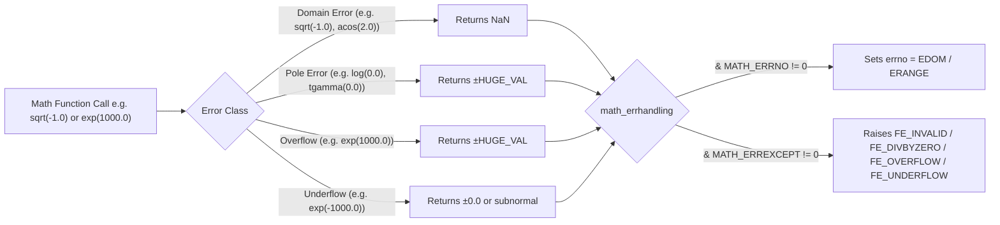
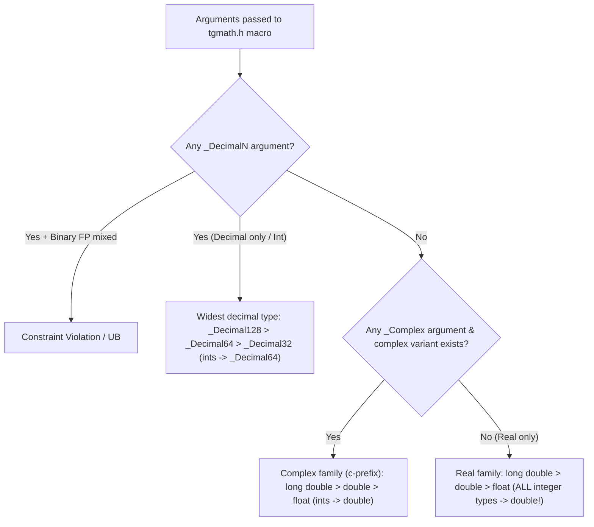

# Numerics: Math, `<fenv.h>`, Random & Complex

The C Standard Library numerics subsystem spans six tightly coupled headers covering real floating-point and integer math, IEEE 754 (IEC 60559) rounding and exception control, legacy pseudo-random generation, native complex arithmetic, and compile-time type-generic math dispatch. C23 (ISO/IEC 9899:2024) represents the largest expansion of `<math.h>` and `<fenv.h>` since C99, integrating IEEE 754-2019 operations, half-revolution trigonometry (`sinpi`/`cospi`/`tanpi`), exact narrowing operations (`fadd`/`fmul`), NaN-payload and total-ordering utilities, and optional IEEE 754 Decimal Floating-Point (`_Decimal32`, `_Decimal64`, `_Decimal128`) families.

!!! info "Numerics Library Headers & Feature-Test Macros"

    | Header | Standard | C23 Version Macro | Scope |
    | :--- | :--- | :--- | :--- |
    | `<math.h>` | <span class="c-badge c89">C89</span>–<span class="c-badge c23">C23</span> | `__STDC_VERSION_MATH_H__` (`202311L`) | Real floating-point math, IEEE 754 classification, narrowing ops, decimal FP |
    | `<stdlib.h>` | <span class="c-badge c89">C89</span>–<span class="c-badge c23">C23</span> | `__STDC_VERSION_STDLIB_H__` (`202311L`) | Integer `abs`/`div` families and `rand`/`srand`/`RAND_MAX` |
    | `<inttypes.h>` | <span class="c-badge c99">C99</span>–<span class="c-badge c23">C23</span> | — | `imaxabs`, `imaxdiv`, `imaxdiv_t` for `intmax_t` |
    | `<fenv.h>` | <span class="c-badge c99">C99</span>–<span class="c-badge c23">C23</span> | `__STDC_VERSION_FENV_H__` (`202311L`) | Floating-point exceptions, rounding modes, control modes, pragmas |
    | `<complex.h>` | <span class="c-badge c99">C99</span> <span class="c-badge c-optional">optional C11</span> | `__STDC_VERSION_COMPLEX_H__` (`202311L`) | Complex types, `CMPLX*`, complex elementary functions |
    | `<tgmath.h>` | <span class="c-badge c99">C99</span>–<span class="c-badge c23">C23</span> | `__STDC_VERSION_TGMATH_H__` (`202311L`) | Type-generic math macros dispatching real, complex, integer, and decimal types |

!!! tip "Related C23 Numerics Headers"
    For C23's brand-new bit manipulation (`<stdbit.h>`) and overflow-checked integer arithmetic (`<stdckdint.h>`) headers, see [Numerics: Bit Manipulation & Checked Int (C23)](numerics-bit-checked.md).

---

## 1. IEEE 754 (IEC 60559) Feature Macros & Linking

On POSIX toolchains (Linux/glibc, FreeBSD, etc.), `<math.h>` and `<complex.h>` symbols frequently reside in `libm` and require linking with `-lm`. On macOS and Windows (UCRT), math symbols are linked automatically.

### IEC 60559 Feature Macros

| Macro | Standard | Meaning |
| :--- | :--- | :--- |
| `__STDC_IEC_60559_BFP__` | <span class="c-badge c23">C23</span> | Expands to `202311L` if binary floating-point conforms to Annex F (IEC 60559 / IEEE 754-2019). Replaces deprecated `__STDC_IEC_559__`. |
| `__STDC_IEC_60559_DFP__` | <span class="c-badge c23">C23</span> <span class="c-badge c-optional">optional</span> | Expands to `202311L` if decimal floating-point (`_Decimal32`, `_Decimal64`, `_Decimal128`) and `d32`/`d64`/`d128` math functions are supported. |
| `__STDC_IEC_60559_COMPLEX__` | <span class="c-badge c23">C23</span> <span class="c-badge c-optional">optional</span> | Expands to `202311L` if complex arithmetic conforms to Annex G. Replaces deprecated `__STDC_IEC_559_COMPLEX__`. |
| `__STDC_NO_COMPLEX__` | <span class="c-badge c11">C11</span> | Defined to `1` if the implementation does not support complex types or `<complex.h>`. |
| `__STDC_WANT_IEC_60559_EXT__` | <span class="c-badge c23">C23</span> | User-defined macro (define before including `<math.h>` / `<fenv.h>`) opting into Annex F/H extended IEEE 754 functions when an implementation gates optional TS 18661 extensions. |

### Suffix Convention Across `<math.h>`

Every floating-point math function family in `<math.h>` follows a uniform naming scheme:

| Suffix | Parameter & Return Type | Standard | Example |
| :--- | :--- | :--- | :--- |
| *(none)* | `double` | <span class="c-badge c89">C89</span> | `double sin(double x);` |
| `f` | `float` | <span class="c-badge c99">C99</span> | `float sinf(float x);` |
| `l` | `long double` | <span class="c-badge c99">C99</span> | `long double sinl(long double x);` |
| `d32` | `_Decimal32` | <span class="c-badge c23">C23</span> <span class="c-badge c-optional">optional</span> | `_Decimal32 sind32(_Decimal32 x);` |
| `d64` | `_Decimal64` | <span class="c-badge c23">C23</span> <span class="c-badge c-optional">optional</span> | `_Decimal64 sind64(_Decimal64 x);` |
| `d128` | `_Decimal128` | <span class="c-badge c23">C23</span> <span class="c-badge c-optional">optional</span> | `_Decimal128 sind128(_Decimal128 x);` |

---

## 2. Common Mathematical Types, Constants & Error Handling

### 2.1 Integer Division Structures (`<stdlib.h>`, `<inttypes.h>`)

| Type | Header | Standard | Members | Returned By |
| :--- | :--- | :--- | :--- | :--- |
| `div_t` | `<stdlib.h>` | <span class="c-badge c89">C89</span> | `int quot; int rem;` (order unspecified) | `div(int, int)` |
| `ldiv_t` | `<stdlib.h>` | <span class="c-badge c89">C89</span> | `long quot; long rem;` | `ldiv(long, long)` |
| `lldiv_t` | `<stdlib.h>` | <span class="c-badge c99">C99</span> | `long long quot; long long rem;` | `lldiv(long long, long long)` |
| `imaxdiv_t` | `<inttypes.h>` | <span class="c-badge c99">C99</span> | `intmax_t quot; intmax_t rem;` | `imaxdiv(intmax_t, intmax_t)` |

### 2.2 Evaluation Types & Special Constants (`<math.h>`)

| Symbol | Standard | Description |
| :--- | :--- | :--- |
| `float_t`, `double_t` | <span class="c-badge c99">C99</span> | Most efficient evaluation types at least as wide as `float` / `double`, governed by `FLT_EVAL_METHOD` in `<float.h>` (`0`: `float`/`double`; `1`: `double`/`double`; `2`: `long double`/`long double`). |
| `_Decimal32_t`, `_Decimal64_t` | <span class="c-badge c23">C23</span> <span class="c-badge c-optional">optional</span> | Decimal FP evaluation types governed by `DEC_EVAL_METHOD`. |
| `HUGE_VAL` | <span class="c-badge c89">C89</span> | Positive `double` overflow indicator (`+INFINITY` on IEEE 754). |
| `HUGE_VALF`, `HUGE_VALL` | <span class="c-badge c99">C99</span> | Positive `float` and `long double` overflow indicators. |
| `HUGE_VAL_D32`, `HUGE_VAL_D64`, `HUGE_VAL_D128` | <span class="c-badge c23">C23</span> <span class="c-badge c-optional">optional</span> | Positive decimal FP overflow indicators. |
| `INFINITY` | <span class="c-badge c99">C99</span> | Positive or unsigned infinity constant (`float`; in C23, required if `float` supports infinity). |
| `NAN` | <span class="c-badge c99">C99</span> | Quiet `float` NaN constant (defined if implementation supports quiet NaNs for `float`). |
| `SNANF`, `SNAN`, `SNANL`, `SNAND32`, `SNAND64`, `SNAND128` | <span class="c-badge c23">C23</span> <span class="c-badge c-optional">optional</span> | Signaling NaN constants for each floating type (defined under `__STDC_IEC_60559_BFP__` / `DFP`). |
| `FP_NORMAL`, `FP_SUBNORMAL`, `FP_ZERO`, `FP_INFINITE`, `FP_NAN` | <span class="c-badge c99">C99</span> | Distinct integer constants returned by `fpclassify(x)`. |
| `FP_ILOGB0`, `FP_ILOGBNAN` | <span class="c-badge c99">C99</span> | Sentinel `int` values returned by `ilogb(0.0)` and `ilogb(NAN)`. |
| `FP_LLOGB0`, `FP_LLOGBNAN` | <span class="c-badge c23">C23</span> | Sentinel `long int` values returned by `llogb(0.0)` and `llogb(NAN)`. |
| `FP_FAST_FMA`, `FP_FAST_FMAF`, `FP_FAST_FMAL` | <span class="c-badge c99">C99</span> | Defined to `1` when `fma*` executes at least as fast as a separate multiply and add (typically hardware FMA instruction). |
| `FP_FAST_FMA_D32`, `FP_FAST_FMA_D64`, `FP_FAST_FMA_D128` | <span class="c-badge c23">C23</span> <span class="c-badge c-optional">optional</span> | Hardware-speed FMA indicators for decimal floating-point types. |
| `FP_INT_UPWARD`, `FP_INT_DOWNWARD`, `FP_INT_TOWARDZERO`, `FP_INT_TONEARESTFROMZERO`, `FP_INT_TONEAREST` | <span class="c-badge c23">C23</span> | Rounding direction arguments for `fromfp`, `ufromfp`, `fromfpx`, and `ufromfpx`. |
| `MATH_ERRNO` (`1`), `MATH_ERREXCEPT` (`2`), `math_errhandling` | <span class="c-badge c99">C99</span> | Bitmask indicating how `<math.h>` reports domain, pole, and range errors (`errno` vs `<fenv.h>` floating-point exceptions). |

### 2.3 Math Error Reporting Model



!!! warning "Do Not Assume `errno` Is Always Set by `<math.h>`"
    On modern toolchains (especially with `-fno-math-errno` or macOS/BSD `libm`), `math_errhandling & MATH_ERRNO` may be `0`, meaning math errors only raise IEEE 754 exceptions (`MATH_ERREXCEPT`) and leave `errno` untouched. Always inspect `math_errhandling`, test the returned value (`isnan`, `isinf`), or check `fetestexcept()` with `#pragma STDC FENV_ACCESS ON`.

---

## 3. Standard Mathematical Functions (`<math.h>`, `<stdlib.h>`, `<inttypes.h>`)

Unless noted otherwise, floating-point functions listed below exist in `double`, `float` (`f`), `long double` (`l`), and (when `__STDC_IEC_60559_DFP__` is defined) `_Decimal32` (`d32`), `_Decimal64` (`d64`), and `_Decimal128` (`d128`) variants.

### 3.1 Basic Operations

| Function(s) | Header | Standard | Prototype (`double` / base) | Behavior & Notes |
| :--- | :--- | :--- | :--- | :--- |
| `abs`, `labs`, `llabs` | `<stdlib.h>` | <span class="c-badge c89">C89</span> / <span class="c-badge c99">C99</span> | `int abs(int n);` | Integer absolute value. **UB if `n == INT_MIN`** (or `LONG_MIN`/`LLONG_MIN`) in two's complement! |
| `imaxabs` | `<inttypes.h>` | <span class="c-badge c99">C99</span> | `intmax_t imaxabs(intmax_t n);` | Absolute value of `intmax_t`. UB if `n == INTMAX_MIN`. |
| `div`, `ldiv`, `lldiv` | `<stdlib.h>` | <span class="c-badge c89">C89</span> / <span class="c-badge c99">C99</span> | `div_t div(int x, int y);` | Computes quotient (truncated toward zero) and remainder simultaneously. UB on `y == 0` or `INT_MIN / -1`. |
| `imaxdiv` | `<inttypes.h>` | <span class="c-badge c99">C99</span> | `imaxdiv_t imaxdiv(intmax_t x, intmax_t y);` | Simultaneous quotient and remainder for `intmax_t`. |
| `fabs` (`f`, `l`, `dN`) | `<math.h>` | <span class="c-badge c89">C89</span> | `double fabs(double x);` | Exact absolute value (clears sign bit; never raises `FE_INVALID` even for NaN on IEEE 754). |
| `fmod` (`f`, `l`, `dN`) | `<math.h>` | <span class="c-badge c89">C89</span> | `double fmod(double x, double y);` | Floating-point remainder $x - \operatorname{trunc}(x/y)\cdot y$ with same sign as `x`. Exact (no rounding error). |
| `remainder` (`f`, `l`, `dN`) | `<math.h>` | <span class="c-badge c99">C99</span> | `double remainder(double x, double y);` | IEEE 754 remainder $x - n\cdot y$ where $n$ is the integer nearest $x/y$ (ties to even). Result in $[-\lvert y\rvert/2, +\lvert y\rvert/2]$. |
| `remquo` (`f`, `l`, `dN`) | `<math.h>` | <span class="c-badge c99">C99</span> | `double remquo(double x, double y, int *quo);` | Same as `remainder`, plus stores sign and at least 3 low bits of quotient $n$ in `*quo` (ideal for quadrant reduction). |
| `fma` (`f`, `l`, `dN`) | `<math.h>` | <span class="c-badge c99">C99</span> | `double fma(double x, double y, double z);` | Fused multiply-add $(x \cdot y) + z$ computed with **one** final rounding (eliminates intermediate rounding and catastrophic cancellation). |
| `fmax`, `fmin` (`f`, `l`, `dN`) | `<math.h>` | <span class="c-badge c99">C99</span> | `double fmax(double x, double y);` | Larger / smaller of `x` and `y`. Treats a quiet NaN as missing data (returns the numeric operand). Sign of `±0.0` tie is unspecified in C99–C17. |
| `fdim` (`f`, `l`, `dN`) | `<math.h>` | <span class="c-badge c99">C99</span> | `double fdim(double x, double y);` | Positive difference: $\max(x - y, +0.0)$. |
| `nan` (`f`, `l`, `dN`) | `<math.h>` | <span class="c-badge c99">C99</span> | `double nan(const char *arg);` | Quiet NaN with implementation-defined payload parsed from `arg` (e.g., `nan("")` or `nan("42")`). |

### 3.2 Exponential & Logarithmic Functions

| Function(s) | Standard | Prototype (`double`) | Mathematical Formula & Accuracy Notes |
| :--- | :--- | :--- | :--- |
| `exp` (`f`, `l`, `dN`) | <span class="c-badge c89">C89</span> | `double exp(double x);` | $e^x$. |
| `exp2` (`f`, `l`, `dN`) | <span class="c-badge c99">C99</span> | `double exp2(double x);` | $2^x$. |
| `exp10` (`f`, `l`, `dN`) | <span class="c-badge c23">C23</span> | `double exp10(double x);` | $10^x$. Standardized in C23 (previously a GNU extension). |
| `expm1` (`f`, `l`, `dN`) | <span class="c-badge c99">C99</span> | `double expm1(double x);` | $e^x - 1$. Accurate near $x = 0$ where `exp(x) - 1.0` loses all precision. |
| `exp2m1` (`f`, `l`, `dN`) | <span class="c-badge c23">C23</span> | `double exp2m1(double x);` | $2^x - 1$. Accurate near $x = 0$. |
| `exp10m1` (`f`, `l`, `dN`) | <span class="c-badge c23">C23</span> | `double exp10m1(double x);` | $10^x - 1$. Accurate near $x = 0$. |
| `log` (`f`, `l`, `dN`) | <span class="c-badge c89">C89</span> | `double log(double x);` | $\ln(x)$. Pole error at $0$, domain error for $x < 0$. |
| `log10` (`f`, `l`, `dN`) | <span class="c-badge c89">C89</span> | `double log10(double x);` | $\log_{10}(x)$. |
| `log2` (`f`, `l`, `dN`) | <span class="c-badge c99">C99</span> | `double log2(double x);` | $\log_2(x)$. |
| `log1p` (`f`, `l`, `dN`) | <span class="c-badge c99">C99</span> | `double log1p(double x);` | $\ln(1 + x)$. Accurate near $x = 0$. |
| `logp1` (`f`, `l`, `dN`) | <span class="c-badge c23">C23</span> | `double logp1(double x);` | IEEE 754-2019 name for $\ln(1 + x)$ (identical semantics to `log1p`). |
| `log2p1` (`f`, `l`, `dN`) | <span class="c-badge c23">C23</span> | `double log2p1(double x);` | $\log_2(1 + x)$. Accurate near $x = 0$. |
| `log10p1` (`f`, `l`, `dN`) | <span class="c-badge c23">C23</span> | `double log10p1(double x);` | $\log_{10}(1 + x)$. Accurate near $x = 0$. |

### 3.3 Power & Root Functions

| Function(s) | Standard | Prototype (`double`) | Mathematical Formula & Domain Notes |
| :--- | :--- | :--- | :--- |
| `pow` (`f`, `l`, `dN`) | <span class="c-badge c89">C89</span> | `double pow(double x, double y);` | $x^y$. Special IEEE 754 rules: `pow(1.0, NAN) == 1.0`, `pow(NAN, 0.0) == 1.0`. |
| `sqrt` (`f`, `l`, `dN`) | <span class="c-badge c89">C89</span> | `double sqrt(double x);` | $\sqrt{x}$. IEEE 754 requires correct rounding; `sqrt(-0.0) == -0.0`. |
| `cbrt` (`f`, `l`, `dN`) | <span class="c-badge c99">C99</span> | `double cbrt(double x);` | $\sqrt[3]{x}$. Defined for all real `x`, including negative numbers. |
| `hypot` (`f`, `l`, `dN`) | <span class="c-badge c99">C99</span> | `double hypot(double x, double y);` | $\sqrt{x^2 + y^2}$ without undue intermediate overflow or underflow. |
| `rsqrt` (`f`, `l`, `dN`) | <span class="c-badge c23">C23</span> | `double rsqrt(double x);` | $1 / \sqrt{x}$ (reciprocal square root). Pole error at $x = \pm 0.0$, domain error for $x < 0$. |
| `pown` (`f`, `l`, `dN`) | <span class="c-badge c23">C23</span> | `double pown(double x, long long int n);` | Integer power $x^n$. `pown(x, 0) == 1.0` for all `x` (including NaN and $\pm\infty$). |
| `powr` (`f`, `l`, `dN`) | <span class="c-badge c23">C23</span> | `double powr(double x, double y);` | Strict real power $e^{y \ln x}$ ($x \ge 0$). Unlike `pow`, `powr(0.0, 0.0)` and `powr(1.0, INFINITY)` return NaN! |
| `rootn` (`f`, `l`, `dN`) | <span class="c-badge c23">C23</span> | `double rootn(double x, long long int n);` | $n$-th root $x^{1/n}$. Defined for $x < 0$ when `n` is odd; domain error for `n == 0` or even `n` with $x < 0$. |
| `compoundn` (`f`, `l`, `dN`) | <span class="c-badge c23">C23</span> | `double compoundn(double x, long long int n);` | Compound interest function $(1 + x)^n$ for $x \ge -1$, accurately avoiding precision loss for small rates $x$. |

### 3.4 Trigonometric Functions (Radians & C23 Half-Revolutions)

| Function(s) | Standard | Prototype (`double`) | Formula / Range |
| :--- | :--- | :--- | :--- |
| `sin`, `cos`, `tan` (`f`, `l`, `dN`) | <span class="c-badge c89">C89</span> | `double sin(double x);` | $\sin(x)$, $\cos(x)$, $\tan(x)$ (argument in radians). |
| `asin`, `acos`, `atan` (`f`, `l`, `dN`) | <span class="c-badge c89">C89</span> | `double asin(double x);` | $\arcsin(x) \in [-\pi/2, \pi/2]$, $\arccos(x) \in [0, \pi]$, $\arctan(x) \in [-\pi/2, \pi/2]$. |
| `atan2` (`f`, `l`, `dN`) | <span class="c-badge c89">C89</span> | `double atan2(double y, double x);` | Quadrant-aware $\arctan(y/x) \in [-\pi, \pi]$. |
| `sinpi`, `cospi`, `tanpi` (`f`, `l`, `dN`) | <span class="c-badge c23">C23</span> | `double sinpi(double x);` | $\sin(\pi x)$, $\cos(\pi x)$, $\tan(\pi x)$. **Exact zeros** at integer/half-integer arguments (`sinpi(1.0) == +0.0`, `cospi(0.5) == +0.0`, `cospi(1.0) == -1.0`), eliminating $\pi$-approximation drift! |
| `asinpi`, `acospi`, `atanpi` (`f`, `l`, `dN`) | <span class="c-badge c23">C23</span> | `double asinpi(double x);` | $\arcsin(x)/\pi \in [-0.5, 0.5]$, $\arccos(x)/\pi \in [0, 1]$, $\arctan(x)/\pi \in [-0.5, 0.5]$. |
| `atan2pi` (`f`, `l`, `dN`) | <span class="c-badge c23">C23</span> | `double atan2pi(double y, double x);` | $\operatorname{atan2}(y, x)/\pi \in [-1, 1]$. |

### 3.5 Hyperbolic, Error & Gamma Functions

| Category | Function(s) | Standard | Prototype (`double`) | Mathematical Function |
| :--- | :--- | :--- | :--- | :--- |
| Hyperbolic | `sinh`, `cosh`, `tanh` (`f`, `l`, `dN`) | <span class="c-badge c89">C89</span> | `double sinh(double x);` | $\sinh(x)$, $\cosh(x)$, $\tanh(x)$ |
| Inv. Hyperbolic | `asinh`, `acosh`, `atanh` (`f`, `l`, `dN`) | <span class="c-badge c99">C99</span> | `double asinh(double x);` | $\operatorname{arsinh}(x)$, $\operatorname{arcosh}(x)$ ($x \ge 1$), $\operatorname{artanh}(x)$ ($\lvert x\rvert < 1$) |
| Error Function | `erf`, `erfc` (`f`, `l`, `dN`) | <span class="c-badge c99">C99</span> | `double erf(double x);` | $\operatorname{erf}(x) = \frac{2}{\sqrt{\pi}}\int_0^x e^{-t^2}\,dt$ and $\operatorname{erfc}(x) = 1 - \operatorname{erf}(x)$ (accurate for large $x$) |
| Gamma | `tgamma`, `lgamma` (`f`, `l`, `dN`) | <span class="c-badge c99">C99</span> | `double tgamma(double x);` | True gamma $\Gamma(x) = \int_0^\infty t^{x-1} e^{-t}\,dt$ and $\ln\lvert\Gamma(x)\rvert$ (note: ISO C `lgamma` does **not** expose POSIX `signgam`) |

### 3.6 Nearest-Integer & Rounding Functions

| Function(s) | Standard | Prototype (`double`) | Rounding Rule & `FE_INEXACT` Behavior |
| :--- | :--- | :--- | :--- |
| `ceil` (`f`, `l`, `dN`) | <span class="c-badge c89">C89</span> | `double ceil(double x);` | Smallest integer $\ge x$ (toward $+\infty$). Does not raise `FE_INEXACT` in IEEE 754. |
| `floor` (`f`, `l`, `dN`) | <span class="c-badge c89">C89</span> | `double floor(double x);` | Largest integer $\le x$ (toward $-\infty$). Does not raise `FE_INEXACT`. |
| `trunc` (`f`, `l`, `dN`) | <span class="c-badge c99">C99</span> | `double trunc(double x);` | Nearest integer not greater in magnitude than $x$ (toward $0$). |
| `round` (`f`, `l`, `dN`) | <span class="c-badge c99">C99</span> | `double round(double x);` | Nearest integer, **halfway cases away from zero** (e.g., `round(2.5) == 3.0`, `round(-2.5) == -3.0`). Ignores `<fenv.h>` rounding mode. |
| `lround`, `llround` (`f`, `l`, `dN`) | <span class="c-badge c99">C99</span> | `long lround(double x);` / `long long llround(double x);` | Same rounding as `round`, returning `long` or `long long`. Raises `FE_INVALID` on out-of-range/NaN. |
| `roundeven` (`f`, `l`, `dN`) | <span class="c-badge c23">C23</span> | `double roundeven(double x);` | Nearest integer, **halfway cases to nearest even integer** (banker's rounding: `roundeven(2.5) == 2.0`, `roundeven(3.5) == 4.0`). Independent of `<fenv.h>` dynamic rounding mode! |
| `nearbyint` (`f`, `l`, `dN`) | <span class="c-badge c99">C99</span> | `double nearbyint(double x);` | Rounds using the **current `<fenv.h>` rounding direction**; guaranteed **never** to raise `FE_INEXACT`. |
| `rint` (`f`, `l`, `dN`) | <span class="c-badge c99">C99</span> | `double rint(double x);` | Rounds using the current `<fenv.h>` rounding direction; **may raise `FE_INEXACT`** if result differs from `x`. |
| `lrint`, `llrint` (`f`, `l`, `dN`) | <span class="c-badge c99">C99</span> | `long lrint(double x);` / `long long llrint(double x);` | Same as `rint`, returning `long` or `long long`. |
| `fromfp`, `ufromfp` (`f`, `l`, `dN`) | <span class="c-badge c23">C23</span> | `double fromfp(double x, int round, unsigned int width);` | Rounds `x` using explicit `FP_INT_*` mode `round` to a signed (`fromfp`) or unsigned (`ufromfp`) integer representable in `width` bits (still returned as FP). Domain error if out of range or `width == 0`. |
| `fromfpx`, `ufromfpx` (`f`, `l`, `dN`) | <span class="c-badge c23">C23</span> | `double fromfpx(double x, int round, unsigned int width);` | Identical to `fromfp` / `ufromfp`, except **raises `FE_INEXACT`** when the rounded value differs from `x`. |

### 3.7 Floating-Point Manipulation Functions

| Function(s) | Standard | Prototype (`double`) | Semantics |
| :--- | :--- | :--- | :--- |
| `frexp` (`f`, `l`, `dN`) | <span class="c-badge c89">C89</span> | `double frexp(double x, int *exp);` | Splits $x = m \cdot 2^{\text{exp}}$ with $\lvert m\rvert \in [0.5, 1.0)$ (or $m = \pm 0.0, \text{exp} = 0$). |
| `ldexp` (`f`, `l`, `dN`) | <span class="c-badge c89">C89</span> | `double ldexp(double x, int exp);` | Computes $x \cdot 2^{\text{exp}}$. |
| `modf` (`f`, `l`, `dN`) | <span class="c-badge c89">C89</span> | `double modf(double x, double *iptr);` | Splits `x` into integral part (`*iptr`) and fractional part (returned), both with sign of `x`. |
| `scalbn`, `scalbln` (`f`, `l`, `dN`) | <span class="c-badge c99">C99</span> | `double scalbn(double x, int n);` / `long n` | Computes $x \cdot \text{FLT\_RADIX}^n$ ($2^n$ for binary, $10^n$ for decimal). Efficient exponent manipulation. |
| `ilogb` (`f`, `l`, `dN`) | <span class="c-badge c99">C99</span> | `int ilogb(double x);` | Extracts unbiased exponent as `int` (`FP_ILOGB0` for `0`, `INT_MAX` for `±Inf`, `FP_ILOGBNAN` for `NaN`). |
| `llogb` (`f`, `l`, `dN`) | <span class="c-badge c23">C23</span> | `long int llogb(double x);` | Same as `ilogb`, returning `long int` (`FP_LLOGB0`, `LONG_MAX`, `FP_LLOGBNAN`). Prevents overflow on wide-exponent formats. |
| `logb` (`f`, `l`, `dN`) | <span class="c-badge c99">C99</span> | `double logb(double x);` | Extracts unbiased exponent as a floating-point value. |
| `nextafter` (`f`, `l`, `dN`) | <span class="c-badge c99">C99</span> | `double nextafter(double from, double to);` | Next representable value after `from` in the direction of `to` (steps by 1 ULP). |
| `nexttoward` (`f`, `l`) | <span class="c-badge c99">C99</span> | `double nexttoward(double from, long double to);` | Same as `nextafter`, but `to` has type `long double` for finer direction discrimination. |
| `nextup`, `nextdown` (`f`, `l`, `dN`) | <span class="c-badge c23">C23</span> | `double nextup(double x);` / `double nextdown(double x);` | Next representable value strictly greater (`nextup`) or strictly less (`nextdown`) than `x` without signaling overflow on finite-to-infinity steps (IEEE 754-2019). |
| `copysign` (`f`, `l`, `dN`) | <span class="c-badge c99">C99</span> | `double copysign(double mag, double sgn);` | Value with magnitude of `mag` and sign bit of `sgn` (works on `±0.0`, `±Inf`, and NaNs without exceptions). |

### 3.8 Classification & Quiet/Signaling Comparison Macros (`<math.h>`)

All macros below are type-generic across all real floating-point types (binary and C23 decimal).

| Macro | Standard | Return Type | Semantics & NaN Exception Behavior |
| :--- | :--- | :--- | :--- |
| `fpclassify(x)` | <span class="c-badge c99">C99</span> | `int` | Returns one of `FP_INFINITE`, `FP_NAN`, `FP_NORMAL`, `FP_SUBNORMAL`, `FP_ZERO`. Never raises exceptions. |
| `isfinite(x)` | <span class="c-badge c99">C99</span> | `int` (bool) | Nonzero iff `x` is zero, subnormal, or normal (not infinity or NaN). |
| `isinf(x)` | <span class="c-badge c99">C99</span> | `int` (bool) | Nonzero iff `x` is $+\infty$ or $-\infty$. |
| `isnan(x)` | <span class="c-badge c99">C99</span> | `int` (bool) | Nonzero iff `x` is any NaN (quiet or signaling). Never raises `FE_INVALID`. |
| `isnormal(x)` | <span class="c-badge c99">C99</span> | `int` (bool) | Nonzero iff `x` is normal (not zero, subnormal, infinity, or NaN). |
| `signbit(x)` | <span class="c-badge c99">C99</span> | `int` (bool) | Nonzero iff the sign bit of `x` is set (true for `-0.0`, `-Inf`, negative NaNs). |
| `issignaling(x)` | <span class="c-badge c23">C23</span> | `int` (bool) | Nonzero iff `x` is a **signaling NaN** (sNaN). Does **not** raise `FE_INVALID`! |
| `issubnormal(x)` | <span class="c-badge c23">C23</span> | `int` (bool) | Nonzero iff `x` is a subnormal (denormal) number. |
| `iszero(x)` | <span class="c-badge c23">C23</span> | `int` (bool) | Nonzero iff `x` is `+0.0` or `-0.0`. |
| `iscanonical(x)` | <span class="c-badge c23">C23</span> | `int` (bool) | Nonzero iff the representation of `x` is canonical (especially relevant for `_Decimal*` cohorts and x87 80-bit `long double` pseudo-denormals). |
| `isgreater(x, y)` | <span class="c-badge c99">C99</span> | `int` (bool) | Quiet $x > y$: returns `0` if either operand is NaN **without raising `FE_INVALID`** (unlike `>`). |
| `isgreaterequal(x, y)` | <span class="c-badge c99">C99</span> | `int` (bool) | Quiet $x \ge y$. |
| `isless(x, y)` | <span class="c-badge c99">C99</span> | `int` (bool) | Quiet $x < y$. |
| `islessequal(x, y)` | <span class="c-badge c99">C99</span> | `int` (bool) | Quiet $x \le y$. |
| `islessgreater(x, y)` | <span class="c-badge c99">C99</span> | `int` (bool) | Quiet $(x < y) \lor (x > y)$ (false if either is NaN or $x == y$). |
| `isunordered(x, y)` | <span class="c-badge c99">C99</span> | `int` (bool) | Nonzero iff at least one of `x` or `y` is NaN. |
| `iseqsig(x, y)` | <span class="c-badge c23">C23</span> | `int` (bool) | **Signaling** equality test ($x == y$): raises `FE_INVALID` if either operand is a quiet or signaling NaN (unlike C's `==` operator, which is quiet for qNaNs). |

---

## 4. C23 Extended IEEE 754-2019 Binary & Decimal FP Functions

C23 adopts ISO/IEC TS 18661 parts 1–4 directly into `<math.h>`, bringing full parity with IEEE 754-2019.

### 4.1 IEEE 754-2019 Maximum & Minimum Family <span class="c-badge c23">C23</span>

Legacy `fmax`/`fmin` (C99) predated IEEE 754-2019 and left `-0.0` vs `+0.0` ordering unspecified while suppressing NaNs. C23 provides all eight strictly specified IEEE 754-2019 variants (`f`/`l`/`dN` suffixes):

| Function | Order Metric | `-0.0` vs `+0.0` | Quiet NaN Handling |
| :--- | :--- | :--- | :--- |
| `fmaximum(x, y)` / `fminimum(x, y)` | Signed value | `-0.0 < +0.0` | **Propagates NaN** (if either arg is NaN, returns NaN) |
| `fmaximum_num(x, y)` / `fminimum_num(x, y)` | Signed value | `-0.0 < +0.0` | **Prefers number** (returns the non-NaN operand) |
| `fmaximum_mag(x, y)` / `fminimum_mag(x, y)` | Magnitude $\lvert x\rvert$ vs $\lvert y\rvert$ (value breaks ties) | `-0.0 < +0.0` | **Propagates NaN** |
| `fmaximum_mag_num(x, y)` / `fminimum_mag_num(x, y)` | Magnitude $\lvert x\rvert$ vs $\lvert y\rvert$ (value breaks ties) | `-0.0 < +0.0` | **Prefers number** |

### 4.2 Single-Rounded Narrowing Arithmetic Functions <span class="c-badge c23">C23</span>

Evaluating `(float)(double_a + double_b)` performs **two** roundings (first to `double`, then to `float`), which can produce a 1-ULP double-rounding error. C23's narrowing operations compute the exact mathematical result and round **once** directly into the narrower return type:

| Operation | `double` → `float` | `long double` → `float` | `long double` → `double` | Decimal Narrowing (`__STDC_IEC_60559_DFP__`) |
| :--- | :--- | :--- | :--- | :--- |
| Addition ($x + y$) | `float fadd(double, double)` | `float faddl(long double, long double)` | `double daddl(long double, long double)` | `d32addd64`, `d32addd128`, `d64addd128` |
| Subtraction ($x - y$) | `float fsub(double, double)` | `float fsubl(long double, long double)` | `double dsubl(long double, long double)` | `d32subd64`, `d32subd128`, `d64subd128` |
| Multiplication ($x \cdot y$) | `float fmul(double, double)` | `float fmull(long double, long double)` | `double dmull(long double, long double)` | `d32muld64`, `d32muld128`, `d64muld128` |
| Division ($x / y$) | `float fdiv(double, double)` | `float fdivl(long double, long double)` | `double ddivl(long double, long double)` | `d32divd64`, `d32divd128`, `d64divd128` |
| Square Root ($\sqrt{x}$) | `float fsqrt(double)` | `float fsqrtl(long double)` | `double dsqrtl(long double)` | `d32sqrtd64`, `d32sqrtd128`, `d64sqrtd128` |
| Fused Multiply-Add | `float ffma(double, double, double)` | `float ffmal(long double, long double, long double)` | `double dfmal(long double, long double, long double)` | `d32fmad64`, `d32fmad128`, `d64fmad128` |

### 4.3 Total Ordering, Canonicalization & NaN Payloads <span class="c-badge c23">C23</span>

!!! note "Why These Functions Take Pointers (`const double *`)"
    Passing a floating-point object by value can convert a signaling NaN (sNaN) into a quiet NaN (qNaN) or raise `FE_INVALID` at the call boundary (for instance, on x87 FPU loads). Accepting pointers preserves exact bit-level representations and prevents spurious exceptions.

| Function(s) | Prototype (`double`; also `f`, `l`, `dN`) | Semantics |
| :--- | :--- | :--- |
| `totalorder` | `int totalorder(const double *x, const double *y);` | Returns nonzero iff `*x` precedes or equals `*y` in the IEEE 754 total order: $-\text{qNaN} < -\text{sNaN} < -\infty < -\text{finite} < -0.0 < +0.0 < +\text{finite} < +\infty < +\text{sNaN} < +\text{qNaN}$. Never raises exceptions. Ideal for `qsort` comparators! |
| `totalordermag` | `int totalordermag(const double *x, const double *y);` | Same as `totalorder`, comparing `fabs(*x)` and `fabs(*y)` (ignores sign bits). |
| `canonicalize` | `int canonicalize(double *cx, const double *x);` | Converts `*x` to its canonical encoding in `*cx`. Returns `0` on success, nonzero if conversion failed (e.g., non-canonical x87 encoding). |
| `getpayload` | `double getpayload(const double *x);` | If `*x` is a NaN, returns its positive integer payload as a floating-point number; otherwise returns `-1.0`. Never raises exceptions. |
| `setpayload` | `int setpayload(double *res, double pl);` | If `pl` is a valid positive integer payload, stores a **quiet NaN** with payload `pl` in `*res` and returns `0`; otherwise stores `+0.0` and returns nonzero. |
| `setpayloadsig` | `int setpayloadsig(double *res, double pl);` | Same as `setpayload`, but stores a **signaling NaN** with payload `pl` (note: payload `0` is invalid for sNaNs on binary formats since it would encode infinity). |

### 4.4 Decimal Floating-Point Quantum & Encoding Operations <span class="c-badge c23">C23</span> <span class="c-badge c-optional">optional</span>

Available when `__STDC_IEC_60559_DFP__` is defined. Unlike binary floating point, decimal FP preserves **cohorts** (trailing decimal precision — e.g., `1.20DD` and `1.2DD` have equal numeric value but distinct quantum exponents $10^{-2}$ vs $10^{-1}$), essential for financial and accounting calculations:

| Function Family (`N` = `32`, `64`, `128`) | Prototype (`_Decimal64`) | Semantics |
| :--- | :--- | :--- |
| `quantizedN` | `_Decimal64 quantized64(_Decimal64 x, _Decimal64 y);` | Returns a value numerically equal to `x` rounded to have the exact same quantum exponent as `y` (e.g., `quantized64(1.234DD, 0.01DD) == 1.23DD`). |
| `samequantumdN` | `bool samequantumd64(_Decimal64 x, _Decimal64 y);` | Returns `true` iff `x` and `y` share the same quantum exponent (or both are infinite / both are NaN). |
| `quantumdN` | `_Decimal64 quantumd64(_Decimal64 x);` | Returns the quantum of `x` ($1 \times 10^q$; e.g., `quantumd64(12.34DD) == 0.01DD`). |
| `llquantexpdN` | `long long int llquantexpd64(_Decimal64 x);` | Returns the quantum exponent $q$ as `long long int` (e.g., `llquantexpd64(12.34DD) == -2`), or `LLONG_MIN` for infinities/NaNs. |
| `encodedecdN` / `decodedecdN` | `void encodedecd64(unsigned char encptr[static 8], const _Decimal64 *xptr);` | Encodes/decodes IEEE 754 **Densely Packed Decimal (DPD)** representation into/from a byte array (4, 8, or 16 bytes for `d32`, `d64`, `d128`). |
| `encodebindN` / `decodebindN` | `void encodebind64(unsigned char encptr[static 8], const _Decimal64 *xptr);` | Encodes/decodes IEEE 754 **Binary Integer Decimal (BID)** representation into/from a byte array. |

---

## 5. Floating-Point Environment (`<fenv.h>`) <span class="c-badge c99">C99</span>

`<fenv.h>` gives direct, standardized access to the hardware floating-point control and status registers (such as x86-64 `MXCSR` / x87 `FPUCW`/`FPUSW` and ARM64 `FPCR`/`FPSR`).

### 5.1 Pragmas (`#pragma STDC`)

| Pragma | Standard | Meaning |
| :--- | :--- | :--- |
| `#pragma STDC FENV_ACCESS ON\|OFF\|DEFAULT` | <span class="c-badge c99">C99</span> | Tells the compiler that code inspects FP status flags or alters rounding modes. **Calling `<fenv.h>` functions while `FENV_ACCESS` is `OFF` is undefined behavior** — the optimizer may hoist, reorder, or constant-fold floating-point expressions across `fesetround()`! |
| `#pragma STDC FENV_ROUND direction` | <span class="c-badge c23">C23</span> | Sets a **compile-time constant rounding mode** (`FE_TONEAREST`, `FE_DOWNWARD`, `FE_UPWARD`, `FE_TOWARDZERO`, `FE_TONEARESTFROMZERO`, or `FE_DYNAMIC`) for the enclosing block without mutating global dynamic hardware state. |
| `#pragma STDC FENV_DEC_ROUND direction` | <span class="c-badge c23">C23</span> <span class="c-badge c-optional">optional</span> | Same as `FENV_ROUND`, applying specifically to decimal floating-point operations. |

!!! warning "Compiler Flags for `<fenv.h>`"
    GCC and Clang historically ignore `#pragma STDC FENV_ACCESS ON` unless you also compile with `-frounding-math` (GCC) or `-ffp-model=strict` / `-frounding-math` (Clang), and **never** use `-ffast-math` when relying on `<fenv.h>` exceptions or rounding modes.

### 5.2 Types, Exception Macros & Rounding Directions

| Category | Symbol | Standard | Description |
| :--- | :--- | :--- | :--- |
| Types | `fenv_t` | <span class="c-badge c99">C99</span> | Complete floating-point environment (control modes + status flags). |
| | `fexcept_t` | <span class="c-badge c99">C99</span> | Floating-point status flags collectively. |
| | `femode_t` | <span class="c-badge c23">C23</span> | Floating-point **control modes only** (rounding direction, flush-to-zero, etc.) without status flags. |
| Default Pointers | `FE_DFL_ENV` | <span class="c-badge c99">C99</span> | Pointer to `const fenv_t` representing the startup default environment. |
| | `FE_DFL_MODE` | <span class="c-badge c23">C23</span> | Pointer to `const femode_t` representing default dynamic control modes. |
| Exceptions (Bitwise OR) | `FE_DIVBYZERO` | <span class="c-badge c99">C99</span> | Pole error / division of finite nonzero number by zero. |
| | `FE_INEXACT` | <span class="c-badge c99">C99</span> | Rounded result is not mathematically exact. |
| | `FE_INVALID` | <span class="c-badge c99">C99</span> | Invalid operation (e.g., `0.0 / 0.0`, `sqrt(-1.0)`, `Inf - Inf`, sNaN operand). |
| | `FE_OVERFLOW` | <span class="c-badge c99">C99</span> | Result magnitude exceeds largest finite representable value. |
| | `FE_UNDERFLOW` | <span class="c-badge c99">C99</span> | Nonzero result magnitude is too small to represent without loss of accuracy. |
| | `FE_ALL_EXCEPT` | <span class="c-badge c99">C99</span> | Bitwise OR of all supported `FE_*` exception macros. |
| Rounding Modes | `FE_TONEAREST` | <span class="c-badge c99">C99</span> | Round to nearest, ties to even (default IEEE 754 mode). |
| | `FE_DOWNWARD` | <span class="c-badge c99">C99</span> | Round toward $-\infty$. |
| | `FE_UPWARD` | <span class="c-badge c99">C99</span> | Round toward $+\infty$. |
| | `FE_TOWARDZERO` | <span class="c-badge c99">C99</span> | Truncate toward $0$. |
| | `FE_TONEARESTFROMZERO` | <span class="c-badge c23">C23</span> <span class="c-badge c-optional">optional</span> | Round to nearest, ties away from zero. |

### 5.3 Complete `<fenv.h>` Function Reference

| Function | Standard | Prototype | Behavior & Return Value |
| :--- | :--- | :--- | :--- |
| `feclearexcept` | <span class="c-badge c99">C99</span> | `int feclearexcept(int excepts);` | Clears the specified exception flags. Returns `0` on success. |
| `fetestexcept` | <span class="c-badge c99">C99</span> | `int fetestexcept(int excepts);` | Returns bitwise OR of currently set flags masked by `excepts`. |
| `feraiseexcept` | <span class="c-badge c99">C99</span> | `int feraiseexcept(int excepts);` | Raises specified exceptions (triggers traps if enabled; `FE_OVERFLOW`/`FE_UNDERFLOW` may also raise `FE_INEXACT`). Returns `0` on success. |
| `fegetexceptflag` | <span class="c-badge c99">C99</span> | `int fegetexceptflag(fexcept_t *flagp, int excepts);` | Saves state of specified exception flags into `*flagp`. Returns `0` on success. |
| `fesetexceptflag` | <span class="c-badge c99">C99</span> | `int fesetexceptflag(const fexcept_t *flagp, int excepts);` | Restores flags from `*flagp` without triggering traps. Returns `0` on success. |
| `fesetexcept` | <span class="c-badge c23">C23</span> | `int fesetexcept(int excepts);` | Sets specified exception flags **without triggering traps** (unlike `feraiseexcept`). Returns `0` on success. |
| `fetestexceptflag` | <span class="c-badge c23">C23</span> | `int fetestexceptflag(const fexcept_t *flagp, int excepts);` | Tests which exceptions in `excepts` are set inside a previously saved `*flagp`. |
| `fegetround` | <span class="c-badge c99">C99</span> | `int fegetround(void);` | Returns current binary rounding direction macro (or negative value if undeterminable). |
| `fesetround` | <span class="c-badge c99">C99</span> | `int fesetround(int round);` | Sets binary rounding direction. Returns `0` on success, nonzero on failure. |
| `fe_dec_getround` / `fe_dec_setround` | <span class="c-badge c23">C23</span> <span class="c-badge c-optional">optional</span> | `int fe_dec_getround(void);` / `int fe_dec_setround(int round);` | Gets / sets dynamic rounding direction for decimal floating-point types. |
| `fegetenv` | <span class="c-badge c99">C99</span> | `int fegetenv(fenv_t *envp);` | Saves entire FP environment into `*envp`. Returns `0` on success. |
| `fesetenv` | <span class="c-badge c99">C99</span> | `int fesetenv(const fenv_t *envp);` | Installs `*envp` (or `FE_DFL_ENV`) without raising exceptions. Returns `0` on success. |
| `feholdexcept` | <span class="c-badge c99">C99</span> | `int feholdexcept(fenv_t *envp);` | Saves current environment into `*envp`, clears all status flags, and enters non-stop (no-trap) mode. Returns `0` on success. |
| `feupdateenv` | <span class="c-badge c99">C99</span> | `int feupdateenv(const fenv_t *envp);` | Saves currently raised flags, restores `*envp`, then raises the saved flags (standard companion to `feholdexcept`). Returns `0` on success. |
| `fegetmode` / `fesetmode` | <span class="c-badge c23">C23</span> | `int fegetmode(femode_t *modep);` / `int fesetmode(const femode_t *modep);` | Saves/restores dynamic control modes (such as rounding direction) **without overwriting exception status flags**! |

---

## 6. Pseudo-Random Number Generation (`<stdlib.h>`)

### 6.1 Standard C Functions

| Symbol | Standard | Prototype / Definition | Behavior |
| :--- | :--- | :--- | :--- |
| `RAND_MAX` | <span class="c-badge c89">C89</span> | `#define RAND_MAX /* >= 32767 */` | Maximum value returned by `rand()`. Guaranteed $\ge 32767$ (`0x7FFF`). On Windows MSVC it is literally `32767`; on glibc/macOS it is `2147483647` (`INT_MAX`). |
| `rand` | <span class="c-badge c89">C89</span> | `int rand(void);` | Returns a pseudo-random integer in `[0, RAND_MAX]`. **Not guaranteed thread-safe** (shares mutable global state). |
| `srand` | <span class="c-badge c89">C89</span> | `void srand(unsigned int seed);` | Seeds the `rand()` generator. If `rand()` is called before `srand()`, it behaves as if `srand(1)` was called. |

!!! danger "Why You Should NEVER Use `rand()` for Cryptography, Security, or Serious Simulation"
    1. **Predictable & Broken for Security**: `rand()` is typically a trivial 31-bit linear congruential generator (LCG) or small additive feedback generator. Observing a handful of outputs completely recovers the internal state. **Never use `rand()` for tokens, nonces, passwords, session IDs, or keys** — use OS CSPRNGs (`getrandom()` on Linux, `arc4random_buf()` on macOS/BSD/glibc 2.36+, or `BCryptGenRandom()` on Windows).
    2. **Tiny Range & Poor Low Bits**: On Windows MSVC, `RAND_MAX == 32767` (only 15 bits!). Classic LCGs also exhibit short periods in their least-significant bits (`rand() & 1` alternates `0, 1, 0, 1` in naive LCGs).
    3. **Modulo Bias**: Writing `rand() % N` produces a **non-uniform distribution** whenever `N` does not evenly divide `RAND_MAX + 1`. For example, with `RAND_MAX == 32767` and `N == 20000`, values `[0, 12767]` occur **twice as often** as `[12768, 19999]`.
    4. **Data Races**: `rand()` mutates global state; calling it concurrently from multiple threads is a data race (undefined behavior unless the libc uses locks, which destroys performance).

### 6.2 Production-Quality Replacement: Self-Contained Xoshiro256** & Unbiased Bounded PRNG

When you need fast, deterministic, statistically rock-solid (passes BigCrush & PractRand), thread-local non-cryptographic randomness in ISO C23, embed a tiny **Xoshiro256\*\*** (seeded via **SplitMix64**) or **PCG32** generator with rejection-sampled bounded generation:

=== "Xoshiro256** (64-bit, Period 2²⁵⁶ − 1)"

    ```c
    #include <stdint.h>
    #include <stdio.h>

    typedef struct {
        uint64_t s[4];
    } xoshiro256ss_t;

    static inline uint64_t rotl64(uint64_t x, int k) {
        return (x << k) | (x >> (64 - k));
    }

    static uint64_t splitmix64_next(uint64_t *state) {
        uint64_t z = (*state += 0x9e3779b97f4a7c15ULL);
        z = (z ^ (z >> 30)) * 0xbf58476d1ce4e5b9ULL;
        z = (z ^ (z >> 27)) * 0x94d049bb133111ebULL;
        return z ^ (z >> 31);
    }

    /* Seed all 256 bits safely from a single 64-bit seed */
    static void xoshiro256ss_seed(xoshiro256ss_t *rng, uint64_t seed) {
        for (int i = 0; i < 4; ++i) {
            rng->s[i] = splitmix64_next(&seed);
        }
    }

    static uint64_t xoshiro256ss_next(xoshiro256ss_t *rng) {
        const uint64_t result = rotl64(rng->s[1] * 5ULL, 7) * 9ULL;
        const uint64_t t = rng->s[1] << 17;

        rng->s[2] ^= rng->s[0];
        rng->s[3] ^= rng->s[1];
        rng->s[1] ^= rng->s[2];
        rng->s[0] ^= rng->s[3];
        rng->s[2] ^= t;
        rng->s[3] = rotl64(rng->s[3], 45);
        return result;
    }

    /* Unbiased uniform integer in [0, bound) via rejection sampling (no modulo bias!) */
    static uint64_t xoshiro256ss_bounded(xoshiro256ss_t *rng, uint64_t bound) {
        if (bound <= 1) {
            return 0;
        }
        const uint64_t threshold = (0ULL - bound) % bound; /* (2^64 - bound) % bound */
        for (;;) {
            uint64_t r = xoshiro256ss_next(rng);
            if (r >= threshold) {
                return r % bound;
            }
        }
    }

    /* Uniform double in [0.0, 1.0) with full 53 bits of significand precision */
    static double xoshiro256ss_uniform_double(xoshiro256ss_t *rng) {
        return (double)(xoshiro256ss_next(rng) >> 11) * 0x1.0p-53;
    }
    ```

=== "PCG32 (Minimal 128-bit State, 32-bit Output)"

    ```c
    #include <stdint.h>

    typedef struct {
        uint64_t state;
        uint64_t inc; /* Must always be odd */
    } pcg32_t;

    static uint32_t pcg32_next(pcg32_t *rng) {
        uint64_t oldstate = rng->state;
        rng->state = oldstate * 6364136223846793005ULL + rng->inc;
        uint32_t xorshifted = (uint32_t)(((oldstate >> 18u) ^ oldstate) >> 27u);
        uint32_t rot = (uint32_t)(oldstate >> 59u);
        return (xorshifted >> rot) | (xorshifted << ((-rot) & 31u));
    }

    static void pcg32_seed(pcg32_t *rng, uint64_t initstate, uint64_t stream_id) {
        rng->state = 0U;
        rng->inc = (stream_id << 1u) | 1u;
        (void)pcg32_next(rng);
        rng->state += initstate;
        (void)pcg32_next(rng);
    }

    /* Unbiased uniform uint32_t in [0, bound) using Lemire's rejection method */
    static uint32_t pcg32_bounded(pcg32_t *rng, uint32_t bound) {
        if (bound <= 1u) {
            return 0u;
        }
        uint64_t m = (uint64_t)pcg32_next(rng) * (uint64_t)bound;
        uint32_t l = (uint32_t)m;
        if (l < bound) {
            uint32_t threshold = (0u - bound) % bound;
            while (l < threshold) {
                m = (uint64_t)pcg32_next(rng) * (uint64_t)bound;
                l = (uint32_t)m;
            }
        }
        return (uint32_t)(m >> 32u);
    }
    ```

---

## 7. Complex Number Arithmetic (`<complex.h>`) <span class="c-badge c99">C99</span>

C provides native language-level complex types (`float _Complex`, `double _Complex`, `long double _Complex`) whose memory representation is guaranteed identical to a 2-element array `T[2]` (`{real, imag}`), ensuring seamless zero-copy interoperability with FFTW, BLAS/LAPACK, and C++ `std::complex<T>`. Since C11, implementations may omit `<complex.h>` if they define `__STDC_NO_COMPLEX__`.

### 7.1 Macros, Types & Pragmas

| Symbol | Standard | Definition / Purpose |
| :--- | :--- | :--- |
| `_Complex` / `complex` | <span class="c-badge c99">C99</span> | Keyword `_Complex` and convenience macro `complex` (`#define complex _Complex`). |
| `_Complex_I` | <span class="c-badge c99">C99</span> | Constant expression of type `const float _Complex` with value $0 + 1i$. |
| `_Imaginary` / `imaginary` / `_Imaginary_I` | <span class="c-badge c99">C99</span> <span class="c-badge c-optional">optional</span> | Optional pure-imaginary types (Annex G; rarely implemented outside specialized compilers). |
| `I` | <span class="c-badge c99">C99</span> | Expands to `_Imaginary_I` if supported, else `_Complex_I`. (You may `#undef I` if you need `I` as a local identifier.) |
| `CMPLX(x, y)` | <span class="c-badge c11">C11</span> | Constructs `double _Complex` with real part `(double)(x)` and imaginary part `(double)(y)`. |
| `CMPLXF(x, y)` | <span class="c-badge c11">C11</span> | Constructs `float _Complex`. |
| `CMPLXL(x, y)` | <span class="c-badge c11">C11</span> | Constructs `long double _Complex`. |
| `#pragma STDC CX_LIMITED_RANGE ON\|OFF\|DEFAULT` | <span class="c-badge c99">C99</span> | When `ON`, permits naive algebraic complex `*`, `/`, and `cabs` formulas without Smith/Knuth overflow-avoidance scaling or Annex G infinity recovery. Faster, but overflows around $10^{154}$ for `double`. Default is `OFF`. |

!!! danger "Always Prefer `CMPLX(x, y)` Over `x + y * I`"
    When `_Imaginary_I` is unavailable (GCC, Clang, glibc, macOS), `I` has type `float _Complex` with value `0.0f + 1.0fi`. Consequently, if `y` is `INFINITY`, `NAN`, or `-0.0`, writing `x + y * I` computes `(0.0 * INFINITY)` in the real part, corrupting the real component into **`NAN`**! By contrast, `CMPLX(0.0, INFINITY)` constructs exact `(0.0, +inf)` with zero arithmetic corruption.

### 7.2 Complex Elementary Functions (`<complex.h>`)

Every function below exists in `double complex` (base), `float complex` (`f` suffix), and `long double complex` (`l` suffix) forms:

| Category | Functions (`double complex` base) | Semantics & Branch Cuts |
| :--- | :--- | :--- |
| Manipulation | `double creal(double complex z);` | Real part $\operatorname{Re}(z)$. |
| | `double cimag(double complex z);` | Imaginary part $\operatorname{Im}(z)$. |
| | `double cabs(double complex z);` | Magnitude $\lvert z\rvert = \operatorname{hypot}(\operatorname{Re}(z), \operatorname{Im}(z))$. |
| | `double carg(double complex z);` | Phase angle $\arg(z) = \operatorname{atan2}(\operatorname{Im}(z), \operatorname{Re}(z)) \in [-\pi, \pi]$. |
| | `double complex conj(double complex z);` | Complex conjugate $\bar{z} = \operatorname{Re}(z) - i\operatorname{Im}(z)$. |
| | `double complex cproj(double complex z);` | Projection onto the Riemann sphere: returns `z` unchanged unless either part is infinite, in which case returns `CMPLX(INFINITY, copysign(0.0, cimag(z)))`. |
| Exponential & Power | `cexp`, `clog`, `cpow`, `csqrt` | $e^z$, principal $\ln(z)$ (branch cut $(-\infty, 0]$), $z^w$, principal $\sqrt{z}$ (branch cut $(-\infty, 0)$). |
| Trigonometric | `csin`, `ccos`, `ctan` | Complex $\sin(z)$, $\cos(z)$, $\tan(z)$. |
| | `casin`, `cacos`, `catan` | Principal inverse trigonometric functions (branch cuts along real/imaginary axes per Annex G). |
| Hyperbolic | `csinh`, `ccosh`, `ctanh` | Complex $\sinh(z)$, $\cosh(z)$, $\tanh(z)$. |
| | `casinh`, `cacosh`, `catanh` | Principal inverse hyperbolic functions. |

---

## 8. Type-Generic Math (`<tgmath.h>`) <span class="c-badge c99">C99</span>

Including `<tgmath.h>` automatically includes both `<math.h>` and (unless `__STDC_NO_COMPLEX__` is defined) `<complex.h>`, and defines type-generic macros that dispatch calls at compile time (conceptually via `_Generic`) to the exact real, complex, or C23 decimal floating-point function matching the argument types.

### 8.1 Type Dispatch Resolution Rules



!!! warning "Integer Arguments Always Promote to `double` (Except Decimal Mixing)"
    In `<tgmath.h>`, passing an integer such as `sqrt(2)` or `sin(1)` selects `double sqrt(double)` — **not** `float`! Likewise, `fabs(z)` on a `float complex z` dispatches to `float cabsf(float complex)` (returning `float`), whereas `fabs(x)` on an `int x` converts `x` to `double` and calls `fabs(double)`.

### 8.2 Function Families Covered by `<tgmath.h>`

| Group | Type-Generic Macros | Notes |
| :--- | :--- | :--- |
| Real + Complex (`math.h` / `complex.h`) | `acos`, `asin`, `atan`, `acosh`, `asinh`, `atanh`, `cos`, `sin`, `tan`, `cosh`, `sinh`, `tanh`, `exp`, `log`, `pow`, `sqrt`, `fabs` | `fabs` maps to `cabs`/`cabsf`/`cabsl` for complex operands; all others map to `c*` functions. |
| Complex-Only | `carg`, `cimag`, `conj`, `cproj`, `creal` | Real floating or integer arguments are treated as having zero imaginary part (e.g., `conj(3.0f)` calls `conjf(3.0f)`). |
| Real-Only (C99) | `atan2`, `cbrt`, `ceil`, `copysign`, `erf`, `erfc`, `exp2`, `expm1`, `fdim`, `floor`, `fma`, `fmax`, `fmin`, `fmod`, `frexp`, `hypot`, `ilogb`, `ldexp`, `lgamma`, `llrint`, `llround`, `log10`, `log1p`, `log2`, `logb`, `lrint`, `lround`, `nearbyint`, `nextafter`, `nexttoward`, `remainder`, `remquo`, `rint`, `round`, `scalbn`, `scalbln`, `tgamma`, `trunc` | Passing a complex argument to a real-only macro is undefined behavior. |
| Real-Only (<span class="c-badge c23">C23</span>) | `acospi`, `asinpi`, `atan2pi`, `atanpi`, `compoundn`, `cospi`, `exp10`, `exp10m1`, `exp2m1`, `fmaximum`, `fmaximum_mag`, `fmaximum_mag_num`, `fmaximum_num`, `fminimum`, `fminimum_mag`, `fminimum_mag_num`, `fminimum_num`, `fromfp`, `fromfpx`, `llogb`, `log10p1`, `log2p1`, `logp1`, `nextdown`, `nextup`, `pown`, `powr`, `rootn`, `roundeven`, `rsqrt`, `sinpi`, `tanpi`, `ufromfp`, `ufromfpx` | Dispatches `float`, `double`, `long double`, and `_Decimal32`/`64`/`128`. |
| Narrowing (<span class="c-badge c23">C23</span>) | `fadd`, `dadd`, `fsub`, `dsub`, `fmul`, `dmul`, `fdiv`, `ddiv`, `fsqrt`, `dsqrt`, `ffma`, `dfma` (plus `d32*`/`d64*` decimal variants) | Target return precision is fixed by the prefix (`f` → `float`, `d` → `double`); argument types select the source precision (`double` vs `long double`). |

---

## 9. Complete Compilable Example: IEEE 754 `<fenv.h>`, `<complex.h>` & `<tgmath.h>`

This self-contained C23 program demonstrates dynamic rounding-mode bracketing with `<fenv.h>` (interval arithmetic), safe complex construction with `CMPLX`, `<tgmath.h>` dispatch, and C23 `<math.h>` feature detection:

```c
/* Compile: cc -std=c23 -Wall -Wextra -Wpedantic -frounding-math numerics_demo.c -lm */
#include <fenv.h>
#include <math.h>
#include <stdio.h>
#include <stdlib.h>
#include <tgmath.h>

#pragma STDC FENV_ACCESS ON

typedef struct {
    double lo;
    double hi;
} interval_t;

/* Compute a rigorous interval enclosure [lo, hi] for a / b using IEEE 754 directed rounding */
static interval_t interval_div(double a, double b) {
    interval_t out = { NAN, NAN };
    fenv_t saved_env;
    if (fegetenv(&saved_env) != 0) {
        return out;
    }

    feclearexcept(FE_ALL_EXCEPT);

    if (fesetround(FE_DOWNWARD) == 0) {
        out.lo = a / b;
    }
    if (fesetround(FE_UPWARD) == 0) {
        out.hi = a / b;
    }

    (void)fesetenv(&saved_env);
    return out;
}

int main(void) {
    /* 1. Rigorous directed-rounding interval for 1.0 / 3.0 */
    interval_t third = interval_div(1.0, 3.0);
    printf("1/3 interval: [%.17g, %.17g]  (width = %.3e)\n",
           third.lo, third.hi, third.hi - third.lo);

    /* 2. Inspecting IEEE 754 exceptions safely */
    feclearexcept(FE_ALL_EXCEPT);
    volatile double neg = -1.0;
    double r = sqrt(neg);
    int raised = fetestexcept(FE_INVALID | FE_DIVBYZERO | FE_OVERFLOW);
    printf("sqrt(-1.0) = %g | isnan=%d | FE_INVALID=%d\n",
           r, isnan(r) != 0, (raised & FE_INVALID) != 0);

    /* 3. Complex arithmetic with CMPLX + <tgmath.h> Euler's identity e^(i*pi) + 1 */
#ifndef __STDC_NO_COMPLEX__
    constexpr double pi = 3.14159265358979323846;
    double complex z = CMPLX(0.0, pi);
    double complex euler = exp(z) + 1.0; /* <tgmath.h> dispatches exp -> cexp */
    printf("e^(i*pi) + 1 = %.3e %+.3ei (|err| = %.3e)\n",
           creal(euler), cimag(euler), fabs(euler)); /* fabs -> cabs */

    /* Safe construction with infinity (would corrupt real part with 0.0 + INFINITY * I) */
    double complex inf_imag = CMPLX(0.0, INFINITY);
    double complex projected = cproj(inf_imag);
    printf("CMPLX(0, +Inf) = (%g, %g) -> cproj = (%g, %g)\n",
           creal(inf_imag), cimag(inf_imag), creal(projected), cimag(projected));
#endif

    /* 4. C23 <math.h> extensions when supported by the C library */
#if defined(__STDC_VERSION_MATH_H__) && __STDC_VERSION_MATH_H__ >= 202311L
    printf("C23 roundeven(2.5) = %.1f, roundeven(3.5) = %.1f\n",
           roundeven(2.5), roundeven(3.5));
#endif

    return EXIT_SUCCESS;
}
```

---

## See Also

- [Numerics: Bit Manipulation & Checked Int (C23)](numerics-bit-checked.md) — `<stdbit.h>` and `<stdckdint.h>`
- [Type Support & Limits](types.md) — `<float.h>`, `FLT_EVAL_METHOD`, `<stdint.h>`, `<limits.h>`
- [Variadic Functions & Error Handling](variadic-and-error.md) — `errno`, `EDOM`, `ERANGE`
- [Expressions, Operators & `_Generic`](../language/expressions.md) — how `<tgmath.h>` dispatch works under the hood
- [Unicode, Locales & Complex Math (Tier 5)](../../curriculum/tier-5-expert/25-unicode-locale-complex-math.md)
- **External References**: [cppreference — C Numerics](https://en.cppreference.com/w/c/numeric), [cppreference — `<math.h>`](https://en.cppreference.com/w/c/numeric/math), [cppreference — `<fenv.h>`](https://en.cppreference.com/w/c/numeric/fenv), [cppreference — `<complex.h>`](https://en.cppreference.com/w/c/numeric/complex), [cppreference — `<tgmath.h>`](https://en.cppreference.com/w/c/numeric/tgmath), ISO/IEC 9899:2024 §§7.3, 7.6, 7.12, 7.24.2, 7.27
