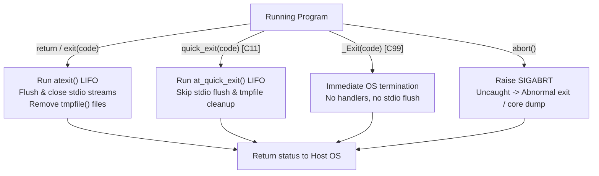

# Program Support Utilities, Signals & Non-Local Jumps

This section mirrors [cppreference.com/c/program](https://en.cppreference.com/w/c/program) and covers process lifecycle control (`<stdlib.h>`), unreachable execution hints (`<stddef.h>`), environment interaction, C23 pointer alignment inspection (`memalignment`), asynchronous signal handling (`<signal.h>`), non-local stack unwinding (`<setjmp.h>`), and the C23 deprecation of `<stdnoreturn.h>`.

---

## Program Termination (`<stdlib.h>`)

**Version-test macro:** `__STDC_VERSION_STDLIB_H__` (`202311L`) <span class="c-badge c23">C23</span>

ISO C defines four distinct termination functions — ranging from clean orderly shutdown (`exit`) to immediate emergency termination (`abort`) — plus exit-handler registration routines and portable status codes.



### API Reference

| Declaration | Standard | Behavior & Constraints |
| :--- | :--- | :--- |
| `#define EXIT_SUCCESS /* impl-defined */` | <span class="c-badge c89">C89</span> | Portable status code indicating successful termination (typically `0`; `0` is also always treated as success by `exit`/`quick_exit`/`_Exit`). |
| `#define EXIT_FAILURE /* impl-defined */` | <span class="c-badge c89">C89</span> | Portable status code indicating unsuccessful termination (typically `1`). |
| `[[noreturn]] void exit(int exit_code);` | <span class="c-badge c89">C89</span> | Performs normal termination: invokes `atexit` handlers in reverse (LIFO) registration order, flushes and closes all open `<stdio.h>` streams, removes files created by `tmpfile()`, and returns control to the host environment. Calling `exit()` more than once (e.g., from an `atexit` handler or concurrently from two threads) is **Undefined Behavior**. |
| `int atexit(void (*func)(void));` | <span class="c-badge c89">C89</span> | Registers `func` to be called during normal termination (`exit()` or return from `main`). Returns `0` on success, nonzero on failure. Implementations must support **at least 32** registered handlers. Thread-safe registration since C11. Calling `longjmp` out of a handler is **UB**. |
| `[[noreturn]] void quick_exit(int exit_code);` | <span class="c-badge c11">C11</span> | Performs fast termination: invokes `at_quick_exit` handlers in reverse (LIFO) order, then terminates as if calling `_Exit(exit_code)`. Does **not** call `atexit` handlers, does **not** flush open `<stdio.h>` buffers, and does **not** destroy static objects. Ideal for multithreaded shutdown when background threads still hold locks or stdio streams. |
| `int at_quick_exit(void (*func)(void));` | <span class="c-badge c11">C11</span> | Registers `func` for `quick_exit()`. Returns `0` on success, nonzero on failure. Must support at least 32 handlers. Thread-safe since C11. |
| `[[noreturn]] void _Exit(int exit_code);` | <span class="c-badge c99">C99</span> | Immediately terminates the process returning `exit_code` to the host OS. Never runs `atexit` or `at_quick_exit` handlers; flushing `<stdio.h>` streams and deleting `tmpfile()` files is **implementation-defined** (on POSIX `_Exit` matches `_exit(2)` and does **not** flush). Safe to call from signal handlers and after `fork()`. |
| `[[noreturn]] void abort(void);` | <span class="c-badge c89">C89</span> | Causes abnormal program termination by raising `SIGABRT`. If `SIGABRT` is not caught or the handler returns, terminates with an unsuccessful host status (typically generating a core dump on UNIX). Never calls `atexit` or `at_quick_exit` handlers; flushing streams is implementation-defined. |

### Exact Termination Comparison Matrix

| Termination Path | Runs `atexit`? | Runs `at_quick_exit`? | Flushes & Closes `stdio`? | Removes `tmpfile()`? | Raises `SIGABRT`? | Signal-Handler Safe? |
| :--- | :---: | :---: | :---: | :---: | :---: | :---: |
| Returning from `main()` | **Yes** (LIFO) | No | **Yes** | **Yes** | No | N/A |
| `exit(status)` | **Yes** (LIFO) | No | **Yes** | **Yes** | No | **No** (UB) |
| `quick_exit(status)` <span class="c-badge c11">C11</span> | No | **Yes** (LIFO) | No | No | No | **Yes** (if handlers are safe) |
| `_Exit(status)` <span class="c-badge c99">C99</span> | No | No | Impl-defined (No on POSIX) | Impl-defined (No on POSIX) | No | **Yes** |
| `abort()` | No | No | Impl-defined | Impl-defined | **Yes** | **Yes** |

!!! danger "Never Call `exit()` in a `fork()` Child Process"
    On POSIX systems, calling `exit()` inside a forked child flushes inherited `FILE *` output buffers a **second time** (duplicating buffered stdout/file output) and runs parent `atexit` cleanup handlers prematurely. Always terminate failed or completed `fork()` children with `_Exit()`.

---

## Unreachable Control Flow: `unreachable()` <span class="c-badge c23">C23</span>

**Header:** `<stddef.h>` (`__STDC_VERSION_STDDEF_H__ == 202311L`) · **Freestanding:** Full

```c
#include <stddef.h>

unreachable(); // Function-like macro expanding to void expression
```

`unreachable()` informs the compiler that control flow can **never** reach that point in any valid execution.

- **Contract**: Reaching `unreachable()` at runtime immediately invokes **Undefined Behavior** (ISO/IEC 9899:2024 §7.21.1).
- **Optimizer benefits**: Eliminates redundant bounds checks, prunes impossible `default:` branches so `switch` statements lower into tight jump tables, suppresses `-Wreturn-type` warnings after exhaustive switches, and unlocks value-range propagation across surrounding branches.
- **Standardization**: Replaces non-portable compiler intrinsics `__builtin_unreachable()` (GCC/Clang) and `__assume(0)` (MSVC).

=== "Idiomatic Debug + Release Guard (C23)"

    ```c
    #include <assert.h>
    #include <stddef.h>

    enum Color { COLOR_RED = 0, COLOR_GREEN = 1, COLOR_BLUE = 2 };

    const char *color_name(enum Color c) {
        switch (c) {
            case COLOR_RED:   return "red";
            case COLOR_GREEN: return "green";
            case COLOR_BLUE:  return "blue";
        }
        assert(false && "Invalid enum Color value"); // Caught loudly in debug builds
        unreachable();                               // Zero-cost hint in release (-DNDEBUG)
    }
    ```

=== "Dangerous Misuse (Avoid)"

    ```c
    #include <stddef.h>

    /* BAD: Never use unreachable() on untrusted external input!
       If input is 99, the optimizer may assume this path never exists
       and corrupt memory or skip security checks entirely. */
    int parse_untrusted(int raw_network_byte) {
        if (raw_network_byte == 0) return 10;
        if (raw_network_byte == 1) return 20;
        unreachable(); // Security vulnerability if network sends 2!
    }
    ```

---

## Environment Communication & Alignment Query (`<stdlib.h>`)

### `getenv`, `getenv_s`, and `system`

| Declaration | Standard | Behavior & Security / Concurrency Notes |
| :--- | :--- | :--- |
| `char *getenv(const char *name);` | <span class="c-badge c89">C89</span> | Searches the host environment list for `name` and returns a pointer to the value string, or `nullptr` if absent. **Do not modify** the returned string (UB). Subsequent calls to `getenv` may overwrite the buffer; copy it promptly. **Data race** if another thread calls POSIX `setenv`/`putenv`/`unsetenv`. |
| `errno_t getenv_s(size_t *restrict len, char *restrict value, rsize_t maxsize, const char *restrict name);` | <span class="c-badge c11">C11</span> <span class="c-badge c-optional">optional</span> | Annex K bounds-checked version copying the value into caller-provided `value[maxsize]` and writing its length to `*len`. Only available when `__STDC_LIB_EXT1__` is supported (absent in glibc/musl). |
| `int system(const char *command);` | <span class="c-badge c89">C89</span> | If `command == nullptr`, returns **nonzero** if a command processor (shell) is available, `0` otherwise. Otherwise passes `command` to the host shell and returns an implementation-defined exit status (wait status on POSIX; decode with `WIFEXITED`/`WEXITSTATUS`). |

!!! danger "Command Injection Hazard with `system()`"
    `system()` invokes `/bin/sh -c` (or `cmd.exe` on Windows), interpreting shell metacharacters (`;`, `|`, `` ` ``, `$(...)`, `&`). **Never** construct `system()` strings from untrusted input, filenames, or environment variables. In production systems code, launch executables directly with `posix_spawn(3)` / `execve(2)` (UNIX) or `CreateProcessW` (Windows) with explicit argument arrays.

### Pointer Alignment Query: `memalignment` <span class="c-badge c23">C23</span>

**Header:** `<stdlib.h>` · **Freestanding:** **Required in C23**

```c
#include <stdlib.h>

size_t memalignment(const void *p);
```

- **Return value**:
  - If `p` is a null pointer (`nullptr`), returns **`0`**.
  - Otherwise, returns a power-of-two `size_t` value representing the **maximum byte alignment** satisfied by the address `p` (conceptually `(uintptr_t)p & -(uintptr_t)p` on flat-address architectures, without requiring optional `uintptr_t` or integer-pointer casts!).
- **Usage contract**: A non-null pointer `p` satisfies the alignment requirement of type `T` if and only if `memalignment(p) >= alignof(T)`.
- **Primary use cases**: Custom arena/bump allocators, SIMD vectorization prologue loops (advancing a byte pointer until `memalignment(p) >= 32` for AVX2 / `64` for AVX-512), and validating DMA/hardware buffer alignment in freestanding kernels.

---

## Signal Handling (`<signal.h>`)

**Freestanding:** Hosted · **Version-test macro:** None in C23

Signals deliver synchronous exceptions (hardware faults such as invalid memory access or division by zero) and asynchronous events (such as user interrupt `Ctrl+C` or termination requests) to a running process.

### Types, Macros, and Functions

| Entity | Standard | Description |
| :--- | :--- | :--- |
| `typedef /* int */ sig_atomic_t;` | <span class="c-badge c89">C89</span> | Integer type guaranteed to be read and written as an atomic entity even in the presence of asynchronous interrupts within a single thread. Always qualify with `volatile`: `volatile sig_atomic_t`. |
| `void (*signal(int sig, void (*handler)(int)))(int);` | <span class="c-badge c89">C89</span> | Installs `handler` (`SIG_DFL`, `SIG_IGN`, or a user function `void fn(int)`) for signal `sig`. Returns the previous handler on success, or `SIG_ERR` on failure (setting `errno`). |
| `int raise(int sig);` | <span class="c-badge c89">C89</span> | Synchronously sends signal `sig` to the current program/thread. Returns `0` on success, nonzero on failure. |
| `SIG_DFL` / `SIG_IGN` / `SIG_ERR` | <span class="c-badge c89">C89</span> | Macros expanding to constant expressions representing default action, ignore action, and `signal()` error return. |

### Standard ISO C Signal Numbers

| Signal | Trigger Cause | Default Disposition |
| :--- | :--- | :--- |
| `SIGABRT` | Abnormal termination initiated by `abort()` | Terminate + core dump |
| `SIGFPE` | Erroneous arithmetic operation (integer division by zero, `INT_MIN / -1`, unmasked FP trap) | Terminate + core dump |
| `SIGILL` | Illegal/invalid CPU instruction | Terminate + core dump |
| `SIGINT` | Interactive attention signal (terminal `Ctrl+C`) | Terminate |
| `SIGSEGV` | Invalid memory access (segmentation fault, null dereference, write to read-only page) | Terminate + core dump |
| `SIGTERM` | Polite termination request sent to the process | Terminate |

### Strict ISO C Signal-Handler Restrictions (ISO/IEC 9899:2024 §7.14.1.1)

An asynchronous signal can interrupt execution between any two machine instructions — including halfway through `malloc()` holding an internal heap mutex or `printf()` updating a `FILE` buffer. Consequently, ISO C strictly limits what a signal handler may do when triggered asynchronously:

1. **Allowed memory access**: Only read/write objects of type **`volatile sig_atomic_t`** or **lock-free atomic objects** (`atomic_is_lock_free(&obj)` is true), plus local automatic variables defined inside the handler. Accessing any other static/global/heap object is **Undefined Behavior**.
2. **Allowed standard library calls**: Only `abort()`, `_Exit()`, `quick_exit()`, `signal()` (only for the same signal number), and lock-free `<stdatomic.h>` operations (`atomic_signal_fence`, etc.). Calling `printf`, `malloc`, `free`, `exit`, or `longjmp` from an asynchronous signal handler is **Undefined Behavior**!
3. **Returning from synchronous fault handlers**: Returning from a handler invoked by `SIGFPE`, `SIGILL`, or `SIGSEGV` (unless raised artificially via `raise()`) is **Undefined Behavior** because the faulting instruction will typically re-execute infinitely.

!!! warning "Portability Trap: `signal()` One-Shot Reset — Prefer POSIX `sigaction(2)`"
    ISO C permits `signal()` to reset a signal's disposition back to `SIG_DFL` upon entry to the handler (historical System V behavior, creating a race window where a second signal kills the process), whereas BSD/Linux glibc keeps the handler installed. On POSIX/Linux/macOS systems, **always prefer `sigaction(2)`** with explicit `sa_mask` and `sa_flags` (`SA_RESTART`) over `signal()`. See [Curriculum · 08 Error Handling, Signals & setjmp](../../curriculum/tier-2-runtime/08-error-handling-signals-setjmp.md).

---

## Non-Local Jumps (`<setjmp.h>`)

**Version-test macro:** `__STDC_VERSION_SETJMP_H__` (`202311L`) <span class="c-badge c23">C23</span> · **Freestanding:** Hosted

`<setjmp.h>` saves the current calling environment (stack pointer, frame pointer, callee-saved registers, instruction pointer) into a `jmp_buf` and lets a deeply nested callee jump directly back to that saved point — C's low-level primitive for error unwinding and cooperative coroutines.

| Entity | Standard | Behavior |
| :--- | :--- | :--- |
| `jmp_buf` | <span class="c-badge c89">C89</span> | Array type suitable for holding execution context information required to restore a calling environment. |
| `int setjmp(jmp_buf env);` | <span class="c-badge c89">C89</span> | **Must be a macro.** Saves the current environment into `env`. Returns **`0`** on direct invocation, and returns the nonzero `status` passed to `longjmp` when returning via a non-local jump. |
| `[[noreturn]] void longjmp(jmp_buf env, int status);` | <span class="c-badge c89">C89</span> | Restores the environment saved in `env`, transferring execution as if the corresponding `setjmp(env)` just returned `status`. **Special rule:** if `status == 0`, `setjmp` returns **`1`** instead (preventing infinite loops!). |

### Critical `setjmp` / `longjmp` Safety Rules & Hazards

1. **The `volatile` Local-Variable Rule (§7.13.2.1p3)**:
   Any automatic (non-`static`) local variable in the function calling `setjmp()` that meets **both** conditions:
   - is **not** declared `volatile`, **and**
   - is **modified** between `setjmp()` and `longjmp()`,
   has an **indeterminate value** after `longjmp()` returns! Compilers keep non-`volatile` locals in registers that `longjmp` restores to stale values (or optimizes away writes across the jump). Always mark modified locals `volatile`.
2. **Restricted Syntactic Contexts for `setjmp` (§7.13.1.1p4)**:
   `setjmp(env)` may appear **only** as:
   - The entire controlling expression of `if`, `switch`, `while`, `do-while`, or `for` (optionally negated with `!` or compared to an integer constant with `==`, `!=`, `<`, `<=`, `>`, `>=`),
   - The sole right-hand side of a simple assignment (`int rc = setjmp(env);` is **invalid** as an initializer in strict ISO C! Declare `int rc; rc = setjmp(env);`), or
   - An expression statement cast to `void` (`(void)setjmp(env);`).
   Using `setjmp` inside larger expressions (like `x = a() + setjmp(env)`) is **Undefined Behavior**.
3. **Never `longjmp` Into a Returned Function**: If the function that called `setjmp(env)` has already returned, its stack frame is dead — calling `longjmp(env, 1)` is immediate **Undefined Behavior** (stack corruption).
4. **VLA Leak Hazard**: Jumping out of a scope containing a **Variable-Length Array (VLA)** may leak storage if the compiler allocated the VLA on the heap rather than the stack.
5. **Resource Leaks**: `longjmp` performs **no** automatic cleanup — open `FILE *` handles, `malloc`'d heap blocks, and locked `mtx_t` mutexes acquired in skipped frames will leak or deadlock unless tracked externally (e.g., via an arena allocator or cleanup stack).

---

## `<stdnoreturn.h>` Deprecation in C23 <span class="c-badge c11">C11</span> <span class="c-badge c-deprecated">deprecated C23</span>

C11 introduced the `_Noreturn` function specifier keyword along with the convenience header `<stdnoreturn.h>` defining `#define noreturn _Noreturn`.

In **C23 (ISO/IEC 9899:2024 §7.33.12)**:

- Both the `<stdnoreturn.h>` header and the `_Noreturn` keyword are **obsolescent/deprecated**.
- Standard library non-returning functions (`abort`, `exit`, `quick_exit`, `_Exit`, `longjmp`, `thrd_exit`) now use the C23 standard attribute **`[[noreturn]]`** (identical syntax to C++11!).

=== "C23 (Recommended)"

    ```c
    #include <stdio.h>
    #include <stdlib.h>

    [[noreturn]] static void fatal_error(const char *msg) {
        fprintf(stderr, "FATAL: %s\n", msg);
        exit(EXIT_FAILURE);
    }
    ```

=== "C11 / C17 (Obsolescent in C23)"

    ```c
    #include <stdio.h>
    #include <stdlib.h>
    #include <stdnoreturn.h>

    noreturn static void fatal_error(const char *msg) {
        fprintf(stderr, "FATAL: %s\n", msg);
        exit(EXIT_FAILURE);
    }
    ```

---

## Complete Compilable C23 Example

This program demonstrates `atexit` LIFO ordering, `volatile sig_atomic_t` signal handling with `raise()`, C23 `memalignment()`, and safe `setjmp`/`longjmp` error recovery with a `volatile` counter.

```c
#include <setjmp.h>
#include <signal.h>
#include <stddef.h>
#include <stdio.h>
#include <stdlib.h>

static volatile sig_atomic_t g_last_signal = 0;

static void handle_sigint(int sig) {
    g_last_signal = sig; // Safe: volatile sig_atomic_t store only
}

static void cleanup_first(void) {
    puts("[atexit] 1st registered -> runs LAST (LIFO)");
}

static void cleanup_second(void) {
    puts("[atexit] 2nd registered -> runs FIRST (LIFO)");
}

[[noreturn]] static void parse_fail(jmp_buf env, int err_code) {
    longjmp(env, err_code);
}

static void run_parser(jmp_buf env, int depth) {
    if (depth == 0) {
        parse_fail(env, 42);
    }
    run_parser(env, depth - 1);
}

int main(void) {
    if (atexit(cleanup_first) != 0 || atexit(cleanup_second) != 0) {
        fputs("Failed to register atexit handlers\n", stderr);
        return EXIT_FAILURE;
    }

    /* 1. Safe signal handler demo */
    if (signal(SIGINT, handle_sigint) == SIG_ERR) {
        perror("signal");
        return EXIT_FAILURE;
    }
    if (raise(SIGINT) != 0) {
        fputs("raise(SIGINT) failed\n", stderr);
        return EXIT_FAILURE;
    }
    printf("Captured signal via volatile sig_atomic_t: %d\n", (int)g_last_signal);

    /* 2. Environment query */
    const char *user = getenv("USER");
    printf("USER env = %s\n", user != nullptr ? user : "(unset)");

    /* 3. C23 memalignment query */
#if defined(__STDC_VERSION_STDLIB_H__) && __STDC_VERSION_STDLIB_H__ >= 202311L
    alignas(64) unsigned char aligned_buf[64] = {};
    printf("memalignment(nullptr)     = %zu\n", memalignment(nullptr));
    printf("memalignment(aligned_buf) = %zu (satisfies alignof(max_align_t)=%zu: %s)\n",
           memalignment(aligned_buf),
           alignof(max_align_t),
           memalignment(aligned_buf) >= alignof(max_align_t) ? "yes" : "no");
#endif

    /* 4. setjmp / longjmp with mandatory volatile local variable */
    jmp_buf recovery_env;
    volatile int attempts = 0; // MUST be volatile because modified before longjmp!
    int err = 0;

    err = setjmp(recovery_env);
    if (err == 0) {
        attempts = 1;
        run_parser(recovery_env, 3);
    } else {
        printf("Recovered from longjmp: code=%d, attempts=%d\n", err, attempts);
    }

    return EXIT_SUCCESS;
}
```

---

## See Also

- [Attributes (C23)](../language/attributes.md) — `[[noreturn]]`, `[[nodiscard]]`, `[[unsequenced]]`, and `[[reproducible]]`.
- [Dynamic Memory Management](memory.md) — `aligned_alloc`, `free_sized`, `free_aligned_sized`, and `memalignment`.
- [Variadic Functions & Error Handling](variadic-and-error.md) — `errno`, `assert`, and Annex K constraint handlers.
- [Curriculum · 08 Error Handling, Signals & setjmp](../../curriculum/tier-2-runtime/08-error-handling-signals-setjmp.md) — Production UNIX `sigaction`, async-signal-safe patterns, and error architectures.
- External reference: [cppreference.com — Program support utilities](https://en.cppreference.com/w/c/program)
