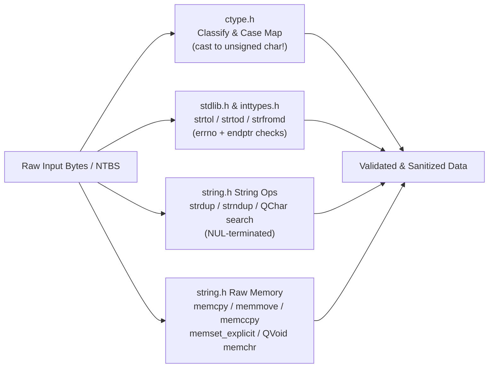

# Byte Strings & Character Utilities

Null-terminated byte strings (**NTBS**) are contiguous arrays of `char` terminated by the first null byte `'\0'` (`0x00`). Because C strings carry no stored length header, safe string handling depends on disciplined boundary tracking, unsigned-character conversion for classification APIs, checked numeric parsing, and explicit raw-memory operations.

This reference mirrors [en.cppreference.com/c/string](https://en.cppreference.com/c/string) and [en.cppreference.com/c/string/byte](https://en.cppreference.com/c/string/byte) through **ISO/IEC 9899:2024 (C23)**, covering `` `<ctype.h>` ``, `` `<stdlib.h>` ``, `` `<inttypes.h>` ``, and `` `<string.h>` ``.

---

## Headers, Feature Macros & API Architecture

| Header | Scope | C23 Feature-Test Macro | Freestanding (C23) |
| :--- | :--- | :--- | :--- |
| `` `<ctype.h>` `` | Single-byte character classification and case conversion | *(none)* | Hosted only |
| `` `<string.h>` `` | NTBS manipulation/examination, raw memory (`mem*`), `strerror` | `__STDC_VERSION_STRING_H__` (`202311L`) <span class="c-badge c23">C23</span> | Partial (excludes `strdup`, `strndup`, `strcoll`, `strxfrm`, `strerror`) |
| `` `<stdlib.h>` `` | String-to-number (`strto*`, `ato*`) and number-to-string (`strfrom*`) | `__STDC_VERSION_STDLIB_H__` (`202311L`) <span class="c-badge c23">C23</span> | Partial (`strto*` subset only) |
| `` `<inttypes.h>` `` | Fixed-width `intmax_t`/`uintmax_t` conversions (`strtoimax`, `strtoumax`) | `__STDC_VERSION_INTTYPES_H__` (`202311L`) <span class="c-badge c23">C23</span> | Hosted only |



!!! info "Annex K Bounds-Checking Interfaces (`*_s`) <span class="c-badge c11">C11</span> <span class="c-badge c-optional">optional</span>"
    Functions suffixed with `_s` (e.g., `strcpy_s`, `strnlen_s`, `memset_s`, `strerror_s`) belong to **Annex K (Bounds-checking interfaces)**. They are **optional** in ISO C11–C23:

    - To request them, define `#define __STDC_WANT_LIB_EXT1__ 1` **before** including any standard header.
    - Check `#ifdef __STDC_LIB_EXT1__` before calling them.
    - Neither **glibc** nor **musl** implements Annex K (citing runtime-constraint handler thread/global-state issues); MSVC implements a partial subset with minor divergences. Prefer portable ISO C23 facilities (`snprintf`, `memccpy`, `strndup`, `memset_explicit`) for cross-platform code.

---

## Character Classification & Transformation (`` `<ctype.h>` ``)

All 14 functions in `` `<ctype.h>` `` classify or transform single-byte characters according to the active **`LC_CTYPE`** locale category (see [Localization Support (`<locale.h>`)](locale.md)), except `isdigit` and `isxdigit`, whose behavior is fixed to ASCII digits and hexadecimal digits across all locales.

!!! danger "CRITICAL UNDEFINED BEHAVIOR RULE: Always Cast `char` to `(unsigned char)`"
    Every `` `<ctype.h>` `` function accepts an `int ch` whose value **must** either be representable as an **`unsigned char`** (`0` to `UCHAR_MAX`) **or** equal to **`EOF`** (ISO/IEC 9899:2024 §7.4p1).

    On platforms where plain `char` is signed (such as x86-64 Linux, macOS, and Windows), any non-ASCII byte (`0x80`–`0xFF`, including UTF-8 multibyte bytes and Latin-1 characters like `'é'`) sign-extends to a negative `int` (e.g., `-23`). Passing a negative value other than `EOF` is **Undefined Behavior**—often causing out-of-bounds negative indexing into libc's internal character-class lookup table, or silently colliding with `EOF` (`-1`, i.e., `0xFF` `'ÿ'`).

    === "❌ Undefined Behavior"

        ```c
        #include <ctype.h>

        void uppercase_broken(char *s) {
            for (; *s != '\0'; ++s) {
                /* UB if char is signed and *s has high bit set (0x80..0xFF)! */
                if (islower(*s)) {
                    *s = (char)toupper(*s);
                }
            }
        }
        ```

    === "✅ Portable & Standard-Compliant"

        ```c
        #include <ctype.h>

        void uppercase_safe(char *s) {
            for (; *s != '\0'; ++s) {
                unsigned char uch = (unsigned char)*s;
                if (islower(uch)) {
                    *s = (char)toupper(uch);
                }
            }
        }
        ```

### Complete `` `<ctype.h>` `` Function Reference (All 14 Functions)

| Function | Prototype | Standard | Behavior in Default `"C"` Locale |
| :--- | :--- | :--- | :--- |
| `isalnum` | `int isalnum(int ch);` | <span class="c-badge c89">C89</span> | Non-zero if `isalpha(ch)` or `isdigit(ch)` (`0-9`, `A-Z`, `a-z`) |
| `isalpha` | `int isalpha(int ch);` | <span class="c-badge c89">C89</span> | Non-zero if alphabetic (`A-Z`, `a-z`; locale may add letters) |
| `islower` | `int islower(int ch);` | <span class="c-badge c89">C89</span> | Non-zero if lowercase letter (`a-z`) |
| `isupper` | `int isupper(int ch);` | <span class="c-badge c89">C89</span> | Non-zero if uppercase letter (`A-Z`) |
| `isdigit` | `int isdigit(int ch);` | <span class="c-badge c89">C89</span> | Non-zero if decimal digit (`0-9`); **locale-independent** |
| `isxdigit` | `int isxdigit(int ch);` | <span class="c-badge c89">C89</span> | Non-zero if hex digit (`0-9`, `A-F`, `a-f`); **locale-independent** |
| `iscntrl` | `int iscntrl(int ch);` | <span class="c-badge c89">C89</span> | Non-zero if control character (`0x00–0x1F`, `0x7F`) |
| `isgraph` | `int isgraph(int ch);` | <span class="c-badge c89">C89</span> | Non-zero if any printable character **except** space (`0x21–0x7E`) |
| `isspace` | `int isspace(int ch);` | <span class="c-badge c89">C89</span> | Non-zero if whitespace (`' '`, `'\f'`, `'\n'`, `'\r'`, `'\t'`, `'\v'`) |
| `isblank` | `int isblank(int ch);` | <span class="c-badge c99">C99</span> | Non-zero if horizontal blank character (`' '` `0x20`, `'\t'` `0x09`) |
| `isprint` | `int isprint(int ch);` | <span class="c-badge c89">C89</span> | Non-zero if printable character **including** space (`0x20–0x7E`) |
| `ispunct` | `int ispunct(int ch);` | <span class="c-badge c89">C89</span> | Non-zero if printable and neither space nor alphanumeric (`0x21–0x2F`, `0x3A–0x40`, `0x5B–0x60`, `0x7B–0x7E`) |
| `tolower` | `int tolower(int ch);` | <span class="c-badge c89">C89</span> | Converts uppercase letter to lowercase; returns `ch` unchanged otherwise |
| `toupper` | `int toupper(int ch);` | <span class="c-badge c89">C89</span> | Converts lowercase letter to uppercase; returns `ch` unchanged otherwise |

!!! note "Boolean Return Value Contract"
    Classification functions return **zero** for false and an unspecified **non-zero** `int` for true (often a bitmask value such as `0x0400`). Never write `if (isdigit(c) == 1)`—always test truthiness (`if (isdigit(c))` or `if (isdigit(c) != 0)`).

### ASCII Classification Truth Table (`"C"` Locale, `0x00`–`0x7F`)

| Dec | Hex | Characters | `cntrl` | `print` | `space` | `blank` | `graph` | `punct` | `alnum` | `alpha` | `upper` | `lower` | `digit` | `xdigit` |
| :--- | :--- | :--- | :---: | :---: | :---: | :---: | :---: | :---: | :---: | :---: | :---: | :---: | :---: | :---: |
| `0–8` | `0x00–0x08` | `NUL`..`\b` | ✅ | — | — | — | — | — | — | — | — | — | — | — |
| `9` | `0x09` | `\t` (HT) | ✅ | — | ✅ | ✅ | — | — | — | — | — | — | — | — |
| `10–13` | `0x0A–0x0D` | `\n`, `\v`, `\f`, `\r` | ✅ | — | ✅ | — | — | — | — | — | — | — | — | — |
| `14–31` | `0x0E–0x1F` | `SO`..`US` | ✅ | — | — | — | — | — | — | — | — | — | — | — |
| `32` | `0x20` | `' '` (space) | — | ✅ | ✅ | ✅ | — | — | — | — | — | — | — | — |
| `33–47` | `0x21–0x2F` | `! " # $ % & ' ( ) * + , - . /` | — | ✅ | — | — | ✅ | ✅ | — | — | — | — | — | — |
| `48–57` | `0x30–0x39` | `'0'`..`'9'` | — | ✅ | — | — | ✅ | — | ✅ | — | — | — | ✅ | ✅ |
| `58–64` | `0x3A–0x40` | `: ; < = > ? @` | — | ✅ | — | — | ✅ | ✅ | — | — | — | — | — | — |
| `65–70` | `0x41–0x46` | `'A'`..`'F'` | — | ✅ | — | — | ✅ | — | ✅ | ✅ | ✅ | — | — | ✅ |
| `71–90` | `0x47–0x5A` | `'G'`..`'Z'` | — | ✅ | — | — | ✅ | — | ✅ | ✅ | ✅ | — | — | — |
| `91–96` | `0x5B–0x60` | `` [ \ ] ^ _ ` `` | — | ✅ | — | — | ✅ | ✅ | — | — | — | — | — | — |
| `97–102` | `0x61–0x66` | `'a'`..`'f'` | — | ✅ | — | — | ✅ | — | ✅ | ✅ | — | ✅ | — | ✅ |
| `103–122` | `0x67–0x7A` | `'g'`..`'z'` | — | ✅ | — | — | ✅ | — | ✅ | ✅ | — | ✅ | — | — |
| `123–126` | `0x7B–0x7E` | `{ \| } ~` | — | ✅ | — | — | ✅ | ✅ | — | — | — | — | — | — |
| `127` | `0x7F` | `DEL` | ✅ | — | — | — | — | — | — | — | — | — | — | — |

---

## Conversions to and from Numeric Formats (`` `<stdlib.h>` ``, `` `<inttypes.h>` ``)

### Legacy Unchecked Parsers (`ato*` — Avoid in Production)

| Function | Header | Prototype | Standard | Fatal Defect |
| :--- | :--- | :--- | :--- | :--- |
| `atoi` | `` `<stdlib.h>` `` | `int atoi(const char *str);` | <span class="c-badge c89">C89</span> | **UB on overflow**; cannot distinguish `"0"` from `"abc"` |
| `atol` | `` `<stdlib.h>` `` | `long atol(const char *str);` | <span class="c-badge c89">C89</span> | **UB on overflow**; no error reporting or `endptr` |
| `atoll` | `` `<stdlib.h>` `` | `long long atoll(const char *str);` | <span class="c-badge c99">C99</span> | **UB on overflow**; no error reporting or `endptr` |
| `atof` | `` `<stdlib.h>` `` | `double atof(const char *str);` | <span class="c-badge c89">C89</span> | **UB on out-of-range**; no error reporting or `endptr` |

!!! danger "Why `atoi` / `atol` / `atoll` / `atof` Are Unsafe (ISO C §7.24.1.2)"
    ISO C explicitly specifies that `atoi`, `atol`, `atoll`, and `atof` need not affect `errno` and that **"if the value of the result cannot be represented, the behavior is undefined."** Furthermore, `atoi("not_a_number")` silently returns `0`, making malformed input indistinguishable from `"0"`, and `atoi("42junk")` silently discards `"junk"`. Always use the `strto*` family instead.

### Checked Integer Conversions (`strtol`, `strtoul`, `strtoimax`, ...)

| Function | Header | Prototype | Standard | Overflow Return + `errno = ERANGE` |
| :--- | :--- | :--- | :--- | :--- |
| `strtol` | `` `<stdlib.h>` `` | `long strtol(const char *restrict str, char **restrict endptr, int base);` | <span class="c-badge c89">C89</span> | `LONG_MAX` / `LONG_MIN` |
| `strtoll` | `` `<stdlib.h>` `` | `long long strtoll(const char *restrict str, char **restrict endptr, int base);` | <span class="c-badge c99">C99</span> | `LLONG_MAX` / `LLONG_MIN` |
| `strtoul` | `` `<stdlib.h>` `` | `unsigned long strtoul(const char *restrict str, char **restrict endptr, int base);` | <span class="c-badge c89">C89</span> | `ULONG_MAX` |
| `strtoull` | `` `<stdlib.h>` `` | `unsigned long long strtoull(const char *restrict str, char **restrict endptr, int base);` | <span class="c-badge c99">C99</span> | `ULLONG_MAX` |
| `strtoimax` | `` `<inttypes.h>` `` | `intmax_t strtoimax(const char *restrict str, char **restrict endptr, int base);` | <span class="c-badge c99">C99</span> | `INTMAX_MAX` / `INTMAX_MIN` |
| `strtoumax` | `` `<inttypes.h>` `` | `uintmax_t strtoumax(const char *restrict str, char **restrict endptr, int base);` | <span class="c-badge c99">C99</span> | `UINTMAX_MAX` |

**Parsing rules & C23 enhancements:**

1. Skips leading whitespace (`isspace`).
2. Accepts an optional sign (`+` or `-`).
3. **`base` values**:
   - `base == 0`: auto-detects prefix — `0x`/`0X` → base 16; **`0b`/`0B` → base 2 <span class="c-badge c23">C23</span>**; leading `0` → base 8; otherwise base 10.
   - `base == 2`: **accepts optional `0b`/`0B` prefix <span class="c-badge c23">C23</span>**.
   - `base == 16`: accepts optional `0x`/`0X` prefix.
   - `2 <= base <= 36`: digits `'0'–'9'` and case-insensitive `'a'–'z'` represent `0..35`.
   - Any other `base` is UB (POSIX sets `EINVAL`, ISO C does not guarantee it).
4. Sets `*endptr` (if `endptr != nullptr`) to the first unconverted character, or to `str` itself if no digits were parsed.

!!! warning "The `strtoul` / `strtoull` Negative Input Quirk"
    By ISO C specification (§7.24.1.7), `strtoul("-1", &end, 10)` **succeeds without setting `ERANGE`** and returns `(unsigned long)-1` (`ULONG_MAX`) via modular negation! If negative numbers must be rejected when parsing unsigned integers, scan past leading whitespace and explicitly reject `'-'` before calling `strtoul`/`strtoull`.

### Checked Floating-Point Conversions (`strtof`, `strtod`, `strtold`, `strtodN`)

| Function | Header | Prototype | Standard | Overflow Return + `errno = ERANGE` |
| :--- | :--- | :--- | :--- | :--- |
| `strtof` | `` `<stdlib.h>` `` | `float strtof(const char *restrict str, char **restrict endptr);` | <span class="c-badge c99">C99</span> | `±HUGE_VALF` |
| `strtod` | `` `<stdlib.h>` `` | `double strtod(const char *restrict str, char **restrict endptr);` | <span class="c-badge c89">C89</span> | `±HUGE_VAL` |
| `strtold` | `` `<stdlib.h>` `` | `long double strtold(const char *restrict str, char **restrict endptr);` | <span class="c-badge c99">C99</span> | `±HUGE_VALL` |
| `strtod32` | `` `<stdlib.h>` `` | `_Decimal32 strtod32(const char *restrict str, char **restrict endptr);` | <span class="c-badge c23">C23</span> <span class="c-badge c-optional">optional</span> | `±HUGE_VAL_D32` (requires `__STDC_IEC_60559_DFP__`) |
| `strtod64` | `` `<stdlib.h>` `` | `_Decimal64 strtod64(const char *restrict str, char **restrict endptr);` | <span class="c-badge c23">C23</span> <span class="c-badge c-optional">optional</span> | `±HUGE_VAL_D64` (requires `__STDC_IEC_60559_DFP__`) |
| `strtod128` | `` `<stdlib.h>` `` | `_Decimal128 strtod128(const char *restrict str, char **restrict endptr);` | <span class="c-badge c23">C23</span> <span class="c-badge c-optional">optional</span> | `±HUGE_VAL_D128` (requires `__STDC_IEC_60559_DFP__`) |

Accepted input forms (case-insensitive): decimal floating-point (`123.45e-6`), hexadecimal floating-point (`0x1.fp+4` <span class="c-badge c99">C99</span>), infinity (`INF`, `INFINITY`), and NaN (`NAN`, `NAN(n-char-seq)`). The decimal-point character is locale-dependent (`LC_NUMERIC`). On underflow to a subnormal or zero, `errno` may be set to `ERANGE`.

### Canonical `errno` + `endptr` Validation Pattern

Standard library functions **never clear `errno` to `0` on success**. You must always reset `errno = 0` immediately before calling `strto*`, verify that characters were consumed (`end != s`), check `errno == ERANGE`, verify full consumption (if trailing garbage is disallowed), and validate target-type bounds.

=== "❌ Broken Pattern"

    ```c
    #include <errno.h>
    #include <stdlib.h>

    int parse_port_broken(const char *s) {
        /* Bugs: stale errno, no endptr check, silent truncation from long to int! */
        long v = strtol(s, NULL, 10);
        if (errno == ERANGE) return -1;
        return (int)v;
    }
    ```

=== "✅ Strict Validation Pattern (C23)"

    ```c
    #include <errno.h>
    #include <stdint.h>
    #include <stdlib.h>

    bool parse_port_strict(const char *s, uint16_t *out_port) {
        if (s == nullptr || out_port == nullptr || *s == '\0') {
            return false;
        }
        char *end = nullptr;
        errno = 0;
        long val = strtol(s, &end, 10);

        if (end == s) {           /* No digits parsed at all */
            return false;
        }
        if (errno == ERANGE) {    /* Overflowed long */
            return false;
        }
        if (*end != '\0') {       /* Trailing non-numeric characters */
            return false;
        }
        if (val < 1 || val > 65535) { /* Out of valid TCP/UDP port range */
            return false;
        }
        *out_port = (uint16_t)val;
        return true;
    }
    ```

### C23 Floating-Point to String Formatting (`strfromf`, `strfromd`, `strfroml`, `strfromdN`) <span class="c-badge c23">C23</span>

Introduced in **ISO/IEC 9899:2024 §7.24.1.3** (originating from TS 18661-1/2), the `strfrom*` family formats a single floating-point number into a bounded character buffer **without** `snprintf`'s variadic argument promotion (`float` → `double`) or full `printf` format-parser overhead.

| Function | Prototype (`<stdlib.h>`) | Standard | Value Type |
| :--- | :--- | :--- | :--- |
| `strfromf` | `int strfromf(char *restrict s, size_t n, const char *restrict format, float fp);` | <span class="c-badge c23">C23</span> | `float` |
| `strfromd` | `int strfromd(char *restrict s, size_t n, const char *restrict format, double fp);` | <span class="c-badge c23">C23</span> | `double` |
| `strfroml` | `int strfroml(char *restrict s, size_t n, const char *restrict format, long double fp);` | <span class="c-badge c23">C23</span> | `long double` |
| `strfromd32` | `int strfromd32(char *restrict s, size_t n, const char *restrict format, _Decimal32 fp);` | <span class="c-badge c23">C23</span> <span class="c-badge c-optional">optional</span> | `_Decimal32` |
| `strfromd64` | `int strfromd64(char *restrict s, size_t n, const char *restrict format, _Decimal64 fp);` | <span class="c-badge c23">C23</span> <span class="c-badge c-optional">optional</span> | `_Decimal64` |
| `strfromd128` | `int strfromd128(char *restrict s, size_t n, const char *restrict format, _Decimal128 fp);` | <span class="c-badge c23">C23</span> <span class="c-badge c-optional">optional</span> | `_Decimal128` |

**Format grammar & return semantics:**

- **Strict format string**: `format` **must** match `%[.precision]specifier`, where `specifier` is strictly one of `a`, `A`, `e`, `E`, `f`, `F`, `g`, `G`. An optional `.` with no digits specifies precision `0`. **Flags (`+`, `-`, `#`, `0`, space), field widths, `*` dynamic precision, length modifiers (`l`, `L`), and literal prefix/suffix text are forbidden and invoke Undefined Behavior!**
- **Return value**: Identical to `snprintf` — returns the number of characters that **would** have been written had `n` been sufficiently large (excluding the terminating `'\0'`). If `n > 0`, the result is always null-terminated (truncated to `n - 1` chars if `ret >= (int)n`). Calling with `s == nullptr` and `n == 0` queries the required buffer size (`ret + 1`).

```c
#include <stdio.h>
#include <stdlib.h>

void format_float_c23(double value) {
    char buf[32];
    int written = strfromd(buf, sizeof buf, "%.4f", value);
    if (written >= 0 && (size_t)written < sizeof buf) {
        printf("Formatted: %s (%d chars)\n", buf, written);
    }
}
```

---

## String Manipulation (`` `<string.h>` ``)

| Function | Prototype | Standard | Notes & Key Traps |
| :--- | :--- | :--- | :--- |
| `strcpy` | `char *strcpy(char *restrict dest, const char *restrict src);` | <span class="c-badge c89">C89</span> | No destination size check! UB on overflow or overlapping buffers |
| `strcpy_s` | `errno_t strcpy_s(char *restrict dest, rsize_t destsz, const char *restrict src);` | <span class="c-badge c11">C11</span> <span class="c-badge c-optional">optional</span> | Fails with non-zero `errno_t` if `strlen(src) >= destsz` or null pointers |
| `strncpy` | `char *strncpy(char *restrict dest, const char *restrict src, size_t count);` | <span class="c-badge c89">C89</span> | **Does NOT NUL-terminate if `strlen(src) >= count`; zero-pads remainder!** |
| `strncpy_s` | `errno_t strncpy_s(char *restrict dest, rsize_t destsz, const char *restrict src, rsize_t count);` | <span class="c-badge c11">C11</span> <span class="c-badge c-optional">optional</span> | Guarantees NUL termination; fails if copy exceeds `destsz - 1` |
| `strcat` | `char *strcat(char *restrict dest, const char *restrict src);` | <span class="c-badge c89">C89</span> | Unbounded append; $O(n)$ scan of `dest` on every call; UB on overflow |
| `strcat_s` | `errno_t strcat_s(char *restrict dest, rsize_t destsz, const char *restrict src);` | <span class="c-badge c11">C11</span> <span class="c-badge c-optional">optional</span> | Checks combined length against total `destsz` |
| `strncat` | `char *strncat(char *restrict dest, const char *restrict src, size_t count);` | <span class="c-badge c89">C89</span> | Always NUL-terminates; `count` is **max chars from `src`** (writes up to `count + 1` bytes!) |
| `strncat_s` | `errno_t strncat_s(char *restrict dest, rsize_t destsz, const char *restrict src, rsize_t count);` | <span class="c-badge c11">C11</span> <span class="c-badge c-optional">optional</span> | Bounds-checked append of at most `count` chars into total capacity `destsz` |
| `strxfrm` | `size_t strxfrm(char *restrict dest, const char *restrict src, size_t count);` | <span class="c-badge c89">C89</span> | Transforms `src` per `LC_COLLATE` so `strcmp` matches `strcoll`; pass `count == 0` to query length |
| `strdup` | `char *strdup(const char *src);` | <span class="c-badge c23">C23</span> | Standardized from POSIX! Allocates via `malloc`; caller must `free()` |
| `strndup` | `char *strndup(const char *src, size_t size);` | <span class="c-badge c23">C23</span> | Standardized from POSIX! Copies at most `size` bytes, **always NUL-terminates**; caller must `free()` |

### The `strncpy` Null-Termination & Zero-Padding Pitfall

`strncpy` is widely mistaken for a "safe `strcpy`". It was originally designed for fixed-width 14-byte Unix V7 directory entries where NUL padding filled unused slots and full-length names had **no** trailing `'\0'`:

1. **Missing NUL terminator**: If `src` has length $\ge \text{count}$, `strncpy` writes `count` non-NUL bytes and leaves `dest` **unterminated**—turning any subsequent `strlen(dest)` or `printf("%s", dest)` into a buffer over-read!
2. **Performance cliff**: If `src` is 3 bytes and `count` is 65,536 bytes, `strncpy` writes 65,533 redundant `'\0'` bytes.

=== "❌ Dangerous `strncpy`"

    ```c
    #include <string.h>

    void copy_name_bad(char dest[8], const char *src) {
        /* If src is "Alexander", dest holds "Alexande" with NO '\0'! */
        strncpy(dest, src, 8);
    }
    ```

=== "✅ Safe C23 Alternatives (`memccpy` / `snprintf` / `strndup`)"

    ```c
    #include <stdio.h>
    #include <string.h>

    /* Option A: Fixed stack buffer with explicit truncation detection via C23 memccpy */
    bool copy_name_bounded(char *dest, size_t cap, const char *src) {
        if (cap == 0) return false;
        void *end = memccpy(dest, src, '\0', cap);
        if (end == nullptr) {
            dest[cap - 1] = '\0'; /* Truncated, but guaranteed NUL-terminated */
            return false;
        }
        return true;
    }

    /* Option B: Dynamic heap copy capped at max_len via C23 strndup */
    char *clone_name_c23(const char *src, size_t max_len) {
        return strndup(src, max_len); /* Caller must free() */
    }
    ```

### C23 Dynamic Duplication: `strdup` & `strndup` <span class="c-badge c23">C23</span>

Standardized into ISO/IEC 9899:2024 (§7.26.2.5–6) from POSIX.1-2008:

- `strdup(src)` allocates `strlen(src) + 1` bytes as if by `malloc`, copies `src` including `'\0'`, and returns the new pointer (or `nullptr` on allocation failure).
- `strndup(src, size)` inspects at most `size` bytes of `src` (safe even on non-NUL-terminated slices of length `size`), allocates `min(strlen(src), size) + 1` bytes, copies those bytes, and **always** appends `'\0'`.
- Both pointers **must** be released via `free()`. Neither function is required in freestanding C23 environments.

---

## String Examination (`` `<string.h>` ``) & C23 `QChar` Const-Preservation

| Function | Prototype | Standard | Return Value & Edge Cases |
| :--- | :--- | :--- | :--- |
| `strlen` | `size_t strlen(const char *str);` | <span class="c-badge c89">C89</span> | Length before `'\0'`; UB if `str` is `nullptr` or unterminated |
| `strnlen_s` | `size_t strnlen_s(const char *str, size_t strsz);` | <span class="c-badge c11">C11</span> <span class="c-badge c-optional">optional</span> | Returns `0` if `str == nullptr`; scans at most `strsz` bytes |
| `strcmp` | `int strcmp(const char *lhs, const char *rhs);` | <span class="c-badge c89">C89</span> | `< 0`, `0`, or `> 0` comparing bytes as **`unsigned char`** |
| `strncmp` | `int strncmp(const char *lhs, const char *rhs, size_t count);` | <span class="c-badge c89">C89</span> | Compares at most `count` bytes (stops at first `'\0'`) as **`unsigned char`** |
| `strcoll` | `int strcoll(const char *lhs, const char *rhs);` | <span class="c-badge c89">C89</span> | Lexicographical compare according to active `LC_COLLATE` locale |
| `strchr` | `QChar *strchr(QChar *str, int ch);` | <span class="c-badge c89">C89</span> <span class="c-badge c23">C23</span> | First occurrence of `(char)ch` (including `'\0'`), or `nullptr`; **C23 `QChar`** |
| `strrchr` | `QChar *strrchr(QChar *str, int ch);` | <span class="c-badge c89">C89</span> <span class="c-badge c23">C23</span> | Last occurrence of `(char)ch` (including `'\0'`), or `nullptr`; **C23 `QChar`** |
| `strspn` | `size_t strspn(const char *dest, const char *src);` | <span class="c-badge c89">C89</span> | Length of maximal initial prefix of `dest` containing **only** chars in `src` |
| `strcspn` | `size_t strcspn(const char *dest, const char *src);` | <span class="c-badge c89">C89</span> | Length of maximal initial prefix of `dest` containing **no** chars in `src` |
| `strpbrk` | `QChar *strpbrk(QChar *dest, const char *breakset);` | <span class="c-badge c89">C89</span> <span class="c-badge c23">C23</span> | Pointer to first char in `dest` that appears in `breakset`, or `nullptr`; **C23 `QChar`** |
| `strstr` | `QChar *strstr(QChar *str, const char *substr);` | <span class="c-badge c89">C89</span> <span class="c-badge c23">C23</span> | First occurrence of `substr` in `str` (returns `str` if `substr` is `""`), or `nullptr`; **C23 `QChar`** |
| `strtok` | `char *strtok(char *restrict str, const char *restrict delim);` | <span class="c-badge c89">C89</span> | **Mutates `str`; hidden static state (NOT thread-safe / NOT reentrant!)** |
| `strtok_s` | `char *strtok_s(char *restrict str, rsize_t *restrict strmax, const char *restrict delim, char **restrict ptr);` | <span class="c-badge c11">C11</span> <span class="c-badge c-optional">optional</span> | Reentrant, bounds-checked tokenizer using caller-owned `ptr` state |

### C23 `QChar` Qualifier-Preserving Search Functions <span class="c-badge c23">C23</span>

From C89 through C17, `strchr`, `strrchr`, `strpbrk`, and `strstr` accepted `const char *` yet returned mutable `char *`, creating a notorious loophole that silently stripped `const` without a cast and allowed accidental writes to read-only string literals (UB / `SIGSEGV`).

**ISO/IEC 9899:2024 (§7.26.5)** resolves this via type-generic macros using the exposition placeholder **`QChar`**:

- Passing **`const char *`** returns **`const char *`**.
- Passing **`char *`** returns **`char *`**.
- Suppressing macro expansion (e.g., `(strchr)(s, c)`) or taking `&strchr` resolves to the external library function returning `char *` for ABI compatibility.

=== "C23 (Const-Preserving)"

    ```c
    #include <string.h>

    void search_c23(void) {
        const char *ro = "readonly=value";
        char rw[] = "mutable=value";

        const char *p_ro = strchr(ro, '='); /* Returns const char * in C23! */
        /* char *bad = strchr(ro, '=');  // Compile-time diagnostic in C23! */

        char *p_rw = strchr(rw, '=');       /* Returns char * in C23! */
        if (p_rw != nullptr) {
            *p_rw = ':';                    /* Legal: rw is mutable */
        }
        (void)p_ro;
    }
    ```

=== "C17 (Const-Stripping Hazard)"

    ```c
    #include <string.h>

    void search_c17_hazard(void) {
        const char *ro = "readonly=value";
        /* C17 compiles silently with zero warnings! */
        char *p = strchr(ro, '=');
        if (p != NULL) {
            *p = ':'; /* UNDEFINED BEHAVIOR: writing to .rodata literal! */
        }
    }
    ```

### Examination Nuances & Traps

- **Sign of `strcmp` / `strncmp`**: Only the sign (`< 0`, `== 0`, `> 0`) is defined. Implementations frequently return byte differences or SIMD mask deltas (not `-1` / `+1`). Always compare against `0`.
- **Searching for `'\0'`**: `strchr(s, '\0')` and `strrchr(s, '\0')` treat the terminating null byte as part of the string and return a pointer to `s + strlen(s)` (never `nullptr`).
- **Why avoid `strtok`**: `strtok` overwrites delimiter bytes with `'\0'` (cannot tokenize read-only strings), collapses consecutive delimiters (breaking CSV empty fields like `"a,,b"`), and stores global state (data race across threads, corrupts nested loops). Prefer `strcspn`/`strspn` pointer scanning for zero-mutation parsing, or POSIX `strtok_r` / Annex K `strtok_s`.

---

## Character Array & Raw Memory Operations (`` `<string.h>` ``)

Unlike `str*` functions, `mem*` functions operate on raw byte buffers of explicit length `size_t count` and **do not stop at `'\0'` bytes**.

| Function | Prototype | Standard | Key Semantics & Traps |
| :--- | :--- | :--- | :--- |
| `memchr` | `QVoid *memchr(QVoid *ptr, int ch, size_t count);` | <span class="c-badge c89">C89</span> <span class="c-badge c23">C23</span> | Finds first `(unsigned char)ch` in `[ptr, ptr+count)`; **C23 `QVoid` const-preserving!** |
| `memcmp` | `int memcmp(const void *lhs, const void *rhs, size_t count);` | <span class="c-badge c89">C89</span> | Compares `count` bytes as `unsigned char`; **unsafe for structs with padding or floats with `-0.0`/`NaN`** |
| `memset` | `void *memset(void *dest, int ch, size_t count);` | <span class="c-badge c89">C89</span> | Fills `count` bytes with `(unsigned char)ch`; **may be elided by dead-store optimization!** |
| `memset_s` | `errno_t memset_s(void *dest, rsize_t destsz, int ch, rsize_t count);` | <span class="c-badge c11">C11</span> <span class="c-badge c-optional">optional</span> | Non-elided fill (optional Annex K) |
| `memset_explicit` | `void *memset_explicit(void *dest, int ch, size_t count);` | <span class="c-badge c23">C23</span> | **Guaranteed non-elided memory scrub** for cryptographic keys & secrets |
| `memcpy` | `void *memcpy(void *restrict dest, const void *restrict src, size_t count);` | <span class="c-badge c89">C89</span> | Fast non-overlapping copy; **UB if ranges overlap** |
| `memcpy_s` | `errno_t memcpy_s(void *restrict dest, rsize_t destsz, const void *restrict src, rsize_t count);` | <span class="c-badge c11">C11</span> <span class="c-badge c-optional">optional</span> | Bounds-checked non-overlapping copy; zeroes `dest` on constraint error |
| `memmove` | `void *memmove(void *dest, const void *src, size_t count);` | <span class="c-badge c89">C89</span> | Overlap-safe copy (behaves *as if* copied through an intermediate buffer) |
| `memmove_s` | `errno_t memmove_s(void *dest, rsize_t destsz, const void *src, rsize_t count);` | <span class="c-badge c11">C11</span> <span class="c-badge c-optional">optional</span> | Bounds-checked overlap-safe copy |
| `memccpy` | `void *memccpy(void *restrict dest, const void *restrict src, int c, size_t count);` | <span class="c-badge c23">C23</span> | Standardized from POSIX! Copies until `(unsigned char)c` (inclusive) or `count` bytes; returns byte *after* `c` in `dest`, or `nullptr` |

### C23 `QVoid` Const-Preserving `memchr` <span class="c-badge c23">C23</span>

Just like `QChar` for `strchr`, `memchr` uses the C23 exposition placeholder **`QVoid`**: passing `const void *` (or `const T *`) returns **`const void *`**, whereas passing mutable `void *` (or `T *`) returns **`void *`**.

### C23 `memset_explicit`: Preventing Dead-Store Elimination of Secrets <span class="c-badge c23">C23</span>

Under the C abstract machine's *as-if* rule, a compiler may legally **delete** a call to standard `memset()` if the buffer is never read again before its lifetime ends (e.g., before returning from a function or calling `free()`). This vulnerability (**CWE-14: Compiler Removal of Code to Clear Buffers**) leaves plaintext passwords, private keys, and session tokens sitting in RAM or core dumps.

**`memset_explicit`** (ISO/IEC 9899:2024 §7.26.6.2) solves this portably across every conforming C23 implementation:

```c
void *memset_explicit(void *s, int c, size_t n);
```

- **Guarantee**: *"The purpose of this function is to make sensitive information stored in the object inaccessible. The intention is that the memory store is always performed (i.e., never elided), regardless of optimizations."*
- **Advantage over `memset_s`**: Mandatory in C23 (not trapped inside optional Annex K) and needs no `rsize_t` / constraint-handler boilerplate.

=== "❌ Vulnerable to Dead-Store Elimination"

    ```c
    #include <string.h>

    unsigned char checksum_secret_unsafe(const unsigned char key[32]) {
        unsigned char derived[32];
        memcpy(derived, key, sizeof derived);
        unsigned char fold = 0;
        for (size_t i = 0; i < sizeof derived; ++i) {
            fold ^= derived[i];
        }
        /* GCC/Clang -O2 legally DELETES this call because derived dies here! */
        memset(derived, 0, sizeof derived);
        return fold;
    }
    ```

=== "✅ Hardened C23 (`memset_explicit`)"

    ```c
    #include <string.h>

    unsigned char checksum_secret_c23(const unsigned char key[32]) {
        unsigned char derived[32];
        memcpy(derived, key, sizeof derived);
        unsigned char fold = 0;
        for (size_t i = 0; i < sizeof derived; ++i) {
            fold ^= derived[i];
        }
        /* Guaranteed to execute and overwrite all 32 bytes in RAM */
        memset_explicit(derived, 0, sizeof derived);
        return fold;
    }
    ```

### C23 `memccpy`: Single-Pass Bounded String Chaining <span class="c-badge c23">C23</span>

Standardized in ISO/IEC 9899:2024 §7.26.2.2, `memccpy` copies bytes from `src` to `dest` (non-overlapping) stopping immediately **after** copying `(unsigned char)c` or after `n` bytes, whichever happens first:

- If `(unsigned char)c` was found within the first `n` bytes, it returns a pointer to the byte **immediately following** `c` in `dest`.
- Otherwise, it returns `nullptr`.

When `c == '\0'`, `memccpy` gives you both **exact truncation detection** (`ret == nullptr`) and an **end-of-string cursor** (`(char *)ret - 1`), enabling $O(n)$ chained concatenation without `strcat`'s quadratic $O(n^2)$ rescanning!

### CRITICAL UB TRAP: Zero-Length `memcpy(dst, nullptr, 0)`

!!! danger "Passing `NULL` / `nullptr` to `memcpy` / `memmove` / `memset` / `memcmp` with `count == 0` Is UB!"
    Under **ISO/IEC 9899:2024 §7.26.1p2**, pointer arguments to `<string.h>` functions **must have valid (non-null) values even when `count == 0`**.

    Real-world impact: glibc declares `memcpy` with `__attribute__((nonnull(1, 2)))`. Under `-O2`, GCC and Clang see `memcpy(dst, src, n)` and **prove to the optimizer that `src != nullptr`**, silently deleting any subsequent `if (src == nullptr)` safety check (the infamous Linux kernel / PostgreSQL null-check-elimination vulnerability class!).

    - **Always guard**: `if (count > 0) { memcpy(dst, src, count); }`
    - *(Note: WG14 C2y paper N3322 proposes relaxing this rule for zero lengths in a future C revision, but under C89–C23 it remains strictly Undefined Behavior.)*

### Struct Padding Pitfall with `memcmp`

Never compare two `struct` objects with `memcmp(&a, &b, sizeof a)` unless you guarantee zero padding or zero-initialized representation: padding bytes between misaligned members contain **indeterminate values** even when every field is equal, causing spurious inequality. Compare structs field-by-field instead.

---

## Error Message Strings (`` `<string.h>` ``)

| Function | Prototype | Standard | Thread Safety & Behavior |
| :--- | :--- | :--- | :--- |
| `strerror` | `char *strerror(int errnum);` | <span class="c-badge c89">C89</span> | Maps `errno` code to locale-specific text; **NOT guaranteed thread-safe** (may reuse a static buffer); caller must **not** modify returned string |
| `strerror_s` | `errno_t strerror_s(char *buf, rsize_t bufsz, errno_t errnum);` | <span class="c-badge c11">C11</span> <span class="c-badge c-optional">optional</span> | Thread-safe bounded copy into `buf`; truncates with `"..."` if `bufsz` is insufficient |
| `strerrorlen_s` | `size_t strerrorlen_s(errno_t errnum);` | <span class="c-badge c11">C11</span> <span class="c-badge c-optional">optional</span> | Returns exact length (excluding `'\0'`) required for `strerror_s` |

!!! tip "Portable Thread-Safe Error Formatting"
    In multi-threaded POSIX code where Annex K `strerror_s` is unavailable, use XSI-compliant `strerror_r(errnum, buf, sizeof buf)` (or `strerror_l` with an explicit `locale_t`). In single-threaded error paths, treat the return value of `strerror(errnum)` as `const char *` and copy it immediately before calling another library routine.

---

## Complete Compilable C23 Lab: Hardened Config Parser & Secret Buffer Hygiene

This complete, warning-free C23 program exercises `` `<ctype.h>` `` unsigned-char safety, strict `strtol`/`strtod` validation, C23 `strfromd`, C23 `QChar` const-preserving `strchr`, C23 `memccpy` chained string building, C23 `strndup`, guarded `memcpy`, and C23 `memset_explicit`.

```c
/*
 * Compile (GCC 14+ / Clang 18+ with glibc 2.38+ or modern C23 libc):
 *   gcc -std=c23 -Wall -Wextra -Wpedantic -O2 -fsanitize=address,undefined \
 *       byte_strings_lab.c -o byte_strings_lab && ./byte_strings_lab
 */
#include <ctype.h>
#include <errno.h>
#include <stdint.h>
#include <stdio.h>
#include <stdlib.h>
#include <string.h>

typedef struct {
    char *host;
    uint16_t port;
    double timeout_sec;
    char api_token[64];
} ServiceConfig;

static void trim_bounds(const char *s, const char **out_start, size_t *out_len) {
    const char *start = s;
    while (*start != '\0' && isspace((unsigned char)*start)) {
        ++start;
    }
    const char *end = start + strlen(start);
    while (end > start && isspace((unsigned char)end[-1])) {
        --end;
    }
    *out_start = start;
    *out_len = (size_t)(end - start);
}

static bool parse_u16(const char *val, size_t len, uint16_t *out) {
    char tmp[32];
    if (len == 0 || len >= sizeof tmp) {
        return false;
    }
    /* Guarded memcpy: len > 0 is guaranteed here */
    memcpy(tmp, val, len);
    tmp[len] = '\0';

    /* Reject leading sign so strtoul cannot silently wrap negative values */
    if (tmp[0] == '-' || tmp[0] == '+') {
        return false;
    }

    char *end = nullptr;
    errno = 0;
    unsigned long parsed = strtoul(tmp, &end, 0); /* C23 supports 0b/0B too */
    if (end == tmp || *end != '\0' || errno == ERANGE || parsed > UINT16_MAX) {
        return false;
    }
    *out = (uint16_t)parsed;
    return true;
}

static bool parse_positive_double(const char *val, size_t len, double *out) {
    char tmp[64];
    if (len == 0 || len >= sizeof tmp) {
        return false;
    }
    memcpy(tmp, val, len);
    tmp[len] = '\0';

    char *end = nullptr;
    errno = 0;
    double parsed = strtod(tmp, &end);
    if (end == tmp || *end != '\0' || errno == ERANGE || !(parsed > 0.0)) {
        return false;
    }
    *out = parsed;
    return true;
}

static bool parse_config_line(const char *line, ServiceConfig *cfg) {
    /* C23 QChar: strchr(const char *, int) returns const char * */
    const char *eq = strchr(line, '=');
    if (eq == nullptr) {
        return false;
    }

    size_t raw_key_len = (size_t)(eq - line);
    char key_buf[32];
    if (raw_key_len == 0 || raw_key_len >= sizeof key_buf) {
        return false;
    }
    memcpy(key_buf, line, raw_key_len);
    key_buf[raw_key_len] = '\0';

    const char *key = nullptr;
    size_t key_len = 0;
    trim_bounds(key_buf, &key, &key_len);

    const char *val = nullptr;
    size_t val_len = 0;
    trim_bounds(eq + 1, &val, &val_len);

    if (key_len == 4 && strncmp(key, "host", 4) == 0) {
        free(cfg->host);
        /* C23 strndup: bounded dynamic duplicate, always NUL-terminated */
        cfg->host = strndup(val, val_len);
        return cfg->host != nullptr;
    }
    if (key_len == 4 && strncmp(key, "port", 4) == 0) {
        return parse_u16(val, val_len, &cfg->port);
    }
    if (key_len == 7 && strncmp(key, "timeout", 7) == 0) {
        return parse_positive_double(val, val_len, &cfg->timeout_sec);
    }
    if (key_len == 5 && strncmp(key, "token", 5) == 0) {
        if (val_len == 0 || val_len >= sizeof cfg->api_token) {
            return false;
        }
        memcpy(cfg->api_token, val, val_len);
        cfg->api_token[val_len] = '\0';
        return true;
    }
    return false;
}

/* Chained O(n) bounded string concatenation using C23 memccpy */
static bool build_endpoint_banner(char *dst, size_t cap, const ServiceConfig *cfg) {
    if (cap == 0 || cfg->host == nullptr) {
        return false;
    }
    char port_str[16];
    char timeout_str[32];

    int p_len = snprintf(port_str, sizeof port_str, "%u", (unsigned)cfg->port);
    /* C23 strfromd: direct double-to-string without variadic printf overhead */
    int t_len = strfromd(timeout_str, sizeof timeout_str, "%.2f", cfg->timeout_sec);
    if (p_len < 0 || (size_t)p_len >= sizeof port_str ||
        t_len < 0 || (size_t)t_len >= sizeof timeout_str) {
        return false;
    }

    const char *parts[] = {
        "https://", cfg->host, ":", port_str, " (timeout=", timeout_str, "s)"
    };
    char *cursor = dst;
    char *limit = dst + cap;

    for (size_t i = 0; i < sizeof parts / sizeof parts[0]; ++i) {
        size_t avail = (size_t)(limit - cursor);
        void *next = memccpy(cursor, parts[i], '\0', avail);
        if (next == nullptr) {
            dst[cap - 1] = '\0'; /* Truncated safely */
            return false;
        }
        cursor = (char *)next - 1; /* Back up over NUL for next piece */
    }
    return true;
}

int main(void) {
    const char *lines[] = {
        "  host = api.internal.example  ",
        "  port = 8443 ",
        "  timeout = 2.75 ",
        "  token = ephemeral_demo_value_only "
    };

    ServiceConfig cfg = {}; /* C23 universal zero-initializer */

    for (size_t i = 0; i < sizeof lines / sizeof lines[0]; ++i) {
        if (!parse_config_line(lines[i], &cfg)) {
            fprintf(stderr, "Failed to parse line %zu: %s\n", i, lines[i]);
            memset_explicit(cfg.api_token, 0, sizeof cfg.api_token);
            free(cfg.host);
            return EXIT_FAILURE;
        }
    }

    char banner[128];
    if (build_endpoint_banner(banner, sizeof banner, &cfg)) {
        printf("Endpoint: %s\n", banner);
        printf("Token length: %zu bytes (redacted)\n", strlen(cfg.api_token));
    } else {
        fprintf(stderr, "Endpoint banner truncated: %s\n", banner);
    }

    /* C23 memset_explicit: guaranteed non-elided scrub of sensitive buffer */
    memset_explicit(cfg.api_token, 0, sizeof cfg.api_token);
    free(cfg.host);
    return EXIT_SUCCESS;
}
```

---

## Related Documentation & Authoritative References

### Internal Cross-References

- [Multibyte, Unicode & Wide Strings (+ C2y `<stdmchar.h>`)](strings-multibyte-wide.md)
- [Algorithms (`qsort` & `bsearch`)](algorithms.md)
- [Dynamic Memory Management (`<stdlib.h>`)](memory.md)
- [Input/Output Support (`<stdio.h>`)](io.md)
- [Localization Support (`<locale.h>`)](locale.md)
- [Curriculum Module 03: Strings & Bounds Safety](../../curriculum/tier-1-core/03-strings-bounds-safety.md)
- [C23 Migration & Breaking Changes](../../standards/c23-migration.md)

### External Standards & Specifications

- **cppreference — Strings Library**: [https://en.cppreference.com/c/string](https://en.cppreference.com/c/string)
- **cppreference — Null-Terminated Byte Strings**: [https://en.cppreference.com/c/string/byte](https://en.cppreference.com/c/string/byte)
- **ISO/IEC 9899:2024 (C23)**: Clause 7.4 (`<ctype.h>`), Clause 7.8.2 (`<inttypes.h>`), Clause 7.24.1 (`<stdlib.h>` numeric conversions & `strfrom*`), Clause 7.26 (`<string.h>`), Annex K (Bounds-checking interfaces)
