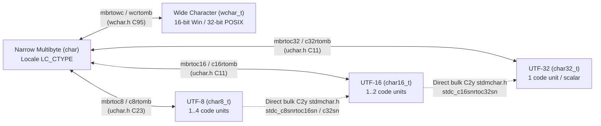
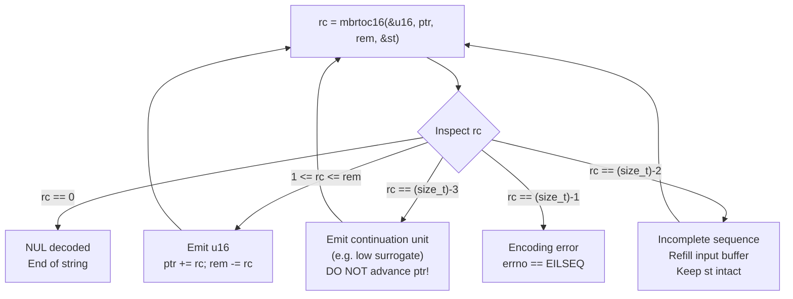

# Multibyte, Unicode & Wide Strings

Beyond single-byte ASCII strings, the C standard library provides three layers for internationalized and Unicode text: **locale-dependent multibyte strings (`char`)**, **wide strings (`wchar_t`)**, and **explicit UTF-8 / UTF-16 / UTF-32 code-unit types (`char8_t`, `char16_t`, `char32_t`)**. Looking ahead to **C2y/C29**, the new `` `<stdmchar.h>` `` header introduces direct, bounds-checked, bulk text transcoding across all five character types.

This reference mirrors [en.cppreference.com/c/string/multibyte](https://en.cppreference.com/c/string/multibyte), [en.cppreference.com/c/string/wide](https://en.cppreference.com/c/string/wide), and [en.cppreference.com/c/header/stdmchar](https://en.cppreference.com/c/header/stdmchar) through **ISO/IEC 9899:2024 (C23)** plus **C2y/C29** working-draft coverage.

---

## Headers, Encoding Architecture & Portability Warning

| Header | Standard | C23 Version Macro | Scope |
| :--- | :--- | :--- | :--- |
| `` `<stdlib.h>` `` | <span class="c-badge c89">C89</span> | `__STDC_VERSION_STDLIB_H__` (`202311L`) | Non-restartable multibyte conversions (`mblen`, `mbtowc`, `wctomb`, `mbstowcs`, `wcstombs`), `MB_CUR_MAX` |
| `` `<wchar.h>` `` | <span class="c-badge c95">C95</span> | `__STDC_VERSION_WCHAR_H__` (`202311L`) | Restartable multibyte conversions (`mbr*`, `wcr*`), wide string/memory operations, wide numeric conversions |
| `` `<wctype.h>` `` | <span class="c-badge c95">C95</span> | *(none)* | Wide character classification (`isw*`), extensible categories (`wctype`), wide case mapping (`tow*`) |
| `` `<uchar.h>` `` | <span class="c-badge c11">C11</span> | `__STDC_VERSION_UCHAR_H__` (`202311L`) | `char8_t` <span class="c-badge c23">C23</span>, `char16_t`, `char32_t`, and `mbrtoc8/16/32` / `c8/16/32rtomb` |
| `` `<inttypes.h>` `` | <span class="c-badge c99">C99</span> | `__STDC_VERSION_INTTYPES_H__` (`202311L`) | `wcstoimax`, `wcstoumax` |
| `` `<stdmchar.h>` `` | <span class="c-badge c2y">C2y</span> | `__STDC_VERSION_STDMCHAR_H__` *(draft)* | Direct single-unit & bulk streaming transcoding (`stdc_*nrto*n`, `stdc_*snrto*sn`) |



!!! warning "PORTABILITY WARNING: Why `wchar_t` Is Broken Across Platforms (Use UTF-8 Everywhere!)"
    The ISO C standard intentionally leaves the width and encoding of `wchar_t` **implementation-defined**:

    | Platform / ABI | `sizeof(wchar_t)` | Encoding | Major Consequences |
    | :--- | :---: | :--- | :--- |
    | **Windows (MSVC / MinGW)** | **2 bytes (16-bit)** | **UTF-16LE** | Cannot store Unicode supplementary characters (`U+10000`–`U+10FFFF`, e.g., emoji `🚀`, CJK Ext. B) in a single `wchar_t`! Requires surrogate pairs, breaking `iswalpha()` / `wcslen()` character-count assumptions |
    | **Linux / macOS / BSD** | **4 bytes (32-bit)** | **UTF-32** | Wastes 4× RAM/cache bandwidth for ASCII-heavy text (JSON, HTTP, SQL, source code); incompatible with Windows binary wire formats and Win32 `*W` APIs |
    | **Embedded / Legacy Unix** | 1, 2, or 4 bytes | Locale-dependent | Encoding may shift with `setlocale()` and is not guaranteed to be Unicode |

    **Industry Best Practice ("UTF-8 Everywhere"):** Store, process, serialize, and transmit all text internally as **UTF-8** (`char` or C23 `char8_t`). Convert to UTF-16 `wchar_t` **only at the OS boundary** on Windows (e.g., `MultiByteToWideChar` before calling Win32 `CreateFileW`).

---

## Core Types & Feature Macros

| Identifier | Header(s) | Standard | Exact Definition & Semantics |
| :--- | :--- | :--- | :--- |
| `mbstate_t` | `` `<wchar.h>` ``, `` `<uchar.h>` `` | <span class="c-badge c95">C95</span> | Non-array complete object type holding stateful shift/surrogate conversion state. Zero-initialization (`mbstate_t st = {};` in C23 or `= {0}`) produces the initial conversion state |
| `wchar_t` | `` `<stddef.h>` ``, `` `<stdlib.h>` ``, `` `<wchar.h>` `` | <span class="c-badge c89">C89</span> | Integer type capable of representing distinct codes for the extended execution character set |
| `wint_t` | `` `<wchar.h>` ``, `` `<wctype.h>` `` | <span class="c-badge c95">C95</span> | Integer type unchanged by default argument promotions; holds any valid `wchar_t` value **plus** `WEOF` |
| `char8_t` | `` `<uchar.h>` `` | <span class="c-badge c23">C23</span> | Typedef alias for **`unsigned char`** dedicated to UTF-8 code units. In C23, `u8"..."` literals have type `unsigned char[N]` (`char8_t[N]`) and `u8'x'` has type `unsigned char` |
| `char16_t` | `` `<uchar.h>` `` | <span class="c-badge c11">C11</span> | Typedef alias for `uint_least16_t` holding UTF-16 code units (`u"..."`, `u'x'`) |
| `char32_t` | `` `<uchar.h>` `` | <span class="c-badge c11">C11</span> | Typedef alias for `uint_least32_t` holding UTF-32 scalar values (`U"..."`, `U'x'`) |
| `MB_CUR_MAX` | `` `<stdlib.h>` `` | <span class="c-badge c89">C89</span> | Runtime positive expression (`size_t`): max bytes in a multibyte character in the **current `LC_CTYPE` locale** (`<= MB_LEN_MAX`). **Not** an integer constant expression! |
| `MB_LEN_MAX` | `` `<limits.h>` `` | <span class="c-badge c89">C89</span> | Compile-time integer constant expression (`>= 1`): max bytes in a multibyte character across **all supported locales** (use `char buf[MB_LEN_MAX]` for stack buffers!) |
| `WEOF` | `` `<wchar.h>` ``, `` `<wctype.h>` `` | <span class="c-badge c95">C95</span> | Constant expression of type `wint_t` representing end-of-file / conversion failure |
| `__STDC_UTF_16__` | *(predefined)* | <span class="c-badge c11">C11</span> | Expands to `1` if `char16_t` values are UTF-16 (**mandated `1` in C23**!) |
| `__STDC_UTF_32__` | *(predefined)* | <span class="c-badge c11">C11</span> | Expands to `1` if `char32_t` values are UTF-32 (**mandated `1` in C23**!) |
| `__STDC_ISO_10646__` | *(predefined)* | <span class="c-badge c99">C99</span> | Integer constant `yyyymmL` if `wchar_t` values match ISO/IEC 10646 (Unicode) for all locales |
| `__STDC_MB_MIGHT_NEQ_WC__` | *(predefined)* | <span class="c-badge c99">C99</span> | Expands to `1` if basic execution character encodings may differ between `char` and `wchar_t` |

!!! note "C23 `u8` Literal Type Compatibility Change"
    In C11/C17, `u8"hello"` had type `char[6]`, so `const char *p = u8"hello";` compiled cleanly. In **C23 (N2653)**, `u8"hello"` has type **`unsigned char[6]` (`char8_t[6]`)**—making `const char *p = u8"hello";` a pointer-signedness diagnostic (`unsigned char *` vs `char *`), though initializing an array `char s[] = u8"hello";` remains explicitly permitted by ISO/IEC 9899:2024 §6.7.11!

---

## Multibyte ↔ Wide Conversions: Restartable vs Non-Restartable

Always prefer the **restartable (`r`)** functions in `` `<wchar.h>` `` over the legacy non-restartable functions in `` `<stdlib.h>` ``:

- **Non-restartable** (`mblen`, `mbtowc`, `wctomb`, `mbstowcs`, `wcstombs`) maintain an **internal static shift state**, making them **non-thread-safe (data race!)**, incapable of interleaving multiple input streams, and unable to distinguish a truncated chunk boundary (`(size_t)-2`) from an invalid byte sequence (`(size_t)-1`).
- **Restartable** (`mbrlen`, `mbrtowc`, `wcrtomb`, `mbsrtowcs`, `wcsrtombs`) store shift state in a caller-owned `mbstate_t *ps` (if `ps == nullptr`, they fall back to an internal non-thread-safe state—so always pass an explicit local `mbstate_t st = {};`!).

### Complete Multibyte Conversion Reference Table

| Operation | Non-Restartable (`<stdlib.h>`) | Restartable (`<wchar.h>`) | Standard |
| :--- | :--- | :--- | :--- |
| Check initial shift state | *(none)* | `int mbsinit(const mbstate_t *ps);` | <span class="c-badge c95">C95</span> |
| Byte length of next multibyte char | `int mblen(const char *s, size_t n);` <span class="c-badge c89">C89</span> | `size_t mbrlen(const char *restrict s, size_t n, mbstate_t *restrict ps);` | <span class="c-badge c95">C95</span> |
| Single multibyte → `wchar_t` | `int mbtowc(wchar_t *restrict pwc, const char *restrict s, size_t n);` <span class="c-badge c89">C89</span> | `size_t mbrtowc(wchar_t *restrict pwc, const char *restrict s, size_t n, mbstate_t *restrict ps);` | <span class="c-badge c95">C95</span> |
| Single `wchar_t` → multibyte | `int wctomb(char *s, wchar_t wc);` <span class="c-badge c89">C89</span><br>`errno_t wctomb_s(int *restrict status, char *restrict s, rsize_t ssz, wchar_t wc);` <span class="c-badge c11">C11</span> <span class="c-badge c-optional">optional</span> | `size_t wcrtomb(char *restrict s, wchar_t wc, mbstate_t *restrict ps);`<br>`errno_t wcrtomb_s(size_t *restrict retval, char *restrict s, rsize_t ssz, wchar_t wc, mbstate_t *restrict ps);` <span class="c-badge c11">C11</span> <span class="c-badge c-optional">optional</span> | <span class="c-badge c95">C95</span> |
| Multibyte string → wide string | `size_t mbstowcs(wchar_t *restrict dst, const char *restrict src, size_t len);` <span class="c-badge c89">C89</span><br>`errno_t mbstowcs_s(size_t *restrict retval, wchar_t *restrict dst, rsize_t dstsz, const char *restrict src, rsize_t len);` <span class="c-badge c11">C11</span> <span class="c-badge c-optional">optional</span> | `size_t mbsrtowcs(wchar_t *restrict dst, const char **restrict src, size_t len, mbstate_t *restrict ps);`<br>`errno_t mbsrtowcs_s(size_t *restrict retval, wchar_t *restrict dst, rsize_t dstsz, const char **restrict src, rsize_t len, mbstate_t *restrict ps);` <span class="c-badge c11">C11</span> <span class="c-badge c-optional">optional</span> | <span class="c-badge c95">C95</span> |
| Wide string → multibyte string | `size_t wcstombs(char *restrict dst, const wchar_t *restrict src, size_t len);` <span class="c-badge c89">C89</span><br>`errno_t wcstombs_s(size_t *restrict retval, char *restrict dst, rsize_t dstsz, const wchar_t *restrict src, rsize_t len);` <span class="c-badge c11">C11</span> <span class="c-badge c-optional">optional</span> | `size_t wcsrtombs(char *restrict dst, const wchar_t **restrict src, size_t len, mbstate_t *restrict ps);`<br>`errno_t wcsrtombs_s(size_t *restrict retval, char *restrict dst, rsize_t dstsz, const wchar_t **restrict src, rsize_t len, mbstate_t *restrict ps);` <span class="c-badge c11">C11</span> <span class="c-badge c-optional">optional</span> | <span class="c-badge c95">C95</span> |
| Fast single-byte ↔ wide | *(none)* | `wint_t btowc(int c);` / `int wctob(wint_t c);` | <span class="c-badge c95">C95</span> |

**Key semantics:**

- `btowc(c)` widens a single byte `(unsigned char)c` if it constitutes a valid 1-byte character in the initial shift state; otherwise returns `WEOF`. `wctob(wc)` narrows a `wint_t` back to a single byte or returns `EOF`.
- `mbsrtowcs` / `wcsrtombs` advance `*src` past converted characters (setting `*src = nullptr` when the terminating NUL is converted!). Passing `dst == nullptr` computes the exact required output length (excluding the NUL terminator) without modifying `*src`.
- On invalid encoding, restartable functions return `(size_t)-1` and set `errno = EILSEQ`.

---

## UTF-8, UTF-16 & UTF-32 Transcoding (`` `<uchar.h>` ``)

`` `<uchar.h>` `` provides restartable functions that transcode between the active locale's narrow multibyte encoding (`const char *`) and explicit UTF-8 (**C23**), UTF-16 (**C11**), or UTF-32 (**C11**) code units.

| Function | Prototype (`<uchar.h>`) | Standard | Direction |
| :--- | :--- | :--- | :--- |
| `mbrtoc8` | `size_t mbrtoc8(char8_t *restrict pc8, const char *restrict s, size_t n, mbstate_t *restrict ps);` | <span class="c-badge c23">C23</span> | Locale multibyte `char` → UTF-8 `char8_t` |
| `c8rtomb` | `size_t c8rtomb(char *restrict s, char8_t c8, mbstate_t *restrict ps);` | <span class="c-badge c23">C23</span> | UTF-8 `char8_t` → locale multibyte `char` |
| `mbrtoc16` | `size_t mbrtoc16(char16_t *restrict pc16, const char *restrict s, size_t n, mbstate_t *restrict ps);` | <span class="c-badge c11">C11</span> | Locale multibyte `char` → UTF-16 `char16_t` |
| `c16rtomb` | `size_t c16rtomb(char *restrict s, char16_t c16, mbstate_t *restrict ps);` | <span class="c-badge c11">C11</span> | UTF-16 `char16_t` → locale multibyte `char` |
| `mbrtoc32` | `size_t mbrtoc32(char32_t *restrict pc32, const char *restrict s, size_t n, mbstate_t *restrict ps);` | <span class="c-badge c11">C11</span> | Locale multibyte `char` → UTF-32 `char32_t` |
| `c32rtomb` | `size_t c32rtomb(char *restrict s, char32_t c32, mbstate_t *restrict ps);` | <span class="c-badge c11">C11</span> | UTF-32 `char32_t` → locale multibyte `char` |

### The `mbrtoc8` / `mbrtoc16` / `mbrtoc32` Return-Value State Machine

Unlike `mbrtowc`, a single input character can produce **multiple output code units** (e.g., a UTF-8 emoji `🚀` `U+1F680` emits **two** UTF-16 surrogate code units `0xD83D` + `0xDE80` via `mbrtoc16`, or a legacy Shift-JIS character emits **three** UTF-8 bytes via `mbrtoc8`). Therefore, `mbrtocN` uses a **5-outcome state machine**:

| Return Value `rc` | Meaning | Input Consumed | Output Written (`*pcN`) | Required Caller Action |
| :--- | :--- | :---: | :---: | :--- |
| **`0`** | Decoded NUL character (`'\0'`) | 1 byte | `0` (state reset to initial) | Stop string loop (end of NTBS) |
| **`1 .. n`** | Decoded a complete character (or 1st unit of a multi-unit output) | `rc` bytes | 1 valid code unit | Emit `*pcN`; **advance `s += rc; n -= rc;`** |
| **`(size_t)-3`** | **Multi-unit continuation!** Next output unit (e.g., UTF-16 low surrogate or UTF-8 continuation byte) pulled from `ps` | **0 bytes!** | 1 valid code unit | Emit `*pcN`; **DO NOT advance `s` or decrement `n`!** Call again! |
| **`(size_t)-2`** | **Incomplete input**: all `n` bytes are a valid prefix absorbed into `ps`, but more input bytes are needed | `n` bytes | *(none)* | Read next chunk into buffer and resume with the **same `ps`** |
| **`(size_t)-1`** | **Encoding error**: malformed byte sequence | unspecified | *(none)* | `errno` is set to `EILSEQ`; abort or reset `ps` |



### How `c8rtomb` / `c16rtomb` / `c32rtomb` Handle Multi-Unit Inputs

When encoding back to narrow multibyte bytes:

- Passing a **leading code unit** that cannot yet form a complete Unicode scalar value (e.g., a UTF-16 high surrogate `0xD800–0xDBFF` to `c16rtomb`, or the first byte of a 3-byte UTF-8 sequence to `c8rtomb`) buffers it inside `ps` and **returns `0`** (zero output bytes written yet!).
- Passing the final trailing code unit completes the scalar value, writes `1 .. MB_CUR_MAX` bytes into `s` (ensure `s` has at least `MB_LEN_MAX` bytes!), and returns the number of bytes written.
- Passing `cN == 0` emits any shift-reset sequence followed by `'\0'` and resets `ps` to the initial state.
- Passing an ill-formed code unit (e.g., unpaired surrogate or invalid UTF-8 continuation) returns `(size_t)-1` and sets `errno = EILSEQ`.

!!! warning "Locale Dependency of `<uchar.h>`"
    Every `<uchar.h>` function interprets `char *` using the **current `LC_CTYPE` locale**, which starts in the minimal `"C"` (7-bit ASCII) locale at `main()`! To transcode UTF-8 `char *` strings with `<uchar.h>`, call `setlocale(LC_CTYPE, "C.UTF-8")` (or `setlocale(LC_CTYPE, "")` on UTF-8 systems) first.

---

## Null-Terminated Wide Strings (`` `<wctype.h>` ``, `` `<wchar.h>` ``, `` `<inttypes.h>` ``)

### Wide Character Classification & Extensible Categories (`` `<wctype.h>` ``)

All wide classification functions accept `wint_t wc` (any `wchar_t` value or `WEOF`) and evaluate according to the active `LC_CTYPE` locale.

| Function | Prototype (`<wctype.h>`) | Standard | Purpose |
| :--- | :--- | :--- | :--- |
| `iswalnum` | `int iswalnum(wint_t wc);` | <span class="c-badge c95">C95</span> | Alphanumeric wide character |
| `iswalpha` | `int iswalpha(wint_t wc);` | <span class="c-badge c95">C95</span> | Alphabetic wide character |
| `iswlower` | `int iswlower(wint_t wc);` | <span class="c-badge c95">C95</span> | Lowercase wide letter |
| `iswupper` | `int iswupper(wint_t wc);` | <span class="c-badge c95">C95</span> | Uppercase wide letter |
| `iswdigit` | `int iswdigit(wint_t wc);` | <span class="c-badge c95">C95</span> | Decimal digit (`L'0'`–`L'9'`) |
| `iswxdigit` | `int iswxdigit(wint_t wc);` | <span class="c-badge c95">C95</span> | Hexadecimal digit (`L'0'`–`L'9'`, `L'A'`–`L'F'`, `L'a'`–`L'f'`) |
| `iswcntrl` | `int iswcntrl(wint_t wc);` | <span class="c-badge c95">C95</span> | Control wide character |
| `iswgraph` | `int iswgraph(wint_t wc);` | <span class="c-badge c95">C95</span> | Printable wide character excluding space |
| `iswspace` | `int iswspace(wint_t wc);` | <span class="c-badge c95">C95</span> | Whitespace wide character |
| `iswblank` | `int iswblank(wint_t wc);` | <span class="c-badge c99">C99</span> | Horizontal blank wide character |
| `iswprint` | `int iswprint(wint_t wc);` | <span class="c-badge c95">C95</span> | Printable wide character (including space) |
| `iswpunct` | `int iswpunct(wint_t wc);` | <span class="c-badge c95">C95</span> | Punctuation wide character |
| `wctype` | `wctype_t wctype(const char *str);` | <span class="c-badge c95">C95</span> | Looks up a named character class (e.g., `"alpha"`, `"digit"`, or locale-specific `"jkanji"`); returns `0` if unsupported |
| `iswctype` | `int iswctype(wint_t wc, wctype_t desc);` | <span class="c-badge c95">C95</span> | Classifies `wc` using descriptor returned by `wctype()` |
| `towlower` | `wint_t towlower(wint_t wc);` | <span class="c-badge c95">C95</span> | Maps uppercase wide character to lowercase |
| `towupper` | `wint_t towupper(wint_t wc);` | <span class="c-badge c95">C95</span> | Maps lowercase wide character to uppercase |
| `wctrans` | `wctrans_t wctrans(const char *str);` | <span class="c-badge c95">C95</span> | Looks up a named mapping (`"tolower"`, `"toupper"`, or locale extensions) |
| `towctrans` | `wint_t towctrans(wint_t wc, wctrans_t desc);` | <span class="c-badge c95">C95</span> | Applies mapping descriptor from `wctrans()` to `wc` |

### Wide String Numeric Conversions (`` `<wchar.h>` ``, `` `<inttypes.h>` ``)

Wide numeric parsers follow the exact same `errno` + `endptr` validation contract as byte `strto*` functions (including C23 `0b`/`0B` binary prefix support for integer conversions!):

| Function | Header | Prototype | Standard |
| :--- | :--- | :--- | :--- |
| `wcstol` | `` `<wchar.h>` `` | `long wcstol(const wchar_t *restrict str, wchar_t **restrict str_end, int base);` | <span class="c-badge c95">C95</span> |
| `wcstoll` | `` `<wchar.h>` `` | `long long wcstoll(const wchar_t *restrict str, wchar_t **restrict str_end, int base);` | <span class="c-badge c99">C99</span> |
| `wcstoul` | `` `<wchar.h>` `` | `unsigned long wcstoul(const wchar_t *restrict str, wchar_t **restrict str_end, int base);` | <span class="c-badge c95">C95</span> |
| `wcstoull` | `` `<wchar.h>` `` | `unsigned long long wcstoull(const wchar_t *restrict str, wchar_t **restrict str_end, int base);` | <span class="c-badge c99">C99</span> |
| `wcstoimax` | `` `<inttypes.h>` `` | `intmax_t wcstoimax(const wchar_t *restrict nptr, wchar_t **restrict endptr, int base);` | <span class="c-badge c99">C99</span> |
| `wcstoumax` | `` `<inttypes.h>` `` | `uintmax_t wcstoumax(const wchar_t *restrict nptr, wchar_t **restrict endptr, int base);` | <span class="c-badge c99">C99</span> |
| `wcstof` | `` `<wchar.h>` `` | `float wcstof(const wchar_t *restrict str, wchar_t **restrict str_end);` | <span class="c-badge c99">C99</span> |
| `wcstod` | `` `<wchar.h>` `` | `double wcstod(const wchar_t *restrict str, wchar_t **restrict str_end);` | <span class="c-badge c95">C95</span> |
| `wcstold` | `` `<wchar.h>` `` | `long double wcstold(const wchar_t *restrict str, wchar_t **restrict str_end);` | <span class="c-badge c99">C99</span> |
| `wcstod32/64/128` | `` `<wchar.h>` `` | `_DecimalN wcstodN(const wchar_t *restrict str, wchar_t **restrict str_end);` | <span class="c-badge c23">C23</span> <span class="c-badge c-optional">optional</span> |

### Wide String Manipulation, Examination & Array Operations (`` `<wchar.h>` ``)

!!! danger "Element Count vs Byte Count Trap!"
    Every `size_t count` parameter in `wcs*` and `wmem*` counts **`wchar_t` elements**, **NOT bytes**! Passing `sizeof(wbuf)` instead of `sizeof(wbuf) / sizeof(wbuf[0])` overflows the destination buffer by 2× (Windows) or 4× (Linux/macOS)!

| Category | Function | Prototype (`<wchar.h>`) | Standard | Notes |
| :--- | :--- | :--- | :--- | :--- |
| **Manipulation** | `wcscpy` / `wcscpy_s` | `wchar_t *wcscpy(wchar_t *restrict dest, const wchar_t *restrict src);` | <span class="c-badge c95">C95</span> | Unbounded copy; Annex K `_s` adds `destsz` |
| **Manipulation** | `wcsncpy` / `wcsncpy_s` | `wchar_t *wcsncpy(wchar_t *restrict dest, const wchar_t *restrict src, size_t count);` | <span class="c-badge c95">C95</span> | Same NUL-termination & zero-padding trap as `strncpy`! |
| **Manipulation** | `wcscat` / `wcscat_s` | `wchar_t *wcscat(wchar_t *restrict dest, const wchar_t *restrict src);` | <span class="c-badge c95">C95</span> | Unbounded append |
| **Manipulation** | `wcsncat` / `wcsncat_s` | `wchar_t *wcsncat(wchar_t *restrict dest, const wchar_t *restrict src, size_t count);` | <span class="c-badge c95">C95</span> | Always NUL-terminates; appends up to `count` wide chars |
| **Manipulation** | `wcsxfrm` | `size_t wcsxfrm(wchar_t *restrict dest, const wchar_t *restrict src, size_t count);` | <span class="c-badge c95">C95</span> | `LC_COLLATE` sort-key transform |
| **Examination** | `wcslen` / `wcsnlen_s` | `size_t wcslen(const wchar_t *str);` | <span class="c-badge c95">C95</span> | Wide code units before `L'\0'` |
| **Examination** | `wcscmp` / `wcsncmp` | `int wcscmp(const wchar_t *lhs, const wchar_t *rhs);` | <span class="c-badge c95">C95</span> | Lexicographical comparison of `wchar_t` values |
| **Examination** | `wcscoll` | `int wcscoll(const wchar_t *lhs, const wchar_t *rhs);` | <span class="c-badge c95">C95</span> | Locale-aware `LC_COLLATE` comparison |
| **Examination** | `wcschr` | `QWchar_t *wcschr(QWchar_t *str, wchar_t ch);` | <span class="c-badge c95">C95</span> <span class="c-badge c23">C23</span> | First `ch` (incl. `L'\0'`); **C23 `QWchar_t` const-preserving!** |
| **Examination** | `wcsrchr` | `QWchar_t *wcsrchr(QWchar_t *str, wchar_t ch);` | <span class="c-badge c95">C95</span> <span class="c-badge c23">C23</span> | Last `ch` (incl. `L'\0'`); **C23 `QWchar_t` const-preserving!** |
| **Examination** | `wcsspn` / `wcscspn` | `size_t wcsspn(const wchar_t *dest, const wchar_t *src);` | <span class="c-badge c95">C95</span> | Prefix span matching / rejecting chars in `src` |
| **Examination** | `wcspbrk` | `QWchar_t *wcspbrk(QWchar_t *dest, const wchar_t *src);` | <span class="c-badge c95">C95</span> <span class="c-badge c23">C23</span> | First wide char in `dest` found in `src`; **C23 `QWchar_t`!** |
| **Examination** | `wcsstr` | `QWchar_t *wcsstr(QWchar_t *dest, const wchar_t *src);` | <span class="c-badge c95">C95</span> <span class="c-badge c23">C23</span> | Substring search; **C23 `QWchar_t` const-preserving!** |
| **Examination** | `wcstok` / `wcstok_s` | `wchar_t *wcstok(wchar_t *restrict str, const wchar_t *restrict delim, wchar_t **restrict ptr);` | <span class="c-badge c95">C95</span> | **Always reentrant** (takes `ptr` state since C95, unlike `strtok`!) |
| **Wide Array** | `wmemcpy` / `wmemcpy_s` | `wchar_t *wmemcpy(wchar_t *restrict dest, const wchar_t *restrict src, size_t count);` | <span class="c-badge c95">C95</span> | Non-overlapping copy of `count` `wchar_t`s |
| **Wide Array** | `wmemmove` / `wmemmove_s` | `wchar_t *wmemmove(wchar_t *dest, const wchar_t *src, size_t count);` | <span class="c-badge c95">C95</span> | Overlap-safe copy of `count` `wchar_t`s |
| **Wide Array** | `wmemcmp` | `int wmemcmp(const wchar_t *lhs, const wchar_t *rhs, size_t count);` | <span class="c-badge c95">C95</span> | Compares `count` `wchar_t` elements |
| **Wide Array** | `wmemchr` | `QWchar_t *wmemchr(QWchar_t *ptr, wchar_t ch, size_t count);` | <span class="c-badge c95">C95</span> <span class="c-badge c23">C23</span> | Searches `count` `wchar_t`s; **C23 `QWchar_t` const-preserving!** |
| **Wide Array** | `wmemset` | `wchar_t *wmemset(wchar_t *dest, wchar_t ch, size_t count);` | <span class="c-badge c95">C95</span> | Fills `count` `wchar_t` elements with `ch` |

### C23 `QWchar_t` Const-Preservation <span class="c-badge c23">C23</span>

Mirroring `QChar` (`strchr`) and `QVoid` (`memchr`), ISO/IEC 9899:2024 (§7.31.4.5) turns **`wcschr`**, **`wcsrchr`**, **`wcspbrk`**, **`wcsstr`**, and **`wmemchr`** into qualifier-preserving generic functions: passing `const wchar_t *` returns `const wchar_t *`, and passing `wchar_t *` returns `wchar_t *`.

---

## Upcoming C2y / C29 Preview: `` `<stdmchar.h>` `` Text Transcoding Utilities <span class="c-badge c2y">C2y</span>

!!! info "Working-Draft Preview (WG14 N3366 / `en.cppreference.com/c/header/stdmchar`)"
    `` `<stdmchar.h>` `` (*Restartable Functions for Efficient Character Conversions*, originally WG14 paper **N3366**) is a post-C23 (**C2y / C29**) standardization effort designed to supersede the design flaws of `<wchar.h>` and `<uchar.h>`. Check `__STDC_VERSION_STDMCHAR_H__` before using it in portable code; exact details remain subject to WG14 working-draft refinement until final publication.

### Why `` `<stdmchar.h>` `` Replaces `<uchar.h>` Loops

Legacy `<uchar.h>` has three fundamental architectural limitations:

1. **Forced locale detour**: You cannot transcode UTF-8 (`char8_t`) directly to UTF-16 (`char16_t`) or UTF-32 (`char32_t`) without bouncing through the locale-dependent `char` encoding—which corrupts non-ASCII text whenever the process is in the `"C"` or non-UTF-8 locale!
2. **Code-unit-at-a-time overhead**: Calling `mbrtoc16` once per output code unit prevents SIMD vectorization (AVX2/AVX-512/NEON UTF-8 ↔ UTF-16 transcoding runs 10–30× faster on bulk buffers).
3. **Magic `size_t` sentinels & `errno`**: Overloading `(size_t)-1`, `(size_t)-2`, `(size_t)-3` alongside global `errno` is error-prone and hostile to streaming buffers.

### Status Enumeration: `enum stdc_mcerr` <span class="c-badge c2y">C2y</span>

Every `<stdmchar.h>` transcoding function returns a typed status code (`stdc_mcerr`) instead of magic negative `size_t` sentinels or `errno`:

| Enumerator | Value | Meaning & Streaming Recovery |
| :--- | :---: | :--- |
| `stdc_mcerr_ok` | `0` | Conversion succeeded cleanly (all requested input processed or unit emitted) |
| `stdc_mcerr_invalid` | non-zero | Ill-formed input sequence encountered (e.g., overlong UTF-8, lone surrogate, invalid byte) |
| `stdc_mcerr_incomplete_input` | non-zero | Input buffer ended mid-sequence; preserve `mbstate_t`, refill input buffer, and resume |
| `stdc_mcerr_insufficient_output` | non-zero | Destination buffer ran out of space; flush/grow output buffer and resume from updated pointers |

### Buffer-Sizing & Encoding Macros <span class="c-badge c2y">C2y</span>

| Macro | Category | Purpose |
| :--- | :--- | :--- |
| `STDC_MC_MAX` | Output bound | Compile-time max `char` code units emitted by a single conversion step |
| `STDC_MWC_MAX` | Output bound | Compile-time max `wchar_t` code units emitted by a single conversion step |
| `STDC_C8_MAX` | Output bound | Compile-time max `char8_t` code units emitted by a single conversion step |
| `STDC_C16_MAX` | Output bound | Compile-time max `char16_t` code units emitted by a single conversion step |
| `STDC_C32_MAX` | Output bound | Compile-time max `char32_t` code units emitted by a single conversion step |
| `MB_UTF8` | Encoding query | Non-zero if execution narrow multibyte encoding is UTF-8 |
| `MB_UTF16` | Encoding query | Non-zero if execution encoding matches UTF-16 |
| `MB_UTF32` | Encoding query | Non-zero if execution encoding matches UTF-32 |

### Systematic Function Families: `stdc_*nrto*n` & `stdc_*snrto*sn` <span class="c-badge c2y">C2y</span>

`` `<stdmchar.h>` `` defines a complete orthogonal matrix of conversion functions across all 5 character encodings:

| Token | Character Type | Encoding |
| :--- | :--- | :--- |
| `mc` | `char` | Narrow execution multibyte (`LC_CTYPE`) |
| `mwc` | `wchar_t` | Wide execution character set (`LC_CTYPE`) |
| `c8` | `char8_t` | UTF-8 (locale-independent!) |
| `c16` | `char16_t` | UTF-16 (locale-independent!) |
| `c32` | `char32_t` | UTF-32 (locale-independent!) |

**Decoding the naming grammar:**

- **`stdc_<src>nrto<dst>n`** — **Single logical character/unit step**, explicitly bounded (`n`), restartable (`r` via `mbstate_t *`). Example: `stdc_mcnrtomwcn`, `stdc_c8nrtoc16n`, `stdc_c8nrtoc32n`, `stdc_c16nrtoc8n`, `stdc_c32nrtoc8n`.
- **`stdc_<src>snrto<dst>sn`** — **Bulk string / buffer sequence** (`s`), explicitly bounded (`n`), restartable (`r` via `mbstate_t *`). Enables SIMD-accelerated full-buffer transcoding in a single call! Example: `stdc_mcsnrtomwcsn`, `stdc_c8snrtoc16sn`, `stdc_c8snrtoc32sn`, `stdc_c16snrtoc8sn`, `stdc_c32snrtoc8sn`, `stdc_mcsnrtoc8sn`, `stdc_c8snrtomcsn`.
- *(Non-`r` convenience forms without an explicit `mbstate_t *` exist alongside restartable `r` forms; always prefer the `r` variants in library and concurrent code.)*

**Canonical prototype pattern (`<stdmchar.h>`):**

```c
/* Example: Bulk UTF-8 (char8_t) -> UTF-16 (char16_t) streaming transcode */
stdc_mcerr stdc_c8snrtoc16sn(
    size_t *restrict p_output_size,          /* [in/out] remaining output slots  */
    char16_t *restrict *restrict p_output,   /* [in/out] output write cursor     */
    size_t *restrict p_input_size,           /* [in/out] remaining input units   */
    const char8_t *restrict *restrict p_input, /* [in/out] input read cursor     */
    mbstate_t *restrict p_state              /* [in/out] restartable shift state */
);
```

**Why this pointer-and-remaining-count design is superior:**

1. Passing `p_output == nullptr` (or `*p_output == nullptr`) **measures** the exact required output size cleanly without allocating!
2. On `stdc_mcerr_insufficient_output`, `*p_input` and `*p_input_size` point **precisely** to the unconverted remainder, so chunked streaming loops simply flush the output buffer, reset `out_ptr`/`out_rem`, and call again!
3. UTF-to-UTF pairs (`c8 ↔ c16 ↔ c32`) are **100% locale-independent**—they never consult `LC_CTYPE`.

```c
/* Illustrative C2y <stdmchar.h> chunked UTF-8 -> UTF-16 streaming loop */
#if defined(__STDC_VERSION_STDMCHAR_H__)
#include <stdmchar.h>

stdc_mcerr transcode_utf8_to_utf16_chunks(
    const char8_t *src, size_t src_len,
    void (*emit_chunk)(const char16_t *buf, size_t count)
) {
    char16_t chunk[256];
    mbstate_t state = {};

    while (src_len > 0) {
        char16_t *out_ptr = chunk;
        size_t out_rem = sizeof chunk / sizeof chunk[0];

        stdc_mcerr err = stdc_c8snrtoc16sn(
            &out_rem, &out_ptr, &src_len, &src, &state
        );
        size_t produced = (size_t)(out_ptr - chunk);
        if (produced > 0) {
            emit_chunk(chunk, produced);
        }
        if (err == stdc_mcerr_insufficient_output) {
            continue; /* Output buffer drained; resume from updated src/src_len */
        }
        return err; /* ok, invalid, or incomplete_input */
    }
    return stdc_mcerr_ok;
}
#endif
```

---

## Complete Compilable C23 Lab: UTF-8 ↔ UTF-16 / UTF-32 Streaming Transcoder (`<uchar.h>`)

This self-contained, warning-free C23 program decodes a multi-script UTF-8 byte sequence (`A`, Greek `λ` `U+03BB`, CJK `日` `U+65E5`, and supplementary emoji `🚀` `U+1F680`) into UTF-32 and UTF-16 (explicitly demonstrating the `(size_t)-3` surrogate-pair continuation state!), round-trips UTF-16 back to UTF-8 via `c16rtomb`, and verifies C23 `QWchar_t` const-preservation on `wcschr`.

```c
/*
 * Compile (GCC 14+ / Clang 18+ with UTF-8 locale support):
 *   gcc -std=c23 -Wall -Wextra -Wpedantic -O2 -fsanitize=address,undefined \
 *       unicode_lab.c -o unicode_lab && ./unicode_lab
 */
#include <errno.h>
#include <inttypes.h>
#include <limits.h>
#include <locale.h>
#include <stdint.h>
#include <stdio.h>
#include <stdlib.h>
#include <string.h>
#include <uchar.h>
#include <wchar.h>
#include <wctype.h>

static bool activate_utf8_locale(void) {
    if (setlocale(LC_CTYPE, "C.UTF-8") != nullptr) {
        return true;
    }
    if (setlocale(LC_CTYPE, "en_US.UTF-8") != nullptr) {
        return true;
    }
    return setlocale(LC_CTYPE, "") != nullptr;
}

static bool decode_to_utf32(const char *utf8, size_t byte_len) {
    mbstate_t state = {};
    const char *ptr = utf8;
    size_t rem = byte_len;

    printf("--- UTF-8 -> UTF-32 (mbrtoc32) ---\n");
    while (rem > 0) {
        char32_t cp = 0;
        size_t rc = mbrtoc32(&cp, ptr, rem, &state);
        if (rc == 0) {
            break; /* NUL terminator */
        }
        if (rc == (size_t)-1) {
            fprintf(stderr, "mbrtoc32 encoding error (errno=%d)\n", errno);
            return false;
        }
        if (rc == (size_t)-2) {
            fprintf(stderr, "mbrtoc32 truncated UTF-8 tail\n");
            return false;
        }
        if (rc == (size_t)-3) {
            printf("  [continuation] U+%04" PRIX32 "\n", (uint32_t)cp);
            continue; /* Do NOT advance ptr */
        }
        printf("  consumed %zu byte(s) -> U+%04" PRIX32 "\n", rc, (uint32_t)cp);
        ptr += rc;
        rem -= rc;
    }
    return true;
}

static bool roundtrip_utf16(const char *utf8, size_t byte_len) {
    char16_t u16_buf[64];
    size_t u16_count = 0;

    mbstate_t dec_state = {};
    const char *ptr = utf8;
    size_t rem = byte_len;

    printf("\n--- UTF-8 -> UTF-16 (mbrtoc16, handling surrogate -3 state) ---\n");
    while (rem > 0) {
        char16_t unit = 0;
        size_t rc = mbrtoc16(&unit, ptr, rem, &dec_state);
        if (rc == 0) {
            break;
        }
        if (rc == (size_t)-1 || rc == (size_t)-2) {
            fprintf(stderr, "mbrtoc16 failed (rc=%zu, errno=%d)\n", rc, errno);
            return false;
        }
        if (u16_count >= (sizeof u16_buf / sizeof u16_buf[0])) {
            fprintf(stderr, "UTF-16 buffer overflow prevented\n");
            return false;
        }
        u16_buf[u16_count++] = unit;

        if (rc == (size_t)-3) {
            /* Second half of surrogate pair: ZERO input bytes consumed! */
            printf("  [rc == -3 low surrogate]  0x%04" PRIX16 "\n", (uint16_t)unit);
            continue;
        }
        printf("  [consumed %zu byte(s)]      0x%04" PRIX16 "\n", rc, (uint16_t)unit);
        ptr += rc;
        rem -= rc;
    }

    printf("\n--- UTF-16 -> UTF-8 Round-Trip (c16rtomb) ---\n");
    char out_utf8[128];
    size_t out_len = 0;
    mbstate_t enc_state = {};

    for (size_t i = 0; i < u16_count; ++i) {
        char step[MB_LEN_MAX];
        size_t written = c16rtomb(step, u16_buf[i], &enc_state);
        if (written == (size_t)-1) {
            fprintf(stderr, "c16rtomb failed at unit %zu (errno=%d)\n", i, errno);
            return false;
        }
        if (written == 0) {
            /* High surrogate buffered inside enc_state; await low surrogate */
            continue;
        }
        if (out_len + written >= sizeof out_utf8) {
            fprintf(stderr, "UTF-8 output buffer full\n");
            return false;
        }
        memcpy(out_utf8 + out_len, step, written);
        out_len += written;
    }
    out_utf8[out_len] = '\0';

    bool exact_match = (out_len == byte_len && memcmp(out_utf8, utf8, byte_len) == 0);
    printf("  Round-trip exact byte match: %s (%zu bytes)\n",
           exact_match ? "YES" : "NO", out_len);
    return exact_match;
}

static void demo_c23_qwchar(void) {
    printf("\n--- C23 QWchar_t Const-Preserving Wide Search ---\n");
    const wchar_t *ro_wide = L"key=value";
    /* C23 QWchar_t: passing const wchar_t * returns const wchar_t * */
    const wchar_t *sep = wcschr(ro_wide, L'=');
    if (sep != nullptr) {
        printf("  Found separator at wide offset %td (iswalpha(next)=%d)\n",
               sep - ro_wide, iswalpha((wint_t)sep[1]) != 0);
    }
}

int main(void) {
    if (!activate_utf8_locale()) {
        fprintf(stderr, "Warning: could not activate a UTF-8 locale\n");
    }

    /*
     * Explicit UTF-8 byte sequence (independent of compiler source charset):
     *   'A' (U+0041) | ' ' | λ (U+03BB) | ' ' | 日 (U+65E5) | ' ' | 🚀 (U+1F680)
     */
    const char sample_utf8[] = "A \xCE\xBB \xE6\x97\xA5 \xF0\x9F\x9A\x80";
    size_t sample_len = sizeof sample_utf8 - 1;

    if (!decode_to_utf32(sample_utf8, sample_len)) {
        return EXIT_FAILURE;
    }
    if (!roundtrip_utf16(sample_utf8, sample_len)) {
        return EXIT_FAILURE;
    }
    demo_c23_qwchar();
    return EXIT_SUCCESS;
}
```

---

## Related Documentation & Authoritative References

### Internal Cross-References

- [Byte Strings & Character Utilities (`<ctype.h>`, `<string.h>`)](strings-byte.md)
- [Localization Support (`<locale.h>`)](locale.md)
- [Input/Output Support (`<stdio.h>`)](io.md)
- [Curriculum Module 25: Unicode, Locales & Complex Math](../../curriculum/tier-5-expert/25-unicode-locale-complex-math.md)
- [C23 Migration & Breaking Changes](../../standards/c23-migration.md)

### External Standards & Specifications

- **cppreference — Null-Terminated Multibyte Strings**: [https://en.cppreference.com/c/string/multibyte](https://en.cppreference.com/c/string/multibyte)
- **cppreference — Null-Terminated Wide Strings**: [https://en.cppreference.com/c/string/wide](https://en.cppreference.com/c/string/wide)
- **cppreference — `<stdmchar.h>` (C2y/C29)**: [https://en.cppreference.com/c/header/stdmchar](https://en.cppreference.com/c/header/stdmchar)
- **ISO/IEC 9899:2024 (C23)**: Clause 7.24.7–8 (`<stdlib.h>` multibyte), Clause 7.30 (`<uchar.h>`), Clause 7.31 (`<wchar.h>`), Clause 7.32 (`<wctype.h>`)
- **WG14 N3366**: *Restartable Functions for Efficient Character Conversions (`<stdmchar.h>`)* — [https://www.open-std.org/jtc1/sc22/wg14/www/docs/n3366.htm](https://www.open-std.org/jtc1/sc22/wg14/www/docs/n3366.htm)
