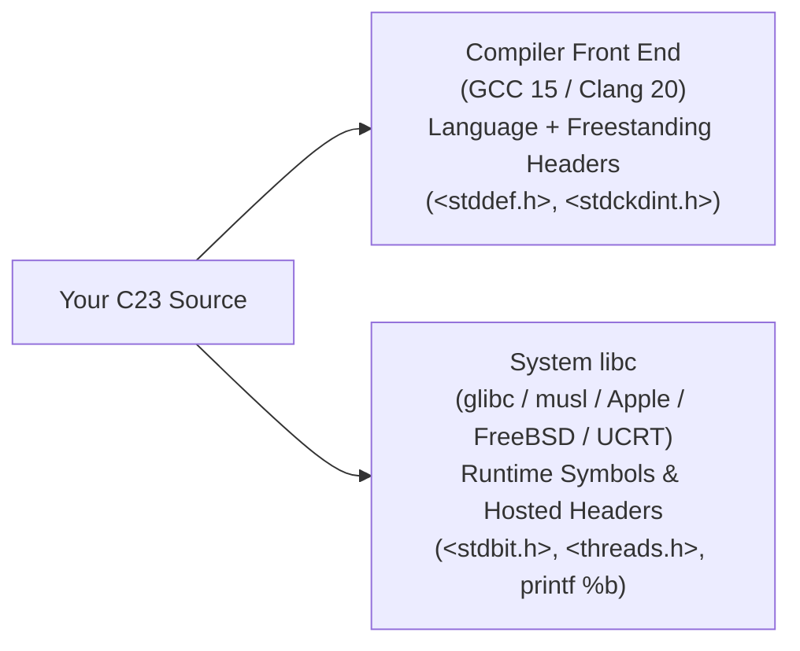

# C23 Compiler & Standard Library Support Matrix <span class="c-badge c23">C23</span>

In C, language conformance is split cleanly between the **compiler front end** (keywords, type system, attributes, preprocessor, freestanding headers) and the **C standard library (`libc`)** (runtime functions, formatting specifiers, threading, and hosted headers). A project compiling with GCC 15 or Clang 21 on an older OS libc can enjoy full C23 *language* features while still needing feature checks for newer *library* functions like `memset_explicit` or `free_sized`.

This page mirrors [cppreference.com — C23 Compiler Support](https://en.cppreference.com/w/c/compiler_support/23) and tracks real-world 2026 toolchain milestones.

---

## 1. Compiler Toolchain Quick Summary (2026)

| Compiler | C23 Flag | Default C Standard | C23 Language Maturity | Notes |
| :--- | :--- | :--- | :--- | :--- |
| **GCC** (13–15) | `-std=c23` / `-std=gnu23` | **GCC 15: `-std=gnu23`** *(GCC 14: `-std=gnu17`)* | **Complete** (GCC 15) | First major compiler to complete full C23 core language including `#embed`, `_BitInt`, `constexpr`, `[[unsequenced]]`/`[[reproducible]]`, and decimal FP (on supported targets). |
| **Clang** (16–21) | `-std=c23` / `-std=gnu23` | `-std=gnu17` | **Near-complete** (Clang 19–21) | `#embed` & `constexpr` in Clang 19; enhanced enums in Clang 20; `[[unsequenced]]`/`[[reproducible]]` and compound literal storage classes maturing in Clang 21+. |
| **Apple Clang** (15–17) | `-std=c23` / `-std=gnu23` | `-std=gnu17` | **High** (tracks upstream LLVM Clang ~1–2 versions behind) | Apple Clang 16 ≈ Clang 17; Apple Clang 17 ≈ Clang 19 (`#embed`, `constexpr`). Note: Apple SDK libc omits `<threads.h>` and `<uchar.h>`. |
| **MSVC** (`cl.exe`) | `/std:clatest` | Legacy C89 (`/std:c17` opt-in) | **Partial / Experimental** | Production support covers C11/C17 (`/std:c11`, `/std:c17`). `/std:clatest` adds selected C23 features (`typeof`, `#elifdef`, `__VA_OPT__` with `/Zc:preprocessor`, binary literals). |
| **EDG `eccp`** (6.5–6.6+) | `--c23` | Configurable | **Very High** | Reference front end used by commercial compilers (Intel, NVIDIA, Green Hills, TI); implements nearly the entire C23 core language. |

---

## 2. Core C23 Language Feature Support Matrix

Version numbers indicate the **minimum release** implementing the standard C23 semantics under `-std=c23` (or `-std=c2x` on earlier releases). A dash (`—`) indicates unimplemented or not yet shipping in stable releases.

| C23 Language Feature | WG14 Paper | GCC | Clang | Apple Clang | MSVC | EDG `eccp` |
| :--- | :--- | :--- | :--- | :--- | :--- | :--- |
| `static_assert` without message string | `N2265` | 9 | 9 | 11 | 19.39* | 6.5 |
| `[[nodiscard]]` & `[[nodiscard("reason")]]` | `N2267`, `N2448` | 10 | 9 / 10 | 11 / 12 | — | 6.5 |
| `[[maybe_unused]]` (incl. labels) | `N2270`, `N2662` | 10 / 11 | 9 / 16 | 11 / 15 | — | 6.5 |
| `[[deprecated]]` & `[[deprecated("reason")]]` | `N2334` | 10 | 9 | 11 | — | 6.5 |
| `[[fallthrough]]` | `N2408` | 10 | 9 | 11 | — | 6.5 |
| `[[noreturn]]` | `N2764` | 13 | 15 | 15 | — | 6.5 |
| `[[unsequenced]]` & `[[reproducible]]` | `N2956` | 15 | 21* (partial) | — | — | — |
| `u8` character constants & UTF-8 `unsigned char` literals | `N2418`, `N2653` | 13 | 15 | 15 | — | 6.5 |
| Remove K&R definitions & empty `()` means `(void)` | `N2432`, `N2841` | 13 | 15 | 15 | — | 6.5 |
| Unnamed parameters in function definitions | `N2480` | 11 | 11 | 12.5 | — | 6.5 |
| Labels before declarations & before closing `}` | `N2508` | 11 | 16 | 15 | — | 6.5 |
| Binary integer constants (`0b` / `0B`) | `N2549` | 11 *(ext 4.3)* | 9 *(ext 2.9)* | 11 | 19.39* | 6.5 |
| Digit separators (`'`) | `N2626` | 12 | 13 | 13.1 | — | 6.5 |
| `#elifdef` and `#elifndef` | `N2645` | 12 | 13 | 13.1 | 19.40* | 6.5 |
| `#warning` preprocessor directive | `N2686` | 13 *(ext 1.0)* | 16 *(ext 2.9)* | 15 | — | 6.5 |
| Bit-precise integers `_BitInt(N)` & `wb`/`uwb` suffixes | `N2763`, `N2775` | 14 | 15 / 16 | 15 | — | 6.5 |
| `__has_include` preprocessor operator | `N2799` | 10 *(ext 5)* | 10 *(ext 2.9)* | 12 | 19.28 | 6.5 |
| UAX #31 Unicode identifiers | `N2836` | 13 | 15 | 15 | — | 6.5 |
| Empty initializer `{}` (incl. VLAs) | `N2900` | 13 / 14 | 17 / 18 | 16 | — | 6.5 |
| `typeof` and `typeof_unqual` | `N2927`, `N2930` | 13 | 16 | 15 | 19.39* | 6.5 |
| Core keywords (`bool`, `true`, `false`, `alignas`, `alignof`, `static_assert`, `thread_local`) | `N2934`, `N2935` | 13 | 15 | 15 | partial* | 6.5 |
| Relaxed variadic parameter lists (`f(...)`, single-arg `va_start`) | `N2975` | 13 | 16 | 15 | — | 6.5 |
| Type inference for object definitions (`auto`) | `N3007` | 13 | 18 | 16 | — | 6.5 |
| `#embed` binary resource inclusion & `__has_embed` | `N3017` | 15 | 19 | 17 | — | 6.6 |
| `constexpr` for object definitions | `N3018` | 13 | 19 | 17 | — | 6.5 |
| Improved normal enums & fixed underlying type `enum : T` | `N3029`, `N3030` | 13 | 20 | 17+ | partial* | 6.5 |
| `__VA_OPT__` variadic macro helper | `N3033` | 12 | 12 | 13 | 19.39* (`/Zc:preprocessor`) | 6.5 |
| Improved `struct`/`union`/`enum` tag compatibility | `N3037` | 14 | 19 | 17 | — | 6.6 |
| Storage-class specifiers on compound literals | `N3038` | 13 | — *(in progress)* | — | — | 6.5 |
| `nullptr` constant and `nullptr_t` | `N3042` | 13 | 16 | 15 | — | 6.5 |
| IEEE 754-2019 Decimal FP (`_Decimal32`/`64`/`128`) <span class="c-badge c-optional">optional</span> | `N2412` | 12+ *(arch-dep)* | — | — | — | — |

*\* Asterisk notes: MSVC entries marked with `*` require `/std:clatest` (and `/Zc:preprocessor` for conforming preprocessor features). GCC `_BitInt(N)` support arrived in GCC 14 on x86-64, AArch64, ARM, and RISC-V and expanded across remaining targets in GCC 15.*

---

## 3. C Standard Library (`libc`) Implementation Matrix

Many C23 library headers are **compiler-provided freestanding headers** (`<stddef.h>`, `<stdckdint.h>`, `<float.h>`, `<limits.h>`), whereas runtime library APIs depend on the platform **C runtime (`libc`)**.



| Library Feature / Header | glibc (Linux) | musl (Linux) | Apple libc (macOS / iOS) | FreeBSD libc | MSVC UCRT (Windows) |
| :--- | :--- | :--- | :--- | :--- | :--- |
| **`<stdckdint.h>`** (`ckd_add`/`sub`/`mul`) | **Yes** (glibc 2.40+ & GCC 14 / Clang 18 compiler header) | **Yes** (via GCC 14 / Clang 18 compiler header) | **Yes** (via Xcode 16+ / Clang 18+ compiler header) | **Yes** (FreeBSD 14.1+ & compiler header) | **Partial** (via Clang-cl 18+; native MSVC pending) |
| **`<stdbit.h>`** (14 bit utilities + endian macros) | **Yes** (glibc 2.39+) | **Pending** *(not in musl 1.2.5)* | **Pending** *(check `__has_include`)* | **Yes** (FreeBSD 14.1+) | **Pending** |
| **`<threads.h>`** <span class="c-badge c-optional">optional</span> | **Yes** (glibc 2.28+) | **Yes** (musl 1.1.5+) | **No** (`__STDC_NO_THREADS__`) | **Yes** (FreeBSD 10+) | **Yes** (VS 2022 17.8+ / UCRT) |
| **`<uchar.h>`** (`char16_t`/`32_t`/`char8_t`) | **Yes** (2.16+; `char8_t` 2.36+) | **Yes** (`char16_t`/`32_t`; `char8_t` pending) | **No** *(not shipped in macOS SDK)* | **Yes** (13+; `char8_t` 14+) | **Partial** (`char16_t`/`32_t` yes; `char8_t` pending) |
| **`memset_explicit`** | **Yes** (glibc 2.40+) | **Pending** *(use `explicit_bzero`)* | **Pending** *(use `memset_s`)* | **Yes** (FreeBSD 14.0+) | **No** *(use `SecureZeroMemory`)* |
| **`strdup` / `strndup`** | **Yes** (C23 & POSIX) | **Yes** (POSIX) | **Yes** (POSIX) | **Yes** (POSIX) | **No** *(only `_strdup`; no `strndup`)* |
| **`memccpy`** | **Yes** | **Yes** | **Yes** | **Yes** | **Partial** (`_memccpy`) |
| **`gmtime_r` / `localtime_r`** | **Yes** | **Yes** | **Yes** | **Yes** | **No** *(uses arg-swapped `gmtime_s`/`localtime_s`)* |
| **`timegm`** | **Yes** | **Yes** | **Yes** | **Yes** | **No** *(uses `_mkgmtime`)* |
| **`timespec_getres`** | **Yes** (glibc 2.34+) | **Pending** | **Pending** | **Yes** (FreeBSD 14.0+) | **Yes** (UCRT) |
| **`free_sized` / `free_aligned_sized`** | **Staged / Pending** *(malloc interposition ABI concerns)* | **Pending** | **Pending** | **Yes** (FreeBSD 14.1+/15 via jemalloc) | **Pending** |
| **`unreachable()`** (`<stddef.h>`) | **Yes** (GCC 13 / Clang 17 compiler `<stddef.h>`) | **Yes** (compiler `<stddef.h>`) | **Yes** (Xcode 16+ compiler `<stddef.h>`) | **Yes** (compiler `<stddef.h>`) | **Partial** (Clang-cl; MSVC `__assume(0)`) |
| **`printf` `%b` / `%B` (binary)** | **Yes** (glibc 2.35+) | **Pending** | **Yes** (macOS 15+ SDK) | **Yes** (FreeBSD 14.0+) | **Pending** |
| **`strfromd` / `strfromf` / `strfroml`** | **Yes** (glibc 2.25+) | **Pending** | **Pending** | **Pending** | **Pending** |
| **`QChar` / `QVoid` const-preserving search** | **Yes** (glibc 2.43+ / GCC 15+ headers) | **Pending** | **Pending** | **In progress** | **Pending** |

!!! warning "macOS / Apple libc Gotchas for Portable C23"
    Even with the latest Xcode toolchain, Apple's macOS SDK deliberately omits `<threads.h>` (defining `__STDC_NO_THREADS__`) and `<uchar.h>`. Portable cross-platform libraries targeting Linux, macOS, and Windows should guard both headers with `__has_include` and fall back to `<pthread.h>` or `<windows.h>` where needed.

---

## 4. Portable `#if` Feature-Detection Cookbook

Never hardcode compiler version guesses (`#if __GNUC__ >= 14`) when standard C23 feature-test primitives exist. Combine `__STDC_VERSION__`, `__has_include`, `__has_c_attribute`, optional-feature macros, and per-header `__STDC_VERSION_*_H__` macros into a single project compatibility header (`c23_compat.h`).

```c
/* c23_compat.h — Portable C11/C17/C23 feature detection & fallbacks */
#ifndef PROJECT_C23_COMPAT_H
#define PROJECT_C23_COMPAT_H

#if defined(__APPLE__) && !defined(__STDC_WANT_LIB_EXT1__)
    #define __STDC_WANT_LIB_EXT1__ 1
#endif

#include <stddef.h>
#include <stdint.h>
#include <string.h>

/* 1. Standard C23 baseline detection */
#if defined(__STDC_VERSION__) && __STDC_VERSION__ >= 202311L
    #define HAS_C23 1
#else
    #define HAS_C23 0
    #include <stdbool.h>
    #include <stdalign.h>
    #ifndef nullptr
        #define nullptr ((void *)0)
    #endif
#endif

/* 2. Standard C23 attribute detection via __has_c_attribute */
#if defined(__has_c_attribute)
    #if __has_c_attribute(nodiscard)
        #define ATTR_NODISCARD [[nodiscard]]
    #endif
    #if __has_c_attribute(maybe_unused)
        #define ATTR_MAYBE_UNUSED [[maybe_unused]]
    #endif
    #if __has_c_attribute(unsequenced)
        #define ATTR_UNSEQUENCED [[unsequenced]]
    #endif
#endif

#ifndef ATTR_NODISCARD
    #if defined(__GNUC__) || defined(__clang__)
        #define ATTR_NODISCARD __attribute__((warn_unused_result))
    #elif defined(_MSC_VER)
        #define ATTR_NODISCARD _Check_return_
    #else
        #define ATTR_NODISCARD
    #endif
#endif

#ifndef ATTR_MAYBE_UNUSED
    #if defined(__GNUC__) || defined(__clang__)
        #define ATTR_MAYBE_UNUSED __attribute__((unused))
    #else
        #define ATTR_MAYBE_UNUSED
    #endif
#endif

#ifndef ATTR_UNSEQUENCED
    #if defined(__GNUC__) || defined(__clang__)
        #define ATTR_UNSEQUENCED __attribute__((const))
    #else
        #define ATTR_UNSEQUENCED
    #endif
#endif

/* 3. Optional header detection via __has_include */
#if defined(__has_include)
    #if __has_include(<stdckdint.h>)
        #include <stdckdint.h>
        #define HAS_STDCKDINT 1
    #endif
    #if __has_include(<stdbit.h>)
        #include <stdbit.h>
        #define HAS_STDBIT 1
    #endif
    #if !defined(__STDC_NO_THREADS__) && __has_include(<threads.h>)
        #define HAS_C11_THREADS 1
    #endif
    #if !defined(__STDC_NO_ATOMICS__) && __has_include(<stdatomic.h>)
        #define HAS_C11_ATOMICS 1
    #endif
#endif

/* 4. Portable unreachable() shim */
#ifndef unreachable
    #if defined(__GNUC__) || defined(__clang__)
        #define unreachable() __builtin_unreachable()
    #elif defined(_MSC_VER)
        #define unreachable() __assume(0)
    #else
        #include <stdlib.h>
        #define unreachable() abort()
    #endif
#endif

/* 5. Portable memset_explicit() shim */
#if defined(__STDC_VERSION_STRING_H__) && __STDC_VERSION_STRING_H__ >= 202311L
    #define secure_zero(ptr, len) memset_explicit((ptr), 0, (len))
#elif defined(_WIN32)
    #include <windows.h>
    #define secure_zero(ptr, len) SecureZeroMemory((ptr), (len))
#elif defined(__APPLE__) && defined(__STDC_LIB_EXT1__)
    #define secure_zero(ptr, len) ((void)memset_s((ptr), (len), 0, (len)))
#elif defined(__GLIBC__) || defined(__FreeBSD__) || defined(__OpenBSD__)
    #include <strings.h>
    #define secure_zero(ptr, len) explicit_bzero((ptr), (len))
#else
    static inline void secure_zero(void *ptr, size_t len) {
        volatile unsigned char *p = (volatile unsigned char *)ptr;
        while (len--) {
            *p++ = 0;
        }
    }
#endif

#endif /* PROJECT_C23_COMPAT_H */
```

### Verifying Compiler Feature Detection at Compile Time

```c
/* Compile with: cc -std=c23 -Wall -Wextra feature_probe.c -o feature_probe */
#include "c23_compat.h"
#include <stdio.h>

ATTR_NODISCARD ATTR_UNSEQUENCED
static int safe_double(int x) {
#ifdef HAS_STDCKDINT
    int out = 0;
    if (ckd_mul(&out, x, 2)) {
        return 0;
    }
    return out;
#else
    return x * 2;
#endif
}

int main(void) {
    unsigned char key[16] = { 0x42 };
    int doubled = safe_double(21);
    printf("HAS_C23=%d | doubled=%d\n", HAS_C23, doubled);

#ifdef HAS_STDBIT
    printf("<stdbit.h> popcount(0xF0u) = %u\n", stdc_count_ones(0xF0u));
#else
    printf("<stdbit.h> not available on this libc\n");
#endif

    secure_zero(key, sizeof key);
    return 0;
}
```

---

## Related References

- [ISO C Standards History & Evolution](index.md)
- [C23 Migration & Breaking Changes Guide](c23-migration.md)
- [Technical Specifications & Reports (TS / TR)](technical-specifications.md)
- [Preprocessor & `#embed`](../reference/language/preprocessor.md) · [Attributes (C23)](../reference/language/attributes.md)
- [cppreference.com — Compiler Support for C23](https://en.cppreference.com/w/c/compiler_support/23)
- [GCC C23 Status Tracker](https://gcc.gnu.org/projects/c-status.html#c23) · [Clang C23 Status Tracker](https://clang.llvm.org/c_status.html#c23)
