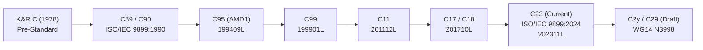

# ISO C Standards History & Evolution

The **C programming language** has evolved for more than five decades under strict backward-compatibility discipline while continuously adapting to modern hardware, memory models, safety analysis, and Unicode text processing. Since 1989, the language and its standard library have been formally governed by **ISO/IEC JTC1/SC22/WG14** under the international standard series **ISO/IEC 9899**.

!!! info "Current Published Standard"
    **C23 — ISO/IEC 9899:2024** (`__STDC_VERSION__ == 202311L`, published October 31, 2024) is the **current official ISO C standard**. Work on the next revision, informally named **C2y** (targeted around 2029), is actively underway in WG14 working draft **N3998** (October 2026).

---

## Chronological Evolution Timeline



---

## Master Standard Revision Matrix

| Standard | Official Designation | Publication | `__STDC_VERSION__` | GCC / Clang Flag | MSVC Flag | Landmark Additions |
| :--- | :--- | :--- | :--- | :--- | :--- | :--- |
| **K&R C** | *The C Programming Language* (1st ed.) | 1978 | *(not defined)* | *(legacy only)* | *(legacy only)* | `struct` assignment, `long int`, `unsigned int`, compound assignment `+=`, standard I/O library |
| **C89 / C90** <span class="c-badge c89">C89</span> | ANSI X3.159-1989 / ISO/IEC 9899:1990 | Dec 1989 / Dec 1990 | *(not defined; `__STDC__ == 1`)* | `-std=c89` / `-std=c90` | *(default legacy mode)* | Function prototypes, `void` & `void *`, `const`/`volatile`, `<stdlib.h>`, `<locale.h>`, 15 standard headers |
| **C95** <span class="c-badge c95">C95</span> | ISO/IEC 9899/AMD1:1995 | Apr 1995 | `199409L` | `-std=iso9899:199409` | — | `<iso646.h>`, `<wchar.h>`, `<wctype.h>`, digraphs, wide/multibyte I/O |
| **C99** <span class="c-badge c99">C99</span> | ISO/IEC 9899:1999 | Dec 1999 | `199901L` | `-std=c99` | *(partial via `/std:c11`)* | `//` comments, `<stdint.h>`, `<stdbool.h>`, `inline`, `restrict`, VLAs, designated initializers, compound literals, `long long`, `_Complex`, `<fenv.h>`, `<tgmath.h>` |
| **C11** <span class="c-badge c11">C11</span> | ISO/IEC 9899:2011 | Dec 2011 | `201112L` | `-std=c11` | `/std:c11` | Memory model, `<stdatomic.h>`, `<threads.h>`, `_Generic`, `_Static_assert`, `_Alignas`/`_Alignof`, `_Noreturn`, anonymous structs/unions, `<uchar.h>`, `aligned_alloc`, Annex K |
| **C17 / C18** <span class="c-badge c17">C17</span> | ISO/IEC 9899:2018 | Jun 2018 | `201710L` | `-std=c17` / `-std=c18` | `/std:c17` | Defect-report consolidation only (no new language features); deprecated `ATOMIC_VAR_INIT` |
| **C23** <span class="c-badge c23">C23</span> | ISO/IEC 9899:2024 | Oct 2024 | `202311L` | `-std=c23` *(GCC 15 default: `-std=gnu23`)* | `/std:clatest` *(partial)* | `nullptr`, `constexpr`, `typeof`, `auto`, `[[attributes]]`, `#embed`, `_BitInt(N)`, `_Decimal*`, `= {}`, `bool`/`true`/`false` keywords, `<stdbit.h>`, `<stdckdint.h>`, mandatory two's complement, K&R removal |
| **C2y / C29** <span class="c-badge c2y">C2y</span> | WG14 Working Draft (`N3998`) | Oct 2026 *(draft)* | *TBD* | `-std=c2y` *(experimental)* | — | `_Countof` (`<stdcountof.h>`), named loops, `<stdmchar.h>`, `defer` (`TS 25755`), pointer provenance (`TS 6010`), `if` declarations, `0o` octal literals |

!!! note "GNU Modes vs. Strict ISO Modes"
    In GCC and Clang, `-std=gnu17` or `-std=gnu23` enables GNU language extensions (such as statement expressions `({ ... })` and `asm`) alongside the ISO baseline, whereas `-std=c23 -pedantic-errors` enforces strict ISO/IEC 9899:2024 conformance and defines `__STRICT_ANSI__`. Beginning with **GCC 15**, `-std=gnu23` became the default C compilation mode.

---

## Era-by-Era Deep Dive

### Pre-Standard & K&R C (1972–1978)

Dennis Ritchie created C at Bell Labs between 1972 and 1973 while porting the UNIX operating system to the DEC PDP-11, evolving from Ken Thompson's typeless language **B** and Martin Richards' **BCPL**. In 1978, Brian Kernighan and Dennis Ritchie published *The C Programming Language* (1st edition), establishing the de facto specification known as **K&R C**.

Key characteristics of K&R C included:

- **No function prototypes**: Function declarations omitted parameter types (`int read();`), and definitions listed parameter types between the parameter list and the opening brace:

  ```c
  /* Historical K&R C — illegal in ISO C23 */
  int add(a, b)
      int a;
      int b;
  {
      return a + b;
  }
  ```

- **Implicit `int`**: Omitted return types and parameter types defaulted to `int`.
- **No `void` type**: Procedures returned implicit `int`, and untyped memory pointers used `char *`.
- **Platform-specific libraries**: Header layouts and standard library contracts varied dramatically across UNIX System V, BSD, and microcomputer compilers.

---

### ANSI C89 / ISO C90 <span class="c-badge c89">C89</span>

In 1983, ANSI formed the **X3J11** committee to codify an unambiguous, portable specification. The result was ratified in December 1989 as **ANSI X3.159-1989** (*C89*) and adopted with renumbered clauses by ISO in December 1990 as **ISO/IEC 9899:1990** (*C90*). Technical Corrigenda **TC1 (1994)** and **TC2 (1996)** clarified edge cases.

Landmark innovations of C89/C90:

- **Function prototypes** (`int printf(const char *fmt, ...);`) enabling compile-time argument count and type checking.
- **`void` and `void *`**: Explicit empty return/parameter lists (`int main(void)`) and a universal generic object pointer replacing `char *`.
- **Type qualifiers**: `const` and `volatile`, plus the `signed` keyword and `enum` standardizations.
- **Locale & library standardization**: Formalized the **15 foundational standard headers**: `<assert.h>`, `<ctype.h>`, `<errno.h>`, `<float.h>`, `<limits.h>`, `<locale.h>`, `<math.h>`, `<setjmp.h>`, `<signal.h>`, `<stdarg.h>`, `<stddef.h>`, `<stdio.h>`, `<stdlib.h>`, `<string.h>`, and `<time.h>`.
- **Preprocessor formalization**: Stringification (`#`), token pasting (`##`), trigraphs (later removed in C23), and `#pragma`.

---

### ISO C95 (Normative Amendment 1) <span class="c-badge c95">C95</span>

Published in April 1995 as **ISO/IEC 9899/AMD1:1995**, C95 introduced the `__STDC_VERSION__` macro (`199409L`) and focused on international text processing and restricted-character-set keyboards:

- **Three new headers**: `<iso646.h>` (operator spell-out macros like `and`, `or`, `not`), `<wchar.h>` (restartable multibyte and wide-character I/O/string functions such as `mbrtowc`, `wprintf`), and `<wctype.h>` (wide-character classification).
- **Digraphs**: Alternative two-character tokens (`<:`, `:>`, `<%`, `%>`, `%:`, `%:%:`) that — unlike trigraphs — remain valid in C23.

---

### ISO C99 <span class="c-badge c99">C99</span>

**ISO/IEC 9899:1999** (`__STDC_VERSION__ == 199901L`) modernized C for high-performance numeric computing, embedded firmware, and cleaner structured programming:

- **Language upgrades**:
  - Single-line `//` comments and mixed declarations and statements within blocks.
  - `for (int i = 0; i < n; ++i)` loop-scoped declarations.
  - `inline` functions and the `restrict` pointer aliasing qualifier.
  - **Designated initializers** (`struct point p = { .x = 1, .y = 2 };`) and **compound literals** (`(int[]){1, 2, 3}`).
  - **Variable-Length Arrays (VLAs)** and **flexible array members** (`char data[];` at the end of a `struct`).
  - `long long int` (at least 64 bits), `_Bool`, `_Complex`, and `_Imaginary`.
  - Hexadecimal floating-point literals (`0x1.fp+3`), variadic macros (`__VA_ARGS__`), and the `__func__` predefined identifier.
  - Removal of implicit `int` and implicit function declarations.
- **Six new headers**: `<stdbool.h>`, `<stdint.h>`, `<inttypes.h>`, `<complex.h>`, `<fenv.h>`, and `<tgmath.h>`.
- **Library highlights**: `snprintf`/`vsnprintf`, `strtoll`/`strtoull`, `va_copy`, and Annex F (IEC 60559 / IEEE 754 floating-point binding).

---

### ISO C11 <span class="c-badge c11">C11</span>

**ISO/IEC 9899:2011** (`__STDC_VERSION__ == 201112L`) brought C into the multicore era with a formal concurrency memory model and safer metaprogramming primitives:

- **Multithreading & Memory Model**: Formally defined data races, happens-before ordering, atomic operations (`<stdatomic.h>` <span class="c-badge c-optional">optional</span>), thread-local storage (`_Thread_local`), and portable threads/mutexes/condition variables (`<threads.h>` <span class="c-badge c-optional">optional</span>).
- **Type-generic dispatch & compile-time diagnostics**: `_Generic` selection expressions and `_Static_assert`.
- **Alignment & layout control**: `_Alignas`, `_Alignof`, `<stdalign.h>`, `aligned_alloc`, `max_align_t`, and anonymous `struct`/`union` members.
- **Unicode & security**: `<uchar.h>` (`char16_t`, `char32_t`), `u8`/`u`/`U` string literals, `fopen` exclusive mode `"wx"`, `quick_exit`/`at_quick_exit`, `_Noreturn` (`<stdnoreturn.h>`), and optional **Annex K** bounds-checking interfaces (`*_s`).
- **Removals**: Removed the notoriously unsafe `gets()` function.
- **Optionality**: Made VLAs (`__STDC_NO_VLA__`) and complex numbers (`__STDC_NO_COMPLEX__`) optional for constrained implementations.

---

### ISO C17 / C18 <span class="c-badge c17">C17</span>

Published in June 2018 as **ISO/IEC 9899:2018** (`__STDC_VERSION__ == 201710L`, informally called C17 because technical work finished in 2017), this release intentionally introduced **zero new language features**. It incorporated resolutions to dozens of C11 Defect Reports (DRs), clarified `<stdatomic.h>` memory ordering rules, deprecated `ATOMIC_VAR_INIT`, and fixed edge cases in `aligned_alloc` and `timespec_get`.

---

### ISO C23 — The Current Standard <span class="c-badge c23">C23</span>

Ratified and published in October 2024 as **ISO/IEC 9899:2024** (`__STDC_VERSION__ == 202311L`), **C23** is the most substantial modernization of C since C99. It eliminates 45 years of historical baggage while adding ergonomic type safety, compile-time constants, binary resource embedding, checked arithmetic, and IEEE 754-2019 support:

- **Ergonomics & Type Safety**: `nullptr` (`nullptr_t`), `constexpr` objects, `typeof` / `typeof_unqual`, `auto` type inference, `= {}` empty initialization, enhanced `enum : T` fixed underlying types, promoted core keywords (`bool`, `true`, `false`, `alignas`, `alignof`, `static_assert`, `thread_local`), and single-argument `static_assert(expr)`.
- **Attributes & Preprocessor**: Standardized `[[attribute]]` syntax with 7 standard attributes (`[[deprecated]]`, `[[fallthrough]]`, `[[maybe_unused]]`, `[[nodiscard]]`, `[[noreturn]]`, `[[reproducible]]`, `[[unsequenced]]`), `#embed` binary resource inclusion, `#elifdef`/`#elifndef`, `#warning`, `__VA_OPT__`, and `__has_include`/`__has_embed`/`__has_c_attribute`.
- **Numeric & Bitwise Power**: Mandatory **two's complement** signed integers, arbitrary-width `_BitInt(N)` integers, `0b` binary literals, `'` digit separators, decimal floating-point (`_Decimal32`/`_Decimal64`/`_Decimal128`), `<stdbit.h>` bit utilities, and `<stdckdint.h>` overflow-checked arithmetic.
- **Library & Security**: `memset_explicit`, `strdup`/`strndup`, `memccpy`, `gmtime_r`/`localtime_r`/`timegm`, `free_sized`/`free_aligned_sized`, `unreachable()`, `char8_t`/`mbrtoc8`/`c8rtomb`, `QChar`/`QVoid` const-preserving search functions, and `%b` binary `printf`/`scanf` formatting.
- **Breaking Cleanup**: Removed K&R function definitions, removed trigraphs, made `int f()` strictly equivalent to `int f(void)`, and made `realloc(ptr, 0)` undefined behavior.

!!! tip "Upgrading a Codebase to C23?"
    See the complete [C23 Migration & Breaking Changes Guide](c23-migration.md) for side-by-side C17 vs. C23 rewrites and compiler audit flags, and check [Compiler & Libc Support Matrix](compiler-support.md) before enabling specific features in production.

---

### C2y / C29 Working Draft (`N3998`) <span class="c-badge c2y">C2y</span>

Following the publication of C23, WG14 opened the **C2y** cycle (expected to become **C29** around 2029). As of the **WG14 Working Draft `N3998`** (published October 21, 2026 after the Ottawa meeting), several high-impact features have been voted into the draft or are progressing via companion Technical Specifications:

| Proposal / Feature | Draft / Paper | Summary & Status in C2y (`N3998`) |
| :--- | :--- | :--- |
| **`_Countof` & `<stdcountof.h>`** | `N3369` / `N3469` | Compile-time operator `_Countof(arr)` (and macro `countof(arr)`) returning the element count of an array while rejecting decayed pointers at compile time. **In C2y draft.** |
| **Named Loops** | `N3355` / `N3474` | Labels attached directly to loops or `switch` statements so `break outer;` and `continue outer;` exit or iterate outer constructs without `goto`. **In C2y draft.** |
| **`<stdmchar.h>`** | `N3443` / `N3998` | Modern, restartable and non-restartable text transcoding functions (`mbsrtoc8s`, `c8srtoc32s`, etc.) converting efficiently between UTF-8, UTF-16, UTF-32, and execution encodings without legacy locale fragility. **In C2y draft.** |
| **`defer` (`_Defer` / `<stddefer.h>`)** | **ISO/IEC TS 25755** | Lexical scope-exit cleanup mechanism (`defer { fclose(f); };`) executing in LIFO order upon normal exit, `return`, `break`, or `continue`. Active TS & C2y integration discussions with early GCC/Clang prototypes. |
| **Pointer Provenance** | **ISO/IEC TS 6010** (`N3226`) | Formal **PNVI-ae-udi** provenance-aware memory object model defining pointer-to-integer round-tripping and aliasing semantics. Active TS candidate for C2y integration. |
| **Declarations in `if`/`switch`** | `N3356` | C++-style selection declarations (`if (FILE *f = fopen(path, "r"); f != nullptr) { ... }`) tightening variable scope. **In C2y draft.** |
| **Octal `0o` Literals & `0b` Parity** | `N3353` | Explicit `0o755` / `0O755` octal prefix matching `0x` and `0b`, reducing bugs from accidental leading zeros. **In C2y draft.** |
| **Zero-length / Void-pointer Ergonomics & `nullptr` refinements** | `N3322` et al. | Permits `NULL` / `nullptr` with zero length (`n == 0`) in `<string.h>` functions such as `memcpy(dst, src, 0)` without undefined behavior! **In C2y draft.** |

```c
/* Preview of C2y features in WG14 N3998 (not yet valid in ISO C23) */
#if defined(__STDC_VERSION__) && __STDC_VERSION__ > 202311L
#include <stdcountof.h>

static int find_matrix_value(size_t rows, size_t cols,
                             const int grid[rows][cols], int target) {
    int sample[4] = {10, 20, 30, 40};
    size_t sample_len = countof(sample); // Compile-time 4; rejects raw int *
    (void)sample_len;

    outer: for (size_t r = 0; r < rows; ++r) {
        for (size_t c = 0; c < cols; ++c) {
            if (grid[r][c] == target) {
                break outer; // Exits both loops cleanly without goto
            }
        }
    }
    return 0;
}
#endif
```

---

## Programmatic Standard Version Inspection

Every conforming C implementation exposes predefined macros that let your build verify the active standard revision, hosted vs. freestanding mode, and optional feature availability.

```c
/* Compile with: gcc -std=c23 -Wall -Wextra -Wpedantic std_probe.c -o std_probe */
#include <stdio.h>

static const char *stdc_revision_name(void) {
#if !defined(__STDC__)
    return "Non-conforming / Pre-ANSI C";
#elif !defined(__STDC_VERSION__)
    return "ISO C89 / C90 (ISO/IEC 9899:1990)";
#elif __STDC_VERSION__ == 199409L
    return "ISO C95 (ISO/IEC 9899/AMD1:1995)";
#elif __STDC_VERSION__ == 199901L
    return "ISO C99 (ISO/IEC 9899:1999)";
#elif __STDC_VERSION__ == 201112L
    return "ISO C11 (ISO/IEC 9899:2011)";
#elif __STDC_VERSION__ == 201710L
    return "ISO C17 / C18 (ISO/IEC 9899:2018)";
#elif __STDC_VERSION__ == 202311L
    return "ISO C23 (ISO/IEC 9899:2024)";
#elif __STDC_VERSION__ > 202311L
    return "ISO C2y / Post-C23 Working Draft";
#else
    return "Unknown ISO C Revision";
#endif
}

int main(void) {
    printf("Revision         : %s\n", stdc_revision_name());
#ifdef __STDC_VERSION__
    printf("__STDC_VERSION__ : %ldL\n", __STDC_VERSION__);
#endif
#ifdef __STDC_HOSTED__
    printf("Environment      : %s\n",
           __STDC_HOSTED__ ? "Hosted (full stdlib)" : "Freestanding");
#endif
#ifdef __STDC_NO_ATOMICS__
    printf("Atomics          : Not supported\n");
#else
    printf("Atomics          : Supported\n");
#endif
#ifdef __STDC_NO_THREADS__
    printf("C11 <threads.h>  : Not supported\n");
#else
    printf("C11 <threads.h>  : Supported\n");
#endif
#ifdef __STDC_IEC_60559_BFP__
    printf("IEEE 754-2019 BFP: %ldL\n", __STDC_IEC_60559_BFP__);
#endif
    return 0;
}
```

---

## Standards Section Roadmap

Navigate the rest of the **C23 & Standards** documentation suite:

- **[C23 Migration & Breaking Changes](c23-migration.md)** — Actionable checklist of every removed, deprecated, and added language and library feature in ISO/IEC 9899:2024 with side-by-side C17 vs. C23 examples.
- **[Compiler & Libc Support Matrix](compiler-support.md)** — Paper-by-paper C23 support across GCC, Clang, Apple Clang, MSVC, EDG, glibc, musl, Apple libc, FreeBSD libc, and MSVC UCRT, plus portable `#if` feature-detection recipes.
- **[Technical Specifications & Reports (TS / TR)](technical-specifications.md)** — Complete registry of ISO/IEC WG14 Technical Reports and Specifications, including Embedded C (`TR 18037`), Dynamic Allocation (`TR 24731-2`), Secure Coding (`TS 17961`), Floating-Point (`TS 18661`), and Pointer Provenance (`TS 6010` / `PNVI-ae-udi`).
- **[Master Symbol Index & Ecosystem](symbol-index.md)** — Instant searchable directory of core C89–C23 keywords, types, macros, and library functions plus curated production C libraries.

---

## Related Internal & External References

- **Internal Guides**: [Keywords (C89–C23)](../reference/language/keywords.md) · [Preprocessor & `#embed`](../reference/language/preprocessor.md) · [Attributes (C23)](../reference/language/attributes.md) · [Standard Library Index](../reference/library/index.md) · [Modern C Curriculum (C99–C2y)](../curriculum/tier-5-expert/19-modern-c-c99-to-c23.md)
- **Authoritative External Sources**:
  - [cppreference.com — History of C](https://en.cppreference.com/w/c/language/history)
  - [ISO/IEC JTC1/SC22/WG14 — Official C Working Group Portal](https://www.open-std.org/jtc1/sc22/wg14/)
  - [ISO/IEC 9899:2024 — Programming languages — C (Official ISO Catalog)](https://www.iso.org/standard/82075.html)
