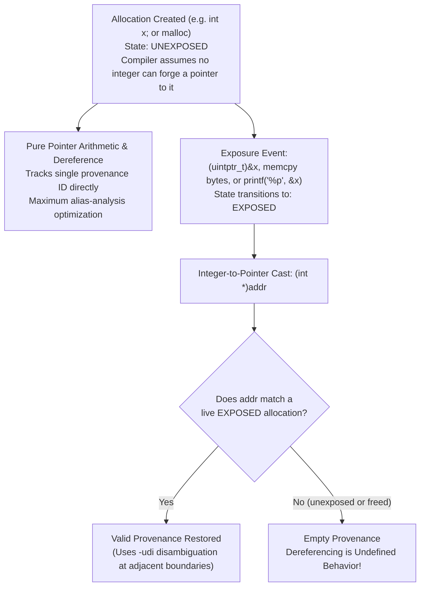

# ISO/IEC Technical Specifications & Reports (TS / TR)

Alongside the main **ISO/IEC 9899** C standard, **WG14** publishes standalone **Technical Reports (TR)** and **Technical Specifications (TS)** to incubate domain-specific extensions (embedded processors, floating-point math, secure coding analysis, pointer provenance, scoped cleanup) before deciding whether to fold them into the core language.

This reference mirrors [cppreference.com — Experimental C Features](https://en.cppreference.com/w/c/experimental) and explains the engineering significance of every major TR/TS — including a deep dive into **ISO/IEC TS 6010 (PNVI-ae-udi)** pointer provenance.

!!! info "TR vs. TS vs. IS in ISO Terminology"
    - **IS (International Standard)**: The normative C language standard (ISO/IEC 9899).
    - **TS (Technical Specification)**: Normative experimental extension document intended to gain real-world compiler and library implementation experience before IS integration.
    - **TR (Technical Report)**: Informative guidance or legacy pre-2012 extension format (ISO now uses TS for normative extensions and TR strictly for informative documents like vulnerability catalogs).

---

## 1. Master Registry of WG14 Technical Reports & Specifications

| ISO Designation | Title / Scope | Key WG14 Paper | Current Status |
| :--- | :--- | :--- | :--- |
| **ISO/IEC TR 19769:2004** | Extensions to support new character data types (`<uchar.h>`, `char16_t`, `char32_t`) | `N1040` | **Merged into C11** <span class="c-badge c11">C11</span> |
| **ISO/IEC TR 24731-1:2007** | Bounds-checking interfaces (`strcpy_s`, `printf_s`, `rsize_t`, `set_constraint_handler_s`) | `N1225` | **Merged into C11 (Annex K)** <span class="c-badge c11">C11</span> <span class="c-badge c-optional">optional</span> |
| **ISO/IEC TR 18037:2008** | Embedded C extensions (fixed-point `_Fract`/`_Accum`, named address spaces, `<iohw.h>`) | `N1169` / `N1275` | **Active standalone TR** (GCC/Clang partial support) |
| **ISO/IEC TR 24732:2009** | Decimal floating-point arithmetic (`_Decimal32`/`64`/`128`) | `N1312` | **Superseded by TS 18661-2 → Merged into C23** <span class="c-badge c23">C23</span> |
| **ISO/IEC 24747:2009** | Mathematical special functions (Bessel, Legendre, Laguerre, Riemann zeta, elliptic) | `N1372` | **Active standalone IS** (rarely implemented in C libc; C++17 adopted `<cmath>` equivalents) |
| **ISO/IEC TR 24731-2:2010** | Dynamic allocation functions (`getline`, `getdelim`, `asprintf`, `strdup`, `strndup`, `open_memstream`, `fmemopen`) | `N1388` | **Adopted by POSIX.1-2008**; `strdup`/`strndup` **Merged into C23** <span class="c-badge c23">C23</span> |
| **ISO/IEC TS 17961:2013** | C Secure Coding Rules (normative rule catalog for static analyzers) | `N1718` | **Active standalone TS** (forms baseline for CERT C & MISRA/static analyzers) |
| **ISO/IEC TS 18661-1:2014** | Floating-point extensions Part 1: Binary FP arithmetic (IEC 60559:2011) | `N1778` | **Merged into C23** <span class="c-badge c23">C23</span> |
| **ISO/IEC TS 18661-2:2015** | Floating-point extensions Part 2: Decimal FP arithmetic | `N1912` | **Merged into C23** <span class="c-badge c23">C23</span> <span class="c-badge c-optional">optional</span> |
| **ISO/IEC TS 18661-3:2015** | Floating-point extensions Part 3: Interchange & extended types (`_Float16`, `_Float32`, `_Float64`, `_Float128`) | `N1945` | **Merged into C23 (Annex H)** <span class="c-badge c23">C23</span> <span class="c-badge c-optional">optional</span> |
| **ISO/IEC TS 18661-4:2015** | Floating-point extensions Part 4: Supplementary math functions (`sinpi`, `cospi`, `exp10`, `rsqrt`, `compoundn`) | `N1950` | **Partially merged into C23** <span class="c-badge c23">C23</span> |
| **ISO/IEC TS 18661-5:2016** | Floating-point extensions Part 5: Supplementary attributes (evaluation format, rounding pragmas) | `N2004` | **Active / Partially superseded** |
| **ISO/IEC TR 24772-3:2020** | Guidance to avoiding vulnerabilities in programming languages — Part 3: C | `N2479` | **Active Informative TR** (updated for C23) |
| **ISO/IEC TS 6010** | A Provenance-Aware Memory Object Model for C (**PNVI-ae-udi**) | `N3226` *(CD TS 6010)* | **Active TS** (candidate for C2y integration) <span class="c-badge c2y">C2y</span> |
| **ISO/IEC TS 25755** | `defer` — Lexical scope-based undo / resource cleanup (`_Defer` / `<stddefer.h>`) | `N3434` / `N3589` | **Active TS** (C2y candidate) <span class="c-badge c2y">C2y</span> |
| **ISO/IEC TS 21938-1 / -2** | Parallel extensions for C (parallel algorithms & vector/task execution) | `N2017` | **Abandoned / Withdrawn** |
| **Transactional Memory (Draft)** | Software/Hardware Transactional Memory (`synchronized` / `atomic` blocks) | `N1804` / `N1967` | **Abandoned** (never reached TS publication) |

---

## 2. Detailed Breakdown of Key TRs & TSs

### 2.1 Embedded C — `ISO/IEC TR 18037:2008`

Designed for DSPs, microcontrollers, and Harvard-architecture embedded processors, **TR 18037** specifies three independent extensions:

1. **Fixed-Point Arithmetic (`<stdfix.h>`)**: Introduces native fractional (`_Fract`, range $[-1, 1)$) and accumulator (`_Accum`, integer + fractional bits) types with optional `_Sat` saturating overflow behavior (`_Sat short _Accum`), avoiding expensive floating-point emulation on FPU-less MCUs. Supported in GCC on ARM/AVR/MIPS targets.
2. **Named Address Spaces**: Allows declaring pointers into non-flat hardware memories (such as AVR Flash `__flash`, x86 segment registers `__seg_gs`, or GPU memory spaces) as type qualifiers, preventing accidental dereferencing across disjoint address spaces. Supported in both GCC and Clang.
3. **Basic I/O Hardware Addressing (`<iohw.h>`)**: Portable register access abstractions (`iord`, `iowr`, `ioor`, `ioand`) decoupling device drivers from memory-mapped vs. port-mapped I/O buses (rarely used directly in favor of vendor HALs and volatile MMIO helpers — see [Embedded MMIO & volatile](../curriculum/tier-4-hardware/15-embedded-mmio-volatile-asm.md)).

### 2.2 Dynamic Allocation Extensions — `ISO/IEC TR 24731-2:2010`

Published to eliminate fixed-size buffer overflows in string and stream parsing, **TR 24731-2** standardized dynamic-allocation helpers gated behind `#define __STDC_WANT_LIB_EXT2__ 1`:

| Function | Header | Purpose | Adoption Status |
| :--- | :--- | :--- | :--- |
| `strdup` / `strndup` | `<string.h>` | Heap-duplicate null-terminated / bounded strings | **POSIX.1-2008** & **Merged into C23** <span class="c-badge c23">C23</span> |
| `getline` / `getdelim` | `<stdio.h>` | Read arbitrarily long lines/records into a dynamically resized buffer | **POSIX.1-2008** (universal on Linux/macOS/BSD; absent on MSVC UCRT) |
| `asprintf` / `vasprintf` | `<stdio.h>` | Allocate exact-sized buffer via `malloc` and format into it | GNU/BSD extension (added to **POSIX.1-2024**; not in ISO C23) |
| `open_memstream` / `open_wmemstream` | `<stdio.h>` / `<wchar.h>` | Dynamically growing in-memory `FILE *` output stream | **POSIX.1-2008** |
| `fmemopen` | `<stdio.h>` | Wrap a caller-owned memory buffer as a `FILE *` stream | **POSIX.1-2008** |

### 2.3 Floating-Point Extensions — `ISO/IEC TS 18661` (Parts 1–5)

`TS 18661` systematically aligned C with **IEEE 754-2008 / 754-2019 (ISO/IEC 60559)** across five parts:

- **Part 1 (Binary FP)** → Fully integrated into **C23**: canonicalization (`canonicalize`), NaN payload inspection (`getpayload`, `setpayload`), total-order comparisons (`totalorder`, `totalordermag`), `fmaximum`/`fminimum`, `fromfp`/`ufromfp`, and `strfromd`/`strfromf`/`strfroml`.
- **Part 2 (Decimal FP)** → Integrated into **C23** as optional `_Decimal32`, `_Decimal64`, `_Decimal128` (`__STDC_IEC_60559_DFP__`).
- **Part 3 (Interchange & Extended Types)** → Integrated into **C23 Annex H** (`_Float16`, `_Float32`, `_Float64`, `_Float128`, `_Float32x`, `_Float64x`).
- **Part 4 (Supplementary Functions)** → Partially integrated into **C23**: half-revolution trig (`sinpi`, `cospi`, `tanpi`, `asinpi`, `acospi`, `atanpi`, `atan2pi`), `exp2m1`, `exp10`, `exp10m1`, `log2p1`, `log10p1`, `logp1`, `rsqrt`, `compoundn`, `pown`, `powr`, `rootn`.
- **Part 5 (Supplementary Attributes)** → Evaluation-format pragmas and rounding-mode attributes remain outside core C23.

### 2.4 Bounds-Checking Interfaces (`TR 24731-1` → C11 Annex K)

Merged into C11 as optional **Annex K** (`__STDC_LIB_EXT1__`, `#define __STDC_WANT_LIB_EXT1__ 1`), functions like `strcpy_s`, `memcpy_s`, `sprintf_s`, and `memset_s` were intended to curb buffer overflows. In practice:

- **glibc** and **musl** deliberately **never implemented Annex K** (citing global `set_constraint_handler_s` state issues, inconsistent error handling, and WG14 paper `N1967` *Field Experience With Annex K*).
- **MSVC UCRT** implements a non-conforming Microsoft variant (e.g., argument order differences in `gmtime_s` and missing `rsize_t` constraint handlers).
- **Apple libc** ships only selected functions like `memset_s`.
- **Recommendation**: Prefer C23 standard functions (`snprintf`, `memset_explicit`, `gmtime_r`, `<stdckdint.h>`) over Annex K for portable software.

### 2.5 Secure Coding & Vulnerability Guidance (`TS 17961` & `TR 24772-3`)

- **ISO/IEC TS 17961:2013 (*C Secure Coding Rules*)**: Defines **46 normative rules** that static analysis tools (Clang Static Analyzer, GCC `-fanalyzer`, Coverity, Polyspace) must diagnose — covering tainted input to format strings, use-after-free, out-of-bounds pointer arithmetic, race conditions, and sensitive data exposure.
- **ISO/IEC TR 24772-3:2020 (*Vulnerabilities in C*)**: Catalogs language-specific vulnerability classes (type-punning UB, integer conversion truncation, dangling pointers, signal-handler non-async-safety) alongside concrete mitigation checklists used in aerospace, automotive (ISO 26262), and medical compliance.

### 2.6 Mathematical Special Functions — `ISO/IEC 24747:2009`

Specifies 23 mathematical physics functions in `<math.h>` (activated via `__STDC_WANT_MATH_SPEC_FUNCS__`), including cylindrical/spherical Bessel functions (`cyl_bessel_j`, `sph_bessel`), Laguerre/Hermite/Legendre polynomials, Riemann zeta (`riemann_zeta`), beta (`beta`), and elliptic integrals. Although ratified as a full International Standard, C runtime adoption stayed minimal — use **GSL (GNU Scientific Library)** or **Boost.Math / Cephes** in C projects.

### 2.7 Abandoned Initiatives: Parallel Extensions (`TS 21938`) & Transactional Memory

- **TS 21938-1 / -2** sought to port C++17 parallel execution policies (`par`, `par_unseq`) and task blocks into C, but stalled due to the absence of closures/lambdas and weak vendor demand; OpenMP (`#pragma omp parallel for`) and C11 `<threads.h>`/`<stdatomic.h>` remain the practical standards.
- **Transactional Memory for C** explored lock-free `synchronized` blocks but was abandoned after hardware TM (Intel TSX) suffered microarchitectural side-channel deprecations and software TM imposed excessive overhead.

---

## 3. Deep Dive: Pointer Provenance — `ISO/IEC TS 6010` (`N3226`)

Modern C optimizing compilers (GCC, LLVM/Clang) routinely assume that pointers derived from **two distinct allocations cannot alias**, even if by coincidence their numeric byte addresses happen to match (for instance, a one-past-the-end pointer of array `a` sitting at the exact same address as the first byte of adjacent array `b`).

Historically, the ISO C standard never defined **pointer provenance** — the invisible metadata binding a pointer value to the specific storage allocation (*storage instance*) it originated from. This caused decades of friction between low-level systems code (allocators, tagged pointers, XOR linked lists, serialization) and aggressive alias-analysis optimizations.

**ISO/IEC CD TS 6010 (`N3226`)** formalizes the **PNVI-ae-udi** memory object model to resolve this ambiguity rigorously.

### 3.1 What Does **PNVI-ae-udi** Mean?

- **PNVI (*Provenance-Not-Via-Integer*)**: Pointer values in the C abstract machine are pairs `(provenance, address)`, whereas integer values (`uintptr_t`) carry **no provenance** (pure numbers). Compilers do not have to track hidden provenance bits across arbitrary integer arithmetic.
- **`-ae` (*Address-Exposed*)**: Every allocation starts **unexposed**. Casting a pointer to an integer, inspecting its representation bytes via `unsigned char *`, or formatting it with `%p` marks that allocation as **exposed**. An integer-to-pointer cast `(T *)addr` can *only* synthesize valid provenance for an allocation that was previously **exposed** and is still live!
- **`-udi` (*User-Disambiguation*)**: When an integer equals the boundary between two adjacent exposed allocations `A` (one-past-the-end of `A`) and `B` (start of `B`), the synthesized pointer initially holds ambiguous provenance `{A, B}` and becomes unambiguously bound to whichever allocation the program first dereferences or performs valid pointer arithmetic within.



### 3.2 Why Provenance Matters in Real Optimizing Compilers

Consider two stack variables `x` and `y` that happen to sit adjacently in memory (`&x + 1 == &y`):

```c
/* Demonstrates why pointer provenance defeats naive address-equality reasoning */
#include <stdint.h>
#include <stdio.h>
#include <string.h>

int main(void) {
    int x = 1;
    int y = 2;

    int *p = &x + 1; // One-past-the-end of x (provenance: x ONLY!)
    int *q = &y;     // Start of y (provenance: y ONLY!)

    /* Even if (uintptr_t)p == (uintptr_t)q at runtime:
     * Under TS 6010 (and real GCC/Clang optimizers):
     *   - Dereferencing *p is ALWAYS Undefined Behavior because p has
     *     provenance of x, NOT y — even if p == q compares true!
     *   - Comparing p == q is permitted (evaluates to 1 if adjacent),
     *     so an optimizer can STILL assume *p cannot alias y!
     */
    printf("Addresses equal? %s\n",
           (uintptr_t)p == (uintptr_t)q ? "yes (adjacent)" : "no");
    printf("Safe read via q (provenance y): %d\n", *q);

    /* SAFE tagged-pointer round-trip under PNVI-ae-udi:
     * 1. Casting &y to uintptr_t EXPOSES storage instance y.
     * 2. Setting/clearing low alignment tag bits works on plain integers.
     * 3. Casting the untagged address back restores valid provenance for y!
     */
    uintptr_t raw = (uintptr_t)&y;
    uintptr_t tagged = raw | 1u;               // Store 1-bit metadata tag
    int *restored = (int *)(tagged & ~(uintptr_t)1u);
    *restored = 99;
    printf("Updated y through round-tripped exposed pointer: %d\n", y);
    return 0;
}
```

### 3.3 Practical Rules for Writing Provenance-Clean C

1. **Never derive a pointer to object `B` via pointer arithmetic starting from object `A`**, even if you know `A` and `B` are adjacent (e.g., two separate `malloc` calls or separate stack variables).
2. **Avoid relational comparisons (`<`, `<=`, `>`, `>=`) between pointers to unrelated objects**: Relational pointer comparison is only defined within the same array/object (including one-past-the-end). If you need a total order across unrelated pointers (for example in a red-black tree or lock ordering), cast both pointers to `uintptr_t` first.
3. **Preserve provenance during byte copies**: Copy pointers with `memcpy(&dst_ptr, &src_ptr, sizeof src_ptr)` rather than hand-written byte loops where possible; under TS 6010, `memcpy` preserves abstract pointer provenance cleanly.
4. **Pointer tagging is safe when done through `uintptr_t`**: Converting `p` to `uintptr_t` exposes the allocation; clearing tag bits and converting back to `T *` restores provenance legally under `PNVI-ae-udi` (provided the target allocation is still alive).

---

## Related References

- [ISO C Standards History & Evolution](index.md)
- [C23 Migration & Breaking Changes Guide](c23-migration.md)
- [Compiler & Libc Support Matrix](compiler-support.md)
- [Basic Concepts & Memory Model](../reference/language/basic-concepts.md) · [Dynamic Memory Management](../reference/library/memory.md)
- [cppreference.com — Experimental C Features](https://en.cppreference.com/w/c/experimental)
- [WG14 N3226 — ISO/IEC CD TS 6010: A Provenance-Aware Memory Object Model for C](https://www.open-std.org/jtc1/sc22/wg14/www/docs/n3226.pdf)
